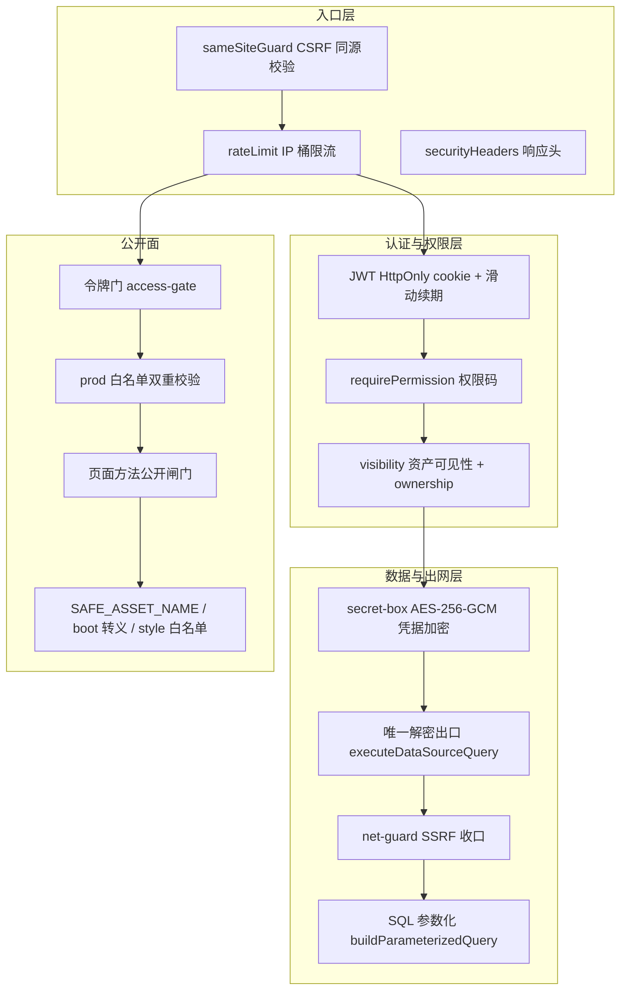

# 08 - 安全与权限设计

> 项目：运营搭建平台（vue3-course） ｜ 版本：v1.1 ｜ 生成日期：2026-10-06 ｜ 依据：源码分析

03 篇第 4 节用一张表概括了"认证 → 权限码 → 资产级访问控制"三层模型；05 篇流程四走读了令牌访问；本篇把安全作为完整体系展开：密钥体系、每一层的实现细节与失效模式、发布产物与 SQL 数据源两大专项的安全边界、以及一份诚实的已知隐患清单。安全机制与架构的相互塑造（frame 策略、CSP 取舍）见 01 篇 3.5 节，本篇不重复论证，只给结论与落点。

## 1. 威胁模型与总体防线

平台面向公网，四类主体对应四种威胁视角：匿名访客（不该看的看板/数据）、低权限登录用户（viewer 能否拖走别人数据源里的口令）、作者（能否借数据源配置把服务器变成内网跳板）、持有数据库文件的人（库被拖走后明文口令是否裸奔）。防线按数据流布置如下：

设计上有两条贯穿原则。其一，**fail-closed 优先，且在启动期暴露**：JWT_SECRET 生产缺失拒绝启动（`packages/work-server/src/index.ts` 38-47 行）、库中有密文而 SECRET_BOX_KEY 缺失异步预检后秒级退出（同文件 101-118 行）、INTERNAL_TOKEN 未配置即取数通道整体禁用（`packages/work-server/src/config.ts` 11 行注释"fail-closed"）、令牌模式下拿不到有效令牌一律拒绝（`packages/portal-server/src/util/access-gate.ts` 25 行"不 fail-open"）。唯一的例外是限流计数存储故障时 fail-open（`packages/server-kit/src/http-security.ts` 167 行——限流是保护措施，不能反过来变成全站不可用），但带 60 秒节流告警。其二，**敏感信息按"最小下发"处理**：detail 响应剥离 accessToken、prod 产物删除 accessMode/accessToken、数据源 config 下发前统一掩码、出码包不带连接配置、内部错误文案不回传原始异常。

## 2. 密钥体系：四把钥匙各管一扇门

| 密钥 | 算法/用途 | 读取点 | 缺失后果 |
| --- | --- | --- | --- |
| `JWT_SECRET` | HS256 签名登录 cookie | `packages/work-server/src/config.ts` 6 行 | 生产拒绝启动；开发仅 warn——空密钥时 jwt.sign 仍能签出 token，但任何人可伪造签名 |
| `SECRET_BOX_KEY` | AES-256-GCM 主密钥（64 hex 或 base64，解码须 32 字节） | `packages/work-server/src/util/secret-box.ts` 30-46 行 `masterKey()`（调用时读，不固化——支持测试注入） | 库中已有 `enc:v1:` 行而密钥缺失 → 启动即退；**丢失 = 全部凭据不可恢复**（GCM 无后门） |
| `INTERNAL_TOKEN` | portal→work-server 服务间共享密钥 | `packages/work-server/src/config.ts` 11 行 + portal 侧 `config.ts` | 通道禁用：portal 查询一律 403「数据查询通道未配置」 |
| `PASSWORD_SALT` | 旧 HMAC 口令哈希（🔴 已废弃，迁移期保留） | `packages/work-server/src/service/user.ts` | 迁移期缺失则老账号无法登录；全部账号登录一次后可删（`SELECT COUNT(*) FROM user_info WHERE password NOT LIKE '$2%'` 归零） |

`SECRET_BOX_KEY` 的密文格式是 `enc:v1:` + base64(12B IV ‖ 16B authTag ‖ 密文)。三个设计点都有注释背书：版本前缀既是识别标志也是**幂等加密**的判据（已加密值原样返回——掩码回填、迁移脚本重跑、人工重存都会重复经过加密函数，不幂等就会写坏数据）；GCM authTag 让"密钥错"与"密文被改"在解密时直接抛错，不会连错库；`decryptSecret` 对明文值原样透传（"先发代码、后迁移"灰度上线的前提）。轮换必须"旧钥解明文 → 换钥 → 新钥重加密"（`scripts/migrate-secrets.ts` + `npm run db:decrypt-secrets`/`db:encrypt-secrets`），脚本自带两道硬门禁（密钥合法、password 列宽 ≥1024），条件不满足 exit 1 不做任何写入。托管要求：.env 全文存密码管理器一份，服务器只留运行副本（`docs/plans/deploy-ops-2026-09.md` 第三节）。

## 3. 认证层：JWT cookie 与滑动续期

登录态是一枚 HS256 JWT，写在 `online-status` cookie 里（HttpOnly + SameSite=Lax + secure 跟随请求协议），TTL 1 小时（`packages/work-server/src/config.ts` 5 行）。四个实现细节：

1. **统一解析入口** `parseOnlineUserData`（`packages/work-server/src/controller/user.ts` 21 行）：无 token / 校验失败 / 缺 exp / 过期一律返回 `{username: null, uuid: null}`，调用方按匿名处理。exp 的毫秒二次判定保留了既有语义（jwt.verify 本身已验 exp，双保险）。
2. **滑动续期** `slidingSessionRenewal`（同文件 74 行，挂在中间件链很前）：剩余寿命不足一半（`shouldRenewSession`，用 exp 而非 iat——jsonwebtoken 对 noTimestamp 会剥掉 iat）就重签全时长 token。活跃用户不被 1 小时强踢；payload 原样沿用不查库，权限变化由下一次完整登录或 online 接口反映。
3. **改密防代改**：`POST /api/post/account/password` 的身份取登录态而非 body（164 行注释），杜绝提交他人 uuid 改密。
4. **登出清 cookie**：属性与签发时完全一致（name+domain+path+secure 匹配），缺属性会清不掉。

口令哈希已是 bcrypt（逐用户盐，60 字符）；存量旧全局盐 HMAC（64 hex）在**每次登录成功时透明重哈希**，用户无感。这是 `PASSWORD_SALT` 退场的机制。

## 4. 权限码层：RBAC 与 requirePermission

经典四表星型（user → user_role → role_permission → permission），`requirePermission(code)`（`packages/work-server/src/middleware/rbac.ts`）一次中间件完成三件事：未登录 401；无码 403（message 回显权限码，方便定位是哪条码缺失）；放行前把 `parseOnlineUserData` 的结果写进 `ctx.state.user`，controller 统一从那里取 actor。权限码按"资源:动作"命名，种子矩阵在 `packages/init-database/src/sql/insert_role_permission_admin|editor|viewer.sql`：admin 全量，editor 19 项（无账号管理与物料删除类），viewer 只读。注意两个端点**不走 RBAC**：AI 流式与出码只要求登录（filterLoginStatus），靠用户配额兜底（见第 8 节）；`/api/post/dashboard/portal-data` 走 `x-internal-token` 校验（controller/dashboard-stage.ts 内实现），是内网专用通道。RBAC 判定每次请求实时查库（`checkUserPermission` → 四表联查），无缓存——权限变更即时生效，代价是每请求一次查询（见 10 篇优化建议）。

## 5. 资产级访问控制：visibility + ownership

四类资产（看板/页面/数据源/连接）共用 `packages/work-server/src/util/visibility.ts` 一套语义：

- **读判定 `isVisibleTo`**：本人所有 / 同租户 public / 同租户同 department / **无主行对所有人可读**。最后一条是迁移前提——老行补 owner 列时只能是 NULL，按"无主不可见"处理会让历史数据一夜变死数据（61 行注释）。可见范围是**租户内语义**：public 不再是"全平台全员"，未显式归属租户的用户与资源一律按默认租户 `t-default` 匹配（单租户部署下与旧"全员可见"行为完全等价）。
- **SQL 化 `visibilityWhere`**：列表查询的同款条件，占位符与 values 严格对应；`scope='mine'` 退化为 `owner_uuid = ?`（管理台"我的 | 全部"切换）。租户条件写成 `(tenant_id IS NULL OR tenant_id = ?)` 让 NULL 行按默认租户参与匹配。
- **写判定 `check*Ownership`**（各 service）：先过读判定，再要求仅 owner；**无主行首写即认领**（claim 后行归写入者）。两层拒绝文案有讲究：私有资源非所有者先被读校验拦下（"暂无权限访问该看板"，不泄露存在性），公开资源才走到归属层（"只有所有者可以…"）。
- **入参收窄**：`normalizeVisibility` 非法值落 private；显式 setter（`/api/post/dashboard/visibility`）直接拒绝非法值，且 department 的 department_id 按当前用户落库，不收前端伪造（`packages/work-server/src/service/dashboard.ts` 393-398 行注释）。
- **数据源与连接的一条刻意例外**（README 归属节）：把**数据源**设为公开即允许他人经它取数，而该源引用的**连接**仍按创建者私有——共享的是数据，不是凭据。

## 6. 发布产物的访问控制：白名单、令牌门与公开闸门

访客侧的权限模型与登录侧完全不同：匿名访客的数据能力**只与发布白名单有关**，与数据源可见性无关。完整链条（03 篇流程二有端到端时序，这里从安全视角重组）：

1. **白名单冻结**：test 发布时 `buildPublishedDataSources` 从组件 `dataBinding` 收集数据源 id，只取 `{id, name, type}` 落进 prod schema 的 `publishedDataSources`——config（含口令）永远不进发布产物（`packages/work-server/src/service/dashboard-stage.ts` 42-52 行）。
2. **双重白名单校验**：portal 侧转发前用本地 prod 行校验一次（`getDataSourceWhitelist`），work-server 终点（`portalDashboardData`）**不信 portal 的判断**再校验一次（controller 注释原话），然后 `queryPublishedDataSource` 以 `queryParams` 固定空对象执行——访客不能注入查询参数。
3. **令牌门**：判定读 `dashboard_info` 实时行（`resolveDashboardAccess`，改访问方式/轮换令牌即时生效，不需要重新发布）；query `?t=` 与 cookie 双通道、`timingSafeEqual` 常量时间比对；验证通过下发 7 天 HttpOnly cookie；HTML 门与取数门共用同一道门（`packages/portal-server/src/controller/dashboard.ts` 143-156 行注释："否则 token 模式只挡住 HTML，数据接口仍匿名可读"）。看板主表软删时 `mode='token' 且 token=null`，任何访问都拒绝（fail-closed）。
4. **页面方法公开闸门**：页面方法是"存稿即执行"的作者 JS，经 `AsyncFunction` 在访客浏览器**无沙箱**执行。`packages/work-server/src/util/page-methods-guard.ts` 收窄暴露面：**两条入口都守**——① 发布到 prod（校验对象取 pre 快照而非草稿，148-151 行注释解释了"先推 test/pre 再删草稿方法"的绕过路径）；② 切 public（`assertPublicExposable`）。只守 ① 会被绕过：portal 的访问模式判定读实时行，"先用 token 发布、再切 public"能让线上内容即刻公开而不经过任何发布动作。逃生阀 `ALLOW_PAGE_METHODS_ON_PUBLIC=1` 关闭两条拦截（明确接受风险才开）。另一个易踩细节：`dashboard_info.access_mode` 库默认值是 `public`（新建即公开），所以 ② 对"新建即有方法"的看板不触发，真正拦住它们的是 ①。

## 7. SQL 数据源的安全边界

「只暴露 uuid + dataSourceId，主机口令 SQL 留服务端」这句话（03 篇 6.2 节）背后是一条完整的纵深链：

- **连接与口令不进前端**：SQL 数据源以 `connectionId` 引用 `db_connection_info`（README 特别强调"存的是 connectionId，不是 host/port"）；口令 AES-GCM 密文落库，detail 接口下发前 `maskConfigSecrets` 换成 `******`，写接口遇掩码位用库里原值回填（`restoreMaskedSecrets`——区分"没改"与"改成 ******"）。掩码只防前端、加密才防拖库，两层缺一不可（`packages/work-server/src/util/config-secrets.ts` 头注释）。
- **SQL 参数化**：`{{name}}` 占位符经 `buildParameterizedQuery`（`packages/work-server/src/util/data-query/shared.ts` 32 行）转成驱动占位符 + 绑定值，值一律走绑定不做文本拼接；`'{{x}}'` 连引号一起替换兼容历史写法；数组展开多占位符支持 `IN`；缺参报错不留残留占位符；**不再支持参数拼接表名/列名**。PG 侧同一函数传 `$n` 生成器复用。
- **唯一解密出口**：`executeDataSourceQuery` 是全仓唯一调用 `openConfigSecrets` 的运行时取数路径，明文不出该函数（`packages/work-server/src/service/data-query.ts` 37-40 行注释）。结合第 5 节的可见性：viewer 能看到公开数据源并取数，但拿不到任何配置。
- **连接池缓存**：`packages/work-server/src/util/data-query/mysql-pool.ts` 按 `host:port:user:database` 缓存连接池（`connectionLimit: 10` + keepAlive），避免每查询建连；PG 同构（`postgresql-pool.ts`）。密文在 `resolveMySQLConfig` 里解一次才建池——池缓存键不含口令，轮换口令后需重启进程或调 `closeMySQLPool` 才会生效（⚠️ 运维须知，见 12 篇）。
- **API 类数据源的 SSRF 收口**是同一专项的另一半：`assertStaticAuthority` 在 `{{参数}}` 替换**之前**校验 authority 段无参数化（替换后就分不清 host 来自配置还是访客）；`assertSafeHttpUrl` 恒拒非 http(s)、URL 内嵌凭据、云元数据地址（**含 IPv6 包裹写法**——WHATWG URL 会把 `[::ffff:127.0.0.1]` 规范化成 `[::ffff:7f00:1]`，按点分十进制写的正则永远匹配不到，所以必须按十六进制 `parseInt(x,16)` 还原，`net-guard.ts` 34-40 行）；默认拒内网/回环/链路本地/ULA 及 `.local` `.internal` 后缀（2026-09 反转过默认值，理由见文件头注释）；请求 `redirect: 'manual'`，3xx 拒且不重试（跟随跳转会让外部主机 302 到元数据地址绕过全部字符串校验，`api.ts` 102-105 行）。超时钳制 30 秒上限、重试钳制 3 次上限，防单数据源拖死服务端。

## 8. CSRF、限流与配额

- **CSRF**：第一道防线是 SameSite=Lax cookie（跨站 POST 不带登录态）；第二道 `sameSiteGuard()`（`packages/server-kit/src/http-security.ts` 110 行）只作用于非幂等方法：判定优先级 Sec-Fetch-Site → Origin/Referer；两者都缺失时带 cookie 的请求按跨站处理（浏览器发带凭据的 POST 至少留一项证据；无 cookie 的服务间调用与命令行不受影响）。判定只比主机名不比协议端口（与浏览器 cookie 口径一致），loopback 互认（localhost/127.0.0.1/::1/0.0.0.0），跨域部署用 `CSRF_ALLOWED_ORIGINS` 显式放行。
- **两级限流**：IP 桶（sign-in 20/10min、sign-up 10/1h、token-verify 20/10min 看板页面共用一个桶、portal-query 300/min、front-log 120/min）与用户桶（AI/codegen 突发 + 自然日双档，按 user.uuid 计——NAT 下一栋楼一个 IP，且这两个端点只要求登录，按 IP 计数形同虚设）。计数后端 `RATE_LIMIT_STORE=mysql` 时落 `rate_limit_bucket` 表（两进程共享、重启不清零）；存储故障 fail-open + 节流告警。429 响应带 `Retry-After`。挂载顺序硬约束：配额守卫必须在 filterLoginStatus 之后（未登录先 401，不消耗额度也不污染用户桶，`packages/work-server/src/middleware/quota.ts` 头注释）。
- **响应头**（`packages/server-kit/src/security-headers.ts`）：nosniff、Referrer-Policy: no-referrer、frame 策略二选一（work-server SAMEORIGIN / portal frame-ancestors *）、HSTS 仅 TRUST_PROXY=1 时下发。刻意不下发 script-src CSP：页面方法要 new Function，任何 script-src 都会因缺 unsafe-eval 打死产品能力——收紧须等页面方法运行时隔离到独立 origin。

## 9. 输出编码与注入防线汇总

| 防线 | 位置 | 防什么 |
| --- | --- | --- |
| `SAFE_ASSET_NAME = /^[a-z0-9][a-z0-9-]{0,31}$/` | `packages/portal-server/src/util/file.ts` 23 行 | pageName/demoName 拼进 href/src 属性的反射型 XSS（注释保留了攻击 payload） |
| boot JSON `<` → `\u003c` 全量转义 | `packages/portal-server/src/controller/dashboard.ts` 84-87 行 | schema 内容闭合 `<script>` 标签 |
| style 18 键白名单 `sanitizeComponentStyle` | `packages/shared/src/schema/index.ts` 293 行（三端统一调用） | 导入/AI 链路注入任意 CSS |
| visibleWhen 纯 JSON 不求值 | schema 类型注释 | 表达式注入 |
| SVG 缩略图服务端生成 | `packages/work-server/src/util/thumbnail.ts` | 缩略图链路注入 |
| 出码包字段白名单 `toSafeDataSources` | `packages/dashboard-codegen/index.ts` 104 行 | 连接配置随导出包外发（"任何顺手带上配置的做法等同于凭据外发"） |
| `normalizeResourceName` | `packages/work-server/src/util/sanitize.ts` | 名称 trim + 剔除控制字符 + 128 长度上限 |
| 建库语句反引号包裹 | `packages/init-database/src/index.ts` | 标识符注入 |

## 10. 已知隐患清单（诚实版）

1. **页面方法无沙箱执行**（`packages/shared/src/runtime.ts`）：当前靠公开闸门收窄暴露面而非根治；token 模式看板的访客仍在无沙箱环境执行作者 JS。根治路径是独立 origin 沙箱（评审报告 S1 的"批次三"），落地前 `ALLOW_PAGE_METHODS_ON_PUBLIC` 不应打开。
2. **net-guard 字符串校验的先天残留**（`packages/work-server/src/util/net-guard.ts` 15 行 ⚠️ 原文标注）：DNS rebinding（校验时域名解析与 fetch 时解析可被指向不同 IP）、NAT64 前缀（`64:ff9b::/96`）、IPv4-translated（`::ffff:0:a.b.c.d`）拦不住；根治需"解析后校验 IP / 连接固定 IP"。
3. **SECRET_BOX_KEY 托管完全依赖运维纪律**：无 KMS 集成、无密钥加密密钥、.env 明文落盘。密钥与数据库同机备份 = 加密形同虚设，务必分离存放（deploy-ops 第三节）。
4. **限流 fail-open**：MySQL 计数表故障时限流整体放行（60 秒节流告警）。配合 `REQUIRE_DB` 心态：对外部署建议网关层（nginx limit_req）兜底。
5. **`dashboard_info.access_mode` 默认 public**：新建看板即公开是库默认值行为，UI 未显式提示。敏感内容务必发布前手动切 token（或改库默认值，但那是行为变更）。
6. **AI 端点是零门槛滥用面**（router.ts 180 行注释原文）：登录即可用、无权限码，上游按 token 真实计费；当前仅靠用户配额兜底。
7. **portal 令牌 cookie 路径为站点根**（`access-gate.ts` 17 行 `ACCESS_COOKIE_PATH = '/'`）：HTML 门与取数门共用同一枚 cookie 所致，键名已按 uuid 区分、值 HttpOnly，但所有看板的令牌 cookie 都在根路径下随请求发送——规模大后可考虑 path 级隔离与取数门单独签发短时票据。
8. **服务端日志含原始错误**：`internalFailure` 在服务端日志里保留完整异常（含主机/账号），日志查询接口 `/api/get/log/list` 只回用户可读文案；但服务端 stdout/日志文件的访问权限需要运维侧管控（`log_info` 表只存前端上报与页面轨迹，不含服务端堆栈）。
