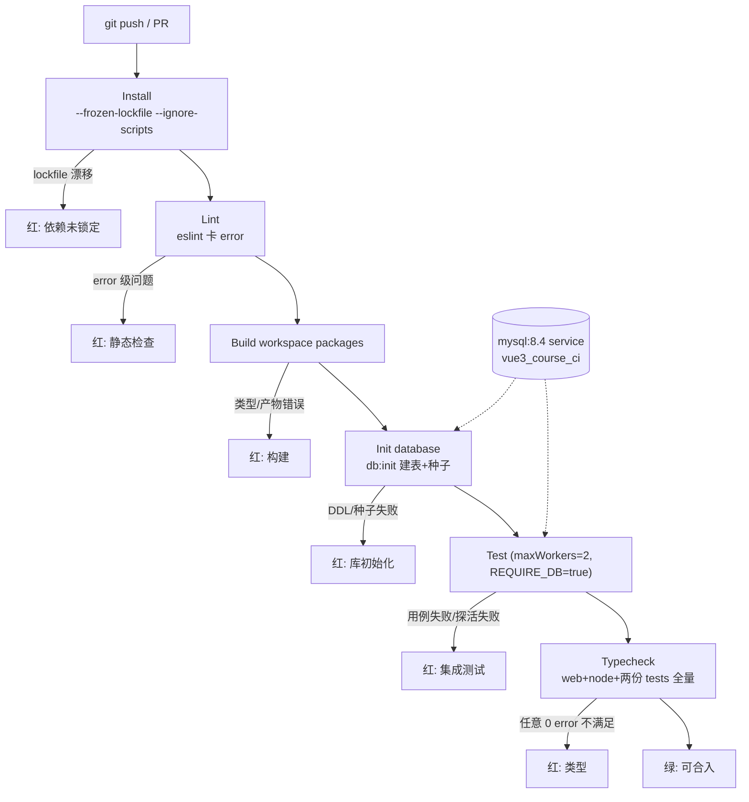

# 09 - 测试与质量保障

> 项目：运营搭建平台（vue3-course） ｜ 版本：v1.1 ｜ 生成日期：2026-10-06 ｜ 依据：源码分析

06 篇 6 节给过测试体系的速览（分线、门控、CI 五道门禁）；本篇展开为完整的质量保障手册：测试现状全景与代表性用例的深读、每道门禁"卡什么、为什么这样卡"、以及当前缺口与补测建议。读代码前先读用例是这个仓库的明确约定——README 安全基线末尾点名了"改代码前必读"的守护用例清单，本篇第 3 节逐个展开。

## 1. 测试现状全景

72 个测试文件、11206 行测试代码，分布在 7 个包的 `__tests__/` 目录。按性质分三类：

| 类别 | 判定方式 | 规模 | 举例 |
| --- | --- | --- | --- |
| 纯函数/单元用例 | 无外部依赖，node 或 jsdom 均可 | 约 35 个文件 | `net-guard.test.ts`（SSRF 判定矩阵）、`secret-box.test.ts`（加解密幂等）、`visibility.test.ts`、`page-methods-guard.test.ts` 纯函数部分、`useDashboardEditor.test.ts`（840 行，jsdom） |
| 真库集成用例 | `dbDescribe` 门控（DB_AVAILABLE） | 约 20 个文件 | `dashboard-stage.test.ts`（发布全链路）、`rbac.test.ts`、`datasource.test.ts`（486 行）、`db-connection.test.ts`（554 行） |
| 起 HTTP 服务的端到端用例 | `dbDescribe` + 子进程真服务 | 2 个文件 | `packages/work-server/__tests__/http.test.ts`（起真 work-server 验响应头/404/静态）、`packages/portal-server/__tests__/server-headers.test.ts` |

另有基准测试线（`npm run test:bench`，vitest bench，include `packages/*/__tests__/**/*.test.ts` 中的 bench 用例，如 `http.bench.ts`）。测试基础设施四件套都在 `packages/work-server/__tests__/`：`setup.ts`（全局 setup）、`util.ts`（起服务/清端口/nodeFetch 工具）、`test-data.ts`（`pruneTestData` 夹具硬删，115 行）、`helpers/`（前端侧共享断言工具）。

## 2. 基础设施：两个门控与一条纪律

**门控一：环境分线**（`vitest.config.js`）。jsdom 环境初始化是每测试文件一份的固定成本（本机实测约 10s/文件），全局 jsdom 时整批 environment 累计 666-885s，撞上 vitest 硬编码的 `START_TIMEOUT=60s`/`WORKER_START_TIMEOUT=90s`（无配置出口）导致 5-8 个文件起不来、CI 假红。分线后同一批用例 environment 累计 666s → 16ms、全量 704s → 82s。分线判据是"测试文件要不要 DOM"而不是"代码在哪个包"：server project（node）收 work-server/server-kit/portal-server，web project（jsdom）收 work-front/charts/shared/dashboard-codegen。**纪律：新增包必须显式归入某一侧**——漏掉的包不会被任何 project 收进去，等于静默不跑（README ⚠️ 原文）。`maxWorkers: 2` 写进配置而非命令行：默认并发让机器饱和，两种症状是 worker 启动超时与 `http.test.ts` 起真服务的 `Hook timed out` 假红。

**门控二：真库门控**（`packages/work-server/__tests__/setup.ts`）。全局 setup 先探活（`checkDBConnection`），结果写 `DB_AVAILABLE`；写库用例统一形如 `const dbDescribe = process.env.DB_AVAILABLE === 'true' ? describe : describe.skip`。库连不上时用例**静默跳过且退出码 0**——README 明言这曾让 CI 假绿。因此 CI 用 `services: mysql:8.4` 起库 + `npm run db:init` 建表 + `REQUIRE_DB=true`（探活失败直接抛错，拒绝在集成测试被静默跳过的情况下继续）。setup 还固定了三个测试密钥（`SECRET_BOX_KEY` 用固定值而非随机——同一批测试里写入的密文要能在另一个文件里解开；子进程 http.test.ts 会继承 env，设一次覆盖全链路）。

**一条纪律：夹具自删**。服务层删除是软删（status=0），行永远在库里；新用例必须在 `dbDescribe` 块内加 `afterAll` 调 `pruneTestData`（`packages/work-server/__tests__/test-data.ts`）按**文件专属前缀**硬删，并顺着 uuid 清三阶段表/快照/访问日志。README 记载的教训：曾堆到 534 看板/824 数据源/98 页面。

## 3. 代表性用例深读

**`packages/work-server/__tests__/http.test.ts`（254 行，起真服务）**。`beforeAll` 起子进程 work-server（`startWorkServer`，util.ts 封装），用例断言三类：① 登录页 HTML 全文（模板注入产物的回归快照，含 importmap 与静态资源版本参数，断言前 normalize 行尾空白与 `?v=`）；② 安全响应头——特意用 **404 路径**而非 `/`（"提前返回的响应最容易被中间件顺序漏掉"），断言 nosniff + SAMEORIGIN + Referrer-Policy 且不以 CSP 放开嵌入；③ 静态资源协商缓存与桶隔离。

**`packages/portal-server/__tests__/server-headers.test.ts`**：与 http.test.ts 是一对镜像守卫——work-server 侧守"必须不能被嵌入"，portal 侧守"门户必须能被嵌入"（frame-ancestors 下发）。README 要求动 frame 策略前先读这两个文件，两套策略刻意相反。

**`packages/work-server/__tests__/net-guard.test.ts`（182 行）**：SSRF 判定矩阵。覆盖元数据地址黑名单（含 `[::ffff:169.254.169.254]` IPv6 包裹写法）、内网/回环/链路本地/ULA/`.local` `.internal`、非 http(s) 协议、URL 内嵌凭据、`DATA_QUERY_DENY_PRIVATE=false` 的放行分支，以及**不误伤公网域名的反例**（`fd.example.com`、`fe80.com` 这类以 fd/fe80 开头的公网域名——对应 `isPrivateHost` 里"IPv6 分支要求 host 含冒号"的修复）。

**`packages/work-server/__tests__/page-methods-guard.test.ts`（344 行）**：README 特别点名——"分别破坏两条闸门时变红用例集合互不重叠"。纯函数矩阵部分覆盖空方法体不算（与 runtime 编译行为一致）、空串/纯空白不触发、test/pre 放行仅 prod 拦截、`accessMode` 缺省按 public、逃生阀开关；真库端到端部分走"token 发布 → 切 public 被拒"的完整路径（对应 08 篇第 6 节的双闸门）。

**`packages/work-server/__tests__/api-query.test.ts`（302 行）**：API 数据源查询的安全矩阵——`{{host}}` 在 authority 段被拒、302 被拒且不重试、超时/重试钳制、dataPath 提取。

**`packages/work-front/__tests__/dashboard-editor/useDashboardEditor.test.ts`（840 行）**：前端线最大的用例文件，覆盖 composable 的历史栈（30 条上限、300ms 合并、undo 前 commitNow flush）、剪贴板粘贴进容器、多选稳定排序、方向键导航、buildSchemaJson 形状。同目录 `dashboard-repository.test.ts`（362 行）/`datasource-repository.test.ts`（233 行）/`ai-service.test.ts`/`js-syntax.test.ts`/`config-panel-methods.test.ts` 分别守住 API 封装、SSE 解析、方法体语法校验与面板回写。前端线另有 `visitor/useDashboardRenderer.test.ts`（269 行，boot 数据初始化/在途去重/错误隔离）、`overlay-geometry.test.ts`（170 行，浮层几何计算）、`dashboard-absolute-layout.test.ts`、`dashboard-inline-text-edit.test.ts`、`prop-configurator.test.ts`。

**`packages/work-server/__tests__/dashboard-stage.test.ts`（312 行）**：三阶段发布的集成矩阵——test 注入白名单且不含 config、pre 必须 test 先行、prod 必须 pre 先行、prod 版本事务自增、prod 自动打 publish 快照、下线后 status=0、公开闸门拒绝含方法看板。`data-query.test.ts`（311 行）守住唯一取数出口的类型分派与 `normalizeData`。`config-secrets.test.ts`（158 行）守住 seal/open/mask/restore 四函数的字段一致性（"字段集合必须完全一致，否则出现读接口打了码、库里却没加密"的静默漂移）。`quota.test.ts`（130 行）验证用户桶计数键（uuid 优先、缺 uuid 退化 IP）。`auth.test.ts`（183 行）/`password.test.ts`（113 行）守登录/改密/bcrypt 透明重哈希。`rbac.test.ts`（232 行）守权限矩阵与 requirePermission 的 401/403 语义。

## 4. 质量门禁全景

把一条提交从 push 到合入所经过的全部关卡画成一张图，可以直观看到"质量保障"不只是测试：lint 与 typecheck 是静态关，build 是产物关，db:init + 真库让集成测试"必须真跑"，任何一个环节失败整条流水线即红。这张图同时也是定位 CI 失败的第一入口——先看死在哪一步，再对照本节表格的"卡什么"列：

CI（`.github/workflows/ci.yml`）五步门禁的完整语义：

| 门禁 | 命令 | 卡什么 | 放过什么 |
| --- | --- | --- | --- |
| Install | `pnpm install --frozen-lockfile --ignore-scripts` | lockfile 漂移 | ——（分步是为了失败能定位到具体环节；postinstall 会自动整套构建，CI 显式跳过） |
| Lint | `npm run lint`（eslint，packages + scripts） | **error 硬卡** | warning 放过（prettier 格式化与 no-explicit-any 存量是 warning 级） |
| Build | `npm run build` | 共享包类型/产物 | —— |
| Init database | `npm run db:init` | ——（准备步骤） | RBAC/模板用例依赖种子行 |
| Test | `npm run test -- --maxWorkers=2` | 全部用例；`REQUIRE_DB=true` 使探活失败硬失败 | 无（不允许静默跳过） |
| Typecheck | `npm run typecheck` | web（vue-tsc）+ node（tsc）+ **两份 `__tests__` tsconfig** 全量 0 error | —— |

两个容易忽略的门禁设计：其一，类型检查把 `__tests__` 也纳入（`tsconfig.tests.json` + `tsconfig.tests.web.json`）——README 的理由是"曾给 pruneTestData 接线时漏 import，vue-tsc/tsc 全绿、vitest 一跑才炸"；其二，CI 环境变量用独立库名 `vue3_course_ci` 与占位密钥（非生产值），`SECRET_BOX_KEY` 给固定值的原因写在 ci.yml 注释里：CI 库每次重建、无存量密文，但没有它时 create/update 数据源会当场抛错。

本地等价命令：`npm run test`（全量两线）、`pnpm exec vitest --run --project server`（服务端线秒级反馈）、`npm run coverage`（v8 覆盖率，分母 `packages/*/src/**`，`all: true` 全量计）、`npm run typecheck`、`npm run lint`。覆盖率没有阈值门禁（无 fail-if-below 配置），仅作观测。

## 5. 缺口与补测建议

以下清单按"出问题的概率 × 爆炸半径"排序，均为当前源码可证实的空缺：

1. **portal-server 集成用例偏薄**。portal 只有 9 个端点却承载全部匿名暴露面；当前 `__tests__/` 仅 4 个文件（server-headers、asset-name-guard 等），没有起真 portal-server 的 `/d/:uuid` 端到端（令牌门 → boot 注入 → 取数转发全链路）。建议补：令牌门双通道（query `?t=` 固化 cookie）、看板软删后 fail-closed、取数通道 INTERNAL_TOKEN 未配置 403。
2. **页面线（page）安全语义无用例**。`page-access.test.ts`（169 行）/`page-visibility.test.ts`（245 行）已覆盖读判定，但 `/preview-test` `/preview-pre` 的"未登录 401、无权 403 且回 HTML 提示页"行为（README 记载这是修复项）没有回归用例；页面线发布构建（`page-static.ts` 的 vite build）完全无用例（构建链依赖真实 vite，属合理取舍，但 `transform.ts` 的 ESTree 变换是纯函数可测而未测）。
3. **`slidingSessionRenewal` 与 `shouldRenewSession` 边界无用例**（续期阈值 exp 剩半、noTimestamp 场景）。`auth.test.ts` 覆盖了登录/改密，未覆盖续期中间件本身。
4. **AI 控制器仅 config/校验覆盖**（`ai.test.ts`）：SSE 转发循环（背压 drain、客户端断开中止上游）无用例。可用可读流 mock 覆盖。
5. **`visit-track` 去重窗口无用例**（30 分钟 TTL、2 万条清扫、爬虫 UA 正则）——纯函数、易测。
6. **`sameSiteGuard` 的边界分支**（`http-security.test.ts` 281 行已较全，但 Sec-Fetch-Site 缺失 + Origin 缺失 + 带 cookie 拒绝的分支建议显式补齐）。
7. **快照 diff（`packages/shared/src/schema/diff.ts`）只有 129 行用例**：容器 children 深层变更、纯位移（order 变化）的分类正确性值得加矩阵。
8. **性能回归**：`npm run test:bench` 已有 `http.bench.ts`，但无 CI 门禁与基线对比，属观测性质。若要防性能退化，建议先给"画布 schema 下发 payload 不含位置字段"与"发布 prod 不触发页面构建"这类**不变量**加断言（成本低于基准门禁）。

补测时的既有约定务必遵守：新文件先归类进 vitest 分线 include（否则静默不跑）；写库用例挂 `dbDescribe` 且 `afterAll` 调 `pruneTestData`（专属前缀）；起服务的用例复用 `packages/work-server/__tests__/util.ts` 的端口清理，避免与 maxWorkers=2 的并发相互踩端口。
