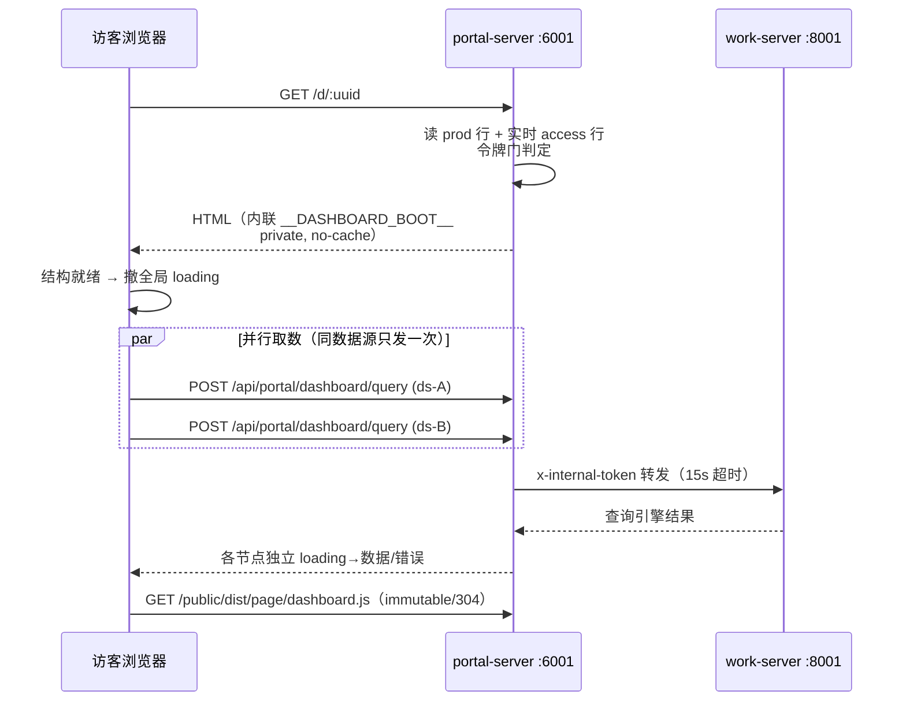

# 10 - 性能设计与优化

> 项目：运营搭建平台（vue3-course） ｜ 版本：v1.1 ｜ 生成日期：2026-10-06 ｜ 依据：源码分析

性能在本项目不是独立专题，而是散落在各机制的注释与常量里。本篇把它们收拢为四个战场：编辑器画布、产物页面、数据源查询、构建与静态资源；每个战场先讲"已经做了什么"（含源码证据），再讲"瓶颈在哪、怎么优化"。总体判断：当前量级（单实例、数十编辑者、门户 PV 万级/日）下无明显热点，设计冗余充足；真正的风险点在"列表全量 schema"与"单实例内存态"两处，见第 6 节。

## 1. 编辑器画布性能

**已做的设计：**

1. **iframe 隔离画布**（`packages/work-front/src/pages/dashboard-canvas/`）。画布是同源 iframe，编辑器的样式/全局变量与画布完全隔离，画布可独立缩放。代价是每次属性变更都要 postMessage 一轮，收益是两端互不拖累——编辑器壳的复杂浮层（CanvasOverlay，1091 行）跑在父页，画布只做纯渲染。
2. **单向数据流 + 位置字段防回环**（`packages/work-front/src/pages/dashboard-canvas/protocol.ts` 头注释）。编辑器下发 `canvas:schema` 的载荷**不含位置字段**，位置只由画布上行（`canvas:abs-move`）、编辑器收到后才写回 `components`。这消除了拖拽时"下发→渲染→上报→再下发"的回环风暴——一次拖动只有一轮消息。
3. **历史栈的 debounce 合并**（`packages/work-front/src/pages/dashboard-editor/composables/useDashboardEditor.ts` 140-170 行）。连续变更（拖动、属性编辑）经 deep-watch + `HISTORY_COMMIT_DELAY=300ms` 合并为一条历史（`scheduleCommit`）；离散操作（增删、粘贴）立即 `commitNow`。上限 `HISTORY_LIMIT=30` 条、每条是全量 JSON 快照——以内存换简单，也把单条快照的最大体积限制在了"30 × 看板大小"。undo 前先 `commitNow()` flush 未决提交，保证撤销语义不丢最后一次编辑。
4. **模块级单例 + 独立 effectScope**（同文件 162-170 行注释）。watch 挂在 `effectScope(true)` 上而非宿主组件作用域：路由离开编辑器时宿主被销毁，但单例的监听不停——否则"之后所有编辑都不再进入历史"。这是正确性修复，顺带避免了反复重建 watch 的开销。
5. **渲染端收敛到单一递归节点**（`packages/charts/src/components/DashboardFlowNode.vue`）。顶层与容器子节点共用同一组件递归渲染，`resolveRenderer` 每类型只解析一次渲染器；未知组件显示占位而非抛错，一个坏节点不拖垮整树。
6. **列表页懒加载编辑器**。管理台列表与编辑器是不同路由，编辑器的 1263 行 composable 与各面板只在进入 `/page/dashboard-editor` 时加载（同包内动态路由，非分包——见第 5 节的局限说明）。

**瓶颈与优化建议：** 组件树深递归 + `JSON.parse(JSON.stringify())` 深拷贝是编辑器的隐性热点：`createCopy`/`applySnapshot`/`copySelectionToClipboard` 全部用 JSON 序列化深拷贝，千节点看板单次 undo 可能数十毫秒。低成本改法是结构共享（快照只存与上条的 diff）或 `structuredClone`（`packages/business/src/drag/drag.vue` 61 行的 TODO 已有先例）。另一个是 `components` 的 deep-watch：任何一处属性变更都触发全树比较，组件数大时可改为"操作入口显式调用 scheduleCommit"（现状已是离散操作显式提交，deep-watch 只兜底画布直改路径，可以评估是否还需要）。CanvasOverlay 的 rect 上报在拖拽中高频触发，若出现卡顿可对 `canvas:rects` 做 rAF 节流（协议消息已是批量 `items[]`，改造成本低）。

## 2. 产物页面（门户）的加载策略

访客打开 `/d/:uuid` 后发生的事情可以按时间轴画成一条关键路径。理解这条路径是讨论门户性能的前提：HTML 到达即携带全部结构数据（无取数往返），静态资产命中两级缓存，数据查询并行发起且同源去重——三个设计共同把"最慢数据源"从首屏关键路径上摘了下去：

**已做的设计：**

1. **boot 数据内联，零额外请求拿结构**（`packages/portal-server/src/controller/dashboard.ts` 88-96 行）。`/d/:uuid` 的 HTML 内联 `window.__DASHBOARD_BOOT__`（schema + 名称 + 版本），访客端不需要先调接口再渲染；首屏关键路径只剩三个静态 JS + 取数。
2. **结构就绪即撤全局 loading，数据并行加载**（`packages/work-front/src/visitor/pages/dashboard/composables/useDashboardRenderer.ts` 226-240 行注释）。`loadDashboard` 先初始化组件树并编译页面方法，立即 `loading.value = false`，然后 `collectDataBoundNodes` 收集绑定节点 `Promise.all` 并行取数——首屏不再被最慢的数据源拖住，各节点独立呈现自己的 loading/error 态，单源失败不拖垮整页（`loadComponentData` catch 后只置本节点 error）。
3. **在途请求去重 + 数据缓存**（同文件 70-125 行）。`dataCache` 用 `shallowRef`（注释："避免大量数据时产生不必要的响应式开销"——行数据不需要深层响应式）；`pendingQueries` Map 保证并行组件共享同一数据源时只发一次查询，settle 后清理。
4. **静态资源两级缓存**（两个服务端 index.ts 同策略）。`/public/cdn/` 版本化路径 `Cache-Control: public, max-age=31536000, immutable`（物料与页面产物目录自带版本号）；其余产物无内容 hash，走 `max-age=0, must-revalidate` 协商缓存 + 显式 304（portal 注释记载踩坑原因："改了 footer 源文件仍发旧产物"）。`koa-compress` 阈值 1KB，且 AI SSE 路径绕过压缩（攒缓冲会打死流式，`packages/work-server/src/index.ts` 54-57 行）。
5. **门户 HTML 不允许共享缓存**：`Cache-Control: private, no-cache`——内容随发布版本与令牌门判定实时变化。
6. **PV 埋点不阻塞渲染**（`packages/portal-server/src/util/visit-track.ts`）。30 分钟 (uuid,ip) 去重窗口挡刷新/轮询/脚本重放；爬虫 UA 正则直跳；去重 Map 带 TTL 清扫与 2 万条容量上限（防无界增长）；写库 fire-and-forget 且放在响应体确定之后（101 行注释："此前在生成 HTML 前就写库，页面 500 也照样计一次 PV"）。
7. **访客桶极小**。visitor 桶只有 dashboard/home/demo 三个入口 + vue/vue-router global 产物；编辑器代码物理上不在 portal 公开目录（桶隔离，见 07 篇第 11 节），访客不会误加载任何编辑器字节。

**瓶颈与优化建议：** 访客首屏体积主要是 vue global 产物 + dashboard.js + charts 相关代码，未做代码分割（vite lib 模式单文件产物）。若 dashboard.js 超过预算，优先级最高的手段是把图表组件（ECharts，体积大头）改为按需动态 import（`resolveRenderer` 已是集中解析点，改成 `defineAsyncComponent` 即可）。其次，`/d/:uuid` 每次请求都读库（prod 行 + 实时 access 行），高频访问下可加 30-60 秒的进程内缓存（发布/下线时失效），当前量级可不做。ECharts 实例在组件卸载时未显式 dispose 的确认也值得做一次（内存长期运行场景）。

## 3. 数据源查询性能

**已做的设计：**

1. **连接池复用**。平台主库池（`packages/server-kit/src/db.ts`，`connectionLimit: 10`，两服务进程各一个池）；MySQL 数据源池按 `host:port:user:database` 缓存（`packages/work-server/src/util/data-query/mysql-pool.ts`，`enableKeepAlive` + 10 连接上限 + `queueLimit: 0`），PG 同构（`postgresql-pool.ts`）。"测试连接"走临时建连即断，不占池。
2. **超时与重试钳制**（`packages/work-server/src/util/net-guard.ts` 129-138 行）：API 数据源超时默认 10s、上限 30s（`clampTimeout`）；重试上限 3 次、指数退避 1s/2s/3s（`api.ts` `delay(1000 * (attempt + 1))`）——防单个坏源拖死服务端连接与内存。
3. **白名单前置**：portal 取数在读库行 → 白名单校验后才进查询引擎，未命中的请求不消耗任何连接。
4. **出码快照限行**：`CODEGEN_SNAPSHOT_ROW_LIMIT=500`（`data-query.ts` 111 行）——"一块看板可能挂多路数据，导出包不宜无界增长"。

**瓶颈与优化建议：** ① SQL 数据源无行数上限——`SELECT *` 十万行的源会把整包数据推给浏览器（`normalizeData` 原样返回），建议给查询器加默认 LIMIT 注入或行数上限 + 截断标记（与 codegen 同语义）；② API 重试是串行等待，慢源 + 3 次重试最多占住请求约 100 秒（30s × 3 + 退避），而 portal 转发侧总超时只有 15 秒（`FORWARD_TIMEOUT_MS`，`packages/portal-server/src/service/dashboard.ts` 92 行）——门户路径实际被 15s 先行掐断，编辑器路径则可能久等，可考虑按来源区分重试策略；③ `checkUserPermission` 每请求四表联查（RBAC 无缓存），编辑器高频操作下是固定开销，可用 60 秒进程内缓存（改权限本就低频）；④ 列表接口每行带完整 `schema_json`（`packages/work-server/src/service/dashboard.ts` 353-356 行注释自认："列表每行都带完整 schema_json：分页非法值与上限统一交 clampPage"）——列表页只需要缩略图与名称，千行 schema 的列表页传输量可观，建议列表 SELECT 剔除大字段或截断，详情页才取全量；`clampPage` 的分页上限是兜底而非优化，建议同时做。

## 4. 构建期与静态资源

**已做的设计：** ① **产物分桶**（`scripts/build-work-front.ts`）：admin/visitor 各自独立产物，portal 只拷 visitor 桶——访客侧的字节面被结构性收窄；`copyVueRuntimeLib` 给两桶各拷一份 vue/vue-router global 产物，避免跨桶引用。② **页面产物真实构建**：页面线发布用 vite lib 模式打 bundle.js/css（`packages/work-server/src/service/page-static.ts`），物料依赖从 mock CDN 镜像落盘后本地构建，构建产物按 `<uuid>/<version>/` 版本化落盘 → 一年 immutable。③ **CDN 回源镜像**（`packages/server-kit/src/sync-cdn.ts`）：本地 404 才回源读 mock CDN 并落盘，之后本地命中——静态资源"两级缓存 + 按需回源"，不启动时不预热不阻塞。④ **模板缓存**：portal 的 HTML 模板按路径 `templateCache` 缓存，避免每请求读盘。⑤ **共享包双格式构建**（`scripts/build-module.ts` rollup 出 ESM+CJS）与 dts 生成（ts-morph，`scripts/build-dts.ts`）分离，构建链各步可独立重跑（但 `build:module` 与 `build:css` 必须成对——见 12 篇 FAQ）。

**瓶颈与优化建议：** 页面线发布的 vite 构建是同步请求路径（发布请求内 `await vite.build`），大页面发布会占住请求数十秒——可改异步任务 + 轮询状态（当前 `page_info.info` 已有 stage 形态标记可承载）；编辑器/门户产物无内容 hash，依赖协商缓存的 304 往返，量大后可引入内容 hash 文件名 + 永久缓存。

## 5. 单实例约束下的内存账

三处进程内存态是横向扩容前的已知约束（`docs/plans/deploy-ops-2026-09.md` 第七节）：① portal 的 PV 去重 Map（2 万条上限，重启清零——短暂重复计数，可接受）；② memory 模式限流桶（`MAX_BUCKETS=20000` 超限整体清空防打爆；`RATE_LIMIT_STORE=mysql` 可集中化——注意 daemon/cluster 启动时 work-server 按 CPU 核数 fork 多 worker，memory 桶每 worker 一份，标称阈值被放大 worker 倍，见 14 篇第 2 节）；③ MySQL 数据源连接池缓存（无上限，每个不同 `host:port:user:database` 组合一个池，10 连接/池——数据源数量大时注意数据库侧总连接数；池按组合键缓存且不失效重建，数据源轮换口令后须重启 work-server 才生效，见 14 篇第 4 节轮换剧本）。扩容路线：PV 去重迁集中式（Redis 或 MySQL 时间窗查询）、产物落盘改共享存储/对象存储、限流上移网关层。

## 6. 优先级排序的优化清单

| 优先级 | 项 | 位置 | 预期收益 |
| --- | --- | --- | --- |
| 高 | 列表接口剔除 schema_json 大字段 | `packages/work-server/src/service/dashboard.ts` getDashboardList + 对应 model | 列表页传输量降 1-2 个数量级 |
| 高 | SQL 数据源行数上限 | `packages/work-server/src/util/data-query/mysql.ts` 等 | 防单源拖垮浏览器与服务端 |
| 中 | 图表组件按需动态 import | `packages/charts/src/runtime-renderer.ts` | 访客首屏体积（ECharts 是大头） |
| 中 | RBAC 查询短缓存 | `packages/work-server/src/service/rbac.ts` | 每请求一次四表联查 → 60s 一次 |
| 中 | 快照结构共享替代全量 JSON 深拷贝 | `useDashboardEditor.ts` 历史栈 | 大看板 undo/redo 延迟 |
| 低 | `/d/:uuid` prod 行短缓存 | `packages/portal-server/src/service/dashboard.ts` | 高 PV 下少一次主键读 |
| 低 | 页面发布 vite 构建异步化 | `packages/work-server/src/service/page-static.ts` | 发布请求不再长阻塞 |
| 低 | `canvas:rects` rAF 节流 | `CanvasOverlay.vue` / `canvas-service.ts` | 拖拽时消息量 |

前两项是"设计已到边界、数据量未到"的典型：当前量级不痛，数据量翻倍后先爆。建议在补测计划（09 篇第 5 节）里同时给"列表响应不含 schema 全文"与"查询行数上限"加不变量断言，防止回归。
