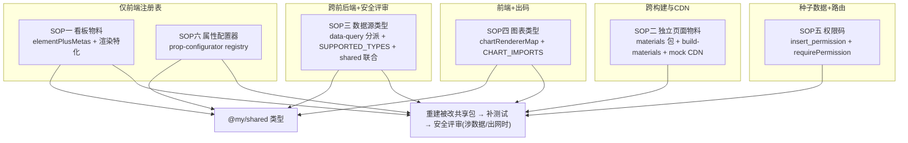

# 11 - 扩展开发指南

> 项目：运营搭建平台（vue3-course） ｜ 版本：v1.1 ｜ 生成日期：2026-10-06 ｜ 依据：源码分析

本篇是六类高频扩展场景的 SOP。每条 SOP 按"触点 → 步骤 → 验证 → 常见坑"组织，所有文件路径与函数名以当前源码为准。开始前必读三条公共前置：① 改 `@my/shared`/`@my/charts`/`@my/business`/`@my/server-kit` 后必须重建该包（两个服务端经 node_modules 软链消费 dist，见 06 篇第 5 节）；② 新增/改动的测试文件必须归入 `vitest.config.js` 某一分线（否则静默不跑，09 篇第 2 节）；③ 涉及对外暴露面（物料 props、数据源 config）的改动要过一遍 08 篇第 9 节的注入防线清单。

## SOP 一：新增一个看板物料（Element Plus 通用组件）

**触点**：`packages/charts/src/meta/elementPlusMetas.ts`（元表）、必要时 `packages/charts/src/components/ElementPlusRenderer.vue`（渲染特化）。

**步骤**：

1. 在 `elementPlusMetas.ts` 末尾按分类追一段 `meta(type, label, category, defaultProps, propSchema, defaultSize)`。硬约束（文件头注释原文）：type 必须对应真实存在的 el-* 组件（ElementPlusRenderer 用 `resolveComponent` 解析，不存在的组件不注册）；**propSchema 每项的 name 必须与 defaultProps 键一致**——面板按 name 回写 props，缺 name 会把属性写进 `model['']` 空键（历史上真踩过，已修）。
2. 用现成构造器拼 propSchema：`str()`/`num()`/`bool()`/`sel()`，各自已绑定配置器 widget（Input/Number/Switch/Select）。需要颜色选色器就手写 `{ name, label, type: 'color', widget: { component: 'ColorConfigurator' } }`。
3. 若组件要接收子组件，把 type 加进文件内 `CONTAINER_TYPES` 集合并给 meta 传 `container: { acceptChildren: true }`（语义对齐官方 `configure.isContainer`，`packages/shared/src/schema/index.ts` 176 行注释）。
4. 组件若可绑定页面方法，给 meta 加 `events: [{ name: 'click', label: '点击' }]`——属性面板"事件"区只渲染声明过的事件，`ElementPlusRenderer.buildEventProps` 据此生成 `onXxx`。
5. 若组件是结构化组件（菜单/ tabs / 表格类需要子项数据），检查 `ElementPlusRenderer.vue` 是否已有对应分支：按"逗号分隔文本"生成子节点的组件名单在该文件头注释里；新组件需要映射逻辑时在此追加（例如 Table/Transfer/Tree 把演示文本映射成运行时数据结构的写法可参照）。

**验证**：`pnpm exec vitest --run --project web`（`packages/charts/__tests__` 无元表全量断言，人工验证路径：`npm run dev:work-server` + `dev:work-front` → 编辑器组件库面板出现新物料 → 拖入画布渲染 → 属性面板改每个 prop 观察回写 → 存为模板再从模板新建确认序列化无损）。**常见坑**：① 忘记重建 charts 包（dev 模式直接吃 src 不受影响，`start:work` 生产模式吃 dist——改完不生效先查这个）；② defaultProps 里放函数/复杂对象（meta 必须可 JSON 序列化，插入画布时要深拷贝）；③ category 用了枚举之外的值（`ComponentMeta['category']` 是字面量联合，TS 会拦）。注意：图表类物料已按产品决策从面板移除（`packages/charts/src/index.ts` 23-26 行注释），新增"图表"不要走本 SOP，走 SOP 四。

## SOP 二：新增一个独立页面物料（npm 包进 mock CDN）

**触点**：`packages/materials/` 新目录、`scripts/build-materials.ts`（物料清单）、页面线编辑器（`packages/work-front/src/pages/manage/modules/page-editor.tsx`）。

**步骤**：

1. 仿照 `material-banner-slides` 建包：`packages/materials/material-xxx/package.json`（name `@my/material-xxx`、version `0.1.0`、vue 进 peerDependencies）、`src/types.ts`（导出 `MaterialProps` 接口——构建脚本会用 typescript-json-schema 从它生成 `props.schema.json`，页面线属性表单据此渲染）、`src/index.ts`（默认导出组件，`import 'xxx.css'` 引样式）、`demo.ts` + `index.html`（独立开发页）。
2. 在 `scripts/build-materials.ts` 的物料清单里注册新包（该脚本遍历清单逐个 `vite build`：lib 模式出 esm/cjs/iife 三格式 + cssFileName 'index'，再 `pushMaterialToCDN` 按 `<name>/<version>/` 进 mock CDN，末尾生成 props schema）。
3. 开发循环：`npm run dev:xxx`（仿 `dev:banner` 在根 package.json 加一条 `vite -c ./vite.config.common.ts ./packages/materials/material-xxx`）→ **提升版本号** → `npm run build:materials`。不升版本等于白改（06 篇 2.3 节 README 原话——产物目录按版本号区分，同版本不覆盖）。
4. 物料管理台录入：`/page/manage/material-list` 新建物料记录（name 与包名对应、current_version 对应版本号），页面编辑器 `initAMDEnv`（page-editor.tsx）按 `paths` 指向 `/public/cdn/material/<name>/<version>/index.amd` 运行时加载。

**验证**：页面编辑器拖入物料 → 属性表单按 props.schema.json 渲染 → 发布到 test → 访客 `/p/:uuid` 渲染。**常见坑**：AMD 产物里 vue 是 external（编辑器 `initAMDEnv` 把 `vue` 注入 AMD 定义），物料源码不要 `import { h } from 'vue'` 之外的全局副作用；物料包内不要引 element-plus（页面线产物自治，依赖必须打进包内或走 CDN pkg 白名单）。

## SOP 三：新增一种数据源类型

**触点**：`packages/work-server/src/util/data-query/`（查询器）、`packages/work-server/src/service/data-query.ts`（分派）、`packages/work-server/src/service/datasource.ts`（`SUPPORTED_TYPES`）、`packages/shared/src/schema/index.ts`（`DataSourceConfig` 判别联合与 `DataSourceConfig['type']`）、前端 `packages/work-front/src/pages/manage/components/datasource-config-dialog.vue`。

**步骤**：

1. 类型定义：`packages/shared/src/schema/index.ts` 给 `DataSourceConfig['type']` 联合加值，并新增一个 `XxxSourceConfig` 接口（带 `mockData?` 则继承 `MockableSourceConfig`）进判别联合；重建 shared 包。
2. 服务端类型白名单：`packages/work-server/src/service/datasource.ts` 顶部 `SUPPORTED_TYPES` 加值。
3. 写查询器：仿 `static.ts`（最简）或 `api.ts`（最完整）新建 `packages/work-server/src/util/data-query/xxx.ts`，导出 `queryXxx(config, params): Promise<Record<string, any>[]>`。约定：参数替换用 `shared.ts` 的 `replaceParams`；返回行数组；**敏感配置不得进 URL/日志**；若发外网请求，过 `net-guard.ts` 的 `assertSafeHttpUrl` 与超时钳制（08 篇第 7 节的边界就是为此设计的）。
4. 接入分派：`packages/work-server/src/service/data-query.ts` 的 `executeDataSourceQuery` switch 加一个 case。**不要绕过该函数另开取数出口**——它是全仓唯一解密点（`openConfigSecrets`）与两个授权入口（`queryDataSourceAsUser`/`queryPublishedDataSource`）的汇聚处，绕过即绕过权限。
5. 若类型需要数据库凭据，复用 `db_connection_info`（config 里存 `connectionId`，不要存 host/port——README 明确约束），仿 `mysql-pool.ts` 做池缓存。
6. 前端表单：`datasource-config-dialog.vue` 按 type 分支加配置表单（测试连接按钮走 `POST /api/post/datasource/test`，服务端 test 逻辑在 `service/datasource.ts` 补对应 case）。

**验证**：`packages/work-server/__tests__/data-query.test.ts` 加该类型的分派与行为用例（夹具自删纪律见 09 篇）；手工路径：管理台新建 → 测试连接 → 编辑器绑定取数 → 发布 → 访客取数（白名单覆盖新类型）。**常见坑**：① 忘改 `SUPPORTED_TYPES`（建源时报"数据源类型不支持"）；② config 里有敏感字段但没进 `packages/work-server/src/util/config-secrets.ts` 的 `SECRET_CONFIG_KEYS`——那个清单是"字段单一事实源"，加密/解密/掩码/回填四处共用，漏了就是明文落库（文件头注释的原话）；③ 忘改 shared 的 type 联合，前端 TS 报错或编辑器不认。

## SOP 四：新增一种看板图表类型（专用渲染器）

**触点**：`packages/charts/src/components/`、`packages/charts/src/runtime-renderer.ts`、`packages/dashboard-codegen/index.ts`、出码快照链路。

**步骤**：

1. 写渲染组件：仿 `packages/charts/src/components/MetricCard.vue`（59 行，最简范本）新建 `XxxChart.vue`，数据换算复用 `composables/useChartData.ts`（fieldMap → x/y/series），空态用 `ChartEmpty.vue`。
2. 注册渲染器：`runtime-renderer.ts` 的 `chartRendererMap` 加 `XxxChart`——`resolveRenderer` 即刻生效（画布、预览、portal 三端共用这个解析点，注释明确"单一事实来源"）。注意图表物料已从组件库面板移除，新增图表对**存量看板**生效的方式是：组件 type 匹配 `chartRendererMap` 即可渲染（`/Chart$/` 兜底注释与之呼应）。若同时要让它出现在面板（恢复图表新增的产品决策），在 `packages/charts/src/index.ts` 的 `allComponentMetas` 补一个 meta（type 与 map 键一致）并确认面板过滤逻辑。
3. 出码支持：`packages/dashboard-codegen/index.ts` 的 `CHART_IMPORTS` 数组加一项（type → vendor 文件路径），生成工程才会 import 新组件。
4. 若图表是 ECharts 封装，主题跟随 `packages/charts/src/theme/index.ts` 的两套主题。

**验证**：`packages/charts/__tests__/useChartData.test.ts` 补数据换算用例；`packages/dashboard-codegen/__tests__/dashboard-codegen.test.ts` 补产物断言；手工验证编辑画布渲染与出码 zip 解压后可独立运行。**常见坑**：vendor 失效——出码器复制的是 charts **源文件**，若新组件引了 charts 内部相对路径之外的依赖（如直接 import 'echarts'），要确认生成工程 package.json 的 `versions` 表（`controller/codegen.ts` 传入）里有对应依赖。

## SOP 五：新增权限码与角色

**触点**：`packages/init-database/src/sql/insert_permission.sql`、`insert_role_permission_*.sql`、`packages/work-server/src/router.ts`、前端权限判定（如有菜单级控制）。

**步骤**：

1. 在 `packages/init-database/src/sql/insert_permission.sql` 追加权限行（code 形如 `dashboard:export`，resource/action 两列与 code 对应）；在 `insert_role_permission_editor.sql`/`_viewer.sql` 里为相应角色追加绑定。
2. 路由挂码：`packages/work-server/src/router.ts` 对应端点换/加 `requirePermission('新码')`。约定：写操作与动作全走 `/api/post/*`，读走 `/api/get/*`（03 篇第 1 节）。
3. 重跑 `npm run db:init`——`packages/init-database/src/index.ts` 306 行注释明确"老库重跑 db:init 也能补齐后续新增的权限行与角色绑定"，幂等 INSERT 保证已有行不重复。
4. 若新码要给已登录用户生效，用户需重新登录或等 online 接口刷新（JWT payload 不含权限，`slidingSessionRenewal` 重签也沿用原 payload——权限变化由 `checkUserPermission` 实时查库反映，无需重签）。

**验证**：`packages/work-server/__tests__/rbac.test.ts` 补新码矩阵（admin 有/editor 无/viewer 无之类）；手工验证 401/403 文案。**常见坑**：只加权限行忘了角色绑定（全员 403）；把新码挂在 `/api/get/*` 读端点但前端缓存了列表（看似越权其实是缓存，先清缓存再排查）。

## SOP 六：新增一个属性配置器（prop-configurator）

**触点**：`packages/work-front/src/ui/prop-configurator/`。

**步骤**：

1. 仿 `builtin.ts` 里的 5 个内置配置器写组件（v-model 协议，受控输入）。
2. 注册：业务代码调用 `registerPropConfigurator('XxxConfigurator', component)`（registry.ts 导出的开放扩展点），或直接加进 `builtin.ts` 的 registry 初始表。物料 meta 的 propSchema 项写 `widget: { component: 'XxxConfigurator', props: {...} }`，`props` 原样透传给配置器。
3. 未注册名的兜底链：`resolveConfigurator` 按 widget.component 查注册表，未命中返回 undefined（面板跳过该项）；**不声明 widget** 时按属性 type 走 `typeFallbackMap`（array/object/json 暂用文本输入，注释说"可后续注册专用配置器覆盖"）。

**验证**：`packages/work-front/__tests__/prop-configurator.test.ts`（146 行，已有注册表解析用例）补新配置器；面板实际渲染走查。**常见坑**：配置器没有双向同步（只读不写回 props）——面板回写直接改 `components` 树上节点的 props，画布经 `canvas:schema` 重新下发，配置器必须 emit 更新。

## 扩展时的整体判断

六条 SOP 的触点分布可以画成一张"扩展点地图"：横轴是改动波及的层（前端注册表 → 服务端 → 构建与产物 → 种子数据），纵轴是扩展类型。动手前在这张图上定位自己要走的路径，就能预判要重建哪些包、要补哪些测试、要不要过安全评审：

六条 SOP 对应五种扩展形态：看板线物料（SOP 一/六）是**纯前端注册表扩展**，零服务端改动；图表（SOP 四）多一个出码 vendor 触点；独立物料（SOP 二）跨构建脚本与 mock CDN；数据源（SOP 三）跨前后端且触碰安全边界（务必过 08 篇第 7/9 节）；权限（SOP 五）只碰种子数据与路由。共同点是：**每个扩展点都是注册表**（物料元表、渲染器 map、查询器 switch、配置器 registry、权限矩阵），先找注册表再动手，基本不会出现"改一处漏三处"。若发现某扩展需要同时改三个以上非注册表文件，说明协议该演进了——按 13 篇的演进路线图提设计文档（放 `docs/plans/`），而不是硬加分支。
