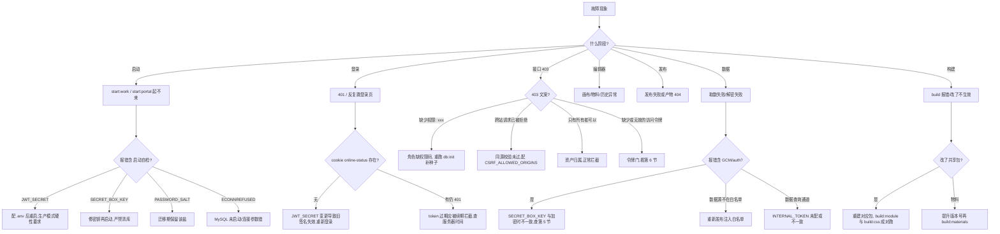

# 12 - FAQ与故障排查

> 项目：运营搭建平台（vue3-course） ｜ 版本：v1.1 ｜ 生成日期：2026-10-06 ｜ 依据：源码分析

本篇按"现象 → 根因 → 处理"组织，覆盖启动、登录权限、编辑器、发布、数据源、访客、构建七类高频故障。两条总原则先记住：① 本项目的启动期报错**绝大多数是刻意 fail-fast 而非 bug**（`packages/work-server/src/index.ts` 的两道自检、`scripts/migrate-secrets.ts` 的两道门禁），报错文案本身就写明了处理动作；② 服务端面向用户的报错文案被 `internalFailure` 收敛过（`packages/work-server/src/util/error-message.ts`），**"系统繁忙"意味着真实错误在服务端 stdout**，查日志而不是猜。

## 1. 故障总决策树

排查方法论先讲三句话。第一句：**先定位阶段，再定位层**。同一个"看板打不开"可能是编辑器保存失败（8001 管理态）、发布未推进到 prod（数据问题）、portal 起错桶（构建问题）或令牌门拦截（权限问题）——决策树的第一层分流就是为此设计的，按"故障发生在哪个阶段"而不是"哪个页面坏了"来切入。第二句：**报错文案是第一手资料**。这个仓库的错误信息有两个特点：启动期报错是刻意 fail-fast 且文案自带处理动作（生成密钥的命令都写在里面）；运行期用户可见文案被 `internalFailure` 收敛过，所以"系统繁忙"不是信息量为零，而是在告诉你"去服务端 stdout 找 `[模块名]` 前缀的原始日志"。第三句：**先分进程再查链路**。8001 与 6001 是两个独立进程、两份静态产物桶、一条内网取数通道，跨进程的问题（访客取数失败）要先确认两个进程各自健康，再查通道配置（INTERNAL_TOKEN、WORK_SERVER_ORIGIN）。

下面的决策树覆盖了本篇后续七类故障的主干分流，每个分支末尾指向对应章节：

## 2. 启动类

启动类故障的共同背景是：这个仓库把"配置错误应当在启动时爆炸"作为设计原则，而不是等第一个请求踩雷。三道自检各有明确的故障模型——JWT_SECRET 缺失时服务**能**起（空密钥下 jwt.sign 照样工作），但登录态可被任意伪造，所以选择"生产拒绝、开发降级"；SECRET_BOX_KEY 缺失时服务也**能**起，但第一个访客取数时才会以"GCM 认证失败"的形式爆炸，这种报错极易被误判成对方数据库故障，所以刻意做成启动后秒级异步预检、宁可退出也不带病运行；PASSWORD_SALT 则是迁移期的兼容性依赖，老账号的旧哈希校验离不开它。理解了"每道自检防的是哪种静默故障"，就不会把这些报错当 bug 修。

表外的两个高频项：端口冲突时优先改 `WORK_SERVER_PORT`/`PORTAL_SERVER_PORT` 而不是杀进程（同机开发/生产并跑是受支持的场景）；`pnpm i` 触发的 postinstall 完整构建是"安装即构建"设计，失败时先看是四步 build 中的哪一步、哪个包，再对照第 7 节构建类条目。最后是全文最重要的一条硬约束——**1406 故障**，它不是偶发 bug 而是升级顺序问题，机理与处理如下表：

| 现象 | 根因 | 处理 |
| --- | --- | --- |
| `[启动自检] JWT_SECRET 未配置…生产模式拒绝启动` | .env 缺 JWT_SECRET（`packages/work-server/src/index.ts` 38-47 行；空密钥时任何人可伪造签名） | `openssl rand -hex 32` 生成后写入 .env 重启；开发模式只 warn |
| `[启动自检] 库中已有 N 行加密凭据，但 SECRET_BOX_KEY 缺失或格式不合法` | 库里有 `enc:v1:` 密文而密钥没配/格式错（异步预检，index.ts 101-118 行；刻意放在启动期——密钥错的表现是 GCM 认证失败，容易被误判成"对方库挂了"） | 修好 SECRET_BOX_KEY 再启动；**不要清库**（清库救不了密钥，只会丢数据） |
| `PASSWORD_SALT is required` | 库中仍有旧 HMAC 口令哈希，校验需要盐（迁移期硬约束） | 保留 PASSWORD_SALT 与历史值一致；全部账号登录一次后（`SELECT COUNT(*) FROM user_info WHERE password NOT LIKE '$2%'` 归零）可删 |
| 起服务秒退且无上述报错 | 端口占用（8001/6001 可用 `WORK_SERVER_PORT`/`PORTAL_SERVER_PORT` 改）；或 MySQL 探活失败 | 换端口/查 MySQL；dev 模式用 nodemon 会自动重试 |
| `pnpm i` 后构建失败 | postinstall 会自动跑完整构建（build + mock-cdn + mock-logger + materials）；vite 7 的 lib 模式必须显式声明 `cssFileName`（页面产物构建里两处注释提到） | 按报错定位具体构建步；CI 里用 `--ignore-scripts` 分步执行便于定位 |
| **老库写入报 MySQL 1406 (Data too long)** | **db:init 未先于新版代码上线**——`db_connection_info.password` 列宽从 256 放宽到 1024（密文比明文长约 50%，256 字符明文加密后约 387 字符），`user_info.password` 放宽到 255（bcrypt 60 字符）。这是 README 第一条硬约束 | 先跑 `npm run db:init`（幂等、重跑安全：`CREATE TABLE IF NOT EXISTS` + `ensureColumns` 查 information_schema 缺列才 ALTER），再上线新代码 |

## 3. 登录与权限类

这一类问题的排查入口是三层模型的分流：401 说明"认证层"没过（没有有效登录态），403 说明认证过了但"权限码层"或"资产归属层"没过——两者的报错文案不同（`缺少权限: xxx` 是权限码层，`只有所有者可以…` 或 `暂无权限访问该看板` 是资产层），先按文案归层再往下查。登录态本身是 HttpOnly cookie，前端 JS 读不到，所以"浏览器 Application 面板里看不到 cookie 值"是正常现象，要查的是 cookie 是否存在、域名路径是否匹配；JWT 签名密钥更换（或本地 .env 被 CI 占位值污染）会让所有存量登录态整体失效，这是"集体掉登录"的最常见根因。跨站拒绝（sameSiteGuard）值得单独理解：它只作用于非幂等方法，判定优先级是 Sec-Fetch-Site → Origin/Referer，两者都缺且带 cookie 时按跨站处理——所以 curl 不带 cookie 直连能过、浏览器跨域 POST 被拦，这不是不一致而是刻意设计（浏览器发带凭据的请求必然留下来源证据，命令行则没有 cookie 可偷）。

| 现象 | 根因与处理 |
| --- | --- |
| 登录成功但刷新即掉登录 | JWT_SECRET 与签发时不一致（如多进程用了不同 .env 或 CI 占位密钥污染了本地 .env）——旧签名全部失效，统一密钥后重新登录 |
| 所有请求 401 且 cookie 存在 | 服务器时间漂移导致 exp 判定失败（`verifySessionToken` 毫秒级判定）；或滑动续期未生效——`slidingSessionRenewal` 挂在中间件链前部，确认自检没改动中间件顺序 |
| `403 缺少权限: xxx` | 角色缺权限码：确认 `npm run db:init` 已跑过最新种子（`insert_role_permission_*.sql`）；自助注册用户默认 viewer（只读），需要 editor 角色要管理员手工绑定 |
| `403 跨站请求已被拒绝（同源校验未通过）` | `sameSiteGuard` 拦截：前端与 API 不同域部署时配 `CSRF_ALLOWED_ORIGINS`（逗号分隔，比主机名不比协议端口）；经反代时确认 `TRUST_PROXY=1`；curl 直连不带 cookie 不受影响，带 cookie 就必须带同源 Origin/Referer 或 Sec-Fetch-Site |
| `403 只有所有者可以xx看板` | 资产归属正常拦截：写操作（更新/发布/回滚/存模板/改访问方式/改可见范围）仅 owner；无主历史行首写会自动认领，被认领后其他人不可写 |
| 明明公开了同事却看不到 | 可见范围是租户内语义（`visibility.ts`：public 同租户可见；department 需同租户同部门）；确认用户 departmentId 已配置（user info JSON 的 departmentId） |
| 429 操作过于频繁/今日额度已用完 | 限流或配额命中：IP 桶（登录 20/10min、注册 10/1h、令牌验证 20/10min、门户取数 300/min）与用户桶（AI 20/min + 200/日、出码 30/min + 100/日）；响应带 `Retry-After`；阈值可用 `RATE_*` 环境变量调，0 关闭；memory 模式重启即清零，mysql 模式查 `rate_limit_bucket` 表 |

## 4. 编辑器类

编辑器故障多数能归结为一句话："单向数据流的某一环断了"。正常链路是：面板/画布改数据 → `useDashboardEditor` 单例的状态更新 → `canvas:schema` 下发 → 画布 iframe 重渲染 → 选中框矩形经 `canvas:rects` 上报浮层。画布白屏是 iframe 本身没加载；物料不出现是元表注册表没收录；属性不生效是 propSchema 的 name 与 defaultProps 键错位（值写进了空键）；历史异常是 deep-watch 被挪出独立 effectScope。排查时打开浏览器控制台监听 message 事件，看 `canvas:*` 消息是否在按协议（`packages/work-front/src/pages/dashboard-canvas/protocol.ts`）双向流动，断在哪一环，问题就在哪一层。此外要记得两个"看起来像 bug 的设计"：图表物料从面板移除但存量数据仍渲染（产品决策，非丢物料）；并行编辑同一看板会整体覆盖（无协作锁，rename 拆独立端点已是缓解措施的边界）。

| 现象 | 根因与处理 |
| --- | --- |
| 画布白屏 / 画布内无组件 | 画布 iframe 加载失败：确认 `/page/dashboard-canvas` 路由可达（admin 桶产物在 8001）；控制台看 `canvas:ready` 握手是否发生（协议见 `packages/work-front/src/pages/dashboard-canvas/protocol.ts`）；跨源 iframe 会被 `listenCanvasMessages` 的 origin 过滤丢弃 |
| 组件库里找不到某物料 | 图表类物料已按产品决策从面板移除（`packages/charts/src/index.ts` 23-26 行注释），存量数据仍可渲染——这是预期行为不是丢物料；新加的 El* 物料不出现先查 type 是否真实存在（`resolveComponent` 解析失败的组件会被审查约束拒注册） |
| 属性改了画布不更新 | propSchema 的 name 与 defaultProps 键不一致会把值写进 `model['']` 空键（elementPlusMetas.ts 头注释记载的历史缺陷）；对照 SOP 一第 1 步检查 |
| 撤销（Ctrl+Z）一次回到很久以前 | 历史栈 watch 被停掉的典型症状：`useDashboardEditor` 的 watch 挂在独立 `effectScope(true)` 上（162-170 行注释），若重构时挪回宿主组件作用域，路由离开再进入后所有编辑都不再进历史 |
| 拖拽落点/选中框错位 | CanvasOverlay 的矩形来自画布上报的 `canvas:rects`（iframe 内部坐标与浮层共处同一缩放坐标系）；检查画布缩放逻辑是否绕过了坐标系约定 |
| 保存后别人改动被覆盖 | 全量 schema 上送 + 独立 rename 端点是有意设计（router.ts 349 行注释：仅改名不回读详情整体回写，防并发旧 schema 覆盖）；并行编辑同一看板仍会互相覆盖，属协作语义限制（无行级锁） |
| 未保存提示丢失 | 脏态基准是"与最后一次保存的 JSON 指纹比对"（`isDashboardDirty`），新建/切模板/关页都会走该判断；若指纹计算被改动会出现假脏/假净 |

## 5. 发布与数据源类

发布类故障的根因几乎都藏在"发布语义"里：三阶段是值的复制（test ← 草稿、pre ← test、prod ← pre），所以"跳阶段"与"推完 test 又改了草稿"都会造成所见非所得；数据源白名单在 **test 发布那一刻**从组件绑定里冻结（只记 id/name/type），之后再绑新源必须重走一遍三阶段；页面方法公开闸门校验的是 **pre 快照**而非草稿，所以"草稿里删了方法"不等于"线上内容干净"。数据源类故障则围绕两把钥匙：SECRET_BOX_KEY 决定密文能不能解（GCM 报错即密钥/密文不匹配，唯一恢复路径是找回正确密钥——清库救不了）；连接池缓存决定改了口令何时生效（池按 host:port:user:database 缓存，口令轮换后要重启进程）。这一节的条目按"先发布语义、后凭据语义"排列，绝大多数报错文案本身已指明违反了哪条规则。

| 现象 | 根因与处理 |
| --- | --- |
| 发布 pre 报"请先发布到测试环境" / prod 报"请先发布到预发环境" | 三阶段严格串行：test ← 草稿、pre ← test、prod ← pre；跳阶段发布被拒 |
| 发布 prod 被拒："该看板含 N 个页面方法…" | 页面方法公开闸门（08 篇第 6 节）：public + 方法体不得上 prod——改令牌访问或删方法体；确认校验的是 pre 快照，删了草稿方法还不够，要重新推 test → pre |
| 切 public 被拒（同类文案） | 第二条闸门 `assertPublicExposable`：草稿或 prod 产物任一含方法体即拒；`ALLOW_PAGE_METHODS_ON_PUBLIC=1` 是逃生阀（明确接受风险才开） |
| 访客 `/d/:uuid` 404 | prod 行不存在或 status=0：未发布到 prod、已下线（unpublish）、或看板已删（删除事务级联下线三阶段表）；portal 读 prod 表按 status=1 过滤 |
| `数据源不在该看板发布白名单内` | 白名单在 **test 发布时**从组件 dataBinding 冻结——发布后又给看板绑了新数据源，必须重新走一遍 test → pre → prod 才会进白名单 |
| `数据查询通道未配置（INTERNAL_TOKEN）` 或 `数据查询通道不可用` | portal→work-server 共享密钥未配或两进程不一致（fail-closed）；确认两服务用同一份 .env 的 INTERNAL_TOKEN，`WORK_SERVER_ORIGIN` 指向可达的 work-server |
| 数据源测试连接报"当前部署禁止 API 数据源访问内网地址"/"不允许访问元数据服务地址" | net-guard 正常拦截（08 篇第 7 节）；确需内网源置 `DATA_QUERY_DENY_PRIVATE=false`（启动会打 warn），元数据地址恒拒不可放行 |
| 测试连接报 SQL 注入相关 / `SQL 缺少查询参数: x` | `buildParameterizedQuery` 缺参报错；表名/列名参数化已不支持（shared.ts 30 行注释），模板需改固定 SQL |
| PostgreSQL 数据源测试连接报"暂不支持" | `packages/work-server/src/service/datasource.ts` 428 行明示测试连接未实现，查询本身可用——属已知缺口（13 篇） |
| **取数报 GCM 相关错误（Decryption failed / auth tag）** | SECRET_BOX_KEY 与加密该行数据时不一致（换过密钥没重加密、或两环境共用了库）。恢复正确密钥；轮换必须"旧钥 `db:decrypt-secrets` → 换钥 → 新钥 `db:encrypt-secrets`"，不能直接替换环境变量 |
| 改了数据库连接口令但取数仍用旧口令 | 连接池缓存：MySQL 数据源池按 `host:port:user:database` 缓存（`mysql-pool.ts`），口令变更后需重启 work-server 进程（或调用 `closeMySQLPool`）才会用新口令重建池 ⚠️ |
| 限流报错 `[rate-limit] 计数存储故障，本请求放行` | 限流计数后端故障：`RATE_LIMIT_STORE=mysql` 时查 `rate_limit_bucket` 表与 MySQL 状态；fail-open 是设计行为（保护措施不能变成全站不可用），连续出现要修计数存储 |

## 6. 访客与令牌类

访客侧问题的特殊性在于"你看不到对方的浏览器"。排查依赖三个事实：其一，`/d/:uuid` 的响应头与 HTML 源码是远程可查的——404 说明 prod 行不在、403 说明令牌门没过、HTML 里搜 `__DASHBOARD_BOOT__` 能确认结构数据是否内联；其二，令牌门是"双通道"（URL `?t=` 与 7 天 cookie 任一即可），cookie 被反代或浏览器策略吞掉时 `?t=` 通道仍可用，反之亦然；其三，访客静态资源来自 visitor 桶 + `/public/cdn/` 回源镜像两级，404 时先分辨是"桶拷错"（portal 拿到了 admin 桶或缺文件）还是"CDN 源缺文件"（mock CDN 目录被清）。嵌入场景还要记住 frame 策略是按服务分的：能嵌的是 6001 门户页，不是 8001 的预览页。

| 现象 | 根因与处理 |
| --- | --- |
| 令牌输入页反复出现 | cookie 未下发/被清：`portal_access_<uuid>` 是 HttpOnly cookie（7 天，路径为站点根）；反向代理剥离 cookie、浏览器禁第三方 cookie（嵌入场景 iframe 里 SameSite=Lax 的限制）都会导致；URL 带 `?t=<token>` 是免 cookie 通道 |
| `?t=` 正确仍 403 | 令牌已轮换（切访问方式会重新生成）；或大小写/空白问题——比对是精确匹配 + 常量时间 |
| 嵌入第三方站点被拒 | work-server 的页面（预览等）是 `X-Frame-Options: SAMEORIGIN`，只有 portal 的 `/d/:uuid`/`/p/:uuid` 才开放 `frame-ancestors *`——嵌入代码要用 6001 的链接 |
| 访客页面样式/脚本 404 | visitor 桶产物缺失：portal 只拷 visitor 桶（`build-portal-server.ts`），误拷 admin 桶或漏拷会导致 `/public/dist/page/dashboard.js` 404；`/public/cdn/` 下的物料与页面产物走 `createSyncCDNMirror` 回源，mock CDN 目录（`packages/mocks/mock-cdn/public/`）被清空也会 404 |
| 页面线产物 404（`/p/:uuid` 能开但 bundle 404） | 页面线发布要真实构建：确认发布日志无 vite 报错；mock CDN 的 `page/<uuid>/<version>/` 目录是否存在（`pushFullPageStage` 失败只报"发布失败"）；`/preview/:uuid/:version/:type` 匿名可读可用于对照 |

## 7. 构建与"改了不生效"类

"改了不生效"是接手初期最高频的困惑，几乎全部源于 workspace 包的消费模型：源码依赖是"先出 dist、再被消费方解析"，构建产物是"分桶拷贝、剥前缀"，物料是"按版本号目录进 mock CDN"。三者叠加出三条铁律：改共享包必须重建该包；服务端构建只拷自己的桶（portal 永远不该有 admin 产物）；物料必须升版本号再构建。遇到"改了没反应"先问自己改的是哪一层，再对照下表——这比反复重启服务高效得多。

| 现象 | 根因与处理 |
| --- | --- |
| 改了 `@my/shared`/`@my/charts`/`@my/business`/`@my/server-kit` 后行为没变 | 工作区包先出 dist 再被消费（README"共享包与构建顺序"节）：重建对应包——shared/business 用 `npm run build`，server-kit/charts 用 `pnpm --filter @my/server-kit|@my/charts run build` |
| `npm run build` 后 `@my/business/css/index.css` 解析不到 | `build:module` 起手清空 dist，CSS 是后面的 `build:css` 才产出——两步必须成对跑完整 `npm run build`（README 原文警告） |
| 改了物料但页面没变化 | 物料按 `<name>/<version>/` 进 mock CDN，**不升版本号等于白改**；提升 `packages/materials/material-xxx/package.json` 的 version 再 `npm run build:materials` |
| `work-front` 构建报 vue-router ENOENT | 构建末尾 `copyVueRuntimeLib` 从 `packages/work-front/node_modules/vue-router/dist/` 硬拷 global 产物——该依赖不能删，即使访客端源码零引用（README 明示） |
| 6001 能拿到 `/public/dist/page/app.js` | 桶隔离失效（正常必须 404）：portal-server 构建拷错了桶，重建 `build:portal-server`；README 记载过这个边界被实测验证 |
| dev 模式 6002 打不开管理页 | 6002 与 8002 是同一包的两个 dev server、代理目标不同（6002 把 /api 转 8001、其余转 6001）——管理台要用 8002 |

## 8. 线上健康检查清单

故障之外，建议把以下五项变成例行检查（上线后第一周每天一次，稳定后每周一次）。这五项对应的是"静默劣化"类问题——它们不会报错，但会在某一天突然变成故障：密钥与备份的有效性只有在演练恢复时才验证得了；限流计数存储故障目前是 fail-open 加一条 warn，不主动看日志就发现不了；`rate_limit_bucket` 表膨胀说明清洗节奏有问题；种子账号密码是否已改属于"一次疏忽即事故"的项。

1. **冒烟三连**（deploy-ops 末节）：管理台登录、新建并发布一个看板、访客端 `/d/:uuid` 打开且能取数——这条链覆盖了两个进程、内网通道、取数引擎与静态产物。
2. **密钥演练**：在预发环境用备份的 .env 完整拉起一次服务并跑通取数——验证密钥备份真的可用，而不是只在密码管理器里"看起来存在"。
3. **数据库备份恢复演练**：拿最近一份 mysqldump 在临时库恢复并抽查数据（含 `enc:v1:` 行）。
4. **日志巡检**：grep 服务端 stdout 的 `[rate-limit]`（计数存储故障告警）、`[net-guard]`（出网策略放宽提示）、`[dashboard-stage]`（prod 读行失败）；出现即处理，不要等访客报障。
5. **账号与配置审计**：`SELECT COUNT(*) FROM user_info WHERE password NOT LIKE '$2%'`（bcrypt 迁移进度）、admin001/admin002 密码已改、`.env` 中 `ALLOW_PAGE_METHODS_ON_PUBLIC` 与 `DATA_QUERY_DENY_PRIVATE` 保持默认（空）。

## 9. 日志入口

| 想看什么 | 去哪看 |
| --- | --- |
| 服务端真实异常（"系统繁忙"的背后） | 两服务进程 stdout（daemon 方式经 `packages/work-server/start-daemon.cjs` 落进程日志）；`internalFailure(err, module)` 打的日志带模块名，按 `[dashboard-stage]`、`[dashboard]` 等前缀 grep |
| 启动自检与密钥预检 | 同上 stdout：`[启动自检]`、`[net-guard]`、`[rate-limit]` 前缀 |
| 前端上报日志（用户浏览器侧） | `log_info` 表（type: common/portal-front/portal-front-work-front 等，info json），管理台 `/page/manage/log-list` 查询；上报入口 `POST /api/log/push`（120 次/min/IP） |
| 页面轨迹 | `GET /api/get/log/page-track`（同 log_info 表） |
| 访问统计（PV） | `dashboard_visit_log`/`page_visit_log` 表（30 分钟去重后的真实访客），管理台发布运维页或 `GET /api/get/dashboard/visit/stats` |
| 限流计数（mysql 模式） | `rate_limit_bucket` 表（name + bucket_key 联合主键，reset_at 到点重建） |
| 审计类信息（谁发布了什么） | 三阶段表 `publish_user_uuid` + 快照表 source='publish' 行 + `GET /api/get/dashboard/snapshot/list` |

排查时的通用顺序：先分清是哪个进程（8001 管理态 / 6001 访客态）→ 看该进程 stdout 有无 `[前缀]` 日志 → 对照 03 篇端点表确认中间件链（401 是登录、403 看文案分流、404 看静态/发布行）→ 涉及凭据/密钥一律先查 08 篇第 2 节的密钥清单再动手。**任何情况下都不要用"清库重来"来修密钥问题**——密钥修不好，清了库数据源凭据也是死的；反过来密钥找回来了，库里的数据都还在。
