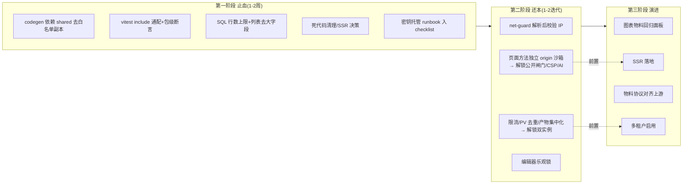

# 13 - 技术债务与演进建议

> 项目：运营搭建平台（vue3-course） ｜ 版本：v1.1 ｜ 生成日期：2026-10-06 ｜ 依据：源码分析

本篇汇总散落在源码注释里的 ⚠️ 项与 TODO、口径不一致处、死代码，逐条给出位置、证据、影响与处置建议，最后给出一份分阶段的演进路线图。判读标准：源码注释里自我标注的债务优先采信（作者已意识到），本篇补充影响面与量化；无法从源码确认的标 `⚠️ 待确认`。与 08 篇第 10 节（安全隐患清单）互为补充：那里只谈安全，这里谈全部。

## 1. 源码自我标注的债务（⚠️ / TODO 逐条）

| # | 位置与证据 | 内容 | 影响与建议 |
| --- | --- | --- | --- |
| 1 | `packages/work-server/src/util/net-guard.ts` 15-17 行 ⚠️ | SSRF 防线的先天残留："DNS rebinding、NAT64 前缀（64:ff9b::/96）、IPv4-translated（::ffff:0:a.b.c.d）"，注释明说"字符串校验拦不住，需解析后校验 IP / 连接固定 IP 才能解，本批不修" | API 数据源可被构造为解析到内网的公网域名（rebinding）。建议：解析域名后对返回的全部 A/AAAA 记录逐个过 isPrivateHost 再连接（fetch 前自定义 lookup），或出网走固定代理。优先级：中（需能配数据源的作者身份） |
| 2 | `packages/work-server/src/util/secret-box.ts` 16 行 ⚠️ | "生成后必须长期稳定保存——密钥丢失 = 所有下游数据源凭据不可恢复" | 密钥托管纯靠运维纪律（.env 明文落盘）。建议：接入 KMS 或至少加密的密钥文件 + 离线副本制度；轮换脚本已完备（`db:decrypt-secrets`/`db:encrypt-secrets`），托管是缺的那半。优先级：高（一次事故即不可逆） |
| 3 | `packages/business/src/drag/drag.vue` 61 行 TODO | "使用 structuredClone 或深拷贝库替代 JSON.parse(JSON.stringify())" | 页面线拖拽的深拷贝热点；JSON 序列化丢 undefined/函数/Date。建议：Node 17+/现代浏览器均可用 `structuredClone`，机械替换即可。优先级：低 |
| 4 | `README.md` 206 行 ⚠️ | WHATWG URL 把 `[::ffff:127.0.0.1]` 规范化成十六进制导致点分正则失配（`ipv4FromIpv6` 已修，README 把它留作认知警示） | 已修复项的"知识债务"：新增校验逻辑时容易再犯。建议：把该案例写进 lint 规则注释或团队 checklist，代码内 `net-guard.ts` 34-40 行注释已足够 |
| 5 | `README.md` 255 行 ⚠️ | "新增包必须显式归入某一侧（vitest 分线）：漏掉的包不会被任何 project 收进去，等于静默不跑" | 结构性风险：新建包若同时没进 `vitest.config.js` include，测试静默消失且 CI 全绿。建议：给 vitest 配 `packages/*/__tests__/**/*.test.ts` 通配 include（按包粒度），或在 CI 加"每个含 `__tests__` 的包必须被某 project include"的断言脚本。优先级：中 |

## 2. 已知安全债（08 篇详述，此处仅入账）

页面方法 `AsyncFunction` 无沙箱执行（当前靠公开闸门收窄暴露面，根治待"独立 origin 沙箱/批次三"，`packages/work-server/src/util/page-methods-guard.ts` 头注释与 README 安全基线均有标注）；AI 端点是"当前唯一零门槛的滥用面"（`packages/work-server/src/router.ts` 180 行注释原文，上游按 token 真实计费）；portal 令牌 cookie 落在站点根路径（`access-gate.ts` 17 行）；`dashboard_info.access_mode` 库默认 `public`（新建即公开，`page-methods-guard.ts` 16-18 行注释特意点出）；限流计数故障 fail-open。处置建议见 08 篇第 10 节，路线图见本篇第 5 节。

## 3. 口径不一与重复实现

1. **样式白名单双份**。`packages/shared/src/schema/index.ts` 的 `COMPONENT_STYLE_KEYS` 与 `packages/dashboard-codegen/index.ts` 77-97 行的本地副本（后者注释自认"本包不依赖 shared，改动两处需同步"）。两份漂移的后果是"画布能设置的样式出码后丢失"。建议：dashboard-codegen 改为 workspace 依赖 `@my/shared`（它已在 monorepo 内，`packages/dashboard-codegen/package.json` 加依赖即可，"独立 Node 流程"的理由不成立——shared 是零依赖纯函数包）。
2. **JSON 列解析的收敛史与新风险**。`packages/server-kit/src/db.ts` `parseJsonText` 的注释点名"看板线曾在 5 个文件各写一份 parseSchemaJson，失败兜底还不一致"——已收敛，但 `packages/portal-server/src/service/page.ts` 46 行注释显示页面线历史上还有"遇对象即 500"的独立实现。新增读 JSON 列的代码必须走 server-kit 两个函数，code review 时可作固定检查项。
3. **图表物料的"面板移除、运行时保留"双口径**。`packages/charts/src/index.ts` 23-26 行：面板不可新增 chart 类型（2026-09 产品决策），运行时仍兼容存量 chart 组件，`/Chart$/` 兜底勿删。风险在"清理运动"：后来者容易把 charts 里的图表组件当死代码删掉，导致存量看板渲染炸。建议：在 `allComponentMetas` 与 `runtime-renderer.ts` 之间加一条注释互指，或加一条守卫测试（构造 chart 类型实例断言渲染不抛错）。
4. **`work-front` 对 vue-router 的幽灵依赖**。README"两个桶"节：构建末尾 `copyVueRuntimeLib` 从 `packages/work-front/node_modules/vue-router/dist/` 硬拷 global 产物，"即使访客端源码零引用也不能删，删了构建直接 ENOENT"。建议：把该硬依赖从隐式约定变成构建前置检查（脚本里 existsSync + 明确报错文案），或在 package.json 加注释字段说明。
5. **两次"测试密钥"事实来源**。`vitest.config.js` setup 固定 `SECRET_BOX_KEY`（`packages/work-server/__tests__/setup.ts`）与 `.github/workflows/ci.yml` 的同名占位值是两处手写同一常量；漂移的后果是 CI 与本地对密文行的互不兼容（已回源核实：两处当前为同一固定值，一致）。建议：CI 直接引用 setup.ts 同值或抽到共享常量文件。

## 4. 死代码、半成品与历史包袱

| 项 | 位置 | 证据 | 建议 |
| --- | --- | --- | --- |
| 注释掉的页面 CRUD 路由 | `packages/work-server/src/router.ts` 25-27、222-223 行 | `// createPageInfo` / `// router.post('/api/post/page-info/create', …)` 整段注释，真实入口是 `page-info-ready` | 确认无回退计划后删除（git 历史可找回） |
| PASSWORD_SALT 废弃 | `.env.example` 18-20 行 🔴 | bcrypt 已接管，盐仅迁移期需要 | 全部账号登录一次后从 .env 删除；`user.ts` 的 HMAC 校验分支随迁移完成一并下线 |
| SSR 半成品 | `packages/work-front/src/ssr/`、`scripts/build-work-front-ssr.ts` | 构建脚本每次都编译 SSR 代码（build-work-front.ts 末尾"开始编译前端项目页面SSR代码"），但 portal 的 `/d/:uuid` 是 CSR（`ssrHtml: ''` 空串注入，controller/dashboard.ts 97 行） | 两条路二选一：落地 SSR（首屏价值真实存在）或删掉编译步骤与目录；现状是每次构建白付时间 |
| 构建产物混入 src | `packages/work-server/src/public/cdn/page*/…`、`packages/mocks/mock-cdn/public/` | 示例页面产物（1.0.0 版本目录）在源码树内；mock-cdn 的 public 是工作目录 | 前者应随种子数据生成而非提交产物（git 追踪状态已核实：`git ls-files packages/work-server/src/public/` 仅 2 个文件入库——esm/preview-esm.js 与 index.css，其余产物未追踪，风险限于本地工作区）；后者加 .gitignore + README 说明"清空后由回源镜像自动重建" |
| demos 目录 | `demos/` | 00 篇已注明"独立 html/js 演示脚本，不属于 workspace" | 保留即可，勿混入构建 |
| `start:work-process` 与 `start:work-daemon` 双入口 | 根 `package.json` 44-45 行 | 两个守护启动脚本并存（start.cjs / start-daemon.cjs） | 已回源核实两者差异：都是 cluster 按 CPU 核数 fork 多 worker、入口同为 `dist/index.cjs`，唯一差别是 daemon 版带崩溃 refork（`cluster.on('exit'/'disconnect')` 自动补位，上限 1000 次），`start:work-process` 无 refork、worker 退出即减员。README 只推荐 daemon；确认无消费场景后可收敛删除 `start:work-process`（14 篇第 2 节已同步此结论） |

## 5. 架构级约束（债务的"利息"）

1. **单实例约束**（`docs/plans/deploy-ops-2026-09.md` 第七节）：PV 去重的进程内存态、memory 限流桶、构建产物落盘本地盘，三处决定当前是"单机多服务"而非可水平扩展集群。利息表现为：任何一次双实例部署都会出现"限流额度翻倍、PV 重复计数、产物 404"。
2. **`build:module`/`build:css` 必须成对**：构建顺序耦合（README 警告），新脚本或新共享包加入时同类耦合还会增加。根治是让 `build:module` 不清他人 dist（按包输出），属于一次性还本。
3. **列表全量 schema**（`packages/work-server/src/service/dashboard.ts` 353-356 行注释自认）：传输量随看板数量线性增长，与 10 篇第 3 节的优化建议对应。
4. **无协作锁**：并行编辑同一看板是全量覆盖语义（rename 已拆独立端点缓解，schema 仍覆盖），多人协作场景需引入乐观锁（updatedAt 比对）或 CRDT。

## 6. 演进路线图

三阶段路线的时间与依赖关系如下图：第一阶段全部可与日常版本并行；第二阶段里"页面方法沙箱"是周期最长的一项，但它同时解锁公开闸门、CSP 收紧与 AI 补丁三条线，值得尽早启动；第三阶段依赖产品决策反转或第二阶段的地基（SSR 依赖沙箱域，图表回归依赖面板过滤逻辑）。每一项都对应前文的具体编号，还账时可回溯证据：

**第一阶段：止血（1-2 周，随版本发布即可做）**
- `dashboard-codegen` 改依赖 `@my/shared`，删除白名单副本（第 3 节第 1 条）；
- vitest include 补通配 + 包级断言（第 1 节 #5）；
- SQL 数据源行数上限 + 列表接口剔除 schema 大字段（10 篇清单前两项）；
- 删除 router.ts 注释死代码与（决策后）SSR 编译步骤；
- 文档化"密钥托管三件套"（密码管理器副本 + 每日备份 + 轮换 runbook，deploy-ops 已有，补进上线 checklist）。

**第二阶段：还本（1-2 个迭代）**
- net-guard 升级为"解析后校验 IP"（DNS 解析钩子 + 全记录校验），同时覆盖 NAT64/translated 残留（第 1 节 #1）；
- 页面方法沙箱：独立 origin 渲染访客页（`/d/:uuid` 内容移到沙箱域，主域经 postMessage 传递 boot 数据）——这是公开闸门、CSP script-src、AI 补丁三条线的共同前置，落地后可放开 `ALLOW_PAGE_METHODS_ON_PUBLIC` 相关拦截并下发严格 CSP；
- 限流/PV 去重/产物存储集中化，解锁双实例部署（第 5 节第 1 条）；
- 编辑器乐观锁（保存带 base 版本号，冲突时提示合并）。

**第三阶段：演进（按产品节奏）**
- 图表物料回归面板（产品决策反转时），同步补出码 vendor 与面板过滤用例；
- SSR 落地（若第二阶段保留）：/d/:uuid 首屏直出，配合 boot 内联已是现成数据源；
- 物料协议与 TinyEngine 上游对齐升级（`tiny-engine-borrow-plan.md` 中未落地项按需重启）；
- 多租户启用：`visibility.ts` 的租户语义已就绪（`DEFAULT_TENANT_ID` 回退设计保证零迁移），差的是管理侧分配租户的入口（文件头注释已预留此判断）。

路线图的总原则与仓库既有风格一致：**每个债务项都有注释记账、每笔还本都先有测试兜底**（09 篇的守护用例清单就是账本的兑现形式）。接手者不必一次性清账——按"出问题的概率 × 爆炸半径"排期，但在动相关代码时必须先读对应守护用例（README 安全基线末尾的原话），这是这个仓库最低成本的质量策略。
