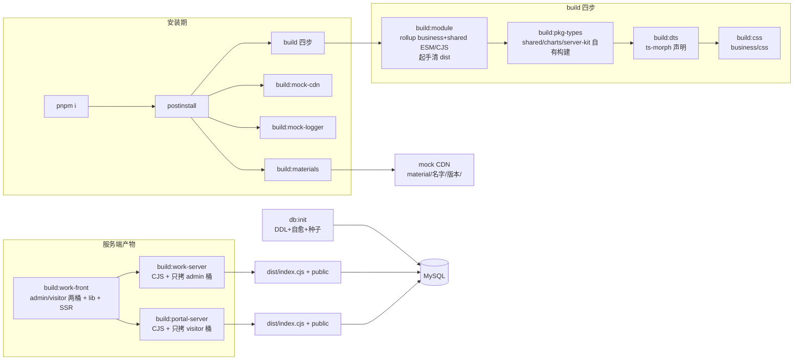

# 14 - 配置与环境详解

> 项目：运营搭建平台（vue3-course） ｜ 版本：v1.1 ｜ 生成日期：2026-10-06 ｜ 依据：源码分析

本篇是配置与环境的手册级速查：环境变量全清单（含缺失后果与读取点）、根 `package.json` 全量脚本说明、构建链路详解、部署运维要点（`docs/plans/deploy-ops-2026-09.md` 的硬约束展开）。06 篇覆盖"怎么跑起来"，本篇覆盖"每个配置项与每条命令到底干了什么"。所有环境变量集中在根 `.env`（dotenv 由 `packages/server-kit/src/http-security.ts`、`packages/server-kit/src/db.ts`、`packages/work-server/src/config.ts` 各自加载；server-kit 特意先于宿主包完成加载，因为阈值白名单在模块体内读环境变量）。

## 1. 环境变量全清单

在读清单之前，先建立四个全局认知，它们决定了"配置写在哪、何时生效、谁在读"：

**加载时机与多次加载**。dotenv 在三个模块各自调用 `dotenv.config()`（`packages/server-kit/src/http-security.ts`、`packages/server-kit/src/db.ts`、`packages/work-server/src/config.ts`），其中 server-kit 特意安排在宿主包 config 之前加载——因为限流阈值与 CSRF 白名单是在**模块体**里读环境变量的，晚了就拿不到。对使用者的含义是：环境变量必须在进程启动前就位（`.env` 文件或真实环境变量），运行中改 `.env` 不会热生效，必须重启进程；同一变量被多个模块读取时以先加载者为准，不存在覆盖问题（dotenv 不覆盖已存在的环境变量）。

**读取时机分两类**。多数配置在模块加载时固化（如 `jwtConfig.secret`、端口、限流阈值），重启才生效；少数刻意延迟到调用时读取——`secret-box.ts` 的 `masterKey()`、`page-methods-guard.ts` 的 `isPageMethodsGateDisabled()`、`net-guard.ts` 的私网开关，注释都写明是为了"测试里临时注入/还原"与运行时调整。排查配置问题时先分辨这两类，否则会出现"改了 .env 却发现行为没变"或反过来"没重启却生效了"的困惑。

**读取点即权威口径**。下表"读取点"列给出的就是每个变量唯一的（或主要的）消费代码位置；`.env.example`（103 行）是带完整注释的模板，三方（本表、example、代码）若出现不一致，以代码为准并回来修文档。

**密钥三件的生成口径统一**：`openssl rand -hex 32`。JWT_SECRET 与 INTERNAL_TOKEN 是"对上暗号即可"的对称密钥，泄露可换；SECRET_BOX_KEY 是数据加密密钥，**泄露等于凭据裸奔、丢失等于凭据作废**，两者的应急响应完全不同（前者换掉重发登录态，后者要走"旧钥解密→换钥→重加密"的轮换流程）。

### 1.1 数据库与密钥（决定能否启动）

| 变量 | 必填 | 默认 | 读取点 | 缺失/错误的后果 |
| --- | --- | --- | --- | --- |
| `MYSQL_HOST` / `MYSQL_PORT` / `MYSQL_DATABASE` / `MYSQL_USER` / `MYSQL_PASSWORD` | 是 | 127.0.0.1 / 3306 | `packages/server-kit/src/db.ts`（运行时连接池）、`packages/init-database/src/util.ts`（db:init 另持一个不含库名的池用于建库） | 探活失败：测试静默跳过（`REQUIRE_DB=true` 时硬失败）；服务启动不拦但请求期报错 |
| `JWT_SECRET` | 生产必填 | 空 | `packages/work-server/src/config.ts` 6 行 | 生产模式拒绝启动（`packages/work-server/src/index.ts` 38-47 行）；开发仅 warn——空密钥时登录态可被任意伪造。生成 `openssl rand -hex 32` |
| `SECRET_BOX_KEY` | 库中已有密文即必填 | 空 | `packages/work-server/src/util/secret-box.ts` 30-46 行（64 hex 或 base64，解码须 32 字节） | 库中有 `enc:v1:` 行而缺失 → 启动即退（index.ts 101-118 行异步预检）；丢失 = 全部凭据不可恢复；轮换必须先解后加密 |
| `PASSWORD_SALT` | 迁移期保留 | — | `packages/work-server/src/service/user.ts` | 🔴 已废弃：旧 HMAC 口令校验依赖；缺失则老账号登录失败。全部账号登录一次后可删 |
| `INTERNAL_TOKEN` | 对外部署强烈建议 | 空（通道禁用，fail-closed） | `packages/work-server/src/config.ts` 11 行 + portal 侧 config | 未配置时 portal 取数一律 403「数据查询通道未配置」；两进程必须同值 |
| `REQUIRE_DB` | 仅 CI | 空 | `packages/work-server/__tests__/setup.ts` | true 时数据库探活失败直接中断测试（否则约 20 个真库用例静默跳过——"假绿"） |
| `DB_AVAILABLE` | 自动 | 自动 | 同上（探活后写入） | 手工设置无意义，供 `dbDescribe` 门控读取 |

### 1.2 服务拓扑与反代

| 变量 | 默认 | 读取点 | 说明与缺失后果 |
| --- | --- | --- | --- |
| `WORK_SERVER_PORT` / `PORTAL_SERVER_PORT` | 8001 / 6001 | 两个服务端 `index.ts` 末行 | 开发生产同机并跑、CI 并行错开端口时改 |
| `WORK_SERVER_ORIGIN` | `http://127.0.0.1:8001` | `packages/portal-server/src/config.ts` | portal 转发取数的目标地址；指向不可达地址 → 「数据查询通道不可用」 |
| `TRUST_PROXY` | 空 | `packages/server-kit/src/http-security.ts` 32 行 | 反代（TLS 终结在 nginx）时置 1 才采信 X-Forwarded-For/Proto。不置的后果：限流把所有访客算同一 IP、cookie 不带 Secure、HSTS 不下发 |
| `CSV_UPLOAD_DIR` | `./uploads` | `packages/work-server/src/router.ts`（koa-body formidable） | CSV 上传暂存目录；不可写时上传失败 |

### 1.3 安全开关与限流阈值

| 变量 | 默认 | 读取点 | 说明 |
| --- | --- | --- | --- |
| `CSRF_ALLOWED_ORIGINS` | 空（仅同源） | `http-security.ts` 66-73 行 | 状态变更请求的跨源白名单（逗号分隔，比主机名不比协议端口，localhost/127.0.0.1 互认）；同域部署留空 |
| `RATE_LIMIT_STORE` | memory | `http-security.ts` 155-160 行 | memory=进程内（重启清零、多 worker 各算各的）；mysql=集中式 `rate_limit_bucket` 表（随 db:init 自建，对外部署建议） |
| `RATE_MAX_SIGN_IN=20` / `RATE_WINDOW_SIGN_IN_MS=600000` | — | router.ts（envInt） | 登录限流，IP 桶，0 关闭 |
| `RATE_MAX_SIGN_UP=10` / `RATE_WINDOW_SIGN_UP_MS=3600000` | — | 同上 | 注册限流 |
| `RATE_MAX_TOKEN_VERIFY=20` / `RATE_WINDOW_TOKEN_VERIFY_MS=600000` | — | `packages/portal-server/src/router.ts` | 令牌验证（看板/页面共用一桶） |
| `RATE_MAX_PORTAL_QUERY=300` / `RATE_WINDOW_PORTAL_QUERY_MS=60000` | — | 同上 | 门户取数（首屏并发多条，额度放宽） |
| `RATE_MAX_FRONT_LOG=120` / `RATE_WINDOW_FRONT_LOG_MS=60000` | — | 同上 | 前端日志上报 |
| `RATE_MAX_AI_BURST=20` / `RATE_WINDOW_AI_BURST_MS=60000` / `QUOTA_MAX_AI_DAILY=200` | — | `packages/work-server/src/middleware/quota.ts` | AI 用户桶：短窗口 + 自然日双档，按 user.uuid 计 |
| `RATE_MAX_CODEGEN_BURST=30` / `RATE_WINDOW_CODEGEN_BURST_MS=60000` / `QUOTA_MAX_CODEGEN_DAILY=100` | — | 同上 | 出码用户桶 |
| `QUOTA_TZ_OFFSET_MINUTES=480` | 480 | 同上 | 日配额重置时区（分钟偏移，480=东八区 00:00 恢复） |
| `DATA_QUERY_DENY_PRIVATE` | 空=拒绝内网 | `packages/work-server/src/util/net-guard.ts` 91 行 | 置 false 放行内网出网（恒定黑名单不受影响）；启动打 warn |
| `ALLOW_PAGE_METHODS_ON_PUBLIC` | 空=拦截 | `packages/work-server/src/util/page-methods-guard.ts` 25-29 行 | 置 1 关闭"含方法体看板禁止公开"的两条拦截；明确接受风险才开 |
| `NODE_ENV` | — | `packages/work-server/src/index.ts` 42 行 | `production` 时 JWT_SECRET 自检硬失败；portal 模板开发/生产分支也读它 |

### 1.4 AI 上游

| 变量 | 读取点 | 说明 |
| --- | --- | --- |
| `AI_API_URL` / `AI_API_KEY` / `AI_MODEL` | `packages/work-server/src/controller/ai.ts` 21-27 行 | OpenAI 兼容上游（示例 deepseek）；三者任缺其一会话时返回明确错误；密钥只在服务端，前端经 SSE 代理 |

## 2. 根 package.json 脚本全量说明

脚本体系的组织逻辑值得先讲清楚再查表。根 `package.json` 是唯一的脚本中枢，全部构建/开发/数据库脚本都经 **vite-node 执行 `scripts/*.ts`**——这些是 TypeScript 脚本而非 shell，因此能直接复用 packages 内的模块（例如 `build-work-front.ts` import 了 `packages/build/vite-config` 的共享构建配置，`migrate-secrets.ts` 直接 import work-server 的 `secret-box`/`config-secrets` 源码，保证迁移脚本与运行时使用同一份字段清单）。这个设计的推论是：**脚本与源码同步演化**，不存在"文档里的命令与代码脱节"的问题，但代价是跑脚本前依赖必须装好（脚本本身也走 TS 类型检查）。

两套运行模式的本质区别：生产模式（`start:*`）先构建出 `dist/index.cjs` 单文件再 `node` 直跑，前端以静态产物被服务端托管；开发模式（`dev:*`）用 nodemon + ts-node 直跑服务端源码、用 Vite dev server 跑前端（源码直出、按需编译）。因此"改了代码不生效"在两种模式下原因不同：生产模式是没重新构建（或构建了没重启），开发模式是 nodemon/watch 的 watch 范围没覆盖到改动文件（服务端只 watch 各自 src，前端 Vite 全量感知）。

cluster 类启动（`start:work-process`/`start:work-daemon`）按 CPU 核数 fork 多个 worker（daemon 版额外带崩溃 refork，上限 1000 次），入口都是构建产物 `dist/index.cjs`。这带来一个容易被忽略的配置后果：`RATE_LIMIT_STORE=memory` 时每个 worker 各持一份限流桶，标称阈值实际被放大了 worker 倍——对外部署务必配 mysql 计数。两个 cluster 脚本并存的取舍已核实（13 篇第 4 节）：唯一差别是 daemon 的崩溃 refork，`start:work-process` 是无 refork 的同型脚本。

### 2.1 构建族

| 脚本 | 干什么 | 关键细节 |
| --- | --- | --- |
| `build` | 完整构建：`build:module && build:pkg-types && build:dts && build:css` | 四步有顺序依赖，**不要拆开单跑**（见 2.1.1 与 2.1.4） |
| `build:module` | `vite-node scripts/build-module.ts`：rollup 出 `@my/business` + `@my/shared` 的 ESM/CJS 到各包 dist | **起手 `removeDist` 清空目标包 dist**——这就是"与 build:css 必须成对"的根源 |
| `build:pkg-types` | `pnpm --filter @my/shared --filter @my/charts --filter @my/server-kit run build`：三包自有 tsc/vite 构建 | charts 是 vite build 在前、dts 在后（已固化在包内脚本） |
| `build:dts` | `vite-node scripts/build-dts.ts`：ts-morph 生成类型声明，构建前先 `checkPackageType` 全量诊断，0 error 才继续 | 声明文件错不会静默发布 |
| `build:css` | `vite-node scripts/build-css.ts`：less 编译出 `business/css/index.css` | 依赖 build:module 之后的目录状态 |
| `build:work-front` | `scripts/build-work-front.ts`：一个包两个产物桶（admin/visitor），各入口 lib 模式构建，末尾 `copyVueRuntimeLib` 两桶各拷一份 vue/vue-router global 产物，再跑 SSR 编译 | 见 07 篇第 4/11 节的桶隔离 |
| `build:work-server` | work-server 打 CJS 单文件（dist/index.cjs）并只拷 admin 桶静态产物（剥前缀） | 拷贝即"桶隔离"的执行点 |
| `build:portal-server` | 同构，只拷 visitor 桶 | 保证 portal 公开目录永不含编辑器代码 |
| `build:work` / `build:portal` | 前端 + 对应服务端的组合命令（先 build:work-front 再打服务端） | `start:work`/`start:portal` 内部会再调 |
| `build:materials` | `scripts/build-materials.ts`：物料包 vite lib 构建（esm/cjs/iife + css）+ typescript-json-schema 生成 props.schema.json + 推 mock CDN 按版本号目录 | 物料不升版本号等于白改 |
| `build:mock-cdn` / `build:mock-logger` | 两个 mock 包构建 | postinstall 自动跑 |

### 2.2 运行族

| 脚本 | 干什么 | 关键细节 |
| --- | --- | --- |
| `postinstall` | `npm run build && build:mock-cdn && build:mock-logger && build:materials` | **`pnpm i` 即完成整包构建**；CI 用 `--ignore-scripts` 跳过以便分步定位 |
| `start:work` | `build:work` 后 `node packages/work-server/dist/index.cjs` 单进程起 8001 | 生产模式 |
| `start:portal` | `build:portal` 后 `node packages/portal-server/dist/index.cjs` 起 6001 | 访客门户 |
| `start:work-process` / `start:work-daemon` | 经 `packages/work-server/start.cjs` / `start-daemon.cjs` 以 **cluster 多进程**启动（按 CPU 核数 fork worker；daemon 版额外带崩溃 refork，上限 1000 次——已核实这是两脚本唯一差别） | 多 worker 下 memory 限流桶各 worker 各算各的（⇒ 更要用 `RATE_LIMIT_STORE=mysql`）；取舍结论见 13 篇第 4 节 |
| `dev:work-server` / `dev:portal-server` | `NODE_ENV=development nodemon + ts-node` 直跑 src/index.ts | watch 各自 src；开发模式 JWT_SECRET 缺失只 warn |
| `dev:work-front` / `dev:portal-front` | `vite-node scripts/dev-work-front.ts|dev-portal-front.ts` | 同一个 work-front 包的两个 dev server：8002（`/api` 代理到 8001）与 6002（`/api` 转 8001、其余转 6001）；开发页面用 8002 |
| `dev:business` / `dev:banner` / `dev:products` | 共享包/物料的独立 vite 开发模式（物料用 `vite.config.common.ts`） | 物料开发完必须升版本再 build:materials |

### 2.3 数据库族与质量族

| 脚本 | 干什么 | 关键细节 |
| --- | --- | --- |
| `db:init` | `vite-node packages/init-database/src/index.ts`：建库建表 + ensureColumns 老库自愈 + 幂等种子 | **必须先于新版代码上线**（列宽放宽，否则 1406）；重跑安全 |
| `db:query` | `packages/init-database/src/select.ts`：命令行查库小工具 | 排查数据用 |
| `db:encrypt-secrets` / `db:decrypt-secrets` | `scripts/migrate-secrets.ts`（后者加 `-- --decrypt`）：存量凭据加密/解密迁移 | 自带两道门禁（密钥合法 + password 列宽 ≥1024），不满足 exit 1；支持 `--dry-run` |
| `test` / `test:update` / `test:bench` | vitest 全量两线 / 快照更新 / 基准 | 分线见 09 篇 |
| `coverage` | vitest --coverage（v8，分母 `packages/*/src/**`，all: true） | 无阈值门禁 |
| `typecheck`（及 :web/:node/:tests） | vue-tsc + tsc + 两份 `__tests__` tsconfig，全量 0 error | CI 硬门禁；`__tests__` 纳入是踩坑后的决定 |
| `lint` / `lint:fix` | eslint（packages + scripts，卡 error 不卡 warning） | CI 硬门禁 |
| `clear` / `clean` | 清 node_modules/dist / 连 src/public/cdn 一起清 | clean 会删服务端镜像落盘的 CDN 产物，清后需重新构建+回源 |

## 3. 构建链路详解

构建链路的目标可以概括为一句话：把"一个前端包、两个服务端、若干共享包、两个物料包"组装成**两个可独立部署的目录**（`packages/work-server/dist` 与 `packages/portal-server/dist`），每个目录里都有自己的一份服务端单文件、自己的一份静态产物桶、以及按需回源补齐的 CDN 资源。理解了"一切构建都服务于这两个部署目录"，下图的每条边就都有了动机：

要点复述（细节已在 06/07 篇）：① 共享包是"先出 dist 再被消费"——改 src 必须重建对应包；② `build:module` 清 dist 与 `build:css` 产出 CSS 的顺序耦合是唯一会"构建成功但运行报错"的组合；③ 服务端构建的"拷桶剥前缀"让浏览器 URL 与合并前一致（`/public/dist/page/app.js`、`/public/dist/page/dashboard.js`）；④ `packages/work-server/src/public/dist` 是指向 `work-front/dist` 的符号链接（.gitignore 忽略，仅 8001 生效）。升级发布的固定动作（deploy-ops 第八节）：`git pull` → `pnpm i`（lockfile 变更时）→ `npm run db:init` → `npm run build` → `start:work` + `start:portal`（或 daemon 重启），冒烟三连（登录、发布一个看板、访客 `/d/:uuid` 能取数）。

## 4. 部署运维要点（deploy-ops 硬约束展开）

`docs/plans/deploy-ops-2026-09.md` 是十六份设计文档里唯一面向"把平台架到真实服务器上的人"的运维手册，特点是"只讲怎么做、按什么顺序"，而"为什么"分散在 README 安全基线与源码注释里。本节把它逐条展开并补上每条约束背后的机理，让执行者知道哪几步跳了会炸、炸成什么样。八条要点按上线的时间顺序排列，前两条（顺序、密钥）是硬约束，跳过的后果是即时故障（1406、启动自检退出）；中间四条（轮换、默认账号、哈希迁移、限流口径）是"不炸但埋雷"；最后两条（单实例、CI 口径）决定架构演进的边界。执行完毕后务必跑冒烟三连再宣告上线完成。

1. **顺序不可跳**：`.env` 就绪 → `db:init` → 构建 → 启动。把 `db:init` 放在上线之后是唯一的"代码正确但线上炸"路径（1406）。
2. **密钥托管**：.env 全文（含三个密钥）进密码管理器/离线保险库一份，服务器只留运行副本；SECRET_BOX_KEY 丢失不可恢复，**不存在"重置密钥"操作，只有"恢复密钥"或"全部凭据作废重录"**。数据库每日备份（mysqldump `--single-transaction`，保留 14 天的 crontab 样例见 deploy-ops 第三节）。
3. **密钥轮换**：`SECRET_BOX_KEY=<旧> npm run db:decrypt-secrets` → 换 .env → `SECRET_BOX_KEY=<新> npm run db:encrypt-secrets` → 编辑器"测试连接"全部通过 + 两条 SELECT 确认 `enc:v1:` 前缀。轮换后重启 work-server（连接池持有旧解密口令）。
4. **默认账号**：db:init 写入 admin001（管理员）/admin002（只读），初始密码都是 88888888，**上线立刻改密**；登录页"一键登录"后门已删除，旧版本升级要确认线上构建包含该改动。
5. **口令哈希迁移**：新口令 bcrypt；存量 HMAC 登录成功时透明重哈希；迁移完成（`password NOT LIKE '$2%'` 计数归零）后删除 PASSWORD_SALT。迁移期内该值必须与历史一致。
6. **限流口径**：对外部署 `RATE_LIMIT_STORE=mysql` + `TRUST_PROXY=1`；daemon/cluster 多 worker 时 memory 桶是每 worker 一份（额度实际翻倍于标称值）；量级上来后限流上移网关层（nginx limit_req），应用内退为兜底。
7. **单实例约束**：cluster/daemon 是单机多进程不是多实例集群；横向扩容前解决 PV 去重内存态、产物落盘（共享盘/对象存储）、限流集中化三件事。
8. **CI 环境变量**是独立口径（`vue3_course_ci` 库 + 占位密钥 + `REQUIRE_DB=true`），不要复用生产 .env；本地复现 CI 用例行为时对照 `.github/workflows/ci.yml` 的 env 块。
