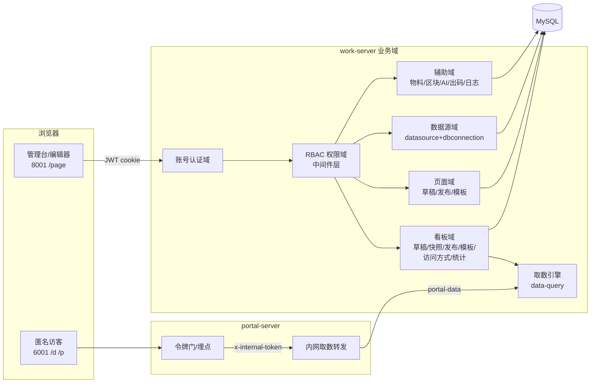

# 15 - 接口全量参考

> 项目：运营搭建平台（vue3-course） ｜ 版本：v1.1 ｜ 生成日期：2026-10-06 ｜ 依据：源码分析

本篇是两个 Koa 服务端的端点速查手册，按 `packages/work-server/src/router.ts`（565 行）与 `packages/portal-server/src/router.ts`（63 行）逐条整理，末尾附看板页面 schema 的 JSON 结构速查。03 篇讲接口组织约定与核心示例，本篇是全量查表用；鉴权模型细节见 08 篇，schema 字段语义见 04 篇第 4 节。

## 0. 业务域总览



**通用约定**（03 篇第 1 节）：写与动作走 `/api/post/*`、读走 `/api/get/*`；响应统一 `{ data, success, message }`；HTTP 状态码只表达传输层事实——401 未登录（`requirePermission`/`filterLoginStatus`）、403 无权限/无令牌/跨站拒绝、404 资产不存在（发布行/静态资源）、429 限流（带 `Retry-After`）、503 portal 库层故障友好页；可预期业务失败一律 HTTP 200 + `success:false`。**鉴权列**缩写：`登录`=filterLoginStatus；`码(x)`=requirePermission(x)（隐含登录）；`内部`=x-internal-token 头校验；`无`=匿名可达。除特殊标注外，权限判定之外的资产级读写规则（owner/visibility）见 08 篇第 5 节，不逐行重复。

**分页与列表约定**：凡"列表"端点接受 `pageNum`/`pageSize`（默认 10，`packages/work-server/src/util/pagination.ts` 的 `clampPage` 统一钳制非法值与上限，四条线共用），可选 `keyword` 模糊匹配名称；看板列表另有 `visibility` 过滤与 `scope=all|mine`（"全部可见 | 我拥有的"切换，SQL 条件来自 `visibilityWhere`）。列表响应统一为 `{ list, total, pageNum, pageSize, keyword? }`。**修改类端点没有部分更新语义**：看板 update 是全量 schema 上送（这正是 rename 拆成独立端点的原因），调用方切勿用读到的旧详情整体回写。**幂等与并发**：发布 prod 在事务内行锁自增版本，重复点击不会产生重号，但会产生连续两个版本；删除与恢复互为逆操作且都只对草稿行生效。**时间字段**统一 `modify_time`（ON UPDATE 自动维护）与 `create_time`，接口层以驼峰 `modifyTime`/`createTime` 下发。


## 1. work-server :8001 端点全表

### 1.1 账号与认证（controller/user.ts）

| 方法 | 路径 | 用途 | 鉴权 | 入参 | 响应/备注 |
| --- | --- | --- | --- | --- | --- |
| POST | `/api/post/account/sign-in` | 登录，签发 JWT cookie `online-status` | 无（限流 20/10min/IP） | `{username, password}` | 成功 Set-Cookie（HttpOnly+Lax，TTL 1h）；失败 `success:false`，文案「登录失败，用户名称或密码错误」（已核实 service/user.ts：无此用户/密码错/缺参数同文案，防用户枚举） |
| POST | `/api/post/account/sign-up` | 注册，默认绑 viewer | 无（限流 10/1h/IP） | `{username, password}` | 用户名冲突/复杂度不足报业务错（service/user.ts 141 行注释：复杂度属产品策略） |
| GET | `/api/get/account/sign-out` | 登出清 cookie | 无 | — | 302 → `/`；cookie 属性与签发一致才能清掉 |
| GET | `/api/get/account/online` | 当前用户（含角色/权限码） | 无 | — | 未登录返回 `{data:{username:null,uuid:null}}` + success:true |
| POST | `/api/post/account/password` | 改密（身份取登录态防代改） | 登录 | `{oldPassword, newPassword}` | 服务端校验原密码；成功后旧 HMAC 行透明重哈希为 bcrypt |
| GET | `/page/:pageName(/:subPageName)` | 管理端 HTML 渲染 | `checkAccountOnlineStatus`（白名单 `/page/sign-in|home|sign-out|preview|sign-up` 匿名） | — | 未登录 302 登录页 |
| GET | `/preview/:pageUuid/:version/:type` | 已发布页面预览 | 无（对外分享即此链接） | — | HTML |
| GET | `/preview-test/…`、`/preview-pre/…` | 未发布草稿预览 | 登录 + `checkPageAccess` 可见权 | — | 未登录 401、无权 403 + HTML 提示页 |

### 1.2 看板域——草稿与资产（controller/dashboard.ts，service/dashboard.ts）

| 方法 | 路径 | 用途 | 鉴权 | 入参 | 响应/备注 |
| --- | --- | --- | --- | --- | --- |
| POST | `/api/post/dashboard/create` | 新建看板 | 码(dashboard:create) | `{name, description?, schemaJson, visibility?, departmentId?}` | 名称 normalize+128 上限；owner 取当前用户 |
| POST | `/api/post/dashboard/update` | 全量更新草稿 | 码(dashboard:update) + 仅所有者 | `{uuid, name, schemaJson, description?, visibility?}` | 成功后自动打 `source='save'` 快照（保留 30 条，失败不阻断保存） |
| POST | `/api/post/dashboard/rename` | 仅改名 | 码(dashboard:update) + 所有者 | `{uuid, name}` | 不整体回写，防并发旧 schema 覆盖（路由注释） |
| POST | `/api/post/dashboard/visibility` | 设可见范围 | 码(dashboard:update) + 所有者 | `{uuid, visibility: private/department/public}` | 非法值直接拒绝；department 按当前用户部门落库 |
| POST | `/api/post/dashboard/delete` | 软删 | 码(dashboard:delete) + 所有者 | `{uuid}` | 事务级联：草稿+三阶段表+快照全部置 0 |
| GET | `/api/get/dashboard/detail` | 草稿详情 | 码(dashboard:view) + 可见权 | `?uuid` | 响应剥 `accessToken`；schemaJson 已 parse |
| GET | `/api/get/dashboard/list` | 分页列表 | 码(dashboard:view) | `?pageNum&pageSize&keyword&visibility&scope=all|mine` | SQL 条件来自 `visibilityWhere`；⚠️ 每行含完整 schemaJson（10 篇优化项） |
| GET | `/api/get/dashboard/recycle-bin` | 回收站列表 | 码(dashboard:view) | — | 仅本人软删行 |
| POST | `/api/post/dashboard/restore` | 回收站恢复 | 码(dashboard:update) + 所有者 | `{uuid}` | 只恢复草稿行，发布状态不恢复 |
| GET | `/api/get/dashboard/visit/stats` | 访问统计 | 码(dashboard:view) + 可见权 | `?uuid&…` | 数据来自 portal 埋点表，按天聚合 |

### 1.3 看板域——快照（controller/dashboard-snapshot.ts）

| 方法 | 路径 | 用途 | 鉴权 | 入参 | 响应/备注 |
| --- | --- | --- | --- | --- | --- |
| POST | `/api/post/dashboard/snapshot/create` | 手动备份 | 码(dashboard:update) + 所有者 | `{uuid, name?}` | source='manual' |
| GET | `/api/get/dashboard/snapshot/list` | 快照列表 | 码(dashboard:view) + 可见权 | `?uuid` | 不含 schema 大字段 |
| GET | `/api/get/dashboard/snapshot/detail` | 快照内容 | 码(dashboard:view) + 可见权 | `?uuid&snapshotId` | "查看内容"与 diff 的数据源 |
| POST | `/api/post/dashboard/snapshot/revert` | 回滚 | 码(dashboard:update) + 所有者 | `{uuid, snapshotId}` | 快照内容写回草稿 |

### 1.4 看板域——三阶段发布（controller/dashboard-stage.ts，service/dashboard-stage.ts）

| 方法 | 路径 | 用途 | 鉴权 | 入参 | 响应/备注 |
| --- | --- | --- | --- | --- | --- |
| POST | `/api/post/dashboard/stage/push` | 三阶段推进 | 码(dashboard:publish) + 所有者 | `{uuid, stage: test/pre/prod}` | test 注入 `publishedDataSources` 白名单；pre 复制 test（未 test 先报"请先发布到测试环境"）；prod 复制 pre+行锁自增版本+自动 publish 快照，先过公开闸门（含方法体+public 拒绝，校验对象是 pre 快照） |
| POST | `/api/post/dashboard/stage/unpublish` | 下线指定环境 | 码(dashboard:publish) + 所有者 | `{uuid, stage}` | 置 status=0；prod 下线后门户立即 404 |
| GET | `/api/get/dashboard/stage/status` | 三环境状态 | 码(dashboard:view) + 可见权 | `?uuid` | `{test,pre,prod}` 各含 currentVersion/modifyTime |
| POST | `/api/post/dashboard/portal-data` | **内网取数通道终点** | 内部（`x-internal-token`，未配置即 403） | `{uuid, dataSourceId}` | 不走 RBAC；再校验 prod 白名单（不信 portal 的判断）；queryParams 固定空对象 |

### 1.5 看板域——模板中心（controller/dashboard-templates.ts）

| 方法 | 路径 | 用途 | 鉴权 | 入参 | 响应/备注 |
| --- | --- | --- | --- | --- | --- |
| GET | `/api/get/dashboard/templates` | 模板列表 | 码(dashboard:view) | `?keyword&category?` | 全局目录人人可读；含 SVG 缩略图 |
| POST | `/api/post/dashboard/create-from-template` | 从模板新建 | 码(dashboard:create) | `{templateUuid, name?}` | 复制 schema；owner/visibility 重置为当前用户/private |
| POST | `/api/post/dashboard/save-as-template` | 存为模板 | 码(dashboard:update) + 所有者 | `{uuid, category?}` | 服务端生成缩略图 |
| POST | `/api/post/dashboard/template/remove` | 取消模板 | 码(dashboard:update) + 所有者 | `{uuid}` | is_template 置 0 |
| POST | `/api/post/dashboard/template/category-rename` | 分类重命名 | 码(dashboard:update) | `{category, newName}` | 按分类批量更新 |
| POST | `/api/post/dashboard/template/refresh-thumbnail` | 刷新缩略图 | 码(dashboard:update) + 所有者 | `{uuid}` | 重新生成 SVG 线框 |

### 1.6 看板域——访问方式（controller/dashboard-access.ts，service/access-mode.ts）

| 方法 | 路径 | 用途 | 鉴权 | 入参 | 响应/备注 |
| --- | --- | --- | --- | --- | --- |
| GET | `/api/get/dashboard/access-mode` | 读访问方式 | 码(dashboard:update) + 所有者 | `?uuid` | 返回 mode 与 token（owner 专属接口，detail 已剥离） |
| POST | `/api/post/dashboard/access-mode` | 切换 public/token | 码(dashboard:update) + 所有者 | `{uuid, accessMode}` | 切 token 生成/轮换 `access_token`（实时列，立即生效）；切 public 过公开闸门（`assertPublicExposable`） |

### 1.7 页面域（controller/page-info-ready.ts / page-info.ts / page-stage.ts / page-revert.ts / page-access.ts / page-templates.ts）

| 方法 | 路径 | 用途 | 鉴权 | 入参 | 响应/备注 |
| --- | --- | --- | --- | --- | --- |
| POST | `/api/post/page-info-ready/create` | 新建页面草稿 | 码(page:create) | `{name, layout, …}` | 内容在 page_info_test，判定挂同 uuid 的 page_info 主表行 |
| POST | `/api/post/page-info-ready/update` | 更新页面草稿 | 码(page:update) | `{uuid, layout, …}` | 同上 |
| GET | `/api/get/page-info-ready/data` | 页面草稿详情 | 码(page:view) | `?uuid` | — |
| GET | `/api/get/page-info/data` | 页面数据（主表） | 码(page:view) | `?uuid` | — |
| GET | `/api/get/page-info/list` | 页面列表 | 码(page:view) | 分页 + keyword | 按 visibility 过滤 |
| GET | `/api/get/page-snapshot/list` | 页面快照列表 | 码(page:view) | `?uuid` | — |
| POST | `/api/post/page-stage/publish` | 三阶段发布 | 码(page:publish) | `{uuid, stage, version?}` | test/pre 复制推进；prod 额外真实构建产物（service/page-static.ts：ESTree 变换 → vite lib → bundle.js/css → mock CDN） |
| POST | `/api/post/page-revert/revert` | 页面回滚 | 码(page:update) | `{uuid, …}` | 快照内容写回 |
| POST | `/api/post/page/visibility` | 设可见范围 | 码(page:update) + 所有者 | `{uuid, visibility}` | 与看板线同语义（显式 setter 拒非法值） |
| GET/POST | `/api/get/page/access-mode`、`/api/post/page/access-mode` | 页面访问方式读/切 | 码(page:update) | 同看板线 | token 生成/轮换 page_info.access_token；切 public 过闸门 |
| GET | `/api/get/page/visit/stats` | 页面访问统计 | 码(page:view) | `?uuid` | — |
| GET | `/api/get/page/templates` | 页面模板列表 | 码(page:view) | — | — |
| POST | `/api/post/page/create-from-template` / `save-as-template` / `template/remove` / `template/category-rename` / `template/refresh-thumbnail` | 页面线模板五件套 | 码(page:create)/(page:update) | 同看板线 | 与看板线能力对齐 |

### 1.8 数据源与数据库连接（controller/datasource.ts、db-connection.ts、data-query.ts、datasource-upload.ts）

| 方法 | 路径 | 用途 | 鉴权 | 入参 | 响应/备注 |
| --- | --- | --- | --- | --- | --- |
| POST | `/api/post/datasource/create` | 建源 | 码(datasource:create) | `{name, type, config, visibility?}` | type ∈ mysql/postgresql/api/csv/static；敏感字段 seal 后落库；api 类型即过 net-guard |
| POST | `/api/post/datasource/update` | 改源 | 码(datasource:update) + 所有者 | `{uuid, name?, config?}` | 掩码位回填原值（restoreMaskedSecrets） |
| POST | `/api/post/datasource/delete` | 删源（软删） | 码(datasource:delete) + 所有者 | `{uuid}` | — |
| POST | `/api/post/datasource/test` | 测试连接 | 码(datasource:create) + 读权 | `{uuid}` 或内联 config | 读权判定与取数同源；PG 类型报"暂不支持"（service/datasource.ts 428 行） |
| GET | `/api/get/datasource/detail` / `list` | 详情/列表 | 码(datasource:view) + 可见权 | `?uuid` / 分页 | config 经 `maskConfigSecrets` 脱敏（凭据恒为 `******`） |
| POST | `/api/post/datasource/query` | 编辑器取数 | 码(datasource:query) + 读权 | `{dataSourceId, queryParams?}` | → `queryDataSourceAsUser` → 唯一取数出口；返回 `{data:[rows]}` |
| POST | `/api/post/datasource/upload` | CSV 上传 | 码(datasource:create) | multipart file | koa-body formidable，落 `CSV_UPLOAD_DIR` |
| POST | `/api/post/dbconnection/create` / `update` | 连接建/改 | 码(dbconnection:create/update) | `{name, type: mysql/postgresql, host, port, user, password, database?, options?, visibility?}` | 口令加密落库 |
| POST | `/api/post/dbconnection/delete` | 删连接 | 码(dbconnection:delete) + 所有者 | `{uuid}` | — |
| POST | `/api/post/dbconnection/test` | 连接测试 | 码(dbconnection:test) | `{uuid}` 或内联 | 真实建连一次即断 |
| GET | `/api/get/dbconnection/detail` / `list` | 连接详情/列表 | 码(dbconnection:view) + 可见权 | `?uuid` / 分页 | 口令不出服务端 |

### 1.9 辅助域：物料、区块、AI、出码、日志

| 方法 | 路径 | 用途 | 鉴权 | 入参 | 响应/备注 |
| --- | --- | --- | --- | --- | --- |
| POST | `/api/post/material/create` / `update` | 物料建/改 | 码(material:create/update) | `{name, currentVersion, info, …}` | 物料与 mock CDN 版本目录对应 |
| GET | `/api/get/material/data` / `list` / `check-exist` | 物料详情/列表/查重 | 码(material:view) | `?uuid` / `?name` | — |
| GET | `/api/get/material-snapshot/list` | 物料版本快照 | 码(material:view) | `?materialUuid` | — |
| GET/POST | `/api/get/block/list`、`/api/post/block/create` | 区块列表/新建 | 码(dashboard:view)/(dashboard:create) | `{name, componentsJson}` | 区块=可复用组件组合 |
| POST | `/api/post/block/update` / `block/delete` | 区块改/删 | 码(dashboard:update) | `{uuid, …}` | 仅创建者（已核实：service 以 `creator_uuid` 比对，失败文案「区块不存在或只有创建者可以修改/删除」） |
| POST | `/api/post/ai/chat/stream` | AI 补丁对话（SSE） | 登录 + aiBurstLimit + aiDailyQuota | `{messages:[{role,content}], temperature?}` | `text/event-stream` 逐 chunk 透传，收尾 `data: [DONE]`；未配上游返回 JSON 错误（HTTP 200）；无权限码、viewer 亦可用 |
| POST | `/api/post/codegen` | 出码下载 zip | 登录 + codegenBurstLimit + codegenDailyQuota | `{uuid}` | schema+快照 → Vue3+Vite 工程 zip（jszip）；快照限 500 行/失败落布尔标记 |
| GET/POST | `/api/get/log/list`、`/api/post/log/create`、`/api/post/log/clean`、`/api/get/log/page-track` | 日志查询/上报/清理/页面轨迹 | 登录（无权限码） | `log_info` 表读写 | 前端日志上报入口在 portal（`/api/log/push`） |

## 2. portal-server :6001 端点全表（匿名可达）

| 方法 | 路径 | 用途 | 中间件 | 入参 | 响应/备注 |
| --- | --- | --- | --- | --- | --- |
| GET | `/d/:uuid` | 已发布看板 HTML | 限流无（页面级）；令牌门 | — | 读 prod 行 → 令牌门（实时行判定）→ schema 内联 `__DASHBOARD_BOOT__`（`<`→`\u003c`，剥 accessMode/accessToken）→ `private, no-cache` → PV 埋点（30min 去重）；未发布 404、库层故障 503 友好页 |
| GET | `/p/:uuid` | 已发布页面 HTML | 同构 | — | 页面产物按 `page/<uuid>/<version>/` 加载 |
| POST | `/api/portal/dashboard/query` | 访客取数通道入口 | 限流 300/min/IP + 令牌门 | `{uuid, dataSourceId}` | 令牌门不过 → 403 `{message:"缺少或无效的访问令牌"}`；过 → 携 `x-internal-token` 转发 work-server portal-data（15s 超时）；INTERNAL_TOKEN 未配置 fail-closed 403 |
| POST | `/api/portal/dashboard/access` | 看板令牌验证（表单） | 限流 20/10min/IP（与页面共用桶） | form `{uuid, token}` | 常量时间比对；通过下发 7 天 HttpOnly cookie（`portal_access_<uuid>`）→ 302 回 `/d/:uuid`；失败 302 `?access=denied` |
| POST | `/api/portal/page/access` | 页面令牌验证 | 同上（共用桶） | form 同上 | 同构，回跳 `/p/:uuid` |
| POST | `/api/log/push` | 前端日志上报 | 限流 120/min/IP | `{type, info}` | 匿名可写，落 log_info 表 |
| GET | `/page/:pageName(/:sub)`、`/demo/:demoName(/:sub)` | 门户通用页/演示页 | 无 | — | pageName/demoName 过 `SAFE_ASSET_NAME` 白名单（反射 XSS 防线） |
| GET | `/` | 根路径 | — | — | 302 → `/page/home` |

## 3. 错误码与错误信息速查

| HTTP | 触发点 | 典型 message |
| --- | --- | --- |
| 200 + success:false | 一切可预期业务失败 | "看板不存在" / "暂无权限访问该看板" / "只有所有者可以xx" / "请先发布到测试环境" / "数据源不在该看板发布白名单内" / "SQL 缺少查询参数: x" |
| 401 | `requirePermission` / `filterLoginStatus` | "暂无权限，请先登录" |
| 403 | RBAC 无码 / sameSiteGuard / 令牌门 / 内部通道 | "缺少权限: {code}" / "跨站请求已被拒绝（同源校验未通过）" / "缺少或无效的访问令牌" / （portal-data 无效 token 直接 403 无 body 语义） |
| 404 | 发布行不存在 / 静态 404 | portal 渲染友好 HTML "看板不存在或未发布" |
| 429 | 两级限流与配额 | "操作过于频繁，请 N 秒后重试" / "今日额度已用完，请 N 分钟后重试"（带 `Retry-After`） |
| 503 | portal 库层故障 | 友好 HTML "服务暂时不可用"（不裸 500） |

## 4. 页面 schema JSON 结构速查

**看板 schemaJson**（存 `dashboard_info.schema_json`，编辑器 `buildSchemaJson()` 生成；完整字段语义见 04 篇 4.1）：

```jsonc
{
  "components": [ /* ComponentInstance[]，见下 */ ],
  "state": { "loading": false },            // 页面状态变量
  "methods": { "refresh": "await …" },       // 页面方法体源码（AsyncFunction 编译，(state, methods) 签名）
  "layoutMode": "flow",                      // flow | absolute
  "canvas": { "background": "#0b1220", "guides": "none" },
  // —— 以下仅发布产物中存在 ——
  "publishedDataSources": [ { "id": "…", "name": "…", "type": "mysql" } ], // test 起注入，仅 id/name/type
  "accessMode": "public"                     // 仅 prod 注入实时值；portal 下发时删除
}
```

**ComponentInstance**（`packages/shared/src/schema/index.ts`）：

| 字段 | 类型 | 说明 |
| --- | --- | --- |
| id | string | uuid；复制/区块插入整树重发（防选中错乱） |
| type | string | 对应 ComponentMeta.type（El* / Native* / 图表类型） |
| label | string? | 面板显示名 |
| x / y / w / h | number | absolute 模式像素坐标；旧栅格单位（flow 忽略；h 换算 min-height） |
| props | Record | 物料属性，纯 JSON 不求值 |
| style | object? | 仅 `COMPONENT_STYLE_KEYS` 18 键白名单，渲染端 `sanitizeComponentStyle` 再过滤 |
| visibleWhen | { stateKey, not? }? | 显隐条件：状态变量为真显示，not 取反；缺失按显示 |
| children | ComponentInstance[]? | 容器子组件（flow 纵排，不进顶层栅格） |
| dataBinding | { dataSourceId, transform?, fieldMap? }? | fieldMap: xField/yField(string[])/seriesField |
| events | Record<事件名, 方法名>? | 仅 meta.events 声明过的事件可绑 |
| locked / zIndex / filterIds | — | 锁定 / 层级 / 过滤器（filterIds 已核实：仅 shared schema 声明与 diff.ts 语义键清单收录，渲染端当前无消费） |

**数据源 config 判别联合**（`datasource_info.config`，敏感字段落库前 `enc:v1:` 加密）：

```jsonc
// mysql
{ "connectionId": "conn-…", "sql": "SELECT … WHERE d = {{day}}", "defaultParams": {}, "mockData": [] }
// postgresql（同 mysql 形态，type 区分）
// api（authority 段禁 {{占位符}}；headers 敏感键加密）
{ "method": "GET", "url": "https://…/v1/{{city}}", "headers": {}, "params": {}, "dataPath": "data.list",
  "authType": "none|basic|bearer|header", "authToken": "…", "timeout": 10000, "retries": 0, "mockData": [] }
// csv
{ "fileId": "…", "hasHeader": true, "encoding": "utf-8" }
// static
{ "data": [ { "label": "周一", "value": 120 } ] }
```

**物料元表 ComponentMeta**（扩展新物料时对照，SOP 见 11 篇）：`{ type, label, category, icon?, defaultSize:{w,h}, defaultProps, propSchema: PropSchemaItem[], propGroups?, container?:{acceptChildren, insertMode?}, dataBinding?:{required, fieldMapSchema?}, events?:[{name,label}] }`；PropSchemaItem 为 `{ name, label, type: string|number|boolean|color|select|array|object|json, defaultValue?, options?, required?, description?, disabled?, widget?:{component, props?} }`。

**boot 注入数据**（portal `/d/:uuid` 内联 `window.__DASHBOARD_BOOT__`）：`{ uuid, name, description, currentVersion, schemaJson }`——schemaJson 中 accessMode/accessToken 已剥除；访客渲染器消费（`useDashboardRenderer.ts` 的 `DashboardBootData`）。

调用方联调建议：拿不准某端点的资产级判定时，先查 03 篇的中间件链说明，再回到对应 controller/service（本篇表格"响应/备注"列已给出文件名）；带写语义的端点全部可以在 `packages/work-server/__tests__/` 找到行为用例（09 篇第 3 节有索引），以用例为准是最快的口径确认方式。
