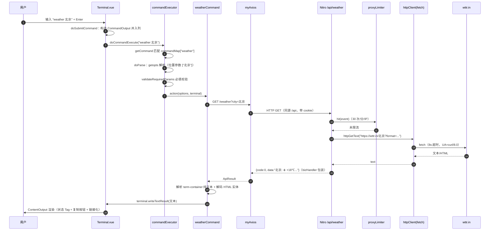

# 01 系统架构

> 项目：webCommand ｜ 版本：v1.0 ｜ 生成日期：2026-10-05 ｜ 依据：源码分析

## 1. 整体架构图

webCommand 是一个 **Nuxt 4 前后端合并单体**：浏览器里运行的 SPA 前端（`app/`）与 Nitro 服务端（`server/`）共存于同一个工程、同一次 `nuxt build` 产物中，生产环境以单个 Node 进程同时提供静态资源与 `/api` REST 接口，后端再按需访问 MySQL 与第三方公网服务。整体结构如下：

```mermaid
graph TB
    subgraph Browser["浏览器（客户端 SPA，ssr: false）"]
        UI["pages/index.vue<br/>全屏终端页面"] --> TV["Terminal.vue<br/>终端主组件"]
        TV --> CE["commandExecutor.ts<br/>命令解析与执行引擎"]
        CE --> REG["commandRegister.ts<br/>命令注册表（func+别名）"]
        CE --> CMDS["commands/&#60;功能域&#62;<br/>40+ 命令实现"]
        CMDS --> STORES["Pinia Stores ×8<br/>user/todo/space/note/custom/terminalConfig/theme"]
        STORES --> LS[("localStorage<br/>persistedstate + 历史快照")]
        CMDS --> CS["useCloudSync + cloudMerge<br/>云同步工厂与合并原语"]
        TV --> OUT["ContentOutput.vue<br/>文本/组件渲染"]
    end

    subgraph Nitro["Node 进程（.output/server/index.mjs）"]
        subgraph Static["静态资源"]
            SPA["SPA 外壳 HTML + JS Bundle<br/>（.output/public）"]
        end
        subgraph API["Nitro 路由层 server/api"]
            USERAPI["/api/user/*<br/>登录注册改密注销"]
            DATAAPI["/api/data*<br/>云端读写"]
            PROXY["/api/weather|news|stock|ip|qrcode<br/>/api/background/get/random<br/>第三方代理"]
            HEALTH["/api/health<br/>探活"]
        end
        subgraph Guard["横切层"]
            BIZ["bizHandler 统一响应包装"]
            RL["rateLimit 内存限流"]
            DA["dataAccess 数据准入"]
            AP["accountPolicy 账号策略"]
        end
        subgraph Service["服务层"]
            USVC["userService"]
            PRSVC["passwordReset 验证码"]
            MIG["migrations SQL 迁移器"]
        end
        CFG["appConfig 运行期配置解析<br/>NUXT_* &#62; 裸名 &#62; 构建默认"]
    end

    DB[("MySQL 8<br/>user / user_data / schema_migrations")]
    SMTP["SMTP 服务器"]
    THIRD["第三方公网 API<br/>wttr.in / 新浪行情 / qrserver / btstu …"]

    UI -- "首次加载 HTTP" --> SPA
    CS -- "axios（withCredentials）" --> DATAAPI
    CMDS -- "axios" --> USERAPI
    CMDS -- "axios" --> PROXY
    USERAPI --> BIZ
    DATAAPI --> BIZ
    PROXY --> BIZ
    BIZ --> RL
    DATAAPI --> DA
    USERAPI --> AP
    USERAPI --> USVC
    USERAPI --> PRSVC
    USVC --> DB
    DATAAPI --> DB
    MIG -- "启动时执行" --> DB
    HEALTH -- "information_schema 探测" --> DB
    PRSVC --> SMTP
    PROXY --> THIRD
    CFG -. "resolveDbConfig / setting()" .-> USVC
    CFG -.-> DB
```

架构上有三个关键认知，是理解本项目的入口：

第一，**"命令"不是服务端概念**。`app/core/commandExecutor.ts` 的 `doCommandExecute` 在浏览器里完成词法切分、命令匹配（`commandMap` 按 func 与别名建索引）、getopts 参数解析、子命令递归（深度上限 10，防止 `subCommands` 无限递归）与执行。大多数命令（搜索、跳转、计算、格式化工具）根本不产生网络请求，或直接 `window.open` 跳第三方站点。

第二，**服务端 API 只承担三类职责**：账号与会话（`server/api/user/*` 七个路由）、云端数据 blob 读写（`server/api/data/index.get.ts` 与 `sync.post.ts`）、以及为绕过浏览器 CORS 或需要 Referer/GBK 解码等特殊处理的第三方代理（`weather/news/stock/ip/qrcode/background`）。`server/api/health.get.ts` 则是部署链路的探活契约。

第三，**会话与数据归属完全由服务端裁决**。前端 store 里保存的 `loginUser` 只是展示态；真正的授权依据是 nuxt-auth-utils 写入的加密 cookie 会话（`getUserSession`），云端数据接口的 `userId` 一律取自会话而非请求体（`server/utils/dataAccess.ts` 的 `checkDataWrite` 只回传会话里的 userId，`test/routes/dataRoutes.test.ts` 有专门用例钉住"伪造 userId 无效"）。

## 2. 为什么选 SPA 而非 SSR

`nuxt.config.ts` 第 14~17 行的注释直接给出了决策依据：本项目是"终端型个人应用"，页面数据来自 localStorage 与登录态，**没有公开内容需要搜索引擎收录**，因此放弃 SSR 可以规避两类真实的水合成本：一是 `localStorage` 在服务端不存在，SSR 渲染出的初始 HTML 与客户端首次挂载结果必然不一致；二是 ant-design-vue 4 的 css-in-js 样式在服务端与客户端的注入时序难以对齐。SPA 模式（`ssr: false`）让首屏从 `app/spa-loading-template.html` 这份静态外壳起步——里面用 `<noscript>` 承载了对爬虫/无 JS 环境的 SEO 与 GEO 兜底文案，配合 `app.head` 里的静态 meta、Open Graph、Twitter Card 与三段 JSON-LD（WebSite / SoftwareApplication / FAQPage），"可被搜索到的部分"完全静态化，"需要交互的部分"完全客户端化。README「已知限制」也实测确认：这些静态标签确实出现在产物 HTML 外壳里，因此没有为了 SEO 上 SSR 的必要。

同时必须强调 Nuxt 团队设计的一个关键点（`nuxt.config.ts` 第 16 行注释）：**SPA 模式下 Nitro 后端（`server/api`）依然完整可用**。`ssr: false` 关闭的只是"服务端渲染 Vue 组件"，不影响 Nitro 作为 HTTP 服务器的任何能力。这使"前端 SPA + 后端 API"可以继续共享一次构建、一个进程、一套 `runtimeConfig`，而不是退化成两个独立服务。

## 3. 前后端分层详解

### 3.1 前端：三层结构

前端在 `app/` 下分为三层，依赖方向严格自上而下：

- **视图层**：`app/pages/index.vue`（唯一页面）与 `app/components/`（Terminal、ContentOutput、CommandPalette 及若干辅助 TS 模块）。视图层不解析命令、不发请求，只负责把输出列表渲染出来并把用户输入交给执行器。`Terminal.vue` 通过 `defineExpose({ terminal })` 向父组件暴露一个实现了 `Terminal.TerminalType` 接口的对象（定义见 `app/components/type.d.ts`），该接口是命令写输出的唯一通道——`writeTextResult/writeTextErrorResult/writeResult` 等方法把结果追加进"当前命令"的 `resultList`。
- **领域层**：`app/core/`。`command.d.ts` 定义命令契约（`func/name/alias/params/options/subCommands/action/collapsible`），`commandRegister.ts` 汇总 40+ 命令模块并生成 `commandMap`，`commandExecutor.ts` 是解释器，`commands/<域>/` 下每个文件是一个自包含命令；六个参与云同步的 Pinia store（todo/space/note/custom/terminalConfig/theme）也放在各自的命令目录里，与命令实现同域共存。
- **基础设施层**：`app/composables/`（云同步三件套）与 `app/utils/`（myAxios、smartText、error、myDayjs）、`app/plugins/pinia-persistedstate.client.ts`（客户端注册持久化插件，并通过 `_isPersistedstate` 标记防止 HMR 重复注册）。

### 3.2 后端：路由薄、服务厚、横切独立

后端遵循"路由层只做协议转换与准入判定，业务在 service，横切关注点独立成纯函数模块"的分层：

- **路由层**（`server/api/**`）：每个文件都是一个 Nitro 文件路由，统一用 `bizHandler` 包装（`server/utils/response.ts`），内部依次做限流（`rateLimit.ts` 的 `authLimiter/proxyLimiter/dataLimiter`）、会话读取（`getUserSession`）、准入判定，然后调用 service 或模型。路由里几乎没有 if 之外的复杂逻辑。
- **服务层**（`server/services/`）：`userService.ts` 承载注册/凭证校验/改密/注销等全部账号业务（bcrypt 10 轮哈希、软删判定、事务）；`passwordReset.ts` 管理内存验证码（sha256 哈希存储、10 分钟 TTL、5 次尝试上限、60 秒重发间隔）。
- **横切层**（`server/utils/`）：`response.ts`（统一响应 `{code,data,message}` 与业务错误码 40000/40100/40300/40400/42900/50000/50010）、`rateLimit.ts`（滑动窗口内存限流，键数上限 10000 自动清扫）、`dataAccess.ts`（云数据准入纯函数：登录、type 白名单、按类型分级尺寸上限——数据类 1MB、配置类 64KB）、`accountPolicy.ts`（口令下限、邮箱正则、注销三条件，纯函数以便零依赖单测）、`appConfig.ts`（运行期配置解析：`NUXT_DB_*` > 裸名 `DB_*` > 构建期默认值）。
- **启动插件**（`server/plugins/`）：`check-env.ts` 在生产启动时硬校验会话密钥长度（≥32）与数据库配置（缺失即抛错，且校验的是 `resolveDbConfig()` 解析后的值，与真正建连用的同一份）；`migrate.ts` 执行 SQL 迁移但**不阻断启动**——失败只记录到 `appStatus` 并由 `/api/health` 暴露，避免数据库瞬时不可用时容器进入重启风暴。

### 3.3 前后端的边界与协作

单工程内的边界由目录约定：`app/` 永远不被服务端 import，`server/` 永远不打进浏览器包。两边共享的"契约"有三处，全部有测试钉住，防止漂移：一是响应包络 `{code,data,message}`（前端 `app/utils/myAxios.ts` 的 `ApiResult` 对齐 `server/utils/response.ts`）；二是云数据类型白名单（`app/composables/cloudSyncRegistry.ts` 与 `server/utils/dataAccess.ts` 各有一份 `CLOUD_DATA_TYPES`，`test/cloudDataType.spec.ts` 做静态一致性比对）；三是口令最小长度（`app/core/commands/user/userConstant.ts` 与 `server/utils/accountPolicy.ts` 各有一份 `MIN_PASSWORD_LENGTH = 8`，`test/accountPolicy.spec.ts` 比对）。协作方式则完全是 HTTP：前端 `myAxios` 以同源 `/api` 为基地址（可用 `NUXT_PUBLIC_API_BASE_URL` 覆盖为独立域名）、`withCredentials: true` 携带会话 cookie；`nuxt.config.ts` 的 `runtimeConfig` 只保留非敏感开发默认值，敏感值一律运行期注入，这是本项目最重要的架构纪律（见第 5 节）。

## 4. 一次请求的端到端数据流

以用户在终端输入 `weather 北京` 为例，下图给出从键盘到屏幕的完整数据流（覆盖"前端执行 → API → 服务端代理 → 第三方"的最长路径；纯本地命令则在第 5 步即结束）：

这条链路体现了三个设计取向。其一，**错误路径与成功路径同构**：任何环节抛出的 `BizError` 都被 `bizHandler` 捕获并包装成 `{code,message}`（限流等场景额外 `setResponseStatus(429)`），前端拦截器把非 2xx 也规整为同构对象，最终都落到 `terminal.writeTextErrorResult`，命令实现无需关心错误来自网络还是业务。其二，**输出是数据不是调用**：命令拿到的 `terminal` 是一个只写接口，写入的对象（文本/组件/可折叠标记）进入 Vue 响应式 `outputList` 后由模板统一渲染，组件型输出用 `markRaw` 包装避免被 Proxy 化导致异步组件失效（`Terminal.vue` 的 `writeResult` 注释）。其三，**渲染层做安全兜底**：任何文本输出都经 `app/utils/smartText.ts` 先 HTML 转义再链接化，`v-html` 因此是安全的。

## 5. 关键设计决策

**决策一：私有配置只在运行期注入，构建产物零凭证。** 这是本仓库用真实事故换来的纪律。`nuxt.config.ts` 的 `runtimeConfig` 注释写明：若在构建期读 `process.env.X`，`nuxt build` 会把值烘进 `.output`，产物本身就变成带内网地址与明文口令的对象。因此 `server/utils/appConfig.ts` 自建了一层解析：`setting(configured, ...envKeys)` 依次取 `NUXT_*` 前缀、裸名环境变量，最后才落到构建期默认值；`scripts/deploy.sh` 的 `scan_artifact` 会在每次构建后 grep `.output` 是否含 `.env` 里的口令与会话密钥，命中即拒绝部署。

**决策二：云端同步放在客户端合并，服务端只存 blob。** 服务端 `user_data` 表以 `(userId, type)` 唯一，每类数据一个 JSON blob，服务端不理解内部结构（只校验白名单与字节数）。冲突解决全部在浏览器：`app/composables/cloudMerge.ts` 提供逐条 last-write-wins（以条目 `updateTime` 毫秒为准）、删除墓碑（30 天保留窗口）与配置类"整包较新者胜出"三类原语；`useCloudSync` 工厂保证每次上传前先拉云端合并再写回（写前合并），并用 `applyingRemote` 标志切断"合并 → $subscribe → 再上传"的回环。这个决策让服务端保持极简（两条 SQL 路径：findOne / upsert），代价是合并算法必须在前端做对并有充分测试（`test/cloudMerge.spec.ts`）。

**决策三：限流、验证码等状态存进程内存，明确单实例假设。** `server/utils/rateLimit.ts` 与 `server/services/passwordReset.ts` 都用 `Map` + 定时清扫实现，README「已知限制」坦承"重启即失效，水平扩容前需改 Redis"。对一个自建单实例个人服务，这是复杂度与正确性的合理折中；配套的 `NUXT_TRUST_PROXY` 开关（`getClientIp` 仅在开启时信任 `x-forwarded-for`）则保证了位于 Nginx/frp 之后时限流按真实客户端 IP 计数。

**决策四：探活必须反映"真的能服务"。** `server/api/health.get.ts` 不读迁移插件写入的内存标志（Nitro dev 下模块重复实例化会让标志停在 false 造成误报，注释实测记录），而是每次直接查 `information_schema` 确认 `user`/`user_data` 两表存在，不健康返回 503。容器 healthcheck（`docker-compose.example.yml`）与 `deploy.sh verify` 都依赖这个语义，挡住"进程活着但注册登录全废"的假健康。

**决策五：安全边界收敛为可单测的纯函数。** `dataAccess.ts` 的 `checkDataRead/checkDataWrite`、`accountPolicy.ts` 的 `checkAccountDeletion` 都返回可判别联合（`{ok:true,...} | {ok:false,code,message}`），放行时把生效的 userId/type 一起交回路由层——路由层因此不需要非空断言，也不可能把 `undefined` 当查询条件。这些纯函数刻意不 import 其它模块，`node:test` 可以零依赖直接跑（两份文件的头部注释都强调了这一点）。

**涉及的设计模式**：命令模式与解释器（`CommandType` 契约 + `commandMap` 注册表 + `commandExecutor`）、工厂模式（`useCloudSync` 同步工厂、`createRateLimiter` 限流器工厂）、注册表模式（`commandRegister`、`cloudSyncRegistry`）、单例与懒加载（`useDb`、`UserModel`、`UserDataModel`、nodemailer transporter 缓存）、装饰器/包装器（`bizHandler` 统一包络）、策略与准入判定（`dataAccess`/`accountPolicy` 的可判别联合决策）、水位迁移（`schema_migrations` 表 + 幂等 DDL）、墓碑合并（CRDT 思想的简化应用）。

## 6. 部署形态与进程拓扑

生产链路是"宿主机构建 + 容器运行"：`nuxt build` 产出自包含的 `.output`（含 `server/node_modules`），`Dockerfile`（node:22-slim）直接 COPY 产物、只额外补装 Nitro 未打包的 `mysql2`（sequelize 动态加载，Dockerfile 注释解释了为何在临时目录安装再合并，避免 npm 与现有 node_modules 树冲突），容器内 `node .output/server/index.mjs` 监听 3000。编排上容器映射宿主机 4900 端口，经 frp 转发到 VPS Nginx 443，最终对外为 `https://command.zhangzhengyang.com`；MySQL 复用 NAS 上另一套 dev-stack 的 `dev-mysql` 容器，通过外部网络 `dev-stack_devnet` 互联。这套"一个应用容器 + 一个共享 MySQL"的极简拓扑与第 5 节的单实例假设互为因果，细节展开见《06-部署运行》。
