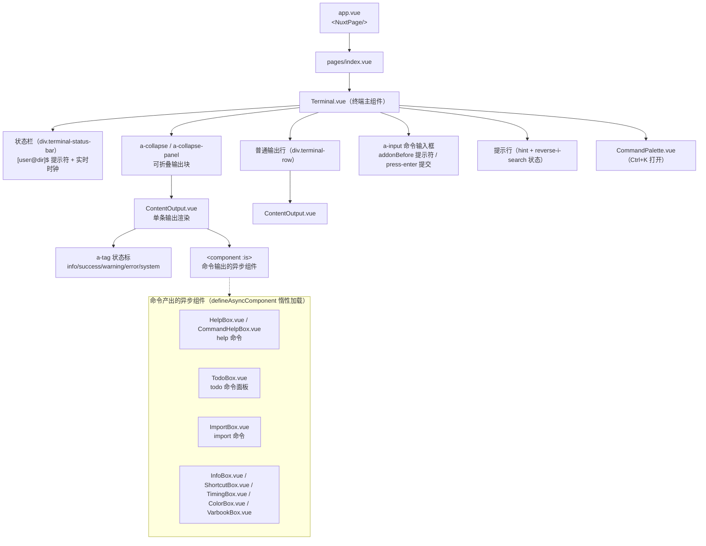
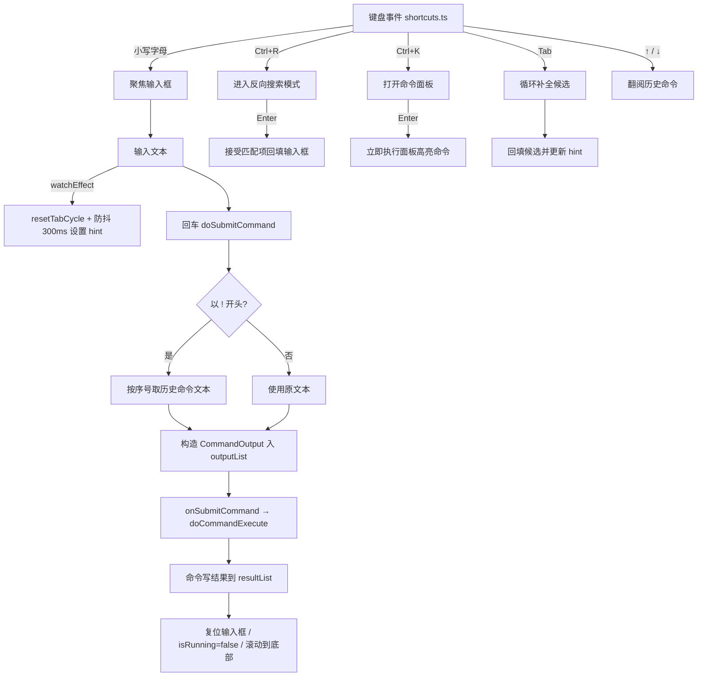
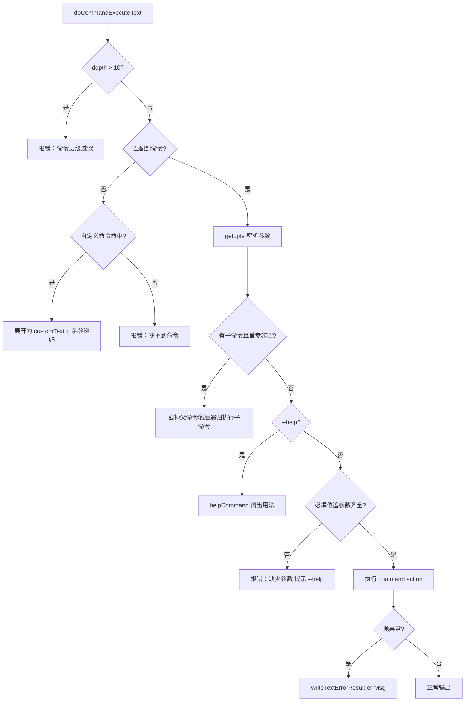

# 02 页面设计

> 项目：webCommand ｜ 版本：v1.0 ｜ 生成日期：2026-10-05 ｜ 依据：源码分析

## 1. 路由与页面总表

本项目是典型的"单页应用只有一个页面"：`app/pages/` 下仅存在 `index.vue`，由 `app/app.vue` 的 `<NuxtPage/>` 挂载。SPA 模式（`ssr: false`）下没有服务端路由渲染，vue-router 的全部能力实际未被使用（全仓没有 `NuxtLink`、没有编程式导航），页面间跳转都是 `window.open`/`window.location.href` 跳到外部站点。

| 路由 | 文件 | 布局形态 | 核心职责 |
| --- | --- | --- | --- |
| `/` | `app/pages/index.vue` | 全屏终端（`full-screen` 传入 Terminal，样式置为 fixed 四边贴零） | 恢复登录态 → 初始化云同步 → 接管命令输入并委托执行器 |
| SPA 加载外壳 | `app/spa-loading-template.html` | 注入 `
` 的静态内容 | JS 加载期间的占位；`<noscript>` 内含面向爬虫/无 JS 环境的功能介绍（SEO/GEO 兜底） |

`index.vue` 的逻辑极薄（33 行）：模板仅一行 `<terminal ref="terminalRef" :user="loginUser" full-screen :on-submit-command="onSubmitCommand" />`；脚本里 `onSubmitCommand` 把输入文本转交 `app/core/commandExecutor.ts` 的 `doCommandExecute`；`onMounted` 先 `userStore.getAndSetLoginUser()` 拉取会话，若已登录则 `initAllCloudSync()` 初始化六类数据同步——注释特别强调"remember 自动登录路径同样要初始化云同步：漏掉的类型既不会从云端拉取，该端下一次改动还会把云端已有数据整包覆盖掉（#24 #25）"，这是页面级唯一有正确性风险的逻辑。

## 2. 组件树

虽然页面只有一个，组件树仍有清晰的层级与职责划分（`unplugin-vue-components` 自动按需引入 ant-design-vue 组件，见 `nuxt.config.ts` 的 vite 插件配置与生成的 `app/components.d.ts`）：

组件间的数据流是单向的：命令执行结果以普通对象（`Terminal.OutputType`，含 `type: 'command' | 'text' | 'component'`）push 进 `Terminal.vue` 的 `outputList`；`ContentOutput` 对文本输出做 `smartText` 转义与链接化渲染、对组件输出用 `<component :is>` 挂载 `defineAsyncComponent` 返回的异步组件。`Terminal.vue` 的 `writeResult` 刻意对组件对象 `markRaw`——注释解释：若不阻止 Proxy 包装，异步组件对象会丢失 template 并触发 Vue 警告。

## 3. 核心页面布局与交互

### 3.1 终端主界面（Terminal.vue）

布局自上而下五段：**状态栏**（左：提示符 `[用户名@当前空间目录]$`，来自 `spacePrompt` computed，拼接 `spaceStore.currentDir`；右：秒级实时时钟，`setInterval` 每秒刷新）；**历史输出区**（`a-collapse` 包裹的输出列表，`collapsible` 的命令块渲染成可折叠面板，如 `help`、`todo` 这类大输出；折叠状态存于 `activeKeys`，新命令默认展开并自动滚动到底部——但仅当用户本就处于底部附近 80px 内才滚动，避免打断向上翻阅，`isNearBottom()` 实现 #93）；**命令输入行**（无边框 `a-input`，`addonBefore` 显示提示符，`press-enter` 触发 `doSubmitCommand`，执行期间 `disabled` 防止并发提交）；**辅助行**（反向搜索状态行 `(reverse-i-search)'xxx':` 与输入提示行，提示开关受 `terminalConfigStore.showHint` 控制）；**命令面板浮层**（`isPaletteOpen` 时渲染 `CommandPalette`）。

交互上，`app/components/shortcuts.ts` 注册了全局键盘体系：任意小写字母键自动聚焦输入框；`Ctrl+L` 清屏、`Ctrl+O` 全部折叠/展开、`Ctrl+R` 进入反向增量搜索（再次 Ctrl+R 循环上一个匹配，Enter 接受，Esc 退出，实现 #29）、`Ctrl+K` 打开命令面板、`Tab` 触发补全（输入框未聚焦时先聚焦）、`↑/↓` 翻阅历史、`!序号` 直接执行历史中第 N 条命令（`doSubmitCommand` 内解析）。主题体系通过 CSS 变量注入：`wrapperStyle` 把 `themeStore.currentTheme` 的 7 个色值写到 `--terminal-*` 变量上，模板与 scoped 样式全部引用变量，8 套主题（GruvboxDark/Dracula/Nord/SolarizedDark/SolarizedLight/OneDark/Monokai/TokyoNight，定义于 `app/core/commands/theme/themes.json`）切换零重排成本；背景支持自定义 URL、纯色或随机壁纸，优先级为 `configStore.background` > 主题背景。

### 3.2 历史与快照的持久化（Terminal.vue + outputSnapshot.ts）

命令历史与终端输出都会写入 localStorage 以抵抗刷新：历史保存在 `terminal-command-history` 键（上限 100 条，写入前经 `redactSensitiveText` 把 `-p xxx/--password=xxx` 等密码参数替换为 `***`，防止明文凭据落盘）；输出快照保存在 `terminal-output-snapshot` 键（上限 200 条，经 `sanitizeForSnapshot` 清洗——组件型输出替换为"（该内容包含交互组件，刷新后已省略）"占位文本，并递归清洗命令块内的 resultList，注释记录了此前"只处理顶层导致 help/todo 输出刷新后空白"的教训）。挂载时按序恢复历史与快照，若快照为空才输出欢迎语（自定义 `welcomeTexts` 优先）。

### 3.3 命令面板（CommandPalette.vue）

Ctrl+K 唤起的浮层，遮罩点击自身关闭。条目来自两个来源：`commandRegister` 的全部内置命令（每命令一条，`search` 字段聚合 func、name、别名的小写串）与 `customStore.listCustom()` 的自定义命令（desc 显示 `自定义 => 目标文本`）。过滤算法是多关键词 AND 匹配（空格分隔的每个词都必须命中 search 串）；`↑/↓` 循环移动高亮，Enter 执行高亮项——执行即 `doCommandExecute(item.label, terminal)`，随后 `focusInput`。这是一个不依赖鼠标的"命令发现"入口，与 `hint.ts` 的输入提示（防抖 300ms 显示用法串）互补。

## 4. 关键 UI 交互流程

以下两张图分别刻画"一次命令输入的完整交互闭环"与"命令执行的分支逻辑"。

## 5. Pinia 状态管理设计

全项目共 8 个 store，全部位于各业务域目录而非集中 store 目录，体现"状态与命令同域"的组织原则。持久化统一走 `pinia-plugin-persistedstate`，由 `app/plugins/pinia-persistedstate.client.ts` 在客户端注册（`.client` 后缀保证 SSR/构建期不执行），并带防重复注册守卫。

| store（id） | 文件 | 关键 state | 持久化 key | 云同步类型 | 合并策略 |
| --- | --- | --- | --- | --- | --- |
| user | `app/core/commands/user/userStore.ts` | loginUser（默认 `LOCAL_USER`，username='local'） | 不持久化 | — | — |
| todo | `app/core/commands/todo/todoStore.ts` | taskList、deleted（墓碑）、currentFilter | `todo-store` | `todo` | 逐条 LWW（按 id + updateTime） |
| space | `app/core/commands/space/spaceStore.ts` | space（路径→条目扁平表）、currentDir、deleted | `space-store` | `space` | 逐条 LWW（按路径）；currentDir 属设备态不同步 |
| note | `app/core/commands/note/noteStore.ts` | noteList、deleted | `note-store` | `note` | 逐条 LWW（按 id） |
| customCommand | `app/core/commands/custom/customStore.ts` | customMap、touched（逐条修改时刻）、deleted | `custom-command-store` | `custom` | 逐条 LWW（按命令名，touched 提供时间） |
| terminalConfig | `app/core/commands/terminal/config/terminalConfigStore.ts` | background、showHint、welcomeTexts、updatedAt | `terminal-config-store` | `terminalConfig` | 整包较新者胜（`localIsFresher`） |
| terminalTheme | `app/core/commands/theme/themeStore.ts` | currentTheme、updatedAt（setup store 写法） | `terminal-theme` | `theme` | 整包较新者胜，云端只同步主题名 |
| （路由态） | — | — | — | — | — |

设计上有四点值得展开。**第一，写路径触发同步的统一手法**：六个可同步 store 都实现 `syncToCloud/loadFromCloud/initCloudSync/resetCloudSync` 四个同名 action，内部委托各自模块级单例的 `useCloudSync` 实例；`initCloudSync` 里用 `this.$subscribe(() => this.syncToCloud())` 订阅任意 state 变化，`useCloudSync` 再做 800ms 防抖与"拉云端→合并→内容无变化则跳过上传"的收敛，保证合并引发的状态回写不会形成上传回环（`applyingRemote` 标志 + 内容相等短路双保险）。**第二，按用户幂等**：`useCloudSync.initCloudSync` 记录 `syncUserId`，同一用户重复初始化直接返回，换用户先 `resetCloudSync` 解除旧订阅——这覆盖了"已登录状态下再执行 user login 切换账号"的场景。**第三，墓碑是一等公民**：列表类删除不是简单移除，而是同时写 `deleted[id] = Date.now()`；序列化时经 `pruneTombstones` 裁掉超 30 天的墓碑（`TOMBSTONE_RETENTION_MS`，定义于 `app/composables/cloudMerge.ts`）；重新创建同名/同 id 条目时调 `clearDeleted` 撤销墓碑，导入备份时也会"改到最新时间并清墓碑"防止历史删除记录把导入数据消掉。**第四，user store 是唯一不持久化、不云同步的 store**：登录态以服务端加密 cookie 会话为准，`getAndSetLoginUser` 启动时 POST `/api/user/current` 校验，40100（未登录）静默 `$reset()` 回 `LOCAL_USER`，保证前端展示态与服务端会话最终一致。

## 6. 状态与主题的运行时表现

终端的视觉状态全部由两个配置类 store 驱动：`terminalConfigStore`（背景、提示开关、欢迎语）与 `themeStore`（配色）。二者都是"配置类"云同步数据，合并按"整包较新者胜出"：本地 `updatedAt` 不早于云端时保持本地等待上传，否则套用云端值（`themeStore.applyCloudTheme` 还会校验主题名在本地 themes.json 中存在，不存在则保持现状）。修改类 action（`setBackground/setOrToggleShowHint/setWelcomeTexts/reset/setTheme`）都会刷新 `updatedAt` 并触发同步，这是"配置类按 blob 整包比较"能成立的前提——每次改动都带着新的修改时刻上云。UI 层消费方式见 3.1 节的 CSS 变量注入，无需任何组件级重渲染逻辑。

综上，页面层的复杂度不在于布局（其实只有一个全屏终端），而在于把"终端语义"做扎实：历史、补全、反向搜索、折叠、快照恢复、脱敏这些细节共同构成了这个单页应用的全部交互深度，也解释了为什么 `app/components/` 下有 5 个纯 TS 辅助模块与 Vue 组件并列——它们各自封装了一块可独立测试的交互逻辑（`test/unit/outputSnapshot.test.ts` 即针对其中快照清洗的用例）。
