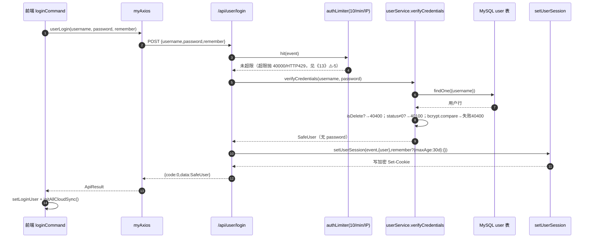

# 03 接口设计

> 项目：webCommand ｜ 版本：v1.0 ｜ 生成日期：2026-10-05 ｜ 依据：源码分析

## 1. 接口总体约定

后端全部接口由 Nitro 文件路由实现，位于 `server/api/`，路径与文件名一一对应（`server/api/user/login.post.ts` → `POST /api/user/login`）。项目**没有 WebSocket/SSE 接口**：所有通信都是短连接 HTTP/JSON，终端输出与命令执行不经过服务端，云同步采用"拉取 + 上传"的轮询式防抖模型（客户端 800ms 防抖，见 `app/composables/useCloudSync.ts`），因此不存在长连接协议需要说明。

全部业务接口遵循同一套约定，实现收敛在 `server/utils/response.ts`：

1. **统一包络**：成功返回 `{ code: 0, data }`（handler 返回 `undefined` 时 data 置为 `true`）；业务失败返回 `{ code: <业务码>, message, data: null }`。
2. **业务错误与 HTTP 状态解耦**：`BizError(code, message, statusCode = 200)` 默认以 HTTP 200 返回、错误码放 body；只有显式传入 statusCode（限流传 429、第三方故障传 502）才改变 HTTP 状态。前端按 `code` 分支而非 HTTP 状态分支。
3. **未知异常兜底**：非 BizError 的异常被 `bizHandler` 捕获，记录 `[api error]` 日志后返回 `{ code: 50000, message: 'server error' }`，不向客户端泄露堆栈。
4. **业务码表**（`ERROR_CODE` 常量）：`40000 PARAMS` 参数错误、`40100 NO_AUTH` 未登录、`40300 FORBIDDEN` 禁止、`40400 NOT_FOUND` 不存在、`42900 RATE_LIMIT` 限流、`50000 SYSTEM` 系统错误、`50010 THIRD_PART` 第三方故障。
5. **认证方式**：基于 cookie 的服务端会话（nuxt-auth-utils），前端 axios 实例 `withCredentials: true`（`app/utils/myAxios.ts`）。无 token、无请求头签名。

限流是接口契约的一部分（`server/utils/rateLimit.ts`，按 IP 的内存滑动窗口）：`authLimiter`（登录/注册/验证码/注销，10 次/分/IP）、`proxyLimiter`（第三方代理类，30 次/分/IP）、`dataLimiter`（云数据读写，120 次/分/IP，因为每次前端同步是"拉 + 推"两个请求）。真实客户端 IP 的判定由 `getClientIp` 完成：仅当 `NUXT_TRUST_PROXY`/`TRUST_PROXY` 为 true 时信任 `x-forwarded-for` 首段，否则取 socket 远端地址——位于反代后不开启该开关会导致所有访客共用一个限流桶（README 与源码注释双重警告）。

## 2. API 端点总表

### 2.1 账号与会话（`server/api/user/`）

| 方法 | 路径 | 用途 | 关键入参（body，JSON） | 成功响应 data | 鉴权 | 限流 |
| --- | --- | --- | --- | --- | --- | --- |
| POST | `/api/user/register` | 注册 | `username`、`password`、`email`（均必填；用户名≤32 字符、密码≥8 位、邮箱正则校验） | 新用户 id（number） | 匿名 | authLimiter |
| POST | `/api/user/login` | 登录并写会话 | `username`、`password`；`remember`（可选，默认 true） | 脱敏用户 `{id, username, email, status, createTime, updateTime, isDelete}` | 匿名 | authLimiter |
| POST | `/api/user/logout` | 注销会话 | 无 | `true` | 需登录（40100） | 无 |
| POST | `/api/user/current` | 获取当前登录用户（从库重读并脱敏） | 无 | 脱敏用户 | 需登录（40100） | 无 |
| POST | `/api/user/password` | 修改密码 | `oldPassword`、`newPassword`（新密码≥8 位、不得与旧密码相同） | `true` | 需登录（40100） | 无 |
| POST | `/api/user/reset-code` | 发送找回密码验证码 | `email` | `true`（邮箱不存在也返回 true，不泄露注册状态） | 匿名 | authLimiter；60 秒重发间隔 |
| POST | `/api/user/reset-password` | 验证码重置密码 | `email`、`code`（6 位）、`newPassword` | `true` | 匿名（凭验证码） | authLimiter |
| POST | `/api/user/delete` | 注销账号（软删用户 + 物理删云端数据 + 清会话） | `password`、`confirm`（必须与用户名完全一致） | `true` | 需登录（40100） | authLimiter |

### 2.2 云端数据（`server/api/data/`）

| 方法 | 路径 | 用途 | 关键入参 | 成功响应 data | 鉴权 | 限流 |
| --- | --- | --- | --- | --- | --- | --- |
| GET | `/api/data` | 读取某类云端 blob | query：`type`（白名单：todo/space/note/custom/terminalConfig/theme） | 内容字符串（未同步过为 `null`） | 需登录 | dataLimiter |
| POST | `/api/data/sync` | 写入（upsert）某类云端 blob | body：`type`（同上白名单）、`content`（字符串；数据类≤1MB、配置类≤64KB，按 UTF-8 字节） | `true` | 需登录 | dataLimiter |

该组接口的准入判定收敛在 `server/utils/dataAccess.ts`：`checkDataRead` 校验"已登录 + type 白名单"，`checkDataWrite` 追加"content 为字符串 + 按类型分级尺寸上限"。放行时把生效的 `userId/type/content` 一并交回路由，路由层因此不会把请求体伪造的 userId 带进查询（`test/routes/dataRoutes.test.ts` 有"伪造 userId 无效"的专门用例）。

### 2.3 第三方代理与基础设施

| 方法 | 路径 | 用途 | 关键入参 | 成功响应 data | 上游 | 限流 |
| --- | --- | --- | --- | --- | --- | --- |
| GET | `/api/weather` | 天气文本代理 | query：`city`（必填）、`format`（wttr.in 格式串，默认 `%l: %c %t 湿度 %h 风速 %w`） | 天气文本（string） | `wttr.in`（8s 超时，失败抛 50010/HTTP 502） | proxyLimiter |
| GET | `/api/news` | 热搜榜（多源容错） | query：`type`（默认 weibo，映射到 60s 源路径） | `NewsItem[]`：`{rank, title, hot, url?}`，取前 20 | 依次尝试 `60s.viki.moe` → `api.vvhan.com` → `api.oioweb.cn`，全败抛 50010/502 | proxyLimiter |
| GET | `/api/stock` | A 股行情 | query：`code`（如 `sh600519`） | `{name, open, preClose, price, high, low, volume, time}` | 新浪 `hq.sinajs.cn`（带 Referer 头，GBK 解码，正则提取引号内字段） | proxyLimiter |
| GET | `/api/ip` | 查询客户端公网 IP | 无 | `{ip}` | 依次尝试 `api.ip.sb` → `api.ipify.org` → `ip-api.com` → `ifconfig.me` | proxyLimiter |
| GET | `/api/qrcode` | 生成二维码 | query：`text`（必填） | 二维码图片 URL（string，不代取图片） | `api.qrserver.com`（仅拼 URL） | proxyLimiter |
| POST | `/api/background/get/random` | 随机壁纸地址 | body：`type`（dongman/fengjing/meizi/suiji，越界回退 dongman） | 图片 URL（string，获取失败抛 50010） | `api.btstu.cn`（axios，5s 超时） | 无（依赖上游白名单类型收敛） |
| GET | `/api/health` | 探活 | 无 | `{status:'ok'|'degraded', service:'webcommand-nuxt', time, dbReachable, schemaReady, missingTables?, schemaError?}`；不健康时 HTTP 503 且 code=50000 | 查 `information_schema` 验证 `user`/`user_data` 两表存在 | 无 |

出站请求统一经 `server/utils/httpClient.ts`：Node 全局 fetch、跟随重定向、`AbortSignal.timeout(8000)` 8 秒超时、UA 固定 `curl/8.0`、非 2xx 抛错。多源容错（news/ip）的失败源只 `console.error` 不中断，直到某源返回非空数据。

## 3. 认证鉴权机制（nuxt-auth-utils 细节）

项目通过 Nuxt 模块 `nuxt-auth-utils`（`nuxt.config.ts` modules 数组注册）获得基于 cookie 的会话能力，服务端代码直接使用其注入的全局函数 `setUserSession(event, data, maxAge?)` / `getUserSession(event)` / `clearUserSession(event)`。会话内容是脱敏后的 `SafeUser`——`auth.d.ts` 把 `#auth-utils` 的 `User` 接口扩展为 `{id: number, username: string, email?: string}`，即**会话里永远不含密码字段**（`server/models/User.ts` 的 `toSafeUser` 在源头剥离 password）。

会话策略的三个支点：

1. **密钥与有效期**：加密密钥来自运行期环境变量 `NUXT_SESSION_PASSWORD`，生产要求 ≥32 位（`server/plugins/check-env.ts` 启动即校验，注释说明原因——密钥过短时 nuxt-auth-utils 会在每个用到 session 的请求里抛 500 且不提示是配置问题）；有效期默认 30 天（`nuxt.config.ts` 的 `runtimeConfig.session.maxAge = 60*60*24*30`，注释说明对齐原 express-session 的 cookie maxAge）。登录时若 `remember !== false`，路由显式传 `{maxAge: SESSION_30D}` 持久化会话，否则用模块默认策略（`server/api/user/login.post.ts`）。
2. **会话只作身份指针，不做数据快照**：`/api/user/current` 拿到会话中的 id 后会**从数据库重新读取**最新用户信息并脱敏返回（`getLoginUserById`），用户改名/改邮箱后旧会话不会展示过期数据；注销账号后软删标记 `isDelete` 也会让旧会话在读取时被拒。
3. **鉴权是路由级显式判定**，没有全局中间件：需要登录的路由自行 `getUserSession` 并检查 `session.user?.id`，不满足抛 `BizError(NO_AUTH=40100, '未登录')`（HTTP 仍为 200）。`server/middleware/` 目录不存在，这与"少数接口需要鉴权"的规模相称。前端把 HTTP 401 也规整为 `{code:40100}`（`myAxios.ts` 拦截器），与服务端业务码对齐，`userStore` 据此静默回退本地态。

登录流程的完整链路（含限流与会话写入）如下：



密码安全细节：存储一律 bcrypt（`BCRYPT_ROUNDS = 10`，`server/services/userService.ts`），登录失败时"用户不存在"与"密码错误"返回同一句 `用户不存在或密码错误`（40400）避免用户枚举；找回密码的 6 位验证码在服务端以 `sha256(email小写:code)` 形式存内存（`server/services/passwordReset.ts`），10 分钟有效、最多 5 次尝试、60 秒内不可重发、验证成功即删除；`/api/user/reset-code` 对未注册邮箱也返回成功以不泄露注册状态。注销账号需要"登录态 + confirm 串与用户名完全一致 + 当前密码"三条件（`server/utils/accountPolicy.ts` 的 `checkAccountDeletion`），通过后在同一事务里物理删除 `user_data` 全部行、软删 `user` 行，最后才 `clearUserSession`（`deleteAccount` + 路由，删除失败时不清会话，`test/routes/userDelete.test.ts` 钉住该顺序）。

## 4. 错误处理约定（前后端贯通）

服务端侧，`bizHandler` 是唯一的错误出口；前端侧，`app/utils/myAxios.ts` 的响应拦截器把 axios 错误规整为与包络同构的对象：有响应体时 reject `data`（服务端的 `{code,message}`），HTTP 401 时 reject `{code:40100, message:'未登录'}`，无响应（网络层）时 reject `{code:50000, message}`。命令层再用 `app/utils/error.ts` 的 `errMsg()` 兜底提取任意异常的可读 message。三层叠加后的效果是：**命令实现只认 `res.code === 0` 与 `errMsg(e)` 两种形态**，不感知 HTTP 细节。典型的错误码消费方是 `userStore.getAndSetLoginUser`（40100 静默 `$reset()`）、`loginCommand`（非 0 直接展示 `res.message`）与数据路由测试（断言 40100/40000/42900 的精确语义）。

限流错误的形态需要特别注意，两组路由的 body 码不同：`dataLimiter/proxyLimiter` 命中时路由抛 `BizError(42900, '操作过于频繁…', 429)`，而 user 组（authLimiter）五个路由抛的是 `BizError(ERROR_CODE.PARAMS, '操作过于频繁…', 429)`——即 **HTTP 状态都是 429，body 码却是 user 组 40000、data/proxy 组 42900**（源码如此，`ERROR_CODE.RATE_LIMIT` 对 auth 组"已定义未使用"）——`bizHandler` 对 `statusCode !== 200` 会调用 `setResponseStatus`。`test/routes/dataRoutes.test.ts` 用两条用例分别断言"42900 且其他 IP 不受牵连"与"HTTP 状态确实是 429 而非包装成 200"，`scripts/smoke-cloud-sync.sh` 第 9 节也对真实服务打满验证。两组不一致已登记《13-技术债务》⚠️-5。

## 5. 核心接口请求/响应示例

登录（成功）：

```bash
curl -X POST http://localhost:3000/api/user/login \
  -H 'content-type: application/json' \
  -c cookies.txt \
  -d '{"username":"alice","password":"password123","remember":true}'
# HTTP 200
# {"code":0,"data":{"id":1,"username":"alice","email":"a@b.com",
#  "status":0,"createTime":"2026-10-01T08:00:00.000Z","updateTime":null,"isDelete":0}}
```

登录（限流命中，第 11 次/分钟）：

```json
// HTTP 429（user 组限流的 body 码是 40000 而非 42900，见第 4 节与《13》⚠️-5）
{"code":40000,"message":"操作过于频繁，请稍后再试","data":null}
```

云端数据写入与读取（需先登录拿到会话 cookie）：

```bash
curl -X POST http://localhost:3000/api/data/sync \
  -H 'content-type: application/json' -b cookies.txt \
  -d '{"type":"todo","content":"{\"items\":[{\"id\":\"t1\",\"name\":\"写文档\",\"isFinished\":false,\"updateTime\":1759651200000}],\"deleted\":{}}"}'
# HTTP 200  {"code":0,"data":true}

curl -b cookies.txt 'http://localhost:3000/api/data?type=todo'
# HTTP 200  {"code":0,"data":"{\"items\":[...],\"deleted\":{}}"}
# 从未同步过该类型时 data 为 null
```

准入失败的典型形态：

```bash
# 未登录读取 → 业务码 40100（HTTP 200）
curl 'http://localhost:3000/api/data?type=todo'
# {"code":40100,"message":"未登录","data":null}

# 已登录但 type 越界（自造类型） → 40000
curl -X POST http://localhost:3000/api/data/sync -b cookies.txt \
  -H 'content-type: application/json' -d '{"type":"role","content":"{}"}'
# {"code":40000,"message":"type 不合法","data":null}

# 配置类超 64KB → 40000，message 携带上限与实际字节数
# {"code":40000,"message":"content 超过 65536 字节上限（本次 71680 字节）","data":null}
```

第三方代理与探活：

```bash
curl 'http://localhost:3000/api/weather?city=北京'
# {"code":0,"data":"北京: ☀️ +18°C 湿度 40% 风速 12 km/h"}   （服务端已提取纯文本）

curl 'http://localhost:3000/api/health'
# HTTP 200 {"code":0,"data":{"status":"ok","service":"webcommand-nuxt",
#          "time":"2026-10-05T12:00:00.000Z","dbReachable":true,"schemaReady":true}}
# 数据库不可达/缺表时：HTTP 503，data.status="degraded"、dbReachable=false 或 missingTables=["user"]
```

前端消费这些接口的统一入口是 `myAxios`（`app/utils/myAxios.ts`）：`get<T>/post<T>` 返回 `Promise<ApiResult<T>>`（拦截器已解包 `response.data`，类型因此收窄，调用方无需 `as any`）。各命令的 API 封装集中在 `app/core/commands/user/userApi.ts`（userLogin/userLogout/userRegister/getLoginUser/updateUserPassword/sendResetCode/resetPassword/userDelete 八个函数）与 `app/composables/useCloudSync.ts`（`GET /data?type=`、`POST /data/sync`），其余查询类命令（weather/news/stock/ip/qrcode）各自在命令文件内直接调用 `myAxios`。

## 6. 契约的测试锚点

接口行为被两层测试钉住，修改任何路由都应先看这两处：`test/routes/dataRoutes.test.ts` 与 `test/routes/userDelete.test.ts`（vitest，通过 `test/routes/nitroGlobals.ts` 为 `defineEventHandler/readBody/getQuery/getUserSession/clearUserSession/setResponseStatus/useRuntimeConfig` 装全局替身，模型用 `vi.mock` 替换）覆盖"路由拿到输入后做了什么判定"——匿名 40100、白名单、尺寸上限、userId 必须来自会话、限流 42900/429、删号后才清会话、删除失败不清会话；`scripts/smoke-cloud-sync.sh` 则对真实 MySQL + dev 服务跑 26 条断言，覆盖上述契约的端到端形态（含 4 字节 emoji 的 utf8mb4 往返、改密后旧密码失效、注销后不可再登录、authLimiter 真实触发 429）。README 的边界声明值得复述：vitest 这套**不验证 h3 如何解析 HTTP body/query，也不连真实数据库**，那部分由冒烟脚本补位。
