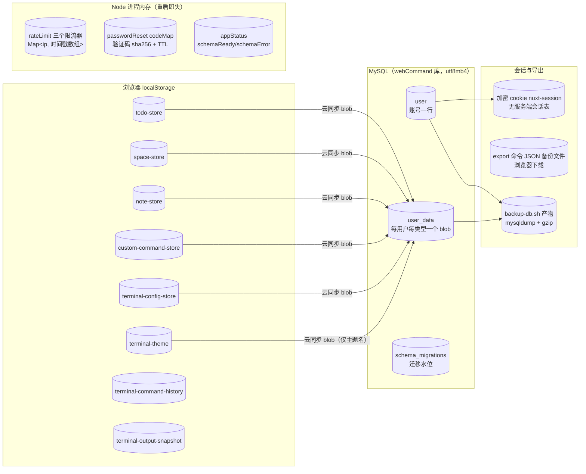
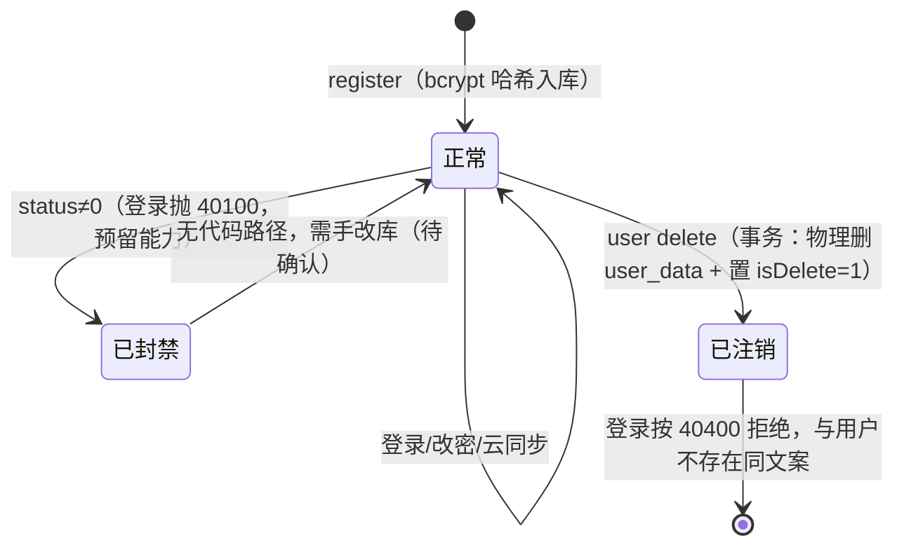
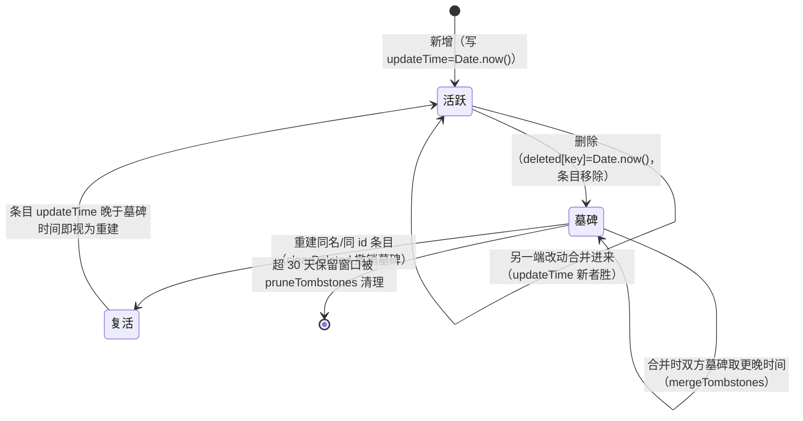

# 04 数据模型

> 项目：webCommand ｜ 版本：v1.0 ｜ 生成日期：2026-10-05 ｜ 依据：源码分析

## 1. 存储介质总览

webCommand 的数据不落在单一介质上，而是按"数据的归属与寿命"分散在四类介质中。理解这张介质地图是理解本项目数据模型的前提——后端数据库的职责被刻意压缩到极小（两张业务表），真正的数据多样性在前端与进程内存里。

四类介质的分工与寿命如下表：

| 介质 | 承载数据 | 写入方 | 寿命与清理方式 |
| --- | --- | --- | --- |
| MySQL `user` | 账号（一行一人） | `server/services/userService.ts` | 注册时创建；注销时软删（`isDelete=1`），行保留 |
| MySQL `user_data` | 六类云同步 JSON blob | `server/api/data/sync.post.ts` upsert | 注销账号时**物理删除**；其余情况只被覆盖 |
| MySQL `schema_migrations` | 迁移水位 | `server/utils/migrations.ts` | 随迁移追加，永不清理 |
| localStorage 六个 store 键 | 各业务域工作副本 | `pinia-plugin-persistedstate` | 随浏览器存续；注销后仍保留（仅解除同步） |
| localStorage 两个终端键 | 命令历史 / 输出快照 | `Terminal.vue` | 各有 100 / 200 条滚动上限 |
| 加密 cookie `nuxt-session` | 登录态（脱敏用户） | nuxt-auth-utils `setUserSession` | 默认 30 天；服务端无状态，无表可查 |
| 进程内存三处 | 限流计数、验证码、schema 状态 | 各模块 `Map` | 进程重启即清空；验证码另有 10 分钟 TTL |
| 导出文件 | 四类业务数据 JSON | `export` 命令 | 用户自管，不回传服务端 |

一个关键认知：**服务端没有会话表**。nuxt-auth-utils 的会话是自包含的加密 cookie（cookie 名 `nuxt-session`，由 `NUXT_SESSION_PASSWORD` 加密），服务端只解密不存储。这直接决定了部署语义——应用重启不会让任何人掉线，只要加密密钥不变（见《06-部署运行》）。

## 2. MySQL 连接与 ORM 层

连接管理收敛在 `server/utils/db.ts` 的 `useDb()`：模块级单例，首次调用时经 `resolveDbConfig()`（`server/utils/appConfig.ts`）解析出 host/port/name/user/password，构造 `new Sequelize(db, user, password, { dialect: 'mysql', logging: false })`，随后异步 `authenticate()` 并把结果打到 stdout（`MySQL client connected` / `Unable to connect to MySQL`）。两点值得注意：其一，懒加载是刻意的——避免在 Nitro 运行时配置就绪前实例化（`useRuntimeConfig` 在插件阶段才可用）；其二，**未显式配置连接池**，全部走 sequelize/mysql2 的默认值（默认池上限 5），对单实例个人服务足够。

两个模型都在 `server/models/` 下，采用同一种"懒加载单例 + `useDb().define`"写法（`UserModel()` / `UserDataModel()`，内部 `if (model) return model`）。模型接口 `UserAttributes` / `UserDataAttributes` 是全项目对表结构的 TypeScript 唯一权威描述；`SafeUser = Omit<UserAttributes, 'password'>` 与 `toSafeUser()` 在类型与运行时两个层面把密码挡在脱敏出口之外——`server/api/user/*` 能返回给前端的用户对象都经过它。

事务只在一条路径上使用：注销账号（`userService.deleteAccount`，`useDb().transaction()` 包住"物理删 `user_data` 全部行 + 软删 `user` 行"，失败回滚）。其余读写都是单条 `findOne / create / update / upsert / destroy`，这是"服务端只存 blob"决策的自然结果（见《01-系统架构》第 5 节决策二）。

## 3. 表结构明细

全部表结构由 `server/utils/migrations.ts` 的 `MIGRATIONS` 常量以显式 SQL 定义（`0001_init_user_and_user_data`），DDL 与 Sequelize 模型定义保持一致，引擎 InnoDB、字符集 utf8mb4、排序规则 utf8mb4_unicode_ci。选 utf8mb4 是硬需求：云同步 blob 里要原样保存 4 字节 emoji（`scripts/smoke-cloud-sync.sh` 第 3 节有专门的逐字往返断言）。

### 3.1 `user` 表

| 字段 | 类型 | 约束 | 说明 |
| --- | --- | --- | --- |
| id | BIGINT | NOT NULL，AUTO_INCREMENT，PRIMARY KEY | 用户唯一标识；会话与 `user_data.userId` 都指向它 |
| username | VARCHAR(255) | NOT NULL，UNIQUE KEY `user_username_unique` | 用户名；应用层另限 ≤32 字符（`userService.userRegister`），列宽 255 是历史兼容 |
| password | VARCHAR(255) | NOT NULL | bcrypt 哈希（10 轮，`BCRYPT_ROUNDS`），任何接口不回传 |
| email | VARCHAR(255) | NULL，UNIQUE KEY `user_email_unique` | 找回密码凭据；一个邮箱只能注册一次 |
| status | INT | NOT NULL，DEFAULT 0 | 0 = 正常；非 0 时登录抛 40100「账号已被封禁」（`verifyCredentials`）。当前无任何代码把 status 改成非 0，封禁是预留能力（《13》⚠️-1 已核实：全仓无任何接口/命令/脚本写此字段，封禁/解封只能手改库） |
| createTime | DATETIME | NULL | 预留列。模型 `timestamps: false` 且 `userRegister` 的 `create()` 未写它，**当前恒为 NULL** |
| updateTime | DATETIME | NULL | 预留列，同上，当前恒为 NULL（改密走 `update` 也不写它） |
| isDelete | INT | NOT NULL，DEFAULT 0 | 软删标记。0 正常；1 已注销。登录、`getLoginUserById`、改密、注销都先检查它 |

`createTime`/`updateTime` 恒为 NULL 是源码层面可证的事实：`server/models/User.ts` 声明了这两列但 `timestamps: false` 关闭了 sequelize 的自动时间戳，而 `userService.ts` 的所有写路径（`userRegister`/`updateUserPassword`/`resetUserPassword`/`deleteAccount`）都没有显式写时间字段。查账号创建时间只能靠 MySQL general log 或备份，这点运维排障时要有预期。`user` 表没有指向 `user_data` 的外键约束——两表关联只靠应用层的 `userId` 等值条件，这是"路由层拿到的 userId 一定来自会话"（`dataAccess.checkDataWrite` 回传）这一纪律在兜底。

### 3.2 `user_data` 表

| 字段 | 类型 | 约束 | 说明 |
| --- | --- | --- | --- |
| id | BIGINT | NOT NULL，AUTO_INCREMENT，PRIMARY KEY | 代理主键，业务不使用 |
| userId | BIGINT | NOT NULL | 所属用户；路由层从会话取（伪造请求体的 userId 无效，有测试钉住） |
| type | VARCHAR(32) | NOT NULL | 数据类型，取值锁定为白名单六类（见第 6 节） |
| content | MEDIUMTEXT | NULL | JSON blob 字符串。MEDIUMTEXT 上限约 16MB，但应用层先按类型限 64KB / 1MB，数据库上限只是最后保险 |
| （复合） | — | UNIQUE KEY `user_data_userId_type_unique` (userId, type) | 每用户每类型恰一行；`upsert` 的"存在即覆盖"判定完全依赖这个唯一索引 |

唯一索引是这张表的灵魂：`sync.post.ts` 的 `UserDataModel().upsert({ userId, type, content })` 生成的正是"按唯一键找行，找不到插入、找到更新"的语义。README「部署与备份」因此专门提醒：**部署后要 `SHOW INDEX FROM user_data` 确认该索引存在**——迁移器对已存在的表完全不动（幂等 DDL 只在表不存在时建），若这张表是从旧工程继承来的而缺索引，upsert 会退化为不断插入重复行。

### 3.3 `schema_migrations` 表

| 字段 | 类型 | 约束 | 说明 |
| --- | --- | --- | --- |
| id | VARCHAR(64) | NOT NULL，PRIMARY KEY | 迁移 id，如 `0001_init_user_and_user_data`；按字符串升序执行 |
| appliedAt | DATETIME | NOT NULL | 写入 `CURRENT_TIMESTAMP`，记录应用时刻 |

这张表是"水位表"：`runMigrations()` 每次启动先建表（`migrationsTableDdl()`），读出已应用的 id 集合，再对 `MIGRATIONS` 按 id 升序逐条补跑缺失项，每成功一条 INSERT 一行水位。它本身不承载业务数据，却决定了"换库 / 灾备恢复时表能不能从仓库重建"——这正是迁移器存在的理由（文件头注释：原先 `user` 表结构只存在于旧库里，仓库建不出来）。

## 4. 表结构的演进机制（SQL 迁移器）

迁移器是自研的极简实现（`server/utils/migrations.ts`，不引外部依赖），规则只有四条：每条迁移有唯一 id；按 id 升序执行；已在水位表里的跳过；**所有语句必须幂等**（`CREATE TABLE IF NOT EXISTS`，`test/migrations.spec.ts` 第一条用例就是对每个语句的正则断言）。最后一条规则的原因写得很直白：线上库的表可能已经存在，迁移器对存量表不做任何 ALTER 补齐。

执行入口是 Nitro 启动插件 `server/plugins/migrate.ts`：把 `sequelize.query` 包成 `MigrationRunner` 后调用 `runMigrations`，成功则 `setSchemaStatus(true)`，**失败不抛出、不阻断启动**，只 `setSchemaStatus(false, message)` 并打错误日志。注释说明了理由：数据库瞬时不可用时若让启动失败，容器会进入重启风暴；失败状态改由 `/api/health` 的 `schemaError` 字段暴露，让探活与 `deploy.sh verify` 去发现。失败的迁移不会写入水位，下次启动自动重试。

演进纪律由此确定：**任何表结构变更都必须手写幂等 SQL 追加到 `MIGRATIONS` 数组**（新 id，字典序更大），不能改老迁移（已应用的不会重跑），也不能依赖 `sequelize.sync()`（项目已弃用该路径）。当前只有一条迁移，即第 3 节的两张业务表。

## 5. 服务端数据生命周期（账号维度）

`user` 行与 `user_data` 行的生灭都收敛在 `server/services/userService.ts` 与 `server/api/data/` 两个路由里，无其他写入方。按操作列全如下：

| 操作（入口） | 对 `user` 的动作 | 对 `user_data` 的动作 |
| --- | --- | --- |
| 注册 `POST /api/user/register` | `create()`（bcrypt 10 轮哈希入库） | 无 |
| 登录 `POST /api/user/login` | 只读 `findOne({username})` + bcrypt 比较 | 无 |
| 读当前用户 `POST /api/user/current` | 只读 `findByPk`（会话 id） | 无 |
| 改密 `POST /api/user/password` | `update()` 新 bcrypt 哈希 | 无 |
| 验证码重置 `POST /api/user/reset-password` | `update()` 新 bcrypt 哈希 | 无 |
| 云同步写 `POST /api/data/sync` | 无 | `upsert()`（唯一键冲突即覆盖 content） |
| 云同步读 `GET /api/data` | 无 | `findOne({userId, type})`，无行返回 `null` |
| 注销账号 `POST /api/user/delete` | `update({isDelete: 1})`（软删，行保留） | `destroy({where: {userId}})`（**物理删除全部行**） |

账号本身的状态机很简单，但判定顺序有安全含义（`verifyCredentials`）：

两个设计点值得展开。其一，"已注销"的登录响应与"用户不存在"完全一致（同一条 `用户不存在或密码错误`，40400），不给枚举者任何信号；`/api/user/current` 拿旧会话查询也会因 `isDelete` 被拒。其二，注销的删除顺序是"先删数据、后软删账号、成功才清会话"（`delete.post.ts`），且前两步在同一事务里——注释的原话是"'删除我的数据'这条承诺不能靠后续清理来兑现"，`test/routes/userDelete.test.ts` 钉住了"删除失败时不清会话"，避免出现"数据还在但用户被登出"的误导状态。

`user_data` 单行内部的生命周期在客户端（见第 6 节状态流转），服务端视角只有两态：存在（content 为最近一次上传的 blob）与不存在（从未同步 = `null`，或随注销被物理删除）。服务端对 content **不做任何结构校验**——不 JSON.parse、不看字段，只校验它是字符串且字节数不超限。这意味着服务端升级永远不需要迁移 blob 内容，但也意味着 blob 结构的向后兼容责任全在前端（见 6.2 的旧格式兜底）。

## 6. 云端 blob 的内部结构（客户端定义）

### 6.1 六类数据的准入与限额

哪些类型能上云、各限多大，由 `server/utils/dataAccess.ts` 与 `app/composables/cloudSyncRegistry.ts` 两份同名常量 `CLOUD_DATA_TYPES` 共同约定（`test/cloudDataType.spec.ts` 做静态一致性比对，另扫描所有 `useCloudSync('<type>')` 调用点防止"store 存在但未登记"）。限额按类型分两档，按 UTF-8 字节计：

| type | 前端 store | 上限 | blob 顶层结构（JSON） |
| --- | --- | --- | --- |
| todo | `todoStore`（键 `todo-store`） | 1 MB | `{ items: TaskType[], deleted: Record<id, 毫秒> }` |
| space | `spaceStore`（键 `space-store`） | 1 MB | `{ space: Record<路径, SpaceItemType>, deleted: Record<路径, 毫秒> }` |
| note | `noteStore`（键 `note-store`） | 1 MB | `{ items: NoteType[], deleted: Record<id, 毫秒> }` |
| custom | `customCommandStore`（键 `custom-command-store`） | 64 KB | `{ map: Record<名, 命令文本>, touched: Record<名, 毫秒>, deleted: Record<名, 毫秒> }` |
| terminalConfig | `terminalConfigStore`（键 `terminal-config-store`） | 64 KB | `{ background, showHint, welcomeTexts, updatedAt }` |
| theme | `themeStore`（键 `terminal-theme`） | 64 KB | `{ themeName, updatedAt }`（只同步主题名，调色板取自本地 `themes.json`） |

条目级字段定义分布在各域的类型文件里：`TaskType`（`app/core/commands/todo/type.d.ts`：id/name/isFinished/createTime/finishTime?/updateTime?）、`SpaceItemType`（`spaceCommands.ts`：name/link?/dir/type:'dir'|'link'/updateTime?）、`NoteType`（`noteStore.ts`：id/text/createTime/updateTime?）。`updateTime`（毫秒数）是逐条合并的冲突裁决依据；`deleted`（墓碑表）与 custom 的 `touched`（逐条修改时刻）都是"名→毫秒时间戳"的平坦映射。数据类 1MB、配置类 64KB 的分档理由写在 `dataAccess.ts` 注释里：配置正常只有几 KB，给到 1MB 等于没设限；而 todo/space/note 是"可能真的很大"的业务数据。按用户总容量配额未实现——六类各限一次，单人理论上限约 3.19 MB（3×1MB + 3×64KB）。

### 6.2 条目状态流转与墓碑

列表类数据（todo/space/note/custom）的每个条目在合并语义下有三态，状态机由 `app/composables/cloudMerge.ts` 的原语驱动：

墓碑（tombstone）解决的是"删除如何跨设备传播"：没有它，后同步的设备会把另一端已删除的条目原样合并回来。`mergeKeyed()` 的裁决规则是：同 key 双方都有时 `updateTime ?? 0` 更大者胜；条目被墓碑命中且 `条目.updateTime <= 删除时间` 则不进入结果——反过来，条目改得比删除更晚，就视为"删掉后又重建"，自然复活。墓碑表本身按 30 天窗口（`TOMBSTONE_RETENTION_MS`）裁剪后才序列化上云，防止删除记录无限增长；导入备份时所有条目统一"改到最新时间并清墓碑"（各 store 的 `importBackup`），防止历史删除记录把导入数据消掉。配置类（terminalConfig/theme）不走条目合并，整包按 `updatedAt` 较新者胜（`localIsFresher`，本地不早于云端即保持本地等待上传）。

### 6.3 blob 结构的向后兼容

服务端不解析 blob，结构演进只受前端约束。两处明确的旧格式兜底：todo 与 note 的 `parseCloud()` 对"旧版裸数组"（早期只同步 items 数组、没有墓碑）返回 `{items, deleted: {}}`；条目缺 `updateTime` 字段按 0 处理（任何本地新改动优先于旧云端数据）。这保证升级当刻老 blob 仍可读，并在下一次上传时自然写成新结构。反向兼容（新 blob 被旧前端读取）无任何保障，属于"自建单人服务"可接受的取舍。

## 7. 浏览器本地持久化

### 7.1 localStorage 键位总表

除第六节的六个 store 键外，终端本体还有两个由 `Terminal.vue` 直读直写的键：

| 键 | 写入方 | 内容 | 上限与清理 |
| --- | --- | --- | --- |
| `todo-store` 等六个 store 键 | pinia-plugin-persistedstate（客户端插件 `app/plugins/pinia-persistedstate.client.ts` 注册） | store 全量 state（含墓碑表；注意墓碑**未经裁剪**地留在本地，仅序列化上云时经 `pruneTombstones` 裁剪） | 无条数上限，受 6.1 的云同步限额间接约束 |
| `terminal-command-history` | `Terminal.vue` | 历史命令文本数组；写入前经 `redactSensitiveText` 把 `-p xxx`/`--password=xxx` 等密码参数替换为 `***` | 100 条滚动覆盖 |
| `terminal-output-snapshot` | `Terminal.vue` | 输出快照；经 `sanitizeForSnapshot` 清洗（组件型输出替换为占位文本，递归处理命令块内 resultList） | 200 条滚动覆盖 |

user store 是唯一**不持久化**的 store：登录态以加密 cookie 为准，前端 `loginUser` 只是展示态（默认 `LOCAL_USER = { username: 'local' }`），每次刷新由 `getAndSetLoginUser()` 从 `/api/user/current` 重建。这意味着清掉 cookie 即"登出"，清掉 localStorage 六键只是丢工作副本，云端仍有全量。

### 7.2 会话与导出备份

会话 cookie 名 `nuxt-session`（nuxt-auth-utils 默认值），内容为脱敏用户 `{id, username, email?}`，`remember !== false` 时显式传 30 天 maxAge，否则用模块默认策略；加密密钥是运行期环境变量 `NUXT_SESSION_PASSWORD`。它是"无服务端状态"的登录态——第 8 节的内存态全部丢失都不影响它。

`export` 命令（`app/core/commands/data/exportCommand.ts`）产出 `webcommand-backup-<时间戳>.json`，结构为 `{app:'webCommand', version:1, exportedAt, data:{todo, space:{space,currentDir}, custom, note}}`。注意**覆盖范围只有四类**：terminalConfig 与 theme 不在导出之列（⚠️ 待确认是否有意省略；从代码看是枚举遗漏而非技术限制）。`import` 命令按各 store 的 `importBackup` 恢复，并按 6.2 所述清墓碑、刷时间。

## 8. 进程内存态（无持久化数据的结构）

三处内存态都要放在"单实例假设"下理解（详见《06-部署运行》）：

| 结构 | 位置 | 键与值 | 生命周期 |
| --- | --- | --- | --- |
| 限流器 ×3 | `server/utils/rateLimit.ts` | `Map<ip, number[]>`（时间戳滑动窗口）；authLimiter 10/分、proxyLimiter 30/分、dataLimiter 120/分 | 命中判定看 60s 窗口内计数；键数达 10000 先 sweep 再逐出最旧键；`setInterval` 周期清扫（`unref` 不阻退出）；重启清零 |
| 验证码表 | `server/services/passwordReset.ts` | `Map<邮箱小写, {codeHash: sha256(邮箱:6位码), expiresAt, attempts, lastSentAt}>` | TTL 10 分钟；最多 5 次尝试；60 秒重发间隔；验证成功/超限/过期即删除；`codeMap.size > 1000` 触发清扫 |
| schema 状态 | `server/utils/appStatus.ts` | `{schemaReady: boolean, schemaError: string}` | 迁移插件启动时写入；仅被 `/api/health` 读取（且 health 刻意不依赖它判就绪，见《03-接口设计》） |

云同步工厂 `useCloudSync`（`app/composables/useCloudSync.ts`）在每个 store 模块里还有一个模块级单例实例，其闭包变量 `syncTimer`（800ms 防抖句柄）、`syncUserId`（按用户幂等标记）、`applyingRemote`（合并回环防护标志）、`unsubscribe`（`$subscribe` 解除函数）也全是会话级内存态，随页面生命周期生灭，注销时由 `resetCloudSync` 显式清理。

重启对这些内存态的影响要分开说：**限流计数清零**（攻击者获得新窗口，正常用户无感）；**未验证的找回密码验证码全部作废**（用户需重新申请）；**schema 状态重新初始化**（迁移器重跑，幂等所以安全）；而**登录态完全不受影响**——加密 cookie 的验证不依赖任何内存数据，只要 `NUXT_SESSION_PASSWORD` 不变。这份"重启影响清单"是单实例架构下最常被问到的问题的完整答案。

## 9. 数据保留与备份汇总

综上，webCommand 各类数据的保留策略可以归成一张表：

| 数据 | 保留方 | 主动删除路径 | 自然清理路径 |
| --- | --- | --- | --- |
| 账号行 | MySQL，永久 | 无（软删后行仍在） | 无 |
| 云端 blob | MySQL，随注销物理删除 | 注销账号；同类型再次同步覆盖 | 无 |
| 墓碑 | 云端 blob 内 / 本地 store | 被重建条目撤销 | 30 天窗口裁剪（仅上云与合并时；本地原样保留） |
| 本地工作副本 | localStorage | `reset` 命令（terminalConfig）/ 各 clear 命令 / 手动清站点数据 | 无 |
| 历史/快照 | localStorage | `clear` 命令（含历史与输出） | 100 / 200 条滚动覆盖 |
| 会话 | cookie | `user logout`（clearUserSession） | 30 天过期 |
| 验证码 | 进程内存 | 验证成功/超限即删 | 10 分钟过期 + 清扫 |
| 数据库整体 | — | — | `scripts/backup-db.sh` 每日 mysqldump + gzip，保留 14 天，<1KB 判失败 |

数据模型一以贯之的原则：**服务端极简并只做事实裁决（谁能写、写多大、写到谁名下），客户端承担结构、合并与兼容**。MySQL 的两张业务表、六类 blob 白名单、一条水位迁移，就是这个原则落进 schema 后的全部形状。
