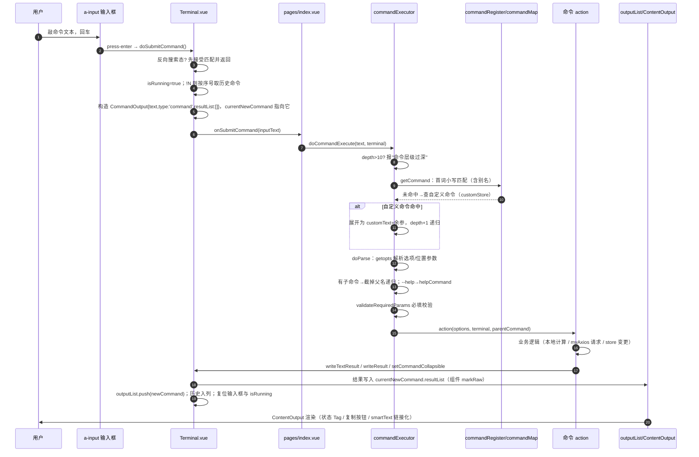
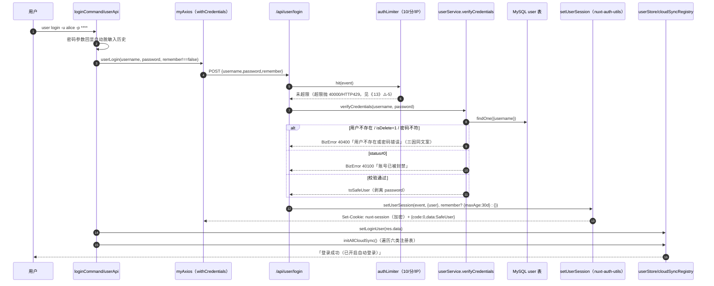
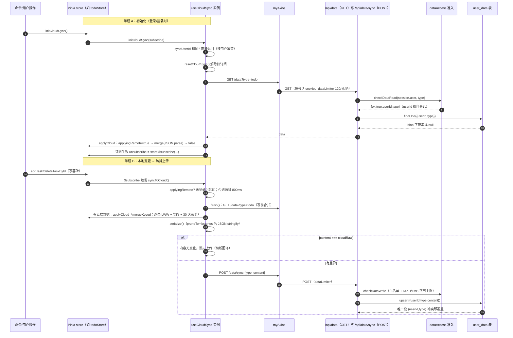
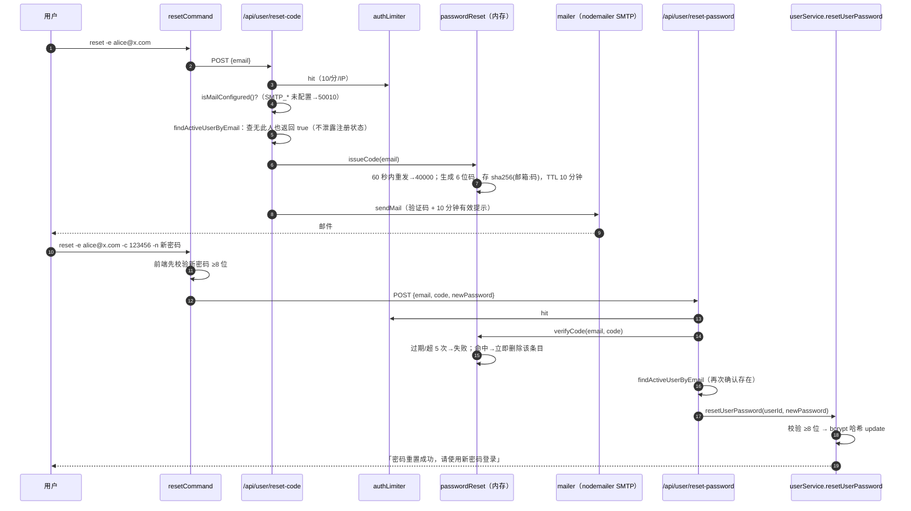
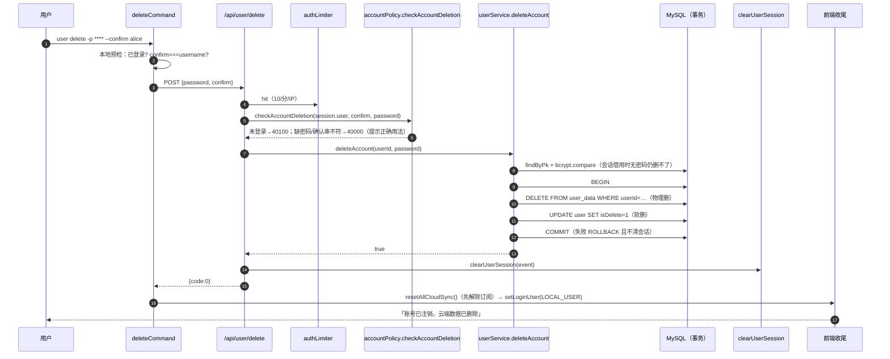

# 05 核心流程

> 项目：webCommand ｜ 版本：v1.0 ｜ 生成日期：2026-10-05 ｜ 依据：源码分析

## 1. 流程总览

本篇从端到端视角拆解五条核心链路：命令执行（纯前端解释器）、登录鉴权与会话恢复、云同步（写前合并）、邮箱验证码找回密码、账号注销。五条链路合起来覆盖了本项目全部需要"跨层协作"的路径——其余命令要么纯本地计算，要么是第 2、3 条链路的简单变体（一次代理请求）。阅读约定：每条流程先给图，再按编号展开关键步骤，最后列出涉及文件清单以便对照源码。

| 编号 | 流程 | 触发方式 | 是否触网 |
| --- | --- | --- | --- |
| 流程一 | 命令执行 | 输入框回车 / 面板执行 / `!序号` | 视命令而定 |
| 流程二 | 登录鉴权与会话恢复 | `user login`、注册后自动登录、页面刷新 | 是（`/api/user/*`） |
| 流程三 | 云同步 | 登录成功、页面挂载、任意 store 变更 | 是（`/api/data*`） |
| 流程四 | 找回密码 | `reset -e <邮箱>` 两步命令 | 是 + SMTP 出站 |
| 流程五 | 账号注销 | `user delete -p <密码> --confirm <用户名>` | 是（事务删数据） |

## 2. 流程一：命令执行链路

命令执行是整个产品的主干流程，特点是**服务端完全不在环内**——除了命令自己发起的请求，解释与调度全部发生在浏览器。

分步说明：

1. **提交与防并发**（`Terminal.vue` 的 `doSubmitCommand`）：回车进入后先把 `isRunning` 置真（执行期间输入框 disabled，防并发提交），并清掉当前提示。若处于 Ctrl+R 反向搜索态，回车语义变为"接受匹配项回填输入框"，不执行。以 `!` 开头时按序号取 `commandList` 中的历史命令文本，越界报"无效的历史命令序号"。
2. **输出占位先行**：执行前就构造 `CommandOutput` 对象并让 `currentNewCommand` 指向它，命令通过 `terminal.writeTextResult/writeTextErrorResult/writeResult` 写入的对象实际是往这个 `resultList` 追加——这就是《01-系统架构》所说的"输出是数据不是调用"。组件型输出经 `markRaw` 阻止 Proxy 化。
3. **解释器主干**（`app/core/commandExecutor.ts` 的 `doCommandExecute`）：先查递归深度（>10 直接报错，防御 `subCommands` 互相嵌套）；`getCommand` 取首词小写后在 `commandMap`（`commandRegister.ts` 按 func 与别名建索引，子命令场景换用父命令的 `subCommands` 表）中查找。
4. **自定义命令回退**：内置命令未命中时，取首词到 `customStore.getCustom()` 查用户自定义映射；命中则把"自定义文本 + 余下参数"拼回并 `depth+1` 递归（如 `g google.com` → `goto google.com`）。这一步让自定义命令成为内置命令的"宏"。
5. **参数解析与分发**：`doParse` 按命令声明的 `options`（key/alias/type/defaultValue）配置 getopts，产出位置参数 `_` 与命名选项。若有子命令且首参非空，截掉父命令名递归执行子命令（`user login xxx` → `login xxx`）；`--help` 则转调 `helpCommand` 输出用法；`validateRequiredParams` 按 `params[].required` 声明统一校验必填位置参数，缺参提示 `xxx --help`。
6. **执行与兜底**：`doAction` 用 try/catch 包住 `command.action`，任何异常经 `errMsg()` 提取可读信息后走 `writeTextErrorResult`——命令实现自身无需 try/catch。`collapsible` 命令（help/todo 等）执行前调 `setCommandCollapsible(true)` 让输出块渲染为可折叠面板。
7. **收尾**：`outputList.push` 后新命令块入列（空命令也输出换行保持终端观感），文本入历史（脱敏后另存 localStorage），输入框复位、`isRunning=false`，并仅在用户本就接近底部时自动滚动。

涉及文件：`app/components/Terminal.vue`（doSubmitCommand、terminal 接口实现）、`app/pages/index.vue`（onSubmitCommand 桥接）、`app/core/commandExecutor.ts`（doCommandExecute/getCommand/doParse/doAction/validateRequiredParams）、`app/core/commandRegister.ts`（commandMap）、`app/core/command.d.ts`（CommandType 契约）、`app/core/commands/custom/customStore.ts`（自定义回退）、`app/components/ContentOutput.vue`（渲染）、`app/utils/error.ts`、`app/utils/smartText.ts`。

## 3. 流程二：登录鉴权与会话恢复

登录有两条入口路径（交互式 `user login`、注册后自动登录）和一条恢复路径（带会话 cookie 刷新页面）。三条路径最终都收敛到同一个动作：前端 `loginUser` 与服务端会话对齐，然后初始化云同步。

分步说明：

1. **命令层**（`app/core/commands/user/subCommands/loginCommand.ts`）：`-u/-p/-r` 三选项由执行器解析后传入；`remember` 默认真。成功提示语区分是否开启自动登录；失败直接展示服务端 `res.message`。
2. **限流**：登录路由第一件事是 `authLimiter.hit(event)`（10 次/分/IP，内存滑动窗口）。IP 取值由 `getClientIp` 决定——仅当 `NUXT_TRUST_PROXY`/`TRUST_PROXY` 为 true 时信任 `x-forwarded-for` 首段，否则取 socket 远端地址。
3. **凭证校验**（`server/services/userService.ts` 的 `verifyCredentials`）：按"找不到→40400、软删→40400、封禁→40100、bcrypt 不匹配→40400"的顺序判定。前两种与密码错误共用同一句文案，防用户枚举；bcrypt 比较走 `bcrypt.compare`（哈希 10 轮在注册时生成）。
4. **会话写入**：路由层拿到 `SafeUser` 后 `setUserSession`——会话内容只有 `{user:{id,username,email?}}`，**没有密码也没有角色**；`remember !== false` 时显式传 30 天 maxAge。cookie 名 `nuxt-session`，由 `NUXT_SESSION_PASSWORD` 加密，服务端无会话表。
5. **前端收尾**：`setLoginUser` 更新展示态后立刻 `initAllCloudSync()`（`app/composables/cloudSyncRegistry.ts`）——惰性 import 六个 store 并逐个调 `initCloudSync`，单个类型失败只 `console.error` 不阻断其余类型。注释里记录了血的教训：漏掉某个类型的初始化，该类型既不会从云端拉取，下次本地改动还会把云端整包覆盖掉（#24 #25）。
6. **会话恢复路径**（`app/pages/index.vue` 的 `onMounted`）：刷新后 `userStore.getAndSetLoginUser()` POST `/api/user/current`，路由从会话取 id 后**从数据库重读**用户并脱敏返回（改名/改邮箱后旧会话不展示过期数据）；40100 属预期路径，静默 `$reset()` 回 `LOCAL_USER`。若拿到真实 id，同样执行 `initAllCloudSync()`——这就是"remember 自动登录路径同样要初始化云同步"的落点。
7. **注册即登录**：`registerCommand` 在 `/api/user/register` 返回新 id 后立刻以同一组凭据调 `userLogin`，复用上述第 2~5 步；登录失败也不回滚注册，只提示"注册成功，请手动登录"。

涉及文件：`app/core/commands/user/subCommands/loginCommand.ts`、`registerCommand.ts`、`logoutCommand.ts`、`app/core/commands/user/userApi.ts`、`userStore.ts`、`app/utils/myAxios.ts`（拦截器把 401 规整为 `{code:40100}`）、`server/api/user/login.post.ts`、`register.post.ts`、`current.post.ts`、`logout.post.ts`、`server/services/userService.ts`、`server/utils/rateLimit.ts`、`auth.d.ts`（会话 User 类型）。

## 4. 流程三：云同步（写前合并）

云同步是本项目最精巧的流程：服务端只存 blob，全部合并语义在浏览器完成。它由"初始化拉取"与"变更防抖上传"两个半程组成，六个数据类型各自独立跑一套实例。

分步说明：

1. **初始化幂等**（`useCloudSync.initCloudSync`）：记录 `syncUserId`，同一用户重复调用直接返回；换用户先 `resetCloudSync`（清防抖句柄、解除 `$subscribe`、清标记）再重新拉取——覆盖"已登录状态下再执行 user login 切换账号"的场景。
2. **拉取即合并**：`loadFromCloud` 拿到云端原始字符串后经 `applyCloud` 应用——`applyingRemote` 标志在 merge 期间置真，此间 store 的任何变更都不会再触发上传，这是回环防护的第一道闸。
3. **变更捕获**：各 store 在 `initCloudSync` 里 `this.$subscribe(() => this.syncToCloud())`，任意 state 变化都触发；themeStore 是 setup store，用 `watch(currentTheme, ..., {deep: true})` 达到同样效果。`syncToCloud` 先过两道闸（未登录、applyingRemote），再防抖 800ms——快速连续执行的命令只产生一次上传。
4. **写前合并**（`flush` 的核心，也是"整包 blob 不丢数据"的关键）：上传前先拉一次云端，若有数据则先 merge 进本地。原因写在注释里：直接整包覆盖会把另一端新增的条目、或本端已删除条目的墓碑冲掉。合并原语见《04-数据模型》6.2：列表类 `mergeKeyed`（逐条 LWW + 墓碑裁决），配置类 `localIsFresher`（整包较新者胜）。
5. **收敛上传**：合并后 `serialize()` 得到新 content，与 `cloudRaw` 全等则跳过 POST——这既是流量优化，也是回环防护的第二道闸（"合并 → $subscribe → 再同步"的链条在这里被内容相等短路）。上传失败的异常只 `console.error`，不影响本地数据；拉取失败时仍会上传本地数据，不因网络抖动丢本次变更。
6. **服务端两步**：`dataAccess.checkDataRead/checkDataWrite` 纯函数判定"已登录 + type 白名单 + 字节上限"，放行时把会话里的 userId 一并交回——请求体伪造 userId 无效（`test/routes/dataRoutes.test.ts` 专门用例）。`sync.post.ts` 最终只有一句 `UserDataModel().upsert(...)`。
7. **注销反初始化**：`user logout` 成功后 `resetAllCloudSync()` 遍历六类调 `resetCloudSync`，先解除订阅再清登录态，保证"注销后的本地变更不继续上云"。本地 store 数据保留，作为未登录工作副本。

涉及文件：`app/composables/useCloudSync.ts`（工厂）、`cloudSyncRegistry.ts`（六类清单与 initAll/resetAll）、`cloudMerge.ts`（合并原语）、`app/core/commands/todo/todoStore.ts`、`space/spaceStore.ts`、`note/noteStore.ts`、`custom/customStore.ts`、`terminal/config/terminalConfigStore.ts`、`theme/themeStore.ts`（各 serialize/merge 回调）、`server/api/data/index.get.ts`、`sync.post.ts`、`server/utils/dataAccess.ts`。

## 5. 流程四：找回密码（邮箱验证码）

两步式命令流程，验证码的全部状态在服务端进程内存中。

分步说明：

1. **第一步发码**（`resetCommand` 只传 `-e` 时）：前端直接把请求发给 `/api/user/reset-code`。路由先确认 `isMailConfigured()`（`server/thirdparty/mailer.ts` 检查 SMTP_HOST/USER/PASS 齐备，transporter 懒加载单例），未配置抛 50010 并给出"联系管理员设置 SMTP 环境变量"的明确指引。邮箱不存在时**同样返回成功**——不给枚举注册邮箱的人任何信号。
2. **验证码签发**（`server/services/passwordReset.ts` 的 `issueCode`）：`crypto.randomInt(0, 1_000_000)` 生成 6 位数字并补零；内存中以 `sha256(邮箱小写:码)` 存储（不存明文）；同一邮箱 60 秒内不可重发（返回剩余秒数）；表超过 1000 条触发过期清扫。
3. **第二步验证与重置**：`verifyCode` 依次查过期（10 分钟 TTL）、尝试次数（累计 5 次即销毁）、哈希比对；比对成功立即删除条目（一次性）。通过后路由再次确认邮箱对应有效用户，然后 `resetUserPassword` 直写新 bcrypt 哈希（**不校验旧密码**，这正是找回密码与改密 `user passwd` 的语义分野）。前端 `resetCommand` 会先行校验新密码长度，与服务端 `validateNewPassword` 同源（`MIN_PASSWORD_LENGTH = 8`，两处常量有契约测试比对）。
4. **限流与爆破成本**：发码与验证共用 authLimiter（10 次/分/IP）叠加验证码自身的 5 次尝试上限，6 位数字码的实际爆破空间被压到极小；进程重启清空验证码表是可接受的降级（用户重新申请即可）。

涉及文件：`app/core/commands/user/subCommands/resetCommand.ts`、`userApi.ts`（sendResetCode/resetPassword）、`server/api/user/reset-code.post.ts`、`reset-password.post.ts`、`server/services/passwordReset.ts`、`server/thirdparty/mailer.ts`、`server/services/userService.ts`（findActiveUserByEmail/resetUserPassword）、`server/utils/accountPolicy.ts`。

## 6. 流程五：账号注销

注销是唯一有事务的写路径，也是唯一物理删除用户数据的流程。

分步说明：

1. **三条件准入**：注销要求"登录态 + 确认串与用户名完全一致 + 当前密码"三者齐备（`server/utils/accountPolicy.ts` 的 `checkAccountDeletion`）。注释给出了每一条的理由：确认串防误触发、也让"删哪个账号"成为明确表达；重新输密码是因为"会话被复用/借用时不足以凭会话删号"。确认串大小写敏感（测试用例钉住）。前端 `deleteCommand` 会先做同规则预检，把正确用法回显给用户。
2. **口令复核**：`deleteAccount` 在事务外先 `findByPk` + `bcrypt.compare` 校验密码，失败抛 40000「密码错误」。
3. **事务化删除**：`useDb().transaction()` 包住两步——**先物理删除** `user_data` 全部行（"删除我的数据"这条承诺不能靠后续清理兑现），**再软删** `user` 行（保留一行便于事后核对）；任一步失败回滚并向上抛错。路由在 `deleteAccount` 成功后才 `clearUserSession`——删除失败时不清会话，避免"数据还在但用户被登出"的误导状态（`test/routes/userDelete.test.ts` 两条用例分别钉住顺序与失败分支）。
4. **前端收尾顺序有讲究**：先 `resetAllCloudSync()` 解除六类同步订阅，再 `setLoginUser(LOCAL_USER)`——若顺序颠倒，清登录态引发的 store 变更仍可能带着旧会话上云。
5. **善后语义**：注销后该用户名与邮箱**不可**被重新注册（软删行持有 `user_username_unique`/`user_email_unique` 唯一索引，而 `userRegister` 的查重条件 `Op.or: [{username}, {email}]` 不含 isDelete 过滤，查重必然命中并报「该用户名或邮箱已被注册」——《13》⚠️-3 已按源码核实，「注销」的实际语义是"删数据 + 永久放弃身份"）；旧会话 cookie 即使未被清也会在 `/api/user/current` 因 `isDelete` 被拒。

涉及文件：`app/core/commands/user/subCommands/deleteCommand.ts`、`userApi.ts`（userDelete）、`server/api/user/delete.post.ts`、`server/utils/accountPolicy.ts`、`server/services/userService.ts`（deleteAccount 事务）、`app/composables/cloudSyncRegistry.ts`（resetAllCloudSync）、`test/routes/userDelete.test.ts`。

## 7. 五条流程的共同骨架

把五条链路叠在一起看，有两个反复出现的模式值得记住。其一是**"纯函数准入 + 薄路由 + 厚服务"**：五条流程的服务端入口都遵循 `bizHandler` 包装 → 限流 `hit` → 会话读取 → 纯函数准入判定（`checkDataRead/checkDataWrite/checkAccountDeletion`）→ service 执行的固定次序，准入函数返回可判别联合并把生效的 userId/type 交回，路由层因此永远不使用非空断言。其二是**"前端状态与后端事实最终一致"**：无论登录、注销还是找回密码，前端 store 只做展示态收敛，真正的授权与数据归属每一步都以服务端裁决为准（会话、数据库唯一键、bcrypt）；前端先行校验（密码长度、确认串）只是体验优化，不是安全边界。新增任何一条涉及账号或数据的流程，都建议先对齐这两个骨架再动笔。
