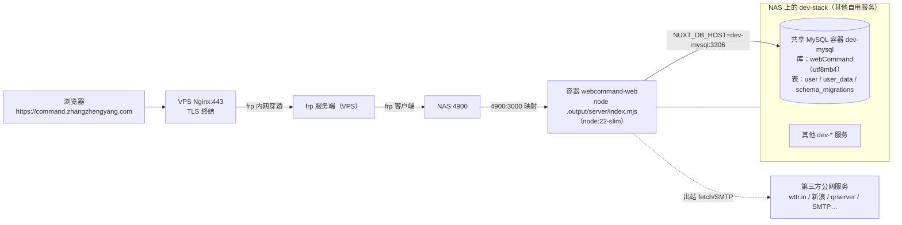

# 06 部署运行

> 项目：webCommand ｜ 版本：v1.0 ｜ 生成日期：2026-10-05 ｜ 依据：源码分析

## 1. 环境要求

webCommand 对运行环境的要求集中在三条：Node 版本、包管理器、一个可连接的 MySQL。生产链路额外需要 Docker 与（当前线上拓扑所需的）frp/Nginx。

| 项 | 要求 | 依据 |
| --- | --- | --- |
| Node（开发/跑测试） | ≥ 22.18（或 ≥ 24） | `pnpm test` 用 `node --test` 直接跑 `.ts` 用例，依赖原生类型剥离；README 实测 22.12/22.15 报 `ERR_UNKNOWN_FILE_EXTENSION`，24.21 可用，22.18 是官方默认开启该特性的版本线。`scripts/check-all.sh` 的 `node_ok` 内置同款判断并会自动从 nvm 目录挑新版 node |
| Node（容器运行时） | node:22-slim 镜像内置 | `Dockerfile`，容器只跑构建产物，不跑测试，无类型剥离需求 |
| pnpm | 任意近期版本 | `package.json` scripts 全按 pnpm 写；`pnpm-workspace.yaml` 只配了构建脚本白名单（allowBuilds：core-js/esbuild/unrs-resolver/vue-demi） |
| MySQL | 8.x（utf8mb4） | DDL 在 `server/utils/migrations.ts`；blob 保存 4 字节 emoji 依赖 utf8mb4（冒烟脚本专项验证） |
| Docker / docker compose | 生产可选但推荐 | `Dockerfile` + `docker-compose.example.yml`；NAS 实操要求 `DOCKER_BUILDKIT=0`（btrfs + BuildKit 死锁，README「部署与备份」） |

数据库可复用已有实例（线上就是复用另一套 dev-stack 的 MySQL 容器），不要求独占；应用账号需要对目标库（默认库名 `webCommand`）的完整读写权限即可，迁移器只在该库内建表，不碰其他库。

## 2. 本地开发启动

从零到跑通常规四步（命令全部来自 README 与 `package.json` scripts）：

```bash
# 1. 准备环境变量：复制示例为 .env 并按需填写 DB_*
#    本地库可直接 localhost/root；nuxt dev 会自动加载 .env
cp .env.example .env

# 2. 安装依赖（postinstall 自动执行 nuxt prepare）
pnpm install

# 3. 启动开发服务器（前端与 /api 同源，默认 http://localhost:3000）
pnpm dev

# 4. 验证：浏览器打开首页，输入 help 应看到命令总表；
#    curl http://localhost:3000/api/health 应返回 {"code":0,"data":{"status":"ok",...}}
```

数据库表**无需手工创建**：Nitro 启动插件 `server/plugins/migrate.ts` 会执行 `server/utils/migrations.ts` 的幂等 DDL，在目标库建出 `user`、`user_data` 与水位表 `schema_migrations`。开发模式下若迁移失败（例如 MySQL 没起），**服务仍会启动**——迁移插件刻意不阻断启动（防容器重启风暴），失败会体现在 `/api/health` 的 `schemaReady=false` 与 `schemaError` 字段里，注册/登录会失败，这是排障时的第一个检查点。

开发环境的配置兜底逻辑值得理解，否则容易误解"不配 DB 也能跑"：`nuxt.config.ts` 的 `runtimeConfig` 里留有**非敏感开发默认值**（dbHost localhost、dbPort 3306、dbName webCommand、dbUser root、dbPassword 空）。运行期真正的取值由 `server/utils/appConfig.ts` 的 `resolveDbConfig()` 按优先级解析（见第 3 节）。本地不填任何 DB 变量时应用会尝试连 `localhost:3306` 的 `webCommand` 库。

其余日常命令：

```bash
pnpm lint          # ESLint（质量规则；stylistic 已关闭，格式归 Prettier）
pnpm lint:fix      # ESLint 自动修复
pnpm format        # Prettier 全量格式化 / format:check 校验
pnpm typecheck     # nuxt typecheck（vue-tsc 全量类型检查）
pnpm build         # 生产构建，产出 .output
pnpm preview       # node .output/server/index.mjs（本地预览产物）
```

## 3. 环境变量清单

以下变量全部以**源码实际读取点**为准。服务端私有配置的读取统一经 `server/utils/appConfig.ts` 的 `setting(configured, ...envKeys)`：依次尝试 `NUXT_*` 前缀变量、裸名变量，最后落到构建期默认值——因此两种写法都生效，推荐统一 `NUXT_` 写法（compose 模板注释给出理由：改口令只需重启容器，无需重新构建）。布尔值经 `boolSetting` 解析，`'true'`/`'1'` 视为真。

| 变量（两种写法） | 读取点 | 必填性 | 默认值 | 说明 |
| --- | --- | --- | --- | --- |
| `NUXT_DB_HOST` / `DB_HOST` | `resolveDbConfig()` | 生产必填（`check-env` 校验） | localhost | MySQL 主机；生产缺失或仍为默认时启动即抛错 |
| `NUXT_DB_PORT` / `DB_PORT` | `resolveDbConfig()` | 可选 | 3306 | `Number()` 解析失败回退 3306 |
| `NUXT_DB_NAME` / `DB_NAME` | `resolveDbConfig()` | 可选 | webCommand | 库不存在时迁移器建表会失败（health 暴露） |
| `NUXT_DB_USER` / `DB_USER` | `resolveDbConfig()` | 生产必填 | root | 生产必须显式给出，防止静默连错实例 |
| `NUXT_DB_PASSWORD` / `DB_PASSWORD` | `resolveDbConfig()` | 生产必填 | （空） | 生产禁止使用开发口令 `root1234`（`check-env` 硬校验） |
| `NUXT_SESSION_PASSWORD` | `check-env`、nuxt-auth-utils | 生产必填，≥32 位 | （空） | 会话加密密钥；生成命令见 compose 模板注释（`crypto.randomBytes(32).toString('base64url')`） |
| `NUXT_TRUST_PROXY` / `TRUST_PROXY` | `rateLimit.getClientIp()` 经 `boolSetting` | 反代后必置 true | false | true 时限流取 `x-forwarded-for` 首段；不开则按反代内层 IP 计数，所有访客共用一个桶 |
| `NUXT_SMTP_HOST` / `SMTP_HOST` | `mailer.smtpConfig()` 经 `setting` | 可选 | （空） | 找回密码需要；HOST/USER/PASS 任一缺失则 `isMailConfigured()=false`，发码接口返回 50010 |
| `NUXT_SMTP_PORT` / `SMTP_PORT` | 同上 | 可选 | 465 | 465 时启用 SMTPS（`secure: true`） |
| `NUXT_SMTP_USER` / `SMTP_USER` | 同上 | 可选 | （空） | 与 PASS 一起构成认证 |
| `NUXT_SMTP_PASS` / `SMTP_PASS` | 同上 | 可选 | （空） | 敏感，仅运行期注入 |
| `NUXT_SMTP_FROM` / `SMTP_FROM` | 同上 | 可选 | 取 SMTP_USER | 发件人地址 |
| `NUXT_PUBLIC_API_BASE_URL` | `nuxt.config.ts`（构建期） | 可选 | /api | 前端 axios 基地址；拆分前后端域名时才需要。非敏感，构建期烘入产物 |
| `NUXT_PUBLIC_SITE_URL` | `nuxt.config.ts`（构建期） | 生产建议 | （空） | 站点绝对地址，决定 canonical/og:url 等绝对 URL 标签；不要以 / 结尾（配置里有去尾处理） |
| `PORT` | Nitro node-server preset | 可选 | 3000 | HTTP 监听端口；compose 里固定 3000，由端口映射对外暴露 |
| `NODE_ENV` | `check-env`、`Dockerfile` | 容器内置 | — | 容器里固定 production；只有 production 才触发启动校验 |
| `TEST_DB_*`（5 个） | `.env.test`，`smoke-cloud-sync.sh` 读取 | 测试用 | — | 隔离测试库 `webcommand_test` 的连接参数，由 `init-test-db.sh` 生成，0600 且 gitignore |
| `SMOKE_PORT` | `smoke-cloud-sync.sh` | 可选 | 3100 | 冒烟测试 dev 服务端口 |

两条纪律性约束必须复述（源自 `nuxt.config.ts` 注释与 README，都有真实事故背书）：其一，**私有配置只能在运行期注入**，严禁往 `runtimeConfig` 里加 `process.env.X`——`nuxt build` 会把值烘进 `.output`，产物本身变成带内网地址与明文口令的对象；`scripts/deploy.sh` 的 `scan_artifact` 会在每次构建后用 `.env` 里的口令对 `.output` 做 grep，命中即拒绝部署。其二，`NUXT_PUBLIC_*` 与 head 标签是**构建期**决定的（`app.head` 是静态外壳的一部分），改站点地址需要重新构建；而 `NUXT_DB_*`、`NUXT_SESSION_PASSWORD`、`NUXT_TRUST_PROXY`、`SMTP_*` 全部运行期生效，改配置重启容器即可。另注：产物（nitro `node-server` preset）在运行时**不自动加载 `.env` 文件**（构建产物中无 dotenv/loadEnv 逻辑），裸进程部署需自行导出环境变量；`nuxt dev` 则会自动读取 `.env`。

## 4. 构建与生产启动

```bash
pnpm build                        # 产出自包含的 .output（含 .output/server/node_modules）
node .output/server/index.mjs     # 生产启动，监听 $PORT（默认 3000）
```

`.output` 是 Nitro 的 `node-server` preset 产物（`.output/nitro.json` 可见 preset 与版本），自包含到"拷到任何有 Node 22 的机器就能跑"。唯一例外是 `mysql2`：sequelize 在运行时动态 require 它，Nitro 打包器追踪不到，所以容器镜像里要补装（见第 5 节 Dockerfile）。启动时按顺序发生三件事，全部是 Nitro 插件行为：

1. **`server/plugins/check-env.ts`（生产守卫，会抛错阻断启动）**：仅 `NODE_ENV=production` 时生效。校验四点——`NUXT_SESSION_PASSWORD` ≥32 位（短了 nuxt-auth-utils 会在每个 session 请求里抛 500 且不提示原因）；`resolveDbConfig()` 解析后的 host/user/password 齐备（**校验解析值而非 process.env**，注释记录了"守卫通过但建连用的是另一份配置"的旧事故）；host 必须显式提供（防止静默连容器内 localhost）；password 不得是开发口令 `root1234`。
2. **`server/plugins/migrate.ts`（迁移，不阻断启动）**：执行幂等 DDL 建表并写水位（机制详见《04-数据模型》第 4 节）；失败只记 `appStatus` 并由 `/api/health` 暴露。
3. **HTTP 监听**：单进程同时服务静态资源（`.output/public`，SPA 外壳）与 `/api` 路由。`/api/health` 是部署链路的探活契约：每次实时查 `information_schema` 确认 `user`/`user_data` 两表存在，库不通或缺表返回 HTTP 503 + `status: "degraded"`，把"进程活着但注册登录全废"的假健康挡在门外。

## 5. Docker 部署链路

### 5.1 镜像构建（Dockerfile）

`Dockerfile` 全文只有八个有效指令，采用**"产物宿主机构建 + 容器纯运行"**模式（与《00-项目总览》技术栈表一致）：基础镜像 `node:22-slim`，`WORKDIR /app` 后直接 `COPY . .`——因为 `.output` 已自包含，容器内不再执行 `npm install`/`nuxt build`；随后一段 RUN 解决 mysql2 缺失：在 `/tmp/mysql2` 临时目录 `npm init -y` + `npm install mysql2@3.24.2`（走 npmmirror 镜像源），再把其 `node_modules` 合并拷入 `/app/node_modules/`。注释解释了为何不直接装：npm 会与产物自带的 node_modules 树冲突（edgesOut 报错）。末尾 `EXPOSE 3000`、`ENV NODE_ENV=production`、`CMD ["node", ".output/server/index.mjs"]`。这个模式的好处是镜像构建快且构建产物与验证过的产物严格一致；代价是**先决条件**：`COPY . .` 之前宿主机必须已经跑过 `pnpm build`，且同步代码到构建机时不能把 `.output/server/node_modules` 排除掉（README 点名的两个坑之一：`bsdtar --exclude=node_modules` 会连它一起排掉，容器因找不到 mysql2 崩溃循环）。

### 5.2 编排（docker-compose.example.yml → docker-compose.yml）

真实编排文件 `docker-compose.yml` 含生产口令，已被 `.gitignore` 忽略；入库的是模板 `docker-compose.example.yml`，用法是复制后填口令。模板要点：服务名 `webcommand-web`，`restart: unless-stopped`，端口 `4900:3000`，加入外部网络 `dev-stack_devnet`（与共享 MySQL 互通，见 5.3）；环境变量用 `NUXT_DB_*` 推荐写法给出全套（HOST/PORT/NAME/USER/PASSWORD/SESSION_PASSWORD/SITE_URL/TRUST_PROXY）。healthcheck 用容器内 node 直接 fetch：

```yaml
healthcheck:
  test: ['CMD', 'node', '-e', "fetch('http://127.0.0.1:3000/api/health').then((r) => process.exit(r.ok ? 0 : 1)).catch(() => process.exit(1))"]
  interval: 30s
  timeout: 5s
  retries: 3
  start_period: 20s
```

即 `/api/health` 返回 503（库不通/缺表）时容器被标记 unhealthy——`start_period: 20s` 给启动迁移留了窗口。这正是 compose 模板注释所说的：探活看的是"真的能服务"，不是"进程活着"。

### 5.3 线上拓扑：一个应用容器 + 一个共享 MySQL

现在兑现《01-系统架构》第 6 节留下的引用。线上真实拓扑如下：



这套拓扑与《01-系统架构》第 5 节的单实例假设**互为因果**，值得把两面都说透：

**从假设看拓扑（为什么可以这么简单）**：决策三明确"限流、验证码等状态存进程内存"，找回密码验证码的注释甚至直接写着"单实例足够；多实例应改 Redis"。正因为运行态全部收在一个 Node 进程里，部署面才退化到"一个容器 + 一个外部数据库"：不需要会话共享存储（会话是自包含加密 cookie）、不需要任务队列、不需要多副本间的迁移互斥（迁移插件单点执行，天然无竞争）。反过来看，若未来做水平扩容，这个拓扑会立刻失效：多容器各自计数会让限流配额翻倍、验证码在 A 容器签发 B 容器验证必然失败——扩容前置条件是把这两处状态外置到 Redis，并把 `check-env` 的启动校验扩展出多实例模式。此外无状态 cookie 会话反而是这份架构里唯一"天然多实例友好"的部分：只要密钥一致，任意副本都能验证任何会话。

**从拓扑看假设（为什么必须守住这些运维纪律）**：应用容器与 `dev-mysql` 共处外部网络 `dev-stack_devnet`，意味着这个库不是本应用独占的——同一 MySQL 实例上还跑着其他 dev-stack 服务。由此派生四条运维影响：

1. **账号最小权限**：应用账号（模板中的 `appuser`）应只对 `webCommand` 库授权；`scripts/init-test-db.sh` 的注释证实了这一约束的真实性（NAS 上 appuser 只有 `USAGE ON *.*`，连建测试库的权限都要管理员另授）。迁移器只在本库内执行 DDL，因此不需要全局 DDL 权限。
2. **备份与恢复要考虑共库**：`scripts/backup-db.sh` 用 `mysqldump --databases webCommand` 只导出本应用库（`--single-transaction` 保证一致性读，不锁全实例），恢复时也是单库导入——共享实例上做全实例级操作（升级 MySQL、迁移到新机器）时，本应用的停机窗口要与其他服务协调。
3. **`schema_migrations` 是唯一权威**：水位表让"应用启动即自动迁移"在任何环境（本地/测试/生产）可重复执行；但因为共享库，任何指向该库的**第二个应用实例**（哪怕只是误起的调试容器）都会并发跑迁移插件——迁移语句幂等所以通常无害，但这仍是"单实例假设"在数据库维度的延伸：确保任何时候只有一个进程指向生产库执行启动迁移。
4. **限流按真实 IP 计数依赖整条链路配合**：浏览器 → Nginx → frp → 容器，`x-forwarded-for` 要逐跳传递，且容器内 `NUXT_TRUST_PROXY=true` 才会信任它。README 双重警告的反面教材：开关不开时所有访客共用 frp 内层 IP 的桶，登录限流 10 次/分会误伤全体用户；而 Nginx 侧若不设置该头，开了开关也一样取不到真实 IP。

对外链路上还有一个容易被忽视的细节：`docker-compose.yml` 头部注释标注了完整转发路径 `https://command.zhangzhengyang.com → VPS Nginx:443 → frp(4900) → 本容器 :4900`，即宿主机 4900 端口经 frp 隧道暴露到 VPS。这意味着容器 healthcheck（127.0.0.1 直连）与外网可达性是两个独立检查——容器自检 healthy 不代表 frp/Nginx 链路通，所以 `deploy.sh verify` 从公网侧再核验一次（见第 6 节）。

### 5.4 发布管线

仓库脚本刻意**不代做远端操作**（`scripts/deploy.sh` 头部注释解释了原因：既有管线依赖 expect 脚本与 NAS 口令，已验证可用，不该在脚本里重新实现），只补流水线里最容易出事的环节：

```bash
./scripts/deploy.sh build     # 1. 用 nvm 的 node 执行 pnpm build（避开错误架构的二进制）
                              # 2. scan_artifact：grep .output 是否含 .env 的 DB_PASSWORD/
                              #    NUXT_SESSION_PASSWORD（含则拒绝部署）；内网 IP 出现则警告
# 3. 传输与重建按《webCommand部署与避雷手册》§3 手工执行：
#    expect tar_src_pipe.exp <仓库路径> /volume1/docker/webcommand
#    expect tar_nm_pipe.exp  …（必须补传 .output/server/node_modules，见 5.1）
#    NAS：DOCKER_BUILDKIT=0 docker compose up -d --build
./scripts/deploy.sh verify    # 4. curl 线上 /api/health：非 2xx 或 status!=ok 都判失败
```

一次标准升级因此是六步：本地 `check-all.sh` 过门禁 → `deploy.sh build`（构建 + 凭据扫描）→ tar 管道同步到 NAS → `docker compose up -d --build` 重建容器 → 容器内自动执行 check-env + migrate → `deploy.sh verify` 公网核验，另建议 `SHOW INDEX FROM user_data` 确认唯一索引仍在（迁移器对存量表不做任何变更）。**回滚**按"重建旧代码目录 + 同一数据库"处理：水位表保证旧代码启动时不会重复跑已应用的迁移；若新迁移包含破坏性 DDL，需先恢复 `backup-db.sh` 的备份再回滚代码（当前仅有一条建表迁移，该风险尚未实际出现）。

## 6. 运维与备份

数据库备份由 `scripts/backup-db.sh` 承担，设计上有四个防呆点：口令经 `MYSQL_PWD` 环境变量传给 mysqldump（不出现在 ps 里）；备份后校验文件 ≥1024 字节（注释："空备份比没有备份更危险"）并 `gzip -t` 完整性校验、统计 `CREATE TABLE` 张数；按 `KEEP_DAYS`（默认 14 天）滚动清理；注释同时提醒备份目录必须在另一块盘/机器留副本。另有一处**已登记的防呆缺口**：脚本第 17 行的 `MYSQL_PWD` 必填守卫写成了 `: "${MYSQL_PWD:*** …}"`，少一个 `?` 后防呆方向恰好反向（变量已设反而报错退出、未设却静默放行，《13》⚠️-23）——修复前按上述 crontab 定时执行会一次都不产出备份，该修复已列入《13》第 6 节第 1 周。典型 crontab（脚本头部给出）：

```bash
30 3 * * * DB_HOST=dev-mysql DB_USER=appuser DB_NAME=webCommand \
  BACKUP_DIR=/volume1/backup/webcommand MYSQL_PWD=*** \
  /volume1/docker/webcommand/scripts/backup-db.sh >> /volume1/backup/webcommand/backup.log 2>&1
```

日常健康观测只看一个端点：`GET /api/health`（无鉴权无限流）。返回体区分 `dbReachable`（`SELECT 1` 连通性）与 `missingTables`（两表存在性），迁移失败的具体原因经 `schemaError` 透出。排障时的决策树：`dbReachable=false` → 查共享 MySQL 容器与 `dev-stack_devnet` 网络；`missingTables` 非空且 `schemaError` 有值 → 迁移器失败，看应用日志 `[migrate]` 行；两者都健康但业务仍异常 → 查限流（HTTP 429；body 码 user 组 40000、data/proxy 组 42900，见《13》⚠️-5）或 SMTP 配置（50010）。日志关键字索引：`MySQL client connected`（首次建连成功）、`[migrate] 已应用迁移/数据库结构已是最新`、`[migrate] 数据库迁移失败`、`[api error]`（未分类异常兜底）。

## 7. 测试体系与质量门禁

### 7.1 一条命令的门禁

```bash
./scripts/check-all.sh   # 依次：格式 → ESLint → 类型 → node:test → vitest
```

`check-all.sh` 五步分别对应 `pnpm format:check`、`pnpm lint`、`pnpm typecheck`、`pnpm test`（`node --test "test/*.spec.ts"`）、`pnpm test:routes`（`vitest run`）。脚本开头会检测当前 Node 是否 ≥22.18，不满足则在 nvm 目录与 `/usr/local/bin` 里自动挑可用的新版（测试依赖原生类型剥离）。`eslint.config.mjs` 只有一条自定义规则——`no-explicit-any` 恢复为 error（前后端 any 已全部收敛，防止回退）；格式规则完全让给 Prettier，避免双规则打架。仓库已配置 origin（github.com/zhangzhengyang27/webCommand）但尚未建立 CI 流水线，门禁仍只存在于本机习惯；`check-all.sh` 头注释仍写"仓库目前没有 git remote"，已落后于现实（《13》⚠️-10），建 CI 时顺手更正。

### 7.2 双轨测试的分工

两套框架各管一段，边界被刻意划清（`vitest.config.ts` 的 include 只收 `test/routes/**` 与 `test/unit/**` 的 `.test.ts`，避免抢收 `node:test` 的 `.spec.ts` 造成"0 条却全绿"的假通过）：

| 轨道 | 载体 | 被测对象 | 代表用例 |
| --- | --- | --- | --- |
| 纯函数与静态契约 | `node:test`（零第三方依赖，被测模块必须自包含——原生 ESM 不解析无扩展名导入） | `test/cloudMerge.spec.ts`（逐条 LWW/墓碑/30 天窗口）、`test/dataAccess.spec.ts`（匿名拒绝、白名单、1MB/64KB 精确边界）、`test/accountPolicy.spec.ts`（口令下限、注销三条件、前后端 MIN_PASSWORD_LENGTH 一致性）、`test/cloudDataType.spec.ts`（前后端 CLOUD_DATA_TYPES 白名单与 useCloudSync 调用点一致性）、`test/commandContract.spec.ts`（命令注册表：未登记模块、命名/别名冲突、子命令 key 一致）、`test/serverConfig.spec.ts`（setting 优先级、check-env 校验逻辑）、`test/migrations.spec.ts`（DDL 幂等、水位、失败不登记） | 钉住"改了一处忘另一处"的契约漂移 |
| 路由层 | `vitest` + `test/routes/nitroGlobals.ts` 全局替身（defineEventHandler/readBody/getUserSession 等） | `test/routes/dataRoutes.test.ts`（伪造 userId 无效、42900 且 HTTP 429、其他 IP 不受牵连、删号顺序）、`test/routes/userDelete.test.ts`（确认串大小写、删除失败不清会话）、`test/unit/outputSnapshot.test.ts`（快照清洗） | 钉住"路由拿到输入后做了什么判定"；**不**验证 h3 的 body/query 解析，也不连数据库 |

### 7.3 真实数据库端到端冒烟

单元/路由测试都不碰数据库，端到端由 `scripts/smoke-cloud-sync.sh` 补位：在 3100 端口起一个 `nuxt dev` 指向隔离测试库 `webcommand_test`，跑 26 条断言，覆盖迁移建表（真实 MySQL 8）、blob 逐字往返（含 4 字节 emoji）、跨用户隔离、type 白名单、按类型尺寸上限、匿名 40100、改密后旧密码失效、注销三条件与注销后不可再登录、authLimiter 真实触发 HTTP 429。两道安全设计值得强调：其一，脚本启动后先用 mysql2 直连测试库确认迁移器把表建在了 `webcommand_test` 里才造数据——因为若配置优先级出错应用会连到 `.env` 里的 NAS 库，而那边的 health 同样报 ok，光看健康检查发现不了（"防误写生产库的闸门"）；其二，第 8 节前显式 `sleep 62` 等 authLimiter 窗口过去，避免限流污染注销断言。测试库的建立本身也有纪律：`init-test-db.sh` 只生成随机口令与 `.env.test`/`init-test-db.sql`（0600 且 gitignore），建库建账号的唯一一步手工 SQL 由持有管理员凭据的人执行，脚本全程不接触管理员口令。

完整测试金字塔因此是四层：`node:test` 纯函数（秒级，无环境）→ `vitest` 路由层（秒级，内存替身）→ 冒烟脚本（分钟级，真实 MySQL + dev 服务）→ `deploy.sh verify`（部署后公网核验）。日常开发守住第一、二层，发布前跑第三层，上线后靠第四层与容器 healthcheck 兜底——这套组合就是本项目的质量门禁全部。

## 8. 常见故障速查

| 现象 | 根因与处置 |
| --- | --- |
| `pnpm test` 报 `ERR_UNKNOWN_FILE_EXTENSION` | Node < 22.18 无原生类型剥离；升级 Node 或让 `check-all.sh` 自动挑选 nvm 里的新版 |
| 容器反复重启 | 大概率 `.output/server/node_modules` 缺失（mysql2 加载失败）；同步时补传该目录（5.1 的坑） |
| 容器 healthy 但用户全报登录失败 | `/api/health` 503：`dbReachable=false` 查共享库；`missingTables` 非空查 `[migrate]` 日志 |
| 所有用户共享限流桶（10 次/分就被限流：HTTP 429，user 组 body 码 40000） | `NUXT_TRUST_PROXY` 未开或上游未传 `x-forwarded-for`（第 3 节、5.3 第 4 条） |
| 改了 compose 口令不生效 | 变量用了非 `NUXT_` 前缀且产物是旧构建（历史事故）；改用 `NUXT_DB_*` 并重启容器（`appConfig` 双写法兼容） |
| 启动即退出报 `NUXT_SESSION_PASSWORD` 或 DB 配置错误 | `check-env` 生产行为：密钥 <32 位 / DB_HOST、DB_USER、DB_PASSWORD 缺失 / 口令为 root1234，按报错列出的变量名补齐 |
| 发验证码报 50010 | SMTP_HOST/USER/PASS 未配齐（`isMailConfigured` 为假）或发信失败，检查 `SMTP_*` 环境变量与上游 SMTP 日志 |

综上，本项目的部署运行模型可以压缩成一句话：**构建在宿主、运行在容器、状态在内存、数据在共享 MySQL、健康看 /api/health、质量看四层金字塔**——每半句背后都有对应的文件与脚本兜底，替换任何一环前先读第 5.3 节的因果约束。
