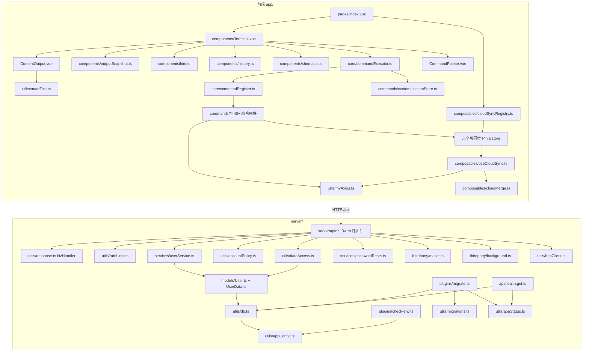

# 07 模块详解

> 项目：webCommand ｜ 版本：v1.1 ｜ 生成日期：2026-10-06 ｜ 依据：源码分析

## 1. 阅读地图与模块依赖

本篇是全仓的"模块级深读手册"：前端（视图层 / 命令域层 / 基础设施层）与 server 端（路由 / 服务 / 模型 / 横切 / 启动插件 / 第三方适配）逐个模块给出职责、关键文件与函数清单和机制走读。与既有文档的分工：《00-项目总览》给全景与功能清单，《01-系统架构》讲分层与设计决策，《05-核心流程》讲五条端到端链路——本篇不重复那些结论，只把"每个模块内部长什么样、每个函数负责什么"展开到位。涉及流程的细节一律以「见《05-核心流程》」方式引用。

先给一张模块依赖总图（箭头指向被依赖方）：

## 2. 前端 · 视图层（app/pages + app/components）

### 2.1 pages/index.vue —— 唯一页面的 33 行

职责只有三件事：渲染全屏终端、把输入桥接给执行器、启动时恢复登录态并初始化云同步。模板仅一行 `<terminal ref="terminalRef" :user="loginUser" full-screen :on-submit-command="onSubmitCommand" />`；脚本里 `onSubmitCommand` 把文本转交 `doCommandExecute`；`onMounted` 先 `getAndSetLoginUser()`，拿到真实 id 后 `initAllCloudSync()`。注释明确记录了 #24/#25 事故：自动登录路径若漏初始化，云端数据不会被拉取且会被本端改动整包覆盖——这也是 `commandContract`/`cloudDataType` 两个契约测试存在的动因。

### 2.2 components/Terminal.vue —— 终端主组件（约 740 行）

这是前端最大的单文件，承担"输出列表 + 输入框 + 状态栏 + 各交互子系统"的组装。关键成员清单：

| 成员 | 类型 | 职责 |
| --- | --- | --- |
| `outputList` | ref | 全部输出（`Terminal.OutputType[]`），模板按 `collapsible`/`type` 分支渲染 |
| `commandList` | ref | 命令历史（`CommandOutputType[]`），与 `outputList` 共享对象引用 |
| `currentNewCommand` | 模块级变量 | 指向正在执行的命令输出块，`write*` 系列都往它的 `resultList` 追加 |
| `doSubmitCommand` | 函数 | 回车入口：反向搜索态优先接受匹配；`!N` 取历史第 N 条；构造输出占位、调 `onSubmitCommand`、入历史、复位 `isRunning` |
| `writeTextResult / writeTextErrorResult / writeTextSuccessResult` | 函数 | 往当前命令块写文本（带可选状态色） |
| `writeResult / writeOutput` | 函数 | 写组件型输出（组件先 `markRaw` 阻止 Proxy 化，否则 `defineAsyncComponent` 会丢 template）/ 立即输出 |
| `writeTextOutput / clear / setCommandCollapsible` | 函数 | 立即输出文本 / 清屏 / 标记当前命令可折叠 |
| `terminal` | 对象 | 上述方法 + 历史/补全/面板/反向搜索的集合，`defineExpose` 给父组件与命令层使用（接口契约见 `type.d.ts` 的 `Terminal.TerminalType`） |
| `persistSnapshot` | 函数 | `outputList` 深度 watch 回调：`sanitizeForSnapshot` 清洗后取末尾 200 条写 `terminal-output-snapshot` |
| 历史持久化 watch | watch | `commandList` 深度 watch：末尾 100 条经 `redactSensitiveText` 脱敏后写 `terminal-command-history` |
| `reverseSearch / acceptSearchResult / exitReverseSearch / computeSearchResults` | 函数 | Ctrl+R 反向增量搜索（#29）：输入即过滤、再按循环上一条、回车接受、Esc 退出 |
| `isNearBottom / scrollToBottom` | 函数 | 输出变更时仅当视口距底 < 80px 才自动滚动（#93） |
| `spacePrompt / currentTime / wrapperStyle` | computed | 提示符 `[用户名@空间目录]$`（#83）、秒级时钟（#100）、主题 7 个 CSS 变量与背景注入 |
| `handleClickWrapper` | 函数 | 点击 `.terminal` 空白区聚焦输入框 |

机制走读有三处值得展开。第一，**输出是数据不是调用**：命令拿到的 `terminal` 是只写接口，写入进入 Vue 响应式数组后由模板统一渲染，因此命令与渲染完全解耦；组件型输出必须 `markRaw`（`writeResult` 内注释解释了 Proxy 化会让异步组件丢 template）。第二，**占位先行**：`doSubmitCommand` 在调用执行器之前就构造好 `CommandOutput` 并把 `currentNewCommand` 指向它，异步命令在任意时刻写结果都能落到正确块。第三，**持久化双通道**：历史与快照分别走两个深度 watch，写入前分别做密码脱敏与组件清洗（细节见 `outputSnapshot.ts` 与《02-页面设计》2.2）。

### 2.3 components/ContentOutput.vue —— 单条输出渲染

文本输出渲染为「状态 Tag（info/success/warning/error/system 五色映射）+ `v-html` 渲染 `smartText(output.text)` + 悬停出现的复制按钮（#30，`navigator.clipboard` 写入后 1.2s 恢复）」；组件输出直接 `<component :is="output.component" v-bind="output.props">`。`v-html` 的安全性由 `smartText` 先转义保证（eslint 注释同步说明）。样式上 `.copy-btn` 默认 `opacity: 0`，悬停才浮现，避免干扰终端观感。

### 2.4 components/CommandPalette.vue —— Ctrl+K 命令面板

条目来源两路：`commandList`（`commandRegister.ts` 的数组）逐命令生成 `{label: func, desc, search}`，search 串聚合 func、name、别名的小写；`customStore.listCustom()` 生成自定义命令条目。过滤是空格分隔的多关键词 AND 匹配；↑/↓ 循环移动高亮（`moveActive` 取模），Enter 执行 `doCommandExecute(item.label, terminal)` 后 `focusInput`。注意 `customItems` 与 `builtinItems` 都是组件创建时一次性快照——面板开着时新增自定义命令不会热更新，需关闭重开（行为细节，无碍使用）。

### 2.5 四个交互子系统 TS 模块

| 文件 | 导出 | 机制要点 |
| --- | --- | --- |
| `shortcuts.ts` | `registerShortcuts(terminal)` 返回清理函数、`shortcutList` | document 级 keydown：任意小写字母聚焦输入框；按 `e.code` + 修饰键匹配 `shortcutList`（Ctrl+L 清屏、Ctrl+O 全折叠、Ctrl+R 反向搜索、Ctrl+K 面板、Tab 补全、↑/↓ 历史、Esc 退出搜索、Cmd+V/Backspace/Enter 聚焦）。卸载时移除监听，防内存泄漏 |
| `history.ts` | `useHistory(commandList, inputCommand)` | `commandHistoryPos` 游标：↑ 减一并回填文本、↓ 加一，走到末尾再按 ↓ 清空输入框；刻意持有 `commandList` 的 Ref 引用而非拷贝，否则挂载时整体替换数组会"失联"（注释原话） |
| `hint.ts` | `useHint()` 返回 `hint/setHint/debounceSetHint/getTabCompletion/resetTabCycle` | 提示：取首词匹配命令 → 有子命令再匹配子命令 → 经 `getUsageStr` 生成用法串，`debounce` 300ms；受 `terminalConfigStore.showHint` 开关控制。Tab 补全：按"空输入 / 未匹配命令名 / 命令名后补子命令 / 第二词前缀匹配子命令或选项 / 已有子命令补该子命令选项 / 兜底补父命令选项"六个分支给出候选，`tabCycleIndex` 让连续 Tab 在候选间循环；输入变化时 `watchEffect` 会 `resetTabCycle` |
| `outputSnapshot.ts` | `redactSensitiveText / sanitizeForSnapshot / COMPONENT_OMITTED_TEXT` | 见下文专节 |

`outputSnapshot.ts` 是从 Terminal.vue 抽出的纯函数模块（头部注释："便于单测"）。`redactSensitiveText` 用正则 `(--?password|-p)\b(=|\s+)(\S+)` 把 `-p xxx / -p=xxx / --password xxx / --password=xxx` 的值替换为 `***`；`sanitizeForSnapshot` 递归清洗：`type:'component'` 换成占位文本"（该内容包含交互组件，刷新后已省略）"，`type:'command'` 的回显文本同样脱敏，`resultList` 逐层递归——注释记录了回归教训：只处理顶层不递归，曾导致刷新后 help/todo 输出全空白（`test/unit/outputSnapshot.test.ts` 钉住此行为）。

### 2.6 components/type.d.ts 与 core/command.d.ts —— 两份类型契约

`Terminal` 命名空间（`type.d.ts`）定义 `OutputType`（command/text/component 三型 + status/props/collapsible）、三个派生类型与 `TerminalType`（19 个方法，命令写输出的唯一通道）。`CommandType`（`command.d.ts`）定义命令契约：`func`（唯一键）、`name`、`desc`、`alias`、`params[]`（位置参数，`required` 由执行器统一校验）、`options[]`（key/alias/type/defaultValue，喂给 getopts）、`subCommands`（Record）、`action(options, terminal, parentCommand)`、`collapsible`。两份类型是"全局 namespace + import alias"写法（`import X = Terminal.X`），这也是 `nuxt.config.ts` 里 `verbatimModuleSyntax: false` 的原因（配置注释：该写法与 Nuxt 4 默认开启的 verbatimModuleSyntax 不兼容）。

## 3. 前端 · 命令域层（app/core）

### 3.1 commandRegister.ts —— 注册表

`commandList` 数组按 46 个顶层命令（含 3 个聚合数组展开：`searchCommands` 3 条、`spaceCommands` 8 条、`userCommands` 1 条，其余 34 个为直接条目）组装，注释强调"数组顺序即 help 展示顺序"；`commandMap` 以 func 与每个别名（小写）为键建索引。全量命令清单（命令名/别名/行为/实现文件）见《15-接口全量参考》第 3 节，此处不重复。契约保护由 `test/commandContract.spec.ts` 承担：未登记的孤儿模块、顶层与目录级命令名/别名冲突、`subCommands` 键与 func 不一致都会被测试捕获。

### 3.2 commandExecutor.ts —— 解释器

| 函数 | 签名要点 | 职责 |
| --- | --- | --- |
| `doCommandExecute` | `(text, terminal, parentCommand?, depth=0)` | 主干：`depth>10` 报"命令层级过深"；trim 后 `getCommand` 匹配；未命中回退自定义命令（`customStore.getCustom(首词)`，命中则拼回"自定义文本+余参"递归，depth+1）；有子命令且首参非空则截掉父名递归；否则 `doAction` |
| `getCommand` | 文本首词小写 | 有父命令时查 `parentCommand.subCommands`，否则查 `commandMap`；先精确键、再线性扫别名（注释：顶层命令的别名在注册时已入 map，这里主要服务子命令） |
| `doParse` | `(text, commandOptions)` | 按 `/\s+/` 切词（支持连续空格）、`slice(1)` 去命令名；把 `options` 声明转成 getopts 的 `alias/default/string/boolean` 四表；`defaultValue !== undefined` 才写入默认（注释：空字符串默认值如 curl 的 maxLength 也要生效）。getopts 是 CJS 模块，顶部做了 namespace/default 兜底 |
| `doAction` | — | `collapsible || help` 时先 `setCommandCollapsible(true)`；`--help` 转调 `helpCommand.action`（把 `_` 伪造成 `[command.func]`）；`validateRequiredParams` 通过后 try/catch 执行 `command.action`，异常经 `errMsg` 提取后 `writeTextErrorResult` |
| `validateRequiredParams` | — | 有子命令的命令跳过（其 params 描述的是子命令名）；按 `params[].required` 数量与 `options._.length` 比较，缺参报"缺少参数：xxx，请使用 yyy --help 查看用法" |

自定义命令回退（#73）值得注意的两个细节：回退发生在"内置命令未命中"之后，因此内置名永远优先于自定义名；展开时 `depth+1` 受 10 层上限保护，用户定义 `a => b`、`b => a` 这类环不会挂死浏览器。

### 3.3 commands/ 各域模块速览

全部 40+ 命令的功能、别名与文件路径见《15-接口全量参考》。本节挑机制上有代表性的深读四个，其余域的共同模式是"命令文件 = 一个 `CommandType` 字面量 + action"：

- **helpCommand + helpUtils**（`terminal/help/`）：无参时输出 `HelpBox.vue` 异步组件（渲染 commandList 总表）；带参时在 `commandMap` 或父命令 `subCommands` 中找命令，输出 `CommandHelpBox.vue` 并传 `props: { command, parentCommand }`。`helpUtils.getUsageStr` 是提示与帮助共用的"用法串生成器"：位置参数必填 `<desc>` 可选 `[desc]`，选项优先显示短别名（`getOptionKey` 返回 `-s` 或 `--self`）。它是 `hint.ts` 的依赖，因此改它会同时影响输入提示。
- **customCommand + customStore**：`custom add/list/remove` 在 action 内手写子命令分发（未用 `subCommands` 机制，因为它要吃"余下任意多参数"）；`add` 会剥离首尾引号（`custom add g "goto baidu"` 不把引号存进映射）。store 的 `customMap + touched + deleted` 三表结构与合并策略见《04-数据模型》6.1。
- **themeCommand + themeStore + themes.json**：`theme` 不用 `subCommands`，用位置参数 `theme ls|set <名>` 分发；8 套主题定义在 `themes.json`（GruvboxDark/Dracula/Nord/SolarizedDark/SolarizedLight/OneDark/Monokai/TokyoNight，各 7 色）。themeStore 是唯一的 setup store 写法，订阅用 `watch(currentTheme, ..., {deep: true})` 而非 `$subscribe`；`applyCloudTheme` 校验云端主题名在本地 themes.json 存在，不存在保持现状（见《02-页面设计》第 6 节）。
- **exportCommand / importCommand**（`data/`）：export 同步聚合四类数据为 `{app:'webCommand', version:1, exportedAt, data:{todo, space:{space,currentDir}, custom, note}}`，经 Blob + `URL.createObjectURL` 触发浏览器下载 `webcommand-backup-<时间戳>.json`；import 只输出 `ImportBox.vue` 组件，粘贴 JSON 后按各 store 的 `importBackup` 恢复（导入即刷新时间、清墓碑，见《04-数据模型》6.2）。**覆盖范围注意**：terminalConfig 与 theme 不在导出之列（详见《13-技术债务》⚠️-2）。

另外几个域的机制一句话：`searchCommands` 用 `fromDict` 在 `search -f` 时委托 baidu/googleCommand 的 action（聚合数组导出，注册时三条命令平铺）；`gotoCommand` 优先把参数当空间条目名查 `spaceStore.getItem` 解析成链接，再补协议头并经 `new URL()` 规范化，`window.open(..., 'noopener,noreferrer')` 打开；`curlCommand` 浏览器端 `fetch`，默认截断 2000 字符（`maxLength` 选项）；`pingCommand` 用 `fetch mode:'no-cors'` + `AbortSignal.timeout` 测连通与延迟（opaque 响应也算通）；`weatherCommand` 调 `/api/weather` 后做两道清洗——从 `term-container` div 提取纯文本（浏览器 UA 下 wttr.in 返回 HTML）+ `decodeHtmlEntities` 解码实体，避免 `smartText` 二次转义后原样显示；`varbook` 调用 `hooks/` 下的翻译 API 取变量名建议（`@author uiuing` 的移植模块）。

## 4. 前端 · 基础设施层

### 4.1 composables 云同步三件套

- **useCloudSync.ts**（工厂）：`useCloudSync(type, {serialize, merge, debounce?})` 返回 `{syncToCloud, loadFromCloud, initCloudSync, resetCloudSync}`。闭包态四件：`syncTimer`（防抖句柄）、`syncUserId`（按用户幂等）、`unsubscribe`（订阅解除函数）、`applyingRemote`（回环防护标志）。`flush()` 是核心：先 `GET /data?type=` 拉云端 → 有则 `applyCloud`（`applyingRemote=true` 期间 `merge(JSON.parse(raw))`）→ `JSON.stringify(serialize())` 与 `cloudRaw` 全等则跳过上传（内容相等短路，双保险之一）→ 否则 `POST /data/sync`。拉取失败仍会上传本地数据（注释：不因网络抖动丢本次变更）；上传失败只 `console.error`。完整时序见《05-核心流程》流程三。
- **cloudMerge.ts**（纯函数）：`TOMBSTONE_RETENTION_MS`（30 天）、`mergeKeyed`（逐条 LWW + 墓碑裁决，条目 `updateTime ?? 0` 大者胜、删除时间不早于修改时间才消掉）、`mergeTombstones`（同 key 取更晚）、`pruneTombstones`（窗口裁剪）、`localIsFresher`（配置类整包较新者胜）、`clearDeleted`、`stampNow`。每个函数的裁决语义与用例见《04-数据模型》6.2 与 `test/cloudMerge.spec.ts`。
- **cloudSyncRegistry.ts**（注册表）：`CLOUD_DATA_TYPES` 六类常量 + 惰性 `loaders` 表（动态 import 各 store，注释：未登录时这些数据模块不进主包）+ `initAllCloudSync`/`resetAllCloudSync` 遍历器（单类失败只 `console.error` 不阻断其余）。它是前后端两份白名单之一（另一份在 `server/utils/dataAccess.ts`），`test/cloudDataType.spec.ts` 比对两者并扫描全部 `useCloudSync('<type>')` 调用点。

### 4.2 utils 四件

| 文件 | 导出 | 要点 |
| --- | --- | --- |
| `myAxios.ts` | `myAxios.get/post<T>` 返回 `Promise<ApiResult<T>>`、`ApiResult` 接口 | baseURL `process.env.NUXT_PUBLIC_API_BASE_URL || '/api'`（构建期内联）、`withCredentials: true`；响应拦截器把非 2xx 规整为同构对象：HTTP 401 → `{code:40100, message:'未登录'}`，有响应体 → reject `data`，网络层错误 → `{code:50000, message}`。返回类型收窄让调用方无需 `as any` |
| `smartText.ts` | `smartText(text?)` | 先 `escapeHtml`（五个字符）再按 `URL_REG` 链接化，锚点带 `target="_blank" rel="noopener noreferrer"`；逐段拼接保证非链接文本也被转义——`v-html` 安全性的唯一担当（消费方见《08-安全与权限设计》第 5 节） |
| `error.ts` | `errMsg(e)` | 从 Error 实例、`{message}` 对象或任意值提取可读字符串；axios 拦截器 reject 的是普通对象，命令层统一用它兜底 |
| `myDayjs.ts` | dayjs 实例 | 全局 zh-cn locale + Duration 插件，`dateCommand`/`tsCommand` 使用 |

### 4.3 plugins/pinia-persistedstate.client.ts

客户端注册持久化插件：通过 Pinia 内部 `_p` 数组检查 `_isPersistedstate` 标记防 HMR 重复注册（类型未公开，注释说明了显式断言的原因）。`.client` 后缀保证构建期/SSR 不执行。六个可同步 store 的 `persist.key`（`todo-store` 等）即 localStorage 键位，全表见《04-数据模型》7.1。

## 5. server 端模块

### 5.1 路由层（server/api/**，17 个文件）

所有业务路由由 `bizHandler` 包装，固定次序为"限流 hit → 会话/参数读取 → 准入判定 → service/模型调用"。端点的入参/响应/鉴权/错误码全量明细见《15-接口全量参考》第 1 节；登录/注销/找回/云同步五条链路的分步走读见《05-核心流程》。文件与职责对照：

| 文件 | 限流器 | 一句话职责 |
| --- | --- | --- |
| `user/register.post.ts` | authLimiter | 转调 `userRegister` |
| `user/login.post.ts` | authLimiter | `verifyCredentials` → `setUserSession`（`remember!==false` 时显式 30 天 maxAge） |
| `user/logout.post.ts` | 无 | `session.user` 存在才 `clearUserSession` |
| `user/current.post.ts` | 无 | 会话 id → `getLoginUserById` 从库重读脱敏 |
| `user/password.post.ts` | 无 | 会话 id → `updateUserPassword` |
| `user/reset-code.post.ts` | authLimiter | `isMailConfigured` → 匿名邮箱也返回 true → `issueCode` → `sendMail` |
| `user/reset-password.post.ts` | authLimiter | `verifyCode` → `findActiveUserByEmail` → `resetUserPassword` |
| `user/delete.post.ts` | authLimiter | `checkAccountDeletion` → `deleteAccount` 成功后才 `clearUserSession` |
| `data/index.get.ts` | dataLimiter | `checkDataRead` → `findOne({userId,type})` |
| `data/sync.post.ts` | dataLimiter | `checkDataWrite` → `upsert` |
| `weather/news/stock/ip/qrcode.get.ts` | proxyLimiter | 第三方代理（http.client 出站，详见《03-接口设计》2.3） |
| `background/get/random.post.ts` | **无** | `getRandomBackground`，失败抛 50010 |
| `health.get.ts` | 无 | 实时查 information_schema 的探活（结构见 5.6） |

一个源码级事实需要点出：**限流命中时 user 组路由抛的是 `ERROR_CODE.PARAMS`（body code 40000）而 data/proxy 组抛 `ERROR_CODE.RATE_LIMIT`（42900）**，HTTP 状态两者都是 429（`test/routes/dataRoutes.test.ts` 断言的是 data 路由的 42900；`smoke-cloud-sync.sh` 第 8 节注释"拿到的是限流的 40000"印证 user 组行为）。`ERROR_CODE.RATE_LIMIT` 对 auth 路由处于"已定义未使用"状态，这是历史不一致（详见《13-技术债务》⚠️-5）。

### 5.2 services 层

**userService.ts**（账号业务全集，`BCRYPT_ROUNDS = 10`，使用 `bcryptjs` 包）：

| 函数 | 职责与关键判定顺序 |
| --- | --- |
| `userRegister(u, p, email)` | 非空 → 用户名 ≤32 → `validateNewPassword` → `isValidEmail` → `findOne({Op.or:[{username},{email}]})` 查重 → `create`（bcrypt 哈希）；`UniqueConstraintError` 兜底为"该用户名或邮箱已被注册" |
| `verifyCredentials(u, p)` | findOne → 无/软删/密码错统一 40400「用户不存在或密码错误」（防枚举）→ status≠0 抛 40100「账号已被封禁」→ 返回 `toSafeUser` |
| `getLoginUserById(id)` | findByPk → 软删即 40400 → 脱敏返回（`/user/current` 用） |
| `updateUserPassword(id, old, new)` | 非空 → 新口令 ≥8 → findByPk/软删 → 旧密码 bcrypt 比对 → 新旧不得相同 → update 新哈希 |
| `findActiveUserByEmail(email)` | `{email, isDelete:0}` 查找（找回密码两路由共用） |
| `deleteAccount(id, password)` | 事务外 bcrypt 复核口令 → 事务：**先物理删 `user_data` 全部行、再软删 user 行** → 失败 rollback 重抛（注释："删除我的数据"这条承诺不能靠后续清理兑现） |
| `resetUserPassword(id, new)` | 只校验长度与哈希入库，**不校验旧密码**（找回语义与改密的分野） |

**passwordReset.ts**（验证码，进程内存 `Map`）：常量 `CODE_TTL` 10 分钟、`MAX_ATTEMPTS` 5、`RESEND_INTERVAL` 60 秒；`issueCode`（60 秒重发限制、`crypto.randomInt(0,1e6)` 补零成 6 位、存 `sha256(邮箱小写:码)` 不存明文、`codeMap.size>1000` 触发清扫）、`verifyCode`（过期/超限即删、命中即删一次性）。重启即失效是有意取舍（注释："单实例足够；多实例应改 Redis"）。

### 5.3 models 层

`User.ts` / `UserData.ts` 同构："懒加载单例 + `useDb().define`"，接口 `UserAttributes`/`UserDataAttributes` 是表结构的 TS 权威描述，`SafeUser = Omit<UserAttributes,'password'>` 与 `toSafeUser()` 在类型与运行时双层剥离密码。两处容易忽视的定义：`timestamps: false`（`createTime/updateTime` 成为恒 NULL 的预留列，见《04-数据模型》3.1）与 UserData 的 `indexes: [{unique:true, fields:['userId','type']}]`（与 DDL 的复合唯一键互为镜像，是 upsert 语义的根基）。字段级明细见《04-数据模型》第 3 节。

### 5.4 utils 横切层

| 文件 | 导出 | 机制要点 |
| --- | --- | --- |
| `response.ts` | `BizError`、`ERROR_CODE`（40000/40100/40300/40400/42900/50000/50010）、`ok/fail/bizHandler` | `bizHandler` 是唯一错误出口：BizError 按 `statusCode!==200` 调 `setResponseStatus` 后返回 `{code,message}`；未知异常打 `[api error]` 日志返回 50000 不泄堆栈；handler 返回 `undefined` 时 data 置 `true` |
| `rateLimit.ts` | `getClientIp`、`createRateLimiter`、`proxyLimiter`(30/分)、`authLimiter`(10/分)、`dataLimiter`(120/分) | `Map<ip, 时间戳数组>` 滑动窗口；键数达 `MAX_KEYS=10000` 先 sweep 再逐出最旧；`setInterval` 周期清扫并 `unref()` 不阻退出；`getClientIp` 仅当 `boolSetting(cfg.trustProxy,'NUXT_TRUST_PROXY','TRUST_PROXY')` 且有头时取 `x-forwarded-for` 首段，否则 socket 远端地址（注释解释为何走 boolSetting：裸名 TRUST_PROXY 不会映射进 runtimeConfig） |
| `dataAccess.ts` | `CLOUD_DATA_TYPES`、`MAX_DATA_CONTENT_BYTES`(1MB)、`MAX_CONFIG_CONTENT_BYTES`(64KB)、`contentLimitFor`、`checkDataRead/checkDataWrite/isAllowedDataType` | 纯函数准入，返回可判别联合并把生效 userId/type/content 交回路由；字节上限按 UTF-8 `Buffer.byteLength` 计；未登录优先于参数错误（不泄露 type 合法性）。安全语义展开见《08-安全与权限设计》 |
| `accountPolicy.ts` | `MIN_PASSWORD_LENGTH=8`、`validateNewPassword`、`EMAIL_RE/isValidEmail`、`checkAccountDeletion` | 自包含纯函数（注释：不 import 本目录其它模块，原生 ESM 才能直接跑单测）；邮箱正则允许 `.+_%-` 与中文本地部分（注释记录旧正则误杀 first.last@gmail.com 的注册漏斗教训）；注销三条件判定，提示语回显正确用法 `user delete --confirm <用户名>` |
| `appConfig.ts` | `setting(configured, ...envKeys)`、`boolSetting`、`resolveDbConfig`、`missingDbConfigKeys`、`DbConfig` | 运行期配置解析：按序试 `NUXT_*`、裸名，空串视为未配置，最后落构建期默认；文件头注释完整记录了"裸名变量在运行期根本不生效"的历史事故（改口令不生效 + 限流按内层 IP 计数），是《14-配置与环境详解》优先级规则的权威出处 |
| `db.ts` | `useDb()` | Sequelize 懒加载单例：首次调用 `resolveDbConfig()` 后 `new Sequelize(db, user, password, {dialect:'mysql', logging:false})`，异步 authenticate 结果打 stdout（`MySQL client connected` / `Unable to connect to MySQL`）；未显式配置连接池（走 mysql2 默认池，性能分析见《10-性能设计与优化》） |
| `migrations.ts` | `MIGRATIONS`、`migrationsTableDdl`、`runMigrations`、`MigrationRunner` | 水位迁移器：建水位表 → 读已应用 id → 按 id `localeCompare` 升序补跑 → 每条成功 INSERT 水位；语句必须幂等（`CREATE TABLE IF NOT EXISTS`），失败抛出且**不登记**（下次启动重试）。设计动机与演进纪律见《04-数据模型》第 4 节 |
| `appStatus.ts` | `appStatus`、`setSchemaStatus` | `{schemaReady, schemaError}` 两字段；只被 `/api/health` 读（health 刻意不用它判就绪，理由见 health 源码注释与《03-接口设计》） |
| `httpClient.ts` | `httpGetText/httpGetJson/httpGetBuffer` | 全局 fetch、跟随重定向、`AbortSignal.timeout(8000)`、UA `curl/8.0`、非 2xx 抛 `上游返回 <status>` |

### 5.5 启动插件与第三方适配

- **plugins/check-env.ts**：生产（`NODE_ENV=production`）启动守卫，四连校验——`NUXT_SESSION_PASSWORD` ≥32 位（否则 nuxt-auth-utils 每个会话请求抛 500 且不提示是配置问题）；`resolveDbConfig()` 解析值缺 host/user/password（校验解析值而非 process.env，注释记录"守卫通过但建连用的是另一份配置"的旧事故）；host 必须显式给出（防静默连容器内 localhost）；password 不得是开发口令 `root1234`。任何一条不过即抛错阻断启动。
- **plugins/migrate.ts**：把 `sequelize.query` 包成 `MigrationRunner` 执行 `runMigrations`；成功 `setSchemaStatus(true)` 并打 `[migrate]` 日志；**失败不抛出、不阻断启动**（防容器重启风暴），只记 appStatus 与错误日志——失败会在 `/api/health` 的 503 里暴露。
- **thirdparty/mailer.ts**：`smtpConfig()` 走 `setting(c.smtp*, 'NUXT_SMTP_*', 'SMTP_*')`；`getTransporter()` 懒加载单例，HOST/USER/PASS 任一缺失返回 null（`isMailConfigured()` 据此判定）；`sendMail` 的 from 缺省取 SMTP_USER；port 465 时 `secure: true`。
- **thirdparty/background.ts**：`getRandomBackground(type)` 白名单四类（dongman/fengjing/meizi/suiji，越界回退 dongman）拼 `api.btstu.cn` URL，axios 5s 超时，失败返回 null 由路由转 50010。

### 5.6 api/health.get.ts 的独立结构

health 是唯一不走 `bizHandler` 的路由（自己拼 `{code, data}` 并控制 503）：`inspectDb()` 先 `SELECT 1` 测连通，再查 `information_schema` 确认 `REQUIRED_TABLES`（user/user_data）存在；表名写死在 SQL 常量里不接收外部输入（注释：避免拼接 SQL）。返回体携带 `status/service/time/dbReachable/schemaReady/missingTables?/schemaError?`。注释解释了为何不读迁移插件的内存标志：Nitro dev 下模块重复实例化会让标志停在 false 造成误报，而"探活误判会让容器反复重启"，所以宁可每次多查一条 SQL 也要"报告的就是事实"。

## 6. 模块协作的三条主通道

收束全篇：前端模块间只有三条主协作通道。其一，**命令通道**：`Terminal → commandExecutor → commandMap/commands → Pinia store / myAxios`，单向、无回调倒流；其二，**同步通道**：`store.$subscribe → useCloudSync（防抖+写前合并）→ /api/data`，以 `applyingRemote` 与内容相等短路双重防回环；其三，**渲染通道**：`outputList → a-collapse/ContentOutput → smartText/异步组件`，命令只写数据不碰 DOM。server 端同理收敛为"路由 →（限流/会话/纯函数准入）→ service → 模型 → MySQL"一条线。理解了这三条通道，任何新模块的接入点都是唯一确定的——具体接入步骤见《11-扩展开发指南》。
