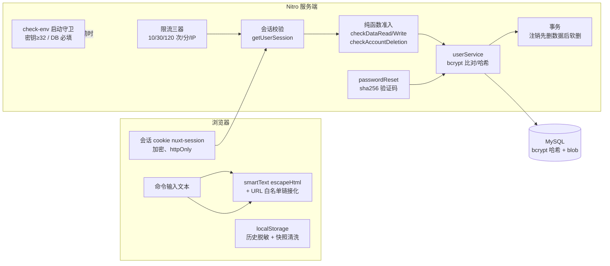

# 08 安全与权限设计

> 项目：webCommand ｜ 版本：v1.1 ｜ 生成日期：2026-10-06 ｜ 依据：源码分析

## 1. 威胁模型与安全边界总览

webCommand 是自建单人/少数人使用的个人服务，安全设计的出发点不是防御国家级对手，而是：**把"匿名者能造成的破坏"压到限流之下，把"已登录用户能触达的数据"严格锁在会话 userId 之内，把"凭据出现的每一处"（库、日志、localStorage、产物、备份）逐一识别并处理**。本篇按"会话 → 口令 → 找回 → 注销 → 数据准入 → 前端输入处理 → 传输与 CSRF 面 → 已知隐患"的顺序展开，每节都给源码位置；与部署相关的凭据纪律（运行期注入、产物扫描）见《06-部署运行》第 3、5.4 节，此处只引用。

## 2. 会话：nuxt-auth-utils 的无状态加密 cookie

**机制**：登录成功后路由调用 `setUserSession(event, { user: safeUser }, remember!==false ? { maxAge: 60*60*24*30 } : {})`（`server/api/user/login.post.ts`），nuxt-auth-utils 把会话对象加密（密钥即运行期环境变量 `NUXT_SESSION_PASSWORD`）后写入名为 `nuxt-session` 的 cookie。服务端**没有任何会话表**——每个请求靠密钥解密 cookie 还原身份，因此：应用重启不掉线（密钥不变即可）、无法主动作废某个已发出的会话（见第 9 节隐患 ⚠️-A1）。

**会话内容最小化**：写入的是 `SafeUser`（`toSafeUser` 在 `server/models/User.ts` 剥离 password），`auth.d.ts` 把类型钉在 `{id, username, email?}`。会话里没有角色、没有权限位——本项目权限模型就是"登录 / 未登录"两态加数据归属，没有第三种身份。

**会话只作身份指针**：`/api/user/current` 拿到会话 id 后**从数据库重读**最新用户（`getLoginUserById`），改名/改邮箱后旧会话不会展示过期数据；软删（注销）用户即使 cookie 未清，重读也会因 `isDelete` 被拒。改密**不**使旧会话失效（无服务端会话可撤销，密钥不变则旧 cookie 仍有效）——这是无状态会话的固有取舍，恶意场景下"改密踢设备"做不到，见第 9 节 ⚠️-A2。

**密钥治理**：`server/plugins/check-env.ts` 在生产启动时硬校验长度 ≥32（注释解释：短密钥不会启动失败，而是让 nuxt-auth-utils 在每个用到 session 的请求里抛 500 且不提示原因，排障成本极高）。密钥生成命令写在 compose 模板注释里（`crypto.randomBytes(32).toString('base64url')`）。`scripts/deploy.sh scan_artifact` 每次构建后 grep `.output` 是否含 `.env` 里的会话密钥，命中即拒绝部署——防止密钥烘进产物。

**Cookie 属性**：项目自身未显式配置 cookie 选项（只覆盖了 `runtimeConfig.session.maxAge`），其余属性（httpOnly、SameSite 等）沿用 nuxt-auth-utils 模块默认值。⚠️ 待确认：不同版本的 nuxt-auth-utils 默认 SameSite 取值可能不同（常见为 Lax）；若要显式加固，应在 `runtimeConfig.session` 中明确声明。从"前端 axios 同源调用"这一事实出发，即便默认为 Lax 也能满足本项目的全部请求形态。

## 3. 口令：bcryptjs 哈希与校验纪律

- **算法与轮次**：注册、改密、验证码重置三条写路径一律 `bcrypt.hash(password, BCRYPT_ROUNDS)`，`BCRYPT_ROUNDS = 10`（`server/services/userService.ts`）。实现包是 **bcryptjs**（纯 JS，`package.json` 依赖 `bcryptjs ^2.4.3` + `@types/bcryptjs`），非原生 bcrypt——性能差异见《10-性能设计与优化》，安全强度无本质区别。README「已知限制」记录：早期为兼容旧库 MD5 哈希留的盐值路径已随"线上按 webCommand 库全新开始"的决定移除，现存哈希全部是 bcrypt。
- **校验一律 `bcrypt.compare`**：登录（`verifyCredentials`）、改密旧口令复核、注销口令复核三处都是 compare，无明文比较路径。
- **防用户枚举**：`verifyCredentials` 把"用户不存在 / 已软删 / 密码错误"三种情况统一为同一句 40400「用户不存在或密码错误」；注意响应时序差异（存在的用户要走一次 bcrypt 比较，天然多花约几十毫秒）理论上可被统计利用，对个人服务属可接受残余风险。
- **口令策略**：`server/utils/accountPolicy.ts` 的 `validateNewPassword` 只强制"非空 + ≥8 位"，无复杂度要求（自建服务的有意取舍）；`MIN_PASSWORD_LENGTH = 8` 在前端 `app/core/commands/user/userConstant.ts` 有一份镜像常量，`test/accountPolicy.spec.ts` 用例"前端提示与后端校验用的是同一个数字"直接读两处源码文本比对，防止只改一边。已注册的短口令仍可登录（策略只约束新设口令，源码注释明示）。
- **口令出现的所有位置盘点**：请求体（HTTPS 传输，落库前哈希）；终端命令文本——历史与快照落 localStorage 前经 `redactSensitiveText` 脱敏（见第 6.3 节）；服务端日志——业务代码从不打印请求体，未知异常日志 `[api error]` 只含 `event.path` 与异常对象；MySQL——只有哈希列。找回密码邮件含验证码但不含口令。

## 4. 找回密码：邮箱验证码

流程见《05-核心流程》流程四，安全要点归纳：

1. **不泄露注册状态**：`/api/user/reset-code` 对不存在的邮箱同样返回 `{code:0}`（路由内 `if (!user) return true // 不泄露邮箱是否已注册`），枚举者无法通过响应区分邮箱是否注册。
2. **验证码不落明文**：内存表以 `sha256(邮箱小写:6位码)` 存储（`passwordReset.hashCode`），即使进程内存被读也无法直接还原验证码；验证成功立即删除（一次性）。
3. **爆破成本三重叠加**：6 位数字码（`crypto.randomInt(0, 1_000_000)`）× 单码 5 次尝试上限 × authLimiter 10 次/分/IP。理论最坏情况（攻击者独占一个 IP、不触发 5 次销毁）每分钟约 10 次猜测，10 分钟窗口内试不满一次完整空间的三千分之一。
4. **重发节流**：同一邮箱 60 秒内不可重发（`issueCode` 抛 40000 带剩余秒数），防邮件轰炸（配合 authLimiter 的每 IP 限制，攻击者换 IP 也只能给同一邮箱每分钟发一封）。
5. **SMTP 未配置的降级**：`isMailConfigured()` 为假时发码路由抛 50010 并明示"联系管理员设置 SMTP 环境变量"——功能降级而非静默失败。
6. **验证通过才查用户**：`reset-password` 先 `verifyCode` 再 `findActiveUserByEmail`，两步都过才 `resetUserPassword`（不校验旧密码，这正是"找回"语义）。顺序意味着：验证码错误时连邮箱存在性都不查询。

## 5. 账号注销：三条件 + 事务 + 会话清理顺序

注销是唯一不可逆操作，防线有四层（`server/api/user/delete.post.ts` + `accountPolicy.ts` + `userService.deleteAccount`）：

1. **纯函数准入 `checkAccountDeletion`**：未登录（会话缺 id 或 username）→ 40100；密码缺失 → 40000"注销账号需要重新输入密码确认身份"（注释：会话被复用/借用时不足以凭会话删号）；确认串与用户名**完全一致**（大小写敏感、不 trim，测试钉住）→ 否则 40000 并回显正确用法。三条件的动机注释写明：确认串防误触发、也让"删哪个账号"成为明确表达。
2. **service 层口令复核**：`deleteAccount` 在事务外再 `findByPk` + `bcrypt.compare`，失败 40000「密码错误」。
3. **事务化删除**：同一事务里先 `destroy({where:{userId}})` 物理删 `user_data` 全部行、再 `update({isDelete:1})` 软删 user 行，失败 rollback 重抛（注释："'删除我的数据'这条承诺不能靠后续清理来兑现"）。
4. **成功才清会话**：路由在 `deleteAccount` 成功后 `clearUserSession`；失败不清（`test/routes/userDelete.test.ts` 的"删除失败时不清会话"用例钉住，避免"数据还在但用户被登出"的误导状态）。前端 `deleteCommand` 同样先 `resetAllCloudSync()` 解除六类同步订阅、再清登录态——顺序颠倒会让注销后的本地变更带着旧会话继续上云。

## 6. 命令执行与前端输入处理

**原则：前端没有"执行系统命令"这回事。** `commandExecutor` 是纯解释器：文本 → `getCommand` 查表 → getopts 切词 → 调用注册好的 `action` 函数。没有任何 `eval`、`Function`、`child_process` 或对 shell 的调用；用户输入永远不会变成服务端的执行体。服务端也从不在 SQL 里拼接用户输入（唯一动态进 SQL 的是迁移 id，来自代码常量且经 `escapeSql` 转义，`migrations.ts` 注释明示；health 的表名写死在常量）。

**XSS 防线（渲染层兜底）**：所有文本输出经 `ContentOutput.vue` 的 `v-html="smartText(output.text)"` 渲染。`smartText`（`app/utils/smartText.ts`）的顺序是关键——**先转义后链接化**：`escapeHtml` 把 `& < > " '` 五个字符换成实体，随后 `URL_REG` 只把匹配到 `https?://`、`www.` 或 `user@host` 形态的片段包成 `<a href target="_blank" rel="noopener noreferrer">`，且 href 值同样先转义。`javascript:` 伪协议不在 URL_REG 的匹配形态里（正则要求 `https?://` 前缀或 `www.`/`@host` 结构），无法借道成为链接；`rel="noopener noreferrer"` 切断了跳转页面对 `window.opener` 的访问。命令产出的组件型输出走 `<component :is>`，组件全部是仓库内 `defineAsyncComponent`，不存在"用户输入决定组件"的路径。

**weather 的两道后处理**是输出清洗的补充：服务端已把 wttr.in 的响应原文返回，前端 `weatherCommand` 先从 `term-container` 提取纯文本再去 HTML 标签、解码实体（`decodeHtmlEntities`），最后仍要过 `smartText` 转义——第三方内容无论多脏，落屏前都被转义兜住。

**命令历史的 `!N` 回放**：`doSubmitCommand` 对 `!序号` 只做"从 `commandList` 取历史文本"这一件事，取出的文本仍走完整解释器，不存在绕过解析的执行通道；越界序号直接报错。

### 6.3 本地持久化的脱敏与清洗

localStorage 两把钥匙（`terminal-command-history`、`terminal-output-snapshot`）的写入路径都过 `outputSnapshot.ts`：`redactSensitiveText` 用正则 `(--?password|-p)\b(=|\s+)(\S+)` 把登录/改密/注销命令里的口令值替换为 `***`（覆盖 `-p xxx`、`-p=xxx`、`--password xxx`、`--password=xxx` 四种写法，测试逐一断言）；`sanitizeForSnapshot` 把组件输出换占位文本并递归清洗命令块的 `resultList`，命令回显文本同样脱敏。已知缝隙：正则的 `(\S+)` 不吃空格，`-p "two words"` 这类带空格口令只有第一个词被遮蔽（残余风险低——口令以空格分隔的场景本身罕见，但记录在案，见《13-技术债务》⚠️-14）。

## 7. 数据准入：服务端如何裁决"谁能写谁的什么"

云端数据接口的授权完全收敛在 `server/utils/dataAccess.ts` 的两个纯函数：

- **`checkDataRead(user, type)`**：会话用户无 id → `NO_AUTH`；type 不在 `CLOUD_DATA_TYPES` 六类白名单 → `PARAMS`；通过则交回 `{ok:true, userId, type}`。**userId 一律取自会话**，请求体里的 `userId: 999` 会被无视——`test/routes/dataRoutes.test.ts` 的"写入的 userId 取自会话，请求体里伪造 userId 无效"用例钉死了这一点。跨用户串数据在结构上不可达：查询条件 `where: {userId: decision.userId, type}` 的 userId 只能来自解密后的会话。
- **`checkDataWrite(user, type, content)`**：读准入全部条件 + content 必须是字符串 + 按类型分级字节上限（数据类 1MB、配置类 64KB，`Buffer.byteLength(content,'utf8')` 计）。上限注释点明威胁模型：`user_data.content` 是 MEDIUMTEXT（约 16MB），数据库拦不住越界写入，应用层这道检查是唯一闸门——不给"把配置类型当大对象存储灌"的机会。判定顺序"未登录优先于参数错误"避免向匿名者泄露 type 合法性（有专门用例）。
- **路由层无非空断言**：准入函数返回可判别联合，放行时把生效值一起交回，路由不可能把 `undefined` 当查询条件（那会变成无过滤的全表条件，`dataAccess.ts` 头注释把这列为"路由层最容易被改错的地方"之一）。

**服务端不解析 blob**：content 不 JSON.parse、不看结构。这一方面让"blob 结构演进不需要服务端迁移"，另一方面也意味着恶意 JSON 只是自伤（前端 merge 时 `JSON.parse` 失败会走 catch，详见《10-性能设计与优化》对拉取失败路径的分析）。

## 8. 传输面：CORS、CSRF 与限流

- **CORS**：服务端**没有设置任何 `Access-Control-Allow-*` 响应头**（全仓 grep 无 cors 相关配置）。默认同源策略下，第三方站点的 JS 无法读取本站 API 的响应——这正好是本项目想要的（API 只服务自己的前端）。第三方公网请求（wttr.in 等）都由服务端代理（`server/api/*`），正是为了绕开浏览器 CORS 而不是放开它。
- **CSRF**：变更类接口全部是 `POST + application/json`。跨站的 JSON POST 会先触发 CORS 预检且服务端不放行，天然被拦；会话 cookie 即使未显式配 SameSite，主流浏览器默认 Lax 也会阻止跨站 POST 携带。叠加"注销/删数据还需要口令与确认串"的双因子（第 5 节），CSRF 的实际可利用面只剩"以受害者身份做无害读取"。⚠️ 待确认：若未来把前端拆到独立域名（`NUXT_PUBLIC_API_BASE_URL` 跨域），上述同源前提全部失效，需要显式配置 CORS 白名单与 SameSite=None 防护。
- **限流作为暴力破解的闸门**：三个限流器按 IP 滑动窗口计数（authLimiter 10/分护住登录/注册/发码/验证/注销，proxyLimiter 30/分护第三方代理，dataLimiter 120/分护云同步）。`getClientIp` 只有在 `NUXT_TRUST_PROXY=true` 时才信任 `x-forwarded-for` 首段——开关不开（反代后）会导致全体访客共用一个桶（可用性问题）；伪造该头（直连场景）不能绕过限流（开关不开时头被无视，socket 地址才是键；开关开了说明有可信反代兜底剥头）。`recordHit` 的键数上限 10000 + sweep + 逐出最旧键，防的是攻击者用伪造 IP 灌爆内存的 DoS。
- **信息泄露面**：未知异常统一 50000「server error」不泄堆栈（`bizHandler`）；业务错误消息为中文人话且不带内部细节；唯一可能带上游信息的错误是代理路由抛 502 时的固定文案（上游错误细节只进服务端日志 `console.error`）。
- **部署面**：产物零凭证（运行期注入纪律 + `deploy.sh scan_artifact` 门禁）；`.env`、`.env.test`、`docker-compose.yml`、`scripts/init-test-db.sql` 全部 gitignore；备份脚本口令走 `MYSQL_PWD` 环境变量不进 ps。细节见《06-部署运行》与《14-配置与环境详解》。

## 9. 已知隐患与安全待办清单

以下各项均在源码可证，按影响排序；编号供《13-技术债务与演进建议》引用。

| 编号 | 隐患 | 位置与证据 | 影响与现状 |
| --- | --- | --- | --- |
| A1 | **会话无法主动作废** | 无状态加密 cookie 是机制本身：无会话表、改密/注销外的任何路径都不能使旧 cookie 失效 | 泄露的 cookie 在 30 天内持续有效（除非换 `NUXT_SESSION_PASSWORD` 全员下线）。自建单人服务可接受；加固方向是引入服务端会话版本号写入 cookie 并与 user 行比对 |
| A2 | **改密不踢旧会话** | `updateUserPassword` 只更新哈希列，不触碰会话 | 同 A1 根因。"改密后其他设备仍在线"是现状，⚠️ 待确认为有意取舍（未见注释声明） |
| B1 | **user.status 封禁无修改通道** | `status` 列有完整的登录拦截（`verifyCredentials` 抛 40100「账号已被封禁」），但全仓没有任何接口、命令或脚本把 status 置非 0 | 封禁是"只读的预留能力"：要封人只能手改库（`UPDATE user SET status=1`）。反向解封同样只能手改。见《04-数据模型》3.1 与《13-技术债务》⚠️-1 |
| B2 | **export/import 覆盖不全** | `exportCommand.ts` 的 data 只聚合 todo/space/custom/note；`terminalConfig` 与 `theme` 不在内 | 用户换浏览器会丢背景/主题/欢迎语配置（云端有则可随登录拉回，但注销前导出的备份不含它们）。从代码看是枚举遗漏而非技术限制。《13-技术债务》⚠️-2 |
| B3 | **注销后用户名/邮箱不可重新注册** | `deleteAccount` 软删（唯一索引仍在），而 `userRegister` 查重 `findOne({Op.or:[{username},{email}]})` **不过滤 isDelete** | 注销后的用户名与邮箱被软删行永久占用，重新注册报「该用户名或邮箱已被注册」。**此结论更正《05-核心流程》6.5 的存疑表述**（该处曾写"都可被重新注册 ⚠️ 待确认"，一致性回刷时已按源码改为"不可"）。影响：注销语义实际是"不可逆删除数据 + 永久放弃用户名"。《13-技术债务》⚠️-3 |
| B4 | **background 自定义 URL 的 CSS 注入面** | `Terminal.vue wrapperStyle`：`style.background = url(${background})` 未转义，仅判 `startsWith('http')` | 精心构造的字符串可逃出 `url()` 注入任意 CSS 声明（值经云同步可从同账号另一设备写入）。属"自伤性质"（只能改自己的终端外观），不构成跨用户攻击；防御成本低（校验 URL 或做 CSS 字符串转义），见《13-技术债务》⚠️-13 |
| C1 | **限流响应码不一致** | user 组路由限流抛 `BizError(ERROR_CODE.PARAMS, …, 429)`（body 40000），data/proxy 组抛 `ERROR_CODE.RATE_LIMIT`（42900） | HTTP 状态一致（429），body 码不一致；`ERROR_CODE.RATE_LIMIT` 对 auth 组是"已定义未使用"。前端按 message 展示所以用户无感，但契约测试/监控若按 42900 匹配会漏。《03-接口设计》的登录时序图曾写 42900，与 login 路由源码不符（一致性回刷时已更正），以本篇为准。《13-技术债务》⚠️-5 |
| C2 | **进程内存态的水平扩容阻断** | rateLimit 与 passwordReset 均为模块级 `Map`（各自注释："多实例应改 Redis"） | 不是漏洞而是架构约束：多副本下限流配额按副本数翻倍、A 副本签发的验证码 B 副本无法验证。扩容前的改造清单见《13-技术债务》第 3 节 |
| C3 | **迁移器无并发互斥** | `runMigrations` 直接查/写水位表，无锁 | 两个进程同时指向同一库启动时可能并发执行同一迁移；当前语句幂等（IF NOT EXISTS）所以通常无害，但未来非幂等迁移（ALTER/回填）会出问题。《13-技术债务》⚠️-16 |
| D1 | **健康检查无鉴权** | `/api/health` 无限流无鉴权，返回库名层面的结构信息（表名、错误文本 `schemaError`） | 信息量小且是部署探活契约所必需；若介意可在反代层限制来源。现状合理，仅记录 |
| D2 | **错误口令的时序侧信道** | `verifyCredentials` 对存在用户执行 bcrypt 比对（毫秒级），不存在用户直接抛错 | 理论上可统计用户名是否存在；个人服务 + authLimiter 下不可实操。记录备查 |
| D3 | **历史脱敏正则不覆盖空格口令** | `outputSnapshot.redactSensitiveText` 的 `(\S+)` | 见第 6.3 节；《13-技术债务》⚠️-14 |

## 10. 小结：这套设计的重心与边界

webCommand 的安全设计可以概括为三句话。第一，**把裁决权全部收进服务端纯函数**：会话、白名单、限额、注销三条件都是可单测的判定函数，路由只做包装——这套"纯函数准入"让安全边界恰好落在测试最密集的地方（`dataAccess.spec`/`accountPolicy.spec`/两个 routes 测试）。第二，**凭据生命周期全程可见**：口令从输入（脱敏入历史）→ 传输（HTTPS/POST body）→ 存储（bcrypt）→ 展示（toSafeUser 剥离）→ 销毁（注销事务）每一环都有对应代码与注释，无"顺手打印"的路径。第三，**残余风险集中在"无状态会话"与"单实例内存态"两个架构级取舍上**——它们不是被忽视的漏洞，而是 README 明文接受的复杂度折中；任何加固（会话撤销、Redis 化）都应作为架构演进而非补丁处理，路线图见《13-技术债务与演进建议》。
