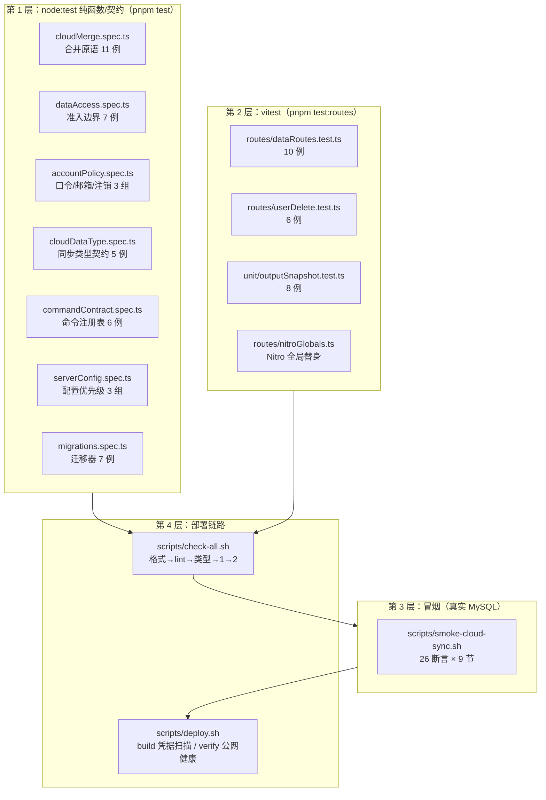

# 09 测试与质量保障

> 项目：webCommand ｜ 版本：v1.1 ｜ 生成日期：2026-10-06 ｜ 依据：源码分析

## 1. 测试体系总览：四层金字塔与双轨分工

webCommand 的质量保障是一条"本地全绿才许发布、发布后还有两道网"的链路：`node:test` 纯函数（秒级、零环境）→ `vitest` 路由层（秒级、内存替身）→ 冒烟脚本（分钟级、真实 MySQL）→ `deploy.sh verify`（部署后公网核验）。其中前两层由两套框架"双轨"承载，边界被刻意划死（`vitest.config.ts` 注释）：

| 轨道 | 框架 | 收录范围 | 被测对象性质 | 运行命令 |
| --- | --- | --- | --- | --- |
| 纯函数与静态契约轨 | node:test（原生，零第三方依赖） | `test/*.spec.ts`（7 个文件） | 不依赖 Vue/Nitro 运行时的纯函数、以及"读源码文本做断言"的静态契约 | `pnpm test`（即 `node --test "test/*.spec.ts"`） |
| 路由层与前端单测轨 | vitest ^2.1.9 | `test/routes/**/*.test.ts` 与 `test/unit/**/*.test.ts` | Nitro 路由 handler（装全局替身后直接调用）、DOM 无关的前端纯函数 | `pnpm test:routes`（`vitest run`） |

收录边界值得单独解释：vitest 的 include 刻意只收 `.test.ts` 且限定两个目录，否则 vitest 会去收集 `test/*.spec.ts`——那些文件用的是 node:test 的 `test()`，被 vitest 收集会出现"收集到 0 条却全绿"的假通过（`vitest.config.ts` 头注释原话）。反方向的约束在 node:test 一侧：node 原生 ESM 不解析无扩展名的相对导入，因此被测模块必须自包含（`appConfig.ts`、`accountPolicy.ts` 头注释都明示"刻意不 import 其它模块"），`pnpm test` 依赖 Node ≥22.18 的原生类型剥离直接跑 `.ts`（版本要求与故障见《06-部署运行》第 1 节）。

## 2. 第一轨：node:test 纯函数与静态契约（逐文件解析）

### 2.1 test/cloudMerge.spec.ts —— 合并算法的裁决语义

覆盖 `app/composables/cloudMerge.ts` 全部导出。分组 `mergeKeyed：跨设备逐条合并` 九例 + `localIsFresher` 两例，每例对应一条裁决规则：两端各自新增都保留（"不再整包覆盖"是云同步重构的原始动机）、同 id 按 `updateTime` 新者胜、本端删除不因另一端留存而复生、云端删除同样在本地生效、删后重建（条目修改晚于墓碑则复活）、超 30 天窗口的墓碑不再压制条目、历史数据无 `updateTime` 视为 0 不与新改动争胜、墓碑合并取更晚、`pruneTombstones` 清理过期项。一个值得学习的工程细节写在文件头注释：**用例时间必须是"真实时刻的分钟偏移"而不是裸小数值**，否则删除记录会被当成过期项剪掉，测试在错误的前提下"通过"——这是时间参数化函数（`now = Date.now()` 形参）配套的测试纪律。

### 2.2 test/dataAccess.spec.ts —— 云数据准入的精确边界

七例分别钉住：未登录一律 `NO_AUTH`（含 `{id:0}`、`{id:null}` 这类伪造形态）；type 白名单外全部拒绝（`'todo '` 带尾空格、`'TODO'` 大小写、`'../x'` 路径形态、非字符串都在列）；放行时交回生效 userId/type；数据类 1MB 边界（恰好到限放行、+1 字节拒绝）；配置类 64KB 边界且三类逐一验证；**字节数按 UTF-8 计**（用汉字串证明"字符数未超而字节数已越界"必须拒绝，同一串对 1MB 数据类合法）；未登录优先于参数错误。这组用例就是《08-安全与权限设计》第 7 节每一条论断的机器可读版本。

### 2.3 test/accountPolicy.spec.ts —— 口令、邮箱与注销三条件

三组：口令长度（短于下限的报错文案、达到放行、空值/非字符串全拒）；**前后端常量一致性**（直接 `readFileSync` 两处源码，正则抠出 `MIN_PASSWORD_LENGTH = 8` 比对——注释解释"前端拿不到 server/ 模块，只能各自声明一遍常量值"）；邮箱正则（放行 `first.last@gmail.com`、`tag+promo@gmail.com`、`中文名@domain.cn` 等旧正则误杀的合法地址，拒绝缺 @/多 @/无后缀/超长）；注销判定（未登录含缺 username 的会话、必须重输密码、确认串大小写敏感不 trim、提示语回显 `--confirm grace`、三件齐全交回 userId）。

### 2.4 test/cloudDataType.spec.ts —— 防"漏注册丢数据"的契约

五例全是"读源码做静态断言"的范式：从两份 `CLOUD_DATA_TYPES` 的 `as const` 数组解析成员并比对（前后端白名单一致）；扫描全 `app/` 的 `useCloudSync('<type>')` 调用点并验证 type 在白名单内；白名单无死类型（每个 type 都有 store 用）；**每个参与同步的 store 都登记进注册表**（断言消息直接写明后果："该类型不会在登录/自动登录时被拉取，且本端下一次改动会整包覆盖云端数据"——#24/#25 事故的自动化防复发）；index.vue 必须调用 `initAllCloudSync()` 且不得手写逐 store 初始化。

### 2.5 test/commandContract.spec.ts —— 命令注册表的自检

用文件系统扫描 + 正则解析实现的六条静态契约：样本量下限（识别不足 40 个命令模块/30 个顶层命令说明扫描规则失效，**不能让测试静默全绿**）；每个 `CommandType` 模块都被引用（孤儿检测——写了命令忘了登记会静默失效）；顶层命令名与别名互不冲突（解析窗口刻意止步于 options/params 前，避免把 `-s` 这类选项短标记误判为别名）；同父目录内子命令名互不冲突；**`subCommands` 的 key 必须与被引命令自己的 `func` 一致**（执行器按 key 查表，key 写错则"命令能注册却对不上号"，新增 `user delete` 这类子命令最容易错）；每个命令模块有 name 且要么有 action 要么有 subCommands。

### 2.6 test/serverConfig.spec.ts —— 运行期配置优先级

三组：`setting` 的四条规则（环境变量覆盖构建期内联值、`NUXT_` 前缀优先于裸名、**空字符串视为未配置**不吞兜底值、全缺时返回空串而非 undefined 字面量）；`boolSetting` 的 TRUST_PROXY 兼容（容器里只写裸名 `TRUST_PROXY=true` 也算开启——注释记录了"只读 runtimeConfig 导致限流按代理 IP 计数"的旧事故）；`resolveDbConfig`/`missingDbConfigKeys`（空配置列出 DB_HOST/DB_USER/DB_PASSWORD 三项、裸名变量可补全全部必填、换口令无需重新构建）。另有一个通用纪律值得复用：文件用 `WATCHED` 快照在 `beforeEach/afterEach` 里保存并还原 `process.env`，防止用例污染同进程其它用例。

### 2.7 test/migrations.spec.ts —— 迁移器的四条铁律

七例：每条 DDL 必须含 `CREATE TABLE IF NOT EXISTS`（幂等）；两张业务表都必须被建出；`user_data` 的 DDL 必须含 `(userId, type)` 复合唯一键；首次启动按序应用并登记（用 fakeRunner 验证第一条语句是建水位表）；重复启动零应用且**除建水位表外无任何 DDL/INSERT**；迁移失败不得登记（坏结构不能被永久跳过）；乱序迁移数组也按 id 升序执行。`fakeRunner` 是个精巧的测试替身：记录执行过的语句、按需让某条失败、模拟水位表的 SELECT/INSERT 行为——它只依赖 `MigrationRunner` 接口，这正是不引外部迁移框架的收益。

## 3. 第二轨：vitest 路由层与前端单测

### 3.1 test/routes/nitroGlobals.ts —— Nitro 全局替身

路由模块依赖 Nitro 注入的全局函数（`defineEventHandler/readBody/getQuery/getUserSession/clearUserSession/setResponseStatus/getRequestHeader/useRuntimeConfig`），node/vitest 环境没有，此文件在 vitest setup 阶段把它们装到 globalThis：handler 原样返回、body/query 从替身事件对象读取、`getUserSession` 返回注入的会话用户、`clearUserSession` 计数并清空（供注销断言）、`setResponseStatus` 记录到事件上。头注释明确了这套替身的验证边界："**不**验证 h3 怎么解析 body/query（那是 h3 的事），验证的是我们的路由在拿到输入后做了什么判定"。

### 3.2 test/routes/dataRoutes.test.ts —— 云数据路由十例

用 `vi.hoisted` + `vi.mock` 替换 `UserDataModel` 后静态导入两个路由 handler，逐条验证：匿名读取/写入 40100 且不落库；白名单外 type 全拒（含 `'TODO'`、`'todo '`、40 字符长串）；**userId 取自会话**（请求体塞 `userId: 999`，断言 upsert 收到的是 7）；数据类 1MB 容忍、配置类 64KB+1 拒且消息含"65536"、超限不落库；非字符串 content 与缺字段全拒；读回 blob 原样；**同 IP 打满 120 次后 42900 且其他 IP 不受牵连**；限流命中时 HTTP 状态确实被 `setResponseStatus` 成 429；读取接口不碰会话（`sessionTracker.clears` 不变）。

### 3.3 test/routes/userDelete.test.ts —— 注销路由六例

mock 掉 `userService.deleteAccount` 后直测路由：匿名 40100 且不进删除逻辑；缺确认串只提示怎么补；确认串 `Grace/grace /grac` 全拒（大小写与空格敏感）；不重输密码不能删号（含非字符串形态）；条件齐全时按会话 userId 调用 `deleteAccount(7, '…')` 并清会话；**删除失败时不清会话**（mock reject 后断言 50000、会话原封不动，并 spy 掉 `console.error` 抑制预期内的错误日志噪音）。

### 3.4 test/unit/outputSnapshot.test.ts —— 快照清洗回归

`vitest` 下的前端纯函数用例（这也是 include 里 `test/unit/**` 存在的意义）。`sanitizeForSnapshot` 六例：组件输出换占位文本；**命令行里嵌套的组件输出同样要被清掉**（文件头注释点名"曾经的回归点"：早先实现处理 `type:'command'` 时提前返回没递归，`defineAsyncComponent` 对象被 JSON 化成空壳，刷新后 help/todo 输出全空白）；嵌套两层也能清；命令回显里 `-p s3cr3t --password=abc123` 被脱敏而结果文本不动；普通文本原样；非对象与 null 丢弃。`redactSensitiveText` 两例覆盖 `-p/-p=/--password 空格/--password=` 四种写法与无凭据原样返回。

## 4. 第三轨：真实数据库冒烟（scripts/smoke-cloud-sync.sh）

冒烟脚本对"接口 + 存储 + 账号生命周期"做端到端验证，文件头注释同时划清边界：**客户端合并算法（写前合并/逐条 LWW/墓碑）不在这里验，那由 `cloudMerge.spec.ts` 覆盖**。九节共 26 条断言：

1. 真实 MySQL 8 上迁移器建表成功（`schemaReady=true`）；
2. 注册/登录/当前用户回显/错误口令 40400；
2.5. 含 `.` `+` `_` 的合法邮箱可注册（旧正则误杀这类地址的回归）、真非法邮箱仍 40000；
3. **blob 逐字往返**：含中文与 4 字节 emoji（🙂🚀）的 JSON 与读回内容逐字符相等（验 utf8mb4）；
4. 跨用户隔离（B 账号读 A 的 todo 得 null）；
5. type 白名单（自造 `role` 40000）与按类型上限（70KB theme 拒、1MB+8B todo 拒）；
6. 匿名读写一律 40100；
7. 改密后旧密码失效、新密码可登录、短于 8 位的新密码被拒；
8. 注销三条件（确认串错 40000、口令错 40000）、注销成功后同口令登录 40400、数据接口 40100；
9. 连续 12 次登录后 HTTP 状态真的变成 429。

两道安全设计是这份脚本的精髓。其一，**防误写生产库的闸门**（脚本 79-102 行注释）：配置优先级出任何差错，应用会连到 `.env` 里的 NAS 库而那边的 health 同样报 ok——所以脚本先等 health 可用，再用 mysql2 直连测试库确认迁移器把 `user`/`user_data` 建在了 `webcommand_test` 里，确认无误才开始造数据，否则立即中止。其二，**限流窗口的隔离**（第 165-167 行注释）：前面的注册/登录已消耗 authLimiter（10 次/分/IP）配额，第 8 节前显式 `sleep 62`，否则注销断言拿到的会是限流响应——顺带印证了 user 组限流的 body 码是 40000（见《08-安全与权限设计》⚠️-C1）。

配套的 `scripts/init-test-db.sh` 解决的是"测试库从哪来"：脚本只生成随机口令并写出 `.env.test`（0600、gitignore）与 `init-test-db.sql`，建库建账号的唯一一步手工 SQL 由持管理员凭据的人执行——脚本全程不接触管理员口令（头注释解释了 NAS 上 appuser 只有 `USAGE ON *.*` 的权限现实）。

## 5. 质量门禁与流水线

**一条命令的门禁** `./scripts/check-all.sh` 五步：`pnpm format:check` → `pnpm lint` → `pnpm typecheck` → `node --test "test/*.spec.ts"` → `vitest run`。脚本开头的 `node_ok` 检测 Node 主/次版本（≥22.18），不满足则自动从 `~/.nvm/versions/node/v*/bin` 与 `/usr/local/bin` 里挑可用新版——因为测试依赖原生类型剥离。 lint 侧的分工（`eslint.config.mjs`）：ESLint 只管质量（`@nuxt/eslint` 关闭 stylistic，`eslint-config-prettier` 关掉格式冲突规则），唯一自定义规则是把 `no-explicit-any` 恢复为 error（注释："前后端 any 已全部收敛，防止回退；确需处理动态第三方数据请用 unknown + 类型收窄"）；格式归 Prettier（`.prettierrc.json`：无分号、单引号、宽 100、尾逗号 all）。`pnpm typecheck` 走 `nuxt typecheck`（vue-tsc 全量）。

**发布链路里的两道网**：`deploy.sh build` 在 `nuxt build` 后执行 `scan_artifact`——用 `.env` 里的 DB 口令与会话密钥对 `.output` 做 grep，命中即拒绝部署（配套警告内网 IP 出现）；`deploy.sh verify` 从公网侧 curl `/api/health`，非 2xx 或 `status != "ok"` 都判失败——挡住"进程活着但注册登录全废"的假健康。这两道网与容器 healthcheck（`docker-compose.example.yml`，30s 间隔打 `/api/health`）构成部署后的持续验证。仓库已配置 origin（github.com/zhangzhengyang27/webCommand）但尚未建 CI 流水线，门禁仍只在本机（《13》⚠️-10）；`check-all.sh` 头注释"仓库目前没有 git remote"的前提已过时。

## 6. 缺口分析与补测建议

按"风险 × 现状"盘点当前未覆盖的面，给出可落地的补测顺序：

| 缺口 | 风险描述 | 现状证据 | 建议动作 |
| --- | --- | --- | --- |
| passwordReset 无任何单测 | 验证码的 TTL/5 次上限/60s 重发/命中即删全无测试，回归只能靠人肉 | 全仓 grep 无 passwordReset 测试 | 用 `vi.useFakeTimers` 或注入 now 参数写 vitest 单测（模块是纯内存 Map，天然可测）；顺带覆盖 `codeMap>1000` 清扫 |
| rateLimit 无直接单测 | 滑动窗口、10000 键逐出、getClientIp 的 TRUST_PROXY 分支只被 dataRoutes 间接覆盖 120 次路径 | `rateLimit.ts` 无专测 | 抽 `now` 参数后写 node:test 用例（窗口边界、多 IP 隔离、x-forwarded-for 开关） |
| 代理路由（weather/news/stock/ip/qrcode/background）零测试 | 多源容错循环、GBK 解码、Referer 头等逻辑改动无回归网 | vitest 只收 routes 两个文件 | 沿用 nitroGlobals 替身 + mock httpClient，至少覆盖"首源失败降级到次源"与"全败 502" |
| 前端交互无组件测试 | Terminal 的 doSubmitCommand/反向搜索/Tab 补全、hint 六分支、CommandPalette 过滤均无测试；`happy-dom` 在 devDependencies 里但 vitest environment 是 node，**实际未使用** | `vitest.config.ts` `environment: 'node'` | 要么移除 happy-dom 依赖（见《13-技术债务》⚠️-8），要么补 @vue/test-utils 组件测试时启用它；优先测 `hint.getTabCompletion` 六分支（纯逻辑）与 outputSnapshot 已有范式 |
| userCommands 其余路由无路由层测试 | login/register/current/password/reset-* 只有冒烟覆盖（且需真实库） | routes 仅两文件 | 优先补 `password.post.ts`（新旧密码校验分支）与 `reset-password.post.ts`（verifyCode 失败路径），替身方案同上 |
| 无覆盖率度量 | 双轨各自有多少行覆盖没有数字 | package.json 无 coverage 配置 | `vitest run --coverage`（@vitest/coverage-v8）先给路由层建立基线；node:test 侧可暂缓 |
| 无 CI | 门禁只在本机，忘跑 `check-all.sh` 就可能把红灯推上去 | 仓库已配 origin（github.com/zhangzhengyang27/webCommand）但无 CI；脚本头注释"无 git remote"已过时（《13》⚠️-10） | 加最小 CI（format:check/lint/typecheck/test/test:routes 五步照抄 check-all，缓存 pnpm store），并更新脚本头注释 |
| 冒烟脚本未进日常 | 26 断言只在发布前手工跑 | 需真实 MySQL 与手工建库 | 保持现状可接受；可加 `--quick` 只跑 1-6 节作为提交前选项 |

补测的总体原则应沿用仓库既有风格：**能写成纯函数的先抽成纯函数再测**（outputSnapshot/accountPolicy/dataAccess 的路线），**测裁决而不是测协议**（nitroGlobals 的边界声明），**时间与随机一律参数化**（cloudMerge 的 now 形参、passwordReset 的 `crypto.randomInt` 若要断言需注入）。新增能力的验收标准建议固化为"新能力必须同时带来至少一个契约测试或路由测试"，这正是本项目把 #24/#25、mysql2 缺失、正则误杀邮箱等每一起真实事故都沉淀为用例的做法。
