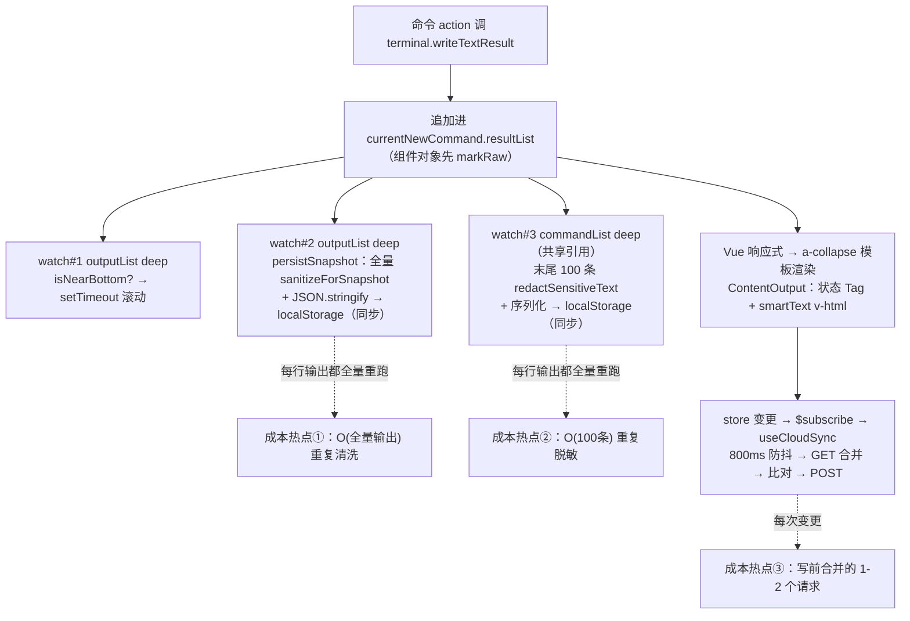

# 10 性能设计与优化

> 项目：webCommand ｜ 版本：v1.1 ｜ 生成日期：2026-10-06 ｜ 依据：源码分析

## 1. 性能画像：这个应用的负载长什么样

webCommand 的性能问题分布很不均匀：**99% 的命令是纯前端即时计算**（搜索跳转、计算器、格式化工具），毫无性能压力；真正的成本集中在四条窄带上——终端输出的渲染与持久化、云同步的网络与合并开销、服务端 MySQL 的访问模式、以及一次性的前端构建产物体积。本篇按这四带展开，先讲现状里"已经做了什么设计"，再讲"哪里还有账可算"，最后给出按性价比排序的优化建议。阅读前提：《05-核心流程》的命令执行与云同步两条链路、《07-模块详解》的 Terminal.vue/useCloudSync 结构。

先给一条"一次输出从写入到落屏"的完整成本路径图，后文的分析都挂在这条路径的节点上：

## 2. 终端渲染与输出持久化

### 2.1 已经做的设计

渲染层的三个关键决策都是为性能/正确性服务的。其一，**输出是数据不是调用**：命令往 `outputList` 写普通对象，Vue 统一渲染，命令本身零 DOM 操作；组件型输出用 `markRaw` 包装（`Terminal.vue writeResult` 注释：阻止 Proxy 化，否则 `defineAsyncComponent` 组件丢 template），同时省掉了一层响应式代理的开销。其二，**主题切换零重排**：8 套主题只是把 7 个色值写到 `--terminal-*` CSS 变量上（`wrapperStyle` computed），模板与 scoped 样式全部引用变量，切换主题不产生任何组件重渲染。其三，**滚动的克制**：输出变更后仅当用户视口距底 80px 内才自动滚动（`isNearBottom`，#93），避免打断向上翻阅时的强制 scroll 布局抖动。

**输出量的源头控制**在命令层：`curl` 默认截断 2000 字符（`maxLength` 选项可调）；`news` 只取前 20 条；`weather` 从 wttr.in 原始页面提取单行文本；`help/todo list` 等大输出走 `collapsible` 折叠面板（antd Collapse 默认不渲染未展开面板的内容，展开历史大块的成本被推迟到用户点击时）。快照侧有硬上限：localStorage 快照只留末尾 200 条、历史只留末尾 100 条。

### 2.2 还有的账：三处 O(N) 的重复序列化

源码里真正值得算的性能账在 **watch 的粒度**上，共三处：

1. **`watch(outputList, persistSnapshot, { deep: true })`**：深度侦听意味着命令执行的每一次 `writeTextResult`（哪怕只追加一行文本）都会触发一次全量 `sanitizeForSnapshot`——对当前 `outputList` 里全部（最多 200+ 条）输出递归清洗并 `JSON.stringify` 后同步写 localStorage。执行 `help` 这类一次写几十行结果的命令时，是 O(行数 × 全量输出) 的重复清洗 + 最多两百次同步写盘放大。
2. **历史持久化 watch**：`watch(commandList, …, { deep: true })` 同样深度侦听，而 `commandList` 里的命令对象与 `outputList` 共享引用——每次 `resultList.push` 都会命中它，把末尾 100 条命令（含各自不断增长的 resultList）重新 `map(redactSensitiveText)` + 序列化写盘。
3. **滚动 watch**：第三个 `watch(outputList, …, { deep: true })` 只做 `isNearBottom` 判断与 `setTimeout(scrollToBottom)`，开销小，但它使同一个数组的深度遍历又多了一次。

三处叠加的量级估算：终端场景下 `outputList` 常年在几十条、每条几十到几千字符，单次命令执行的额外开销在毫秒级，**日常无感**；但若用 `curl -l 999999` 拉大文本或长期不清屏积累到 200 条大输出，每次写行都会做 MB 级字符串序列化，可能出现可感知的卡顿（localStorage 写是同步阻塞主线程的）。这是"简单正确优先"的有意取舍——`persistSnapshot` 的 try/catch 甚至刻意吞掉序列化失败（注释：忽略），性能底线靠 200 条硬上限兜住。

### 2.3 时钟与提示符的常驻成本

状态栏时钟每秒 `setInterval` 更新 `currentTime` ref（触发状态栏这一小块重渲染）；提示符 `[user@dir]$` 是 computed，跟随 `spaceStore.currentDir` 变化。两者都是恒定小开销，无优化必要；唯一提醒是 `onUnmounted` 里正确清了时钟与快捷键监听（`unref` 语义的反面——组件销毁不留悬挂定时器）。

## 3. 云同步的网络与合并成本

### 3.1 设计：写前合并的代价模型

`useCloudSync` 的每次上传都不是"单请求上传"，而是**"拉取 → 合并 → 比对 → 条件上传"**（`flush()`）：至少 1 个 GET，最多 1 GET + 1 POST。这是正确性买网络的行为——注释写明动机：整包直接覆盖会把另一端新增条目、或本端已删除条目的墓碑冲掉。成本账要分三面算：

- **请求面**：每个类型每次本地变更触发"1 GET +（内容有差异时）1 POST"。六类型独立实例，一次批量操作（如 `import` 恢复四类数据）理论上最多 6×2=12 个请求；幸好有 800ms 防抖把快速连续变更折叠成一次 flush，且 `content === cloudRaw` 的短路把"合并后无差异"变成 1 GET 收场。dataLimiter 120 次/分/IP 的配额就是按"拉+推"双请求设计的（`rateLimit.ts` 注释）。
- **CPU 面**：合并是纯内存操作（`mergeKeyed` 对条目数组按 key 建 Map，O(n)），对个人数据量（几百条 todo/note）完全无感；`pruneTombstones` 保证墓碑表不随历史无限增长（30 天窗口），序列化体积因此有界。
- **流量面**：blob 是整包传输——即使只改了一个字的 todo，上传的也是全量 JSON。数据类上限 1MB 意味着最坏单次同步上行约 1MB；个人使用频次下无碍，但这是"blob 存储换服务端极简"决策的固有代价（决策本身见《01-系统架构》决策二）。

### 3.2 失败路径的成本行为

两条注释写明的取舍值得记住：拉取失败仍会上传本地数据（"不因网络抖动丢掉本次变更"）——代价是弱网时可能用本地覆盖云端（另一端的新变更要等下一轮回环合并找回，墓碑/ updateTime 语义保证不丢数据）；上传失败只 `console.error`，不重试不排队——下一次 store 变更自然触发重传。`applyingRemote` 标志 + 内容相等短路双保险切断了"合并 → $subscribe → 再同步"的回环，使得上述成本模型**不会自激**（不会因为合并写回 state 而触发无限上传）。

### 3.3 可省的账

拉取侧没有做任何缓存/条件请求：每次 flush 的 GET 都全量拉 blob。若给 `/api/data` 加 ETag（blob 的 sha256 或 `appliedAt` 版本号），无差异时只返回 304，可以把"高频小改动"场景的下行流量降到近零——这是云同步侧性价比最高的一项优化（代价是服务端要存哈希或读 content 算哈希）。其次是把六类型的 flush 共享一个防抖桶（一次 tick 里批量拉/推），可把"一次性改多类"的请求数从 12 压到 2。

## 4. 服务端与 MySQL 的访问模式

### 4.1 访问路径盘点

服务端对 MySQL 的全部访问就七种，每一种都吃索引：

| 访问 | SQL 形态 | 索利用途 |
| --- | --- | --- |
| 注册查重 | `findOne({Op.or:[{username},{email}]})` | 两个单列唯一索引各扫一次 |
| 登录 | `findOne({username})` + bcrypt.compare | `user_username_unique` |
| 当前用户 | `findByPk(id)` | 主键 |
| 改密/重置 | `update … where id` | 主键 |
| 注销 | 事务内 `destroy({userId})` + `update({isDelete:1})` | `user_data_userId_type_unique` 最左前缀 userId |
| 云读 | `findOne({userId,type})` | 复合唯一键全命中 |
| 云写 | `upsert`（唯一键定位，存在即更新） | 同上 |

连接层是**未显式配置的 Sequelize 默认池**（`db.ts` 无 pool 字段，mysql2 默认 connectionLimit 5），对单实例个人服务绰绰有余；`logging: false` 关掉 SQL 日志。bcrypt 是服务端每请求最贵的 CPU 项（10 轮 bcryptjs 在普通 NAS 上约几十毫秒），且是故意的——慢哈希就是安全设计（见《08-安全与权限设计》第 3 节）；它只出现在登录/改密/注销/验证码重置路径，云同步等高频路径完全不碰密码。

### 4.2 health 探活的成本

`/api/health` 每次执行 `SELECT 1` + 一条 `information_schema` 查询；容器 healthcheck 30 秒打一次，`deploy.sh verify` 部署时打一次——常驻成本约 2 查询/30s，可忽略。这里的性能换正确性的决策在源码注释里说得很直白：不读内存标志（Nitro dev 下会误报），"查库多一条 SQL，换来的是报告的就是事实"。

### 4.3 出站代理的超时预算

所有第三方代理统一 `AbortSignal.timeout(8000)`（`httpClient.ts`），壁纸源单独 5s；news/ip 的多源容错最坏情况是"逐源串行失败"——四个 IP 源全部 8s 超时意味着一个 `/api/ip` 请求最长挂约 32 秒（前端 fetch 无额外超时，用户看到的是长时间无输出后报错）。这是容错换延迟的已知形态：上游全挂时用户体验劣化明显，但换来了单源抖动下的高可用。proxyLimiter 30 次/分也顺带限制了这类慢请求能占用的并发。

## 5. 前端构建与产物

构建侧的取舍要放在"单页终端应用"的语境里读。入口只有 `pages/index.vue` 一个，首屏 JS 的大小主要取决于 Vue 运行时、Pinia、axios、getopts 与 antd 按需组件；而其余大块都被刻意推迟了。**按需与分包**已经做到位的地方：ant-design-vue 经 `unplugin-vue-components` + `AntDesignVueResolver({importStyle:'css-in-js'})` 按需自动引入（只全局引 `dist/reset.css`）；命令产出的交互组件全部 `defineAsyncComponent(() => import(...))`（HelpBox/TodoBox/ImportBox/TimingBox 等），不在首屏主包，用户敲到 `help` 才拉对应 chunk；六个可同步 store 经 `cloudSyncRegistry` 的动态 `import()` 惰性加载（注释：未登录时这些数据模块不进主包）——对匿名首访者，todo/space/note/custom/theme 的业务代码完全不下载。SPA 模式没有 SSR 水合成本，首屏从静态外壳直接切到挂载，"可交互时间"基本等于 bundle 解析时间。

**css-in-js 的取舍**值得单独一句：antd 4 的 css-in-js 在运行时注入样式，比静态 CSS 多一点首屏运行时开销，换来按需加载与主题能力；本项目主题切换走 CSS 变量而非 antd token，实际只承受了开销的一小部分。若未来做首屏预算，把 `importStyle` 换成静态 CSS 是现成的优化位。**产物结构**由 Nitro `node-server` preset 决定：`.output` 自包含（含 server 端 node_modules），唯一例外是 sequelize 动态加载的 mysql2 要在镜像里补装（`Dockerfile` 注释）。这带来一个部署性能点：镜像构建快（无容器内 install/build，产物与验证过的版本严格一致），但**镜像体积主要由 node_modules 决定**，且 `.output/server/node_modules` 必须随产物一起传输（README 点名的部署坑）。启动成本三件：check-env 校验（纯内存，微秒级）→ migrate（一至数条 DDL，首次启动建表、之后只查水位表）→ HTTP 监听，冷启动秒级；迁移幂等所以重启无累积成本。

## 6. 优化建议清单（按性价比排序）

| 序 | 建议 | 针对的账 | 预期收益 | 改动面 |
| --- | --- | --- | --- | --- |
| 1 | **persistSnapshot 节流**：深度 watch 回调改为 300-500ms 防抖，或只在 `resultList` 追加完成后统一清洗 | 2.2 第 1 条 | 大输出场景消除每行一次的全量序列化/写盘 | `Terminal.vue` 一处 |
| 2 | **历史 watch 改浅侦听**：历史只需在"新命令入列"时持久化，resultList 增长无需重写；改用 `watch(() => commandList.value.length, …)` | 2.2 第 2 条 | 每行输出省一次 100 条级别的 redact+序列化 | `Terminal.vue` 一处 |
| 3 | **`/api/data` 加 ETag/If-None-Match**（content 哈希或版本列） | 3.3 | 无差异同步零下行，弱网/多设备场景显著 | `data/index.get.ts` + `useCloudSync.flush` 带条件头 |
| 4 | **六类型同步共享防抖桶**：`initAllCloudSync` 后多类型变更合并 flush | 3.1 请求面 | 批量操作请求数 12 → 2-4 | `useCloudSync` 小改 |
| 5 | 代理路由加**总超时预算**（多源循环共享 8s deadline） | 4.3 | 上游全挂时最坏等待 32s → 8s | `news/ip` 路由循环处传 `AbortSignal` 派生 |
| 6 | **显式声明 Sequelize 连接池**（如 pool: {max: 5, min: 1}）并按机器核数评估 bcrypt 轮次 | 4.1 | 行为固化，防 sequelize 大版本改默认值；bcryptjs → 原生 bcrypt 可得 2-4 倍哈希吞吐（可选） | `db.ts` / `userService.ts` |
| 7 | **gzip/压缩响应**：Nitro 默认未开压缩，1MB blob 明文上行/下行 | 3.1 流量面 | JSON 压缩比通常 5-10×，反代层 `gzip on` 即可零代码生效 | Nginx 配置（或 nitro 压缩中间件） |
| 8 | 输出列表**虚拟化/条数上限提示**：超 200 条时提示"执行 clear 释放"或仅渲染可视窗口 | 2.2 | 极端长会话的内存与 DOM 占用封顶 | `Terminal.vue`（低优先级，现状 200 条上限已基本够用） |
| 9 | **本地镜像缓存随机壁纸**：`background` 随机壁纸每次刷新都打第三方 | 4.3 | 削上游依赖、加快背景加载 | `backgroundCommand`/`terminalConfigStore`（低优先级） |

前两条是纯前端小改动、收益立竿见影，建议作为下一次触碰 Terminal.vue 时的顺手项；3/4/7 属于"数据量增长后才显现"的预防性投资；其余按需。所有建议都不改变对外契约——这与本项目"服务端极简、客户端承担智能"的架构取向一致：性能优化的主战场在客户端的重复劳动上，服务端天然没有热点。

## 7. 度量方法：改之前先能看见

本项目没有接入任何 APM，优化前后靠三组手工度量就足够，且都能在现有形态下完成。**前端侧**：DevTools Performance 面板录一次"执行 `help` → 连续 `todo add` × 20 → `curl -l 999999 <大文本>`"的操作序列，看主线程长任务是否落在 persistSnapshot/历史 watch 的调用栈上（调用栈里能直接看到 `sanitizeForSnapshot` 与 `JSON.stringify`）；localStorage 写入耗时可用 `performance.now()` 手工包一层测量。**同步链路**：Network 面板过滤 `api/data`，观察一次批量操作产生的请求数与字节量，对照 `flush()` 的"拉-比-推"三步验证防抖与内容短路是否按预期收敛——若看到密集成对的 GET/POST，说明 800ms 防抖被跨 tick 的变更绕开，是建议 4 的直接证据。**服务端侧**：`/api/health` 的响应时间即"一次 SELECT 1 + 一条 information_schema 查询"的库延迟基线；登录接口的耗时减去 health 基线约为一次 bcrypt 比较的成本，这个差值如果明显变大，优先怀疑负载而非代码（bcrypt 成本恒定）。把这些度量点写进 PR 描述，优化才有"改前/改后"的可比性——这也是本项目一贯的"证据先于断言"风格在性能维度的延伸。
