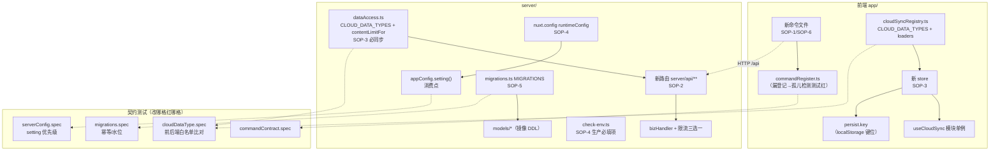

# 11 扩展开发指南

> 项目：webCommand ｜ 版本：v1.1 ｜ 生成日期：2026-10-06 ｜ 依据：源码分析

## 0. 动手前的三条公约

本篇给出六个高频扩展场景的标准作业程序（SOP）。每条 SOP 都遵循仓库已经沉淀的三个公约，违反它们就是与测试为敌：

1. **契约必须落测试**：本项目每一起真实事故都沉淀成了契约测试（#24/#25 → `cloudDataType.spec.ts`；正则误杀邮箱 → `accountPolicy.spec.ts`；快照空白 → `outputSnapshot.test.ts`）。新扩展要么自带用例，要么说明为什么不需要。
2. **纯函数优先**：能写成"不 import 其它模块的纯函数"就抽出来（`accountPolicy.ts`、`dataAccess.ts`、`cloudMerge.ts`、`outputSnapshot.ts` 的共同路线），原生 ESM 单测可以直接跑，也天然规避 Nitro 注入的复杂度。
3. **私有配置只在运行期注入**：新增任何服务端配置都走 `server/utils/appConfig.ts` 的 `setting()`，严禁读进 `nuxt.config.ts` 的 `runtimeConfig` 构建期值（原因与事故记录见《14-配置与环境详解》第 2 节）。

场景间的依赖关系：SOP-1（前端命令）与 SOP-2（服务端 API）相互独立；SOP-3（同步数据）同时触碰前后端白名单；SOP-4（配置项）与 SOP-5（表结构）是服务端基建变更；SOP-6（组件型输出）是 SOP-1 的变体。做任何 SOP 前，先跑一遍 `./scripts/check-all.sh` 确认基线全绿。

每个改动落点在代码库里的位置与必须联动的契约测试如下图——先在图上找到你要动的地方，再看对应 SOP 的步骤，能避免"改了这头忘了那头"：



## SOP-1：新增一个前端命令

以"新增 `translate <文本>` 命令"为例（走真实代理接口的完整形态；纯本地命令删掉网络部分即可）。

**第一步：建文件**。命令按业务域放目录：顶层单文件命令放 `app/core/commands/<name>Command.ts`，聚合域放 `app/core/commands/<域>/`（参考 `search/searchCommands.ts` 的聚合数组导出，或 `todo/` 的"父命令 + subCommands 目录"形态）。最小骨架：

```ts
import type { CommandType } from '../../command'
import myAxios from '../../utils/myAxios'
import { errMsg } from '../../utils/error'

const translateCommand: CommandType = {
  func: 'translate',
  name: '翻译',
  alias: ['fy', '翻译'],
  desc: '中英互译',
  params: [{ key: 'text', desc: '文本', required: true }],
  options: [{ key: 'self', desc: '当前页打开', alias: ['s'], type: 'boolean', defaultValue: false }],
  async action(options, terminal) {
    const res = await myAxios.get<string>('/translate', { params: { text: options._.join(' ') } })
    if (res.code !== 0) throw new Error(res.message || '翻译失败')
    terminal.writeTextResult(res.data ?? '')
  },
}
export default translateCommand
```

要点：错误直接 throw 即可——`doAction` 的 try/catch 会经 `errMsg()` 转成 `writeTextErrorResult`（见《07-模块详解》3.2），命令内不需要自己 try/catch 网络；输出文本会自动经 `smartText` 转义与链接化，禁止自己拼 HTML。

**第二步：登记**。在 `app/core/commandRegister.ts` 的 `commandList` 数组中加入 import 与条目——**数组顺序即 `help` 展示顺序**。忘登记不会报错但命令静默失效，这正是 `test/commandContract.spec.ts` 第 2 例（孤儿模块检测）存在的意义，写完命令先跑 `pnpm test` 就能看到它是否被正确识别。

**第三步：自检清单**。① func 全小写唯一、别名不与任何现有命令/别名冲突（顶层与子命令两个作用域都有契约测试盯防）；② 有 `name`，且要么有 `action` 要么有 `subCommands`（契约测试第 6 例）；③ 需要必填位置参数的，声明 `params[].required: true`，执行器会自动校验并提示 `--help`，不要在 action 里手写"参数不足"（存量命令有手写的，新命令不必效仿）；④ `--help` 是免费的——执行器检测到该选项会自动转调 `helpCommand`；⑤ 输入提示与 Tab 补全也是免费的——`hint.ts` 直接读命令声明生成用法串与候选。

**第四步：测试**。契约测试自动覆盖注册表一致性；若命令含可测的解析/计算逻辑（如 `calc.ts` 的表达式安全过滤），抽成纯函数放同目录并在 `test/` 下加 `.spec.ts`（node:test，零依赖，参考 `cloudMerge.spec.ts` 的写法）。完成后 `pnpm lint && pnpm typecheck` 过一遍。

## SOP-2：新增一个服务端 API

以"新增 `GET /api/translate`"为例。

**第一步：建路由文件**。Nitro 文件路由，路径即目录：`server/api/translate.get.ts`。必须用 `bizHandler` 包装（统一包络与错误出口，见《07-模块详解》5.1）；固定次序：**限流 → 会话/参数 → 准入 → service**：

```ts
import { proxyLimiter } from '../utils/rateLimit'
import { httpGetText } from '../utils/httpClient'
import { bizHandler, BizError, ERROR_CODE } from '../utils/response'

export default bizHandler(async (event) => {
  if (proxyLimiter.hit(event))
    throw new BizError(ERROR_CODE.RATE_LIMIT, '操作过于频繁，请稍后再试', 429)
  const text = getQuery(event).text as string | undefined
  if (!text) throw new BizError(ERROR_CODE.PARAMS, '缺少 text 参数')
  try {
    return await httpGetText(`https://api.example.com/t?q=${encodeURIComponent(text)}`)
  } catch (e) {
    console.error('translate proxy error:', e)
    throw new BizError(ERROR_CODE.THIRD_PART, '翻译服务不可用', 502)
  }
})
```

要点：① 限流器三选一——登录/注册类用 `authLimiter`(10/分)、代理与查询类用 `proxyLimiter`(30/分)、云数据类用 `dataLimiter`(120/分)，新场景不要裸奔也不要另造限流器；② 出站请求走 `httpClient.ts`（8s 超时、UA、非 2xx 抛错），不要裸 fetch；③ 上游错误细节只进 `console.error`，给客户端的 message 固定文案；④ 需要登录的路由自己 `getUserSession` 判 `session.user?.id`（本项目无全局中间件，鉴权是路由级显式判定，见《03-接口设计》第 3 节）。

**第二步：有业务就进 service**。超过"读参数 + 调一次模型/上游"的逻辑都放 `server/services/`（如 `userService.ts` 形态），路由保持薄。涉及"谁能做"的判定抽成 `server/utils/` 下的纯函数（可判别联合返回 `{ok} | {ok:false, code, message}`，参考 `checkDataRead`），不要在路由里堆 if。

**第三步：测试**。路由层用 vitest：`vi.mock` 掉模型/service，沿 `test/routes/nitroGlobals.ts` 的替身事件直接调用 handler，覆盖"匿名 40100、参数 40000、成功 code=0、限流 429"四条主干（参考 `dataRoutes.test.ts`）；纯函数准入逻辑进 node:test（参考 `dataAccess.spec.ts`）。涉及真实 MySQL 的行为交给 `smoke-cloud-sync.sh` 加节（若改动了账号/数据链路）。

**第四步：文档**。把新端点登记进《15-接口全量参考》第 1 节总表（方法/路径/入参/响应/鉴权/限流/错误码），保持文档与代码同步。

## SOP-3：新增一类云同步数据

这是跨层最多、事故代价最高的扩展（#24/#25 的教训都源于此），六步缺一不可。以"新增书签数据 bookmarks"为例：

1. **建 store**：新建 `app/core/commands/bookmark/bookmarkStore.ts`，state 含数据本体与 `deleted` 墓碑表；实现统一四 action：`syncToCloud/loadFromCloud/initCloudSync/resetCloudSync`，内部委托模块级单例 `useCloudSync('bookmarks', { serialize, merge })`；列表类 merge 用 `mergeKeyed`（keyOf + 双方墓碑），并在 `serialize` 里 `pruneTombstones`。全套模板抄 `todoStore.ts`（逐条 LWW）或 `terminalConfigStore.ts`（配置类整包较新者胜，用 `localIsFresher`）。
2. **登记前端注册表**：`app/composables/cloudSyncRegistry.ts` 的 `CLOUD_DATA_TYPES` 加 `'bookmarks'`，`loaders` 加惰性加载器。**漏掉这一步的后果**（契约测试消息原话）：该类型不会在登录/自动登录时被拉取，且本端下一次改动会整包覆盖云端数据。
3. **放行服务端白名单**：`server/utils/dataAccess.ts` 的 `CLOUD_DATA_TYPES` 同步加 `'bookmarks'`，并在 `contentLimitFor` 决定档位（业务数据 1MB / 配置 64KB）。两份清单必须一致——`test/cloudDataType.spec.ts` 会静态比对，不一致直接红。
4. **接入命令**：写 bookmark 命令族操作 store（SOP-1）；若希望数据出现在 `export/import` 备份里，同步改 `exportCommand.ts` 的聚合与 `importCommand`/`ImportBox.vue` 的恢复分发（注意 ⚠️-2：现有 terminalConfig/theme 也不在备份内，顺手补齐更好）。
5. **持久化**：store 加 `persist: { key: 'bookmark-store', storage: window.localStorage }`，插件已全局注册（`app/plugins/pinia-persistedstate.client.ts`）。
6. **测试与冒烟**：跑 `pnpm test` 让 `cloudDataType.spec.ts` 的五个断言（白名单一致、调用点在白名单、无死类型、store 已登记、页面走注册表）逐一验证；若新类型的限额/结构有特殊边界，在 `dataAccess.spec.ts` 加例；最后对真实库跑一轮 `smoke-cloud-sync.sh` 确认 upsert 往返。

## SOP-4：新增一个运行期配置项

以"新增找回邮件的发件人签名 `SMTP_FOOTER`"为例：

1. **runtimeConfig 放非敏感默认值**：`nuxt.config.ts` 的 `runtimeConfig` 加 `smtpFooter: ''`（空串占位即可）。红线：**不要写 `process.env.SMTP_FOOTER`**——`nuxt build` 会把值烘进 `.output`，产物变成携带配置的对象（真实事故见 `appConfig.ts` 头注释与 `deploy.sh` 的扫描器）。敏感值（口令/密钥）连默认值都不放，直接空串。
2. **读取点走 `setting()`**：消费方（如 `mailer.ts`）写 `setting(c.smtpFooter, 'NUXT_SMTP_FOOTER', 'SMTP_FOOTER')`——运行期两种写法都生效，优先级 NUXT_* > 裸名 > 构建默认（机制见《14-配置与环境详解》第 3 节）。
3. **生产必填项要进 check-env**：若该项生产必须有值（如新增一个必填密钥），在 `server/plugins/check-env.ts` 加校验并抛出**含变量名**的错误（现有报错都列出变量名，注释："避免只报一句启动失败要人猜"）；同时校验**解析后的值**而非 process.env（历史上的"守卫通过但建连用另一份配置"事故）。
4. **配套**：`docker-compose.example.yml` 加注释占位；`.env.example` 加条目；在《14-配置与环境详解》第 4 节的环境变量总表登记读取点。
5. **测试**：`serverConfig.spec.ts` 加 setting 优先级用例（环境覆盖内联、空串视为未配置两条都要）。

布尔项用 `boolSetting`（'true'/'1' 视为真），参考 `TRUST_PROXY` 的读取方式——注意它同时传了 `cfg.trustProxy` 与两个环境变量键，因为裸名变量不会映射进 runtimeConfig。

## SOP-5：变更数据库表结构

本项目**不用 `sequelize.sync()`**，一切表结构变更走手写迁移：

1. 在 `server/utils/migrations.ts` 的 `MIGRATIONS` 数组**追加**新条目：`id` 形如 `0002_add_bookmark_table`（字典序必须大于所有已应用 id），`statements` 为显式 SQL 数组。
2. **每条语句必须幂等**（`CREATE TABLE IF NOT EXISTS`；加列用 MySQL 8 的 `ADD COLUMN IF NOT EXISTS` 不可用——MySQL 不支持，改用"先查 information_schema 再决定"的存储过程写法或接受首启报错重试语义 ⚠️ 待确认具体策略，当前仓库尚无非幂等迁移先例）。已应用的迁移不会重跑，也**不允许修改老迁移**——线上水位表已登记，改了也不会执行。
3. **同步改模型**：`server/models/` 对应模型的字段/索引定义与 DDL 保持一致（两处是镜像关系，`migrations.spec.ts` 会校验 DDL 的关键特征：IF NOT EXISTS、必需表、`user_data` 复合唯一键）。
4. **失败语义**：迁移失败不阻断启动（`plugins/migrate.ts`），失败项不写水位、下次启动自动重试，状态经 `/api/health` 的 `schemaError` 暴露——新迁移写坏时的症状是"服务活着但 health 503"，按《12-FAQ与故障排查》的决策树查 `[migrate]` 日志。
5. **回滚预案**：破坏性变更（删列/改类型）先跑 `backup-db.sh` 再部署；回滚 = 恢复备份 + 回滚代码（水位表保证旧代码启动不重复跑新迁移）。

## SOP-6：新增一个"组件型输出"命令（交互面板）

当输出不是文本而是交互 UI（表格、日历、取色器）时，在 SOP-1 基础上加三件事：

1. 组件文件与命令同目录（如 `devtools/ColorBox.vue`），props 只传数据不传回调时用 `props: {...}`；需要命令继续接收组件内的后续命令，组件内通过 `useXXXStore` 或注入的 `terminal` 对象回写（参考 `ImportBox.vue` 与各 store 的关系）。
2. 输出必须走 `terminal.writeResult({ type: 'component', component: defineAsyncComponent(() => import('./XxxBox.vue')), props })`——**不要**直接 `writeTextResult` 拼模板字符串，也不要同步 import 组件（异步组件保证不进主包）。
3. 明白两个既有机制兜底：`writeResult` 会 `markRaw` 组件对象（防 Proxy 化丢 template）；刷新后组件输出**不会恢复**——`sanitizeForSnapshot` 会把它换成占位文本"（该内容包含交互组件，刷新后已省略）"，这是设计行为不是 bug。若组件输出含用户敏感信息，注意它不落 localStorage（已被清洗），但可能仍在 DOM 里。

## 6. 通用收尾清单

在展开各 SOP 之前，先把"为什么本仓库的扩展步骤长这样"讲透，理解了机理，步骤就不必死记。**命令为什么零成本接入提示与帮助**：因为 `hint.ts` 与 `helpCommand` 都不读命令实现、只读命令声明——`getUsageStr` 从 `params/options` 生成用法串，`getTabCompletion` 从 `func/alias/subCommands` 生成候选。所以扩展者的责任边界是"把声明写全"，而不是"在各处手工同步"。**服务端为什么强制 bizHandler 与三选一限流**：因为前端 `myAxios` 拦截器与 `errMsg` 只认"包络对象 + 可读 message"两种形态，绕开 bizHandler 的路由会把非包络结构漏给命令层；限流三器则是把"这个接口暴露给公网的价值密度"显式化——auth 类是爆破目标给最紧的 10/分，代理类有上游成本给 30/分，数据类是自有高频流给 120/分。**同步数据为什么六步缺一不可**：因为这套体系的正确性靠"前后端两份白名单 + 注册表"三点对齐维持，任何一点缺失的失败模式都不是报错而是静默丢数据（类型永不拉取、或本端覆盖云端），#24/#25 两次事故后形成的 SOP 就是把"人能忘的"全部交给契约测试盯防。**表结构为什么手写迁移**：因为线上库先于仓库存在（`user` 表结构曾只活在旧库里），`sequelize.sync()` 的隐式推导无法表达"存量表如何演化"，显式幂等 SQL + 水位表是能让"换库/灾备重建"成为可重复操作的唯一方案。

任何 SOP 完成后过一遍：`pnpm format:check && pnpm lint && pnpm typecheck && pnpm test && pnpm test:routes`（或直接 `./scripts/check-all.sh`）；涉及账号/数据链路的追加 `./scripts/smoke-cloud-sync.sh`；涉及部署语义的跑 `./scripts/deploy.sh build` 看产物扫描是否干净；最后同步更新《15-接口全量参考》（新端点/新命令）与本篇对应的 SOP（若发现步骤与源码漂移，先改文档再合码——文档也是这个仓库的契约）。
