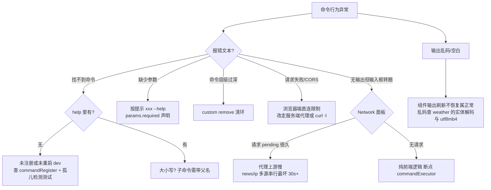

# 12 FAQ 与故障排查

> 项目：webCommand ｜ 版本：v1.1 ｜ 生成日期：2026-10-06 ｜ 依据：源码分析

## 1. 使用前的排查姿势

本篇是"出问题时打开的那一页"：先给高频报错速查表（按现象组织，每条给出根因与处置，全部标注源码出处），再解释五类高频根因的机理（知道"为什么"才能举一反三），然后给登录、同步、命令执行三条主链路的 mermaid 排查决策树，最后汇总日志入口。

排查的总动作序列固定为三步，顺序不能乱。**第一步看 `/api/health`**：它同时回答"进程活着吗、库连得上吗、表在吗"三个问题，且无鉴权无限流，一个 curl 就能把故障域切成"部署/数据库侧"与"应用逻辑侧"两半——health 是 ok 的而业务报错，问题几乎必然在应用逻辑或前端；health 503 则不用看业务，先修库。**第二步看浏览器 console**：前端所有持久化异常与云同步异常都打了带中文前缀的 `console.error`（清单见第 6 节），同步类问题九成在这一步就能定位到具体类型。**第三步看服务端 stdout 的四个关键字**（`[api error]`、`[migrate]`、`MySQL client connected`、`Unable to connect to MySQL`）。三条链路的正常形态见《05-核心流程》，这里只讲"哪里断了怎么认"；速率与阈值类参数的出处见《14-配置与环境详解》第 3 节。

## 2. 高频报错与坑速查表

### 2.1 启动与部署

| 现象 | 根因 | 处置 | 出处 |
| --- | --- | --- | --- |
| `pnpm test` 报 `ERR_UNKNOWN_FILE_EXTENSION` | Node < 22.18 无原生类型剥离，跑不了 `.ts` 用例 | 升级 Node，或让 `check-all.sh` 自动从 nvm 挑新版 | 《06》§1；`check-all.sh` 的 `node_ok` |
| 生产启动即退出，报 `NUXT_SESSION_PASSWORD` 不足 32 位 | `check-env` 守卫生效：短密钥会让所有会话接口 500 且不提示原因，所以启动就拦 | 按 compose 模板注释生成 32+ 位随机串并重启 | `server/plugins/check-env.ts` |
| 生产启动即退出，报缺少 DB 配置 / 必须 DB_HOST / 不得 root1234 | 同上四连校验的另外三条：解析后的 DB host/user/password 缺失、host 未显式给出、口令是开发默认 | 按报错列出的变量名补 `NUXT_DB_*` 并重启；注意校验的是解析值 | 同上 |
| 容器反复重启 / 日志见 `Cannot find module 'mysql2'` | `.output/server/node_modules` 未随产物传输（sequelize 动态加载的 mysql2 不在 Nitro 打包结果里） | 补传该目录（`tar_nm_pipe.exp` 那步不能省）；镜像内由 Dockerfile 的临时目录安装补齐 | 《06》§5.1；README 部署坑 |
| 容器 healthy 但用户全报登录失败 | "进程活着但注册登录全废"的假健康被 compose 探活放过了？不会——先看 `/api/health` 是否 503 | `dbReachable=false` 查共享 MySQL 与 `dev-stack_devnet` 网络；`missingTables` 非空查 `[migrate]` 日志 | `health.get.ts`；《06》§5.3 |
| `/api/health` 返回 503 且 `schemaError` 有值 | 启动迁移失败（库不存在、权限不足、DDL 冲突），服务**不会**因此退出（防重启风暴的设计） | 修复数据库侧问题后重启应用即可，失败迁移下次启动自动重试 | `plugins/migrate.ts`；《04》§4 |
| 改了 compose 口令重启不生效 | 变量用了非 `NUXT_` 前缀且产物是旧构建（历史真实事故：裸名变量运行期不映射进 runtimeConfig） | 统一用 `NUXT_DB_*` 写法；或确认读取点走的是 `setting()` 双写法 | `appConfig.ts` 头注释；《14》§3 |
| 所有用户共享限流桶（10 次/分就 429） | `NUXT_TRUST_PROXY` 未开或上游没传 `x-forwarded-for`，`getClientIp` 取到反代内层 IP | 反代后置 true + 逐跳传递该头 | `rateLimit.getClientIp`；《06》§5.3 第 4 条 |

### 2.2 账号与会话

| 现象 | 根因 | 处置 |
| --- | --- | --- |
| 登录报「用户不存在或密码错误」但确信密码对 | 三因同文案（防枚举）：用户名不存在 / 已注销（isDelete=1）/ 密码错 | 换用户名试一次即可区分"用户不存在"；已注销账号数据已物理删除，无法恢复 |
| 登录报 40100「账号已被封禁」 | `user.status ≠ 0`（手改库的封禁） | 无解封通道，手改库 `UPDATE user SET status=0`（《08》⚠️-B1） |
| 刷新页面后变回未登录 | 会话 cookie 过期（未 remember 默认策略/30 天到）或清了 cookie；属预期 | 重新 `user login` |
| 登录后另一台设备不同步 | 该设备是"已登录状态下的再登录"路径且初始化失败，看 console 是否有「xx 云同步初始化失败」 | 刷新页面让 `onMounted` 走 `initAllCloudSync` 重试 |
| 改密后旧设备还在登录态 | 无状态 cookie 会话，改密不使旧会话失效（《08》⚠️-A2） | 在旧设备 `user logout`，或全端下线临时换 `NUXT_SESSION_PASSWORD`（会让所有人掉线） |
| 发验证码报 50010 | SMTP_HOST/USER/PASS 未配齐（`isMailConfigured` 为假）或发信失败 | 检查 `SMTP_*` 环境变量；发信失败细节在服务端日志 `send reset code mail failed:` |
| 验证码总提示错误/过期 | 10 分钟 TTL 过 / 5 次尝试已销毁 / 服务重启清空了内存表 / 邮箱大小写不一致（键是小写） | 重新申请；输入与注册一致的邮箱 |
| 60 秒内再发验证码报「发送过于频繁」 | `issueCode` 的 `RESEND_INTERVAL` 节流 | 等提示的剩余秒数 |
| 注销后想用原用户名重新注册报「该用户名或邮箱已被注册」 | 软删行占用唯一索引且查重不过滤 isDelete（《08》⚠️-B3，源码核实结论） | 当前无解，属设计现状；介意则手删软删行（会同时失去核对能力） |
| 注册报「该用户名或邮箱已被注册」但登录不上 | 用户名或邮箱与**已注销**账号撞车（同上） | 换名/换邮箱 |

### 2.3 数据与同步

| 现象 | 根因 | 处置 |
| --- | --- | --- |
| 同步接口报 40000「content 超过 65536 字节上限」 | 配置类（custom/terminalConfig/theme）单条 64KB 上限 | 精简数据；数据类（todo/space/note）上限是 1MB，检查是否传错 type |
| 同步报 40000「type 不合法」 | type 不在六类白名单（前后端两份清单） | 检查 `cloudSyncRegistry` 与 `dataAccess` 两处是否都登记了新类型（《11》SOP-3） |
| 同步报 42900「同步过于频繁」 | dataLimiter 120 次/分/IP 打满（多设备频繁改动可能触发） | 等窗口；常态触发说明该调大阈值或加批量 flush（《10》§6-4） |
| 某类数据在两台设备间互相覆盖 | 检查合并语义：配置类（theme/terminalConfig）是整包较新者胜，两端同时改必然有一端让步 | 属设计行为；列表类是逐条 LWW，条目级不会整包丢 |
| 删除的条目在另一设备"复活" | 墓碑超过 30 天保留窗口后被 `pruneTombstones` 清理，另一端的旧条目可再合并回来 | 属窗口设计的已知边界（《04》§6.2）；避免让设备离线超过 30 天再上线 |
| blob 里 emoji 读回来变问号 | 库/表字符集不是 utf8mb4 | 检查 DDL（`migrations.ts` 强制 utf8mb4）与连接字符集；用冒烟脚本第 3 节复验 |
| `export` 导出的文件里没有背景/主题配置 | 导出只含 todo/space/custom/note 四类（`exportCommand.ts`，《08》⚠️-B2） | 属已知缺口；配置类数据云端有，登录即可拉回 |
| 刷新后部分输出变空白或全是占位文本 | 组件型输出刷新不恢复（`sanitizeForSnapshot` 换占位文本），属设计行为 | 重新执行对应命令 |

### 2.4 命令与终端交互

| 现象 | 根因 | 处置 |
| --- | --- | --- |
| 输入命令报「找不到命令」 | 未注册 / 拼错 / 该名字是子命令被当顶层敲 | `help` 查总表；子命令要带父名（`user login` 不是 `login`） |
| 自定义命令不生效 | 内置命令优先：同名时自定义被跳过（执行器先查 commandMap 再回退 customStore） | 换名；`custom list` 确认存在 |
| `!3` 报「无效的历史命令序号」 | 序号越界或非数字（历史含本轮会话恢复的 100 条） | `history` 先看序号 |
| Tab 补全不动 | 输入框未聚焦时第一次 Tab 只聚焦；候选为空返回 null | 先点一下终端或敲字母聚焦 |
| Ctrl+R 搜不到 | 搜索只匹配命令文本（小写包含），且搜索态下回车=接受不是执行 | Esc 退出后再回车执行 |
| 命令执行报「命令层级过深」 | 自定义命令成环（a→b→a）或嵌套超 10 层 | `custom remove` 清理环 |
| `curl` 命令请求失败（CORS） | 浏览器端直连第三方，目标站没开 CORS | 属浏览器限制；同类数据需求走内置代理命令（weather/news/stock/ip） |

## 3. 高频根因的机理解释

速查表给"怎么办"，这一节给"为什么会这样"——五个反复出现的根因，理解一次就能覆盖表里大半条目。建议的配套习惯是：每次排障都把"现象 → 走到哪一步 → 结论"记进发布日志或 issue，本仓库的几条最有效速查表行（TRUST_PROXY 共桶、mysql2 缺失、限流 40000）当初就是这么沉淀下来的——排障记录是这个仓库唯一会自动变成文档的东西。

**机理一：无状态会话决定了一批"看起来像 bug"的行为。** 会话是自包含的加密 cookie，服务端没有会话表，于是三件事成为必然：应用重启所有登录态完好（密钥不变）；改密不能踢掉其他设备（没有任何可撤销的服务端状态）；泄露的 cookie 在有效期内无法单独作废（只能换密钥全员下线）。反过来，"清掉 cookie 即登出、清掉 localStorage 只是丢工作副本"也由此而来——云端 blob 是全量，本地只是缓存。排查任何"登录态不符合直觉"的问题，先回到这个模型推演，而不是怀疑代码。

**机理二：限流按 IP 计数，IP 的可信度由 TRUST_PROXY 决定。** 三个限流器的键都是 `getClientIp` 的返回值：开关不开时取 socket 远端地址，位于 Nginx/frp 之后就意味着全体访客共享反代内层 IP 的桶——这解释了"所有人都 10 次就 429"的现象；开关开了但上游没传 `x-forwarded-for`，效果相同。它同时解释了冒烟脚本为什么要 `sleep 62`：同一 IP 连续跑注册/登录用例，authLimiter 的 60 秒窗口会把后续断言污染成限流响应。顺带记住两个限流易混点：user 组限流的 body 码是 40000（data/proxy 组才是 42900，见《13》⚠️-5）；HTTP 状态两者都是 429。

**机理三：迁移器"不阻断启动"让故障后移到 health。** `plugins/migrate.ts` 刻意吞掉迁移失败（防容器重启风暴），代价是"启动成功"不再等于"服务可用"——注册/登录会以奇怪的方式失败（找不到表）。这个设计把发现责任移交给了 `/api/health` 的 `schemaError` 与 `[migrate]` 日志，所以排障第一步永远是 health。同理，`db.ts` 的建连失败也只打日志不抛错（懒加载单例无法在启动期确认连通性），"MySQL client connected" 没出现在日志里本身就是一条线索。

**机理四：合并语义决定"覆盖/复活"类现象的对错。** 云端每类数据是整包 blob，冲突裁决全在客户端：列表类逐条按 `updateTime` 新者胜、删除靠墓碑（30 天窗口）、配置类整包较新者胜。由此可推演所有"覆盖/复活"投诉：两端同时改配置类必有一端让步（设计如此）；删除后条目复活要么是墓碑过期被裁（设备离线超 30 天），要么是条目在删除后被改得更晚（判为重建）；导入备份不丢数据是因为 import 统一"刷新时间+清墓碑"。判断某次数据丢失是否为 bug 的方法：把两端 blob 从云端拉出来，按 `mergeKeyed`/`localIsFresher` 的规则手工推一遍，推不出来说明是真 bug，推得出来说是语义。

**机理五：前端渲染层的三道"清洗"造就了三类视觉现象。** 输出快照把组件输出替换为占位文本（异步组件无法 JSON 序列化，强存会得到空壳并渲染成空白——这是修复过的回归，占位文本是修复形态而非残留问题）；历史与回显里的 `-p xxx` 被替换为 `***`（脱敏是特性，误以为"密码记错了"的人请直接重敲）；`smartText` 先转义后链接化让第三方内容里的尖括号显示为字面字符（不是乱码，是防 XSS 的正确表现）。看到这三类现象先对照机理，再决定是否报障。

## 4. 排查决策树

### 4.1 登录故障

```mermaid
flowchart TD
    A[登录报错] --> B{HTTP 状态?}
    B -->|429| C[限流命中]
    C --> C1[authLimiter 10次/分/IP<br/>等窗口或查 TRUST_PROXY<br/>是否全体用户都中]
    B -->|200| D{body code?}
    D -->|40400 用户不存在或密码错误| E[三因同文案]
    E --> E1[别人同名也报? 用户真不存在]
    E --> E2[曾 user delete? 软删占用 无法恢复]
    E --> E3[密码错 重置: reset -e 邮箱]
    D -->|40100 账号已被封禁| F[status≠0 手改库解封]
    D -->|40000 参数错误| G[检查命令参数 -u/-p 齐全]
    D -->|50010| H[发码类: SMTP 未配置或发送失败]
    D -->|50000 server error| I[服务端日志 [api error] 看堆栈]
    A --> J[登录成功但掉线/不同步]
    J --> J1[console 是否有 云同步初始化失败]
    J1 -->|有| J2[查该类型 store 初始化异常]
    J1 -->|无| J3[GET /api/data 是否 40100<br/>cookie 未带上? withCredentials?]
```

### 4.2 同步故障

```mermaid
flowchart TD
    A[数据不同步] --> B{前端 console 有无报错?}
    B -->|同步前拉取失败 / 同步失败| C[网络或服务端 5xx]
    C --> C1[服务端 [api error] 与 health]
    B -->|xx 云同步初始化失败| D[store 动态 import 失败<br/>看具体类型]
    B -->|无报错但数据旧| E{该类型在白名单?}
    E -->|否| F[SOP-3 补登记<br/>registry + dataAccess 两处]
    E -->|是| G{GET /api/data?type= 返回?}
    G -->|40100| H[会话问题 走 3.1 登录树]
    G -->|40000| I[type 拼写/content 超限]
    G -->|200 但 data 与本地不符| J[合并语义判定<br/>配置类: updatedAt 谁新谁赢<br/>列表类: 条目 updateTime + 墓碑]
    A --> K{服务端日志}
    K --> L[api/data 429 频繁?] --> L1[dataLimiter 打满 调批量防抖]
    K --> M[upsert 报错?] --> M1[user_data 唯一索引丢失?<br/>SHOW INDEX FROM user_data]
```

### 4.3 命令执行故障



## 5. 典型故障案例复盘

把前三节的方法串起来走四遍完整流程，每一遍都从"模糊的现象"走到"源码级的原因"，这是本篇方法论的综合示范。

**案例一：'所有用户偶尔集体被登出'。** 现象是多个用户同一天报告登录态失效，但没有人执行过注销。按三步法走：health 是 ok 的（进程与库正常），排除部署问题；前端 console 无异常（`getAndSetLoginUser` 的 40100 是静默路径，不打日志）；服务端日志没有 `[api error]`。走到这里只剩两个可能：cookie 被清（用户侧原因）或服务端验签失败。后者只有一种触发方式——`NUXT_SESSION_PASSWORD` 变了（nuxt-auth-utils 用它解密会话，密钥一换所有旧 cookie 全部解不开）。回查 compose 变更记录，确认当天有人轮换过密钥。结论与预防：会话密钥属"改了=全员下线"的变量，轮换要按停机窗口对待；这也能反推《08-安全与权限设计》A1 隐患的应对手段（紧急踢全端时换密钥是唯一开关）。

**案例二：'同步在两台设备间来回打架'。** 现象是用户在 A 设备改了主题，B 设备几秒后又"改回去"。这不是覆盖 bug 而是配置类合并语义的正常表现：theme 按"整包较新者胜"，B 设备离线期间的旧改动带旧 `updatedAt` 上云后，两端会在下一次同步收敛到时间戳更大的那个值。判别方法（机理四的推演）：把两端 `/api/data?type=theme` 的 blob 拉出来比对 `updatedAt`，若收敛后稳定不变则语义正确；若 `updatedAt` 持续互相刷新，说明有两台设备时钟偏差过大——LWW 依赖客户端时钟，时钟倒流的设备会赢得不该赢的合并。处置：校正系统时钟；这一限制也记录为墓碑/LWW 机制的已知前提（客户端时钟可信），若要根治需改用服务端时间戳，属架构变更。

**案例三：'注册接口偶发 40000，message 是参数错误但参数看起来都对'。** 用户反馈注册失败且无法复现。查服务端日志没有 `[api error]`（业务码不是异常路径），再查 authLimiter 的时间分布：该用户一分钟内已尝试 10 次（前端在失败后快速重试），第 11 次起全部命中限流——而 user 组限流的 body 码恰好是 40000（⚠️-5），message 是通用的"操作过于频繁"。这里有两个教训：一是排障时不要只看 HTTP 200 与 body 码，429 状态才是限流的可靠信号（响应头与状态码同源）；二是它解释了为什么前端体验上"参数错误"与"操作频繁"会混在一起——这正是 ⚠️-5 建议把 user 组限流码改为 42900 的用户价值所在。修复前的临时引导话术：让用户等一分钟再试。

**案例四：'容器 unhealthy 反复重建，但手动 curl health 是 ok 的'。** 现象指向"探活视角与人工视角不一致"。compose 的 healthcheck 从容器内 `127.0.0.1:3000` 打 health，人工从宿主机或公网打——两者相差整条链路。先在容器内 `docker exec webcommand-web node -e "fetch('http://127.0.0.1:3000/api/health').then(r=>r.text()).then(console.log)"` 复现：若容器内也 ok，则问题在 healthcheck 定义本身（常见是 start_period 20s 内迁移未完成，health 503 连续三次即 unhealthy，而迁移慢是因为共享 MySQL 当时有长事务）；若容器内 503，看 `schemaError` 字段。此案例的通用教训写在《06-部署运行》§5.3：容器自检 healthy 与外网可达（frp/Nginx 链路）是两个独立检查，反之亦然。

## 6. 日志入口索引

**服务端 stdout**（容器日志 / dev 终端）的以下关键字全部来自源码 grep：

| 关键字 | 产生者 | 含义 |
| --- | --- | --- |
| `MySQL client connected` | `db.ts` authenticate 成功回调 | 首次建连成功（懒加载，出现在第一个碰库的请求后） |
| `Unable to connect to MySQL:` | `db.ts` 失败回调 | 建连失败（注意：不抛错，应用继续跑，首个查询才真失败） |
| `[migrate] 已应用迁移` / `[migrate] 数据库结构已是最新（跳过 %d 条）` | `plugins/migrate.ts` | 迁移成功/无需迁移 |
| `[migrate] 数据库迁移失败，注册/登录可能不可用：` | 同上 | 迁移失败原文，同步写入 `/api/health` 的 `schemaError` |
| `[api error]` | `response.ts bizHandler` | 未分类异常兜底（含 `event.path` 与异常对象），出现即代表有 bug 或依赖故障 |
| `send reset code mail failed:` | `reset-code.post.ts` | SMTP 发信失败原文 |
| `weather/news/ip source failed:` / `stock proxy error:` / `获取随机背景失败` | 各代理路由 | 多源容错的单源失败（info 级，全败才对客户端报 502） |

**前端 console**（DevTools）的中文前缀清单：`保存命令历史失败` / `恢复命令历史失败` / `恢复输出快照失败`（Terminal.vue 的 localStorage 异常）；`<type> 同步前拉取失败` / `<type> 同步失败` / `<type> 云端加载失败`（useCloudSync）；`<type> 云同步初始化失败` / `<type> 云同步解除失败`（cloudSyncRegistry）；`获取登录用户失败` / `获取登录用户异常`（userStore——注意 40100 未登录是预期路径，静默不打日志）；`复制失败`（ContentOutput）。**健康观测只需一个端点**：`GET /api/health`，字段判读见《03-接口设计》2.3 与《06》§6；部署链路另加 `deploy.sh verify` 的公网核验。最后提醒一条元规则：本篇每条结论的最终依据是源码与《09-测试与质量保障》里的测试——若实际行为与本篇冲突，以源码为准并回来修这篇文档。
