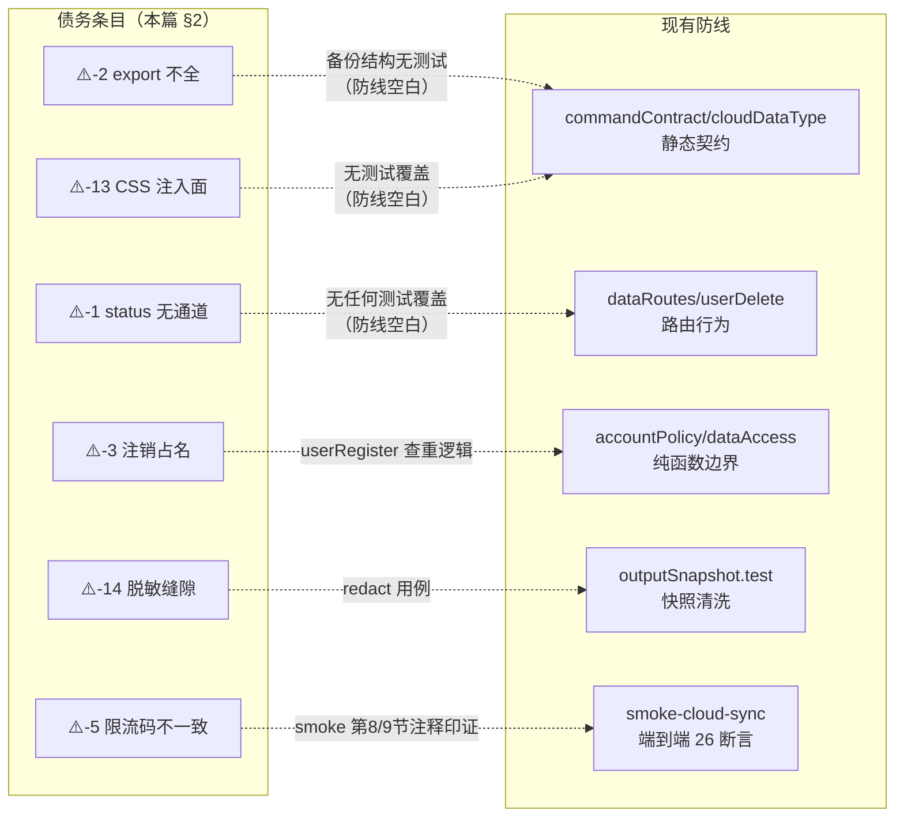

# 13 技术债务与演进建议

> 项目：webCommand ｜ 版本：v1.1 ｜ 生成日期：2026-10-06 ｜ 依据：源码分析

## 1. 债务清单的口径

本篇把散落在各篇的 ⚠️ 项、源码注释里的自认取舍、以及本次通读新发现的问题汇总成一张可执行的债务清单。先立口径，避免"债务"一词被滥用。**认定标准**只有一条：当前行为与"代码作者声称的意图"不一致，或当前行为会在可预见条件下造成数据/语义损害——前者的证据是注释与实现的矛盾（如 `ERROR_CODE.RATE_LIMIT` 定义了却没用），后者的证据是边界条件推演（如软删行占用唯一索引）。**不属于债务的**：README「已知限制」里明文接受、且当前用户规模下无实际损害的取舍（第 4 节登记在案）；以及一切"加功能"类的愿望（那叫 roadmap，不叫债）。每条债务给四元组：**位置（真实路径）／证据（源码事实）／影响／建议**，并按"会不会咬人"分三档：A 档（有用户可见影响或数据语义问题）、B 档（契约不一致、有维护陷阱）、C 档（卫生类）。编号沿用《08-安全与权限设计》第 9 节的 A/B/C 前缀以便交叉引用；部分编号（4/6/7/11/12/15）被引用后合并或撤销，保留空洞不作重排，保证跨篇引用稳定。

债务与既有防线的关系如下图——大多数债务之所以"还没咬人"，是因为恰好落在某张契约测试或纯函数的射程内；还债的第一步永远是确认改动会惊动哪张网：

本篇每条结论都按两种方式复核过：**静态的**——在对应文件里 grep 证据串（例如 `status: 0` 全仓只有注册路径一处写入、`ERROR_CODE.RATE_LIMIT` 在 user 组路由零引用）；**动态的**——对可执行脚本直接实测（⚠️-23 的守卫分别以"变量已设／未设"两种前提在 bash 下跑过，行为与推演一致后才定档）。"位置"列一律给相对 `webCommand/` 的真实路径，"证据"列的字符串可直接当检索词用：读者对任何一条存疑时，一条 grep 就能重走完整推导链——这也是债务清单区别于"问题感想"的形式特征：**每条债都自带可复现的验证路径**。

## 2. 债务清单

以下三张表按"咬人程度"降序排列。读表的方法：先看"证据"列确认它是源码级事实而非猜测（每条都可在对应文件里一行 grep 复核），再看"影响"列判断它离自己的使用场景有多远——个人自用与开放注册对同一条债的优先级判断可能完全相反，本篇给的是事实与默认建议，不是拍板。

### A 档：用户可见或数据语义

| 编号 | 债务 | 位置 | 证据 | 影响 | 建议 |
| --- | --- | --- | --- | --- | --- |
| ⚠️-1 | user.status 封禁能力"只读"，无任何修改通道 | `server/models/User.ts`（status 列）、`server/services/userService.ts` 的 `verifyCredentials`（status≠0 抛 40100「账号已被封禁」） | 全仓无任何接口/命令/脚本写 status；仅注册时 `create` 置 0 | 封禁只能手改库；误封/解封都依赖 DBA 手工操作，且没有审计痕迹 | 短期保持手改（个人服务可接受）；若开放注册则加最小管理面：一个需环境变量密钥的管理路由或 CLI 脚本，写 status 并打日志 |
| ⚠️-2 | export/import 覆盖不全：缺 terminalConfig 与 theme | `app/core/commands/data/exportCommand.ts`（data 只聚合 todo/space/custom/note） | 与 `CLOUD_DATA_TYPES` 六类对照缺两类；从代码看是枚举遗漏而非技术限制：五个 store 有 `importBackup`（todo/space/custom/note/terminalConfig），其中 `terminalConfigStore.ts` 的已实现却没被 `ImportBox.vue` 接上，`themeStore` 则连方法也没有（theme 只需存主题名，补分发即可，不必新增方法） | 换浏览器后备份无法恢复背景/主题/欢迎语（云端有则可拉回，纯本地用户会丢） | `exportCommand` 的 data 增加 `terminalConfig` 与 `theme`（theme 存 `{themeName}` 即可）；`ImportBox.vue` 分发补两行；补一条备份结构契约测试 |
| ⚠️-3 | 注销后用户名/邮箱被永久占用，无法重新注册 | `server/services/userService.ts`：`deleteAccount` 软删（唯一索引仍在）+ `userRegister` 查重 `findOne({Op.or:[{username},{email}]})` **无 isDelete 过滤** | 软删行持有 `user_username_unique`/`user_email_unique`，查重必然命中 → 报「该用户名或邮箱已被注册」 | 「注销」语义实际是"删数据 + 永久放弃身份"；《05-核心流程》6.5 曾写"可被重新注册 ⚠️ 待确认"，经源码核实为**不可**（一致性回刷时该处已按本篇口径更正），结论以本篇为准 | 三选一：① 文档明确该语义（零成本）；② 查重加 `isDelete: 0` 过滤 + 释放唯一索引（MySQL 无部分索引，需把 username 改为"软删时改名"如 `username_deleted_<id>`）；③ 提供管理员改名通道。建议先做①并在 README 注明 |
| ⚠️-16 | 迁移器无并发互斥 | `server/utils/migrations.ts` 的 `runMigrations`（查水位→补跑→写水位，无锁） | 两个进程指向同一库启动会并发跑同一迁移 | 当前语句全幂等所以通常无害；未来任何非幂等迁移（ALTER/数据回填）在双进程下可能半途冲突 | 迁移入口加 MySQL advisory lock：`GET_LOCK('webcommand_migrate', 0)` 拿不到就跳过（另一实例在跑）；或迁移前置条件写进部署手册"仅单实例跑迁移" |
| ⚠️-17 | `createTime/updateTime` 恒为 NULL | `server/models/User.ts`（`timestamps: false`）+ `userService.ts` 全部写路径未写时间字段 | 《04-数据模型》3.1 已证 | 排障无法回答"这账号何时创建"；审计缺时间线 | 低成本：注册/改密/注销路径显式写 `createTime/updateTime`（或打开 sequelize 只在 update 时维护 updateTime 的钩子）；历史 NULL 行不补 |

### B 档：契约与维护陷阱

| 编号 | 债务 | 位置 | 证据 | 影响 | 建议 |
| --- | --- | --- | --- | --- | --- |
| ⚠️-5 | 限流响应码不一致：auth 组 body 40000 vs data/proxy 组 42900 | user 组五个路由（login/register/reset-code/reset-password/delete）写 `BizError(ERROR_CODE.PARAMS, '操作过于频繁…', 429)`；data/proxy 路由写 `ERROR_CODE.RATE_LIMIT` | `ERROR_CODE.RATE_LIMIT=42900` 对 auth 组"已定义未使用"；`smoke-cloud-sync.sh` 第 8 节注释印证（"拿到的是限流的 40000"）；《03-接口设计》登录时序图曾写 42900 与源码不符（一致性回刷时已按本篇口径更正），以本篇为准 | 监控/前端若按 42900 匹配限流会漏掉 auth 组；语义错误码体系自相矛盾 | 五处 `ERROR_CODE.PARAMS` 改 `ERROR_CODE.RATE_LIMIT`（HTTP 429 不变，前端只展示 message 不受影响）；顺手在 `serverConfig` 风格的契约测试里钉住"路由限流码 == RATE_LIMIT" |
| ⚠️-8 | happy-dom 依赖未被使用 | `package.json` devDependencies 有 `happy-dom ^17.6.3`；`vitest.config.ts` 的 `environment: 'node'` | 全仓无组件测试引用它 | 死依赖，误导读者以为有 DOM 测试 | 要么删除；要么按《09》补测建议启用它写第一批组件测试 |
| ⚠️-9 | `web/` 目录为旧前端工程残留 | 仓库根 `web/`；`.gitignore` 注释「旧前端工程残留目录」 | 未被任何代码引用（构建入口只有 `app/` 与 `server/`） | 仓库噪音，扫描类脚本（commandContract 等）虽不受影响但阅读成本高 | 从工作区与远端历史（如需要）移除 |
| ⚠️-10 | 门禁无 CI 托管；check-all.sh 头注释的"没有 git remote"前提已过时 | `scripts/check-all.sh`（头注释） | 头注释仍写"仓库目前没有 git remote"，但仓库实际已配置 origin（github.com/zhangzhengyang27/webCommand）——注释落后于现实，自身又成一处"注释与实现矛盾" | 门禁只存在于本机习惯：忘跑 `check-all.sh` 照样能发布，五步门禁形同虚设 | 建立 GitHub Actions 最小流水线：五步照抄 check-all.sh，缓存 pnpm store；顺手把头注释的 remote 表述更新，防止下一个读者据它做错误决策 |
| ⚠️-14 | 历史脱敏不覆盖含空格的口令 | `app/components/outputSnapshot.ts` 的 `redactSensitiveText` 正则 `(\S+)` | `-p "two words"` 只遮蔽第一个词 | localStorage 历史可能残留口令后半段（低危，见《08》§6.3） | 正则改为 `("([^"]*)"|\S+)` 级别的取值匹配，或干脆对含 `-p/--password` 的整条命令只保留命令名 |
| ⚠️-18 | 契约漂移：两处文档漂移已修正，两处代码注释仍指错文件 | 《03》限流码描述（42900）、《05》注销重注册表述（可重注册）本次通读已按源码更正（⚠️-5、⚠️-3）；另实测发现 `nuxt.config.ts` 的 runtimeConfig 注释写"由 `server/utils/dbConfig.ts` 解析"、`docker-compose.example.yml` 注释写"`server/utils/setting.ts` 兼容读取"——两个文件均已不存在，实际解析层都在 `server/utils/appConfig.ts` | 文档失去公信力的起点就是小漂移；注释指向空文件会把后来者引向死胡同 | 立个规矩：改契约必同步改对应篇目；改文件名必同步 grep 注释引用；`test/*.spec.ts` 的契约测试消息里可直接引用文档章节号 |
| ⚠️-19 | `auth.d.ts` 的 email 可选但登录路由未同步可选性 | `auth.d.ts`（`email?: string`）与 `toSafeUser` 直接透传 | email 列可 NULL，会话/接口理论上可能返回 undefined email | 前端 `loginCommand` 已做 `loginUser.email` 存在性判断，无实际 bug | 仅记录；若未来加"必填邮箱"策略，改注册校验而非类型 |
| ⚠️-23 | backup-db.sh 的 MYSQL_PWD 守卫写法失效（缺 `?` 运算符） | `scripts/backup-db.sh` 第 17 行 `: "${MYSQL_PWD:*** 数据库口令必须通过环境变量传入}"`——意图显然是 `${VAR:?提示}`，少写 `?` 后成了"子串展开 + 非法算术偏移"。实测（bash）：变量**已设**时报 `syntax error: operand expected` 并以 rc=1 退出，**未设**时反而静默放行 | 防呆方向恰好反过来：按头注释用法（`MYSQL_PWD=*** ./scripts/backup-db.sh`）执行必失败，定时备份将一次都不产出；口令漏配也不会在入口报错，拖到 mysqldump 才败。备份是删库恢复的最后防线，"自以为有备份"比"没有备份"更危险 | 一行修复为 `${MYSQL_PWD:?*** 数据库口令必须通过环境变量传入}`；修复后用假口令空跑一次确认入口四个防呆全部触发，并把该空跑固化为脚本的回归验证步骤（已列入第 6 节第 1 周） |

### C 档：卫生与体验

| 编号 | 债务 | 位置 | 证据 | 影响 | 建议 |
| --- | --- | --- | --- | --- | --- |
| ⚠️-13 | background 自定义 URL 的 CSS 注入面 | `app/components/Terminal.vue` 的 `wrapperStyle`：`style.background = url(${background})` 无转义 | 值可经云同步来自同账号另一设备；构造串可逃出 `url()` | 自伤性质（只能影响自己的终端外观），无跨用户面 | 设置入口校验：`new URL()` 解析 + 协议白名单 http/https + 编码括号；或 CSS 字符串转义 |
| ⚠️-20 | 健康检查暴露 `schemaError` 原文 | `server/api/health.get.ts`（无鉴权返回迁移错误文本） | 信息量小（表名/错误消息） | 探活契约需要它，删除会伤运维 | 保持现状；介意者在反代层限来源 |
| ⚠️-21 | 命令面板条目为创建时快照 | `app/components/CommandPalette.vue`（`customItems` 非 computed） | 面板打开期间新增的自定义命令不出现 | 关闭重开即愈，无实际损害 | 把两段构建挪进 `computed`，一行改动 |
| ⚠️-22 | `generate` script 与 `vue-router` 依赖存疑 | `package.json`（`generate: nuxt generate`；SPA 单页且无 NuxtLink） | generate 对 SPA 单页意义存疑；vue-router 是 Nuxt 必带依赖但项目零路由用法 | 语义噪音 | `generate` 保留（官方脚本无碍）；vue-router 是框架依赖不动；记录即可 |

## 3. 单实例假设的扩容演进路线

这是最重要的一项"预埋债务"：`rateLimit.ts` 与 `passwordReset.ts` 的注释都明写"单实例足够；多实例应改 Redis"。先说清楚**为什么它排在 A 档之外却最重要**：它不是缺陷而是已声明的容量边界，但它是唯一一条"其他所有扩展都被它挡住"的债——没有它，本篇第 6 节的任何演进、GitHub 上的开源发布、甚至"临时起个第二个容器排查问题"都会引入正确性问题（限流配额翻倍、验证码跨副本失效）。因此它值得一条完整的路线图而不是一行建议。路线按触发条件分三阶段，**不达触发条件不要动**——每一步都有真实成本（引入 Redis 就是引入一个有状态依赖，运维面、备份面、故障面都随之扩大）：

**阶段 0（现状，单实例）**：适用条件——用户量个位数、单容器、`schema_migrations` 由唯一进程写。运维要点已在《06-部署运行》§5.3 固化。此时引入 Redis 纯属负优化。

**阶段 1（可用性扩容：2~N 个无状态副本）**：触发条件——需要滚动升级不中断、或单机故障要求快速恢复。改造清单按依赖顺序：
1. **先外置限流**（`rateLimit.ts`）：`createRateLimiter(windowMs, max)` 的接口天然适配 Redis 实现（`INCR`+`EXPIRE` 或 ZADD 滑窗），路由层零改动；注意 `getClientIp` 的 TRUST_PROXY 语义在多反代下要复核。
2. **再外置验证码**（`passwordReset.ts`）：`issueCode/verifyCode` 两个函数换成 Redis Hash（`codeHash/expiresAt/attempts/lastSentAt`），TTL 用原生 EXPIRE 替代 sweep；A 副本签发 B 副本验证的现状 bug 随之消失。
3. **迁移加锁**（⚠️-16 的 advisory lock）：多副本同时启动时只允许一个跑迁移，其余跳过。
4. **无需动的是会话**：无状态加密 cookie 是这套架构里唯一"天然多实例友好"的部分（密钥一致任意副本可验，README/《08》均已说明）——这也是当初选 cookie 会话的回报。
5. **health 与 deploy.sh verify** 不需要变（每副本自查自报）。

**阶段 2（规模扩容：数据库瓶颈）**：触发条件——连接数、慢查询或备份窗口成为问题。顺序：显式连接池调优（`db.ts` 加 pool 配置）→ 读写分离（blob 读多写少，可挂只读副本）→ 冷热分层（user_data 归档）。此阶段同时把 bcryptjs 换原生 bcrypt（每请求 CPU 减半以上，《10》§6-6）。到此为止本项目都不需要引入消息队列/对象存储——blob 模型的上限（单条 1MB、每用户 6 条）天然封顶了存储复杂度。

路线之外再给两条护栏。**其一，进入下一阶段的判据要来自观测而不是感觉**：单实例阶段就该先记下四组基线数——限流键规模与命中次数（`rateLimit.ts` 的滑动窗口 map 目前只在超过 10000 键时清扫，且命中无日志，外置前要先补一条命中日志才有观测面）、验证码 `codeMap` 规模、`/api/health` 的响应耗时、MySQL 连接数与慢查询日志；没有基线，"该扩了"就永远是一句感觉。**其二，每一步改造都要同时配测试**：Redis 限流器要带上与现版语义一致的多 IP 隔离用例（正好对应《09》缺口表里 rateLimit 补测的建议——先补测再替换实现，等于免费获得一次行为对照）；advisory lock 要验证"第二个实例拿不到锁后正常继续启动、只是跳过迁移"；验证码外置要覆盖"A 副本签发、B 副本验证"这个单实例下根本不存在的场景。改造与测试同批落地，是本仓库"每起事故沉淀为测试"传统在演进期的自然延伸。

## 4. 有意取舍登记表（不是债务，但要有出处）

区分"债"与"取舍"的标准是**是否有明文的接受声明**：下表每一行的出处要么是源码注释要么是 README 的「已知限制」，它们是作者知情且接受的设计边界，列在这里的目的是让复议有据可查——当条件变化（用户量、部署形态、需求）触发复议时，直接看"复议条件"列就知道当初为什么能接受、现在为什么不能。这也是本篇与 roadmap 的分界：取舍表加一行是"做了决定"，债务表加一行是"承认欠账"。

| 取舍 | 出处 | 复议条件 |
| --- | --- | --- |
| 限流/验证码存进程内存 | `rateLimit.ts`、`passwordReset.ts` 注释；README「已知限制」 | 阶段 1 触发时 |
| 按类型限额、无按用户总配额 | `dataAccess.ts` 头注释（"按用户的总容量配额仍未实现"） | 出现滥用迹象 |
| SPA（ssr:false） | `nuxt.config.ts` 注释；README 实测静态标签在产物外壳里 | 需要服务端个性化首屏时 |
| blob 不解析、结构兼容责任在前端 | `dataAccess.ts`；《04》§6.3 | 出现跨版本 blob 读取故障时 |
| 无移动端适配 | README「已知限制」（全仓无媒体查询） | 移动流量成为真实场景 |
| bcryptjs 而非原生 bcrypt | `package.json`（纯 JS 便于跨机部署） | 阶段 2 或登录 QPS 上升时 |
| todo 初始列表为空（曾内置演示任务） | `todoStore.ts` 注释（演示任务会随同步写进云端，每台新设备留垃圾） | 不再复议 |

这张表的使用方式是"复议驱动"：任何一条取舍被条件变化触发时，先在表内把"复议条件"列改写为"已触发（+日期+原因）"，再到第 2 节为其新立债务条目（编号顺延不重排），最后同步更新引用它的篇目——取舍转债务要走完这三步才算迁移完成，避免出现"表里说可接受、别处已在声讨"的分裂状态。反过来，已偿还的债务若本质是接受了某个边界（例如决定永远手改 status），也应回落到这张表登记出处，而不是让条目无声消失；债务表只减不灭、取舍表有进有出，两份清单加起来才是技术决策的完整账本。

## 5. 死代码与可清理项汇总

逐一核查过引用关系后的清理清单如下，每项都给出核查方法以便复核。`web/` 目录（⚠️-9）：全仓 grep 无任何 import/构建引用，目录里现存内容只剩 `.nuxt` 与 `node_modules` 两个生成物，构建入口只有 `app/` 与 `server/`，`.gitignore` 的注释也自认是残留，整目录删除即可；删除前建议在远端归档一次以防旧文档引用。`happy-dom` 依赖（⚠️-8）：`package.json` devDependencies 声明、`vitest.config.ts` 的 `environment: 'node'` 决定了它不会被加载，删除后 `pnpm install` 与全部测试无感知；保留的唯一理由是《09》补测建议里"未来写组件测试时启用它"——二选一，别让依赖声明与测试现实长期不一致。`app/components.d.ts`：unplugin-vue-components 的生成物，`.gitignore` 未忽略它，建议加入忽略列表交由 `nuxt prepare` 维护，避免手改被误提交。`scripts/init-test-db.sql` 是生成物但**应保留生成逻辑**（脚本按需重生成，文件本身已 gitignore，无需入库）。`dateCommand` 的中文别名 `日期`、`goto` 的 `跳转` 等中文别名属特性不是死代码（alias 机制服务于输入习惯）。`package.json` 的 `generate` script 对 SPA 单页意义存疑但属 Nuxt 官方脚本，保留无害。**没有发现**不可达的业务函数——这与"每起事故沉淀为测试"的仓库习惯一致：代码面小、注释密度高，本身已是最有效的防腐化机制；换句话说，这个仓库的死代码问题规模很小，真正的债都在语义层（第 2 节 A/B 档）。

## 6. 建议的偿还顺序

把上表折算成一个季度视角的偿还节奏，原则是"先还零成本且能建立信任的，再还动语义的，最后还动架构的"。**第 1 周（纯赚项）**：⚠️-5 限流码统一、⚠️-2 export 补全、⚠️-23 备份脚本一行修复、⚠️-8/9/21 卫生三项——全部是小改动，且每一项都有现成测试或现成测试位兜底，做完即可体验"清单在缩短"的正反馈，也为后面的动库操作建立流程信心。**第 2-3 周（语义决策项）**：⚠️-3 注销占用与 ⚠️-17 时间列——它们需要先拍板语义（注销到底应不应该释放用户名？时间列要不要回填历史行？），拍板后一次迁移解决；动库前先 `backup-db.sh`，动完跑冒烟脚本第 2/8 节验证注册与注销闭环。**第 4 周（预埋项）**：⚠️-16 迁移锁与《09》缺口表里的 passwordReset/rateLimit 补测——它们不解决任何现存故障，却为未来扩容与重构买保险，属于"现在做便宜、将来做昂贵"的典型。**持续项**：每起新事故按仓库传统沉淀为契约测试，本篇相应条目随之销账；每次发布前把第 2 节的表扫一眼，确认没有新增的"注释与实现矛盾"。所有条目偿还后，本篇的 A/B 档应清空，只保留第 4 节的取舍登记表与 C 档记录——一个健康的个人项目，债务清单的理想形态就是"处处有出处、条条有复议条件"。
