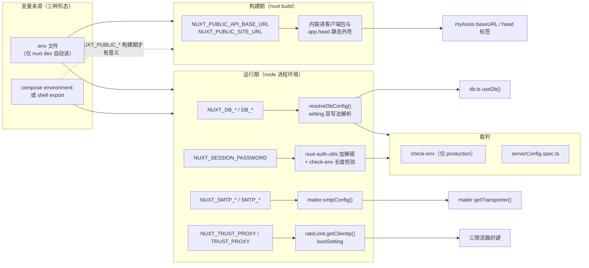

# 14 配置与环境详解

> 项目：webCommand ｜ 版本：v1.1 ｜ 生成日期：2026-10-06 ｜ 依据：源码分析

## 1. 配置体系的两条总线

webCommand 的全部配置走两条互不重叠的总线。**运行期总线**（服务端私有配置）：`NUXT_*` 环境变量或裸名变量，经 `server/utils/appConfig.ts` 的 `setting(configured, ...envKeys)` 解析，改配置重启容器即生效、不进构建产物——承载 DB、会话密钥、SMTP、代理信任开关。**构建期总线**（前端公共配置）：`NUXT_PUBLIC_*` 在 `nuxt build` 时被内联进客户端包与 `app.head` 静态外壳，改了要重新构建——只有 `NUXT_PUBLIC_API_BASE_URL` 与 `NUXT_PUBLIC_SITE_URL` 两项。这条分界线的由来（`nuxt build` 会把构建期读到的 `process.env` 烘进 `.output`，产物外传即泄露）是 `nuxt.config.ts` 注释与 `deploy.sh scan_artifact` 共同守护的红线，完整事故记录见《06-部署运行》第 3 节。

`setting()` 的精确语义（`serverConfig.spec.ts` 全覆盖）：按 `envKeys` 顺序找第一个**非 undefined 且非空字符串**的 `process.env[key]`；全 miss 时回退 `String(configured)`，configured 为 undefined/null 则返回空串。布尔变体 `boolSetting` 在此之上认定 `'true'` 与 `'1'` 为真。因此 `NUXT_DB_HOST` 与 `DB_HOST` 同时存在时前者赢（优先级 NUXT_* > 裸名 > 构建默认，《06》篇已立论，本篇全量展开每个变量的读取点）。

两条总线之外还有一层"启动校验"作为安全网，它不是配置的来源而是配置的裁判：`server/plugins/check-env.ts` 只在 `NODE_ENV=production` 时运行，校验的值一律取自**与真正消费点相同的解析函数**（`resolveDbConfig()` 而非 `process.env` 直读——这条纪律本身是旧事故的产物：曾出现守卫读 `process.env.DB_PASSWORD` 而建连用构建期内联值，"守卫通过但连的是另一份配置"）。校验失败的报错都带变量名清单，这是"配置错误要在启动时尖叫而不是在第一个请求时哑败"这一原则的落地。加上测试侧的 `serverConfig.spec.ts` 把 `setting` 的四条语义钉死，本篇第 3 节的每一行"读取点"都是三重背书（源码、启动校验、单测）之后的结论，可信度与《09-测试与质量保障》的契约同级。

配置从环境到消费点的完整流转如下图（左侧两条进入路径对应两条总线，右侧每个消费点都标注了读取函数）：

## 2. nuxt.config.ts 逐段走读

| 段落 | 内容与理由（注释为源码原文的浓缩） |
| --- | --- |
| 顶部常量 | `siteUrl = (process.env.NUXT_PUBLIC_SITE_URL || '').replace(/\/+$/, '')`——构建期读一次并去尾部斜杠，供 canonical/og:url 拼绝对地址 |
| `ssr: false` | 终端型个人应用无公开内容可收录；规避 localStorage 与 antd css-in-js 的水合成本；**SPA 下 Nitro（server/api）依然完整可用** |
| `compatibilityDate` / `devtools` | `2026-09-01`；开发工具开启 |
| `modules` | `@pinia/nuxt`、`nuxt-auth-utils`、`@nuxt/eslint` 三个模块，无多余 |
| `eslint.config.stylistic: false` | ESLint 只管质量，格式让给 Prettier，避免双规则打架 |
| `css` | 仅 `ant-design-vue/dist/reset.css`（css-in-js 模式下需手动引的基础重置） |
| `app.head` | `htmlAttrs.lang=zh-CN`、title/description、favicon 三件套 + manifest；`siteUrl` 非空时追加 canonical 与 og:url；OG/Twitter Card 全套；两段统计脚本（百度统计内联、Umami 外链带站点 id）；三段 JSON-LD（WebSite / SoftwareApplication / FAQPage）。**全部是构建期静态外壳**——改任何文案或统计 id 都要重新构建 |
| `vite.plugins` | `unplugin-vue-components` + `AntDesignVueResolver({importStyle:'css-in-js'})`，antd 组件按需自动引入 |
| `runtimeConfig.session` | 仅覆盖 `maxAge: 60*60*24*30`（注释：对齐原 express-session 的 cookie maxAge）；`password` 由 nuxt-auth-utils 从 `NUXT_SESSION_PASSWORD` 取，此处不写 |
| `runtimeConfig.db*` | `dbHost: 'localhost', dbPort: 3306, dbName: 'webCommand', dbUser: 'root', dbPassword: ''`——注释明示"只放非敏感开发默认值，不要构建期读 process.env"，运行期真值由 `resolveDbConfig()` 解析 |
| `runtimeConfig.smtp*` | 五项默认空/465，同上原则 |
| `runtimeConfig.trustProxy` | 默认 `false`；注释说明运行期用 `NUXT_TRUST_PROXY` 开启 |
| `runtimeConfig.public` | `apiBaseUrl`（`process.env.NUXT_PUBLIC_API_BASE_URL || '/api'`）与 `siteUrl`——仅有的两个构建期内联项 |
| `typescript` | `strict: true`；`tsConfig.compilerOptions.verbatimModuleSyntax: false`——注释：全局 namespace + `import X = Terminal.X` 写法与该默认不兼容，关闭以消除 TS1288 |

另一处配置文件 `vitest.config.ts`（第 1 章总线的测试侧镜像）：include 只收 `test/routes/**` 与 `test/unit/**` 的 `.test.ts`，environment `node`，setup 装 `test/routes/nitroGlobals.ts` 全局替身——设计理由见《09-测试与质量保障》第 1 节。

顺带记录走读中发现的两处注释漂移（已登记《13-技术债务》⚠️-18）：`nuxt.config.ts` 的 runtimeConfig 注释把运行期解析写作 `server/utils/dbConfig.ts`，`docker-compose.example.yml` 的 environment 注释写作 `server/utils/setting.ts`——两个文件均已不存在，实际的 `setting()/boolSetting()/resolveDbConfig()` 都在 `server/utils/appConfig.ts`。功能无碍，但注释指向一个空文件足以让新读者迷路，修两行注释的成本远低于长期忍受它的成本；这也再次印证第 1 节的结论：排查配置问题时以本篇第 3 节的读取点表为准，不要以任何注释为准。

## 3. 环境变量全量清单（逐一标注读取点）

下表覆盖仓库声明的全部环境变量（两种写法合并为一行，"读取点"给出消费函数与文件）。口径说明：按"逻辑变量"计——应用侧 14 项（DB 五项、会话密钥、SMTP 五项、TRUST_PROXY、两个 `NUXT_PUBLIC_*`，双写法各算一项）、平台侧 2 项（PORT、NODE_ENV）、测试侧 6 项（`TEST_DB_*` 五个加 SMOKE_PORT）、运维脚本参数 4 项（BACKUP_DIR、KEEP_DAYS、HEALTH_URL，外加 backup-db.sh 必需的 MYSQL_PWD——它不进应用配置，却同属"缺失即故障"的输入），合计 26 项；无论按哪种口径切，读取点都收敛在下表第二列的六个函数里（`resolveDbConfig`、`setting`、`boolSetting`、`smtpConfig`、`check-env`、nuxt.config 构建期读取），这正是"配置面小而集中"的直接证据：

| 变量 | 读取点 | 必填性 | 默认 | 说明 |
| --- | --- | --- | --- | --- |
| `NUXT_DB_HOST` / `DB_HOST` | `appConfig.resolveDbConfig()` → `db.ts useDb()`、`check-env.ts` | 生产必填（check-env 硬校验） | `runtimeConfig.dbHost`（localhost） | 生产缺失或仍为开发默认即启动失败 |
| `NUXT_DB_PORT` / `DB_PORT` | 同上 | 可选 | 3306 | `Number()` 解析失败回退 3306（`resolveDbConfig` 的 `\|\| 3306`） |
| `NUXT_DB_NAME` / `DB_NAME` | 同上 | 可选 | webCommand | 库不存在时迁移建表失败，经 health 暴露 |
| `NUXT_DB_USER` / `DB_USER` | 同上 | 生产必填 | root | 生产必须显式给（防静默连错实例） |
| `NUXT_DB_PASSWORD` / `DB_PASSWORD` | 同上 | 生产必填 | （空） | 生产禁用开发口令 `root1234`（check-env）；也是 `deploy.sh scan_artifact` 的扫描基准之一 |
| `NUXT_SESSION_PASSWORD` | nuxt-auth-utils（会话加解密）、`check-env.ts`（读 `process.env` 直查长度） | 生产必填 ≥32 位 | （空） | 生成命令见 compose 模板注释；泄露=全员会话可伪造，轮换即全员下线 |
| `NUXT_TRUST_PROXY` / `TRUST_PROXY` | `rateLimit.getClientIp()` 经 `boolSetting(cfg.trustProxy, 'NUXT_TRUST_PROXY', 'TRUST_PROXY')` | 反代后必置 true | false | true 时候限流取 `x-forwarded-for` 首段；裸名写法的兼容正是 `boolSetting` 存在的理由 |
| `NUXT_SMTP_HOST` / `SMTP_HOST` | `thirdparty/mailer.ts smtpConfig()` 经 `setting(c.smtpHost, …)` | 可选 | （空） | HOST/USER/PASS 任一缺失则 `isMailConfigured()=false`，发码接口 50010 |
| `NUXT_SMTP_PORT` / `SMTP_PORT` | 同上（`Number() \|\| 465`） | 可选 | 465 | 465 时 `secure: true`（SMTPS） |
| `NUXT_SMTP_USER` / `SMTP_USER` | 同上 | 可选 | （空） | 与 PASS 构成 SMTP 认证 |
| `NUXT_SMTP_PASS` / `SMTP_PASS` | 同上 | 可选 | （空） | 敏感，仅运行期注入；绝不入库入产物 |
| `NUXT_SMTP_FROM` / `SMTP_FROM` | 同上 | 可选 | 取 SMTP_USER | `sendMail` 的 from 缺省回退发件账号 |
| `NUXT_PUBLIC_API_BASE_URL` | `nuxt.config.ts`（`runtimeConfig.public.apiBaseUrl`）→ `app/utils/myAxios.ts` 构建期内联 | 可选 | /api | 前后端拆分域名时才需要；**构建期生效** |
| `NUXT_PUBLIC_SITE_URL` | `nuxt.config.ts` 顶部 `siteUrl`（canonical/og:url/og:image 与 JSON-LD url） | 生产建议 | （空） | 不要以 / 结尾（顶部有去尾处理）；**构建期生效**，改了要重新构建 |
| `PORT` | Nitro node-server preset（HTTP 监听） | 可选 | 3000 | compose 里固定 3000 由端口映射对外；产物运行时不读 `.env`，裸进程部署需自行 export |
| `NODE_ENV` | `check-env.ts`（仅 `production` 才校验）、`Dockerfile`（`ENV NODE_ENV=production`） | 容器内置 | — | 开发期不触发启动校验（注释：构建期校验会阻断 nuxt prepare/build） |
| `TEST_DB_HOST/PORT/NAME/USER/PASSWORD`（5 项） | `scripts/smoke-cloud-sync.sh`（source `.env.test` 后以 `NUXT_DB_*` 注入 dev 服务）+ 第 0 节的 mysql2 直连校验 | 冒烟前必配 | — | 由 `init-test-db.sh` 生成（0600、gitignore）；指向隔离库 `webcommand_test` |
| `SMOKE_PORT` | `smoke-cloud-sync.sh`（`PORT="${SMOKE_PORT:-3100}"`） | 可选 | 3100 | 冒烟 dev 服务端口 |
| `BACKUP_DIR` / `KEEP_DAYS` / `HEALTH_URL` | `backup-db.sh`（默认 ./backups / 14）、`deploy.sh`（默认线上 health 地址） | 可选 | 见左 | 运维脚本参数，非应用配置 |

补三条全局性纪律（均为源码注释与 README 的双重警告，此处只立条目）：私有配置严禁写进 `runtimeConfig` 的构建期读取（`deploy.sh` 会扫描拦截）；产物（node-server preset）**不自动加载 `.env` 文件**，`nuxt dev` 才会自动读；`NUXT_PUBLIC_*` 改动需要重新构建，其余全部重启即生效。

## 3.1 `.env` 文件与三种运行形态的加载语义

同一份变量清单在三种形态下的"从哪来"完全不同，配置类故障的一半源于混淆这一点。**nuxt dev**：自动加载工程根的 `.env`（dotenv 语义），未覆盖的键落到 `runtimeConfig` 的开发默认值——所以"本地不配 DB 也能跑"（连 localhost:3306 的 webCommand 库）。**node 裸进程（pnpm preview / node .output/server/index.mjs）**：产物里没有 dotenv/loadEnv 逻辑，`.env` 不会被读取，必须自行 `export` 环境变量；`.env` 只在构建期对 `NUXT_PUBLIC_*` 有意义。**docker compose**：`environment:` 段即运行期注入的全部来源，容器内没有 `.env` 文件；compose 自身的 `env_file`/变量替换是 compose 的功能，与 Nuxt 无关。判断一次配置改动会不会生效的口诀：先问消费点是构建期（public/head/统计脚本）还是运行期（appConfig 系），再问当前形态会不会把变量送进进程环境——两问都过，改动才生效。

## 3.2 配置排错三案例（全部有源码对应）

**案例一：改了 compose 口令登录仍然失败。** 走查链路：`db.ts useDb()` → `resolveDbConfig()` → `setting(c.dbPassword, 'NUXT_DB_PASSWORD', 'DB_PASSWORD')`——如果 compose 写的是 `DB_PASSWORD` 且产物是旧构建，`setting` 会先读到构建期烘进 runtimeConfig 的旧值吗？不会（运行期环境变量优先），但旧版本代码只读 `runtimeConfig` 时就会用构建期旧值——这正是 `appConfig.ts` 头注释记录的真实事故，也是"双写法兼容层"存在的原因。验证手段：`docker exec <容器> printenv | grep DB_` 看进程环境，再看 `/api/health` 与启动日志的 `Unable to connect to MySQL`。**案例二：health 是 ok 的但限流表现异常（全体共享一个桶）。** `getClientIp` 走 `boolSetting(cfg.trustProxy, 'NUXT_TRUST_PROXY', 'TRUST_PROXY')`，而 health 不经过限流器——所以 health 永远 ok，限流错不计入 health。检查两处：容器内 `NUXT_TRUST_PROXY` 是否为 true/1；上游每一跳是否都传递并追加了 `x-forwarded-for`（frp 与 Nginx 都要配，断任何一跳都取不到真实 IP）。**案例三：验证码发不出，但 SMTP 三项明明配了。** `mailer.smtpConfig()` 读的是 `runtimeConfig.smtp*` + `NUXT_SMTP_*`/`SMTP_*`——如果只在 `.env` 里配了而部署形态是裸进程/容器（第 3.1 节的加载语义），变量根本没进进程；`isMailConfigured()` 只检查三个键是否非空，配置了但值错（如端口不通）要到 `sendMail` 抛错才暴露，服务端日志找 `send reset code mail failed:`。三个案例共用一条元方法：**从消费点的读取代码出发倒推**，而不是从"我配了"正推。

## 3.3 给新变量接线的六个登记点

新增一个运行期配置项不是"加一行 process.env 读取"，本仓库把它拆成六个登记点，缺任何一步都会以特定方式失败。① `nuxt.config.ts` 的 `runtimeConfig` 写**非敏感开发默认值**（敏感项留空串，注释写明"生产由运行期提供"，这是 scan_artifact 红线的一部分）；② 在 `server/utils/appConfig.ts`（或消费方自己的 `smtpConfig()` 式函数）里经 `setting()`/`boolSetting()` 接线，同时声明 `NUXT_*` 与裸名两个键，继承双写法兼容；③ 生产必填的进 `check-env.ts`（数据库系走 `missingDbConfigKeys()` 清单，其余自己加分支），保证"启动时尖叫"而非第一个请求哑败；④ 在 `test/serverConfig.spec.ts` 为解析语义补用例，钉住默认值与空串行为；⑤ `.env.example` 加占位行（该文件入库，只放占位符与说明）；⑥ `docker-compose.example.yml` 的 environment 段加注入行，注释写清生成方式。漏 ①② 变量根本到不了消费点；漏 ③ 生产静默连错；漏 ④⑤⑥ 则下一个部署环境复现不出配置。构建期变量（`NUXT_PUBLIC_*` 系）走的是另一条路：只改 `nuxt.config.ts` 与 head/axios 消费点、不进 appConfig，但必须在提交前跑 `deploy.sh build` 让 `scan_artifact` 把关——两条路的分岔点就是第 1 节那张流转图的分叉处。

## 4. Dockerfile 逐指令走读

读懂这个 Dockerfile 的钥匙是理解它"运行时唯一依赖是 `.output`"的立场（`.dockerignore` 头注释原话），因此全部指令只做两件事：把产物放进来、把产物缺的唯一一块补上。`FROM node:22-slim`——容器只跑产物不跑测试，无原生类型剥离需求，slim 减小体积与攻击面；`WORKDIR /app` 与 `COPY . .`——因为 `.output` 已自包含（连 server 端 node_modules 都在），容器内不做 `npm install`/`nuxt build`，构建产物与本地验证过的产物严格一致；核心的 RUN 段解决 mysql2 缺失：`mkdir -p /tmp/mysql2 && cd /tmp/mysql2 && npm init -y >/dev/null 2>&1 && npm install mysql2@3.24.2 --registry=https://registry.npmmirror.com && cp -a /tmp/mysql2/node_modules/. /app/node_modules/`——注释解释了两层"为什么"：sequelize 在运行时动态 require mysql2，Nitro 打包器追踪不到所以没打进产物；而直接在 `/app` 里 `npm install` 会与产物自带 node_modules 树冲突（npm 报 edgesOut），所以借临时目录安装再合并拷贝。走 npmmirror 镜像源是 NAS 网络环境的选择。末尾三行：`EXPOSE 3000`（声明性）、`ENV NODE_ENV=production`（触发 check-env 启动校验，这一行有实际语义）、`CMD ["node", ".output/server/index.mjs"]`。由此派生两条使用纪律：构建必须在宿主机先完成（`deploy.sh build` 的职责），且向构建机同步代码时不能排掉 `.output/server/node_modules`（README 点名的崩溃循环事故）。

## 5. docker-compose 两个文件与编排语义

入库模板 `docker-compose.example.yml` 的每个字段都有意图：`name: webcommand`；服务 `webcommand-web`，`restart: unless-stopped`；**healthcheck** 用容器内 node 直接 `fetch('http://127.0.0.1:3000/api/health')` 按 `r.ok` 退码（`interval 30s / timeout 5s / retries 3 / start_period 20s`——start_period 给启动迁移留窗口，health 503 即 unhealthy，探的是"真的能服务"）；`ports: '4900:3000'`（宿主机 4900 经 frp 转发到 VPS Nginx 443，链路见《06》§5.3 拓扑图）；`networks: dev-stack_devnet`（external，与共享 MySQL `dev-mysql` 互通）；environment 全套 `NUXT_DB_*` + `NUXT_SESSION_PASSWORD` + `NUXT_PUBLIC_SITE_URL` + `NUXT_TRUST_PROXY: 'true'`，注释给出会话密钥生成命令并解释"推荐 NUXT_ 写法：改口令只需重启容器"。真实 `docker-compose.yml` 已被 gitignore（含生产口令，本地工作区存在、不入库），用法是复制模板填密钥。两条实战约束来自 README：NAS 上构建要 `DOCKER_BUILDKIT=0`（btrfs + BuildKit 死锁）；模板与真实文件的变量写法不一致不影响运行（appConfig 双写法兼容），但新部署应统一 `NUXT_`。

## 6. scripts 全量说明（六个脚本）

六个脚本是一条"开发 → 门禁 → 构建 → 部署 → 运维 → 测试"的完整人肉流水线，选型上的共同立场是**只做本机可控的事、不代做远端操作**（`deploy.sh` 头注释把这条上升为职责边界：既有管线依赖 expect 脚本与 NAS 口令，重新实现既跑不通又危险）。选脚本前先看下表第二列确定用途，再看第三列确认前置条件——所有脚本的失败都设计为"显式报错并说明缺什么"（`:?` 参数校验、0600 检查、行数校验），不会有静默失败：

| 脚本 | 用法 | 机制与防呆点 |
| --- | --- | --- |
| `check-all.sh` | `./scripts/check-all.sh` | 五步门禁：format:check → lint → typecheck → `node --test "test/*.spec.ts"` → `vitest run`。开头 `node_ok` 校验 Node ≥22.18（主版本 >22 或 22.18+），不满足则扫描 `~/.nvm/versions/node/v*/bin` 与 `/usr/local/bin` 挑新版注入 PATH；仍无则报错退出。头注释仍写"无 git remote 暂无 CI，推远端后由 CI 调等价步骤"（该前提已过时：仓库已配置 origin 但尚未建 CI 流水线，见《13》⚠️-10） |
| `deploy.sh` | `deploy.sh build` / `deploy.sh verify` | **不做任何远端操作**（头注释：既有管线依赖 expect 脚本与 NAS 口令，不该重新实现；曾写过 ssh+rsync --delete 的远端步骤，跑不通且危险，已移除）。build：用 nvm 的 node 22.15 跑 `pnpm build` → `scan_artifact`——从 `.env` 提取 DB_PASSWORD 与 NUXT_SESSION_PASSWORD 对 `.output` 做 `grep -rqF`，命中即拒绝部署；`grep -rqE "192\.168\."` 对内网 IP 只警告；通过后打印手工传输步骤（tar_src_pipe.exp → tar_nm_pipe.exp 补传 server/node_modules → NAS `DOCKER_BUILDKIT=0 docker compose up -d --build` → 回来 verify）。verify：`curl -fsS -m 15 $HEALTH_URL`，非 2xx 失败；body 不含 `"status":"ok"` 也失败 |
| `backup-db.sh` | 环境变量 `DB_HOST/DB_USER/DB_NAME`（缺失经 `:?` 报错）+ `MYSQL_PWD`（⚠️ 其守卫写法有缺陷：`${MYSQL_PWD:*** …}` 缺 `?` 运算符，实测口令**已设**时脚本报 `syntax error: operand expected` 退出、**未设**时静默放行——《13》⚠️-23，修复前请勿信任这条防呆）+ 可选 `BACKUP_DIR/KEEP_DAYS` | mysqldump `--single-transaction --routines --triggers --default-character-set=utf8mb4 --databases <库>` | gzip 单文件。其余防呆有效：口令走 `MYSQL_PWD` 不进 ps；备份后 `wc -c` < 1024 判失败（注释："空备份比没有备份更危险"）；`gzip -t` 完整性 + 统计 `CREATE TABLE` 张数打日志；`find -mtime +KEEP_DAYS -delete` 滚动清理（默认 14 天）。头注释附 crontab 样例并提醒备份目录要异地副本 |
| `init-test-db.sh` | `./scripts/init-test-db.sh` / `--rotate` | 只生成不执行：随机口令（`crypto.randomBytes(18).toString('base64url')`）写入 `.env.test`（`umask 077` 保证 0600、已 gitignore），并生成 `scripts/init-test-db.sql`（建 `webcommand_test` 库、建/改 `webcommand_test` 用户、只授该库权限）。头注释解释权限现实：NAS 上 appuser 只有 `USAGE ON *.*`，建库 SQL 必须由持管理员口令的人手工执行，脚本全程不接触管理员凭据。已存在 `.env.test` 时复用口令，`--rotate` 重生成 |
| `smoke-cloud-sync.sh` | 前置执行过 init-test-db.sql 后 `./scripts/smoke-cloud-sync.sh` | 九节 26 断言的端到端冒烟（逐节内容见《09》§4）。安全设计：起 `nuxt dev` 于 127.0.0.1:$SMOKE_PORT 并以 `NUXT_DB_*` 指向测试库 + 随机会话密钥；先用 mysql2 直连测试库确认表建在 `webcommand_test`（"防误写生产库的闸门"）才造数据；第 8 节前 `sleep 62` 等 authLimiter 窗口；trap EXIT 清理 dev 进程与临时 cookie jar |
| `init-test-db.sql` | （生成物，手工执行一次） | 见上；含刚生成的测试口令，0600 且 gitignore |

## 7. 环境从零到一的装配顺序

把本篇与《06》串成一条可执行序列：本地开发 = `cp .env.example .env`（填 DB_*,本地可 localhost/root）→ `pnpm install`（postinstall 自动 `nuxt prepare`）→ `pnpm dev`（自动读 `.env`；migrate 插件自动建表）→ `help` 验证。生产 = 宿主 `./scripts/check-all.sh` → `./scripts/deploy.sh build`（构建+凭据扫描）→ 按脚本打印的手册步骤传输（**补传 `.output/server/node_modules`**）→ NAS `DOCKER_BUILDKIT=0 docker compose up -d --build`（compose 由模板填密钥而来：`NUXT_SESSION_PASSWORD` 用 `crypto.randomBytes(32).toString('base64url')` 生成、`NUXT_TRUST_PROXY=true`、`NUXT_DB_*` 指向 dev-mysql）→ 容器自动 check-env → migrate → `./scripts/deploy.sh verify` 公网核验 → 建议 `SHOW INDEX FROM user_data` 确认唯一索引仍在（迁移器对存量表不动）。冒烟环境（可选）= `./scripts/init-test-db.sh` → 管理员执行 `scripts/init-test-db.sql` → `./scripts/smoke-cloud-sync.sh`。每一环失败时对应《12-FAQ与故障排查》的哪一节，表内已标注。

最后给一张"配置变更的影响面"速判表，作为全篇的收束：改 `NUXT_DB_*`/`NUXT_SESSION_PASSWORD`/`SMTP_*`/`TRUST_PROXY` —— 重启容器生效，其中换会话密钥会让全员掉线（对齐《12》案例一）；改 `NUXT_PUBLIC_*`、head 标签、统计脚本—— 需要重新构建并走完整发布管线（凭据扫描会重新把关）；改 `.env.example`/compose 模板—— 只影响后续新部署，存量环境要手工同步；改 `check-env` 校验规则—— 注意它只拦生产（`NODE_ENV=production`），本地不设防是刻意的。所有配置类改动之后，统一用 `GET /api/health` + 一次真实登录做冒烟验证，这两个动作覆盖了配置可能破坏的全部三类能力（库连接、会话验签、限流取数）。

配置排障还有一个共通的"证据链"取数顺序，值得背下来。**第一证据**是 `docker exec <容器> printenv | grep -E 'NUXT_|DB_|SMTP_|TRUST'`——它回答"进程到底拿到了什么"，优先级高于一切口头声称与脚本内容；**第二证据**是启动日志里 check-env 与 migrate 插件的输出（`MySQL client connected` 或 `Unable to connect to MySQL`）——它回答"进程用什么值连了库"；**第三证据**才是 `GET /api/health` 的 `dbReachable/schemaReady/schemaError`——它回答"此刻库里的事实是什么"。三者分别对应配置的"输入、解析、效果"三站，排障时应正序回溯（先确认输入，再验证解析，最后看效果）；从效果端反推输入（"health 不对，肯定是口令错了"）是常见误区——本篇 3.2 的三个案例本质上都是"跳过了第一证据"才变成悬案。顺着证据链走，任何配置争执都能在一分钟内变成可判定的读数。
