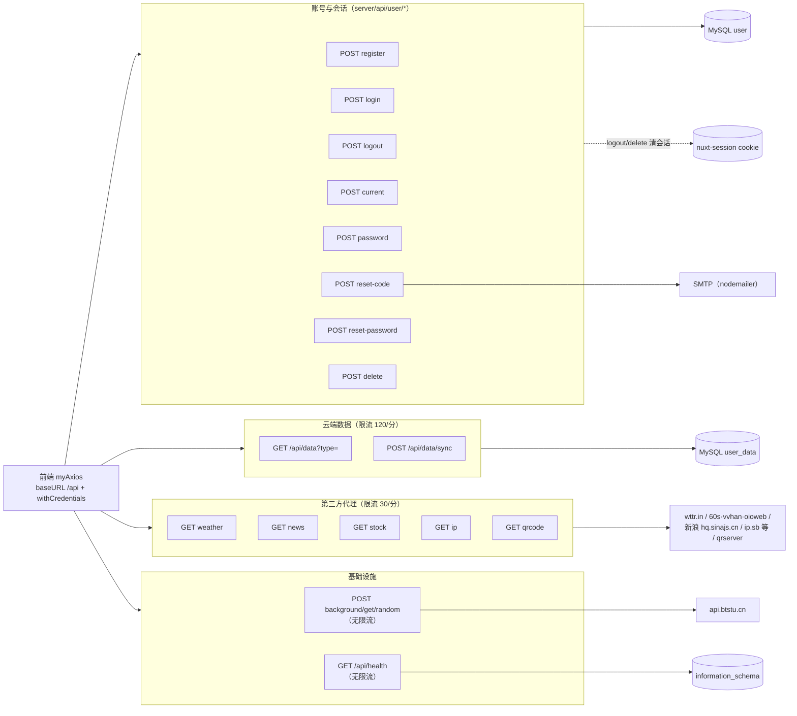

# 15 接口全量参考

> 项目：webCommand ｜ 版本：v1.1 ｜ 生成日期：2026-10-06 ｜ 依据：源码分析

## 1. 总览与通用约定

后端共 17 个路由文件、17 条路径（`server/api/**`，Nitro 文件路由，每文件恰对应一条路径、无同路径双方法）；前端共 46 个顶层命令、62 个命令名登记项（含 16 个子命令）。本篇是两者的全量速查：先给一张总览图，再给接口详表（方法/路径/用途/入参/响应/鉴权/错误码），最后给命令注册表。通用约定收拢为四条（机制出处《03-接口设计》《07-模块详解》5.1）：**包络**一律 `{code, data, message?}`，成功 `code:0`，handler 返回 undefined 时 data 置 true；**HTTP 状态与业务码解耦**，业务错误默认 HTTP 200，只有限流传 429、第三方故障传 502、探活不健康传 503；**鉴权**是路由级显式判定（`getUserSession` 查 `session.user?.id`，无全局中间件），会话为加密 cookie `nuxt-session`（`NUXT_SESSION_PASSWORD`，默认 30 天）；**错误码表**：40000 PARAMS、40100 NO_AUTH、40300 FORBIDDEN、40400 NOT_FOUND、42900 RATE_LIMIT、50000 SYSTEM、50010 THIRD_PART（`server/utils/response.ts`）。一个全表适用的注意点：**user 组路由限流命中的 body 码是 40000（非 42900），HTTP 状态仍为 429**——源码如此（`login.post.ts` 等五处 `BizError(ERROR_CODE.PARAMS, '操作过于频繁…', 429)`），已列入《13-技术债务》⚠️-5，下表按实际行为标注。



## 2. 接口详表

两张表的数字基线都可以用一行命令复核，这也是本篇与代码保持同步的锚点：路由数 `find server/api -name '*.ts' | wc -l`（17）；顶层命令数即 `app/core/commandRegister.ts` 中 `commandList` 的长度（46，其中 search/space/user 三个聚合文件展开后的成员都算）；子命令数 `grep -r "func:" app/core/commands/*/subCommands/`（16：user 6、todo 6、note 4）；命令键总数 62 = 46 + 16——子命令经各命令的 `subCommands` 表分发、不进顶层 `commandMap`，所以 user 域的 reset 与终端的 reset 才能在同一份字典里相安无事。哪天这两个数与本篇对不上，先怀疑代码变了、再核对表格——顺序反了就会把漂移固化进文档。

### 2.0 一个请求在服务端的完整生命周期

读下面任何一行的错误码之前，先记住每个请求经过的固定流水线（`bizHandler` 实现，`server/utils/response.ts`）：请求进入 → handler 第一行几乎总是限流器 `hit(event)`，命中即抛带 429 的 BizError，**此后不再读取参数与会话**（匿名者打满配额前连"参数是否合法"都探不到，这是刻意的）；随后读取 body 或 query（`readBody/getQuery`），绝大多数路由对解构结果做了 `|| {}` 兜底，缺失字段会以 undefined 进入下一步；需要身份的路由调 `getUserSession(event)` 解密 cookie，取 `session.user?.id`——这个 id 是全服务唯一的身份事实；账号与数据类路由再过各自的**纯函数准入**（`checkAccountDeletion/checkDataRead/checkDataWrite`），准入函数返回可判别联合，拒绝时的 `code`（NO_AUTH→40100 / PARAMS→40000）与 message 原样变成 BizError；通过后才进入 service（bcrypt 比对、事务）或模型（findOne/upsert）。任何一步抛出的 BizError 由 `bizHandler` 统一转成包络（statusCode 非 200 时同时 `setResponseStatus`）；非 BizError 的异常打 `[api error]` 日志后转 50000，堆栈不出网。理解这条流水线后，两张详表里的错误码可以直接读成"流水线在第几站拒绝了你"：40100 是会话站、40000 是参数/准入站、40400 是存在性站、42900/429 是限流站、50010 是上游站。

### 2.1 账号与会话

本组的共同特征有三：只有 register/login/reset-code/reset-password/delete 挂 authLimiter（登录态内的操作 logout/current/password 不限流，因为它们本身要求有效会话，爆破无意义）；错误文案刻意"三因合一"（40400 同时覆盖用户不存在、已软删、密码错，防止用户枚举，唯一例外是封禁单独给 40100 因为处置动作不同——见《08-安全与权限设计》第 3 节）；所有成功响应里的用户对象都是 `toSafeUser` 产物，password 字段在类型与运行时双层不存在。顺带说明 SafeUser 的完整形状：`{id, username, email?, status, createTime, updateTime, isDelete}`——其中 `createTime/updateTime` 恒为 NULL（《04-数据模型》3.1、《13-技术债务》⚠️-17），前端展示与排障都不要依赖这两个字段；`status` 目前只有注册时写入的 0，非 0 值在登录时表现为 40100（⚠️-1）。逐条如下：

| # | 方法与路径 | 用途 | 入参（JSON body） | 成功 data | 鉴权 | 限流 | 错误码（message） |
| --- | --- | --- | --- | --- | --- | --- | --- |
| 1 | POST `/api/user/register` | 注册 | `username` `password` `email` 全必填 | 新用户 id（number） | 匿名 | authLimiter 10/分/IP（429 + 40000 操作过于频繁） | 40000：参数错误／用户名过长／密码至少 8 位／邮箱非法／该用户名或邮箱已被注册（含软删行占用，⚠️-3） |
| 2 | POST `/api/user/login` | 登录并写会话 | `username` `password`；`remember`（缺省视为 true→30 天 maxAge） | SafeUser `{id,username,email?,status,createTime,updateTime,isDelete}` | 匿名 | authLimiter（429 + 40000） | 40000 参数错误；40400 用户不存在或密码错误（不存在/软删/密码错三因同文案）；40100 账号已被封禁 |
| 3 | POST `/api/user/logout` | 注销会话 | 无 | true | 需登录 | 无 | 40100 未登录 |
| 4 | POST `/api/user/current` | 当前用户（从库重读脱敏） | 无 | SafeUser | 需登录 | 无 | 40100 未登录；40400 找不到该用户（含软删） |
| 5 | POST `/api/user/password` | 修改密码 | `oldPassword` `newPassword` | true | 需登录 | 无 | 40100 未登录；40400 找不到该用户；40000 参数错误／密码至少 8 位／旧密码错误／新密码不能与旧密码相同 |
| 6 | POST `/api/user/reset-code` | 发送找回验证码 | `email` | true（邮箱不存在也返回 true，不泄露注册状态） | 匿名 | authLimiter（429 + 40000） | 40000 参数错误／发送过于频繁，请 N 秒后再试；50010 邮件服务未配置…／邮件发送失败，请稍后再试 |
| 7 | POST `/api/user/reset-password` | 验证码重置密码 | `email` `code`（6 位）`newPassword` | true | 匿名（凭验证码） | authLimiter（429 + 40000） | 40000 参数错误／验证码错误或已过期／密码至少 8 位；40400 用户不存在 |
| 8 | POST `/api/user/delete` | 注销账号（事务：物理删 user_data + 软删 user，成功才清会话） | `password` `confirm`（必须与用户名完全一致） | true | 需登录 | authLimiter（429 + 40000） | 40100 未登录；40000 注销账号需要重新输入密码确认身份／确认串必须与用户名完全一致，请执行 user delete --confirm \<用户名>／密码错误；50000（删除事务失败走系统兜底，会话保留） |

### 2.2 云端数据（准入纯函数见 `server/utils/dataAccess.ts`）

本组只有两个端点，却是全服务安全密度最高的地方：`userId` 只能来自会话解密结果、type 六类白名单是硬编码常量、字节数按 UTF-8 `Buffer.byteLength` 计算而非字符数、判定顺序"先登录后参数"避免向匿名者泄露 type 合法性。两个端点共享同一对限流与准入，唯一差异是写入多一道"content 是字符串 + 按类型限额"。写入路径还有一处表上看不见的语义：`/api/data/sync` 用 sequelize 的 `upsert` 落库，冲突判据是迁移 0001 建表语句里定义的 `user_data_userId_type_unique` 唯一索引（userId + type）——"每个用户每类恰好一行"由数据库而非代码保证，这也是并发同步不会产生重复行的原因，与《04-数据模型》3.2 的索引设计互为印证。这些行为每一条都有测试钉住（`dataRoutes.test.ts` 十例 + `dataAccess.spec.ts` 七例 + 冒烟五节），因此本表可以当作可执行契约来读：

| # | 方法与路径 | 用途 | 入参 | 成功 data | 鉴权 | 限流 | 错误码 |
| --- | --- | --- | --- | --- | --- | --- | --- |
| 9 | GET `/api/data?type=<type>` | 读取某类 blob | query `type` ∈ todo/space/note/custom/terminalConfig/theme | content 字符串（从未同步为 null） | 需登录 | dataLimiter 120/分/IP（429 + **42900** 同步过于频繁） | 40100 未登录；40000 type 不合法 |
| 10 | POST `/api/data/sync` | upsert 某类 blob | `type` 同上；`content` 字符串，字节上限按类型：数据类 1MB、配置类 64KB（UTF-8 计） | true | 需登录（userId 取自会话，伪造无效） | dataLimiter（429 + 42900） | 40100 未登录；40000 type 不合法／content 不合法／content 超过 N 字节上限（本次 M 字节） |

### 2.3 第三方代理与基础设施

本组的存在理由是绕开浏览器 CORS 或承载特殊协议处理（GBK 解码、Referer 头、多源容错），因此错误码里独有 50010（THIRD_PART）且以 HTTP 502 返回——与业务错误的 200 语义刻意区分，运维可以直接按状态码把"上游挂了"从"代码错了"里分出来。一个按状态码分流监控时必须记住的例外：`background/get/random` 抛的 BizError 未带 statusCode（默认 200），所以同一个 50010 在 background 是 HTTP 200、在其余代理路由是 502。多源容错（news/ip）的失败源只进服务端日志，客户端永远只看到最终结果或统一失败；`background/get/random` 是全表唯一没有限流的业务路由（依赖上游白名单类型收敛）；`health` 是唯一不走 bizHandler 的路由，自己控制 503。逐条如下：

| # | 方法与路径 | 用途 | 入参 | 成功 data | 上游 | 限流 | 错误码 |
| --- | --- | --- | --- | --- | --- | --- | --- |
| 11 | GET `/api/weather?city=&format=` | 天气文本 | `city` 必填；`format` 默认 `%l: %c %t 湿度 %h 风速 %w` | 文本 string | wttr.in（8s，UA curl/8.0） | proxyLimiter 30/分/IP（429 + 42900） | 40000 缺少 city 参数；50010 天气服务不可用（HTTP 502）；42900 |
| 12 | GET `/api/news?type=` | 热搜前 20 | `type` 默认 weibo（映射 60s 源路径） | `[{rank,title,hot,url?}]` | 60s.viki.moe → api.vvhan.com → api.oioweb.cn 依次容错 | proxyLimiter | 50010 获取热搜失败（502）；42900 |
| 13 | GET `/api/stock?code=` | A 股行情 | `code` 如 sh600519 | `{name,open,preClose,price,high,low,volume,time}` | hq.sinajs.cn（Referer 头 + GBK 解码 + 正则取引号内字段） | proxyLimiter | 40000 缺少股票代码；50010 无行情数据／获取行情失败（502）；42900 |
| 14 | GET `/api/ip` | 客户端公网 IP | 无 | `{ip}` | api.ip.sb → api.ipify.org → ip-api.com → ifconfig.me 依次容错 | proxyLimiter | 50010 获取 IP 失败（502）；42900 |
| 15 | GET `/api/qrcode?text=` | 二维码图片 URL | `text` 必填 | URL string | api.qrserver.com（仅拼 URL 不代取图） | proxyLimiter | 40000 缺少内容；42900 |
| 16 | POST `/api/background/get/random` | 随机壁纸地址 | `type` ∈ dongman/fengjing/meizi/suiji（越界回退 dongman） | URL string | api.btstu.cn（axios 5s） | **无** | 50010 背景图获取失败 |
| 17 | GET `/api/health` | 探活（不走 bizHandler） | 无 | `{status:'ok'|'degraded', service:'webcommand-nuxt', time, dbReachable, schemaReady, missingTables?, schemaError?}` | `SELECT 1` + information_schema 验 user/user_data | 无 | 不健康：HTTP 503 且 code=50000、status=degraded |

### 2.4 响应包络的字段语义与前端消费

详表里的 `code` 在前端有一条确定的消费链，写在这里供排查"服务端说成功、界面却不对"类问题时对照。`myAxios` 的响应拦截器先做一层归一：2xx 时直接返回 `response.data`（即包络本身），HTTP 401 归一为 `{code:40100, message:'未登录'}`，其他非 2xx 透传响应体（代理路由的 429/502 因此以 `{code:42900|50010}` 形态到达调用方），网络层错误归一为 `{code:50000}`。命令层再按 `code` 三分支：`code===0` 取 `data`；40100 在登录态探测里是预期路径（`userStore.getAndSetLoginUser` 静默 `$reset()` 回本地态）；其余一律 `errMsg(e)` 或 `res.message` 直出终端（红色 error Tag）。`data` 字段的空态有两种且语义不同：`null` 表示"服务端正常处理但无数据"（如从未同步过的 type、被防枚举吞掉的邮箱），`true` 表示"动作型接口的约定占位"（logout/delete/reset 系列的成功值）——前端没有任何地方依赖 `data===true` 做逻辑判断，判断成功只看 `code===0`。`message` 只在人机界面出现，不参与逻辑分支，因此服务端调整文案不构成破坏性变更；反之 `code` 是跨端契约，任何调整都要过《09》的测试锚点。

### 2.5 调用示例（与服务端行为逐字对应）

匿名读数据（业务码 40100，HTTP 200）：

```bash
curl 'http://localhost:3000/api/data?type=todo'
# {"code":40100,"message":"未登录","data":null}
```

登录后同步与回读（-c/-b 维持会话 cookie）：

```bash
curl -s -c jar.txt -X POST http://localhost:3000/api/user/login \
  -H 'content-type: application/json' \
  -d '{"username":"alice","password":"password123"}'
# {"code":0,"data":{"id":1,"username":"alice",...}}

curl -s -b jar.txt -X POST http://localhost:3000/api/data/sync \
  -H 'content-type: application/json' \
  -d '{"type":"todo","content":"{\"items\":[],\"deleted\":{}}"}'
# {"code":0,"data":true}

curl -s -b jar.txt 'http://localhost:3000/api/data?type=todo'
# {"code":0,"data":"{\"items\":[],\"deleted\":{}}"}
```

限流（连打 11 次登录）与上游故障的形态：

```bash
# HTTP 429（user 组：body 码 40000）
{"code":40000,"message":"操作过于频繁，请稍后再试","data":null}
# HTTP 502（代理上游全挂）
{"code":50010,"message":"获取热搜失败","data":null}
```

## 3. 前端命令注册表全量速查

登记处 `app/core/commandRegister.ts`（数组顺序即 `help` 展示顺序，别名同键入 `commandMap`）；执行引擎与契约测试见《07-模块详解》第 3 节。**登记规模的事实基线**：46 个顶层命令、16 个子命令（todo 6、note 4、user 6）、合计 62 个命令键，与 `commandContract.spec.ts` 的样本量下限（40 模块/30 顶层）留有余量。命令的行为分布也有规律可循：46 条里约三分之二不产生任何网络请求（纯本地计算或 window.open 跳转），其余走两类网络路径——直接调自有 API（账号五件套与数据同步经 `userApi.ts`/`useCloudSync`）或经自家代理查第三方（weather/news/stock/ip/qrcode/background）；唯一的例外是 `curl` 命令从浏览器直连目标站（受 CORS 限制是已知行为）。下表按域分组，"子命令/形态"列给出该命令的组织方式（action 内手写分发、subCommands 递归或单命令），"行为摘要"保留到能与其他命令区分的粒度：

| 命令（func） | 名称 | 别名 | 子命令/形态 | 行为摘要 | 实现文件 |
| --- | --- | --- | --- | --- | --- |
| shortcut | 快捷键 | — | 单命令+组件 | 输出 ShortcutBox 快捷键表 | terminal/shortcut/shortcutCommand.ts |
| goto | 网页跳转 | to/open/visit/jump/跳转 | 单命令 | 参数可作空间条目名解析；补协议、URL 规范化；`-s` 当前页打开 | gotoCommand.ts |
| search | 网页搜索 | s/sousuo/sou/query | 委托 baidu/google action | `-f` 选源（默认 baidu）、`-c` 当前页 | search/searchCommands.ts |
| baidu | 百度搜索 | 百度 | 单命令 | window.open 百度搜索 | search/baiduCommand.ts |
| google | Google 搜索 | 谷歌 | 单命令 | window.open Google 搜索 | search/googleCommand.ts |
| add | 新增空间条目 | touch/new | 顶层（空间域） | 当前目录加链接/目录条目 | space/addCommand.ts |
| cd | 切换空间目录 | — | 顶层 | 支持 `..` 与目录名/全路径 | space/cdCommand.ts |
| copy | 复制空间条目 | cp | 顶层 | `-r` 递归复制 | space/copyCommand.ts |
| list | 列举空间条目 | ls | 顶层 | 列当前/指定目录直接子级 | space/listCommand.ts |
| mkdir | 创建空间目录 | — | 顶层 | 创建目录条目 | space/mkdirCommand.ts |
| move | 移动空间条目 | mv | 顶层 | copy+delete 组合 | space/moveCommand.ts |
| pwd | 显示当前空间位置 | — | 顶层 | 输出 currentDir | space/pwdCommand.ts |
| remove | 删除空间条目 | rm/delete/del | 顶层 | `-r` 递归；写墓碑 | space/removeCommand.ts |
| user | 用户 | — | login/register/logout/passwd/reset/delete | 无子命令时显示当前登录用户 | user/userCommands.ts |
| login | 用户登录 | — | 子命令 | `-u/-p/-r`；成功后 initAllCloudSync | user/subCommands/loginCommand.ts |
| register | 用户注册 | — | 子命令 | `-u/-p/-e`；成功自动登录 | user/subCommands/registerCommand.ts |
| logout | 用户注销 | — | 子命令 | 清会话 + resetAllCloudSync | user/subCommands/logoutCommand.ts |
| passwd | 修改密码 | — | 子命令 | `-o/-n`，服务端校验旧密码 | user/subCommands/passwdCommand.ts |
| reset | 找回密码 | — | 子命令 | 两步：`-e` 发码；`-e -c -n` 重置 | user/subCommands/resetCommand.ts |
| delete | 注销账号 | — | 子命令 | `-p --confirm` 三条件；先解同步再清登录态 | user/subCommands/deleteCommand.ts |
| varbook | 变量命名助手 | vb/bianliang/变量 | 单命令+组件 | 翻译取变量名建议（collapsible） | varbook/varbookCommand.ts |
| custom | 自定义命令 | alias/快捷 | action 内分发 add/list/remove | 自定义名→命令文本；执行器未命中内置时回退展开 | custom/customCommand.ts |
| ip | 公网 IP 查询 | ip查询/公网ip/我的ip | 单命令 | 调 /api/ip 多源容错 | ip/ipCommand.ts |
| news | 新闻热搜 | 热搜/新闻 | 单命令 | 调 /api/news 输出榜单 | news/newsCommand.ts |
| stock | 股票行情 | 股票/行情 | 单命令 | 调 /api/stock 输出 A 股行情 | stock/stockCommand.ts |
| qrcode | 二维码生成 | 二维码 | 单命令 | 调 /api/qrcode 返回图片地址 | qrcode/qrcodeCommand.ts |
| todo | 待办事项 | 待办 | add/list/delete/done/clear/stats | 任务增删改查统计；登录云同步 | todo/todoCommand.ts + subCommands/* |
| timing | 定时器 | — | 单命令+组件 | `-s` 秒数 → TimingBox 倒计时 | timing/timingCommand.ts |
| date | 日期 | 日期 | 单命令 | dayjs 输出当前时间 | dateCommand.ts |
| clear | 清屏 | cl/清屏 | 单命令 | 清 outputList（含历史与输出） | terminal/clearCommand.ts |
| history | 查看执行历史 | h/历史 | 单命令 | 列 commandList | terminal/historyCommand.ts |
| help | 查看帮助 | man/帮助 | 单命令+组件 | 无参总表 HelpBox；带参 CommandHelpBox；`--help` 由执行器转调 | terminal/help/helpCommand.ts |
| info | 查看本站信息 | author/about/关于/作者 | 单命令+组件 | InfoBox 站点信息 | terminal/info/infoCommand.ts |
| ping | 网络连通测试 | 检测/网络 | 单命令 | fetch no-cors 测延迟，`-t` 超时 | pingCommand.ts |
| welcome | 自定义终端欢迎语 | — | 单命令 | 设 welcomeTexts（多值） | terminal/config/welcomeCommand.ts |
| background | 切换终端背景 | bg/背景 | 单命令 | 自定义 URL 或 `-t` 分类随机壁纸 | terminal/config/backgroundCommand.ts |
| reset | 重置终端配置 | — | 单命令 | terminalConfigStore.reset | terminal/config/resetCommand.ts |
| hint | 开关提示 | — | 单命令 | on/off/反转 showHint | terminal/config/hintCommand.ts |
| calc | 计算器 | calculator/jsq/计算器 | 单命令 | 安全算术表达式求值 | calc/calcCommand.ts（解析在 calc/calc.ts） |
| convert | 单位换算 | conv/dwhs/转换/单位换算 | 单命令 | 长度/质量/温度/数据换算 | convert/convertCommand.ts（表在 convert.ts） |
| weather | 天气查询 | tianqi/tq/天气 | 单命令 | 调 /api/weather，提取 term-container 纯文本+实体解码 | weather/weatherCommand.ts |
| curl | HTTP 请求 | fetch/request/请求 | 单命令 | 浏览器端 fetch，`-X` 方法、`-l` 截断（默认 2000 字符） | curl/curlCommand.ts |
| theme | 切换主题 | zt/zhuti/主题 | 参数分发 ls/set | 8 套主题（themes.json）；只同步主题名 | theme/themeCommand.ts |
| json | JSON 工具 | json格式化 | 单命令 | 格式化/压缩/校验 | devtools/jsonCommand.ts |
| b64 | Base64 编解码 | base64 | 单命令 | 编码/解码文本 | devtools/b64Command.ts |
| uuid | UUID 生成 | — | 单命令 | UUID 或 8 位短 id | devtools/uuidCommand.ts |
| ts | 时间戳转换 | timestamp/时间戳 | 单命令 | 当前时间戳/日期互转 | devtools/tsCommand.ts |
| regex | 正则测试 | — | 单命令 | 匹配结果列表 | devtools/regexCommand.ts |
| color | 颜色查看 | 颜色 | 单命令+组件 | ColorBox 色块预览 | devtools/colorCommand.ts |
| note | 速记 | memo/笔记 | add/list/rm/clear | 随手记一句话；登录云同步 | note/noteCommand.ts + subCommands/* |
| export | 数据导出 | backup | 单命令 | 四类数据 JSON 下载（缺 terminalConfig/theme，⚠️-2） | data/exportCommand.ts |
| import | 数据导入 | restore | 单命令+组件 | ImportBox 粘贴 JSON 恢复 | data/importCommand.ts |

读表的三点提示：其一，`reset` 存在两条同名命令（user 子命令的"找回密码"与顶层的"重置终端配置"），作用域不同不冲突，契约测试按目录分组校验；其二，空间域 8 条是**顶层命令**（`ls`、`mkdir` 直接敲），不要被"类似文件系统"的观感误导成子命令；其三，别名表即补全候选（`hint.ts` 直接消费 func+alias），新增别名会影响 Tab 循环顺序——扩展步骤见《11-扩展开发指南》SOP-1。

命令在运行期的分发还有几条统一行为，查表时默认适用、不再逐行重复。**参数入口统一**：位置参数经 getopts 进 `options._`（支持连续空格切词），命名选项按各命令 `options` 声明解析并带默认值，必填位置参数由执行器统一校验并提示 `--help`；**错误出口统一**：命令内 throw 的任何异常都会被 `doAction` 捕获并渲染为红色错误行，因此表中"行为摘要"只描述成功路径；**输出渲染统一**：文本输出经 `smartText` 转义与链接化，组件型输出（表中标注"+组件"的八条：shortcut/help/info/timing/color/varbook/todo/import——全仓恰好八个命令文件使用 `defineAsyncComponent`，其中 help 一个文件两处调用、对应 HelpBox 与 CommandHelpBox 两组件，`grep -rln defineAsyncComponent app/core/commands` 可复核）刷新后不可恢复；**登录态差异**：账号域与数据域命令在未登录时各自给出引导文案（`user login` 提示、同步类静默跳过），这是《02-页面设计》所述"前端展示态与后端事实最终一致"原则在命令层的体现。

## 4. 契约的维护锚点

本篇两张表不是静态文档而是"被测试钉住的契约"：命令表由 `test/commandContract.spec.ts` 守护（孤儿模块、命名/别名冲突、subCommands 键一致），数据类型白名单由 `test/cloudDataType.spec.ts` 守护（前后端清单一致 + 调用点扫描），接口行为由 `test/routes/*.test.ts` 与 `scripts/smoke-cloud-sync.sh` 守护（40100/40000/429 语义、userId 归属、注销顺序、emoji 往返）。改任何一行本篇内容前，先确认对应测试仍然成立；反之，任何破坏这些测试的代码改动，都应同步修本篇——《15》与测试互为对方的"人类可读形态"。

使用本篇做排障时的三条快捷通路：先按第 2.0 节的流水线定位"错误码 = 第几站"，再到对应分组的详表行拿精确 message 与触发条件；登录/同步/命令三条链路的完整故障分流在《12-FAQ与故障排查》的决策树（本篇给"单点事实"，那篇给"组合路径"）；要修改任何端点或命令的行为，先到《11-扩展开发指南》找对应 SOP——本篇的每一行都对应 SOP 里的一个登记步骤，表与步骤一起改才不会漂移。
