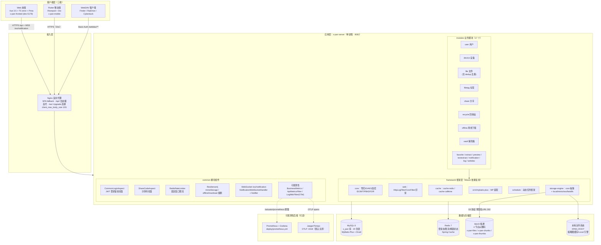
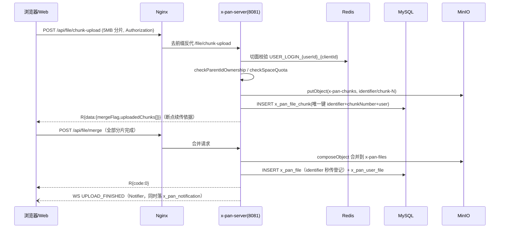

# 01-系统架构

> 项目：X-Pan ｜ 版本：v1.0 ｜ 生成日期：2026-10-05 ｜ 依据：源码分析

## 1. 总体架构：一张图看懂 X-Pan

X-Pan 采用**"模块化单体后端 + 多端接入 + 分布式对象存储"**的架构。必须先澄清一个源码事实：后端并没有注册中心（Nacos/Eureka）、配置中心或独立网关进程，全部业务运行在一个 Spring Boot 进程（`x-pan-parent/server`，`com.xiaoye.pan.server.XPanServerLauncher`，默认端口 8081）；"微服务"体现在**逻辑边界**上——17 个业务模块按 `modules/<模块>/{controller,service,mapper,entity,po,vo,context,converter}` 的统一包结构切分，依赖方向被 Maven 模块与包约定约束，具备按边界平移拆分为独立部署单元的条件。对外角色的"网关"由 Nginx 承担（静态资源、`/api` 反代去前缀、`/ws` WebSocket 升级直通，见 `x-pan-fronted/nginx.conf`）。



三端与后端的关系是**同一套 HTTP API 契约的三种实现**：Web 与移动端共享 `R{code,message,data}` 响应契约、`Authorization` 请求头 + `new-access-token` 续期协议、5MB 分片上传协议（移动端 `lib/services/upload_service.dart` 注释明确"对齐前端 simple-uploader.js 的分片协议"）；WebDAV 则是协议级复用（同一批文件服务经 Basic Auth + 加密 fileId 路径模型暴露；当前能力边界见《16-决策记录ADR》ADR-010）。移动端不经过 Nginx 也可以直连后端（`AppConfig.apiBaseUrl` 可配），Web 端生产环境必经 Nginx。

## 2. 后端"微服务拆分"：逻辑边界与职责

### 2.1 业务模块清单与职责（`server/src/main/java/com/xiaoye/pan/server/modules/`）

| # | 模块包 | Controller | 职责 | 关键依赖 |
|---|---|---|---|---|
| 1 | `user` | `UserController`（`/user/*`）、`IUserSearchHistoryService` | 注册/登录/登出/找回密码/改密/配额/头像；搜索历史与联想热搜 | device（记录设备）、file（根目录创建） |
| 2 | `device` | `DeviceController`（`/device/*`） | 登录设备指纹记录、设备列表、远程下线 | user（退出会话） |
| 3 | `file` | `FileController`、`FileHistoryController`、`ThumbnailController`、`VideoThumbnailController`、`file/dedup/FileDedupController` | 文件 CRUD/上传下载预览/搜索/版本历史/缩略图/视频关键帧/去重 | storage-engine、filetag、vault（解锁校验）、user（配额） |
| 4 | `filetag` | `FileTagController` | 手动标签 + 规则自动打标（AI 打标的降级路径） | textextract（内容提取） |
| 5 | `share` | `ShareController` | 分享创建/校验提取码/详情/转存/匿名下载/统计 | file、notification（访问通知） |
| 6 | `recycle` | `RecycleController` | 回收站列表/还原/彻底删除/统计 | file（级联）、storage-engine |
| 7 | `offline` | `OfflineTaskController` | 离线下载任务创建/取消/删除，SSRF 防护，独立线程池（3 线程） | file、ratelimit、resilience |
| 8 | `vault` | `VaultController` | 保险箱密码设置/解锁（30 分钟缓存）/移入移出/永久删除 | file、cache |
| 9 | `favorite` | `FavoriteController` | 收藏/取消/列表 | file |
| 10 | `extract` | `ExtractController` | ZIP 在线解压异步任务 + 进度查询 | file、线程池 |
| 11 | `preview` | `PreviewController` | Office/PDF→PDF 转换任务 + 预览直链轮询 | file、storage-engine |
| 12 | `textextract` | `TextExtractController` | 提取文件纯文本供 AI 摘要 | file |
| 13 | `notification` | `NotificationController` | 通知列表/未读数/已读标记（WS 推送的落库面） | websocket |
| 14 | `log` | （无 Controller，事件监听落库） | 错误日志异步入库 `x_pan_error_log` | event/listenner |
| 15 | `webdav` | `WebDavController`（`/webdav/**`） | 手写 WebDAV 协议子集，Basic Auth | file、user |

模块间调用一律走 Spring 容器内的接口注入（如 `UserServiceImpl` 注入 `IUserFileService`、`IDeviceService`），**没有远程调用**——这是"逻辑微服务"与"物理单体"的关键区别。跨模块解耦的第二条通道是 **Spring 事件**：`common/event/` 定义了 `DeleteFileEvent`、`FilePhysicalDeleteEvent`、`FileRestoreEvent`、`ErrorLogEvent`、`UserSearchEvent`，由 `common/listenner/` 下对应监听器以 `@Async`（`eventListenerTaskExecutor` 线程池，见 `common/config/ThreadPoolConfig.java`）异步消费，例如文件物理删除事件触发存储引擎删对象、搜索事件异步入库搜索历史。

### 2.2 为什么"先单体后拆分"是合理的

源码给出了三点证据：其一，`DEV_GUIDELINES.md` 后端红线第 1 条要求"Controller 必须位于 `modules/<模块>/controller/` 子包"，因为登录切面 `CommonLoginAspect` 的切点是包路径（`execution(* com.xiaoye.pan.server.modules.*.controller..*(..))`）——**包结构即架构契约**，放错位置等于接口裸奔（文档记录了 OfflineTaskController 事故）；其二，模块内严格分层 `controller → service(接口+impl) → mapper`，入参用 `XxxContext` 聚合、出参用 MapStruct 转换的 `XxxVO`，模块间仅通过接口交互，拆分时只需把接口换成 RPC；其三，状态类依赖已集中在 Redis（登录态、限流计数、保险箱解锁标记），天然支持未来多实例水平扩展，`IdUtil` 的雪花算法也预留了 `XPAN_SNOWFLAKE_WORKER_ID / XPAN_SNOWFLAKE_DATACENTER_ID` 环境变量为多节点分配 workerId（`framework/core/.../IdUtil.java` 注释）。

## 3. framework 与 server 的分层复用关系

framework 是"平台件"层，以 Maven 模块依赖（而非运行时注册）方式被 server 复用。依赖关系（`server/pom.xml`）：

```
x-pan-server
 ├─ x-pan-web            → 依赖 x-pan-core
 ├─ x-pan-swagger2       → 接口文档
 ├─ x-pan-mybatis-plus   → 依赖 x-pan-core
 ├─ x-pan-schedule       → 动态定时任务
 ├─ x-pan-cache-redis    → 依赖 cache-core、core
 └─ x-pan-storage-engine-local / -minio → 依赖 storage-engine-core → cache-core + core
```

各框架模块内容与职责：

| 框架模块 | 关键类 | 职责与设计 |
|---|---|---|
| `framework/core` | `IdUtil`（hutool 雪花 ID + AES-128 加解密对外 ID）、`JwtUtil`（含 `CLIENT_ID`、`RENEWAL_TIME` claim 与 `analyzeRenewalTime`）、`PasswordUtil`（PBKDF2WithHmacSHA256，10000 次迭代）、`R`/`ResponseCode`/`PageVO`、`XPanBusinessException`、`AES128Util`、`MessageDigestUtil` | 零 Spring 依赖的纯工具与契约；对外 ID 一律 AES 加密（`IdUtil.encrypt/decrypt`），防止自增/雪花 ID 被遍历 |
| `framework/web` | `HttpLogFilter`（访问日志，大响应白名单短路）、`CorsFilter`（`xpan.web.cors.allowed-origins` 白名单）、`WebExceptionHandler`、`IdEncryptSerializer`（VO 出参自动加密 ID）、`WebValidatorConfig` | Servlet 层横切；`@ServletComponentScan` 装配 |
| `framework/cache` | `cache-core`（`CacheConstants.R_PAN_CACHE_NAME` 统一缓存名）；`cache-redis`（`RedisCacheConfig`：Jackson 序列化 + TTL 防永不过期 + 支持事务）；`cache-caffeine`（`CaffeineCacheConfig`：expireAfterWrite 单策略） | 通过 Maven 依赖切换决定用哪个 CacheManager——server 引入 cache-redis，登录态、分享码、限流都走它；策略模式落地 |
| `framework/orm/mybatis-plus` | MP 装配、`CodeGenerator` | `@MapperScan` 在启动类按 `modules.**.mapper` 扫描；复杂 SQL 在 `resources/mappers/**/*.xml`（file/share/user/log 四目录） |
| `framework/schedule` | `ScheduleManager`/`ScheduleTask`/`ScheduleTaskHolder` | 简易动态任务注册框架；`CleanExpireChunkFileTask`、`CleanExpireRecycleFileTask` 实现该接口，另有 `OrphanFileGc` 用原生 `@Scheduled`（cron `0 0 3 * * ?`，配置 `xpan.gc.orphan-cron`） |
| `framework/swagger2` | `Swagger2Config` + `DocAccessCondition` | 仅 dev/local profile 暴露 doc.html；生产全关（`knife4j.enable: false`） |
| `framework/storage-engine` | `StorageEngine` 接口（store/delete/storeChunk/mergeFile/realFile 五操作）、`AbstractStorageEngine` 模板方法（参数校验骨架 + doXxx 下沉）、`LocalStorageEngine`、`MinIOStorageEngine`、`OSSStorageEngine`、`FastDFSStorageEngine` | **策略 + 模板方法**双模式；MinIO 实现标 `@ConditionalOnProperty(pan.storage.minio.enabled)`，`doStore` 上叠 `@CircuitBreaker(name="minioStorage")` + `@Retry`（`MinIOStorageEngine.java`），并带 `MinioMetrics` 指标 |

分层复用的两条铁律（来自 `DEV_GUIDELINES.md` 与源码）：server 只依赖 framework 的接口与工具，不允许反向；业务代码禁止绕过 `StorageEngine` 直接 new MinIO/OSS 客户端——唯一持 SDK 的是 storage-engine 模块（预签名 URL 由 `FileController` 调 `MinIOStorageEngine.generatePresignedGetUrl` 生成，仍经引擎封装）。

## 4. 请求处理与数据流向

一次典型鉴权请求在后端的完整链路（组件均可在 `common/` 找到）：

```
CorsFilter → HttpLogFilter(访问日志/MDC) → LogMdcFilter(traceId 注入)
  → ApiMetricsFilter(HTTP 耗时直方图)
  → Tomcat → CommonLoginAspect(切面鉴权: Header/Cookie 取 token → Redis 比对 → UserIdUtil 线程上下文 → 生命周期中点续期)
  → ShareCodeAspect(仅 @NeedShareCode 方法: Share-Token → ShareIdUtil)
  → Controller(PO+@Validated 校验 → MapStruct 转 Context)
  → ServiceImpl(业务校验: 归属/配额/保险箱 → 事务 → MyBatis-Plus Mapper → MySQL)
  → StorageEngine(物理文件: local/minio)
  → R{code,message,data}（IdEncryptSerializer 自动加密 ID）
  → Notifier/事件监听器（WS 推送 + 落库，@Async 不阻塞主流程）
```

```mermaid
flowchart LR
    A[客户端请求] --> B[CorsFilter 白名单]
    B --> C[HttpLogFilter + LogMdcFilter<br/>traceId/spanId 注入 MDC]
    C --> D[ApiMetricsFilter<br/>http_server_requests_seconds]
    D --> E{CommonLoginAspect}
    E -->|@LoginIgnore| H
    E -->|校验失败| F[R.fail NEED_LOGIN code=10]
    E -->|通过| G[UserIdUtil.set 线程上下文]
    G --> H{需要分享码?}
    H -->|@NeedShareCode| I[ShareCodeAspect<br/>Share-Token → ShareIdUtil]
    H -->|否| J[Controller]
    I --> J
    J --> K[Service 业务校验<br/>归属/配额/保险箱/限流]
    K --> L[(MySQL<br/>MyBatis-Plus)]
    K --> M[(Redis<br/>Spring Cache)]
    K --> N[StorageEngine<br/>Local / MinIO]
    J --> O[R 响应体<br/>code=0 + 加密 ID]
    K -.->|状态变更| P[Notifier → WebSocket 推送<br/>+ x_pan_notification 落库]
```

**服务间通信机制**：由于是单进程，"服务间通信"即进程内方法调用 + Spring ApplicationEvent 异步事件；与外部的实时通道是 WebSocket（服务端 30s PING、客户端 PONG、空闲超时清理，见 `NotificationWebSocketHandler` 与 `WebSocketHeartbeat`）；与大文件存储的"通信"是 S3 协议（MinIO），大文件下载用 **302 重定向到 1 小时预签名 URL** 让浏览器直连 MinIO，绕开应用层带宽（`FileController.download`，阈值 `pan.storage.minio.large-file-threshold=50MB`）。

## 5. 认证与安全的架构设计

- **登录态存 Redis 而非纯 JWT 无状态**：`CommonLoginAspect.checkAndSaveUserId` 从 `Authorization` 头（回退 Cookie `login_token`）解析 token 后，必须与 Redis 缓存 `USER_LOGIN_{userId}_{clientId}` 中的 token 比对（并兼容 `_PREV` 上一版），实现"服务端可吊销的多端并存会话"；`clientId` 由各端生成稳定标识（Web 存 Cookie，移动端存 Keychain/Keystore，`x-pan-mobile/lib/core/storage/token_storage.dart`），Web/移动端互不踢线。
- **token 滑动续期**：`JwtUtil.generateToken` 写入 `RENEWAL_TIME = 签发时间 + 有效期/2`；切面在请求超过续期点时按缓存 key 粒度加锁（`RENEW_KEY_LOCKS`）签发新 token，旧 token 存 `_PREV` 兼容在途请求，新 token 经 `New-Access-Token` 响应头下发，前端/移动端拦截器自动替换本地存储。
- **双层鉴权注解**：`@LoginIgnore`（免登录：登录注册、分享访问、预览流、缩略图）与 `@NeedShareCode`（凭校验提取码后签发的 `Share-Token` JWT 访问分享资源，`ShareCodeAspect` 解析出 `shareId` 放入 `ShareIdUtil`）。
- **防滥用**：`RedisRateLimiter` 固定窗口（key `xpan:rl:{scope}:{userId|ip}`，首次 INCR 才 EXPIRE，Redis 故障 fail-open 放行），覆盖 login 5/min、register 3/h、share-create 30/min、offline-create 10/min（`application.yaml` 的 `pan.ratelimit.*`）；保险箱解锁失败防爆破锁定，解锁态缓存 30 分钟；离线下载 SSRF 双重防护（创建时校验 + 手动跟随重定向逐跳复检，最多 5 跳，拒内网 IP/云元数据/file:/gopher:）。

## 6. 关键设计决策与设计模式汇总

| 设计决策 | 采用模式 | 源码证据 |
|---|---|---|
| 多存储引擎可插拔 | 策略模式 + `@ConditionalOnProperty` 装配 | `StorageEngine` 接口、`MinIOStorageEngine` 条件注解；本地/MinIO 按配置切换，OSS/FastDFS 依赖预留（pom 注释） |
| 存储引擎公共流程沉淀 | 模板方法 | `AbstractStorageEngine`：check → doXxx 抽象 |
| 文件元数据与物理文件分离（逻辑文件/物理文件两表） | 共享去重（CAS 语义的秒传） | `x_pan_user_file.real_file_id → x_pan_file.file_id`，同 MD5 `identifier` 复用物理文件；`UserFileServiceImpl.SEC_UPLOAD_IDENTIFIER_LOCKS` 与物理删除共用 identifier 锁（DEV_GUIDELINES 后端红线 8） |
| 切面式鉴权而非 Filter 链 | AOP 环绕 + 注解开关 | `CommonLoginAspect` 包路径切点 + `@LoginIgnore` |
| 业务与推送解耦 | 门面（Notifier 静态门面）+ 观察者（Spring 事件 + WS） | `Notifier.pushToUser`、`common/event` + `common/listenner` |
| 稳定性 | 熔断（Resilience4j）、限流（Redis 固定窗口）、降级（AI 打标失败回落规则打标、OTLP 导出默认关闭）、快速失败（MinIO 不可用熔断 30s 半开探测） | `application.yaml` resilience4j 段、`CircuitBreakerFallback` |
| 大文件不经应用中转 | 302 预签名直链 | `FileController.download`/`presigned-url` |
| ID 安全 | 雪花 ID + AES-128 对外加密 + `IdEncryptSerializer` 出参自动加密 | `IdUtil`、`framework/web/serializer` |
| 密钥治理 | 环境变量强制注入、`${ENV:}` 空兜底、`AesKeyConfig` 启动时注入 System Property | `AesKeyConfig.java`、`DEV_GUIDELINES.md` 第一节 |

## 7. 数据流总览（一次文件上传的完整拓扑）



## 8. 前端/移动端架构速写（详见 02 篇）

Web 端是标准 Vue 3 分层：`router`（守卫）→ `views`（12 个列表页 + 6 个预览页）→ `components`（base 自研组件库 + 业务组件）→ `stores`（Pinia 5 个）→ `api`（11 个模块）→ `utils/http.ts`（axios 拦截器统一处理续期/code=10/blob 短路）。移动端是 Riverpod 分层：`pages`（29 页）→ `providers`（auth/file/notification/upload/view_mode，`copyWith` 保持不可变）→ `services`（约 20 个 API 服务）→ `core/network/http_client.dart`（Dio 单例拦截器，`code===10` 抛 `NeedReloginException`，经广播流 `onNeedRelogin` 驱动 `AuthNotifier.forceRelogin` 全局重登录）。

## 9. 架构现状与演进注意点（源码可证的边界）

1. **单点应用**：x-pan-server 单实例；水平扩展前需确认雪花 workerId 环境变量、Redis 已共享（已满足）、本地缩略图缓存目录需共享存储或改走 MinIO thumb 桶。
2. **OSS/FastDFS 未接线**：依赖模块代码完整但 `server/pom.xml` 中依赖被注释，切回需解注释并配置 `com.xiaoye.pan.storage.engine.oss/fdfs`（`application.yaml` 中留有注释模板）。
3. **RocketMQ 仅在父 POM 声明**，无任何使用点（⚠️ 待确认是否有移除计划）。
4. 生产配置中 `application.yaml` 示例出现公网 IP（106.15.35.71）——该文件在 `.gitignore` 中，属本机私有配置，正式部署应通过环境变量覆盖（`DEV_GUIDELINES.md` 已有约定）。
