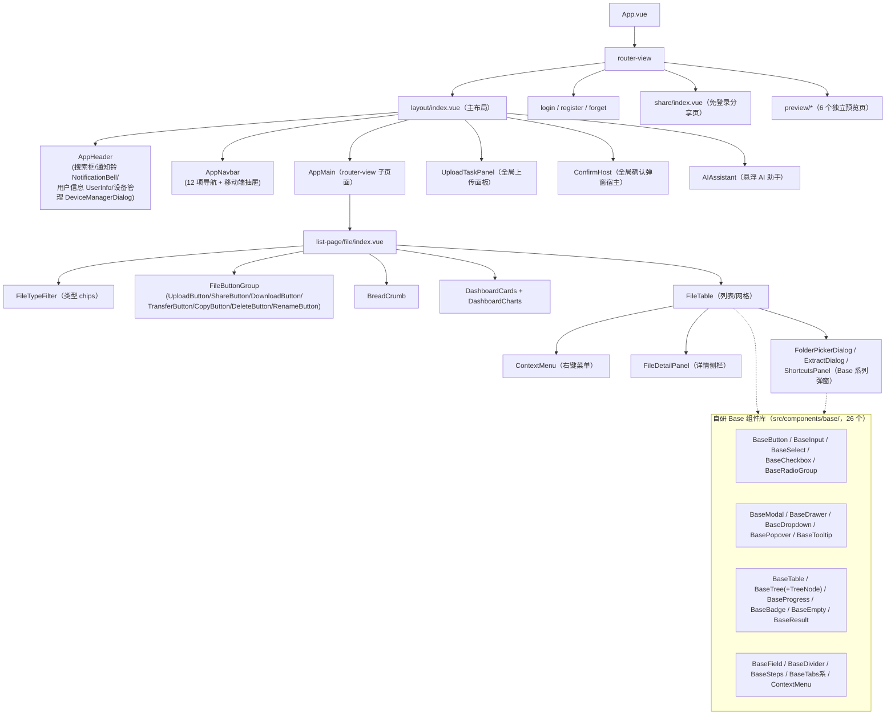
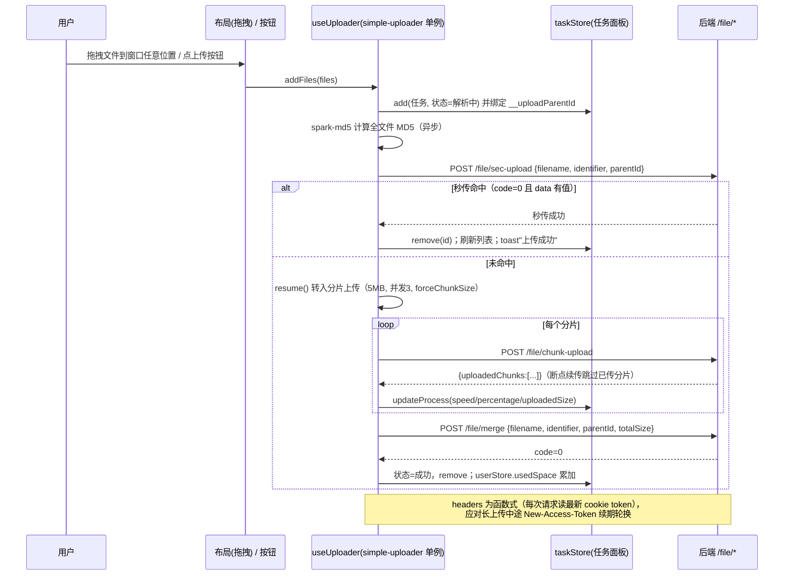
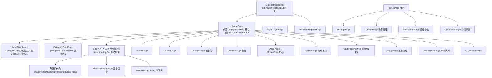

# 02-页面设计

> 项目：X-Pan ｜ 版本：v1.0 ｜ 生成日期：2026-10-05 ｜ 依据：源码分析

本文覆盖两大部分：**Web 前端**（`x-pan-fronted/`，Vue 3.5 + TS strict + Tailwind CSS 4 + 自研 Base 组件库）与 **Flutter 移动端**（`x-pan-mobile/`，Riverpod + go_router + Navigator）。两端共用同一后端 API 契约，信息架构对齐但交互形态各自原生。

## 一、Web 前端页面设计

### 1.1 路由总表（`x-pan-fronted/src/router/index.ts`）

路由使用 `createWebHistory`，全局守卫 `router.beforeEach` 负责：已登录访问 Login/Register/Forget 自动跳 `/files`；未登录访问非白名单页跳 `/login?redirect=...`；有 token 但 store 无用户名时调 `userService.info` 拉取用户信息（3 秒超时兜底放行，防止后端不可用时卡死路由），成功后初始化根目录 ID（`fileStore.setParentId(res.data.rootFileId)`）与配额。NProgress 显示加载进度条。

| 路径 | 名称 | 页面组件（`src/views/`） | 登录 | 布局 | 用途 |
|---|---|---|---|---|---|
| `/` | Index | `layout/index.vue`（子路由容器） | 是 | 主布局 | `/` 重定向到 `/files` |
| `/files` | Files | `list-page/file/index.vue` | 是 | 主布局 | 全部文件（核心页） |
| `/docs` `/imgs` `/musics` `/videos` | Docs/Imgs/Musics/Videos | `list-page/{doc,img,music,video}/index.vue` | 是 | 主布局 | 类型直达（复用文件列表，`query.type` 映射 fileType） |
| `/recycles` | Recycles | `list-page/recycle/index.vue` | 是 | 主布局 | 回收站 |
| `/favorites` | Favorites | `list-page/favorite/index.vue` | 是 | 主布局 | 收藏/星标 |
| `/dedup` | Dedup | `list-page/dedup/index.vue` | 是 | 主布局 | 重复文件清理 |
| `/shares` | Shares | `list-page/share/index.vue` | 是 | 主布局 | 我的分享 |
| `/offline` | Offline | `list-page/offline/index.vue` | 是 | 主布局 | 离线下载任务 |
| `/vault` | Vault | `list-page/vault/index.vue` | 是 | 主布局 | 隐私保险箱 |
| `/stats` | Stats | `list-page/stats/index.vue` | 是 | 主布局 | 存储统计 |
| `/login` `/register` `/forget` | Login/Register/Forget | `views/{login,register,forget}/index.vue` | 否 | 独立页 | 认证三件套 |
| `/share/:shareId` | Share | `views/share/index.vue` | 否（白名单） | 独立页 | 匿名分享页（提取码/转存/下载） |
| `/preview/code/:fileId` | PreviewCode | `views/preview/code/index.vue` | 是 | 独立页 | 代码高亮预览（Shiki） |
| `/preview/office/:fileId` | PreviewOffice | `views/preview/office/index.vue` | 是 | 独立页 | Office 预览（@vue-office） |
| `/preview/iframe/:fileId` | PreviewIframe | `views/preview/iframe/index.vue` | 是 | 独立页 | iframe 兜底预览 |
| `/preview/image/:parentId/:fileId` | PreviewImage | `views/preview/image/index.vue` | 是 | 独立页 | 图片画廊预览（vue3-image-viewer） |
| `/preview/music/:parentId/:fileId` | PreviewMusic | `views/preview/music/index.vue` | 是 | 独立页 | 音频播放（APlayer） |
| `/preview/video/:fileId` | PreviewVideo | `views/preview/video/index.vue` | 是 | 独立页 | 视频播放（ArtPlayer） |
| `/agreement` `/privacy` | Agreement/Privacy | `views/protocol/index.vue` | 否 | 独立页 | 协议（同一组件按 `type` props 切换） |
| `/404` `/500` | Error404/500 | `views/error/{404,500}/index.vue` | 否 | 独立页 | 错误页 |
| `/:pathMatch(.*)*` | — | 重定向 `/404` | — | — | 兜底 |

### 1.2 主布局与导航结构（`src/layout/index.vue`）

主布局为 **Header（AppHeader）+（Navbar + AppMain）+ Footer** 的纵向结构，并承载四个全局能力：

1. **全窗拖拽上传（P1-3）**：在布局根节点监听 `window` 的 `dragenter/dragover/dragleave/drop`（`dragCounter` 计数防子元素抖动），落下文件调用 `useUploader().addFiles()`，全屏虚线高亮反馈；
2. **移动端适配**：`useBreakpoint`（`composables/useMediaQuery.ts`）判定移动端后 Navbar 变为抽屉（汉堡按钮通过 `window` 自定义事件 `xpan:open-mobile-nav` 打开），右下角浮动上传按钮兜底触屏无拖拽，并处理 `--safe-top/--safe-bottom` 安全区；
3. **上传任务面板**：`UploadTaskPanel` 挂载于布局层，进度数据来自 `stores/task.ts`；
4. **主题**：`composables/useTheme.ts` 提供 `#0070f3` 主色的明暗主题（移动端主题对齐同一色值）。

Navbar（`stores/navbar.ts`）维护三态视图（`list/grid/gallery`）、当前激活导航项、搜索关键字与显示设置（只看文档/视频/音乐/图片），是跨 12 个列表页共享的导航状态中枢。

### 1.3 核心页面：全部文件 `/files`（`src/views/list-page/file/index.vue`）

自上而下的区域构成：`FileTypeFilter`（类型筛选 chips：图片=7、文档=3,4,5,6,10、视频=9、音频=8、其它=1,2,11,12，见页面内 `typeQueryMap`）→ 工具条（`FileButtonGroup` + 视图切换 `SortMenu`/`FilterMenu`）→ 面包屑 `BreadCrumb`（数据来自 `stores/breadcrumb.ts`）→ 仪表盘 `DashboardCards`/`DashboardCharts`（仅根目录且非搜索态显示）→ `FileTable`（列表/网格双视图，含 `FileDetailPanel` 右侧详情、多选批量操作条）。交互要点：

- **状态全部收敛在 `stores/file.ts`**（584 行）：`parentId`（localStorage 键 `xpan:parentId` 持久化，防刷新丢目录）、`fileList`、`multipleSelection`、`clipboard`（剪切/复制粘贴）、`fileTypes`、`searchFlag/searchKey`、分页五件套（`pageNum/pageSize/total/hasMore/isLoadingMore`）与排序（`sortProp/sortOrder`，前端本地排序 + 后端 `orderBy/order` 参数，`getOrderBy` 映射为后端白名单 snake_case 字段）。列表写入统一走 store 内带 `requestSeq` 的方法（防过期响应覆盖，DEV_GUIDELINES 前端红线 4）。
- **多选批量操作**：选中文件后顶部出现批量条：下载（`file/archive-download` 打包 zip）、分享、转移、复制、删除、批量重命名、批量打标签。
- **右键菜单**：`components/base/ContextMenu.vue` 提供文件级右键操作（收藏、标签、版本历史、详情等）。

### 1.4 认证页面

- **登录页** `views/login/index.vue`：用户名/密码表单，登录成功把 token 写入 Cookie（`utils/cookie.ts`，键 `login_token`），并生成稳定 `client_id`（多端并存登录），失败走 `ElMessage` toast；底部协议链接（`/agreement`、`/privacy`）。
- **注册页**：用户名/密码/昵称 + 密保问题与答案（后端 `x_pan_user` 表有 `question/answer` 字段，用于找回密码）。
- **找回密码页** `views/forget/index.vue`：三步流程对应后端三接口——`POST /user/username/check`（取密保问题）→ `POST /user/answer/check`（答案换一次性 token）→ `POST /user/password/reset`（token+新密码），页面用 `BaseSteps` 步骤条呈现。

### 1.5 分享页 `/share/:shareId`（免登录）

从 URL 取 `shareId` 调 `GET /share/simple` 拿简单详情（名称/是否需要提取码）；需要提取码时展示提取码输入框，`POST /share/code/check` 换取 `shareToken`（存 Cookie `share_token`），后续 `GET /share`（详情）、`GET /share/file/list`（浏览）、`POST /share/save`（转存到我的网盘，需登录态）、`GET /share/file/download`（匿名下载）均带 `Share-Token` 头。页面同时用 `qrcode` 生成分享二维码。

### 1.6 预览体系

预览是"路由页 + 插件注册表"的组合：`src/plugins/preview/index.ts` 与 `utils/preview-plugin.ts` 维护"后缀 → 预览器"映射，文件表格点击文件名时按后缀路由到对应预览页；媒体/文档标签通过 `POST /file/preview/url` 申请短期 `ptoken` 签名 URL（5 分钟有效、绑定 fileId），再用 `GET /file/preview/stream?fileId=&ptoken=` 直出内容流，避免把长期 token 暴露在 `/<video>` 标签与日志里。图片预览页支持画廊模式（同目录翻页）、时间线视图（`file_timeline_view` 对应 Web 端 img 页的时间线）；视频用 ArtPlayer（支持 `Range` seek），音频 APlayer，PDF pdfjs-dist，Office 四件套 @vue-office，代码 Shiki 高亮，Markdown 用 vditor/markdown-it。重型库经 `vite.config.ts` `manualChunks` 拆为独立 vendor chunk 按需加载。

### 1.7 组件树（mermaid）

### 1.8 状态管理设计（Pinia）

| Store（`src/stores/`） | 职责 | 关键状态 |
|---|---|---|
| `user.ts` | 当前用户 | `username`、配额（`usedSpace/totalSpace`，`setQuota(used,total)`）、`clear()` 登出清理 |
| `file.ts` | 文件列表中枢 | `parentId`（localStorage 持久化）、`fileList`、`multipleSelection`、`clipboard`、`fileTypes`、`searchFlag/searchKey`、分页/排序、`loadFileList()`（带 requestSeq） |
| `navbar.ts` | 导航与视图 | `mode`（list/grid/gallery）、`active`、`searchKey`、`settings` |
| `task.ts` | 上传任务队列 | `uploadTaskList`（主键= simple-uploader 的 `file.id`，避免同名冲突）、`viewFlag`（面板显隐）、`updateStatus/updateProcess/remove/clear` |
| `breadcrumb.ts` | 面包屑链 | `list` + `push/clear` |

跨页面单例能力放 `composables/`（18 个）：`useUploader`（simple-uploader 单例，`_attachCount` 引用计数）、`useWebSocket`（`_singleton` 单例，指数退避重连上限 8 次，25s 心跳早于服务端 30s PING，`on(type,handler)` 订阅业务事件）、`useToast`（`ElMessage/ElMessageBox` 假封装：confirm 恒 `resolve(true/false)` 永不 reject——前端红线第 1 条）、`useLLM`/`useAIAssistant`（DeepSeek 摘要打标）、`useFavorites`/`useRecent`（收藏内存缓存/最近访问 localStorage）、`useTheme`、`useShortcuts`、`useResizable`、`useTableSort`、`usePdfSearch` 等。

### 1.9 关键 UI 交互流程：上传（Web）

## 二、Flutter 移动端页面设计

### 2.1 页面结构与路由

移动端路由分两层：**go_router 只承担"认证门卫 + 三个顶层路由"**（`lib/router/app_router.dart` 注册 `/`=HomePage、`/login`、`/register`，`redirect` 依据 `authProvider.status`：`unknown` 放行由页面自行处理、`unauthenticated` 强制回 `/login`、已登录访问登录/注册页回 `/`，并 `ref.listen(authProvider)` 在认证态变化时 `router.refresh()`）；**其余 29 个页面全部通过 `Navigator.push(MaterialPageRoute)` 压栈导航**，由各页面自行 push（例如 HomePage 里 `Navigator.push` 进入 `CategoryFilesPage`、`VaultPage`、`SharePage` 等）。这种"轻 go_router + 重 Navigator"的组合让登录守卫极简，页面间传参用构造函数完成。

`lib/pages/` 页面清单（29 个 dart 文件）按功能分组：

| 分组 | 页面（文件） | 说明 |
|---|---|---|
| 认证 | `login_page.dart`、`register_page.dart`、`forgot_password_page.dart` | 与 Web 一致的登录/注册/三步找回密码 |
| 主框架 | `home_page.dart`（1460+ 行）、`home/home_dashboard.dart`、`home/home_components.dart` | 桌面端 `NavigationRail` 侧边导航 / 移动端底部 `NavigationBar` 五 Tab（首页/文件/传输/AI/我的）+ `IndexedStack` 保活 |
| 文件域 | `file/category_files_page.dart` + `file/{image,video,audio,doc}_category_view.dart`、`search_page.dart`、`recent_page.dart` | 分类直达（类型 7/9/8/3,4,5,6,10 与 Web 一致）、搜索、最近访问 |
| 管理域 | `recycle_page.dart`、`favorite_page.dart`、`share_page.dart`、`share_detail_page.dart`、`offline_page.dart`、`vault_page.dart`、`dedup_page.dart`、`device_page.dart`、`version_history_page.dart`、`notification_page.dart`、`settings_page.dart`、`profile_page.dart`、`dashboard_page.dart`、`upload_task_page.dart` | 与 Web 端功能一一对齐（回收站/收藏/分享/离线/保险箱/去重/设备/版本/通知/设置/统计/传输队列） |
| 预览域 | `image_preview_page.dart`、`video_preview_page.dart`（chewie）、`audio_preview_page.dart`（just_audio）、`pdf_preview_page.dart`（flutter_pdfview/pdfx）、`office_preview_page.dart`（WebView）、`text_preview_page.dart`、`csv_preview_page.dart`、`xmind_preview_page.dart`（archive 解 zip 解析） | 8 类预览器 |
| AI | `ai_assistant_page.dart` + `lib/services/llm_service.dart` | 文件摘要/问答（DeepSeek） |

首页仪表盘 `HomeDashboard`（`home/home_dashboard.dart`）由"分类直达 `CategoryGrid` + 最近访问/收藏/下载三 Tab"构成；文件列表组件化拆分：`HomeDesktopRail`（桌面侧栏）、`HomeBreadcrumbs`、`SelectionAppBar`（多选模式顶栏）、`UploadProgressBar`、`_FileTile/_FileGridItem`（列表/网格双形态）、`FileTimelineView`（时间线，带粒度切换 `_GranularitySwitch`）、`Skeleton` 骨架屏与 `EmptyState` 空态。

### 2.2 状态管理设计（Riverpod）

五个 provider 全部位于 `lib/providers/`，统一用 `StateNotifier + copyWith` 保持不可变（AGENTS.md 约定）：

| Provider | 状态类 | 要点 |
|---|---|---|
| `auth_provider.dart` | `AuthState{status: unknown/unauthenticated/authenticated, user: UserInfo?}` | `bootstrap()` 启动恢复登录态（读 TokenStorage → 调 `info()`；网络异常保留 token 进"离线态"不误清）；订阅 `HttpClient.onNeedRelogin` 广播流，任一请求 `code=10` 触发 `forceRelogin()`；`login()` 先存 token 再拉用户信息，失败回滚 token 防孤儿 |
| `file_provider.dart` | `FileListState{files,loading,error,pageNo,hasMore,loadingMore}` | 分页 50/页、滚动加载；`orderBy` 白名单映射（filename/file_size/update_time/create_time，与后端 `SafeOrderBy` 对齐，注释明确与 Web `stores/file.ts getOrderBy` 保持一致）；`initRoot(rootId)` 由 `auth.user.rootFileId` 初始化 |
| `notification_provider.dart` | `NotificationState{notices,connected}` | 登录后 `start()` 建 WS 连接，把 WS 消息转为通知列表 + 本地系统推送；登出 `stop()` |
| `upload_provider.dart` | 上传队列 | 与 `UploadTaskStorage`（本地持久化）配合实现跨重启断点续传 |
| `view_mode_provider.dart` | 列表/网格视图切换 | 对齐 Web 的 list/grid 形态 |

网络层 `lib/core/network/http_client.dart` 是 Dio 单例：请求拦截器注入 `Authorization`、`X-Client-Id`（首次生成 `app-时间戳36进制` 并持久化，与 token 独立、登出不清除）、`X-Pan-Trace-Id`；响应拦截器读取 `new-access-token` 自动续期；`code!==0` 抛 `ApiException`，`code===10` 抛 `NeedReloginException` 并向广播流发事件。Token 存储用 `flutter_secure_storage`（iOS Keychain / Android Keystore 加密，避免明文），并做内存缓存 + 平台实例探测（测试注入 mock 时自动失效缓存）。

配置 `lib/core/config/app_config.dart`：`apiBaseUrl` 默认公网生产地址、编译期 `--dart-define=X_PAN_API_BASE_URL` 覆盖；`chunkSize=5MB`（对齐后端 MinIO composeObject 合并限制）、`maxFileSize=3GB`。上传服务 `lib/services/upload_service.dart` 完整复刻 Web 三段协议（MD5 → `sec-upload` 秒传检测 → `chunk-upload` 断点续传（`uploadedChunks` 跳过已传）→ `merge`），支持 `CancelToken` 取消与 `resumeIdentifier` 跳过重复 MD5 计算。

### 2.3 移动端页面导航树（mermaid）

### 2.4 两端页面能力对齐表

| 能力 | Web 路由 | Flutter 页面 |
|---|---|---|
| 文件列表/多选批量 | `/files` | HomePage 文件 Tab + SelectionAppBar |
| 分类直达 | `/docs /imgs /musics /videos` | CategoryFilesPage + 四个 category view |
| 搜索（联想/热搜） | Header 搜索框 | SearchPage |
| 回收站/收藏/去重 | `/recycles /favorites /dedup` | RecyclePage / FavoritePage / DedupPage |
| 分享管理 | `/shares` | SharePage / ShareDetailPage |
| 离线下载 | `/offline` | OfflinePage |
| 保险箱 | `/vault` | VaultPage |
| 版本历史 | 文件右键菜单入口 | VersionHistoryPage |
| 设备管理 | Header 用户菜单（DeviceManagerDialog） | DevicePage |
| 通知中心 | NotificationBell 下拉 | NotificationPage（+本地推送） |
| 存储统计 | `/stats` | DashboardPage |
| 上传队列 | UploadTaskPanel | UploadTaskPage / 首页传输 Tab |
| AI 助手 | AIAssistant 悬浮组件 | AIAssistantPage + 底部 AI Tab |
| 分享接收（匿名） | `/share/:shareId` | ⚠️ 待确认：移动端未见匿名分享接收独立路由（share_detail 面向自己的分享管理），`TokenStorage` 已预留 `share_token` 键 |

### 2.5 移动端关键交互流程：断点续传恢复

`HomePage._checkPendingUploads()` 在进入首页后从 `UploadService.pendingTasks()`（`UploadTaskStorage` 持久化的任务表）读取未完成任务，弹确认框"检测到「xx」上次上传未完成，是否继续上传？"，确认后 `_resumeUpload(task)` 以 `resumeIdentifier` 复用已计算的 MD5 进入统一上传队列——先 `GET /file/chunk-upload` 查询 `uploadedChunks`，仅补传缺失分片后合并；取消走 `CancelToken` 中断在途请求。该流程与 `upload_provider` 的队列状态、`upload_task_page` 的进度展示联动。
