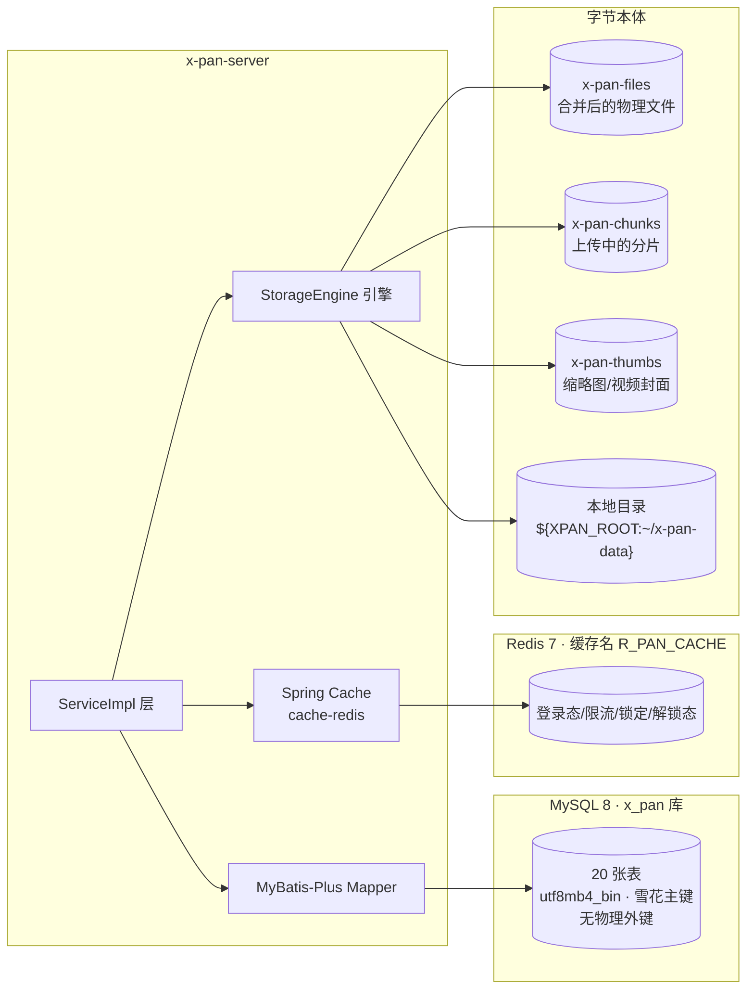
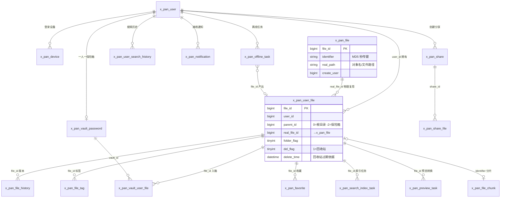
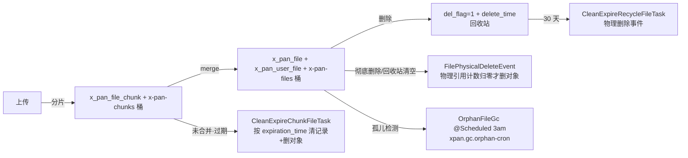

# 04-数据模型

> 项目：X-Pan ｜ 版本：v1.0 ｜ 生成日期：2026-10-05 ｜ 依据：源码分析

X-Pan 的数据分布在三个平面：**MySQL 元数据平面**（谁拥有什么文件、什么分享，20 张表，全量建表脚本 `x-pan-parent/distribution/conf/db.sql`，另有增量脚本在 `server/src/main/resources/sql/`）、**Redis 状态平面**（登录态、限流计数、防爆破锁定、保险箱解锁态等"可丢可重建"的易变状态，经 Spring Cache 抽象访问）、**对象/文件存储平面**（物理文件字节本体，MinIO 三桶或本地目录）。三者通过"逻辑文件 ↔ 物理文件分离"的核心设计连接。ORM 与缓存装配方式见《01-系统架构》第 3 节，本章只讲数据本身。

## 1. 总体存储方案

### 1.1 三个数据平面

关键设计决策（源码证据）：

- **逻辑文件与物理文件分离（两表模型）**：`x_pan_user_file.real_file_id → x_pan_file.file_id`。物理文件表按 MD5（`identifier`）登记字节本体，逻辑文件表登记"某用户的某个目录下的某个文件名"。同一物理文件可被多个逻辑记录（及分享、版本、保险箱、收藏）引用——这是秒传、复制零拷贝、去重（dedup）的数据基础。秒传并发用 `SEC_UPLOAD_IDENTIFIER_LOCKS`（按 identifier 的 JVM 锁）+ 物理删除共用 identifier 锁保证原子性（`UserFileServiceImpl` 第 264 行附近，DEV_GUIDELINES 后端红线 8）。
- **无物理外键**：`db.sql` 开头显式 `SET FOREIGN_KEY_CHECKS=0`，全部关联靠应用层维护 + 唯一索引兜底。这是互联网网盘的常见取舍：引用关系复杂（删除/还原/转存跨多表），物理外键会带来级联锁与迁移负担。
- **主键全部应用层生成**：`@TableId(value = ...)` 不带 `IdType.AUTO`（见 `XPanUser`/`XPanFile` 实体），值来自 `IdUtil.get()`（hutool 雪花算法，workerId/datacenterId 由 `XPAN_SNOWFLAKE_WORKER_ID/XPAN_SNOWFLAKE_DATACENTER_ID` 环境变量预留多节点分配）。少数纯流水表（分片、搜索历史、收藏、通知等）用数据库 `AUTO_INCREMENT` 自增主键。
- **字符集 utf8mb4 + `utf8mb4_bin` 排序规则**：所有业务表一致，文件名区分大小写、完整支持 emoji；这也意味着按 filename 查询是二进制精确比较（前缀搜索联想走独立机制）。
- **对外 ID 与存储 ID 解耦**：库里存明文 bigint，出参由 `IdEncryptSerializer` AES-128 加密（见《03-接口设计》第 1 节），数据层不感知加密。

### 1.2 对象存储平面：桶与对象命名

MinIO 引擎（`framework/storage-engine/storage-engine-minio/.../MinIOStorageEngine.java` + `MinIOStorageEngineProperties.java`）启动即确保三桶存在，命名与用途：

| 桶 | 配置项（`pan.storage.minio.*`） | 存什么 | 对象命名规则 |
|---|---|---|---|
| `x-pan-files` | `file-bucket` | 合并完成的物理文件 | `buildObjectName(identifier, filename)`（第 593 行，identifier 清洗 `[/\\]` 后与文件名组合） |
| `x-pan-chunks` | `chunk-bucket` | 上传中的分片 | **`{identifier}/{chunkNumber}`**（`doStoreChunk` 注释明确，靠 identifier+chunkNumber 唯一定位，不依赖 S3 uploadId） |
| `x-pan-thumbs` | `thumbnail-bucket` | 图片缩略图/视频封面帧 | 按 fileId + 尺寸/时间点命名 |

`x_pan_file.real_path` / `x_pan_file_chunk.real_path` 存的就是上述对象名（或本地引擎的文件系统路径）——**存储引擎可切换而元数据结构不变**的关键。下载大文件时服务端用 realPath 生成 1 小时预签名 URL 302 给浏览器直连（`presigned-expiry-seconds: 3600`）。`pan.storage.minio.enabled=false` 时切换 LocalStorageEngine，落盘 `${XPAN_ROOT:${user.home}/x-pan-data}`（`application.yaml` 第 76 行），本地目录同样承担缩略图磁盘缓存。OSS/FastDFS 引擎代码完整但 pom 依赖被注释（见《01-系统架构》第 9 节）。

## 2. MySQL 数据模型

### 2.1 ER 图（核心关系）

注意两个特殊 `parent_id` 约定值：`0` 表示用户根目录；`-2` 是保险箱虚拟父目录（`VaultConstants.VAULT_PARENT_ID = -2L`，文件入箱即改 parentId 为 -2，`x_pan_vault_user_file.original_parent_id` 保留原目录供移出还原）。`-1` 为离线/解压任务的"待选目标"占位。

### 2.2 核心表字段明细

**`x_pan_user_file` 用户文件信息表（全系统枢纽，逻辑文件）**：

| 字段 | 类型 | 约束 | 说明 |
|---|---|---|---|
| file_id | bigint | PK，雪花 | 文件记录 ID（逻辑 ID，对外加密） |
| user_id | bigint | NOT NULL | 归属用户 |
| parent_id | bigint | NOT NULL | 上级文件夹 ID；0=根目录，-2=保险箱 |
| real_file_id | bigint | NOT NULL DEFAULT 0 | 指向 `x_pan_file.file_id`；文件夹为 0 |
| filename | varchar(255) | NOT NULL | 文件名 |
| folder_flag | tinyint(1) | NOT NULL DEFAULT 0 | 0 文件 / 1 文件夹 |
| file_size_desc | varchar(255) | DEFAULT '--' | 人类可读大小（"1.2 MB"） |
| file_type | tinyint(1) | DEFAULT 0 | 1 普通文件 2 压缩 3 excel 4 word 5 pdf 6 txt 7 图片 8 音频 9 视频 10 ppt 11 源码 12 csv（三端类型筛选的枚举契约） |
| del_flag | tinyint(1) | DEFAULT 0 | 0 正常 / 1 在回收站 |
| delete_time | datetime | NULL | 进回收站时间，30 天过期清理依据 |
| create_user/create_time/update_user/update_time | bigint/datetime | NOT NULL | 审计四件套 |

两个精心设计的索引（建表脚本内注释解释了动机）：`index_file_list(user_id, del_flag, parent_id, file_type, file_id, filename, folder_flag, file_size_desc, create_time, update_time)`——覆盖"文件列表页"的全部查询形态（按目录+删除态过滤、按类型筛选、五种排序均不出索引）；`uk_user_parent_folder_name(user_id, parent_id, folder_flag, filename, del_flag)`——**del_flag 纳入唯一键**：未删除文件同目录同名唯一（防重名覆盖），已删除文件可与新上传同名共存（还原冲突由 `checkRestoreFilename` 校验，见脚本内"问题 7"注释）。

**`x_pan_file` 物理文件信息表**：

| 字段 | 类型 | 约束 | 说明 |
|---|---|---|---|
| file_id | bigint | PK，雪花 | 物理文件 ID |
| filename | varchar(255) | NOT NULL | 登记时的原始文件名 |
| real_path | varchar(700) | NOT NULL | 存储引擎对象名/路径（MinIO 桶内对象名或本地路径） |
| file_size | varchar(255) | NOT NULL | 实际大小（字节字符串） |
| file_size_desc | varchar(255) | NOT NULL | 展示字符 |
| file_suffix | varchar(255) | NOT NULL | 后缀（预览路由依据） |
| file_preview_content_type | varchar(255) | NOT NULL | 预览响应 Content-Type |
| identifier | varchar(255) | NOT NULL | **MD5 唯一标识**：秒传命中键、分片归属键、去重分组键 |
| create_user / create_time | bigint/datetime | NOT NULL | 上传者/时间 |

**`x_pan_user` 用户信息表**：`user_id`(PK 雪花)、`username`(唯一索引 `uk_username`)、`password`+`salt`（PBKDF2WithHmacSHA256 1 万次迭代）、`question`/`answer`（密保三步找回）、`used_size`/`total_size`（字节；total 默认 107374182400=100GB，上限 10TB 由接口校验）、`avatar`（存储引擎对象名，独立存储不占配额）、时间戳。

**`x_pan_file_chunk` 文件分片信息表**：自增 `id`、`identifier`+`chunk_number`+`create_user` 联合唯一（`uk_identifier_chunk_number_create_user`——断点续传"已传分片查询"与重复分片幂等的数据保障）、`real_path`（`{identifier}/{chunkNumber}`）、`expiration_time`（过期清理依据，`CleanExpireChunkFileTask` 消费）。

**`x_pan_share` / `x_pan_share_file` 分享两表**：`x_pan_share` 含 `share_id`(PK)、`share_name`、`share_type`（0 有提取码）、`share_day_type`（0 永久/1 七天/2 三十天）、`share_day`、`share_end_time`（永久时为固定远未来 2099-12-31 23:59:59，避免 NULL 判断）、`share_url`、`share_code`、`share_status`（0 正常/1 有文件被删除）、`download_count/download_limit`（0=不限）、`visit_count/save_count`（统计三件套）；唯一索引 `uk_create_user_time(create_user, create_time)`。`x_pan_share_file` 是 share↔file 多对多桥表（`uk_share_id_file_id` 唯一），一个分享可含多个文件。

### 2.3 其余业务表速览

| 表 | 用途 | 关键字段与约束 | 生命周期 |
|---|---|---|---|
| `x_pan_vault_password` | 保险箱独立密码 | `uk_user_id`（一人一箱）；password+salt 独立于登录密码（PBKDF2） | 随用户长期保留 |
| `x_pan_vault_user_file` | 入箱文件关联 | `uk_user_file_id(user_id,file_id)` 防重复入箱；`original_parent_id` 记录入箱前目录（默认 -1） | 移出/永久删除时清除 |
| `x_pan_device` | 登录设备指纹 | `idx_user_last_login` 支撑设备列表排序；client_id 定位会话槽位；location 字段预留（需 IP 库，⚠️ 待确认是否有填充实效） | 每次登录 upsert last_login_time |
| `x_pan_file_tag` | 文件标签 | `uk_user_file_tag(user_id,file_id,tag_name)` 防重；`tag_source` 0 AI 自动/1 手动；`idx_user_tag` 支撑按标签筛选 | 随文件删除清理 |
| `x_pan_file_history` | 版本历史（P1.13） | `version_no` 自增版本号；`content_hash`/`real_file_id` 支撑版本级秒传复用；`operation` UPLOAD/MODIFY/RENAME；四个普通索引；单文件上限 50 版本（`pan.history.max-versions-per-file`，超出 trim 最旧非当前版本） | 回滚/删除版本时操作 |
| `x_pan_favorite` | 收藏 | `uk_user_file(user_id,file_id)` | 取消收藏/文件删除时清理 |
| `x_pan_recycle_policy` | 回收站清理策略 | `policy_type` 0 按时间/1 按容量；`retain_days` 默认 30；`capacity_ratio` 默认 0.90 | 策略配置行（⚠️ 待确认：代码当前按 30 天硬编码与该表策略的联动程度） |
| `x_pan_extract_task` | ZIP 解压异步任务 | `uk_task_id`；`total_count/processed_count` 进度；status 0 待开始/1 解压中/2 完成/3 失败；`result` mediumtext JSON | 任务完成后留档 |
| `x_pan_preview_task` | Office→PDF 转换任务 | `uk_file_target(file_id,target_type)` 幂等；status 同上；`preview_url`+`expire_time`（产物缓存回收） | 产物过期后可重建 |
| `x_pan_search_index_task` | 全文检索辅助 | `uk_file(file_id)`；`content_hash` 变化才重建；`indexed` 0/1 | 随文件删除清理 |
| `x_pan_notification` | 通知中心（WS 落库面） | type 枚举 OFFLINE_TASK_UPDATE/SHARE_STATS_UPDATE/UPLOAD_FINISHED/SYSTEM_NOTICE；`payload` text 存原始 JSON；`idx_user_read`/`idx_user_time` 双索引支撑未读数与列表 | ⚠️ 待确认：未见定期清理任务 |
| `x_pan_offline_task` | 离线下载任务 | `uk_task_id`；`url` varchar(2048)；status 0 待开始/1 下载中/2 完成/3 失败/4 取消；`downloaded_size` 进度；`file_id` 完成后关联产出的逻辑文件；`protocol` HTTP/BT/MAGNET（BT 仅字段预留，⚠️ 待确认是否已实现 BT 下载） | 任务记录可手动删除 |
| `x_pan_user_search_history` | 搜索历史 | `uk_user_id_search_content` 去重 + 带时间唯一索引幂等写入 | 异步写入（UserSearchEvent） |
| `x_pan_error_log` | 错误日志落库 | `log_content` varchar(900)；`log_status` 0 未处理/1 已处理 | ErrorLogEvent 异步写入 |

复杂查询不走 MyBatis-Plus 单表 API 而是手写 XML，位于 `server/src/main/resources/mappers/` 的 file/share/user/log 四个目录（如文件列表聚合、分享统计联查）。

## 3. Redis 数据结构（状态平面）

全部状态经 Spring Cache 抽象（缓存名恒为 `R_PAN_CACHE`，`CacheConstants.R_PAN_CACHE_NAME`；`cache-redis` 模块的 `RedisCacheConfig` 提供 Jackson 序列化、TTL 防永不过期、事务支持）或直接 `RedisTemplate`（限流器）访问。已确认的键空间：

| 键模式 | 数据类型 | 写入方 | 用途与规则 |
|---|---|---|---|
| `USER_LOGIN_{userId}_{clientId}` | String（token） | `UserServiceImpl.generateAndSaveAccessToken` | 多端并存登录会话槽位；校验时与请求 token 严格比对（可吊销语义） |
| `USER_LOGIN_{userId}_{clientId}_PREV` | String | `CommonLoginAspect.tryRenewToken` | 续期窗口内保留上一版 token，避免在途请求 401 |
| `USER_CLIENT_IDS_{userId}` | String（`;` 分隔集合） | `addActiveClientId` | 活跃会话清单，改密后遍历强制全端下线 |
| `USER_LOGIN_FAIL_{username}` / `USER_LOGIN_FAIL_TIME_{username}` | Integer / Long | `recordLoginFail` | 登录防爆破：≥5 次锁 15 分钟（`MAX_LOGIN_FAIL_COUNT`/`LOGIN_LOCK_TIME_LONG`）；注释说明保留读改写结构的原因（Spring Cache 无原生 INCR） |
| `USER_ANSWER_FAIL_{username}` | Integer | 密保校验 | 找回密码答案防爆破（D3） |
| `vault_unlocked:{userId}` | Long（时间戳） | `VaultServiceImpl.unlock` | 保险箱解锁态，TTL 30 分钟（`UNLOCKED_TTL_MS`），lock 即 evict |
| `vault:{...}` | 计数 | 保险箱解锁失败记录 | 失败 ≥5 次锁定 15 分钟（`VAULT_MAX_UNLOCK_FAIL`/`VAULT_UNLOCK_LOCK_SECONDS`） |
| `xpan:rl:{scope}:{userId或ip}` | 计数器 | `RedisRateLimiter` | 固定窗口限流：首次 INCR 才 EXPIRE；scope 取 login/register/share-create/offline-create，阈值 `pan.ratelimit.*`；Redis 异常 fail-open |
| 找回密码 token | — | `UserServiceImpl`（`FORGET_USERNAME` claim） | 5 分钟一次性 JWT（`FIVE_MINUTES_LONG`），answer 校验签发 |

两条补充说明：① `CommonLoginAspect.RENEW_KEY_LOCKS` 是 JVM 内 `ConcurrentHashMap` 锁表而非 Redis——续期互斥在单实例内完成，多实例部署时需改分布式锁（与《01-系统架构》第 9 节扩展注意点呼应）；② WebSocket 握手校验复用 `USER_LOGIN_` 键并兼容 `_PREV`，不引入新键。cache-caffeine 是 Redis 的本地替换实现（同缓存名），但登录态、限流等多实例语义场景必须用 Redis。

## 4. 数据生命周期

数据从产生到消亡的五条主线（清理任务均实现 `framework/schedule` 的 `ScheduleTask` 接口或原生 `@Scheduled`，批量 500 条滚动处理防大事务）：

1. **分片**：分片记录带 `expiration_time`；`CleanExpireChunkFileTask` 滚动扫描过期记录（每批 500），先按 realPath 删 `x-pan-chunks` 对象再删记录。MinIO 引擎特意区分 chunkBucket/fileBucket（源码注释记录了曾因固定删 fileBucket 导致过期分片永不清理的缺陷修复）。
2. **回收站**：删除置 `del_flag=1` + `delete_time`；`CleanExpireRecycleFileTask` 清理超 30 天记录（前端回收站页用同样阈值显示"即将到期"）；`x_pan_recycle_policy` 表保留按容量（90%）清理的策略位。
3. **物理文件**：逻辑删除不删物理对象；`FilePhysicalDeleteEvent`（`common/listenner/file/FilePhysicalDeleteEventListener`）在物理引用真正归零（所有 user_file/share/history/vault 引用消失）后才调 `StorageEngine.delete`；`OrphanFileGc` 每天 03:00（`xpan.gc.orphan-cron`）兜底清扫"有对象无记录"的孤儿。
4. **版本**：每文件最多 50 版（`pan.history.max-versions-per-file: 50`），新版本压入自动裁剪最旧的非当前版本；版本内容通过 `real_file_id`/`content_hash` 复用物理文件，不额外占存储。
5. **预览产物**：`x_pan_preview_task.expire_time` 标记转换产物过期，可按需重建（幂等键 `uk_file_target`）。

配套的**容量核算**：`x_pan_user.used_size` 是权威已用量，上传加、物理删除减（跨秒传复用时引用计数语义由 identifier 锁保护）；配额校验在 `UserFileServiceImpl` 的 `checkSpaceQuota` 于写库前执行。头像对象"独立存储不占配额"（`x_pan_user.avatar` 字段注释）。

## 5. 表设计模式与共性约定

二十张表虽多，但反复使用少数几种可复用的模式，识别它们比逐表记忆更高效。**审计四件套模式**：几乎所有表都带 `create_user/create_time/update_user/update_time`（纯流水表至少带 create_time），由应用层统一赋值，保证任何数据变更可追溯到人；`ON UPDATE CURRENT_TIMESTAMP` 让更新时间由数据库兜底，应用层漏写也不失真。**软删除模式**：全库只有 `x_pan_user_file` 使用 `del_flag + delete_time` 的软删除（文件是唯一需要"后悔"的资产），其余关联表（收藏、标签、保险箱关联、分享文件）均为硬删除的从属数据，随主删除级联清理——这保证了"回收站还原"只需要恢复主表标志位，而从属关系在彻底删除时一次性了断。

**桥表模式**：多对多关系一律用独立桥表并施以联合唯一键——`x_pan_share_file`（分享↔文件）、`x_pan_vault_user_file`（保险箱↔文件，多存一列 `original_parent_id` 用于还原）、`x_pan_favorite`（用户↔文件收藏）。这些唯一键同时承担业务约束（防重复收藏、防重复入箱）与幂等语义（重复请求撞唯一键报错而非产生脏数据）。**任务表模式**：`x_pan_extract_task`、`x_pan_preview_task`、`x_pan_offline_task` 三张异步任务表结构高度同构——业务主键 `task_id`（唯一索引）、状态机字段 `status`（0 待开始/1 执行中/2 完成/3 失败，离线任务多一个 4 取消）、`error_msg` 记失败原因、进度字段（`processed_count` 或 `downloaded_size`）。这使前端轮询与 WS 推送可以共用同一套任务展示逻辑。**JSON 载荷模式**：少数半结构化数据直接用 text 列存 JSON（`x_pan_extract_task.result`、`x_pan_notification.payload`），避免为一次性展示内容建从表——这是单库场景下"够用就好"的务实取舍，代价是这些列无法参与 SQL 过滤。

## 6. 索引设计哲学

X-Pan 的索引思路可以概括为"**唯一键即业务约束，联合索引即查询契约**"。唯一键方面：`uk_user_parent_folder_name` 把"同目录不能重名"这条业务规则下沉到存储引擎层（并把 `del_flag` 纳入键以兼容回收站场景，建表注释专门解释了这一权衡）；`uk_identifier_chunk_number_create_user` 保证分片重复上传天然幂等；`uk_create_user_time`、`uk_task_id`、`uk_file_target` 等则分别约束分享、任务、预览转换的幂等性。普通索引方面：`index_file_list` 是教科书式的宽覆盖索引——文件列表页的"按目录 + 删除态过滤、按类型筛选、多字段排序"全部形态都被这一个索引覆盖，避免回表；`idx_user_read` 与 `idx_user_time` 双索引分别服务"未读数"和"通知列表"两个高频查询。反过来看，没有任何表建了全文本索引或模糊查询索引：搜索功能走 `keyword` 前缀匹配 + 搜索历史/联想辅助，`x_pan_search_index_task` 表为未来的全文检索预留了 `content_hash` 增量重建机制但当前未接全文引擎。

无物理外键的代价由应用层显式补偿：`common/listenner/` 下的事件监听器在删除/还原时手工清理从属数据，`OrphanFileGc` 兜底清理漏网数据。修改任何删除路径时，必须对照《05-核心流程》流程五核对级联完整性，这是该设计最大的维护风险点。

## 7. Redis 使用原则与演进注意

状态平面遵循一条清晰的判据：**"可丢可重建的易变状态进 Redis，不可丢的事实进 MySQL"**。登录态、续期旧 token、限流计数、防爆破计数、保险箱解锁标记，全部是"丢了也只是退回未登录/未限流/重新解锁"的状态；而分享次数统计、下载计数这类业务事实一律落 MySQL。理解这条判据就能推断任何新数据的归属。访问路径上还有一个重要细节：除限流器直接使用 `RedisTemplate` 的 INCR/EXPIRE 外，其余全部读写都走 Spring Cache 抽象（`cache.get/put/evict`），这带来两个后果——一是键的值类型由 Jackson 序列化决定，跨语言读取这些键需要理解其序列化格式；二是缓存抽象不暴露原生 TTL 与 INCR（登录失败计数的读改写并发缓解注释就是这一限制的直接产物），需要原子操作的场景必须显式绕过抽象。

向多实例水平扩展演进时，Redis 侧已就绪（登录态与会话清单天然共享），但有三个点需要改造：`CommonLoginAspect.RENEW_KEY_LOCKS` 与 `UserFileServiceImpl` 的 identifier 锁表都是 JVM 内锁，多实例下需替换为基于 Redis 的分布式锁；`RedisRateLimiter` 本身已是分布式安全的（INCR 原子），无需改动；`cache-caffeine` 本地缓存实现与 Redis 实现在 TTL 语义上不完全对等（单策略 expireAfterWrite），切回本地缓存仅适用于单实例开发场景。

## 8. 待确认项汇总

本章标注 ⚠️ 的三处为：`x_pan_device.location` 字段是否有 IP 库支撑的实际写入；`x_pan_recycle_policy` 策略表与代码中 30 天硬编码清理的联动程度；`x_pan_notification` 未见定期清理任务，长期运行的归档策略。另外 `x_pan_offline_task.protocol` 的 BT/MAGNET 枚举值仅为字段预留，仓库中未发现 BT 下载实现，使用该表做扩展前需核实。这些点不影响现有功能正确性，但在二次开发涉及对应表时必须先行核实。
