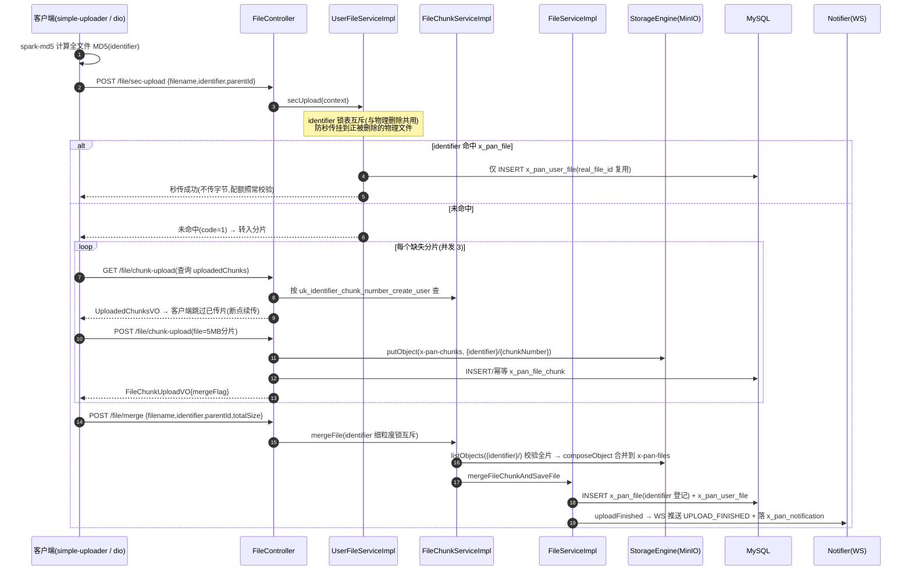
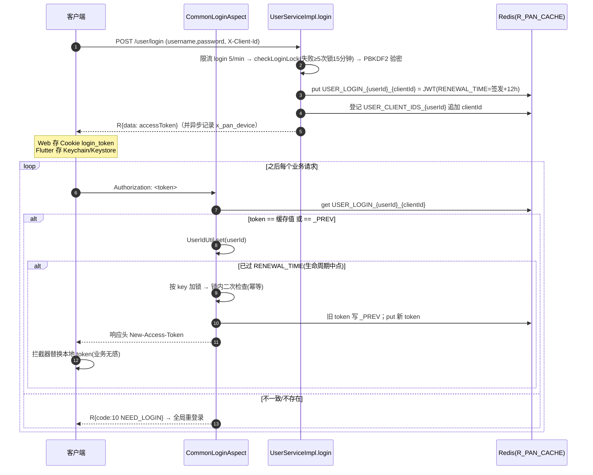

# 05-核心流程

> 项目：X-Pan ｜ 版本：v1.0 ｜ 生成日期：2026-10-05 ｜ 依据：源码分析

本章拆解 X-Pan 五条端到端主干流程：上传三段式（秒传/分片/断点续传）、登录鉴权与 token 滑动续期、文件分享全链路、离线下载（SSRF 防护）、删除→回收站→物理删除级联。架构分层与请求链路总览见《01-系统架构》第 4 节，接口契约见《03-接口设计》，表结构与 Redis 键见《04-数据模型》——本文聚焦"一步步发生了什么"与代码落点。

## 流程一：文件上传三段式（秒传 / 分片 / 断点续传 / 合并 / 实时通知）

这是全系统最核心的流程，Web（`x-pan-fronted/src/composables/useUploader.ts`，基于 simple-uploader.js + spark-md5）与 Flutter（`x-pan-mobile/lib/services/upload_service.dart`，dio + crypto）实现同一协议：**先问、再传、后合**。分片固定 5MB 且 `forceChunkSize: true`（除最后一片外严格 ≥5MB，满足 MinIO composeObject 合并下限，`useUploader.ts` 第 41 行注释）。



分步说明与代码落点：

1. **MD5 预计算**：客户端异步计算 32 位十六进制 MD5 作为 `identifier`。它是贯穿物理文件表（`x_pan_file.identifier`）、分片表、对象命名（`x-pan-chunks/{identifier}/{chunkNumber}`）、秒传/去重的全局键。
2. **秒传试探**：`POST /file/sec-upload`（`UserFileServiceImpl.secUpload`，第 260 行起）。服务端在 `FilePhysicalDeleteEventListener.SEC_UPLOAD_IDENTIFIER_LOCKS` 锁内执行"查物理文件 + 插逻辑引用"（代码注释标注这是 B7 修复 TOCTOU：与物理删除监听器的"isUnused 判定 + 删对象"临界区互斥）。命中则零字节传输完成上传——新逻辑记录直接 `real_file_id` 指向既有物理记录。
3. **分片上传与断点续传**：每片先经 `GET /file/chunk-upload` 查询已传清单，仅补缺失片（Flutter 端跨重启恢复见《02-页面设计》第 2.5 节）。`POST /file/chunk-upload` 中 `identifier` 有 `@Pattern(^[a-fA-F0-9]{32}$)` 正则校验（会被拼进对象名，防路径穿越），分片写入 MinIO 后登记 `x_pan_file_chunk`（联合唯一键保证重复请求幂等）。
4. **合并**：`UserFileServiceImpl.mergeFile`（第 362 行）→ `FileChunkServiceImpl.mergeFile`（按 identifier 的细粒度 JVM 锁防同文件并发合并）→ 校验分片完整性 → `MinIOStorageEngine.mergeByComposeObject` 服务端合并（可带临时对象多轮重试，第 638 行 `.tmp.{round}` 机制）→ `FileServiceImpl.mergeFileChunkAndSaveFile`（第 105 行）落两表。秒传在合并层同样生效：全片 MD5 与既有 `x_pan_file.identifier` 相同时直接复用物理记录。
5. **实时通知**：`Notifier.uploadFinished`（`common/websocket/Notifier.java` 第 67-69 行）通过 WebSocket 向该用户所有在线会话推送 `UPLOAD_FINISHED` 事件，同时经 `pushNotice` 落库 `x_pan_notification`——推送与落库解耦于主流程，前端任务面板/通知铃即时刷新。

**涉及文件清单**：`x-pan-parent/server/.../modules/file/controller/FileController.java`、`modules/file/service/impl/UserFileServiceImpl.java`（secUpload/mergeFile/checkSpaceQuota/checkParentIdOwnership）、`modules/file/service/impl/FileChunkServiceImpl.java`、`modules/file/service/impl/FileServiceImpl.java`、`framework/storage-engine/storage-engine-minio/.../MinIOStorageEngine.java`（doStoreChunk/mergeByComposeObject/buildObjectName）、`common/websocket/Notifier.java`、`common/listenner/file/FilePhysicalDeleteEventListener.java`；前端 `x-pan-fronted/src/composables/useUploader.ts`、`src/stores/task.ts`；移动端 `x-pan-mobile/lib/services/upload_service.dart`、`lib/core/storage/upload_task_storage.dart`。

## 流程二：登录鉴权与 token 滑动续期

登录不是"发个 JWT 就完事"，而是 **JWT + Redis 双重会话**：JWT 保证无状态验签性能，Redis 保证可吊销与多端隔离。完整交互如下（`clientId` 概念与续期并发治理见《03-接口设计》第 4 节）：



分步要点：① 登录入口 `UserServiceImpl.login`（第 120 行）依次执行限流（`RedisRateLimiter`，fail-open）、防爆破锁检查（`USER_LOGIN_FAIL_` 计数，5 次锁 15 分钟，注释记录了 Spring Cache 无原生 INCR 时的并发缓解措施）、PBKDF2 验密、签发写缓存；② 每请求校验在 `CommonLoginAspect.checkAndSaveUserId`：`Authorization` 头优先、Cookie `login_token` 回退（浏览器原生下载场景免拼 URL）；③ 续期触发点是 JWT 内 `RENEWAL_TIME` claim（有效期/2，即 24h token 在 12h 后的首个请求触发），`tryRenewToken` 用 `RENEW_KEY_LOCKS` 按缓存 key 加锁 + 锁内二次检查，保证并发请求只签发一个新 token（防互踢）；④ 登出 `POST /user/exit` 只 evict 当前 clientId 的缓存键，改密 `POST /user/password/change` 则遍历 `USER_CLIENT_IDS_{userId}` 全端下线；⑤ 设备管理（`DeviceController`）读 `x_pan_device` 表可远程下线指定 clientId——删除对应 Redis 键即吊销。

**涉及文件清单**：`server/.../modules/user/controller/UserController.java`、`modules/user/service/impl/UserServiceImpl.java`（login/generateAndSaveAccessToken/addActiveClientId/checkLoginLock）、`common/aspect/CommonLoginAspect.java`、`framework/core/.../utils/JwtUtil.java`、`modules/user/constants/UserConstants.java`、`modules/device/controller/DeviceController.java`、`common/ratelimit/RedisRateLimiter.java`；前端 `src/utils/http.ts`、`src/utils/cookie.ts`；移动端 `lib/core/network/http_client.dart`、`lib/core/storage/token_storage.dart`、`lib/providers/auth_provider.dart`。

## 流程三：文件分享全链路（创建 → 提取码 → 浏览/转存/下载）

分享是唯一对外开放的匿名通道，因此堆叠了最多的防护：越权校验、保险箱隔离、限流、双层鉴权、到期/取消/次数三重失效判定。

```mermaid
flowchart TB
    subgraph Owner["分享者(登录态)"]
        A[POST /share 创建分享] --> A1[限流 share-create 30/min]
        A1 --> A2[checkShareFileOwnership<br/>逐个校验归属+禁保险箱文件 parentId=-2]
        A2 --> A3[事务: INSERT x_pan_share + x_pan_share_file]
        A3 --> A4[返回 share_url + share_code]
    end
    subgraph Visitor["接收者(匿名)"]
        B[GET /share/simple 简况] --> C{需要提取码?}
        C -->|是| D[POST /share/code/check] --> E{校验:存在/未取消/未过期/下载未达限}
        E -->|失败| E1[code=5/6/7 错误态]
        E -->|通过| F[签发 Share-Token JWT(claim shareId)<br/>客户端存 Cookie]
        C -->|否| F2[免码直接获得简况]
        F --> G[GET /share 详情 /share/file/list 浏览<br/>ShareCodeAspect: Share-Token→ShareIdUtil]
        G --> H[POST /share/save 转存<br/>需登录态+Share-Token 双凭证]
        G --> I[GET /share/file/download 匿名下载<br/>download_count+1, 通知分享者]
    end
    I -.->|Notifier.shareAccessed| Owner
```

分步要点：

1. **创建**：`ShareServiceImpl.create`（第 105 行，`@Transactional`）先限流（share-create 30 次/分钟/用户），再 `checkShareFileOwnership` 逐文件校验归属与保险箱隔离（代码注释明确：分享对匿名者开放，若允许分享保险箱文件会绕过解锁校验泄露明文，故直接拦截），最后事务写 `x_pan_share`（`share_end_time` 永久时写死远未来 2099-12-31，规避 NULL 判断）与桥表 `x_pan_share_file`。分享列表查询时按当前配置**实时重算** share_url（注释：兼容历史脏数据 `127.0.0.1:null`）。
2. **提取码校验**：`checkShareCode`（第 187 行）依次检查分享存在性、`share_status`（code=6 SHARE_CANCELLED）、`share_end_time`（code=7 SHARE_EXPIRE，null 按过期处理防 NPE）、下载次数上限；通过后签发独立的 Share-Token JWT（claim 携带 shareId），与登录 token 完全独立。
3. **访问与转存**：`@NeedShareCode` 方法（`GET /share`、`/share/file/list`、`/share/save`、`/share/file/download`）由 `ShareCodeAspect` 环绕：解析 `Share-Token` 头 → `ShareIdUtil` 线程上下文。转存是"逻辑文件复制"——只为当前用户新建 `x_pan_user_file` 记录并复用 `real_file_id`（零字节拷贝），同时受配额校验约束。下载与转存均会累加统计并经 `Notifier.shareAccessed` 实时通知分享者（WS + 落库）。

**涉及文件清单**：`server/.../modules/share/controller/ShareController.java`、`modules/share/service/impl/ShareServiceImpl.java`、`common/aspect/ShareCodeAspect.java`、`common/annotation/NeedShareCode.java`、`common/utils/ShareIdUtil.java`、`modules/share/constants/ShareConstants.java`、`common/websocket/Notifier.java`；前端 `src/views/share/index.vue`、`src/api/share.ts`；移动端 `lib/services/share_service.dart`。

## 流程四：离线下载（SSRF 防护 + 异步拉取 + 进度推送）

离线下载让服务端代替用户从任意 HTTP(S) 链接拉取文件入网盘，也因此在服务端打开了一个"向内网发起请求"的攻击面。`OfflineTaskServiceImpl` 用"创建时校验 + 执行时逐跳复检"双保险封堵：

```mermaid
flowchart TB
    A[POST /offline/create url+parentId] --> B[限流 offline-create 10/min]
    B --> C["validateUrl: 协议白名单(仅 http/https,<br/>拒 file:/gopher: 等)"]
    C --> D[DNS 解析检查: 拒内网 IP/云元数据地址<br/>(169.254.169.254 等), 缓解 DNS 重绑定]
    D --> E[INSERT x_pan_offline_task status=0]
    E --> F[独立线程池 3 线程异步执行<br/>pan.offline.thread-pool-size]
    F --> G[openWithRedirectValidation<br/>关闭自动重定向]
    loop 每一跳(最多 MAX_REDIRECT_HOPS=5)
        G --> H[逐跳重跑 validateUrl 完整校验]
    end
    H -->|超 5 跳| X1[失败: 重定向跳数超限]
    H -->|通过| I[流式下载 downloaded_size 累加]
    I --> J[完成: 走统一入库逻辑落 x_pan_user_file<br/>status=2, file_id 关联]
    I -->|异常/取消| K[status=3/4 + error_msg]
    J & I --> L[Notifier.offlineTaskUpdate/Finished<br/>WS OFFLINE_TASK_UPDATE + 落库]
```

分步要点：① URL 校验 `validateUrl`（第 524 行）是单一权威实现——协议白名单、IP 黑名单（`SSRF 黑名单：拒绝内网 IP 和云元数据地址`，第 517 行）、DNS 解析复查三段共用，供创建时与重定向每一跳复用（注释点明威胁模型：公网 URL 302 跳转到 `169.254.169.254` 云元数据地址绕过创建时校验）；② 下载在独立线程池（`pan.offline.thread-pool-size: 3`，与 Tomcat 工作线程隔离）执行，单文件上限 `pan.offline.max-file-size-bytes` 10GB；③ 关闭 HttpURLConnection 自动重定向，改手动逐跳跟随并每一跳完整复检，超 5 跳终止；④ 进度经 `downloaded_size` 落库 + `Notifier.offlineTaskUpdate/offlineTaskFinished` WebSocket 推送（`OFFLINE_TASK_UPDATE` 事件，前端离线页与通知铃实时刷新）；⑤ 完成的文件走与普通上传一致的物理/逻辑两表登记（`file_id` 回写任务表），复用秒传与配额校验。

**涉及文件清单**：`server/.../modules/offline/controller/OfflineTaskController.java`、`modules/offline/service/impl/OfflineTaskServiceImpl.java`（validateUrl/openWithRedirectValidation/线程池装配）、`common/config/ThreadPoolConfig.java`、`common/resilience/`（offlineDownload 熔断与重试，`application.yaml` resilience4j 段）、`common/websocket/Notifier.java`；前端 `src/views/list-page/offline/index.vue`、`src/api/offline.ts`；移动端 `lib/services/offline_service.dart`、`lib/pages/offline_page.dart`。

## 流程五：删除 → 回收站 → 物理删除级联

删除是两阶段设计：**逻辑删除（可逆）** 与 **物理删除（不可逆，事件驱动）**，中间隔 30 天回收站窗口；级联关系（子目录、分享、收藏、标签、版本、保险箱）全部在服务层维护，无数据库外键。

```mermaid
flowchart TB
    A[DELETE /file fileIds] --> B[UserFileServiceImpl.deleteFile<br/>校验归属 → 递归收集子树]
    B --> C[置 del_flag=1 + delete_time<br/>配额 used_size 不减(仍在回收站占额)]
    C --> D[前端 /recycles 列表可见<br/>30 天倒计时提示]
    D -->|用户还原| E[PUT /recycle/restore<br/>checkRestoreFilename 防重名冲突]
    D -->|超 30 天| F[CleanExpireRecycleFileTask<br/>滚动批 500 条]
    D -->|用户彻底删除| G[DELETE /recycle]
    E --> H[del_flag=0 回原/指定目录]
    F & G --> I[物理删除: 引用计数归零判定<br/>分享/收藏/标签/版本/保险箱级联清理]
    I --> J[发布 FilePhysicalDeleteEvent @Async]
    J --> K[FilePhysicalDeleteEventListener<br/>identifier 锁内 isUnused 判定]
    K -->|无任何 x_pan_user_file 引用| L[StorageEngine.delete 删对象<br/>x_pan_file 记录删除, used_size 扣减]
    K -->|仍被引用(秒传/分享复用)| M[仅删逻辑记录, 物理对象保留]
    L -.-> N[OrphanFileGc 每天 3:00 兜底<br/>清 有对象无记录 的孤儿]
```

分步要点：① `deleteFile`（第 238 行）先归属校验再递归展开子树（文件夹删除是级联软删），置 `del_flag=1` + `delete_time`；同目录同名约束因唯一键含 `del_flag` 而允许"已删同名 + 新上传"共存（见《04-数据模型》第 2.2 节）；② 还原走 `checkRestoreFilename` 校验目标目录是否冲突；③ 彻底删除（用户手动或 30 天过期任务）触发级联清理与 `FilePhysicalDeleteEvent`；④ 监听器 `FilePhysicalDeleteEventListener` 在 identifier 锁内做"是否仍被引用"判定（与秒传临界区互斥，流程一第 2 步呼应），只有物理记录真正无引用才删对象并扣减 `used_size`——**这正是秒传零成本的数据一致性代价所在**；⑤ `OrphanFileGc`（原生 `@Scheduled`，cron `xpan.gc.orphan-cron` 默认 `0 0 3 * * ?`）每日兜底清理"对象存在但无元数据记录"的存储泄漏。

**涉及文件清单**：`server/.../modules/file/service/impl/UserFileServiceImpl.java`（deleteFile/还原校验）、`modules/recycle/controller/RecycleController.java`、`modules/recycle/service/impl/RecycleServiceImpl.java`、`common/event/file/DeleteFileEvent.java`、`common/event/file/FilePhysicalDeleteEvent.java`、`common/listenner/file/FilePhysicalDeleteEventListener.java`、`common/schedule/task/CleanExpireRecycleFileTask.java`、`common/gc/OrphanFileGc.java`、`framework/storage-engine/.../StorageEngine.java`；前端 `src/views/list-page/recycle/index.vue`、`src/api/recycle.ts`。

## 流程间的关系与共同机制

五条流程共享四套横切机制，改动时须全局联想：① **Redis 限流**（login/share-create/offline-create 三处入口，见流程二、三、四）；② **Notifier 静态门面 + WebSocket**（UPLOAD_FINISHED / SHARE_STATS_UPDATE / OFFLINE_TASK_UPDATE 三类业务事件，推送与落库总是成对出现）；③ **identifier 锁表**（秒传、物理删除、分片合并三处临界区共用，是数据一致性的枢纽）；④ **Spring 事件异步化**（搜索历史、错误日志、物理删除均为 `@Async` 消费，主流程不被拖慢）。任何新功能接入这些机制前，建议先通读 `common/` 包下对应组件与本清单，避免破坏既有并发与一致性假设。

## 失败语义与异常分支速查

正常路径之外，每条流程的失败出口同样是被设计过的，调用方应按下面的语义处理而不是一律当"出错"弹窗。**上传**：秒传未命中不是错误，是转入分片的正常信号（未命中返回 code=1，命中才是 code=0 且无 data，见《19》第 3 节）；分片中途失败只需重查 `uploadedChunks` 补传缺失片，已传分片因联合唯一键而不会重复累积；merge 在分片不全时会业务报错，客户端应以服务端校验为准而非本地计数。配额不足（`checkSpaceQuota`）在分片开始前的 sec-upload 阶段即会拦截，避免传完 3GB 才发现没空间。**登录**：密码错误与账号锁定的提示文案不同（"密码信息不正确"与"登录失败次数过多，账号已被锁定15分钟"），前端应区分展示；锁定是按用户名维度的 Redis 计数，15 分钟后自动解除，无需人工介入。**分享**：三个失效态（文件丢失 code=5、已取消 code=6、已过期 code=7）在分享页有各自错误态，接收者侧不应重试；下载次数达限同样进入不可用态。**离线下载**：SSRF 校验失败、重定向超 5 跳、目标文件超 10GB 上限均落为任务 status=3 + `error_msg`，用户在任务列表看到失败原因而不是全局报错；取消是 status=4 的协作式中断。**删除与还原**：还原时目标目录存在同名文件会被 `checkRestoreFilename` 拦截（唯一键含 del_flag 的设计使"已删同名"不阻碍还原校验），需要用户先处理冲突；彻底删除后不可逆，物理对象是否真正释放取决于引用计数（见流程五第 4 步）。

## 幂等与并发控制机制汇总

X-Pan 在没有分布式锁中间件的前提下，用三种手段组合解决了并发正确性问题，值得在同类项目中复用。**第一，数据库唯一键兜底幂等**：分片记录、收藏、标签、保险箱关联、预览任务的重复请求都直接撞唯一键失败，语义等价于"已完成"；这是成本最低也最可靠的一层，所有任务表的主键设计都优先考虑了它。**第二，JVM 内细粒度锁保护读改写临界区**：`SEC_UPLOAD_IDENTIFIER_LOCKS`（秒传与物理删除互斥）、`FileChunkServiceImpl` 的 identifier 合并锁、`CommonLoginAspect.RENEW_KEY_LOCKS`（token 续期互斥）三处锁表都按业务键（identifier/缓存 key）加锁而非方法级 synchronized，锁冲突面被压到"同一文件/同一会话"粒度；配合锁内二次检查（续期场景）实现幂等。这些锁在单实例语义下正确，多实例部署时是必须改造的三个点。**第三，业务状态机收敛并发写**：异步任务（离线/解压/预览转换）用 status 字段单调推进，重复触发同一任务要么被唯一键挡下要么被状态判断短路，不会产生双份产物。理解这三层机制后，新增任何"可能被并发触发"的写操作时，应优先问：唯一键能否表达幂等？临界区是否需要业务键锁？状态机是否单调？
