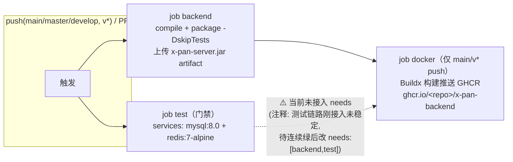

# 06-部署运行

> 项目：X-Pan ｜ 版本：v1.0 ｜ 生成日期：2026-10-05 ｜ 依据：源码分析

本章给出 X-Pan 从零跑通的完整操作路径：环境要求、本地三端启动、环境变量与配置清单、容器化构建部署、测试体系与 CI 质量门禁。总览见《00-项目总览》第 5 节的快速上手，本章是对它的工程化展开。一条红线贯穿全文（源自 `DEV_GUIDELINES.md` 第一节）：**任何 yaml 中不允许出现密钥默认值**，全部密钥经 `XPAN_*` 环境变量注入，`${ENV:}` 空兜底、缺失即启动失败。

## 1. 环境要求

| 组件 | 版本 | 用途 | 必需性 |
|---|---|---|---|
| JDK | 17+（CI 用 temurin 17） | 后端编译运行 | 必需 |
| Maven | 3.8+（Docker 构建器用 3.9） | 后端构建（`mvn -pl server -am`） | 必需 |
| MySQL | 8.0 | 元数据持久化，库 `x_pan`，建表脚本 `x-pan-parent/distribution/conf/db.sql`（20 张表） | 必需 |
| Redis | 7.0（CI 用 redis:7-alpine） | 登录态/限流/锁定状态（强依赖，连接失败启动报错） | 必需 |
| MinIO | RELEASE.2025-04-01 | 对象存储三桶；`pan.storage.minio.enabled=false` 可退回本地目录存储 | 可选（生产建议） |
| Node.js / npm | 20+ / 10+ | Web 前端构建 | Web 端必需 |
| Flutter | 3.35（Dart SDK ^3.9.2） | 移动端开发/构建 | 移动端必需 |
| Docker / Docker Compose | 稳定版 | 生产部署、MinIO 纠删码集群、可观测栈 | 生产必需 |

## 2. 本地启动步骤

### 2.1 后端（x-pan-server，端口 8081）

```bash
# ① 初始化数据库（20 张表，纯 DDL）
cd /path/to/x-pan/x-pan-parent
mysql -u root -p < distribution/conf/db.sql

# ② 注入密钥（二选一）
#    a) 手工导出：
export XPAN_DB_USERNAME=root XPAN_DB_PASSWORD=你的密码
export XPAN_REDIS_PASSWORD=你的Redis密码
export XPAN_JWT_SECRET=$(head -c 48 /dev/urandom | base64)   # ≥32 字节
export XPAN_AES_KEY=$(openssl rand -hex 8) XPAN_AES_IV=$(openssl rand -hex 8)  # 各 16 字符
export XPAN_MINIO_ACCESS_KEY=xxx XPAN_MINIO_SECRET_KEY=xxx    # 启用 MinIO 时
#    b) 本机已配好密钥则直接用仓库自带脚本（内含真实密码，勿提交 git）：
./run-local.sh

# ③ 编译并启动
mvn clean install -DskipTests
mvn -pl server spring-boot:run
# 启动类：com.xiaoye.pan.server.XPanServerLauncher
# 默认 profile：${XPAN_PROFILE:prod}，本地开发建议 XPAN_PROFILE=local 或 dev

# ④ 验证
curl http://localhost:8081/actuator/health
# dev/local profile 下接口文档：http://localhost:8081/doc.html（knife4j）
```

`run-local.sh`（仓库根）做且只做两件事：导出 7 个 `XPAN_*` 密钥变量（注释记录了 2026-09-06 密钥重新生成导致"需重新登录、旧分享链接失效"的教训），然后 `mvn -pl server spring-boot:run`。profile 差异：`application-local.yaml`/`application-dev.yaml` 开启 knife4j 文档与更宽松的 CORS 白名单（`xpan.web.cors.allowed-origins`），生产 profile 关闭文档（`knife4j.enable: false`）。

### 2.2 Web 前端（Vite dev，端口 5179）

```bash
cd /path/to/x-pan/x-pan-fronted
npm install
npm run dev          # http://localhost:5179
```

开发期代理已在 `vite.config.ts` 配好：`/api` → `http://localhost:8081`（rewrite 去 `/api` 前缀）、`/ws` → `ws://localhost:8081`（升级头直通），与生产 Nginx 规则对齐（见《03-接口设计》第 3 节），无需额外配置。生产构建 `npm run build` 会先执行 `vue-tsc -p tsconfig.app.json --noEmit` 严格类型检查，任何类型错误都构建失败。

### 2.3 Flutter 移动端

```bash
cd /path/to/x-pan/x-pan-mobile
flutter pub get
# 指向本地后端（默认 apiBaseUrl 指向公网生产地址，见 lib/core/config/app_config.dart）：
flutter run --dart-define=X_PAN_API_BASE_URL=http://127.0.0.1:8081
# Android 模拟器访问宿主机：
flutter run --dart-define=X_PAN_API_BASE_URL=http://10.0.2.2:8081
```

`--dart-define` 同样支持 `X_PAN_WS_BASE_URL` 等编译期配置（未设置时按 apiBaseUrl 推导）；分片 5MB 与 3GB 文件上限为代码常量，与后端协议对齐，不可经环境变量调整。产物构建：`flutter build apk --release`（Android）与 `flutter build macos --release`，v1.0 发布产物（`x-pan-mobile-v1.0-android.apk`、`x-pan-mobile-v1.0-macos.zip`）即按此产出，存于仓库根 `release-artifacts/`。

### 2.4 依赖中间件的两种本地起法

最简路径是复用 `deploy/docker-compose.yml` 里的 MinIO 4 节点纠删码集群模板（`minio{1...4}`，每节点 `./data/minioN:/data`，控制台 `:9001`）：`docker compose -f deploy/docker-compose.yml up -d` 后执行 `deploy/init-buckets.sh`（mc 客户端创建 `x-pan-files/x-pan-chunks/x-pan-thumbs` 三桶，参数：host/user/pass，默认 `xpanadmin/xpanadmin123`）。MySQL/Redis 用本机安装或临时容器均可，只要与 `XPAN_DB_*`、`XPAN_REDIS_PASSWORD` 一致。

## 3. 环境变量与配置清单

### 3.1 环境变量（`application.yaml` 中全部 `${XPAN_*}` 引用）

| 环境变量 | 用途 | 约束 | 缺失后果 |
|---|---|---|---|
| `XPAN_PROFILE` | Spring profile（prod/dev/local） | 默认 `prod` | 文档/白名单按生产收紧 |
| `XPAN_DB_USERNAME` / `XPAN_DB_PASSWORD` | MySQL 连接 | — | 启动失败（数据源初始化） |
| `XPAN_REDIS_PASSWORD` | Redis 密码 | — | 启动失败（登录态不可用） |
| `XPAN_JWT_SECRET` | JWT HS256 签名密钥 | ≥32 字节 | 启动即抛"JWT 签名密钥未配置"（`JwtUtil` 静态块） |
| `XPAN_AES_KEY` / `XPAN_AES_IV` | 对外 ID 加密（AES-128） | 各恰好 16 字符 | ID 加解密失败；由 `AesKeyConfig` 启动时注入 System Property |
| `XPAN_MINIO_ACCESS_KEY` / `XPAN_MINIO_SECRET_KEY` | MinIO S3 凭证 | 启用 MinIO 时必填 | 对象存储不可用（有 minioStorage 熔断兜底） |
| `XPAN_ROOT` | 本地引擎/缩略图缓存根目录 | 默认 `${user.home}/x-pan-data` | 容器内建议 `/app/data` 并挂卷 |
| `XPAN_SHARE_HOST` | 分享链接对外地址前缀 | 默认 `http://127.0.0.1:8081` | 分享链接不可达（历史脏数据已做实时重算兜底） |
| `XPAN_SNOWFLAKE_WORKER_ID` / `XPAN_SNOWFLAKE_DATACENTER_ID` | 雪花 ID 多节点分配 | 多实例部署必配 | ⚠️ 待确认：未显式设置时 hutool 默认策略的单实例行为 |
| `XPAN_SERVER_HOST` | 中间件主机（compose 编排用） | docker-compose-server.yml 中 `:?` 强制 | 部署脚本报错拒启 |

### 3.2 关键应用配置（`server/src/main/resources/application.yaml`）

| 配置项 | 默认值 | 说明 |
|---|---|---|
| `spring.servlet.multipart.max-file-size/max-request-size` | 支撑 3GB 上传 | 单文件/请求上限 |
| `pan.ratelimit.login-per-minute` 等 | 5/min、3/h、30/min、10/min | 四个限流 scope 阈值 |
| `pan.offline.thread-pool-size` / `max-file-size-bytes` | 3 / 10GB | 离线下载独立线程池与单文件上限 |
| `pan.history.max-versions-per-file` | 50 | 单文件版本上限，超出裁剪最旧 |
| `pan.storage.minio.enabled` | true | false 切换本地存储引擎 |
| `pan.storage.minio.endpoint` / `public-endpoint` | —（示例含公网 IP） | 内网入口（服务端 S3）/公网入口（浏览器 302 直连） |
| `pan.storage.minio.file-bucket/chunk-bucket/thumbnail-bucket` | x-pan-files / x-pan-chunks / x-pan-thumbs | 三桶命名 |
| `pan.storage.minio.presigned-expiry-seconds` | 3600 | 预签名直链有效期 |
| `pan.storage.minio.large-file-threshold` | 50MB | 超过走 302 直链的阈值 |
| `resilience4j.*`（minioStorage/offlineDownload） | 熔断 30s 半开 + 重试 | 稳定性策略 |
| `management.endpoints.web.exposure.include` | health,info,metrics,prometheus | Actuator 暴露面 |
| `management.otlp.tracing.export.enabled` | false | OTLP 导出默认关闭（降级开关） |
| `xpan.gc.orphan-cron` | `0 0 3 * * ?` | 孤儿对象清理周期 |
| `xpan.web.cors.allowed-origins` | 白名单 | CORS 白名单（`CorsFilter`） |

## 4. 构建与部署

### 4.1 容器镜像

- **后端** `x-pan-parent/server/Dockerfile`：两阶段构建——`maven:3.9-eclipse-temurin-17` 内 `mvn -pl server -am package`（先 `dependency:go-offline` 利用层缓存），运行时 `eclipse-temurin:17-jre-jammy` + 非 root 用户 `xpan`(uid 1000) + curl 健康检查。**构建上下文必须是项目根**（`COPY . .` 需含父 POM 与 framework 模块）：`docker build -f server/Dockerfile -t xpan-server .`
- **前端** `x-pan-fronted/Dockerfile`：Node 20 构建 dist → `nginx:1.27-alpine` 托管；`nginx.conf` 承担 SPA fallback、`/api/` 去前缀反代（`client_max_body_size 10G`）、`/ws/` 升级直通、安全响应头与 gzip。

### 4.2 一键部署（deploy/deploy.sh）

```bash
cd x-pan-parent
cp deploy/.env.example deploy/.env     # 填入全部必填密钥与 XPAN_SERVER_HOST
bash deploy/deploy.sh                  # 校验 .env → 构建镜像 → 拉起容器 → 等待健康
bash deploy/deploy.sh --no-build       # 已有镜像时仅校验+拉起
```

`docker-compose-server.yml` 编排两个服务：`xpan-server`（8081，`SPRING_PROFILES_ACTIVE: prod`，全部密钥用 `${VAR:?必须设置}` 语法强制非空，`xpan-data` 卷持久化 `/app/data`，healthcheck 探 `/actuator/health/liveness`）与 `xpan-frontend`（80）。MySQL/Redis/MinIO **不在编排内**——注释明确"已独立部署，通过内网/公网直连"。纯存储集群场景用 `deploy/docker-compose.yml` 起 MinIO 四节点纠删码集群 + nginx 负载均衡。

### 4.3 可观测性栈（deploy/）

`prometheus.yml` 抓取三类目标：`xpan-server:8080 /actuator/prometheus`、`minio{1..4}:9000` 集群/节点指标；`alerts.yml` 内置 5 条告警：MinioNodeDown、MinioHighErrorRate、MinioSlowUpload、MinioDiskAlmostFull、MinioClusterDiskFull；`grafana-dashboard.json` 开箱导入。链路追踪走 OTLP（默认关闭，启用需置 `management.otlp.tracing.export.enabled=true` 并提供collector 地址），采样率 0.1（W3C 传播，MDC 注入 traceId，见《01-系统架构》第 4 节）。

### 4.4 版本升级与回滚

X-Pan 的发布单元是镜像，回滚语义因此简单：`deploy.sh --no-build` 配合上一个版本镜像 tag 即可把服务拉回旧版，数据层无需回滚（建表脚本只增不删，历史上每次加表都以新 DDL 文件追加而非修改旧脚本）。升级时需要留意三个衔接点。第一，**前后端发布顺序**：后端接口保持"只加不改"的演进约定（新增字段向后兼容、`R` 契约与 code 语义稳定），因此正确的顺序是先后端、后前端——旧前端遇到新后端能正常工作（未知字段被 `NON_NULL` 序列化策略自然忽略），反过来新前端依赖新接口时旧后端会暴露缺口。第二，**移动端的特殊性**：Flutter 产物发到用户设备后不可强制召回，`AppConfig` 的编译期地址配置意味着老版本 App 会长期直连生产域名，任何后端地址或协议常量（分片 5MB、3GB 上限）的变更必须保持长期向后兼容，服务端不能假设所有客户端都是最新版。第三，**升级窗口的健康确认**：容器自带 liveness 健康检查，compose 拉起后 `deploy.sh` 会等待健康才结束；升级后应依次验证 `/actuator/health`、登录一次（验证 JWT/AES 密钥未变）、上传一个小文件（验证存储链路）、打开一个分享链接（验证 `XPAN_SHARE_HOST`），四步通过即可认为发布成功。

## 5. 测试体系与 CI 质量门禁

### 5.1 测试代码现状

后端测试位于 `x-pan-parent/server/src/test/java/com/xiaoye/pan/server/modules/`，5 个测试类覆盖四个核心模块：`file/FileTest.java`（22 个 @Test，上传/秒传/删除等核心文件流）、`user/UserTest.java`（15 个，注册/登录/找回密码）、`share/ShareTest.java`（8 个，分享全链路）、`recycle/RecycleTest.java`（7 个，回收站还原/清理）、`share/ShareStatisticsTest.java`（1 个，分享统计）。它们是**需要真实 MySQL/Redis 的集成测试**（事务回滚式验证业务服务层），而非纯 Mockito 单测——这正是 CI 需要 service 容器的原因。

**用例数量说明**：根 `README.md` 与 `x-pan-parent/README.md` 均表述为"CI 测试门禁（MySQL/Redis 服务容器，68 用例全绿）"；当前源码中 `@Test` 注解计数为 53（22+15+8+7+1，无 `@ParameterizedTest`/`@RepeatedTest`）。两数字的差异（⚠️ 待确认：68 可能包含参数化展开后的实际执行用例数，或 README 统计早于/晚于某次测试增删）不影响门禁机制本身——CI 以 `mvn test` 退出码为准，任何用例失败即阻断。

### 5.2 后端 CI 门禁（`x-pan-parent/.github/workflows/ci.yml`）

三个 job 的依赖关系与门禁语义（文件头注释原意）：



test job 的关键步骤（源码可查）：① service 容器起 MySQL 8（root/xpan-ci-pwd，预建 `x_pan` 库，带健康检查）与 Redis 7；② 因 `application.yaml` 被 `.gitignore` 排除（含真实环境地址），先 `cp server/src/test/resources/application-ci.yaml server/src/main/resources/application.yaml` 补位（CI 专用：Redis 指向 127.0.0.1、database 1）；③ `docker exec ... mysql ... x_pan < distribution/conf/db.sql` 导入全量表结构；④ 注入一次性 CI 测试密钥（`XPAN_JWT_SECRET: ci-only-...-not-real` 等，注释声明"非真实密钥"）；⑤ `mvn -B -pl server -am test -fae` 执行测试——**失败即 job 红，PR 无法合并**（门禁本体）。docker job 目前 `needs: [backend]`，即测试失败暂不阻塞镜像发布（注释写明待测试链路连续绿后收紧为 `needs: [backend, test]`）。

### 5.3 前端 CI 门禁（`x-pan-fronted/.github/workflows/ci.yml`）

单 job：`npm ci` → `npx vue-tsc -p tsconfig.app.json --noEmit`（**严格类型检查即门禁**，任何类型错误阻断）→ `npm run build`（Vite 构建，内含同一类型检查）→ 上传 dist artifact；main/v* push 时额外 Buildx 推送 `ghcr.io/<repo>/x-pan-frontend`。移动端暂无独立 CI workflow（⚠️ 待确认是否计划接入 flutter analyze/test 门禁），当前以 `flutter analyze` 本地自查 + release-artifacts 人工发版为主。

### 5.4 质量门禁的完整语义

除 CI 自动门禁外，`DEV_GUIDELINES.md` 约定了必须人工遵守的架构红线（包结构即鉴权切点、密钥环境变量化、模块间只走接口、identifier 锁约定等，详见《01-系统架构》第 2.2 节与第 3 节）。二者共同构成 X-Pan 的质量防线：CI 保证"编译可过、测试可绿、镜像可跑"，红线保证"拆分条件不腐化"。日常开发建议的完整回归序列：`mvn -pl server -am test`（后端门禁本地复现）→ `npx vue-tsc -p tsconfig.app.json --noEmit`（前端类型门禁）→ `./run-local.sh` + 三端冒烟（登录/上传/分享/预览）。

## 6. 常见启动与运行故障排查

按"启动即失败"到"运行期才暴露"的顺序排一遍最高频的故障。**启动失败第一类：密钥缺失**。`XPAN_JWT_SECRET` 未设置或短于 32 字节时，`JwtUtil` 静态初始化块直接抛"JWT 签名密钥未配置"，进程无法起来——这是刻意的快速失败；`XPAN_AES_KEY/XPAN_AES_IV` 长度不是 16 字符会在 `AesKeyConfig` 注入 System Property 时报错；`XPAN_DB_PASSWORD/XPAN_REDIS_PASSWORD` 缺失则表现为数据源/Redis 连接初始化失败。**第二类：中间件不可达**。MySQL 连不上先查库是否存在（`db.sql` 只建表不建库，需手工 `CREATE DATABASE x_pan`）；Redis 连不上或密码错会阻断一切登录相关功能（登录态缓存是硬依赖）；MinIO 不可达时应用仍能启动，但上传下载触发 `minioStorage` 熔断（30 秒半开探测），用户侧表现为存储相关操作批量失败，此时应检查 endpoint 的内网/公网地址与凭证。**第三类：行为符合预期但像故障**。生产 profile 下访问 `/doc.html` 返回关闭（`knife4j.enable: false` 是设计行为，切 dev/local 才有文档）；Nginx 后 WebSocket 连不上几乎都是 `/ws/` location 漏配 `Upgrade/Connection` 升级头；大文件上传被 413 拒绝是 Nginx `client_max_body_size` 未放宽到 10G；浏览器直连 MinIO 预签名 URL 失败通常是 `public-endpoint` 配了内网地址（该地址会被下发给浏览器做 302，必须用公网可达入口）。**排查通用抓手**：日志 MDC 已注入 traceId（`LogMdcFilter`），同一请求的完整链路用 traceId 串联；前端/移动端请求头也会携带 `X-Pan-Trace-Id`，跨端报障时先对齐这个值。

## 7. 配置与密钥变更操作规程

有几类变更具有全局副作用，必须按规程执行。**更换 `XPAN_JWT_SECRET`**：全部已签发 token 立即失效（验签不过），所有端被登出，Redis 中旧登录态成为死键可等待过期或手工清理；影响可接受，安排在低峰执行即可。**更换 `XPAN_AES_KEY/XPAN_AES_IV`**：后果严重得多——历史分享链接、任何客户端本地持久化的加密 ID 都无法再解密（仓库注释记录过 2026-09-06 重新生成密钥导致"需重新登录、旧分享链接失效"的实际代价），分享侧虽有实时重算链接的兜底，其余引用加密 ID 的持久化面必须逐一评估，原则上视同不可逆操作。**切换存储引擎**：`pan.storage.minio.enabled=false` 切回本地引擎后，存量对象的 `real_path` 仍是 MinIO 对象名，本地引擎无法解读，切换前必须完成存量对象迁移（或仅在新部署上切换）；启用 OSS/FastDFS 引擎同理需先解除 `server/pom.xml` 中的依赖注释并补齐 `application.yaml` 对应配置段（模板以注释形式留在文件尾部）。**profile 切换**：生产必须 `XPAN_PROFILE=prod`（默认值），dev/local 会开放 knife4j 文档面与更宽的 CORS 白名单，误开等于把接口文档暴露公网。**缩略图与本地缓存目录**：容器内 `XPAN_ROOT=/app/data` 已挂 `xpan-data` 卷，重建容器不丢缩略图缓存；裸机部署则注意该目录默认在用户主目录下，磁盘规划需计入。

## 8. 上线检查清单

发布前逐项核对：数据库已执行最新 `db.sql` 与 `server/src/main/resources/sql/` 增量脚本；七个必填 `XPAN_*` 环境变量全部注入且 `deploy/.env` 不在版本库中；MinIO 三桶已创建（`deploy/init-buckets.sh`）且 `public-endpoint` 为公网可达地址；Nginx（或 compose 内前端容器）的 `/api/`、`/ws/` 两个 location 均已配置且 `client_max_body_size 10G` 生效；`/actuator/health` 与 `/actuator/health/liveness` 探活通过；Prometheus 抓取目标在线、五条 MinIO 告警规则已加载；CI 两条流水线（后端 compile/package/test、前端 vue-tsc/build）在发布 commit 上为绿；`XPAN_SNOWFLAKE_WORKER_ID/DATACENTER_ID` 在多实例部署时已按节点分配。若启用 OTLP 链路导出，确认 collector 地址可达后再打开 `management.otlp.tracing.export.enabled`，避免追踪开销影响主链路。

两类环境的目标形态差异也值得在上线前明确：本地开发环境的特征是 profile 为 local/dev（文档与白名单全开）、存储可退回本地目录、依赖中间件允许单点裸装；生产环境的特征则是 prod profile（文档关闭、CORS 收紧）、MinIO 纠删码集群、密钥仅存在于 `.env` 或编排环境变量、健康检查与告警全部接线。判定一个环境"像不像生产"的最快方法有三条：`/doc.html` 是否可访问、`application.yaml` 中是否残留明文地址、错误响应是否泄漏堆栈细节（`WebExceptionHandler` 在生产只返回固定文案）。把这三条当作环境巡检的探针，可以避免"开发配置带上生产"这一最常见的上线事故。


