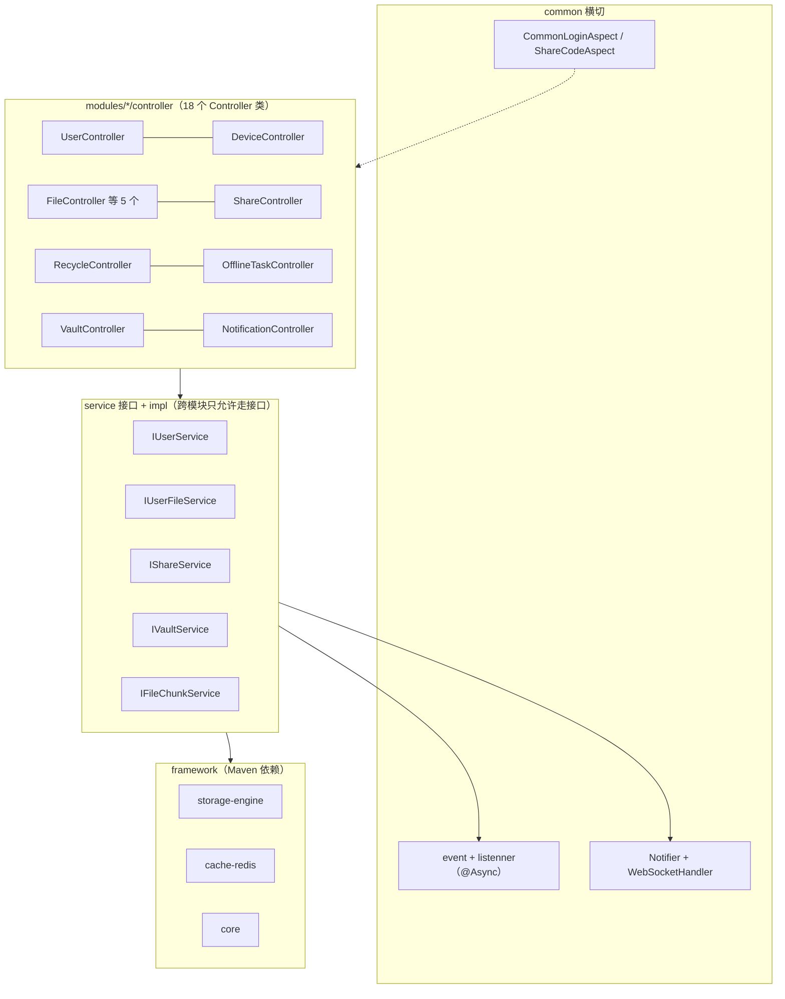

# 07-模块详解

> 项目：X-Pan ｜ 版本：v1.1 ｜ 生成日期：2026-10-06 ｜ 依据：源码分析

本文是《01-系统架构》的纵深篇：架构篇回答"模块如何划分、边界在哪"，本文回答"每个模块内部长什么样、关键类有哪些、一段请求在模块里怎么走"。阅读前提：已了解 framework/server 分层、`R{code,message,data}` 契约与切面鉴权机制（分别见《01-系统架构》第 2-4 节与《03-接口设计》第 1、4 节）。文中路径均相对 `x-pan/`。

需要坚持的源码事实：后端不是物理微服务，而是"按微服务风格拆分的模块化单体"（单进程 `x-pan-parent/server`，端口 8081）。因此下文"服务间交互"指的是**进程内接口注入 + Spring 事件**两条通道，而非 RPC/消息队列。

## 1. 模块全景与依赖方向



依赖纪律有三条硬约束（`DEV_GUIDELINES.md` 第二节 + 源码一致）：模块间只能注入对方 `service` 包下的**接口**（如 `VaultServiceImpl` 注入 `IUserFileService`，见 `x-pan-parent/server/src/main/java/com/xiaoye/pan/server/modules/vault/service/impl/VaultServiceImpl.java`）；Controller 必须位于 `modules/<模块>/controller/` 子包（登录切面包路径切点的要求，放错即裸奔——历史上 OfflineTaskController 事故）；业务代码禁止绕过 `StorageEngine` 直接操作对象存储 SDK。

## 2. 后端业务模块逐个深读

### 2.1 user 模块（用户与会话）

**职责**：注册、登录、登出、密保找回密码三步流程、在线改密、用户信息/配额/头像、搜索历史与热搜。

**组件清单**：

| 组件 | 路径（`x-pan-parent/server/src/main/java/com/xiaoye/pan/server/modules/user/`） | 要点 |
|---|---|---|
| Controller | `controller/UserController.java`（`@RequestMapping("user")`） | 12 个端点；register/login/username-check/answer-check/password-reset 五个 `@LoginIgnore` |
| Service | `service/IUserService.java`、`service/impl/UserServiceImpl.java` | register（幂等校验 `uk_username`）、login（限流→防爆破→PBKDF2→签发写缓存）、`generateAndSaveAccessToken`、`addActiveClientId`、`checkLoginLock`、`recordLoginFail`、三步找回密码（一次性 5 分钟 token，claim `FORGET_USERNAME`） |
| 实体/Mapper | `entity/XPanUser.java`、`entity/XPanUserSearchHistory.java`、`mapper/` | 搜索历史为自增主键流水表，经 `UserSearchEvent` 异步写入 |
| 常量 | `constants/UserConstants.java` | `USER_LOGIN_PREFIX`、`LOGIN_TOKEN_COOKIE_NAME`、`ONE_DAY_LONG`、`LOGIN_USER_ID` 等全部会话契约常量 |

**内部机制走读**：`login` 是全链路防护的样板——先 `RedisRateLimiter`（login 5 次/分钟，Redis 故障 fail-open）、再 `checkLoginLock`（`USER_LOGIN_FAIL_{username}` 计数 ≥5 锁 15 分钟）、然后 PBKDF2 验密、最后签发 JWT 并写两个 Redis 键（会话槽位 + 活跃 clientId 集合）。改密 `password/change` 遍历 `USER_CLIENT_IDS_{userId}` 强制全端下线。跨模块交互：注册成功后调 file 模块创建根目录、调 device 模块登记登录设备。

### 2.2 device 模块（设备管理）

**职责**：登录设备指纹记录、设备列表、远程下线。组件极简：`controller/DeviceController.java`（`/device/list`、`/device/logout` 两个端点）、`service/impl/DeviceServiceImpl.java`、`entity/XPanDevice.java`。登录时 upsert `(userId, clientId)` 维度的 `last_login_time`/UA/IP；远程下线的本质是删除对应 `USER_LOGIN_{userId}_{clientId}` 缓存键。已知预留：`DeviceServiceImpl.java:87` 的 `device.setLocation("")` 注释"预留，需 IP 库支持"——location 字段当前无实际写入（⚠️ 待确认填充实效，见《13-技术债务与演进建议》）。

### 2.3 file 模块（文件核心，含 dedup/history/thumbnail 子域）

这是体量与复杂度之最：`FileController`（25 个端点）、`FileHistoryController`（4）、`ThumbnailController`（1）、`VideoThumbnailController`（3）、`file/dedup/FileDedupController`（3）五个 Controller，核心实现 `service/impl/UserFileServiceImpl.java` 约 2200 行。

| 关键类 | 职责与内部机制 |
|---|---|
| `UserFileServiceImpl` | 列表查询（`index_file_list` 覆盖索引 + `SafeOrderBy` 白名单排序）、`secUpload`（B7 修复：在 `FilePhysicalDeleteEventListener.SEC_UPLOAD_IDENTIFIER_LOCKS` 锁内"查物理记录+插引用"，与物理删除互斥防 TOCTOU）、`chunkUpload`（委托 FileChunkService）、`mergeFile`（第 362 行起）、`checkParentIdOwnership`/`checkSpaceQuota`（B9 配额强制）、`deleteFile` 递归软删、`archiveDownload` zip 打包流、`preview`（Range 断点 + `checkOperatePermission` 归属/保险箱校验）、`getFolderTree`/`getBreadcrumbs` |
| `FileServiceImpl` | 物理文件表操作：`mergeFileChunkAndSaveFile`（第 105 行）落 `x_pan_file` + `x_pan_user_file` 两表；合并层秒传（identifier 命中即复用） |
| `FileChunkServiceImpl` | 分片锁与合并判定，见下文专段 |
| `dedup/FileDedupServiceImpl` | 按 `identifier` 分组重复逻辑文件、去重统计、`release` 释放冗余引用（复用秒传的物理引用模型） |
| `ThumbnailServiceImpl` / `VideoCoverServiceImpl` | 磁盘缓存缩略图（`${xpan.root}/thumbnail`）、FFmpeg 视频封面/雪碧图；`@Async` 预热使用 `taskExecutor`（审计 #19 修复） |

`FileChunkServiceImpl` 的并发设计值得单独走读（`modules/file/service/impl/FileChunkServiceImpl.java`）：`LOCK_MAP` 按 `identifier_userId` 粒度加 striped 锁，用**持有计数**（`StripedLock.holder`）管理锁对象生命周期——避免"computeIfAbsent 新建锁 + finally 无条件 remove"导致后来者拿到已被移除的旧锁对象；进入同步块后还有**锁内校验**（`LOCK_MAP.get(lockKey) != stripedLock` 则重试，最多 `MAX_LOCK_ATTEMPTS=3`）。合并判定 `doJudgeMergeFile` 只统计**未过期**分片，并校验 chunk_number 恰为 `[1..totalChunks]` 连续集合，防"重复上传同一分片凑数"合成损坏文件。完整上传时序见《05-核心流程》流程一。

### 2.4 share 模块（分享全链路）

组件：`controller/ShareController.java`（9 个端点）、`service/impl/ShareServiceImpl.java`（`create` 第 105 行事务写两表、`checkShareCode` 第 187 行四重校验、`recordShareCodeFail` 防爆破、`refreshShareStatus`）、`common/aspect/ShareCodeAspect.java` 与 `common/annotation/NeedShareCode.java`（二级凭证）、`common/utils/ShareIdUtil.java`（线程上下文）。机制要点：分享对匿名开放故防护最深——创建时限流 30/分 + `checkShareFileOwnership` 逐文件校验归属并**拒绝 parentId=-2 的保险箱文件**（防止绕过解锁泄露明文）；`share_end_time` 永久分享写死 2099-12-31 规避 NULL；列表查询实时重算 share_url 兼容历史脏数据。跨模块：转存复用 file 模块"逻辑复制零字节拷贝"，访问/保存/下载统计经 `Notifier.shareAccessed` 推送分享者。

### 2.5 recycle 模块（回收站）

`controller/RecycleController.java`（列表/`/stat` 统计/restore/彻底删除四端点）+ `service/impl/RecycleServiceImpl.java`。还原复用 `findAllFileRecords` 级联还原子树并经 `checkRestoreFilename` 防重名冲突（审计 #7 修复：此前只还原顶层导致"还原后是空目录"）。30 天过期由 `common/schedule/task/CleanExpireRecycleFileTask.java` 滚动批 500 条清理，触发 `FilePhysicalDeleteEvent`。数据生命周期全景见《04-数据模型》第 4 节。

### 2.6 offline 模块（离线下载，SSRF 防护标杆）

`controller/OfflineTaskController.java`（create/list/cancel/delete）+ `service/impl/OfflineTaskServiceImpl.java`（核心约 630 行）。内部机制四件套：① `validateUrl`（第 524 行）单一权威实现——协议白名单 http/https + `checkHostSafety` DNS 解析复查（`PRIVATE_IP_PREFIXES` 黑名单含 127/10/192.168/169.254/0./IPv6 私网，另补 172.16-31 段判断）；② `openWithRedirectValidation` 关闭自动重定向逐跳手动跟随，每一跳完整复检，`MAX_REDIRECT_HOPS=5`；③ 独立线程池 3 线程（`pan.offline.thread-pool-size`，与 Tomcat 隔离），FUTURES 登记 + cancel/delete 主动回收（审计修复）；④ `spoolToTempFile` 落盘临时文件（失败路径就地删除，C2 修复 deleteOnExit 永不触发的缺陷）再以 `TempFileMultipartFile` 适配器走统一 `upload` 入库。状态机用**条件 UPDATE**（`WHERE status IN (0,1)`）防取消被覆盖。取消语义 status=4、失败 status=3+error_msg。安全面展开见《08-安全与权限设计》。

### 2.7 vault 模块（隐私保险箱）

`controller/VaultController.java`（8 端点）+ `service/impl/VaultServiceImpl.java`（前文已全文核对）。机制：独立密码表 `x_pan_vault_password`（PBKDF2 独立盐）；解锁态以时间戳写入 `vault_unlocked:{userId}` 缓存，`isUnlocked` 做 30 分钟比对（`UNLOCKED_TTL_MS`，不依赖 Redis TTL）；防爆破用 `StringRedisTemplate` 原生 INCR + 仅首次 EXPIRE（D2 修复，注释明确参照分享码防爆破写法）；文件隐藏靠 `parent_id=-2`（`VaultConstants.VAULT_PARENT_ID`），`x_pan_vault_user_file.original_parent_id` 保留原目录。**扁平模型限制**：文件夹移入被明确拒绝（"保险箱暂不支持文件夹"），因关联表按单文件记录、无层级导航。所有入口（列表/移入/移出/永久删除）都先 `checkUnlocked`；file 模块的 download/presigned-url 也回补 `checkVaultPermission`，防绕过。

### 2.8 其余模块速览

| 模块 | Controller | 核心机制 | 跨模块交互 |
|---|---|---|---|
| favorite | `FavoriteController`（3 端点） | `uk_user_file` 唯一键防重，硬删除从属数据 | 随文件删除级联清理 |
| extract | `ExtractController`（2 端点） | ZIP 异步解压任务表 `x_pan_extract_task`，processed_count 进度轮询 | 复用文件入库链路 |
| preview | `PreviewController`（2 端点） | Office→PDF 转换任务，`uk_file_target` 幂等，产物带 `expire_time` | storage-engine 读取源文件 |
| textextract | `TextExtractController`（1 端点） | 提取纯文本供 AI；是 filetag AI 打标的数据源 | file、filetag |
| filetag | `FileTagController`（4 端点） | 手动标签 + `auto-tag`（LLM 失败降级规则打标） | textextract |
| notification | `NotificationController`（4 端点） | WS 推送的落库面：列表/未读数/已读标记 | websocket（Notifier） |
| log | 无 Controller | `ErrorLogEvent` → `ErrorLogEventListener` @Async 落 `x_pan_error_log` | WebExceptionHandler |
| webdav | `WebDavController`（`/webdav/**` 单入口） | Basic Auth（10 分钟 AUTH_CACHE 缓存）+ 按 method 分发；PUT 返回 501 暂未实现（`WebDavController.java:264`） | user（verifyCredentials）、file |

## 3. framework 通用组件逐个详解

framework 七个模块是"平台件"，server 以 Maven 依赖复用。逐个看：

**framework/core**（零 Spring 依赖的纯工具与契约）：`IdUtil`（hutool 雪花 `get()` + AES-128 `encrypt/decrypt`，workerId/datacenterId 经 `XPAN_SNOWFLAKE_WORKER_ID/DATACENTER_ID` 预留多节点）；`JwtUtil`（静态块强制 `xpan.jwt.secret`，缺失即抛"IllegalStateException: JWT 签名密钥未配置"快速失败；`RENEWAL_TIME` claim 写入"签发+有效期/2"；`analyzeClientId/analyzeRenewalTime/analyzeSubject` 三个解析器全部吞 JwtException 返回 null——**解析失败与过期统一按未登录处理**）；`PasswordUtil`（PBKDF2WithHmacSHA256、10000 迭代、随机盐）；`R`/`ResponseCode`/`PageVO`（响应契约）；`AES128Util`、`MessageDigestUtil`（MD5）、`FileUtils`（后缀→Content-Type、realPath 生成）、`ImageThumbnailUtil`。

**framework/web**（Servlet 层横切）：`CorsFilter`（`@Order(1)`，`xpan.web.cors.allowed-origins` 白名单命中回显 Origin 并加 `Vary`，未配置时回退 `*` 并 warn 一次）；`HttpLogFilter`（访问日志，大响应白名单 `shouldNotFilter` 防止 3GB 下载体进堆内存——审计 #4 修复）；`WebExceptionHandler`（`@RestControllerAdvice` 全局异常到 `R` 的映射表，见《03-接口设计》第 5 节）；`IdEncryptSerializer`（VO 出参自动加密 ID）；`WebValidatorConfig`。

**framework/cache**（策略模式双实现）：`cache-core` 仅一个 `CacheConstants.R_PAN_CACHE_NAME` 常量统一缓存名；`cache-redis` 的 `RedisCacheConfig` 提供 Jackson 序列化、**按 key 前缀区分 TTL**（`USER_LOGIN_*` 25h，链条 TTL(25h) > JWT(24h) > 续期点(12h)，审计 #7/#25 修复）、支持事务；`cache-caffeine` 是本地替换实现（单策略 expireAfterWrite），仅适用单实例开发。

**framework/orm/mybatis-plus**：MP 装配（`@MapperScan("modules.**.mapper")` 在启动类）与 `CodeGenerator`；复杂 SQL 手写于 `server/src/main/resources/mappers/` 四目录。

**framework/schedule**：`ScheduleManager`/`ScheduleTask`/`ScheduleTaskHolder` 简易动态任务注册框架；`CleanExpireChunkFileTask`、`CleanExpireRecycleFileTask` 实现该接口，由 `common/schedule/launcher/` 下两个 Launcher 注册；孤儿 GC 则用原生 `@Scheduled`（`xpan.gc.orphan-cron` 默认每天 3 点）。

**framework/swagger2**：`Swagger2Config` + `DocAccessCondition`——仅 dev/local profile 暴露 doc.html，生产 `knife4j.enable: false` 全关。

**framework/storage-engine**（策略 + 模板方法）：`StorageEngine` 接口五操作（store/delete/storeChunk/mergeFile/realFile）+ `AbstractStorageEngine` 模板（check 骨架 + doXxx 下沉）；四个实现中 local/minio 在 `server/pom.xml` 生效，oss/fastdfs 依赖被注释（代码完整，接线方式见《11-扩展开发指南》SOP-5）。MinIO 实现的独有增强：`doStore` 叠 `@CircuitBreaker(name="minioStorage")` + `@Retry`（3 次指数退避）、`MinioMetrics` 指标、`generatePresignedGetUrl/PutUrl`（1 小时有效期）、`mergeByComposeObject` 服务端合并（.tmp.{round} 多轮重试）与 <5MB 分片回退下载拼接。

## 4. common 横切组件清单

`x-pan-parent/server/src/main/java/com/xiaoye/pan/server/common/` 下共 40+ 类，按子包归纳：

| 子包 | 组件 | 一句话职责 |
|---|---|---|
| annotation | `LoginIgnore`、`NeedShareCode` | 两级鉴权开关注解 |
| aspect | `CommonLoginAspect`、`ShareCodeAspect` | 登录/分享码环绕校验与续期（详见《08》） |
| config | `AesKeyConfig`、`ThreadPoolConfig`、`PanServerConfig`、`OpenApiConfig` | 密钥注入 System Property、两个异步线程池 Bean（`taskExecutor`/`eventListenerTaskExecutor`）、share-host 配置绑定 |
| event + listenner | `DeleteFileEvent`/`FilePhysicalDeleteEvent`/`FileRestoreEvent`、`ErrorLogEvent`、`UserSearchEvent` | 事件驱动解耦；监听器 @Async 消费 |
| ratelimit | `RedisRateLimiter`、`RateLimitProperties` | 固定窗口限流（key `xpan:rl:{scope}:{u:userId|ip:ip}`），fail-open |
| resilience | `CircuitBreakerFallback`、`MinioCircuit` | 熔断兜底与探测 |
| websocket | `NotificationWebSocketHandler`、`Notifier`、`WebSocketConfig`、`WebSocketHeartbeat` | WS 会话容器（`ConcurrentHashMap<Long, Set<WebSocketSession>>` + `ConcurrentWebSocketSessionDecorator` 5s 发送超时/512KB 缓冲上限）、静态推送门面、30s PING/90s 空闲清理 |
| metrics | `BusinessMetrics`、`ApiMetricsFilter` | 下载计时/字节直方图、HTTP 耗时 |
| schedule(+task/launcher) | `CleanExpireChunkFileTask`、`CleanExpireRecycleFileTask` | 分片/回收站过期清理（批 500 滚动） |
| gc | `OrphanFileGc` | 每日 3 点清"有对象无记录"孤儿 |
| migration | `StorageMigrationRunner` | 存储引擎迁移启动器（⚠️ 待确认：当前是否绑定在主流程，仓库未见启用文档） |
| utils | `UserIdUtil`、`ShareIdUtil`、`IpUtil`、`UserAgentUtil`、`HttpUtil` | 线程上下文与请求工具 |
| log / health / exception | `LogMdcFilter`、`HealthIndicators`、`GlobalExceptionHandler` | traceId 注入 MDC、自定义健康指标、兜底异常 |

## 5. 服务间交互机制总结

```mermaid
flowchart LR
    A[模块 A 的 ServiceImpl] -->|接口注入| B[模块 B 的接口]
    B --> C[模块 B 的 ServiceImpl]
    A -->|ApplicationEventPublisher| D[common/event 事件]
    D -->|@Async eventListenerTaskExecutor| E[common/listenner 监听器]
    E --> F[(MySQL / StorageEngine / Redis)]
    A -->|静态门面| G[Notifier]
    G --> H[WebSocket 实时推送]
    G --> I[notification 模块落库]
```

三条通道的分工：**同步调用走接口注入**（编译期可见、事务边界清晰，但引入模块间编译依赖）；**扇出副作用走事件**（物理删除、错误日志、搜索历史——不阻塞主流程，代价是时序不可控）；**对外实时性走 Notifier 门面**（WS 推送 + 落库成对出现）。没有第四种——不存在 MQ、RPC 与注册中心（父 POM 的 rocketmq 声明无任何使用点，见《00-项目总览》3.1 节）。

## 6. Web 前端核心模块（`x-pan-fronted/src/`）

**api 层**（11 个目录）：`api/file/`（含 `index.ts`、`extract.ts`、`tag.ts` 三个文件）最大，覆盖文件 CRUD/上传三段/下载预览/搜索；其余 `user/share/recycle/offline/vault/dedup/device/favorite/notification/preview` 一目录一域。全部经 `utils/http.ts` 的 axios 实例发出：请求拦截器注入 `Authorization`（Cookie `login_token`）与 traceId；响应拦截器处理 `New-Access-Token` 续期、`code=10` 全局重登录跳转（带 `redirect` 回跳）、`responseType==='blob'` 短路（审计前端 #1 修复，zip 打包下载曾全灭于此）。

**stores 层**（Pinia 5 个）：`file.ts`（584 行中枢：parentId 持久化到 localStorage、分页/排序/多选/剪贴板、所有列表写入收敛到带 `requestSeq` 的方法防过期响应覆盖）；`task.ts`（上传队列，主键 `task.id`）；`user.ts`（配额，`usedSpace` 在上传成功后被前端累加估算）；`navbar.ts`（三态视图 + 显示设置）；`breadcrumb.ts`。

**composables 层**（18 个，跨页面单例）：`useUploader`（simple-uploader 单例 + `_attachCount` 引用计数；`forceChunkSize: true`、`simultaneousUploads: 3`、函数式 headers 实时读 Cookie 应对续期轮换、`checkChunkUploadedByResponse` 严格按 `uploadedChunks` 判定防误跳过——细节见《10-性能设计与优化》）；`useWebSocket`（单例 + 指数退避重连上限 8 次 + 25s 心跳早于服务端 30s PING）；`useToast`（**假封装 ElMessageBox，恒 resolve 不 reject**，前端红线第 1 条）；`useLLM`/`useAIAssistant`（DeepSeek 摘要打标）；`useFavorites`/`useRecent`（模块级缓存，登出须手动 clear）；其余 `useTheme/useShortcuts/useResizable/useTableSort/usePdfSearch/useMediaQuery/useFileTags/useIcon/useDrivePreview`。

**components 层**：`base/` 26 个自研组件（BaseButton→BaseTable/BaseTree 全套 + ContextMenu/NotificationBell/DeviceManagerDialog 等业务化的 Base 组件）；`file-table/` 列表/网格双视图核心；`upload-task-panel/` 全局任务面板；`preview/` 六类预览器挂件。

**router**：`src/router/index.ts` 22 条路由 + 全局守卫（登录白名单、用户信息引导 3 秒超时兜底、根目录 ID 初始化）。页面清单与布局树见《02-页面设计》第 1 节，不重复。

## 7. 移动端核心模块（`x-pan-mobile/lib/`）

**core 三件**：`core/config/app_config.dart`（编译期常量：`apiBaseUrl` 默认生产域名 `https://pan.zhangzhengyang.com`、`chunkSize=5MB` 注释明确对齐 MinIO composeObject、`maxFileSize=3GB`）；`core/network/http_client.dart`（Dio 单例：拦截器注入 Authorization/X-Client-Id/X-Pan-Trace-Id，读 `new-access-token` 自动续期，`code=10` 抛 `NeedReloginException` 并发 `onNeedRelogin` 广播）；`core/storage/token_storage.dart`（flutter_secure_storage 安全存储 + 内存缓存，预留 `share_token` 键）。

**providers 五个**（StateNotifier + copyWith 不可变约定）：`auth_provider`（bootstrap 恢复登录态、订阅 onNeedRelogin 全局重登录、login 失败回滚 token 防孤儿）；`file_provider`（分页 50/页 + 自增 seq 防竞态 + orderBy snake_case 白名单映射）；`notification_provider`（WS 转本地推送 + 10s 节流去重）；`upload_provider`（队列状态 + `UploadTaskStorage` 持久化实现跨重启断点续传）；`view_mode_provider`（列表/网格）。

**services 约 17 个**：与后端模块一一对齐（`upload_service.dart` 完整复刻 MD5→sec-upload→chunk-upload→merge 三段协议并支持 CancelToken/resumeIdentifier；`llm_service.dart`、`notification_service.dart` 等）。**pages 29 个**与导航树、两端能力对齐表见《02-页面设计》第 2 节。

## 8. 模块健康度小结

以"审计修复后现状"评价各模块的成熟度：file/share/user 三模块经受住 2026-09-06 全仓库审查（约 90 项）修复并沉淀了 `DEV_GUIDELINES.md` 红线，是当前约束最严、注释最密的部分；offline 模块是安全机制最完整的模块（限流/熔断/SSRF 双重校验/状态机条件更新齐备）；vault 模块功能正确但受"扁平模型"限制；webdav 模块是协议子集实现，PUT 明确返回 501（下载/浏览/删除可用，上传不可用）——扩展前请先读《13-技术债务与演进建议》核对各模块已知边界。任何对本文所列组件的修改，建议先对照 `DEV_GUIDELINES.md` 对应模块的红线清单。
