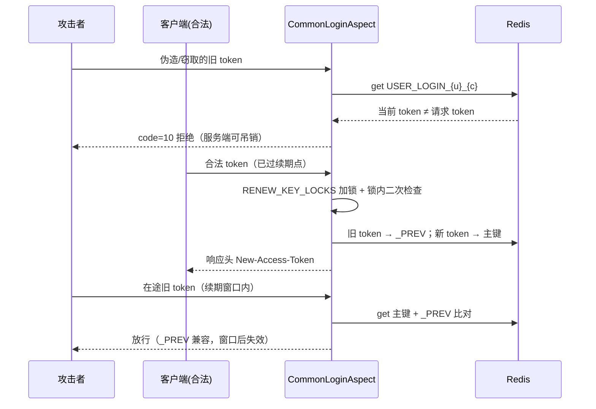

# 08-安全与权限设计

> 项目：X-Pan ｜ 版本：v1.1 ｜ 生成日期：2026-10-06 ｜ 依据：源码分析

本文从**攻击者视角**纵览 X-Pan 的安全设计：每个入口凭什么信任请求、凭证如何流转、哪里还留有风险面。架构级概览见《01-系统架构》第 5 节，鉴权接口契约见《03-接口设计》第 4 节，登录/分享/离线下载三个流程的安全分支见《05-核心流程》流程二/三/四——本文不重复时序，聚焦机制本身与源码落点。历史背景：2026-09-06 全仓库审查修复了约 90 项问题（报告 `CODE_AUDIT_2026-09-06.md`，红线沉淀 `DEV_GUIDELINES.md`），本文描述的是修复后的现状，已知残留风险在第 8 节如实列出。

## 1. 会话模型：JWT + Redis 双层设计与滑动续期

X-Pan 不用纯无状态 JWT：JWT 负责**验签性能**（不需要查库就能确认身份与过期时间），Redis 负责**可吊销性与多端隔离**。两者缺一不可——只有 JWT，登出/改密/远程下线都无法生效；只有 Redis session，则失去无验签开销的横向扩展能力。

**令牌内容与生命周期**（`x-pan-parent/framework/core/src/main/java/com/xiaoye/pan/core/utils/JwtUtil.java`）：HS256 签名，密钥 `XPAN_JWT_SECRET`（≥32 字节，静态块缺失即抛"JWT 签名密钥未配置"快速失败）；claims 含 `LOGIN_USER_ID`（userId）、`CLIENT_ID`（端标识）、`RENEWAL_TIME`（签发时间 + 有效期/2，`RENEWAL_DIVISOR=2`）、`exp`（24h）。有效期链条被刻意设计为：**缓存 TTL 25h > JWT 24h > 续期点 12h**（`RedisCacheConfig` 按 key 前缀给 `USER_LOGIN_*` 单独 TTL），保证续期窗口内缓存先于令牌过期。

**多端并存**：会话槽位键 `USER_LOGIN_{userId}_{clientId}`，clientId 由各端生成并终身稳定（Web 存 Cookie `client_id`，移动端 `lib/core/storage/token_storage.dart` 存 Keychain/Keystore，登出不清除）。不同端的 token 互不覆盖、互不踢线；`USER_CLIENT_IDS_{userId}` 集合支撑改密后遍历全端下线。

**请求校验链**（`x-pan-parent/server/src/main/java/com/xiaoye/pan/server/common/aspect/CommonLoginAspect.java`）：包路径切点 `execution(* com.xiaoye.pan.server.modules.*.controller..*(..))` 环绕全部 Controller（这就是"Controller 必须放 controller/ 子包"红线的原因）；取 token 优先 `Authorization` 头、回退 Cookie `login_token`（浏览器原生下载跳转自动带同源 Cookie，避免 token 进 URL）；`analyzeToken` 验签 → 与 Redis 槽位比对（兼容 `_PREV`）→ 不一致或缓存不存在一律 `R.fail(NEED_LOGIN)`（code=10）——**token 签名合法但服务端已吊销时同样拒绝**；通过后 `UserIdUtil.set` 进线程上下文，finally 清理。

**滑动续期**（`tryRenewToken`）：请求时间超过 `RENEWAL_TIME` 时触发。并发治理是亮点——`RENEW_KEY_LOCKS`（JVM 内按缓存 key 粒度的 `ConcurrentHashMap` 锁表）+ **锁内二次检查**（拿到锁后发现已有并发请求完成续期则直接复用新 token），保证并发请求只签发一个新 token，避免"后写者覆盖前写者、两端各持互不认可的新 token 互踢"；旧 token 写入 `_PREV` 键兼容在途请求；新 token 经响应头 `New-Access-Token` 下发（并设 `Access-Control-Expose-Headers`），Web（`x-pan-fronted/src/utils/http.ts`）与 Flutter（`x-pan-mobile/lib/core/network/http_client.dart`）拦截器自动替换本地存储，业务代码全程无感。



**防爆破**：登录失败 `USER_LOGIN_FAIL_{username}` 计数 ≥5 锁 15 分钟；密保答案校验 `USER_ANSWER_FAIL_{username}`（审计 D3）；保险箱解锁失败 `vault:{userId}` 原生 INCR + 仅首次 EXPIRE（`VaultServiceImpl.recordUnlockFail`，注释明确"窗口自首次失败起算，后续失败不重置过期"）。三者都遵循红线 6："禁止读-改-写"（Spring Cache 抽象无原生 INCR，需计数处显式走 `StringRedisTemplate`）。

## 2. 网关与边界：Nginx、CORS、限流

**Nginx 边界**（`x-pan-fronted/nginx.conf`）：`client_max_body_size 10G` 放行大分片；`/ws/` 独立 location 显式携带 Upgrade/Connection 升级头；安全响应头（X-Frame-Options SAMEORIGIN、X-Content-Type-Options nosniff、Referrer-Policy strict-origin-when-cross-origin）；gzip。TLS 终止在生产由外层完成。注意后端**没有**独立网关进程，Nginx 即全部边界（见《01-系统架构》第 1 节）。

**CORS**（`x-pan-parent/framework/web/src/main/java/com/xiaoye/pan/web/cors/CorsFilter.java`）：`@Order(1)` 全局过滤器。配置 `xpan.web.cors.allowed-origins` 白名单后：命中回显具体 Origin 并加 `Vary: Origin` 防缓存投毒；未命中不回写跨域头（浏览器拦截）。**未配置白名单时保持旧行为回退 `*` 并打一次 warn**——这是刻意保留的开发便利，也是生产环境必须配置白名单的原因（见第 8 节风险）。`Access-Control-Allow-Credentials: false` 与 Cookie 兜底组合把 CSRF 面收窄到"简单请求"。

**限流**（`x-pan-parent/server/src/main/java/com/xiaoye/pan/server/common/ratelimit/RedisRateLimiter.java`）：固定窗口，key `xpan:rl:{scope}:{u:userId|ip:ip}`，首次 INCR 才 EXPIRE。四个 scope 阈值在 `application.yaml` `pan.ratelimit.*`：login 5/分、register 3/时、share-create 30/分、offline-create 10/分。两处 fail-open 设计要知晓：Redis 异常放行（注释"避免限流拖垮服务"）；`UserIdUtil.get()` 未登录返回占位 0，代码显式回退 IP 桶，防止所有匿名请求共享 `u:0` 互相误伤。取 IP 链路为 `X-Forwarded-For` 首段 → `X-Real-IP` → `remoteAddr`——**该头可被伪造**，限流对直连场景按 socket 地址、对经 Nginx 场景依赖 Nginx 正确覆盖该头。

## 3. 资源访问控制：归属校验、保险箱隔离、ID 加密

**归属校验模式**：所有文件操作入口都执行"decrypt fileId → getById → 比对 `record.getUserId()` 与上下文 userId"。实现在 `UserFileServiceImpl.checkOperatePermission`（预览/下载）与各 Service 的显式判断（如 `FileController.download` 中 `record.getUserId().equals(userId)` 不等即 403/业务异常）。上游还有 `checkParentIdOwnership`（B9，父目录归属）与 `checkSpaceQuota`（配额）保护上传/秒传路径。

**保险箱隔离**（三层）：① 数据层隐藏——入箱文件 `parent_id=-2`（`x-pan-parent/server/src/main/java/com/xiaoye/pan/server/modules/vault/constants/VaultConstants.java` 的 `VAULT_PARENT_ID`），正常列表查询永不命中；② 独立密码——`x_pan_vault_password` 表 PBKDF2 独立盐，与登录密码分离；③ 出口复检——`UserFileServiceImpl.checkVaultPermission` 在 `file/download`、`file/presigned-url` 等可能绕过的出口回补解锁校验（`FileController.java` download/presignedUrl 中显式调用，注释写明"防止保险箱文件通过预签名 URL 绕过解锁直接下载"）。**分享侧的隔离更前置**：`ShareServiceImpl.checkShareFileOwnership` 直接拒绝 parentId=-2 的文件参与分享（注释：分享对匿名者开放，若允许会绕过解锁校验泄露明文）。解锁态是 30 分钟时间戳缓存（`vault_unlocked:{userId}`），`lock` 即 evict。

**ID 加密与遍历防护**：对外 ID 一律 AES-128（`IdUtil.encrypt`，密钥 `XPAN_AES_KEY/XPAN_AES_IV` 恰 16 字符经 `AesKeyConfig` 注入 System Property），出参由 `framework/web/.../IdEncryptSerializer` 自动加密——防自增/雪花 ID 被遍历爬取。入参手工 `IdUtil.decrypt`。**加密的边界要说清**：它防枚举不防持有，拿到合法链接的人仍可访问；真正的访问控制仍在归属校验层。AES 密钥轮换会导致历史分享链接与客户端持久化 ID 全部失效（2026-09-06 实际发生过，代价记录在 `DEV_GUIDELINES.md` 第一节），应视同不可逆操作。

**分片 identifier 防穿越**：`FileChunkUploadPO.identifier` 强制 `@Pattern(regexp="^[a-fA-F0-9]{32}$")`——identifier 会被拼进对象存储路径（`{identifier}/{chunkNumber}`），正则白名单从源头杜绝 `../` 注入（审计 🔴#2 的修复，MinIO 引擎另有 `buildObjectName` 清洗 `[/\\]` 纵深防御）。WebDAV 路径解析同样"URL 解码 + 拒绝 .."（`WebDavController.parseWebDavPath`）。

## 4. 分享码与 ptoken：两类短期凭证

**Share-Token**（分享域凭证）：匿名访客 `POST /share/code/check` 提交提取码 → 四重校验（存在/share_status 未取消/share_end_time 未过期/下载未达限）→ 签发独立 JWT（claim `SHARE_ID`）。后续 `@NeedShareCode` 方法由 `ShareCodeAspect` 校验 `Share-Token` 头（回退参数 `shareToken`），解析出 shareId 放入 `ShareIdUtil`。失败时 `ShareCodeAspect` 返回 `ACCESS_DENIED`（code=4）而非 NEED_LOGIN——避免匿名访客被误导向登录页。Share-Token 与登录 token 完全独立、不可互换，且**不落 Redis**（纯 JWT 自证，泄漏面为"知晓提取码者的会话本身"）。提取码校验另有防爆破计数（`recordShareCodeFail`）与大小写统一处理（审计 🟠#15 修复）。

**ptoken**（预览直链凭证，`FileController.previewUrl/previewStream`）：`/<video>` 标签无法携带 Authorization 头，故预览走"申请短期签名 URL → 免登录直出流"两步：`POST /file/preview/url` 用 `JwtUtil.generateToken(subject=userId, claim=PREVIEW_FILE_ID=fileId, 5 分钟)` 签发 ptoken；`GET /file/preview/stream` 验签并**比对 ptoken 内 fileId 与请求 fileId 一致**（防篡改换文件），再经 `checkOperatePermission` 归属校验。缩略图场景的 width/height 被钳制到 `FileConstants.THUMBNAIL_MAX_SIZE`，防 URL 篡改超大尺寸触发放大占用内存（DoS）。Web 端对 ptoken URL 做约 5 分钟 TTL 缓存（`src/utils/preview.ts`）。

## 5. SSRF 逐跳校验（MAX_REDIRECT_HOPS=5）

离线下载让服务端向任意 URL 发起请求，是全系统最大的 SSRF 攻击面。防护是**创建时校验 + 执行时逐跳复检**双保险（`x-pan-parent/server/src/main/java/com/xiaoye/pan/server/modules/offline/service/impl/OfflineTaskServiceImpl.java`）：

1. `validateUrl`（第 524 行）单一权威实现：URI 解析失败拒绝 → 协议白名单仅 http/https（`ALLOWED_PROTOCOLS`，拒 file:/gopher:/magnet: 等）→ host 非空 → `checkHostSafety`。
2. `checkHostSafety`（第 550 行）：`InetAddress.getAllByName` 解析出**全部**地址逐一检查 `isPrivateOrLoopback`——黑名单 `PRIVATE_IP_PREFIXES`（第 518 行）含 `127./10./192.168./169.254./0./fc00:/fe80/::1`，另对 `172.` 段解析第二段判断 16-31；任一命中即抛"URL 指向内网或元数据地址，已拒绝"并记 `SSRF blocked` 告警日志。DNS 解析复查缓解 **DNS 重绑定**（域名创建时解析到公网、执行时改解析到内网的 TOCTOU）。
3. `openWithRedirectValidation`（第 261 行注释写明威胁模型）：`setInstanceFollowRedirects(false)` 关闭自动重定向，改**手动逐跳跟随，每一跳都重新执行完整 validateUrl**——因为"公网 URL 302 跳转到 169.254.169.254 云元数据地址"可以绕过创建时校验；超过 `MAX_REDIRECT_HOPS=5` 跳抛"重定向跳数超过 5 次，已终止下载"。连接后还用 `conn.getURL()` 复查最终地址。
4. 辅助措施：`sanitizeUrl` 去掉 query（token/signature 不进日志）；下载文件名消毒（审计 🟡#39 修复）；单文件上限 10GB（`pan.offline.max-file-size-bytes`）防撑爆存储。

```mermaid
flowchart TB
    A[POST /offline/create] --> B{validateUrl}
    B -->|协议非 http/https| X1[拒绝: 仅支持 HTTP/HTTPS 协议]
    B -->|DNS 解析到私网/元数据 IP| X2[拒绝: URL 指向内网或元数据地址]
    B -->|通过| C[独立线程池执行]
    C --> D[打开连接 关闭自动重定向]
    D --> E{"hop < MAX_REDIRECT_HOPS=5 ?"}
    E -->|否| X3[失败: 重定向跳数超限]
    E -->|是| F[validateUrl 逐跳复检]
    F -->|命中私网| X2
    F -->|conn.getURL() 复查通过| G[流式下载 → 临时文件 → 统一入库]
```

**已知残余**（如实记录）：私网判断基于 IP 前缀字符串匹配，未覆盖十进制/八进制 IP 变形与 100.64.0.0/10 运营商级 NAT 段；DNS 复查与实际连接之间存在纳秒级重绑定窗口（彻底解法是解析后按 IP 直连）；⚠️ 待确认：以上变形是否在内网威胁模型的考虑范围内。

## 6. WebSocket 与 WebDAV 的接入面

**WebSocket**（`common/websocket/NotificationWebSocketHandler.java`）：握手时 `resolveUserId` 解析 `?token=` 中的 JWT 并与 Redis 登录缓存比对（兼容 `_PREV`），失败 `CloseStatus.NOT_ACCEPTABLE` 关闭。会话容器 `ConcurrentHashMap<Long, Set<WebSocketSession>>`，每个会话包 `ConcurrentWebSocketSessionDecorator`（发送超时 5s、缓冲上限 512KB——慢消费者被自动断开，防拖垮 IO 线程，审计 🔴#8 修复）。**风险面**：token 经 URL query 传输会进 Nginx/访问日志；连接建立后不再复查登录态（心跳只查空闲不查吊销）——已登出的 token 可保持连接至其自然过期（⚠️ 待确认是否有加固计划）。心跳协议：服务端 30s PING、客户端 PONG、90s 空闲清理。

**WebDAV**（`modules/webdav/WebDavController.java`）：标准 HTTP Basic Auth，与 JWT 体系并行。实现要点：`split(":", 2)` 保密码含冒号场景；`userService.verifyCredentials` 校验**不复用 login**（避免触发登录失败计数误锁真实账户）；`AUTH_CACHE` 把 Authorization 头映射到 userId 缓存 10 分钟（避免每请求 PBKDF2 验密的 CPU 开销——代价是改密后旧 Basic 凭证最长 10 分钟内仍有效）；请求结束 finally `UserIdUtil.remove()`（Tomcat 线程复用防身份泄漏，审计 🔴#1 修复链）。能力边界：OPTIONS 免鉴权回显能力集（Allow 头声明先于实现）；实际可用 GET/HEAD/DELETE；PUT 返回 501"暂未实现"，MKCOL/MOVE/COPY/PROPFIND 未注册进 `@RequestMapping`（路由层即 405，PROPFIND 处理器亦为桩）——目录浏览不可用，写入需走 Web/移动端（能力口径见《16》ADR-010）；路径解析拒绝 `..`。

## 7. 敏感信息管理（DEV_GUIDELINES 约定）

`DEV_GUIDELINES.md` 第一节是密钥治理的权威约定，要点与现状：

1. **硬红线**：任何 yaml/properties/脚本禁止出现密钥默认值，只允许 `${ENV:}` 空兜底；部署编排用 `${XPAN_XXX:?必须设置 XXX}` 强制语法（`x-pan-parent/deploy/docker-compose-server.yml`）。历史事故：`distribution/conf/application.yaml` 曾把真实密码写成 `${ENV:真实密码}` 默认值并被 git 跟踪——这是泄漏源，已清空并轮换 JWT/AES。
2. **本地密钥住处**：`x-pan-parent/run-local.sh`（已 gitignore，`git ls-files` 确认未跟踪）集中导出 7 个 `XPAN_*` 变量，注释记录 2026-09-06 密钥重生成导致"需重新登录、旧分享链接失效"的教训。**注意**：该文件以明文形式存在于工作区磁盘，且注释自述"含真实密码勿提交"——电脑失窃/目录误打包即泄漏（见第 8 节）。
3. **轮换语义**：JWT secret 轮换 = 全员重新登录（可接受，低峰执行）；AES key/iv 轮换 = 历史分享链接与外部加密 ID 失效（视同不可逆）。生成命令：`openssl rand -hex 8`（AES）、`head -c 48 /dev/urandom | base64`（JWT）。
4. **git 历史结论**（文档记录的 2026-09-06 全量扫描）：仅 `x-pan-parent` 37 个提交历史中存在过 4 个真实密码；fronted/mobile 历史干净。前提条件：x-pan-parent 必须保持 Private；阿里云安全组把 13306/16379/19000 三端口收紧到常用出口 IP——端口不可达后泄漏密码等于无效。
5. **配置面收敛**：`application.yaml` 本身在 `.gitignore`（改动无 diff 提示，是双刃剑）；打包模板 `distribution/conf/application.yaml` 的 actuator 暴露面已白名单化（`include: health,info,metrics,prometheus`，显式 `exclude: env,beans,configprops,heapdump,threaddump,shutdown`）；接口文档生产全关（`knife4j.enable: false`）；`WebExceptionHandler` 生产环境 RuntimeException 只返回固定文案"系统异常，请稍后重试"，堆栈走 `ErrorLogEvent` 异步落库不外泄。

## 8. 已知隐患与加固建议清单

以下为源码可证、当前仍存在的风险面，按暴露程度排序（修复历史见 `CODE_AUDIT_2026-09-06.md`，该报告所列问题均已修复，此处为**修复后仍存在**的设计性取舍）：

| # | 隐患 | 位置/证据 | 影响 | 建议 |
|---|---|---|---|---|
| 1 | CORS 未配置白名单时回退 `*` | `CorsFilter.getAllowedOriginList` 空→`CORS_ORIGIN(*)` + warn | 生产漏配即全源开放；配合 Cookie 兜底鉴权扩大 CSRF 面（审计 🟡#24 遗留的设计取舍） | 生产 profile 强制注入白名单（启动校验而非 warn） |
| 2 | `run-local.sh` 明文密钥在工作区 | `x-pan-parent/run-local.sh`（gitignore 但落盘） | 本机泄露面；误归档/误分享即泄漏 | 改为引用 `.env`（同样 gitignore）或系统 keychain；至少在文件头强化警告 |
| 3 | WS token 走 URL query + 连接后不复查吊销 | `NotificationWebSocketHandler` | token 进访问日志；登出后连接存活到 JWT 过期 | 握手改 Sec-WebSocket-Protocol/首帧认证；心跳周期内重验登录态 |
| 4 | WebDAV Basic Auth 缓存 10 分钟 | `WebDavController.AUTH_CACHE` | 改密后旧凭证最长 10 分钟仍可用；Basic 凭证每请求明文传输（依赖 TLS） | 接受或缩短 TTL；文档标注必须 HTTPS |
| 5 | WebDAV OPTIONS 响应 `Access-Control-Allow-Origin: *` | `WebDavController.handle` OPTIONS 分支 | 信息面暴露（OPTIONS 本身无数据） | 与全局白名单对齐 |
| 6 | SSRF 私网判断不含 100.64/10 与 IP 变形 | `OfflineTaskServiceImpl.PRIVATE_IP_PREFIXES` | 特定网段/变形绕过 | 换 `isSiteLocalAddress`/`isLinkLocalAddress` 等 JDK 结构化判断并补 CGNAT 段 |
| 7 | 限流 key 信任 `X-Forwarded-For` 首段 | `RedisRateLimiter.getClientIp` | 直连时伪造头可换桶绕过匿名限流 | 仅在可信代理后取该头（Nginx 已设 `X-Real-IP`），否则取 `remoteAddr` |
| 8 | JVM 内三处锁表（续期/秒传/分片） | `CommonLoginAspect.RENEW_KEY_LOCKS` 等 | 多实例部署即失效（见《04-数据模型》第 7 节） | 演进为 Redis 分布式锁（与《13-技术债务与演进建议》路线图呼应） |
| 9 | 移动端 shareToken 全局单槽 | `x-pan-mobile/lib/core/storage/token_storage.dart` 预留键（审计移动 🟠#11 记录的清理缺口） | ⚠️ 待确认：审计修复后是否已按分享隔离；若未，A 分享 token 可能用于 B 分享（后端 ShareIdUtil 与分享归属校验会兜底拒绝） | 复核 `share_detail_page.dart` 现状并按 shareId 隔离存储 |

第 9 条体现了本套文档的核对原则：审计报告声称"全部修复"，但修复核对以源码为准——存疑处标注 ⚠️ 待确认，不做断言。
