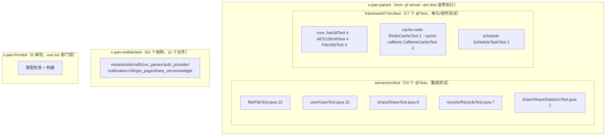

# 09-测试与质量保障

> 项目：X-Pan ｜ 版本：v1.1 ｜ 生成日期：2026-10-06 ｜ 依据：源码分析

CI 门禁的机制框架（workflow 结构、服务容器原理、"68 vs 53"差异的初步标注）已在《06-部署运行》第 5 节给出；本文是对它的纵深展开：逐类解析测试分布与代表性用例、CI 容器配置逐项走读、三端质量门禁的完整语义，最后给出测试缺口与可落地的补测建议。数字先行修正一个口径：《06》标注的差异现在可以算得更准——README 的"68 用例"对应 2026-09-28 接入门禁时点的全量测试（`CHANGELOG.md` 记载"本地同构环境验证 68/68 全绿"）；当前源码 server 侧 53 个 `@Test` + framework 侧 17 个 `@Test` = 70 个注解（无参数化测试），说明门禁接入后测试仍有增删，README 未同步（处理见《13-技术债务与演进建议》）。

## 1. 测试资产全景

需要被准确理解的一点：server 侧 5 个测试类**全部是 `@SpringBootTest(classes = XPanServerLauncher.class)` + `@Transactional` 的集成测试**——拉起完整 Spring 上下文，连真实 MySQL/Redis，每个用例结束自动回滚事务。这正是 CI 必须用 services 容器的原因，也意味着"跑测试"的前提是中间件可达（本地跑测试前先起 MySQL/Redis，或直接复用 CI 的同构方式）。framework 侧则是无 Spring 上下文的单元/组件测试（JwtUtil/AES128/FileUtils 纯工具校验；cache 两模块带 test 环境的自有配置类；schedule 验证任务注册框架）。

## 2. 逐类解析：server 集成测试覆盖什么

以下方法名逐一取自源码（路径前缀 `x-pan-parent/server/src/test/java/com/xiaoye/pan/server/modules/`）：

**FileTest（22 个，`file/FileTest.java`）**——最大的一类，覆盖文件域核心流：列表查询（`testQueryUserFileListSuccess`）；创建文件夹（`testCreateFolderSuccess`）；重命名四连（错误 fileId/错误 userId/非法文件名/文件名不可用 四个失败用例 + `testUpdateFilenameSuccess`）；删除三连（错误 fileId/错误 userId 失败 + `testDeleteFileSuccess`）；秒传正反（`testSecUploadSuccess` 命中返回 true、`testSecUploadFail` 未命中返回 false）；单文件上传（`testUploadSuccess`）；断点续传（`testQueryUploadedChunksSuccess` 查已传分片）；**分片并发上传**（`uploadWithChunkTest`——多线程分片 + CountDownLatch 等待合并，是最复杂的一个用例）；文件夹树（`getFolderTreeNodeVOListTest`）；移动正反（`testTransferFileSuccess/Fail`）；复制正反（`testCopyFileSuccess/Fail`）；搜索（`testSearchSuccess`，CHANGELOG 记录曾对齐"子串 LIKE 语义"）；面包屑（`testGetBreadcrumbsSuccess`）。`uploadWithChunkTest` 有段值得记住的修复史（CHANGELOG test 段）：分片线程是独立事务，看不到测试事务未提交的根目录记录，B9 归属校验上线后必然失败且线程异常不 countDown 导致**永久挂死**——修复为合并目标改用 `TOP_PARENT_ID`、latch 加 try/finally 与 60 秒超时兜底。这解释了为什么测试要区分"测试事务内可见"的数据。

**UserTest（15 个，`user/UserTest.java`）**——用户域闭环：注册（成功 + `testRegisterDuplicateUsername` 重复名幂等）；登录（`loginSuccess`/`wrongUsername`/`wrongPassword` 三态）；登出（`exitSuccess`，解析 token 中 userId 后调 exit）；找回密码三步（`checkUsernameSuccess/NotExist`、`checkAnswerSuccess/Fail`、`resetPasswordSuccess/resetPasswordTokenError`——覆盖一次性 token 的正确与错误两态）；改密（`changePasswordSuccess`/`changePasswordFailByWrongOldPassword`）；用户信息（`testQueryUserInfo`）。

**ShareTest（8 个，`share/ShareTest.java`）**——分享全链路：`createShareUrlSuccess`、`queryShareUrlListSuccess`、`cancelShareSuccess`、`checkShareCodeSuccess/Fail`（提取码正反）、`queryShareDetailSuccess`、`queryShareSimpleDetailSuccess`、`queryShareFileListSuccess`。

**ShareStatisticsTest（1 个，`share/ShareStatisticsTest.java`）**——`visitCountIncrementsOnDetail`：访问详情后 `visit_count` 自增；CHANGELOG 记录曾把断言改为"对照库中访问次数"以消除环境耦合。

**RecycleTest（7 个，`recycle/RecycleTest.java`）**——回收站与级联：列表（`testQueryRecyclesSuccess`）；还原三态（`testFileRestoreSuccess`、`testFileRestoreFailByWrongUserId`、`testFileRestoreFailByWrongFilename1/2`——重名冲突的两个分支）；彻底删除（`testFileDeleteFailByWrongUserId`/`testFileDeleteSuccess`）。

从命名即可读出这批测试的三条结构约定。**命名约定**：`test<动作>Success` / `test<动作>FailBy<原因>` 的两态对仗式命名贯穿全部五个类，读用例名即得"该行为有几个失败分支、各因什么失败"——这本身就是一份可执行的接口行为清单，新用例应延续该风格。**数据构造约定**：几乎每个用例都以"先 register 一个用户"开场（`createUserRegisterContext` 工厂方法），不依赖共享夹具数据——配合 `@Transactional` 回滚，用例之间零耦合、可独立运行也可乱序运行；代价是每个用例都要付出注册开销，但换来的是排障时"任何单个用例失败都与其它用例无关"的确定性。**断言风格约定**：以 hutool 的 `Assert.isTrue` 与 JUnit 5 的 `assertThrows` 为主，断言"业务结果"而非"数据库细节"（如验证秒传返回 true/false 而非核对表行数），使测试在表结构小改时不至于大面积脆断。理解这三条约定后，为既有模块补测试就是照猫画虎的体力活；反之，破坏任何一条（比如引入用例间共享状态）都会先在 CI 的偶发失败上还债。

**框架层（17 个）**：`framework/core/src/test/.../JwtUtilTest`（4：签发/解析/续期点/过期）、`AES128UtilTest`（4：加解密回环与边界）、`FileUtilsTest`（4：后缀/路径工具）、`framework/cache/cache-redis/src/test/.../RedisCacheTest`（2）与 `cache-caffeine/.../CaffeineCacheTest`（2：注解缓存读写）、`framework/schedule/src/test/.../ScheduleTaskTest`（1：任务注册）。framework 的 cache 测试需要 Redis/本地缓存可用（⚠️ 待确认：CI 的 `-fae` 模式下若环境不满足是否会 fail-continue——`-fae` 是"fail at end"，单模块失败不阻断其他模块，但最终退出码非零，门禁依然生效）。

## 3. 服务容器配置逐项走读（`x-pan-parent/.github/workflows/ci.yml` test job）

test job 的完整装配顺序与每个步骤的"为什么"：

1. **services 两容器**：`mysql:8.0`（`MYSQL_ROOT_PASSWORD: xpan-ci-pwd`、预建库 `x_pan`、3306 映射宿主机、healthcheck 用 `mysqladmin ping` 重试 10 次 ×10s）+ `redis:7-alpine`（6379、`redis-cli ping` 健康检查）。GitHub Actions 会等 healthcheck 通过才开始步骤——这是"服务容器"与自起容器的关键差异。
2. **补位 application.yaml**：`cp server/src/test/resources/application-ci.yaml server/src/main/resources/application.yaml`。因为真实 `application.yaml` 在 `.gitignore` 中（含生产地址），CI checkout 里根本没有这个文件，Spring 启动会失败。`application-ci.yaml` 的配置与主配置逐段对齐（multipart 3GB、resilience4j 两实例、限流阈值、50 版本上限等全部一致，注释自述"避免实例缺失时行为漂移"），差异仅五处：Redis/MySQL 指向 `127.0.0.1`（服务容器映射端口）、Redis 无密码、**`pan.storage.minio.enabled: false`**（CI 不部署 MinIO，统一走本地文件引擎）、`xpan.root` 指向 `${java.io.tmpdir}/x-pan-ci-data`、tracing 采样率 1.0（且 OTLP 导出关闭防刷日志）。文件头红线声明："只允许 127.0.0.1 与一次性测试假密钥，禁止真实环境 IP 与密码"。
3. **导表**：`docker exec -i <mysql容器id> mysql -uroot -pxpan-ci-pwd x_pan < distribution/conf/db.sql`——借宿主机 docker CLI 向服务容器灌 20 张表。
4. **注入 CI 专用密钥**：`XPAN_JWT_SECRET: ci-only-...-not-real`、`XPAN_AES_KEY/IV: '0123456789abcdef'/'abcdef0123456789'`——满足 `JwtUtil`/`AesKeyConfig` 的启动快速失败校验，值本身标注"非真实密钥"。注意 `XPAN_DB_USERNAME/PASSWORD` 传的是服务容器凭据。
5. **执行**：`mvn -B -pl server -am test -fae`——`-am` 连带构建并测试 framework 依赖模块；`-fae`（fail at end）让所有模块都跑完再统一失败，日志一次看全。**失败即 job 红、PR 无法合并**——这是门禁本体。

三 job 关系（编译 backend → 测试 test → 镜像 docker）：**docker job 目前 `needs: [backend]`，未接入 test**（文件头注释："测试链路刚接入尚未稳定，避免 test job 抖动阻塞镜像发布；待 test job 连续绿后改为 needs: [backend, test]"）。这意味着当前测试失败不阻断镜像发布——门禁的"通知价值"已生效、"拦截价值"未闭环，是《13-技术债务与演进建议》的头部条目。

## 4. 前端与移动端的质量门禁

**前端**（`x-pan-fronted/.github/workflows/ci.yml` 单 job）：`npm ci` → `npx vue-tsc -p tsconfig.app.json --noEmit`（**严格类型检查即门禁**，`tsconfig.app.json` 开 strict）→ `npm run build`（Vite 构建内含同一类型检查）→ 上传 dist artifact；main/v* push 时额外 Buildx 推 GHCR。前端**没有任何运行时单测**（无 vitest/jest 依赖）——逻辑正确性靠类型系统 + `DEV_GUIDELINES.md` 前端红线 + 人工冒烟，这是当前最大的测试空白（见第 6 节）。

**移动端**：**没有 CI workflow**（`x-pan-mobile/.github/` 下无生效流水线），质量保障靠本地自查：`flutter analyze`（静态分析，审计记录"零问题"）+ `flutter test`（11 个测试文件、61 个用例：`models_test` 10、`utils_test` 8、`csv_parser_test` 9、`notification_test` 6、`notification_throttle_test` 5、`login_page_test` 6、`auth_provider_test` 3、`md5_hash_test` 4、`share_version_test` 7、`notification_page_test` 2、`widget_test` 1——覆盖模型映射、工具函数、CSV 解析、通知节流、认证状态机与关键页面冒烟）。`CHANGELOG.md` 记录移动端 CI 曾有"测试豁免"并被摘除的意图，但仓库现状尚无 workflow 文件（⚠️ 待确认：计划中的 flutter test 门禁是否已另库维护）。

## 5. 质量门禁的完整语义（CI 之外）

CI 只保证"编译可过、测试可绿、类型可查、镜像可跑"，X-Pan 的第二道防线是 `DEV_GUIDELINES.md` 的人工红线（后端 11 条 / 前端 10 条 / 移动端 7 条，逐条对应一次真实事故，索引见《08-安全与权限设计》第 7 节与《07-模块详解》第 3 节）。第三道是提交前自检清单（`DEV_GUIDELINES.md` 第五节）：后端 `mvn compile -DskipTests -q`、前端 `npx vue-tsc --noEmit` + `grep vardanger 零结果`（CSS 变量漏 var 包装曾修 20+ 处）、移动端 `flutter analyze` + `flutter test`、**密钥扫描** `git grep -nE '\$\{XPAN_[A-Z_]+:[^}]+\}'`（查配置文件里残留的密钥默认值——正是 2026-09-06 泄漏事故的形态）。

三道防线的分工值得一句总结：CI 管的是"机器能判断的事"，红线管的是"机器还判断不了的事"（包结构约定、锁的使用姿势、并发写法），自检清单管的是"提交前 30 秒能拦住的事"。三层各自有漏洞：CI 的门禁未闭环到发布（D6）、红线靠人工记忆没有静态检查、自检清单靠自觉执行——所以《13-技术债务与演进建议》把它们列入演进项；但在自动化补齐之前，三层叠加已经把这个课程级项目的质量托在了"多数同类项目之上"。

日常开发建议的本地回归序列（《06-部署运行》5.4 的展开）：起 MySQL/Redis → `mvn -pl server -am test`（复现 CI 门禁）→ `npx vue-tsc -p tsconfig.app.json --noEmit` → `./run-local.sh` + 三端冒烟（登录/上传/分享/预览四动作）。

## 6. 测试缺口与补测建议

按"风险 × 现状"排序，缺口与建议如下（每条给出建议的落点文件，便于直接开工）：

| 优先级 | 缺口 | 现状证据 | 建议补测 |
|---|---|---|---|
| P0 | docker 发布 job 未接 test 门禁 | `ci.yml` `needs: [backend]` + 文头注释 | test job 连续绿后改 `needs: [backend, test]`（一行改动，闭环拦截价值） |
| P0 | Controller/切面层零覆盖 | 测试全部直调 Service；`CommonLoginAspect`/`ShareCodeAspect`/`WebExceptionHandler` 无测试 | MockMvc 切片测试：code=10 路径、`@LoginIgnore` 放行、续期响应头、ptoken 校验——历史上 OfflineTaskController 裸奔事故正是这层缺失的代价 |
| P1 | offline/vault/notification/extract/preview 模块零测试 | 5 个测试类只覆盖 file/user/share/recycle | offline 的 `validateUrl` SSRF 用例（协议黑名单、私网 IP、重定向逐跳——纯函数可单测）；vault 解锁/锁定/30 分钟过期（需 Redis）；分享下载次数达限 |
| P1 | MinIO 引擎无容器化测试 | CI 关闭 MinIO 走本地引擎，`mergeByComposeObject`/预签名/302 路径无自动化覆盖 | CI 增加 minio service 容器（`minio/minio` 镜像 + `mc` 建桶），或本地 profile 手动冒烟清单固化 |
| P2 | 前端零运行时单测 | 仅 vue-tsc | 引入 vitest：`stores/file.ts` 的 requestSeq 防竞态、`getOrderBy` 白名单映射、`useToast.confirm` 恒 resolve 语义、`useUploader.checkChunkUploadedByResponse` 判定 |
| P2 | 移动端无 CI | 本地 flutter analyze/test | 补 workflow：`flutter analyze` + `flutter test` 两步即可（CHANGELOG 已有摘除豁免的意图记录） |
| P3 | 无测试覆盖率度量 | pom 无 jacoco | 加 `jacoco-maven-plugin`，把 server 行覆盖纳入 CI 报告，让"53 个用例覆盖多少"可量化 |

补测时有两个既有约定必须遵守：其一，集成测试沿用 `@SpringBootTest + @Transactional` 回滚范式，凡涉及独立线程（分片上传类）需按 `uploadWithChunkTest` 的修复方式处理事务可见性与超时；其二，新增密钥相关测试配置只允许写 `application-ci.yaml` 的假密钥模式（该文件头红线），不得回写真实值——这是把 2026-09-06 泄漏事故制度化的防线。
