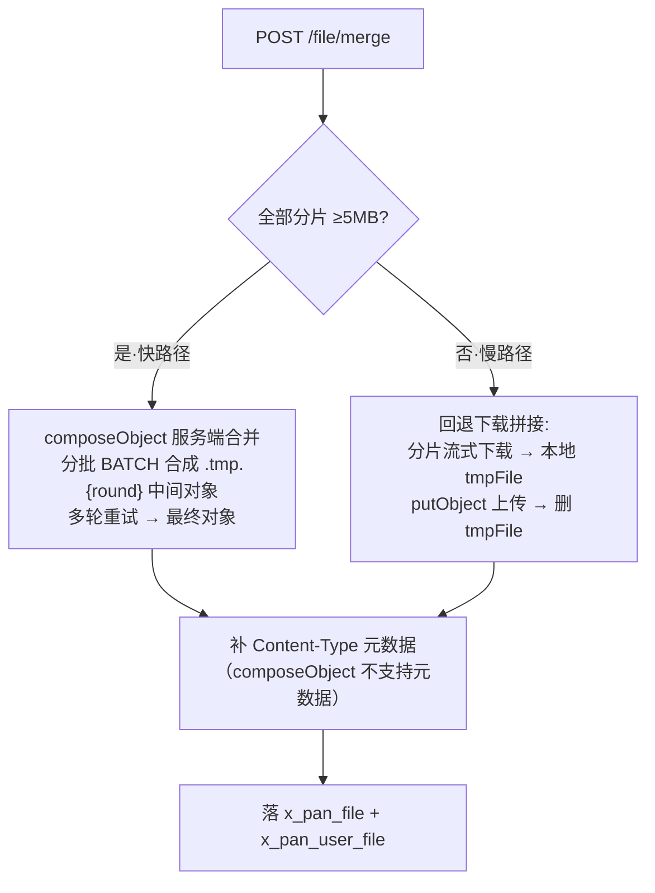

# 10-性能设计与优化

> 项目：X-Pan ｜ 版本：v1.1 ｜ 生成日期：2026-10-06 ｜ 依据：源码分析

X-Pan 的性能设计围绕一个核心矛盾展开：**元数据走 MySQL（强一致、小事务），字节走 MinIO/本地盘（大吞吐），两者绝不让对方的短板拖累自己**。本文沿"上传→存储→下载/预览→状态访问→前端加载"的数据通路逐段拆解设计、量化参数与代码落点；最后给出按性价比排序的进一步优化建议。上传三段式协议的业务语义见《05-核心流程》流程一，存储桶与表结构见《04-数据模型》第 1-2 节——本文聚焦"快不快、为什么、还能怎么更快"。

## 1. 分片上传：并发、分片尺寸与合并

**客户端并发模型**（`x-pan-fronted/src/composables/useUploader.ts`）：`simultaneousUploads: 3`（单文件内 3 个分片并发，多文件排队）；`chunkSize` 取 `panUtil.getChunkSize()`（5MB）且 `forceChunkSize: true`——**强制每片严格 5MB**（除末片），这不是可调参数而是协议约束：MinIO `composeObject` 要求除最后一个源对象外每片 ≥5MB，注释直接写明"满足 MinIO composeObject 合并限制"。`progressCallbacksInterval: 500` 把进度事件节流到 500ms，避免大文件高频刷新任务面板。`maxChunkRetries: 0`（分片失败靠断点续传整体恢复而非自动重试——配合函数式 headers `() => ({ Authorization: getToken() })` 实时读 Cookie，长上传中 token 续期不中断）。移动端同构（`x-pan-mobile/lib/services/upload_service.dart`，`AppConfig.chunkSize=5MB` 注释同样对齐 composeObject）。

**服务端分片写入**（`x-pan-parent/server/src/main/java/com/xiaoye/pan/server/modules/file/service/impl/FileChunkServiceImpl.java`）：每片"写对象（`x-pan-chunks/{identifier}/{chunkNumber}`）+ 插记录"在同一把 identifier 粒度 striped 锁内——锁只串行化**同一文件的**分片处理，不同文件完全并行；持有计数 + 锁内校验消除锁对象切换竞态（细节见《07-模块详解》2.3）。分片判定 `doJudgeMergeFlag` 只统计未过期分片且校验 `[1..totalChunks]` 连续集合。`x_pan_file_chunk` 的联合唯一键 `uk_identifier_chunk_number_create_user` 让重复分片天然幂等，客户端重试不产生重复对象写（记录层会撞唯一键）。

**合并的快路径与慢路径**（`x-pan-parent/framework/storage-engine/storage-engine-minio/src/main/java/com/xiaoye/pan/storage/engine/minio/MinIOStorageEngine.java`）：

快路径把拼接开销完全下放到 MinIO 服务端内部（`composeObject` 只复制引用不搬运字节流经应用），应用出口带宽零占用；`.tmp.{round}` 多轮机制应对一次 compose 数量上限；失败回退的下载拼接路径保证任意分片大小可用（正确性优先于速度）。合并后补 Content-Type（composeObject 无法设置元数据，默认 application/octet-stream 会破坏预览）。

**秒传的并发正确性代价**：秒传是最大的性能红利（命中即零字节传输），但其"查物理记录 + 插逻辑引用"临界区与物理删除监听器的"isUnused 判定 + 删对象"临界区**共用 `SEC_UPLOAD_IDENTIFIER_LOCKS` 锁表**（`UserFileServiceImpl.secUpload` 第 260 行起，B7 修复 TOCTOU）——否则秒传可能挂到正被删除的物理文件上。这是典型的"用一把细粒度锁买数据一致性"的设计：锁按 identifier 粒度，只影响同 MD5 文件的并发，全局吞吐无损。

## 2. Redis 状态设计对性能的影响

Redis 承担全部易变状态（《04-数据模型》第 3 节键空间），对性能的影响有三层：

1. **TTL 分层避免缓存雪崩**：`RedisCacheConfig` 按 key 前缀区分 TTL（`USER_LOGIN_*` 25h > JWT 24h > 续期点 12h 的链条，见《08-安全与权限设计》第 1 节），登录态不会同时过期造成认证风暴；保险箱解锁态存时间戳而非依赖 TTL 比对（`VaultServiceImpl.isUnlocked`），锁定窗口用"仅首次 EXPIRE"保证语义稳定。
2. **Spring Cache 抽象的双刃剑**：绝大多数读写走 `cache.get/put/evict`（Jackson 序列化 + TTL 防永不过期 + 事务支持），代价是抽象层不暴露原生 INCR 与 TTL——需要原子性的场景（限流器、保险箱/分享码/登录失败计数）显式绕过抽象直用 `StringRedisTemplate`，代码注释记录了这一权衡（登录失败计数的"读改写并发缓解"注释是抽象限制的直接产物，审计 🟡#36 修复后统一 INCR）。
3. **续期锁在 JVM 不在 Redis**：`CommonLoginAspect.RENEW_KEY_LOCKS` 按缓存 key 粒度加 JVM 锁 + 锁内二次检查——单实例下近乎零开销（无网络往返），但这是"性能换扩展性"的欠账（多实例需分布式锁，见第 7 节建议 2）。

限流器本身是 O(1) 的 INCR + EXPIRE，fail-open 设计保证 Redis 故障时限流不反噬主链路（`RedisRateLimiter` 注释"避免限流拖垮服务"）。

## 3. MinIO 存储平面与下载路径

**集群拓扑**（`x-pan-parent/deploy/docker-compose.yml`）：4 节点纠删码（`server http://minio{1...4}/data`），注释自述"等价 RAID5：任意 2 节点宕机仍可读、任意 1 节点宕机仍可写"；前置 nginx 负载均衡（`deploy/nginx.conf`：`least_conn`、**`proxy_buffering off` + `proxy_request_buffering off`**——流式传输关键，避免大对象在 LB 落盘、`client_max_body_size 0` 不限、四个 300s 超时、`X-NginX-Proxy` 头防止 MinIO 按内部 IP 重定向）。

**读路径分流**（`FileController.download`，`x-pan-parent/server/src/main/java/com/xiaoye/pan/server/modules/file/controller/FileController.java` 第 216 行起）：文件大小 ≥`pan.storage.minio.large-file-threshold`（50MB，可配）时**302 重定向到 1 小时预签名 URL**（`generatePresignedGetUrl(realPath, 3600)`），浏览器直连 MinIO，应用层不搬运字节——这是大文件场景最重要的设计，应用带宽与内存占用与文件大小解耦；<50MB 走应用流式代理。`endpoint`（内网 S3 入口）与 `public-endpoint`（浏览器 302 入口）分离支持内外网双平面。配套指标：`BusinessMetrics` 对下载计时并按状态码打标（200/302/403/404）、记录下载字节数直方图。

**预览与缩略图的带宽治理**：图片列表瓦片不拉原图——`POST /file/preview/url` 可带 `width/height`，`previewStream` 按尺寸等比缩放输出并做磁盘缓存（`${xpan.root}/thumbnail`，`xpan.thumbnail.dir`）；尺寸钳制 `THUMBNAIL_MAX_SIZE` 防放大 DoS；视频封面/FFmpeg 关键帧雪碧图预生成（`@Async` 预热走 `taskExecutor`）。`Range` 断点解析（`applyRange`）支持 `bytes=start-end/start-/-suffix` 三形态，视频 seek 不整文件回源。

**生命周期回收**：过期分片（`CleanExpireChunkFileTask`）与 30 天回收站（`CleanExpireRecycleFileTask`）批 500 滚动清理防大事务；孤儿对象 `OrphanFileGc` 每天 3 点兜底（`xpan.gc.orphan-cron`）。存储泄漏有两道防线（bucket 维度教训：分片在 chunk-bucket，别拿 file-bucket 删——`MinIOStorageEngine` 注释记录的缺陷修复）。

## 4. 应用进程的资源配置

| 资源 | 配置 | 出处 |
|---|---|---|
| JVM | `UseG1GC`、`MaxRAMPercentage=75`、`-Djava.security.egd=file:/dev/./urandom`（防 SecureRandom 熵阻塞） | `x-pan-parent/server/Dockerfile` `JAVA_OPTS` |
| Tomcat 线程外的隔离池 | 离线下载 3 线程（`pan.offline.thread-pool-size`）；事件监听 `eventListenerTaskExecutor`；通用异步 `taskExecutor` | `application.yaml`、`common/config/ThreadPoolConfig.java` |
| 数据库连接池 | Druid `initial-size/min-idle: 5`、`max-active: 20`、`max-wait: 60s`、`test-while-idle`、池化 PreparedStatement（20/连接） | `x-pan-parent/distribution/conf/application.yaml` |
| WebSocket 背压 | 单会话发送超时 5s + 缓冲上限 512KB（`ConcurrentWebSocketSessionDecorator`），慢消费者自动断开 | `common/websocket/NotificationWebSocketHandler.java` |
| 大响应防 OOM | `HttpLogFilter.shouldNotFilter` 白名单放行 download/preview/archive 等大流量路径，响应体不进堆 | `framework/web/.../log/HttpLogFilter.java` |
| 离线下载落盘 | 先 spool 到临时文件（64KB 缓冲）再统一入库，失败路径就地删除 | `OfflineTaskServiceImpl.spoolToTempFile` |

## 5. 前端与移动端性能

**Web 加载**（`x-pan-fronted/vite.config.ts`）：`build.target: esnext`；`manualChunks` 把重型预览依赖拆成 7 组独立 vendor chunk（`vendor-vue-office`/`vendor-pdfjs`/`vendor-docx`/`vendor-excel`/`vendor-pptx`/`vendor-codemirror`/`vendor-shiki`/`vendor-monaco`/`vendor-lucide`），预览器全部动态 import 按需加载**不进首屏**；`chunkSizeWarningLimit: 12000` 显式放宽告警（注释说明是"避免无意义噪音"的自觉选择）。静态资源带内容 hash，生产 Nginx `expires 1y immutable` 长缓存（`x-pan-fronted/nginx.conf`）。预签名 URL/ptoken 客户端缓存带约 5 分钟 TTL（`src/utils/preview.ts`）；blob URL 用完 `revokeObjectURL`（前端红线 9）。

**运行时**：列表写入统一走带 `requestSeq` 的 store 方法（防过期响应覆盖，避免"快速操作→重复渲染"）；缩略图磁盘缓存 + blob 缓存（`src/utils/thumbnail-cache.ts`，删除需 revoke——审计 🟡#18 修复）；播放器用完即毁（ArtPlayer 单例 Promise 串行 init + 卸载 destroy，pdfjs `doc.destroy()`，前端红线 8——防的是内存泄漏型性能劣化）。

**移动端**：底部 5 Tab 用 `IndexedStack` 保活（切 Tab 不重建页面树）；图片走 `cached_network_image`；上传任务经 `UploadTaskStorage` 持久化（跨重启断点续传，避免重传大文件的流量与时间成本）；`requestTimeoutMs=60s`（注释"对齐前端 60s"）。已知性能型欠账（审计移动 🟡 组记录）：每请求 2 次 secure storage 平台通道调用（已加内存缓存缓解）、MD5 isolate 不可中断、connectTimeout 60s 偏长——均为低频场景，未阻塞主路径。

## 6. 数据库层的性能设计

文件列表是最高频查询，`x_pan_user_file` 的宽覆盖索引 `index_file_list(user_id, del_flag, parent_id, file_type, file_id, filename, folder_flag, file_size_desc, create_time, update_time)` 把"按目录+删除态过滤、类型筛选、五种排序"全部形态收进一个索引免回表（《04-数据模型》第 6 节）。排序参数走 `SafeOrderBy` 白名单（filename/file_size/update_time/create_time），杜绝注入同时保证排序走索引列。复杂联查（文件列表聚合、分享统计）手写 XML 于 `server/src/main/resources/mappers/`。已知欠账（源码 TODO）：`UserFileServiceImpl.java:632` 注释标注 B11——`findAllFileRecords` 一次性加载用户全部记录，单用户十万级文件时内存压力大，审计记录"改动风险高，保留并加 TODO，建议配合 P5 阶段集成测试重构"。

## 7. 进一步优化建议（按性价比排序）

1. **上传直传 MinIO（预签名 PUT）**：现状分片字节仍流经应用（`storeChunk` 中转）。`MinIOStorageEngine` 已有 `generatePresignedPutUrl`（第 490 行）但无调用方——让客户端持短时效预签名 PUT 直写 `x-pan-chunks`、应用只收"分片完成"回执，可把应用出口带宽与 Tomcat 连接占用降一个数量级。需同步解决预签名 URL 的鉴权发放（沿用 ptoken 模式）与 identifier 校验前置。
2. **多实例前置改造**：三处 JVM 锁（`RENEW_KEY_LOCKS`/`SEC_UPLOAD_IDENTIFIER_LOCKS`/分片 `LOCK_MAP`）与 WebDAV `AUTH_CACHE` 迁 Redis 分布式锁/缓存；`xpan.gc.orphan-cron` 加分布式调度防多节点重复 GC（ShedLock 即可）。单实例内这些机制性能最优，扩容前完成即可。
3. **统计接口合并**：审计 🟡#31 记录文件统计 12 条 COUNT 可合并 GROUP BY（`UserFileServiceImpl` 统计路径）——列表页仪表盘每次进根目录的固定开销。
4. **`findAllFileRecords` 分页/投影改造**：B11 TODO 的正解，配合 ref_count 字段落库（审计 #22 建议）可同时消掉物理删除的引用全表检查。
5. **限流窗口升级滑动窗口**：固定窗口在窗口边界允许 2 倍突发（`RedisRateLimiter` 自述"简单但够用"）——当前阈值宽松（login 5/分）无实际风险，防爆破另有独立计数兜底；如暴露公网压力大可换滑动窗口或令牌桶。
6. **Web 端画廊并发收敛**：审计 🟡#17 记录画廊一次性解析全部图片预览 URL（大目录几十上百并发 POST）——分批 + 交叉轴懒加载即可（⚠️ 待确认：审计修复是否已覆盖此项，`image-gallery-previewer.vue` 现状需复核）。
7. ** OTLP 采样率按环境分级**：主配置 0.1、CI 1.0 已分级；开启导出的生产环境建议对 `/file/chunk-upload` 等高 QPS 路径做采样排除，避免追踪开销占比过高。

一条总原则收束：X-Pan 现有性能设计的共同姿势是**"把贵的操作推到离数据最近的地方"**——合并推给 MinIO、大文件下载推给浏览器直连、缩放推给启动时预热、清理推给凌晨 3 点。后续优化也应延续这个方向，而不是在应用层增加中转与缓冲。
