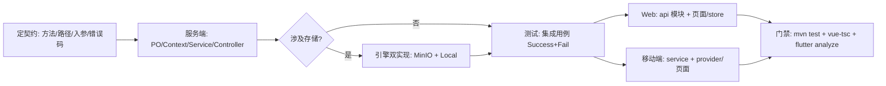

# 11-扩展开发指南

> 项目：X-Pan ｜ 版本：v1.1 ｜ 生成日期：2026-10-06 ｜ 依据：源码分析

本文是"照着做就能通过 CI、不破坏既有约定"的操作手册：六个高频扩展场景各给一条 SOP（步骤化操作流程），全部以当前源码为基准。开工前的公共前提只有两条：通读 `DEV_GUIDELINES.md` 对应端的红线（每条都对应一次真实事故）；理解"模块化单体"的边界纪律（模块间只走接口、Controller 必须在 `modules/<模块>/controller/` 子包——这是登录切面包路径切点的要求，见《01-系统架构》2.2）。提交前跑一遍自检清单（《09-测试与质量保障》第 5 节）。

## SOP-1：在既有模块新增一个业务接口（以后端为轴）

以"给回收站加一个'一键清空'"接口为例（该能力当前不存在，`RecycleController` 只有列表/统计/还原/彻底删除四端点）：

1. **定契约**：确认端点方法与路径（复用既有风格：`DELETE /recycle` 已是批量删除，清空可设计为 `POST /recycle/clear`）。写清入参（无需入参则省）、响应 `R<Void>`、错误码语义（《03-接口设计》第 5 节的 code 表）。
2. **建 PO/Context/VO**：入参 PO 放 `modules/recycle/po/`，`@Validated` + JSR-303 注解；服务层入参用 `context/` 下的 Context 类聚合（对照 `RestorePO` → `RestoreContext` 的既有链）。
3. **写 Service**：接口加在 `modules/recycle/service/IRecycleService.java`，实现加在 `service/impl/RecycleServiceImpl.java`。业务校验（归属、状态）→ `@Transactional(rollbackFor = Exception.class)` → Mapper 操作。**红线检查**：批量 `IN ()` 前判空（红线 11）；状态机变更用条件 UPDATE（红线 5）；删除类操作要触发级联与 `FilePhysicalDeleteEvent`（见《05-核心流程》流程五，漏一条就是数据泄漏）。
4. **写 Controller**：方法放 `modules/recycle/controller/RecycleController.java`——**不要新建包**。只做四件事：解密 ID（`IdUtil.decrypt`）、组装 Context、调 Service、包 `R` 返回。鉴权自动生效（切面覆盖），无需任何注解；如需免登录才加 `@LoginIgnore`。若涉敏感操作（登录/注册/创建类），在 Service 里接 `RedisRateLimiter.checkRateLimit(scope, ...)` 并在 `application.yaml` `pan.ratelimit.*` 加阈值（对照 `share-create` 的接线，`common/ratelimit/RateLimitProperties.java`）。
5. **测试**：在 `server/src/test/java/com/xiaoye/pan/server/modules/recycle/RecycleTest.java` 补 `@SpringBootTest + @Transactional` 用例（成功 + 主要失败分支），沿用回滚范式；涉独立线程参考 `uploadWithChunkTest` 的事务可见性处理（《09-测试与质量保障》第 2 节）。
6. **同步调用方**：Web 端在 `x-pan-fronted/src/api/recycle/index.ts` 加方法（走 `utils/http.ts` 实例，自动获得鉴权/续期/code=10 处理）；移动端在 `x-pan-mobile/lib/services/recycle_service.dart` 加方法。若响应含新 VO 字段，VO 加到出参对象即被 `IdEncryptSerializer` 自动加密 ID，三端无需额外处理。

**反模式提醒**：不要在 Controller 写业务、不要让 Controller 逃出 `controller/` 子包（OfflineTaskController 事故）、不要直接操作别的模块的 Mapper（走它的 Service 接口）。

## SOP-2：新增一个存储桶用途（对象存储平面扩展）

以"为 AI 文本提取结果增加一个缓存桶"为例：

1. **加配置**：`server/src/main/resources/application.yaml`（及打包模板 `distribution/conf/application.yaml`——两者需同步，见《14-配置与环境详解》第 2 节）的 `pan.storage.minio.*` 下加 `text-bucket: x-pan-text`。**禁止**在这里写密钥默认值（红线）。
2. **绑定属性**：`framework/storage-engine/storage-engine-minio/src/main/java/com/xiaoye/pan/storage/engine/minio/config/MinIOStorageEngineProperties.java` 加字段（对照既有 `fileBucket/chunkBucket/thumbnailBucket` 三字段的 `@ConfigurationProperties` 绑定方式）。
3. **确保桶存在**：`MinIOStorageEngine` 启动即确保三桶存在（`ensureBucket` 逻辑），在同类位置补第四桶的初始化。
4. **走引擎而非 SDK**：业务代码通过 `StorageEngine` 接口操作（模板方法 `AbstractStorageEngine` 的 check→doXxx 骨架）。若五操作（store/delete/storeChunk/mergeFile/realFile）语义不覆盖新用途，先扩接口与抽象模板，再落 MinIO 实现与本地实现——**两个引擎实现都要落**，否则 `pan.storage.minio.enabled=false` 的本地模式直接坏死。本地引擎的对应物是 `${xpan.root}` 下的子目录（对照缩略图缓存 `xpan.thumbnail.dir` 的做法）。
5. **对象命名与清理**：命名带业务前缀（对照分片 `{identifier}/{chunkNumber}` 的规则化命名）；登记可清理性——若对象有生命周期，补一张记录表 + 一个 `framework/schedule` 的 `ScheduleTask` 实现（对照 `CleanExpireChunkFileTask`：批 500 滚动、先删对象再删记录、**bucket 维度删对桶**——红线 10 的教训），并在 `common/schedule/launcher/` 注册。
6. **CI 注意**：CI 环境 MinIO 关闭（`application-ci.yaml` `pan.storage.minio.enabled: false`），新桶逻辑的集成测试只能覆盖本地引擎分支；MinIO 分支按《09-测试与质量保障》第 6 节的缺口建议补容器化测试或列入手动冒烟清单。

## SOP-3：新增一个 Web 前端页面

以"新增'最近删除统计'页面 `/purge-stats`"为例：

1. **API 模块**：`src/api/` 下对应域的 `index.ts` 加调用（或新建域目录，对照 `src/api/dedup/` 的最简结构）。请求走统一 axios 实例；blob 类响应自动被拦截器短路（红线 2，无需特殊处理）。
2. **路由**：`src/router/index.ts` 注册路由。主布局内页面挂到 `layout/index.vue` 的子路由（对照 `/recycles`）；独立页（如全屏预览）挂顶层（对照 `/preview/*`）。需要登录就**不要**进守卫白名单；同时把导航项加进 `AppNavbar` 与 `stores/navbar.ts`。
3. **页面组件**：视图放 `src/views/list-page/<name>/index.vue`（列表类）或独立目录。UI 优先复用 `src/components/base/` 的 26 个 Base 组件（BaseTable/BaseModal/BaseDrawer……），图标用 `@lucide/vue`；确认弹窗必须走 `useToast` 的假封装语义——`const ok = await ElMessageBox.confirm(...); if (!ok) return`（前端红线 1，禁止 try/catch 等 reject）。
4. **状态**：页面私有状态用组件内 ref；跨页共享才进 Pinia。**列表类页面必须**把列表写入收敛到 store 里带 `requestSeq` 的方法（红线 4，防过期响应覆盖——对照 `stores/file.ts`）。
5. **样式纪律**：CSS 变量必须 `var(--color-xxx)` 完整包装；提交前跑 `grep -rn "vardanger\|varsuccess\|varwarning" src | grep -v "var("` 应零结果（自检清单）。
6. **类型与构建**：`npx vue-tsc -p tsconfig.app.json --noEmit` 零输出才能过 CI；重型第三方库（预览器类）加进 `vite.config.ts` `manualChunks`（对照 7 组 vendor 拆分，见《10-性能设计与优化》第 5 节）。

## SOP-4：新增一个 Flutter 移动端页面

以"新增'标签管理'页"为例：

1. **Service**：`lib/services/` 加 `file_tag_service.dart`（对照 `favorite_service.dart` 的最简结构），Dio 实例从 `core/network/http_client.dart` 取单例——鉴权/续期/code=10 广播自动生效，**不要**自建 Dio（红线 7：临时 Dio 必须显式超时，能不用就不用）。
2. **Provider（如需）**：状态放 `lib/providers/`，`StateNotifier + copyWith` 不可变更新（红线 6，禁止原地改对象）；列表加载用自增 seq 防竞态（对照 `file_provider.dart`）。
3. **页面**：`lib/pages/` 下建页面文件，通过 `Navigator.push(MaterialPageRoute(...))` 压栈进入（本项目 29 个页面全部如此，go_router 只管认证门卫与三个顶层路由——见《02-页面设计》2.1）；传参用构造函数。
4. **交互纪律**：异步回调里用 `ref`/`context` 前查 `mounted`（红线 7）；轮询必须有总次数/时长上限（对照 `_pollExtract` 的 60 次上限）；后端 `progress` 是 0-100 整数别再 ×100（红线 4）；排序参数必须经 provider 映射成 snake_case 白名单（`filename/file_size/update_time/create_time/delete_time`）。
5. **质量门禁**：`flutter analyze` 零问题 + `flutter test` 全绿（61 个既有用例不许退化）；页面级交互建议补 `testWidgets` 用例（对照 `login_page_test.dart`）。
6. **若页面承载新后端能力**：与 SOP-1 第 6 步联动，三端同一契约——Web 的对应实现也要同步（对齐清单见《03-接口设计》第 7 节）。

## SOP-5：接入新的存储介质（OSS/FastDFS 或新引擎）

OSS/FastDFS 两个引擎**代码已完整但依赖被注释**（`x-pan-parent/server/pom.xml` 中 oss/fastdfs 段），接入它们是"接线"而非"新建"；自研新介质才走全流程：

**接线 OSS（以阿里云 OSS 为例）**：
1. 解除 `server/pom.xml` 对 `x-pan-storage-engine-oss` 的依赖注释（它依赖 `storage-engine-core`，传递依赖自动带上 OSS SDK 3.18.5）。
2. 补配置：`application.yaml` 尾部已留注释模板（`com.xiaoye.pan.storage.engine.oss.bucket-name/endpoint/access-key-id/access-key-secret/auto-create-bucket`），解除注释并把密钥换成 `${OSS_*:}` 空兜底环境变量注入。**红线**：切换前必须完成存量对象迁移——存量 `x_pan_file.real_path` 是 MinIO 对象名，新引擎无法解读（《06-部署运行》第 7 节；`common/migration/StorageMigrationRunner.java` 即为此准备的迁移启动器，⚠️ 待确认其当前完成度后使用）。
3. 验证点：`OSSBucketInitializer` 建桶、上传/秒传/下载 302（OSS 实现同样应提供预签名，对照 MinIO 的 `generatePresignedGetUrl` 在 `FileController.download` 的接线方式）、`minioStorage` 熔断实例语义（新引擎应注册等价熔断，对照 `MinIOStorageEngine.doStore` 上的 `@CircuitBreaker + @Retry`）。

**自研新介质（如 WebDAV 网关、SFTP、Azure Blob）**：
1. 新建 Maven 模块 `framework/storage-engine/storage-engine-<name>`，依赖 `storage-engine-core`；
2. 实现 `StorageEngine` 五操作（store/delete/storeChunk/mergeFile/realFile），继承 `AbstractStorageEngine` 复用参数校验骨架，Context 对象在 `storage-engine-core/.../context/` 已备好；
3. `@ConditionalOnProperty("pan.storage.<name>.enabled")` 装配（对照 `MinIOStorageEngine`），配置属性类对照 `MinIOStorageEngineProperties`；
4. server 引入依赖，业务代码**零改动**（这就是策略模式红线的回报）；若引擎支持服务端合并/预签名，参照 MinIO 引擎在 `FileController` 的可选注入方式（`minioStorageEngine != null` 判断）接入直链路径，否则大文件自动回落应用流式代理（50MB 阈值逻辑不变）。

## SOP-6：新增一个定时/清理任务

以"通知中心 90 天归档清理"为例（当前 `x_pan_notification` 无清理任务，见《13-技术债务与演进建议》）：

1. **选框架**：业务清理任务实现 `framework/schedule` 的 `ScheduleTask` 接口（对照 `common/schedule/task/CleanExpireRecycleFileTask.java`）；单一 cron 型任务也可用原生 `@Scheduled`（对照 `common/gc/OrphanFileGc.java`，cron 走配置 `xpan.gc.orphan-cron`）。`@EnableScheduling` 已在启动类，勿删（红线 7）。
2. **实现要点**（三条全部来自既有任务的血泪）：批处理（500 条/批滚动，防大事务长锁）；**bucket/路径维度删对目标**（红线 10）；清理前置事件（通知归档类若涉及关联展示，评估是否发 Spring 事件异步刷未读数）。
3. **注册**：`common/schedule/launcher/` 下加 Launcher（对照 `CleanExpireRecycleFileTaskLauncher`）把任务挂进 `ScheduleTaskHolder`；cron 参数化到 `application.yaml`。
4. **验证**：本地把 cron 调到分钟级观察日志与数据；确认任务在 `StartedListener` 启动日志后正常注册（框架层有 `ScheduleTaskTest` 可参照写单测）。

## 扩展总检查单（所有 SOP 通用）

六个 SOP 的落点虽然分散在三端，但改动扩散路径是同构的——先定契约、后落服务端、再同步两端调用方，最后过门禁：

动代码前问五问：① Controller 是否在 `modules/<模块>/controller/` 子包（鉴权自动生效的前提）？② 新路径是否会把客户端输入拼进存储/文件路径（是则先加 `@Pattern` 白名单 + 工具层清洗，红线 3）？③ 是否新增了"复用 realFileId"的路径（是则必须进 `SEC_UPLOAD_IDENTIFIER_LOCKS` 同一临界区，红线 8）？④ 失败计数/防爆破是否用了 Redis 原生 INCR + 仅首次 EXPIRE（红线 6）？⑤ 三端契约是否同步（Web `src/api/`、移动端 `lib/services/`、`code=10`/`New-Access-Token` 语义不动）？这五问全部来自真实事故，比任何风格指南都优先。
