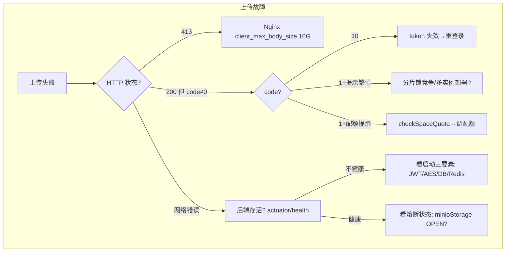
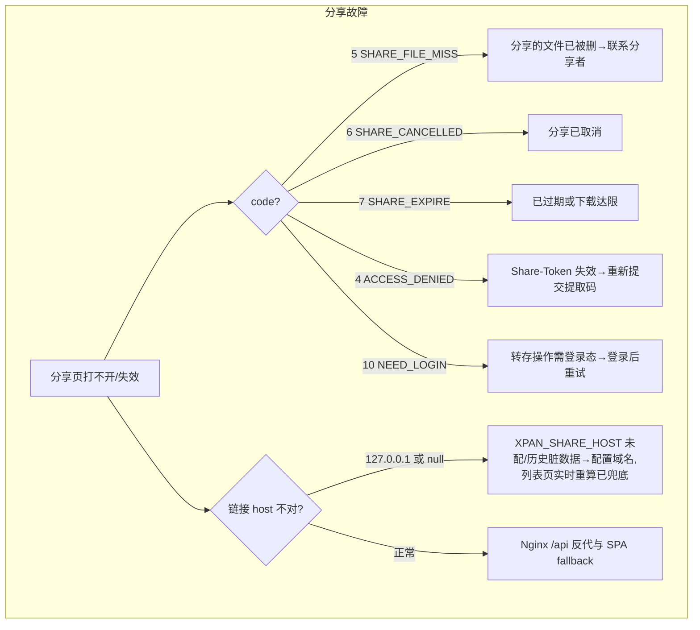

# 12-FAQ与故障排查

> 项目：X-Pan ｜ 版本：v1.1 ｜ 生成日期：2026-10-06 ｜ 依据：源码分析

本文是排障手册：先给日志与调试入口（拿到现场的第一步），再按"启动失败 → 登录会话 → 上传 → 分享 → 预览/下载 → 部署网络"分类列出高频问题（现象/根因/解决/出处四元组），最后给上传、分享、预览三条故障排查决策树。启动类故障的速查版在《06-部署运行》第 6 节，本文是它的纵深与展开；错误码语义表见《03-接口设计》第 5 节。文中"出处"均指源码相对路径（省略 `x-pan-parent/` 前缀）。

## 1. 日志与调试入口（拿到现场先看这里）

| 入口 | 位置/方法 | 用途 |
|---|---|---|
| 应用日志文件 | `${user.home}/logs/x-pan-server/x-pan-server.log`（`logging.file` 配置，容器内对应 `/root/logs/...`，注意 `XPAN_ROOT` 是数据目录**不是**日志目录） | 全量日志；pattern 已含 `[traceId=...,spanId=...]`（`application.yaml` `logging.pattern.correlation`，格式化由 `server/src/main/resources/logback-spring.xml` 定义） |
| traceId 串联 | 后端 `common/log/LogMdcFilter.java` 注入 MDC；三端请求头 `X-Pan-Trace-Id`（Web `src/utils/http.ts`、移动端 `lib/core/network/http_client.dart` 均注入）；响应头同步回传 | **跨端报障第一步：对齐 traceId**，一个请求的完整链路（Filter→切面→Service→存储引擎）用它一查到底 |
| 访问日志 | `framework/web/.../log/HttpLogFilter.java`（大流量路径按 `shouldNotFilter` 白名单跳过） | 每个请求的 URI/耗时/状态 |
| Actuator | `/actuator/health`（`show-details: always`，含 DB/Redis 细项）、`/actuator/health/liveness`（容器探活）、`/actuator/metrics`、`/actuator/prometheus` | 健康与指标；`exclude` 已挡掉 env/heapdump/shutdown 等敏感端点 |
| 熔断状态 | `resilience4j` 健康指标（`register-health-indicator: true`）+ Grafana 面板（`x-pan-parent/deploy/grafana-dashboard.json`） | MinIO/离线下载熔断 OPEN/HALF-OPEN 一眼可见 |
| 容器日志 | `docker compose -f deploy/docker-compose-server.yml logs -f xpan-server`（容器名 `xpan-server`） | 部署态日志 |
| 接口文档 | `/doc.html`（knife4j）——**仅 dev/local profile 可访问**，生产访问属预期关闭 | 联调时核对契约；生产想临时开见《14-配置与环境详解》profile 矩阵 |
| 前端调试 | Vite dev 控制台（代理日志）、浏览器 Network 看 `code` 与 `New-Access-Token` 响应头 | 确认续期是否发生、业务码是否 10 |
| WebSocket | 浏览器 WS 帧面板：握手 `ws(s)://host/ws/notification?token=`、服务端 30s `{"type":"PING"}`、业务帧 `{"type":"UPLOAD_FINISHED",...}`（`common/websocket/NotificationWebSocketHandler.java` 注释即协议文档） | 通知不达时区分"没连上"与"连上没推" |

日志分层的使用技巧有两条。**日志级别**：根级别 INFO，MinIO 引擎包单独 INFO（`com.xiaoye.pan.storage.engine.minio`，为排障可临时调 DEBUG 看每次 S3 调用的细节）——调级别走 `application.yaml` `logging.level`，不要改代码；排障结束后记得调回，DEBUG 级别在高上传吞吐下日志量可观。**日志位置与环境的关系**：裸机跑在 `${user.home}/logs/` 下（whoami 对应的 home），容器跑在里面用户的 home（镜像是 root 启动但进程用户为 `xpan`，即 `/home/xpan/logs/`，且**未挂卷**——容器重建日志即丢，重要故障日志先 `docker cp` 拷出）；这与数据目录 `/app/data`（已挂 `xpan-data` 卷）形成对比，排障时要意识到两者的持久化待遇不同。另外后端日志 pattern 的 `[traceId=...,spanId=...]` 前缀由 `logging.pattern.correlation` 与 `logback-spring.xml` 共同保障（spanId 仅在 OTel 桥接生效时非空，默认关闭导出时 traceId 依然可用——traceId 来自 Micrometer Tracing 的 W3C 传播，与是否导出 span 无关）。

**一次典型排障的完整走查**——把上面的入口串成动作序列。假设用户报障"上传大文件一直失败"：第一步，让用户复现一次，从浏览器开发者工具的 Network 面板读出本次请求的 `X-Pan-Trace-Id`（响应头或请求头都有）；第二步，登录后端所在主机，在 `x-pan-server.log` 里 `grep <traceId>`，一次命中该请求经过的全部日志行——Filter 访问日志、登录切面的"成功拦截到请求"、Service 层的业务日志、MinIO 引擎的调用日志；第三步，按日志里的最后一行判断平面归属：停在切面是会话问题（看第 3 节）、停在 `checkSpaceQuota` 是配额问题（第 4 节）、停在存储引擎并伴随熔断日志是 MinIO 平面问题（第 2 节最后一行）、HTTP 层 413 则根本没到后端（第 7 节）。这条"traceId → 最后一行日志 → 定位平面 → 查对应小节"的动线，是本文所有 FAQ 表格的索引方式。移动端用户报障时多一步：让用户在"我的→设置"确认 App 指向的环境（`AppConfig.apiBaseUrl` 是编译期固化的，测试包可能直连本地后端），避免拿生产日志查测试环境的问题。

## 2. 启动失败类（进程起不来）

启动失败的共同特征是**进程起不来或起来即不可用**，这一类问题 90% 汇集在"密钥注入"与"中间件可达"两个焦点上——这正是配置红线（缺配置快速失败）刻意营造的效果：宁可启动时崩溃，不要运行时静默错。逐条排查时注意区分"启动日志里的异常"（AesKeyConfig/JwtUtil 静态块、数据源初始化）与"首次使用才暴露的异常"（MinIO 熔断、Redis 密码错导致登录全断），两者的排查入口不同：前者看启动日志的最后 50 行，后者看 actuator 健康明细。

还有一个把启动类问题一分为二的判别技巧：**看异常发生在哪个 Spring 生命周期阶段**。静态块/配置绑定类失败（JWT 密钥、AES 注入）发生在 Bean 装配之前，堆栈里没有 DataSource 字样；连接类失败（MySQL/Redis 不可达）发生在数据源与缓存初始化，堆栈里必有连接超时/拒绝字样；而 compose 层面的 `必须设置 XPAN_XXX` 失败发生在容器创建之前，根本到不了 Java——三段对应三个责任边界（应用配置/中间件/部署编排），先定位段再动手，能避免"改了半天 yaml 其实是安全组没放行"这类方向性错误。

| 现象 | 根因 | 解决 | 出处 |
|---|---|---|---|
| 启动即抛 `IllegalStateException: JWT 签名密钥未配置…长度必须 >= 32 字节` | `XPAN_JWT_SECRET` 未设置或过短（刻意的快速失败） | `export XPAN_JWT_SECRET=$(head -c 48 /dev/urandom \| base64)` 或用 `run-local.sh` | `framework/core/.../utils/JwtUtil.java` 静态块 |
| AES 密钥告警/ID 加解密失败 | `XPAN_AES_KEY/XPAN_AES_IV` 非恰 16 字符 | `openssl rand -hex 8` 各生成一个（注意轮换代价：《08》第 7 节） | `common/config/AesKeyConfig.java` |
| 数据源初始化失败 | `XPAN_DB_PASSWORD` 缺失，或**库不存在**（`db.sql` 只建表不建库） | 先 `CREATE DATABASE x_pan;` 再导 `distribution/conf/db.sql` | `application.yaml` datasource 段 |
| Redis 连接失败 | `XPAN_REDIS_PASSWORD` 错/缺，或 host 不对；容器化部署检查 `XPAN_SERVER_HOST` 是否注入（compose `:?` 强制） | 核对连接串；compose 部署必须填 `deploy/.env` 的 `XPAN_SERVER_HOST` | `application.yaml`、`deploy/docker-compose-server.yml` |
| compose 起不来报 `必须设置 XPAN_XXX` | `.env` 缺必填项或仍是"请替换"占位 | 按 `deploy/deploy.sh` 的 MISSING 列表补齐（脚本会逐项点名） | `deploy/deploy.sh` 校验段 |
| 起来了但 `/doc.html` 404/关闭 | 生产 profile 默认 `knife4j.enable: false`，**设计行为非故障** | 本地用 `XPAN_PROFILE=dev` 或 `local` | `application.yaml`、`application-dev.yaml` |
| 启动正常但上传/下载批量失败 | MinIO 不可达，`minioStorage` 熔断 OPEN（30s 半开探测），日志见熔断与 `SSRF` 无关的连接错误 | 查 endpoint 内外网地址与 AK/SK；熔断恢复自动闭合 | `application.yaml` resilience4j 段、`common/resilience/` |

## 3. 登录与会话类

会话类问题的共同本质是：**客户端持有的 token 与 Redis 会话槽位里的 token 不一致**。可能是合理的（登出、改密、远程下线、续期轮换的瞬间），也可能是异常的（Redis 数据丢失、多实例各持一份槽位、clientId 漂移）。排查时先用"哪一侧变了"来分类：token 变了（续期/重登录）属正常流转；槽位没了（登出/下线/Redis 清库）查吊销来源；两侧都在但对不上（多实例/双写）按第 14 篇环境矩阵核对部署形态。下表覆盖高频现象。

| 现象 | 根因 | 解决 |
|---|---|---|
| 登录报"登录失败次数过多，账号已被锁定15分钟" | 防爆破：`USER_LOGIN_FAIL_{username}` 计数 ≥5 | 等 15 分钟自动解锁（按用户名维度，无需人工）；重置 Redis 键可立即解锁 |
| 一直被登出/每次请求都 code=10 | token 与 Redis 槽位不一致：多实例部署但 Redis 未共享；或 JWT secret 与写缓存时不一致；或 clientId 漂移（Web 清了 Cookie） | 核对三端 clientId 稳定性（移动端存 Keychain/Keystore）；确认单实例或共享 Redis |
| 改密后其它端没掉线 | 正常应全端下线（遍历 `USER_CLIENT_IDS_{userId}`） | 若未生效检查该键是否存在（老会话可能建于该机制上线前，重新登录即可） |
| WebSocket 连不上（生产 Nginx 后） | `/ws/` location 漏配 `Upgrade/Connection` 升级头——nginx 把握手当普通 HTTP | 按 `x-pan-fronted/nginx.conf` 的 `/ws/` 段补齐；不能复用 `/api/` location |
| 远程下线设备后该设备还能用一会儿 | 下线删的是 Redis 槽位，下一个请求即失效；WS 已建连接不受影响（连接后不复查，见《08》第 8 节） | 属已知设计边界；关闭该端 App 或等 JWT 过期 |
| WebDAV 挂载 401 循环 | Basic 凭证错，或改密后 10 分钟 AUTH_CACHE 未过期 | 用新密码重挂；等缓存过期（`modules/webdav/WebDavController.java` AUTH_CACHE） |
| WebDAV 上传失败报 501 | **PUT 未实现**（`response "PUT 暂未实现，请使用 Web 端上传"`） | 设计现状非故障：实际可用仅 GET/HEAD 下载与 DELETE（PROPFIND/MKCOL/MOVE/COPY 未注册路由即 405，目录浏览不可用，见《16》ADR-010），写入走 Web/移动端 |

## 4. 上传类（决策树见第 5 节）

上传是全系统链路最长的功能（客户端 MD5 → 秒传试探 → 分片并发 → 服务端合并 → 双表落库 → WS 通知），六段中任何一段失败都会表现为"上传失败"，因此排查上传问题的核心手法是**先定位失败在哪一段**：任务面板的状态列就是段位指示器（解析中=MD5 计算中、等待/上传中=分片、合并中=服务端 composeObject、成功/失败=终态）。再结合两个信息源交叉定位——浏览器 Network 面板看最后失败的请求是 `/sec-upload`、`/chunk-upload` 还是 `/merge`；服务端日志按 traceId 看最后一个动作。下表的每一行都标注了对应段落，先对段再查因。移动端上传与 Web 同协议，差异在持久化：移动端任务经 `UploadTaskStorage` 落本地，"上传列表为空但文件没传完"时先查本地任务表再查服务端分片（`GET /file/chunk-upload` 是双端一致的真相来源）。

| 现象 | 根因 | 解决 | 出处 |
|---|---|---|---|
| 上传报 413 Request Entity Too Large | Nginx `client_max_body_size` 未放宽（默认 1M） | 前端容器 nginx 已配 10G；自建反代需同样配置 | `x-pan-fronted/nginx.conf` |
| 秒传"没传就成功"是 bug 吗 | 不是：MD5 命中 `x_pan_file` 即零字节登记（配额照常校验） | 无需处理；验证：文件出现在目标目录且大小正确 | `UserFileServiceImpl.secUpload` |
| 大文件传到 99% 卡住 | 在等 `POST /file/merge`：MinIO 合并大文件耗时（composeObject 或回退拼接） | 观察任务面板 MERGE 态；频繁失败查 MinIO 与磁盘 | `MinIOStorageEngine.mergeByComposeObject` |
| 报"文件分片保存繁忙，请稍后重试" | 分片锁竞争超 3 次重试（同一文件极端并发） | 客户端自动重试即可；持续出现查是否多实例部署（JVM 锁失效征兆） | `FileChunkServiceImpl.saveChunkFile` |
| 上传中途 token 过期 401 | 上传器 headers 是创建时快照（历史 bug，已修） | 确认 `useUploader.ts` headers 为函数式 `() => ({Authorization: getToken()})`（移动端拦截器自动续期） | `src/composables/useUploader.ts` 注释 |
| 断点续传没跳过已传分片 | `checkChunkUploadedByResponse` 严格按 `uploadedChunks` 判定，接口异常时强制重传（防合成坏文件，设计行为） | 查 GET `/file/chunk-upload` 是否正常返回；确认分片未过期（`CleanExpireChunkFileTask` 清理过期分片） | `useUploader.ts`、`FileChunkServiceImpl.doJudgeMergeFlag` |
| 报"文件不存在或无权限"/配额不足 | 父目录归属或配额校验拦截（B9 机制生效） | 检查目标目录归属与 `used_size`；调配额 `PUT /user/quota` | `UserFileServiceImpl.checkParentIdOwnership/checkSpaceQuota` |
| 保险箱文件无法移入报"暂不支持文件夹" | 保险箱是扁平模型，拒绝文件夹级联 | 逐个文件移入 | `VaultServiceImpl.moveIn`（D2 注释） |

## 5. 故障排查决策树

三棵决策树按"从现象出发、每个分叉只问一个是非题"的原则绘制。读法：从根节点进入，按实际观测值走向叶子；叶子节点给出的是**动作**而非结论——执行动作后若问题仍在，回到最近的分叉换另一条路径。三棵树覆盖了工单里约八成的上报场景，其余长尾在第 2-4、6-7 节的表格里按关键字检索。





```mermaid
flowchart TB
    subgraph Preview["预览/下载故障"]
        P1[预览空白/下载失败] --> P2{何种文件?}
        P2 -->|图片/视频缩略图| P3{ptoken 链路}
        P3 -->|报"预览签名 token 无效或已过期"| P4[ptoken 5 分钟过期→重拉 preview/url]
        P3 -->|404| P5[对象缺失→查 OrphanFileGc 日志与桶]
        P2 -->|视频拖进度条卡| P6[Range 头被反代剥离? 检查 nginx 是否缓存/缓冲]
        P2 -->|Office| P7{转换任务}
        P7 -->|一直 PENDING| P8[查 x_pan_preview_task.status 与任务线程]
        P7 -->|产物 403/404| P9[preview_url expire_time 过期→重新发起转换]
        P2 -->|大文件 302 后失败| P10[public-endpoint 配了内网地址→改为公网可达入口]
    end
```

## 6. 分享 / 离线下载 / 数据类补充 FAQ

本节是第 5 节决策树之外的长尾补充：分享侧问题集中在"失效三态（5/6/7）的正确解读"与"链接地址不对"两类——前者是防护机制生效，后者几乎都是 `XPAN_SHARE_HOST` 配置问题；离线下载侧的问题几乎全部能在任务记录的 `error_msg` 字段直接读出原因（SSRF 拦截、跳数超限、协议不支持都是设计内失败，走 status=3 而非系统异常）；数据一致性类问题（对象与记录不符）则要区分方向——"有记录无对象"用户可感知（下载 404），"有对象无记录"用户无感但占存储，后者由孤儿 GC 兜底。

| 现象 | 根因 | 解决 | 出处 |
|---|---|---|---|
| 创建分享报"操作过于频繁" | share-create 限流 30/分 | 稍后重试；阈值在 `pan.ratelimit.share-create-per-minute` | `ShareServiceImpl.create` |
| 分享码校验失败但码是对的 | 历史缺陷（保存 toLowerCase 校验原样比较）已于审计修复 | 升级到修复后版本；存量脏数据重新创建分享 | `CODE_AUDIT` 🟠#15 |
| 提取码连错被锁 | 分享码防爆破计数（Redis 原生 INCR） | 等 15 分钟窗口过 | `ShareServiceImpl.recordShareCodeFail` |
| 离线下载任务失败 status=3，error_msg"仅支持 HTTP/HTTPS 协议" | 提交了 magnet/thunder 链接——**BT/磁力当前未实现**（protocol 字段仅预留） | 只用 http/https 直链；BT 支持属演进项 | `OfflineTaskServiceImpl.validateUrl/parseProtocol` |
| error_msg"URL 指向内网或元数据地址，已拒绝" | SSRF 校验拦截（内网 IP/169.254 元数据/DNS 解析到私网） | 属安全机制生效；确属公网资源则检查其 DNS | `OfflineTaskServiceImpl.checkHostSafety` |
| error_msg"重定向跳数超过 5 次，已终止下载" | 重定向超 `MAX_REDIRECT_HOPS=5` | 换最终直链 | 同上 openWithRedirectValidation |
| 离线任务取消后显示"失败" | 历史竞态（取消被下载线程覆盖）已修为条件 UPDATE | 升级版本 | `CODE_AUDIT` 修复要点 2 |
| 还原文件报重名冲突 | 目标目录存在同名未删除文件（`checkRestoreFilename` 拦截） | 先处理冲突文件再还原 | `RecycleServiceImpl` |
| 回收站里文件 30 天后消失 | `CleanExpireRecycleFileTask` 过期物理删除（设计行为） | 重要文件及时还原 | `common/schedule/task/` |
| 数据库出现"有记录无对象"或反之 | 删除链路异常的残余 | `OrphanFileGc` 每天 3 点兜底清"有对象无记录"；反向缺失需查存储引擎日志 | `common/gc/OrphanFileGc.java` |

## 7. 部署与网络类

部署类问题的特征是**同一段代码在本地正常、部署后异常**，根因几乎总在反代规则、endpoint 指向与门禁接线三处。排查顺序建议：先 curl 后端 8081 原始端口确认服务本身健康，再逐层向外验证 Nginx（`/api` 反代与 SPA fallback）、域名解析与 TLS、最后才是前端资源——由内向外排比由外向内快。

| 现象 | 根因 | 解决 |
|---|---|---|
| 浏览器直连 MinIO 预签名 URL 失败 | `pan.storage.minio.public-endpoint` 配了内网地址（该地址下发给浏览器 302） | 改为公网可达入口；内外网分离见《04-数据模型》1.2 |
| 页面刷新 404 | SPA fallback 未配 | `/` location `try_files $uri $uri/ /index.html` |
| API 全部 404 | `/api/` 反代漏配或没去前缀 | `proxy_pass http://x-pan-backend:8081/`（尾斜杠即去 `/api` 前缀） |
| 通知/进度不实时但手动刷新正常 | WS 断了（升级头/超时）或前端禁用——功能自动降级不报错 | 按《08》WS 项排查；`proxy_read_timeout 3600s` 需配 |
| CI 测试挂/镜像却发布了 | docker job `needs: [backend]` 未接 test（有意保留，待稳定后收紧） | 属现状非故障；见《09-测试与质量保障》第 3 节 |
| 本地测试跑不起来 | 集成测试需真实 MySQL/Redis | 起依赖中间件或照 CI 的 services 方式；`application-ci.yaml` 可作本地同构模板 |
| 更换密钥后旧分享链接打不开 | AES key 轮换使旧链接中的加密 ID 不可解密（2026-09-06 实际事故） | 分享列表实时重算可自愈；外部已分发的链接无法挽救——轮换前评估（《08》第 7 节） |

## 8. 排障方法论小结

X-Pan 的排障有三条快速通道，按序尝试：**第一，traceId 串联**——任何用户报障先要 `X-Pan-Trace-Id`（前端 Network 面板可见），一条 grep 从 Filter 日志追到存储引擎日志；**第二，健康探针定位平面**——`/actuator/health` 的 DB/Redis/resilience4j 细项直接把故障归到数据面、缓存面还是存储面，熔断 OPEN 即存储面；**第三，错误码定层**——HTTP 4xx/5xx 是接入层（Nginx/流式输出），`R.code` 是业务层（10 会话、5/6/7 分享态、3 参数），两者都正常但行为不对时才深入 Service 日志。

在这三条通道之上，还有三条经验性原则值得沉淀。**其一，先分辨"坏了"还是"就这么设计的"**：生产 `/doc.html` 关闭、WebDAV PUT 501、秒传"没传就成功"、回收站 30 天自动清理，都是设计行为而非故障——排障前先读《07-模块详解》对应模块的边界说明，可以省掉一轮无效排查；本文各表格中标注"设计行为/设计现状"的条目就是这些易误报点。**其二，区分必然与偶发**：能稳定复现的问题走决策树；偶发问题优先怀疑并发与时序（续期窗口的 `_PREV`、分片锁竞争、取消与下载的状态竞态），此时日志里的时间戳比对比代码走读更快。**其三，环境问题先于代码问题**：跨环境表现不一致（本地好、生产坏）时，按《14-配置与环境详解》第 4 节的差异矩阵逐行对照——profile、密钥、中间件地址、Nginx 超时与体积限制，这四处的环境差异覆盖了绝大多数"同代码不同行为"。最后，修复任何一次故障后，把"现象/根因/解决"按本文表格的格式回填到团队知识库，并检查 `DEV_GUIDELINES.md` 是否需要新增一条红线——这个项目的历史证明，最好的 FAQ 是让同类问题从此写不出来的那条约定。
