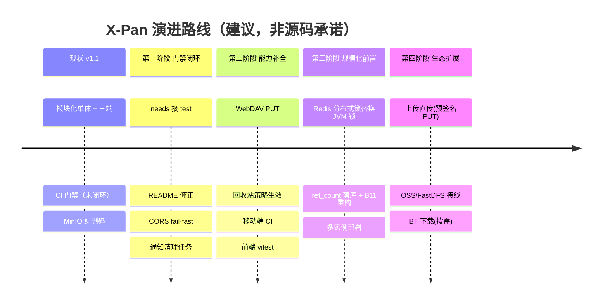

# 13-技术债务与演进建议

> 项目：X-Pan ｜ 版本：v1.1 ｜ 生成日期：2026-10-06 ｜ 依据：源码分析

本文汇总散落在前七篇（00-06）与本套新篇（07-12）中标注的全部 ⚠️ 待确认项与已知欠账，逐条给出**位置/证据/影响/建议**，再合并出一份带优先级的演进路线图。口径说明：`CODE_AUDIT_2026-09-06.md` 所列约 90 项问题**已全部修复**（含死代码清理，已逐项核实），本文只收"修复后仍存在"的债务——即有意保留的设计取舍、预留未实现的特性、文档漂移与测试缺口；修复史本身不重复展开（索引见《08-安全与权限设计》第 7-8 节）。

## 1. 逐条债务清单

### 1.1 功能预留未实现类

**D1 离线下载 BT/磁力未实现（protocol 字段仅预留）**
- 位置：`x-pan-parent/server/src/main/java/com/xiaoye/pan/server/modules/offline/service/impl/OfflineTaskServiceImpl.java` `parseProtocol`（识别 MAGNET/THUNDER/BT）与 `validateUrl`（仅放行 http/https）；`distribution/conf/db.sql` `x_pan_offline_task.protocol` 字段。
- 证据：`parseProtocol` 会把 magnet 链接标为 MAGNET，但 `ALLOWED_PROTOCOLS = Set.of("http","https")` 直接拒绝——字段与识别逻辑先行，下载器未落地。
- 影响：用户提交磁力/种子链接只会得到"仅支持 HTTP/HTTPS 协议"错误；protocol 字段实际只会有 HTTP/HTTPS/OTHER 三值。
- 建议：若不打算实现 BT，建议把 `parseProtocol` 的 BT/MAGNET/THUNDER 分支删掉或注释注明预留语义，避免读码者误解；若要实现，BT 下载器需进独立线程池（复用 `pan.offline.thread-pool-size` 的隔离模式）并补充种子文件 SSRF 评估（tracker 与 peer 均为任意地址，现有 URL 校验模型不适用）。

**D2 设备地理位置（device.location）无实际写入**
- 位置：`modules/device/service/impl/DeviceServiceImpl.java:87`（`device.setLocation(""); // 预留，需 IP 库支持`）、`modules/device/entity/XPanDevice.java:50`。
- 影响：设备管理页 location 恒为空，字段与前端展示位空转；引入 IP 库（GeoLite2 等）才有意义。
- 建议：二选一——接入离线 IP 库并在登录时填充（注意隐私合规与库更新运维），或明确废弃该列（`db.sql` 去字段需走增量脚本规范，参考 `server/src/main/resources/sql/` 的追加式迁移）。⚠️ 待确认：产品层面是否需要此能力。

**D3 WebDAV 能力边界比"协议子集"更窄：实际可用仅 GET/HEAD/DELETE**
- 位置：`modules/webdav/WebDavController.java:67-73`（`@RequestMapping` 仅注册 GET/POST/PUT/DELETE/OPTIONS/HEAD 六个方法——PROPFIND/MKCOL/MOVE/COPY 到不了处理器，Spring 路由层即 405）、:254-265（`handlePut` 返回 501 + "PUT 暂未实现，请使用 Web 端上传"）、:282-290（`handleMkcol` 501）、:351-356（`handleMoveOrCopy` 501）、:292-339（`handlePropfind` 桩实现：仅回显请求路径自身元数据，不遍历真实文件树）。
- 影响：Finder/RaiDrive 挂载后**拖文件进网盘不可用**（PUT 501），**目录浏览同样不可用**（PROPFIND 桩）——"挂载为网络磁盘"实际达成度远低于 OPTIONS Allow 头宣称的能力；GET 的路径语义是加密 fileId 而非层级路径。能力口径详见《16-决策记录ADR》ADR-010（本条原表述"PUT 未实现（挂载只读）"隐含其余方法可用，已在 2026-10-06 一致性回刷中按源码收窄）。
- 建议：短期在 `deploy/WEBDAV.md` 与本文档明示"实际可用面：GET/HEAD/DELETE + OPTIONS 能力探测"；中期补齐分两步——先把缺失方法注册进 `@RequestMapping` 并补"层级路径 → 文件树"解析层，再实现 PUT（复用 `IUserFileService.upload`，MultipartFile 适配参照离线下载的 `TempFileMultipartFile` 模式），注意大文件走分片协议或直传的限制（`spring.servlet.multipart` 3GB 上限）。

**D4 通知中心无清理策略**
- 位置：`modules/notification/`（无清理任务）；`x_pan_notification` 表无 TTL 机制；《04-数据模型》8 已标注。
- 影响：长期运行通知表单调膨胀（UPLOAD_FINISHED/SHARE_STATS_UPDATE 每次上传/访问都落库），`idx_user_time` 列表查询变慢。
- 建议：按 SOP-6（《11-扩展开发指南》）加"90 天归档清理"任务，批 500 滚动；或按用户保留条数截断（每用户最近 N 条）。

**D5 OSS/FastDFS 引擎待接线**
- 位置：`x-pan-parent/server/pom.xml`（两段依赖注释）、`application.yaml` 尾部注释模板、`framework/storage-engine/storage-engine-oss|fastdfs/`（代码完整）。
- 影响：多存储介质能力"看得见摸不着"；但反之也说明当前 MinIO/Local 双实现是全量验证过的。
- 建议：保持现状即可；启用时按《11-扩展开发指南》SOP-5 执行，**关键是先解决存量对象迁移**（`common/migration/StorageMigrationRunner.java` ⚠️ 待确认完成度，启用前必须实测）。

### 1.2 工程与门禁类

**D6 CI docker 发布 job 未接 test 门禁**
- 位置：`x-pan-parent/.github/workflows/ci.yml`——docker job `needs: [backend]`，文件头注释自述"测试链路刚接入尚未稳定，待连续绿后改为 needs: [backend, test]"。
- 影响：测试失败不阻断镜像发布，门禁只有"通知价值"没有"拦截价值"；坏镜像可能被 `latest` tag 拉到生产。
- 建议：test job 连续绿一段周期后立即收紧为 `needs: [backend, test]`（一行改动）；收紧前可用 GitHub branch protection 把 test 设为 PR 必检，先行拦截合入侧。

**D7 移动端无 CI、前端无运行时单测**
- 位置：`x-pan-mobile/.github/` 无生效 workflow（`CHANGELOG.md` 有"摘除测试豁免"意图记录）；`x-pan-fronted/package.json` 无测试框架。
- 影响：移动端 61 个用例只在本机跑，回归靠自觉；前端逻辑（store 竞态防护、useToast 语义、上传判定）零自动化覆盖。
- 建议：移动端补两步 workflow（`flutter analyze` + `flutter test`）；前端引入 vitest 优先覆盖《09-测试与质量保障》第 6 节列出的四个纯逻辑点。

**D8 README 用例数漂移（68 vs 源码 53+17）**
- 位置：`README.md:7,211` 与 `x-pan-parent/README.md`（"68 用例全绿"）；当前源码 server 53 个 `@Test` + framework 17 个 = 70；`CHANGELOG.md` 记录门禁接入时点"68/68 全绿"。
- 影响：数字漂移侵蚀 README 可信度（同理还有下条 D9）；新协作者核对不上会怀疑环境。
- 建议：README 改为不带死数字的表述（"CI 集成测试门禁（MySQL/Redis 服务容器）"），或加一条"用例数以 `mvn test` 输出为准"的口径说明；每次增删测试顺手同步。

**D9 README 默认账号与 db.sql 不符**
- 位置：`x-pan-parent/README.md:186`（"默认账号 admin/admin（请上线前修改）"）；`distribution/conf/db.sql` 为纯 DDL 无账号数据；《00-项目总览》5.5 已标注 ⚠️。
- 影响：按 README 操作的用户登录失败，误判系统故障。
- 建议：README 改为"首次通过 `/user/register` 注册（限流 3 次/小时）"，或提供 `INSERT` 示例脚本（PBKDF2 口令需用 `PasswordUtil` 生成，不能手写明文）。

**D10 x_pan_recycle_policy 策略表与硬编码 30 天的联动不明**
- 位置：`distribution/conf/db.sql` `x_pan_recycle_policy`（policy_type 按时间/按容量、retain_days 默认 30、capacity_ratio 默认 0.90）；`common/schedule/task/CleanExpireRecycleFileTask.java` 按 30 天清理。
- 影响：策略表像是"已实现的可配置回收站"，实际清理只认 30 天硬编码——配置能力与实现脱节，误配无效果。
- 建议：让 `CleanExpireRecycleFileTask` 读策略表（retain_days 生效是低成本改动，capacity_ratio 需要配额联动放后）；或删表并在文档说明规划。⚠️ 待确认产品意图。

**D11 StorageMigrationRunner 完成度未知**
- 位置：`common/migration/StorageMigrationRunner.java`；仓库无使用文档，`00-06` 篇亦未覆盖其细节。
- 影响：存储引擎切换（MinIO↔Local↔OSS）依赖存量对象迁移，该 Runner 是唯一候选工具但未经验证。
- 建议：专项验证（构造双引擎小数据集实测迁移），补 `deploy/` 文档；不可用则标记 @Disabled 并在 SOP-5 标注"迁移需自研脚本"。

### 1.3 架构约束类（多实例前置改造）

**D12 三处 JVM 锁 + WebDAV AUTH_CACHE 不可水平扩展**
- 位置：`CommonLoginAspect.RENEW_KEY_LOCKS`、`FilePhysicalDeleteEventListener.SEC_UPLOAD_IDENTIFIER_LOCKS`、`FileChunkServiceImpl.LOCK_MAP`、`WebDavController.AUTH_CACHE`。
- 证据：`ConcurrentHashMap` 实现的多处锁表与缓存；《04-数据模型》第 7 节已点名前两者。
- 影响：单实例内近零开销且正确；多实例部署时秒传/物理删除竞态窗口重新打开、续期互踢复发、WebDAV 缓存不一致——**扩容前必须改造**，无灰度余地。
- 建议：统一迁 Redis（`SET NX PX` 分布式锁即可，粒度沿用现有业务键）；限流器与登录态已是 Redis 共享无需动。顺序上放在"第二实例上线"这个里程碑的前置清单里（见第 3 节路线图）。

**D13 findAllFileRecords 全量加载（TODO B11）**
- 位置：`modules/file/service/impl/UserFileServiceImpl.java:632` TODO 注释；审计"未修事项"声明"改动风险高，保留并加 TODO，建议配合 P5 阶段集成测试重构"。
- 影响：单用户十万级文件时内存压力（还原/级联/引用判定路径都要全量加载）；当前个人网盘场景无感，规模化即瓶颈。
- 建议：与 ref_count 落库（审计 #22 建议）打包成"数据可靠性专项"（README 路线图 P5.5 恰好预留了此专项），配集成测试再动。

**D14 CORS 未配置白名单时回退 `*`**
- 位置：`framework/web/.../cors/CorsFilter.java`（空白名单 → `Access-Control-Allow-Origin: *` + warn 一次）。
- 影响：生产漏配即全源开放，配合 Cookie 兜底鉴权扩大 CSRF 面（审计 🟡#24 的保留取舍）。
- 建议：prod profile 下空白名单改为启动失败（fail-fast），dev/local 保留 `*` 便利——一处 profile 判断即可。

### 1.4 密钥与残留风险类

**D15 run-local.sh 明文密钥落盘 + git 历史含旧密码**
- 位置：`x-pan-parent/run-local.sh`（7 个真实密钥明文，gitignore 已确认）；`DEV_GUIDELINES.md` 第一节记录的 git 历史扫描结论（仅 x-pan-parent 37 个提交含 4 个真实密码）。
- 影响：本机失窃/目录误打包即泄漏；历史泄漏依赖"仓库 Private + 安全组白名单"两个前提兜底，任一失效即实际泄露。
- 建议：短期维持 DEV_GUIDELINES 的两个前提并设日程提醒自查；中期把本地密钥迁到 `.env`（deploy 已有该模式）或系统 keychain，`run-local.sh` 改为加载器；开源/展示前必须先完成历史清洗（filter-repo）+ 全量轮换。

**D16 移动端 shareToken 存储隔离待复核**
- 位置：`x-pan-mobile/lib/core/storage/token_storage.dart`（预留 `share_token` 键）；`CODE_AUDIT` 移动 🟠#11 记录"shareToken 全局单槽永不清理"。
- 影响：⚠️ 待确认：审计修复后的现状——若仍单槽，A 分享的 token 可被复用于 B 分享（后端 `ShareIdUtil` 与分享归属校验会兜底拒绝，实际风险为体验问题而非越权）。
- 建议：复核 `share_detail_page.dart` 与 `token_storage.dart`，按 shareId 隔离存储并在登出/离开分享页时清理。

**D17 RocketMQ 依赖声明无使用点**
- 位置：`x-pan-parent/pom.xml` `dependencyManagement`（rocketmq-spring-boot-starter 2.3.6）；全仓库无 Java/配置引用（《00-项目总览》3.1 节核实）。
- 影响：依赖面误导（读 POM 者以为有 MQ），拉包时间浪费。
- 建议：删除声明；真要引入异步化（如通知扇出、缩略图队列）时再加回——当前 Spring 事件已覆盖单进程场景。

### 1.5 文档漂移与死代码（修复确认）

死代码清理已完成的核实结果（写下来避免后人重复排查）：`CODE_AUDIT` 前端 🟡#28 点名的 `SortDialog.vue`、`BaseAutocomplete.vue`、`useWebSocketAuto` 已不存在于 `x-pan-fronted/src/`；后端 media 空壳模块（10 个 0 字节文件）与 `@LoginIgnore` test 演示端点已删（`CHANGELOG.md` chore 段记录）。仍活着的漂移即 D8/D9 两条。另有三处文档互证点已在前篇标注不赘述：《05-核心流程》失败语义表（v1.0）与本套 12 篇 FAQ 的错误文案一致；`deploy/WEBDAV.md` 的客户端兼容性说明未逐条实测（⚠️ 待确认，使用前以 D3 与《16-决策记录ADR》ADR-010 的能力边界现状为准）。

## 2. 债务优先级矩阵

| 优先级 | 条目 | 一句话理由 |
|---|---|---|
| 立即（一次提交内） | D6（CI 门禁收紧）、D8/D9（README 修正）、D17（删 RocketMQ） | 成本极低、消除误导、闭环门禁 |
| 短期（一个迭代） | D14（CORS prod fail-fast）、D16（复核 shareToken）、D4（通知清理）、D15（密钥迁 .env） | 安全面收敛 + 低成本 hygiene |
| 中期（专项） | D3（WebDAV PUT）、D10（回收站策略生效）、D11（迁移器验证）、D7（移动端 CI/前端 vitest） | 各为一个独立小专项，互不阻塞 |
| 与规模化绑定 | D12（分布式锁）、D13（B11+ref_count） | 单实例下无收益，扩容前必须完成 |
| 按需/产品决策 | D1（BT）、D2（location）、D5（OSS/FastDFS） | 先问"要不要"，再谈"怎么做" |

## 3. 演进路线图建议

路线图与 README 既有阶段（P5 测试门禁 🚧、P5.5 数据可靠性专项 📋）的衔接：第一阶段即 P5 的收尾（门禁拦截价值闭环）；第三阶段整体对应 P5.5（配额原子化、ref_count、备份策略属同一数据可靠性主题）；第二、四阶段为能力型演进，可与前两者并行排期。每个阶段动工前，先跑《09-测试与质量保障》第 5 节的完整回归序列——本套文档反复强调的那个判断依然成立：**这个代码库最值钱的资产是"约束即文档"的纪律（DEV_GUIDELINES 每条红线都对应一次真实事故），演进时先保纪律再保速度**。
