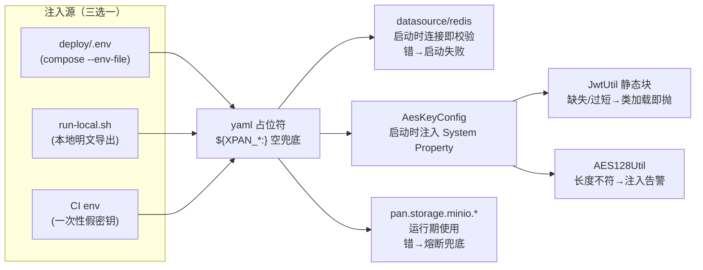

# 14-配置与环境详解

> 项目：X-Pan ｜ 版本：v1.1 ｜ 生成日期：2026-10-06 ｜ 依据：源码分析

X-Pan 的配置体系由一条主线贯穿（`DEV_GUIDELINES.md` 第一节红线）：**密钥只从环境变量来，yaml 只留 `${ENV:}` 空兜底，缺配置要快速失败**。本文把这条主线展开成四份清单：XPAN_* 环境变量全量字典（含缺失后果）、`run-local.sh` 逐段解析、容器化部署四件套（Dockerfile/compose/deploy.sh/Nginx）走读、三端三种环境（本地开发/CI/生产）的差异矩阵。应用内业务参数（限流阈值、熔断、存储桶名等）的字典在《06-部署运行》3.2 节，本文不重复；profile 机制的源码在 `framework/swagger2/Swagger2Config.java` 与 `application-dev.yaml`。

## 1. XPAN_* 环境变量全量字典

以下 12 个变量覆盖后端全部运行时密钥与寻址（来源：`server/src/main/resources/application.yaml`、`distribution/conf/application.yaml`、`deploy/docker-compose-server.yml`、`deploy/deploy.sh`、`.github/workflows/ci.yml` 逐一核对）：

| 变量 | 注入点/消费方 | 约束 | 缺失后果 |
|---|---|---|---|
| `XPAN_PROFILE` | `spring.profiles.active` | prod/dev/local，默认 **prod** | 按生产口径运行（文档关闭、按 prod 收紧） |
| `XPAN_DB_USERNAME` | datasource.username | 默认 `root` | 一般不缺 |
| `XPAN_DB_PASSWORD` | datasource.password | `${XPAN_DB_PASSWORD:}` 空兜底 | 启动失败（数据源初始化） |
| `XPAN_REDIS_PASSWORD` | spring.data.redis.password | 同上 | 启动失败/登录链路全断（Redis 是硬依赖） |
| `XPAN_SERVER_HOST` | Redis host + JDBC URL（仅 `distribution/conf/application.yaml` 模板） | compose 用 `${XPAN_SERVER_HOST:?必须设置}` 强制 | compose 启动即报错；裸机跑 distribution 包则中间件连不上 |
| `XPAN_JWT_SECRET` | `pan.jwt.secret` → `AesKeyConfig` 注入 System Property `xpan.jwt.secret` → `JwtUtil` 静态块 | ≥32 字节 | 进程起不来："JWT 签名密钥未配置" |
| `XPAN_AES_KEY` / `XPAN_AES_IV` | `pan.aes.key/iv` → System Property `xpan.aes.key/iv` → `AES128Util` | 恰 16 字符；轮换=旧分享链接/外部 ID 失效 | ID 加解密失败，接口大面积不可用 |
| `XPAN_MINIO_ACCESS_KEY` / `XPAN_MINIO_SECRET_KEY` | `pan.storage.minio.access-key/secret-key` | 启用 MinIO 时必填 | 对象存储不可用（有 minioStorage 熔断兜底，操作批量失败） |
| `XPAN_ROOT` | `xpan.root` | 默认 `${user.home}/x-pan-data`；容器内应为 `/app/data` 并挂卷 | 缩略图缓存/本地引擎数据随工作目录漂移 |
| `XPAN_SHARE_HOST` | `com.xiaoye.pan.server.share-host` | scheme://host[:port]；应用模板默认 `http://localhost:5179`（指向 Vite），compose 默认 `http://127.0.0.1:8081` | 分享链接不可达（列表页有实时重算兜底） |
| `XPAN_SNOWFLAKE_WORKER_ID` / `XPAN_SNOWFLAKE_DATACENTER_ID` | `IdUtil`（hutool 雪花） | 多实例必配且各节点不同 | ⚠️ 待确认：未设置时 hutool 默认策略的单实例行为；多实例下 ID 冲突风险 |

编排层的辅助变量（非 XPAN_ 前缀但同属配置面）：`SPRING_PROFILES_ACTIVE: prod`（compose 固定）、`TZ: Asia/Shanghai`、`JAVA_OPTS`（Dockerfile 默认 `UseG1GC + MaxRAMPercentage=75 + edg`）、MinIO 集群的 `MINIO_ROOT_USER/MINIO_ROOT_PASSWORD`（compose 默认 `xpanadmin/xpanadmin123`——**演示默认值，生产必改**）、OTLP 端点 `OTEL_EXPORTER_OTLP_ENDPOINT`（默认 `http://localhost:4318/v1/traces`，导出开关另在 yaml）。前端两个编译期变量：`VITE_API_BASE_URL`（默认 `/api`，走 Nginx/Vite 反代）与 `VITE_WS_URL`（缺省按 host 拼 `/ws/notification`）；移动端 `X_PAN_API_BASE_URL` 与 `X_PAN_WS_BASE_URL`（`--dart-define`，默认生产域名 `https://pan.zhangzhengyang.com`，`x-pan-mobile/lib/core/config/app_config.dart`）。

变量的注入链路值得单独画出来，因为三处消费方的校验时机不同——这决定了"配错在哪个时刻暴露"：



读图要点：`XPAN_JWT_SECRET` 的校验最早（`JwtUtil` 在类加载的静态块里检查，等于进程一起来就验）；数据库与 Redis 的校验发生在数据源初始化（紧随其后）；MinIO 凭证错误**不阻断启动**——运行期由 `minioStorage` 熔断兜底，所以"启动成功"不等于"配置全对"，生产部署后必须按《06-部署运行》8 的四步验证（健康/登录/上传/分享）确认。这张图也解释了一个排障常识：为什么同一个"MinIO 配错"在不同环境表现不同——本地引擎模式（enabled=false）整段跳过，CI 永远不会碰到，只有生产启用了 MinIO 才有熔断兜底这一层表现。

## 2. run-local.sh 逐段解析

`x-pan-parent/run-local.sh`（已 gitignore，`git ls-files` 核实未跟踪）全文 18 行，做且只做两件事：

```bash
set -e                                  # 任一命令失败即中止
export XPAN_DB_PASSWORD='...'           # ① 四个中间件密码（MySQL/Redis/MinIO AK/SK）
                                        #    注释：从 distribution/conf/application.yaml 找回的旧默认值
export XPAN_AES_KEY='...'               # ② 三个 2026-09-06 重新生成的密钥（旧值已丢失）
export XPAN_AES_IV='...'  XPAN_JWT_SECRET='...'
                                        #    注释记录代价：需重新登录、旧分享链接失效
cd "$(dirname "$0")"                    # ③ 切到 x-pan-parent 根（mvn -pl 需要父 POM 上下文）
mvn -pl server spring-boot:run          # ④ 只构建并运行 server 模块（framework 模块经 reactor 解析）
```

要点与坑：① 脚本头自述"含真实密码，勿提交 git"——它已 gitignore 但**明文落盘**（处置建议见《13-技术债务与演进建议》D15）；② 没有导出 `XPAN_PROFILE`，因此走默认 `prod`——本地想开 knife4j 文档需自己 `export XPAN_PROFILE=local`；③ 没有设置 `XPAN_ROOT/XPAN_SHARE_HOST`，本地数据落在 `~/x-pan-data`、分享链接指向 Vite 5179（与本地开发形态吻合）；④ 隐含前提：本机 13306/16379/19000 三端口可达对应中间件（这些端口来自 gitignore 的 `application.yaml`，若你的本机配置不同，以该文件为准）；⑤ `XPAN_AES_KEY='0f9b8731a617487d'` 是 16 字符的十六进制串——正好演示了"恰 16 字符"的生成方式（`openssl rand -hex 8` 输出 16 个字符）。

## 3. 容器化部署四件套走读

### 3.1 后端 Dockerfile（`x-pan-parent/server/Dockerfile`）

两阶段构建。构建阶段 `maven:3.9-eclipse-temurin-17`：`COPY . .`（**构建上下文必须是 x-pan-parent 根**——要含父 POM 与 framework 模块，CI 与 compose 都按此传 context）→ `mvn -B dependency:go-offline -DskipTests || true`（先把依赖拉进层缓存，源码再变依赖层不变）→ `mvn -B -pl server -am package -DskipTests`。运行阶段 `eclipse-temurin:17-jre-jammy`：装 curl（健康检查用）→ `useradd -r -u 1000 -g root xpan`（非 root 运行）→ 拷入 `x-pan-server.jar` → `mkdir /app/data` 并 chown → `JAVA_OPTS`/`SPRING_PROFILES_ACTIVE=prod`/`XPAN_ROOT=/app/data` 三个默认 ENV → `HEALTHCHECK` 探 `/actuator/health/liveness`（30s 间隔/5s 超时/3 次重试）→ `USER xpan` → ENTRYPOINT `exec java $JAVA_OPTS -jar app.jar`（exec 形态让 PID 1 即 java，信号正确传递）。

### 3.2 前端 Dockerfile（`x-pan-fronted/Dockerfile`）

`node:20-alpine` 构建：先 `COPY package*.json` + `npm ci`（依赖层缓存）→ `COPY . .` → **`npm run build:nocheck`**（注意：镜像内构建跳过 vue-tsc——类型门禁由 CI 的独立步骤承担，镜像构建追求速度）→ `nginx:1.27-alpine` 运行：`nginx.conf` 覆盖为 `default.conf`、dist 拷入 `/usr/share/nginx/html`（--chown nginx）、HEALTHCHECK `wget -qO- http://localhost/`。

### 3.3 两份 compose 的分工（`x-pan-parent/deploy/`）

`docker-compose-server.yml` 是**应用编排**：`x-pan-backend`（构建 context 为父目录、镜像 `xpan-server`、8081、`SPRING_PROFILES_ACTIVE: prod`、全部密钥 `${VAR:?必须设置}` 强制非空、`xpan-data` 卷持久化 `/app/data`、healthcheck 探 liveness 且 `start_period: 60s` 给 JVM 预热）+ `x-pan-frontend`（80、depends_on 后端）。**MySQL/Redis/MinIO 不在编排内**（文件头注释"已独立部署，通过内网/公网直连"）。`docker-compose.yml` 是**纯存储集群模板**：MinIO 4 节点纠删码（`server http://minio{1...4}/data`，各挂 `./data/minioN`，console 9001）+ nginx LB 容器（9000 入口，挂 `deploy/nginx.conf`）。两份文件不可混用。

理解这份分工的钥匙是**容器名即网络地址**：前端 nginx.conf 反代写的是 `http://x-pan-backend:8081/`，`x-pan-backend` 正是 compose 的服务名——compose 网络（`xpan-net`）内置 DNS 让服务名互相解析，所以前端容器不配 IP 就能找到后端；同理 `docker-compose.yml` 里 MinIO 的 `server http://minio{1...4}/data` 依赖的是各节点的 `hostname: minioN`。这也解释了两个易踩的坑：其一，把前端容器拿掉 compose 单独 `docker run` 时，`x-pan-backend` 这个主机名不存在，反代全部 502——单容器调试要么把 proxy_pass 改成宿主机地址，要么加入同一个自定义网络；其二，`container_name`（`xpan-server`）与 `ports` 的宿主机映射（8081/80）是两个平面的概念，deploy.sh 的健康等待用的是容器名、外部访问用的是端口映射，排障时别混。

### 3.4 deploy.sh 逐段（`deploy/deploy.sh`）

四段式：① 校验 `.env`——存在性检查 + 8 个必填键（`XPAN_SERVER_HOST/XPAN_JWT_SECRET/XPAN_AES_KEY/XPAN_AES_IV/XPAN_DB_PASSWORD/XPAN_REDIS_PASSWORD/XPAN_MINIO_ACCESS_KEY/XPAN_MINIO_SECRET_KEY`）逐行解析、剔注释与空行、值含"请替换"占位视为缺失，MISSING 列表点名报错退出；② `docker compose --env-file .env -f docker-compose-server.yml build`（`--no-build` 跳过，用于回滚旧镜像）；③ `up -d` 拉起；④ 健康等待——`docker inspect` 轮询 `xpan-server` 容器 Health.Status，30 次 ×5 秒，healthy 即成功，否则打印 `logs -f` 排障命令并附服务状态表。注意脚本 `set -uo pipefail` 而无 `-e`（错误处理靠显式 `$?` 判断），且健康判定接受 `none`（无 healthcheck 定义时视为通过）。

这段脚本有两处设计值得点出。其一，**校验前置到构建之前**——密钥缺失时连镜像都不构建，避免"构建三分钟、启动一秒报错"的浪费，这是把 yaml 层 `:?` 强制语法往前端（脚本层）再提了一级；其二，**健康等待是幂等的安全网**——`--no-build` 模式配合健康的容器即可完成回滚（上一版镜像 + 拉起 + 等待），`deploy.sh` 因此同时是部署与回滚的入口，不必另写回滚脚本。日常使用建议把 `.env` 的权限收紧（`chmod 600 deploy/.env`），脚本注释未提及但符合密钥治理红线的精神。

### 3.5 Nginx 两份配置对照

前端容器 `x-pan-fronted/nginx.conf`（对外 80）：`/` SPA fallback（`try_files ... /index.html`，`no-cache`）→ 静态资源正则 `expires 1y immutable` → **`/api/` 反代 `http://x-pan-backend:8081/`（尾斜杠去 `/api` 前缀；`client_max_body_size 10G` 放行大分片；`proxy_read_timeout 600s`）** → `/ws/` 独立 location（`Upgrade/Connection: upgrade` 升级头直通，`proxy_read_timeout 3600s` 长连接——注释明确"不能沿用 /api/ 的 location"）→ `/health` 直接 200 → 安全头四件（X-Frame-Options SAMEORIGIN / nosniff / XSS-Protection / Referrer-Policy）→ gzip（`text/css application/json` 等 7 类，min length 1024）。MinIO LB `deploy/nginx.conf`（9000）：`upstream least_conn` 四节点、**`proxy_buffering off` + `proxy_request_buffering off`**（流式关键，见《10-性能设计与优化》第 3 节）、`client_max_body_size 0`、四个 300s 超时、`X-NginX-Proxy` 头防 MinIO 按内部 IP 重定向。

## 4. 三环境差异矩阵（本地开发 / CI / 生产）

同一套代码要在三种环境里运行，X-Pan 的做法不是"三套配置文件"而是"一份配置骨架 + 三个注入源"：骨架是 `application.yaml` 的占位符体系（`${ENV:}`），注入源分别是本地 shell（run-local.sh）、CI 的 service 容器与假密钥（application-ci.yaml 兜底）、生产的 `.env`（compose 强制语法）。差异矩阵因此可以按维度读：每一行都是一个"环境间天然不同的量"，部署或迁移时逐行核对即可——矩阵比对代码走读更可靠，因为它以配置事实为准。

| 维度 | 本地开发 | CI（`application-ci.yaml`） | 生产 |
|---|---|---|---|
| profile | `local`/`dev`（需手动导出，run-local.sh 不带） | `${XPAN_PROFILE:prod}`（yaml 内文档开关另被显式关闭） | `prod`（默认值即生产，compose 固定） |
| 密钥来源 | `run-local.sh` 明文导出（gitignore） | CI env 一次性假密钥（`ci-only-...-not-real`、`0123456789abcdef`） | `deploy/.env` → compose `:?` 强制注入 |
| MySQL/Redis 地址 | gitignore 的 `application.yaml`（示例为 106.15.35.71 高位端口） | 服务容器 `127.0.0.1:3306/6379`，Redis 无密码 | `XPAN_SERVER_HOST` 注入（`:13306`/`:16379`） |
| MinIO | 可启用；`enabled=false` 退本地目录 | **强制关闭**，统一本地引擎，root 指向 `${java.io.tmpdir}/x-pan-ci-data` | 4 节点纠删码集群，内外网双 endpoint |
| 接口文档 | `knife4j.enable: true`（dev/local） | false | false（访问 `/doc.html` 属预期关闭） |
| tracing 采样 | 0.1（主配置） | 1.0（且 OTLP 导出关闭） | 0.1；开导出需自备 collector |
| 接入方式 | Vite 5179 代理 `/api`→8081、`/ws` ws 直通；移动端 `--dart-define` 直连 | 无前端 | Nginx 80：SPA + `/api` 反代（10G/600s）+ `/ws` 升级（3600s）；移动端直连公网域名 |
| 健康与告警 | 手工 curl | 无 | liveness 探针 + Prometheus 抓取 + 5 条 MinIO 告警（`deploy/alerts.yml`） |
| 数据持久化 | `~/x-pan-data` + 本机 MySQL | 容器即抛 | `xpan-data` 卷 + 独立中间件 + MinIO 4 盘 |

矩阵之外的三个"探针"判别法（《06-部署运行》第 8 节提出，此处收束）：`/doc.html` 可访问 = 不是生产口径；`application.yaml` 残留明文地址 = 配置纪律失守；错误响应泄漏堆栈细节 = 异常处理被绕过。巡检环境时先打这三个探针，再谈其余。

矩阵背后还有一条容易被忽视的**配置文件三份同源**原则。同一份逻辑配置在仓库里有三个物理存在：`server/src/main/resources/application.yaml`（运行时实际加载，被 gitignore，改动无 diff）、`distribution/conf/application.yaml`（打包分发的模板，被 git 跟踪，含 `XPAN_SERVER_HOST` 注入点与 Druid 连接池段）、`server/src/test/resources/application-ci.yaml`（CI 专用，服务容器寻址 + 假密钥）。三者必须语义同步——历史上 actuator 暴露面、redis 前缀（Boot 3 迁移 `spring.data.redis`）都曾因三份不同步出过问题（审计 🔴#6 与 CHANGELOG 的 distribution 修复段）。判断一份配置改动的正确姿势：先问"这份改动对三份文件分别意味着什么"，缺一份同步就是给未来埋一个"本地好好的、CI/生产挂了"的地雷。这也是为什么本文与《06-部署运行》反复强调：改配置永远带着"三份文件"的意识。

## 5. 配置变更操作速查

变更即有副作用的五类操作，规程浓缩如下（详述见《06-部署运行》第 7 节）：**换 JWT secret**→全员重登，低峰执行；**换 AES key/iv**→视同不可逆（旧分享链接/外部 ID 失效），先评估再动手；**切存储引擎**→先迁移存量对象（`StorageMigrationRunner` ⚠️ 待确认，见《13》D11），`pan.storage.minio.enabled` 翻转后重启；**改 profile**→生产务必 prod（dev/local 开文档与宽 CORS）；**改限流/熔断阈值**→`application.yaml` 与 `distribution/conf/application.yaml` **两份同步**（打包模板与运行配置的一致性是 `DEV_GUIDELINES` 第一节的隐性要求，CI 的 `application-ci.yaml` 第三处同步点——三份配置漂移是"本地好好的、CI 挂了/生产挂了"的经典根因）。

收束成一句话的配置哲学：X-Pan 把"配置"拆成了三种性质不同的东西并分别给了归宿——**秘密**（七个密钥变量）只活在环境变量与 .env 里，轮换有明确代价评估；**寻址**（主机、端口、桶名）按环境注入但允许默认值，换环境只动这几个；**行为**（限流、熔断、上限、开关）进 yaml 且三份同源，改动要走 diff 评审。配置排障时先问"这是哪一类"：秘密类查注入源与轮换史，寻址类查环境矩阵，行为类查三份文件的一致性——对类下药，比全文搜索快得多。
