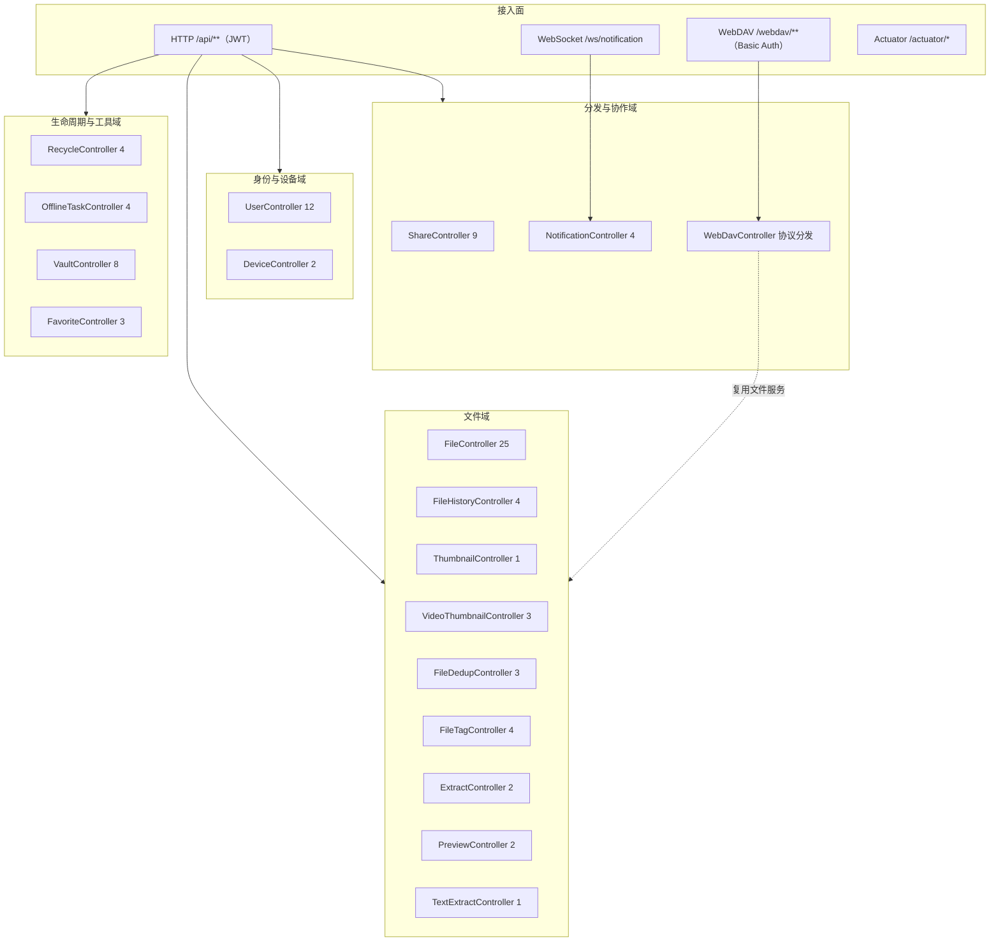

# 15-接口全量参考

> 项目：X-Pan ｜ 版本：v1.1 ｜ 生成日期：2026-10-06 ｜ 依据：源码分析

本文是 18 个 Controller 全部 HTTP 端点的速查总表，外加 WebSocket 与 WebDAV 两个协议面的契约速查。定位与《03-接口设计》互补：03 篇讲契约约定、鉴权机制与调用方一致性（修改接口前必读其第 1 节与第 7 节）；本文按服务分组给"方法/路径/入参/响应/鉴权/典型错误"六要素，供开发与联调时直接检索。表内路径为后端根路径（8081 直连形态）；经 Nginx/Vite 时加 `/api` 前缀并被去前缀反代（见《03-接口设计》第 3 节）。鉴权列：`登录` = 切面默认拦截；`免登录` = `@LoginIgnore`；`分享码` = `@NeedShareCode`。

## 1. 服务-业务域总览

计数核对：Controller 类 18 个（user/device/file/file-history/thumbnail/video-thumbnail/dedup/filetag/extract/preview/textextract/share/recycle/offline/vault/favorite/notification/webdav），HTTP 端点合计 89 个 + WebSocket 1 条通道 + WebDAV 方法族 9 个（实际注册进路由的仅 GET/POST/PUT/DELETE/OPTIONS/HEAD 六个，见第 7 节）。错误码全量枚举先给出（`framework/core/.../response/ResponseCode.java`，各表"典型错误"列引用）：`0` 成功；`1` 通用失败（业务异常文案随场景）；`2` token 过期；`3` 参数错误（JSR-303 第一条消息）；`4` 无权限（分享码失效也走此码）；`5/6/7` 分享文件丢失/已取消/已过期；`10` 需要登录（全端统一重登录信号）。

## 2. 身份与设备域

**UserController**（`modules/user/controller/UserController.java`，`@RequestMapping("user")`）——会话与账户全生命周期。登录成功后 token 存 Redis 槽位并下发；改密强制全端下线；找回密码是三步有状态流程（每步限流，答案错误有防爆破计数）。

| 方法 | 路径 | 入参 | 响应 data | 鉴权 | 典型错误 |
|---|---|---|---|---|---|
| POST | `/user/register` | body：username/password/nickname/question/answer（`UserRegisterPO`，JSR-303） | — | 免登录（限流 3/时） | 1 用户名已存在 |
| POST | `/user/login` | body：username/password；header `X-Client-Id` | accessToken 字符串 | 免登录（限流 5/分） | 1 密码信息不正确；1 登录失败次数过多（锁定 15 分钟） |
| POST | `/user/exit` | header `Authorization` | — | 登录 | 10 |
| POST | `/user/username/check` | body：username | 密保问题 | 免登录 | 1 用户不存在 |
| POST | `/user/answer/check` | body：username/answer | 5 分钟一次性 token | 免登录 | 1 答案不正确（有防爆破） |
| POST | `/user/password/reset` | body：username/password/answer/token | — | 免登录 | 1 token 无效/过期 |
| POST | `/user/password/change` | body：oldPassword/newPassword | — | 登录 | 1 旧密码不正确（成功后全端下线） |
| GET | `/user/` | — | `UserInfoVO`（含 rootFileId/配额） | 登录 | 10 |
| PUT | `/user/quota` | body：totalSpace（上限 10TB） | — | 登录 | 3 超上限 |
| PUT | `/user/avatar` | body：avatar（URL） | — | 登录 | — |
| POST | `/user/avatar/upload` | multipart `file` | 头像 URL | 登录 | — |

**DeviceController**（`modules/device/controller/DeviceController.java`，`@RequestMapping("device")`）：

| 方法 | 路径 | 入参 | 响应 data | 鉴权 | 典型错误 |
|---|---|---|---|---|---|
| GET | `/device/list` | — | `List<DeviceVO>`（clientId/UA/last_login_time；location 恒空，见《13》D2） | 登录 | — |
| POST | `/device/logout` | body：clientId（`LogoutDevicePO`） | — | 登录 | —（删除对应 Redis 会话槽位即吊销） |

## 3. 文件域（9 个 Controller）

文件域是端点密度最高的业务域：9 个 Controller、45 个端点，覆盖"上传→组织→检索→增强（版本/缩略图/去重/标签/解压/转换/文本提取）"的完整能力面。分组逻辑值得先建立心智图：**FileController 是唯一的主干**（列表与 25 个端点里含全部上传下载流），其余 8 个 Controller 都是围绕它的增强面——FileHistory 挂在文件的时间轴上（版本）、Thumbnail/VideoThumbnail 挂在文件的媒体形态上（缩略图与关键帧）、Dedup 挂在物理文件的复用关系上（identifier 分组）、FileTag 与 TextExtract 挂在文件的内容上（标签与纯文本）、Extract 与 Preview 挂在文件格式上（解压与 Office 转 PDF）。理解这个"一主干八分支"的结构后，找端点先定位它属于文件生命周期的哪一段，再落到对应 Controller。

**FileController**（`modules/file/controller/FileController.java`，25 端点）——文件核心。上传三段协议的语义（秒传未命中 data 为空、`mergeFlag`、`uploadedChunks`）见《03-接口设计》6.1 与《05-核心流程》流程一；下载 302 直链阈值 50MB（`pan.storage.minio.large-file-threshold`）；排序参数必须传 `SafeOrderBy` 白名单 snake_case 字段（filename/file_size/update_time/create_time），非法字段不报错但不生效。

| 方法 | 路径 | 入参 | 响应 data | 鉴权 | 典型错误 |
|---|---|---|---|---|---|
| GET | `/files` | parentId/fileType/orderBy/order/pageNum/pageSize/keyword | `PageVO<XPanUserFileVO>`（ID 已加密） | 登录 | 10 |
| GET | `/files/stats` | — | `UserFileStatsVO` | 登录 | — |
| POST | `/file/folder` | body：parentId/filename | 新文件夹加密 ID | 登录 | 1 同目录重名（唯一键） |
| PUT | `/file` | body：fileId/newFilename | — | 登录 | 1 文件名不可用/重名；3 |
| DELETE | `/file` | body：fileIds（批量，进回收站） | — | 登录 | —（级联软删子树） |
| POST | `/file/sec-upload` | body：parentId/filename/identifier(32位MD5)（三字段，无 totalSize） | 命中→code=0 无 data；未命中→code=1"文件唯一标识不存在，请手动执行文件上传"（转分片的正常分支，见《19》第 3 节） | 登录 | 3 必填缺失；1 未命中（正常分支） |
| POST | `/file/upload` | multipart `file` + parentId | — | 登录 | 1 配额不足 |
| POST | `/file/chunk-upload` | multipart：filename/identifier/totalChunks/chunkNumber/currentChunkSize/totalSize + file（探测请求可为 null） | `FileChunkUploadVO{mergeFlag}` | 登录 | 1 分片下标越界；1 保存繁忙（锁竞争） |
| GET | `/file/chunk-upload` | identifier/totalChunks | `UploadedChunksVO{uploadedChunks[]}` | 登录 | — |
| POST | `/file/merge` | body：filename/identifier/parentId/totalSize | — | 登录 | 1 分片不全/校验失败 |
| GET | `/file/download` | fileId | 文件流；≥50MB 时 **302 → MinIO 预签名 URL** | 登录（Cookie 回退） | 404/403（HTTP 层）；文件夹不可下载 |
| GET | `/file/presigned-url` | fileId | 1 小时预签名 URL | 登录 | 1 未启用 MinIO；保险箱未解锁 |
| POST | `/file/archive-download` | body：fileIds | zip 流（blob） | 登录 | —（前端拦截器 blob 短路） |
| GET | `/file/preview` | fileId | 内容流（支持 Range） | 登录 | — |
| POST | `/file/preview/url` | fileId + 可选 width/height | ptoken 相对 URL（5 分钟，绑定 fileId） | 登录 | — |
| GET | `/file/preview/stream` | fileId/ptoken + 可选 width/height | 内容流（缩放钳制 THUMBNAIL_MAX_SIZE） | **免登录**（ptoken 验签） | 1 预览签名 token 无效或已过期 |
| GET | `/file/folder/tree` | — | `List<FolderTreeNodeVO>` | 登录 | — |
| POST | `/file/transfer` | body：fileIds/targetParentId | — | 登录 | 1 父目录无权限 |
| POST | `/file/copy` | body：fileIds/targetParentId | — | 登录 | 1 配额不足 |
| POST | `/file/batch-rename` | body（`BatchRenamePO`） | — | 登录 | 1 冲突名 |
| POST | `/file/batch-tag` | body（`BatchTagPO`） | — | 登录 | — |
| GET | `/file/search` | keyword/fileType/extension/sizeRange/timeRange | `List<FileSearchResultVO>` | 登录 | —（keyword 子串 LIKE） |
| GET | `/file/search/suggest` | prefix | `List<String>` | 登录 | — |
| GET | `/file/search/hot` | limit（默认 10） | `List<String>` | 登录 | — |
| GET | `/file/breadcrumbs` | fileId | `List<BreadcrumbVO>` | 登录 | — |

**FileHistoryController**（版本历史）：GET `/file/versions`（入参 fileId → 版本列表）、GET `/file/version`（fileId/versionId → 详情）、POST `/file/rollback`（回滚，当前版本转为历史版本）、DELETE `/file/version`（删除指定版本）。全部登录；单文件上限 50 版自动裁剪（`pan.history.max-versions-per-file`）。

**ThumbnailController / VideoThumbnailController**（媒体增强）：GET `/file/thumbnail`（fileId/width/height，**免登录**——经 ptoken 链路或签名参数；磁盘缓存）、GET `/file/video-cover`（fileId，免登录）、GET `/file/video-thumbnails`（fileId，登录）、GET `/file/video-sprite`（fileId，免登录）。错误面：文件无封面/关键帧未生成返回业务 1。

**FileDedupController**（`/file/dedup`）：GET `/list`（分页 → 重复分组）、GET `/stat`（去重统计）、POST `/release`（fileId 列表 → 释放冗余引用）。全部登录。

**FileTagController**：POST `/file/auto-tag`（fileId → AI 打标，LLM 失败降级规则打标）、GET `/file/{fileId}/tags`、POST `/file/{fileId}/tags`（body tags 数组）、DELETE `/file/tags/{tagId}`。全部登录；标签唯一键 `uk_user_file_tag` 防重。

**ExtractController**：POST `/file/extract`（fileId/targetParentId → 任务 taskId）、GET `/file/extract/progress`（taskId → status/total_count/processed_count）。登录；任务状态机 0-3。

**PreviewController**（`/preview`）：POST `/office/{fileId}`（发起转换任务）、GET `/url/{taskId}`（轮询 → preview_url + expire_time）。登录；`uk_file_target` 幂等，重复请求返回既有任务。

**TextExtractController**：GET `/file/{fileId}/text-extract`（→ 纯文本，供 AI 摘要）。登录；不支持的后缀返回业务 1。

## 4. 分发与协作域

分发域的两个 Controller 分别对应两种"单向信息流"：分享是**用户主动向匿名世界开放**的通道（安全约束最重），通知是**系统向用户单向投递**的通道（可达性约束最重）。前者的一切设计围绕"不可信的访客"展开——双层凭证、三态失效、限流、防爆破；后者围绕"消息必达"展开——WS 实时投递 + 落库补齐的成对机制，任何一端不可用都不丢消息。

**ShareController**（`modules/share/controller/ShareController.java`，9 端点）——唯一匿名开放面，错误码语义最丰富（5/6/7 三态 + 4）：

| 方法 | 路径 | 入参 | 响应 data | 鉴权 | 典型错误 |
|---|---|---|---|---|---|
| POST | `/share` | body：shareFileIds/shareCode/expireDays/downloadLimit 等 | `XPanShareUrlVO`（链接+提取码） | 登录（限流 30/分） | 1 含保险箱文件（拒绝）；1 操作过于频繁 |
| GET | `/shares` | — | `List<XPanShareUrlListVO>`（share_url 实时重算） | 登录 | — |
| DELETE | `/share` | body：shareIds | — | 登录 | — |
| POST | `/share/code/check` | body：shareId/shareCode | shareToken（JWT，claim SHARE_ID） | 免登录（防爆破） | 6 已取消；7 已过期；1 提取码错误（连错锁定 15 分钟） |
| GET | `/share/simple` | shareId | `ShareSimpleDetailVO`（名称/是否需提取码） | 免登录 | 5/6/7 |
| GET | `/share` | header `Share-Token` | `ShareDetailVO` | 免登录+分享码 | 4 |
| GET | `/share/file/list` | Share-Token + parentId | 文件 VO 列表 | 免登录+分享码 | 4 |
| POST | `/share/save` | Share-Token + `ShareSavePO` | — | **登录+分享码 双凭证** | 1 配额不足；4 |
| GET | `/share/file/download` | Share-Token + fileId | 文件流（download_count+1） | 免登录+分享码 | 4；下载达限进失效态 |

**NotificationController**（`/notification`）：GET `/list`（分页）、GET `/unread/count`、PUT `/read/{id}`、PUT `/read/all`。全部登录。通知由 WS 推送与落库成对产生（`Notifier`），本组接口是历史补齐面；无清理任务（见《13》D4）。

## 5. 生命周期与工具域

本域四个 Controller 的共性是"操作都改变文件的状态或可见性"，因此除常规鉴权外各自叠加了一层状态校验：回收站操作要求目标在回收站里（还原才有时效 30 天）、保险箱操作要求解锁态在 30 分钟窗口内、收藏与离线任务则受唯一键/限流约束。联调时遇到的"莫名其妙的 1 号错误"多半是这层状态校验在说话——错误文案会具体到原因（重名/未解锁/未设置密码），不要只看 code 不看 message。

**RecycleController**：GET `/recycles`（列表，含剩余天数）、GET `/stat`（数量/字节）、PUT `/recycle/restore`（`RestorePO`：fileIds；**目标目录重名冲突报业务 1**，`checkRestoreFilename`）、DELETE `/recycle`（彻底删除，触发引用计数判定与级联清理）。全部登录。

**OfflineTaskController**：POST `/offline/create`（url/targetParentId → 任务 VO；限流 10/分；SSRF 校验失败/超 10GB 上限落 status=3+error_msg）、GET `/offline/list`、POST `/offline/cancel`（taskId；条件 UPDATE 协作式中断 → status=4）、DELETE `/offline`（taskId 删记录）。全部登录。错误文案与决策树见《12-FAQ与故障排查》第 5 节。

**VaultController**（`/vault`，8 端点）：GET `/status`（hasPassword/unlocked）、POST `/setup`（password，PBKDF2；已设置时报"已设置"）、POST `/unlock`（password；错误 5 次锁 15 分钟："尝试次数过多，保险箱已被锁定"）、POST `/lock`、GET `/files`（需已解锁，扁平列表无层级）、POST `/move`（fileIds 移入；**文件夹被拒绝**）、POST `/file/{fileId}/out`（移出还原原目录）、DELETE `/vault/file/{fileId}`（永久删除→先进回收站）。全部登录 + 列表/移入/移出/删除需解锁态（30 分钟）。

**FavoriteController**（`/favorite`）：POST `/add`（fileIds；`uk_user_file` 防重）、POST `/remove`、GET `/list`（分页）。登录。

## 6. WebSocket 协议契约速查

WebSocket 是唯一的**服务端主动推**通道，与第 4 节的通知落库面共用事件源。读协议前先建立分层：连接层（握手鉴权、心跳保活、背压控制）管"通不通"，消息层（type + payload 约定）管"推什么"——排障时先判层：连接不通看握手与 Nginx 升级头，连而不推看业务事件是否触发。

通道 `ws(s)://host/ws/notification?token=<JWT>`（`common/websocket/` 四类实现）。**握手**：`NotificationWebSocketHandler.resolveUserId` 解析 token 并与 Redis 登录槽位比对（兼容 `_PREV`），失败 `CloseStatus.NOT_ACCEPTABLE`。**连接确认帧**（服务端→客户端）：`{"type":"CONNECTED","payload":{"userId":123}}`。**心跳**：服务端每 30s 发 `{"type":"PING","ts":...}`，客户端回 `{"type":"PONG"}`；90s 无任何客户端消息即主动关闭；Web 端 25s 心跳刻意早于服务端 PING（`src/composables/useWebSocket.ts`），移动端由 `notification_service.dart` 承担。**背压**：每会话包 `ConcurrentWebSocketSessionDecorator`（发送超时 5s、缓冲 512KB，慢消费者被断开）。**业务帧**（type 与 `x_pan_notification.type` 一致，payload 为对应 VO 的 JSON）：

| type | 触发方 | payload | 推送对象 |
|---|---|---|---|
| `UPLOAD_FINISHED` | 上传合并完成（`Notifier.uploadFinished`） | 文件 VO | 上传者全部在线会话 |
| `OFFLINE_TASK_UPDATE` | 离线下载进度/完成（`offlineTaskUpdate/Finished`） | 任务 VO | 任务所有者 |
| `OFFLINE_TASK_REMOVED` | 任务删除（仅 WS 推送，不落库） | taskId | 任务所有者 |
| `SHARE_STATS_UPDATE` | 分享被访问/转存/下载（`shareAccessed`） | 分享统计 VO | 仅分享者 |
| `SYSTEM_NOTICE` | 系统公告（`systemNotice`，含 level） | `{level,message}` | 指定用户 |

消费端约定：推送与通知中心落库**成对出现**（`OFFLINE_TASK_REMOVED` 除外），断线期间的消息可由 `GET /notification/list` 补齐；前端按 type 分发（上传面板刷新/离线行更新/铃铛红点）。

## 7. WebDAV 协议契约速查

WebDAV 的特殊性在于它不是"又一个 API 分组"，而是**同一套文件服务的第二协议入口**——认证方式（Basic vs JWT）、路径模型（层级路径 vs 加密 ID）、报文形态（XML 属性 vs JSON）都不同，但落到底层调用的是同一批 Service 与同一套配额/归属校验。因此它的契约要点是"映射关系"：每个 WebDAV 方法对应到哪个网盘动作、哪些能力缺失（PUT，以及未注册路由的 MKCOL/MOVE/COPY/PROPFIND）、路径穿越如何被拦截。

单入口 `modules/webdav/WebDavController.java`（`@RequestMapping("/webdav")` + `/**`），零第三方依赖手写实现，Basic Auth 与 JWT 体系并行（凭证缓存 10 分钟；不复用 login 防误锁账户；OPTIONS 免鉴权）。`/webdav/` 根返回简易 HTML 说明页；其余子路径按**加密 fileId** 解析（URL 解码 + 拒绝 `..`），并非层级目录模型（见《16》ADR-010）：

| 方法 | 语义 | 映射到网盘操作 | 现状/备注 |
|---|---|---|---|
| OPTIONS | 能力协商 | — | 返回 `DAV: 1, 2` 与 Allow 集（声明先于实现，见《16》ADR-010）；CORS `*`（见《08》第 8 节） |
| GET / HEAD | 下载/探测 | download（按加密 fileId 定位） | 可用；根路径返回简易 HTML |
| PUT | 上传 | — | **返回 501"暂未实现"**（已注册路由但处理器直接 501，见《13》D3） |
| DELETE | 删除 | 软删除（进回收站） | 可用 |
| MKCOL | 建目录 | — | **路由层即 405**（未注册进 `@RequestMapping`）；处理器本身也返回 501 |
| PROPFIND | 列目录/查属性 | — | **路由层即 405**；处理器为桩实现（仅回显请求路径自身元数据，size 恒 0，不遍历真实文件树）——**目录浏览不可用**，见《16》ADR-010 |
| MOVE / COPY | 移动/复制 | — | **路由层即 405**；处理器本身也返回 501 |

经反代时 WebDAV 不走 `/api` 前缀（直通 8081 的 `/webdav/**`），大文件 PUT（若未来实现）同样受 `client_max_body_size 10G` 保护。客户端兼容性清单见 `x-pan-parent/deploy/WEBDAV.md`（⚠️ 待确认：文中兼容性说明未逐条实测）。

## 8. 使用本文的三个提醒

第一，**鉴权是切面不是注解**——表内"登录"列的依据是包路径切点自动覆盖，`@LoginIgnore`/`@NeedShareCode` 只是例外开关；新增端点放在正确包里即自动受保护（红线与事故背景见《08-安全与权限设计》第 1 节）。第二，**错误码与 HTTP 状态码分层**——业务失败一律 HTTP 200 + code（唯一例外是文件流接口的 404/403/302 直接走 HTTP 层），客户端拦截器只认 code；blob 响应的错误表现为 HTTP 异常，两端均已适配（《03-接口设计》第 7 节）。第三，**本文表是 v1.1 时点快照**——接口演进遵循"只加不改"约定（《06-部署运行》4.4），联调时若发现表与实际不符，以 `application-dev.yaml` 开启后的 `/doc.html`（knife4j，`common/config/OpenApiConfig.java` 分组）为准并回头修订本文。

最后给两类高频使用场景各一条检索路径。**联调新功能**：先在本文定位端点行 → 看该 Controller 段落的机制说明（每个分组开头一段）→ 需要理解跨端约定再跳《03-接口设计》第 7 节；入参里的加密 ID、分页参数、blob 响应这三类易错点在表内"典型错误"列都有标注，报错先对照。**排查线上问题**：拿异常日志里的 URI 回本文查端点 → 从"典型错误"列直接跳对应机制文档（《05-核心流程》流程 / 《12-FAQ》决策树 / 《08-安全》防护段），比从 Controller 源码冷读快得多。本文刻意把"机制细节"留在引用目标里而只保留"契约事实"，就是为了保持速查密度——如果发现自己需要第三层细节，那通常是该读对应机制篇而非继续查表。
