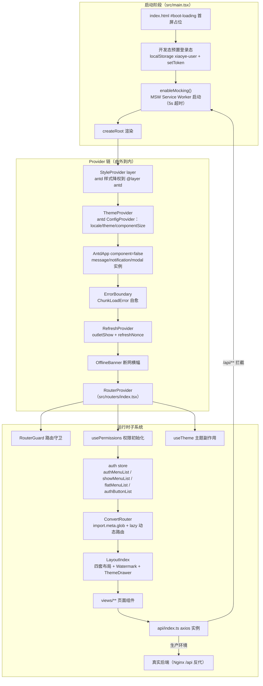
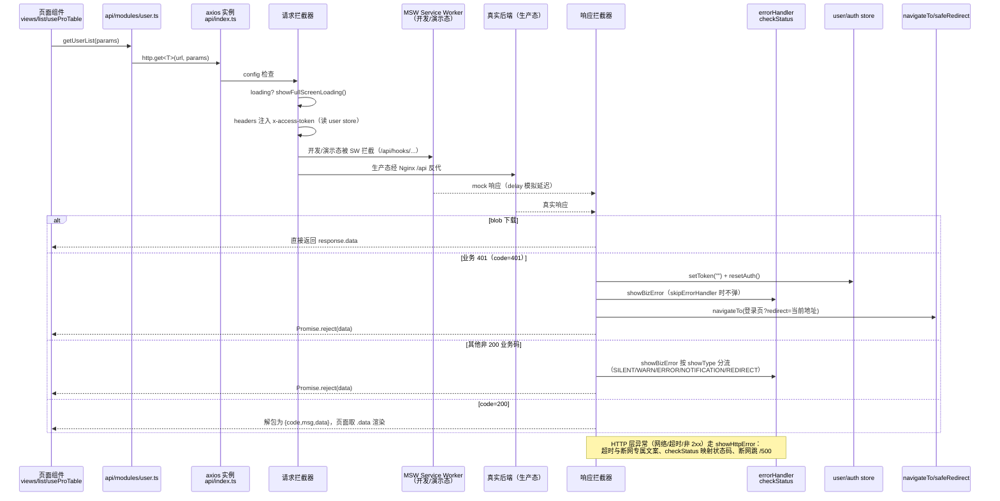

# 01 系统架构

> 项目：xiaoye-admin-react ｜ 版本：v1.0 ｜ 生成日期：2026-10-06 ｜ 依据：源码分析

## 1. 整体架构图

下图概括了应用的启动链路与运行时分层关系。箭头方向表示"渲染/依赖"方向：外层 Provider 为内层提供上下文能力。

## 2. 分层与模块职责

项目采用"入口 → Provider 链 → 路由层 → 布局层 → 页面层 → 基础设施"的分层结构，各层职责如下。

### 2.1 入口层（`src/main.tsx`、`src/App.tsx`）

`src/main.tsx` 承担四件事：开发态登录态预置（写入 localStorage 后再 `setToken`，注释解释了"persist 的 rehydrate 是异步的，顺序颠倒会被旧值覆盖导致权限初始化被跳过"）、MSW 异步启动、Provider 嵌套组装、渲染。`src/App.tsx` 则把 antd `<App>` 的 `message/notification/modal` 实例通过 `setAppInstances`（`src/hooks/useMessage.tsx`）注入到模块级单例，使 axios 拦截器等非 React 场景也能弹出继承主题与语言的提示。

### 2.2 路由层（`src/routers/`）

| 文件 | 职责 |
| --- | --- |
| `index.tsx` | `RouterProvider`：监听 `authMenuList`，菜单为空时用静态路由（`*` 渲染 Loading），就绪后与动态路由合并重建 router；`useMemo` 以菜单数组引用为依赖，避免"路径指纹"缓存陷阱（源码中有大段注释说明为何不能用 useState 镜像路由表） |
| `modules/staticRouter.tsx` | 静态路由：`/`（重定向首页）、`/login`、`/403`、`/404`、`/500`、`*`（Loading）；每个 element 都被 `RouterGuard` 包裹，`loader` 返回 `meta` |
| `helper/ConvertRouter.tsx` | 菜单树 → react-router 结构：`import.meta.glob("/src/views/**/*.tsx")` 收集全部视图，`element` 字符串映射为 `lazy` 组件并包 `Suspense`（`src/components/Lazy`）、`RouteMetaContext` 与 `RouterGuard`；`isFull` 路由挂在 Layout 之外 |
| `helper/RouterGuard.tsx` | 守卫：挂载 `window.$navigate`；按 `meta.key` 从 `menu`/`error` 命名空间取标题写 `document.title`；白名单 `/500` 放行；已登录访问登录页跳首页；无 token 跳登录并携带 `?redirect=` |
| `interface/index.ts` | `RouteObjectType` 与 `MetaProps`（key/icon/title/activeMenu/isLink/isHide/isFull/isAffix/isKeepAlive） |

### 2.3 状态层（`src/stores/`，zustand）

四个 store 的职责划分（接口定义见 `src/stores/interface/index.ts`）：

- `useUserStore`（`modules/user.ts`）：token、userInfo、tokenUpdatedAt，`persist` 到 localStorage `xiaoye-user`，version 2 + migrate 容错旧缓存；
- `useAuthStore`（`modules/auth.ts`）：authMenuList（菜单树）、showMenuList（过滤 isHide 后的菜单树）、flatMenuList（剥掉 children 的扁平表）、authButtonList（`{ [menuKey]: string[] }`）；`setAuthMenuList` 一次性派生三个视图；`resetAuth` 是 401 与登出的统一出口，防止账号切换后权限串号；
- `useGlobalStore`（`modules/global.ts`）：23 项全局 UI 偏好（layout、isDark、primary、tabs、watermark 等），`persist` 到 `xiaoye-global`；
- `useTabsStore`（`modules/tabs.ts`）：多标签 tabsList 的增删/关闭/改题，不持久化。

### 2.4 请求层（`src/api/`）

`src/api/index.ts` 是唯一 axios 实例（导出单例 `new RequestHttp(config)`）。`src/api/modules/` 按域组织 42 个接口函数（login/user/system/business），`src/api/interface/index.ts` 集中维护 `Result`/`ResultData` 信封与业务实体类型。OpenAPI 生成物（`src/services/api/`）通过 `src/api/openapiRequest.ts` 适配器桥接到同一 axios 实例，两套 API 最终共享同一套拦截器行为。细节见《03-接口设计》。

### 2.5 布局层（`src/layouts/`）

`src/layouts/index.tsx` 的 `LayoutIndex` 依据 `global.layout` 在 `LayoutVertical / LayoutClassic / LayoutTransverse / LayoutColumns` 四个组件间切换，并可包一层 antd `Watermark`（关闭水印时直接卸载组件而非传空 content——antd 6 的 Watermark 空 content 会生成 0×0 canvas 抛 InvalidStateError，源码注释明确此坑）。布局共享组件在 `src/layouts/components/`：Header（含 Language、SearchMenu、ThemeSetting、AvatarIcon 等 12 个子件）、Menu、Tabs、Main、Footer、ThemeDrawer。

### 2.6 页面层与基础设施层

`src/views/**` 是唯一被动态路由扫描的目录；`src/components/**` 提供跨页面复用组件（KeepAlive、Echarts、Error 系列等）；`src/hooks/`、`src/utils/`、`src/context/` 提供逻辑复用。值得注意 `src/utils/menu.ts` 的存在原因（源文件头注释）：`utils/index.ts` 依赖 store、而 store 又依赖菜单工具函数，为避免循环依赖，把纯函数单独抽到不依赖 store 的文件中。

### 2.7 上下文与全局横切设施

除了 Provider 链上可见的全局组件，项目还有四个不起眼但关键的横切设施。第一是 `src/context/Refresh.tsx` 的 `RefreshProvider`：它把"刷新当前页"建模为两个状态——`outletShow`（短暂置 false 制造卸载窗口）与 `refreshNonce`（自增作为缓存失效信号），`LayoutMain` 与 `KeepAliveOutlet` 都是它的消费方，MoreButton 的刷新动作最终就落在 `refresh()` 这一个函数上。第二是 `src/context/RouteMeta.tsx` 的 `RouteMetaContext`：由 `ConvertRouter` 在装配每个动态路由时注入该路由自身的 meta，解决了"KeepAlive 缓存页隐藏期间全局 URL 可能属于其他页面"的身份判定问题，`useAuthButton` 与 `AuthButton` 因此能准确归属按钮权限。第三是 `src/hooks/useMessage.tsx` 的模块级单例：`App.tsx` 在 antd `<App>` 上下文内把 `message/notification/modal` 实例写入模块变量 `appInstances`，非 React 环境（axios 拦截器、工具函数）通过 `getInstances()` 取用，未注入时回退 antd 静态方法兜底——这让全项目的提示既继承主题与语言，又可以在任何模块直接调用。第四是 `window.$navigate`：`RouterGuard` 渲染时把 react-router 的 `navigate` 挂到 window 上（类型声明在 `src/typings/window.d.ts`），`src/utils/navigate.ts` 的 `navigateTo` 优先使用它，未挂载时按路由模式降级改 hash 或 href，弥合了 React 内外两套跳转体系的缝隙。

此外还有两个可靠性组件值得在架构层面记录：`src/components/ErrorBoundary/index.tsx` 识别"代码分片加载失败"（`isChunkLoadError` 用错误名与两类消息正则匹配），重试通过自增 `retryCount` 改变 children 的 key 强制卸载重挂载——源码注释解释直接重置 `hasError` 无效，因为 React.lazy 会缓存已 reject 的 promise；恢复联网且处于 chunk 错误态时自动整页刷新拉取新版资源。`src/components/OfflineBanner/index.tsx` 用 `useSyncExternalStore` 订阅 `online/offline` 事件，断网时在视口顶部悬浮 antd Alert，恢复即消失。

## 3. 一次请求的端到端数据流

以列表页 `getUserList`（`src/api/modules/user.ts`）为例，从点击到渲染的完整链路：

该链路有三个设计要点：其一，**信封协议**统一为 `{ code, msg, data }`（`src/api/interface/index.ts` 的 `Result/ResultData`），可选 `showType` 字段决定错误呈现方式，前端不再各自 try/catch 弹错；其二，**401 双路径收敛**——业务 401（HTTP 200 但 `code==401`）与 HTTP 401（`checkStatus`）都执行"清 token + resetAuth + 带 redirect 跳登录"，且权限清空不可跳过；其三，`skipErrorHandler` 是逃生口而非豁免口：登录页用它改为内联 Alert 提示，但登录态清理照常执行（`src/api/index.ts` 注释）。

## 4. 关键设计决策与实现策略

### 4.1 动态路由：glob 扫描 + 菜单驱动注册

动态路由的实现由三段协作完成：

1. **视图收集**：`ConvertRouter.tsx` 顶部 `import.meta.glob("/src/views/**/*.tsx")` 一次性声明所有视图为懒加载 chunk。源码注释强调两个约束：glob 不支持路径别名必须写真实路径；模式必须以 `/` 开头（项目根），否则键是相对路径导致查找全部落空、页面渲染 "Page Not Found"。
2. **菜单解析**：后端菜单中的 `element` 是形如 `/home/index` 的字符串，转换时拼出 `/src/views/home/index.tsx` 去 glob 结果中查找，找不到则降级为显示 "Page Not Found" 的占位组件而不是崩溃。
3. **路由装配**：扁平化菜单（`getFlatMenuList`，剥掉 children）逐条变成 `RouteObject`：`redirect` 转 `<Navigate>`，每条包 `RouteMetaContext.Provider`（页面从 Context 读自身 meta，而非全局 URL 反查——KeepAlive 缓存页隐藏期间全局 URL 可能属于别的页面）与 `RouterGuard`，`loader` 下发 meta 供 `useLoaderData` 消费。最后按 `meta.isFull` 分流：普通路由全部挂到无 path 的 `<LayoutIndex />` 之下，全屏路由平铺在顶层。

`src/routers/index.tsx` 中有一段关键的防御性设计：菜单未就绪时 router 只含静态路由（`*` 渲染 `<Loading />` 而非 404）；菜单就绪后合并并**用不可变方式**把 `*` 的元素替换为 `<NotFound />`（源码注明不能原地修改 `wrappedStaticRouter` 模块级常量）。同时源码注释警告不要把路由树镜像进 useState：因为所有动态路由都嵌在同一个无 path 的 layout 路由下，顶层 path 列表在菜单加载前后完全相同，"路径指纹"永远不会变，会导致路由器停留在空菜单版本、所有动态页落到 `*` 变成 404——因此以菜单数组**引用相等性**作为重建信号。

### 4.2 权限体系：菜单权限 + 按钮权限的双层模型

**菜单权限**：`usePermissions.initPermissions(token)` 是唯一入口。生产环境用 `Promise.allSettled` 并行请求按钮与菜单接口（顺序 await 会让按钮接口失败连带吞掉菜单请求，源码标注 P0-3）；菜单失败则 `setAuthMenuList([])` + `setToken("")` 并提示登录过期——**绝不回退静态全量菜单**（源码标注 P0-2，回退等同放行全部 77 条动态路由），空菜单也是合法结果（该账号确无权限）。开发环境（非 PROD 构建）短路为静态 JSON，但按钮权限仍走接口并带 5 秒重试窗口（600ms 间隔、单次 2s 超时），因为按钮权限是"启动时一次性获取、之后不再请求"的数据，单次失败整个会话按钮全灰。

**按钮权限**：数据形态是 `{ [menuKey]: ["add", "edit", ...] }`（见 `src/assets/json/authButtonList.json`）。消费端有两种：声明式 `<AuthButton authority="add">`（`src/components/AuthButton/index.tsx`，无权限直接不渲染子节点）与命令式 `useAuthButton()` 返回当前页 `BUTTONS` 映射。两者都从 `RouteMetaContext` 取页面 `meta.key` 作为权限命名空间，而非 URL 反查。

### 4.3 样式架构：无 Less 三件套

Tailwind v4（`@tailwindcss/vite`）+ antd 6 CSS-in-JS + 原生 CSS 自定义属性的组合，通过 CSS Cascade Layers 定序解决共存问题：`src/styles/global.css` 顶部 `@layer theme, base, antd, components, utilities;`，`main.tsx` 的 `StyleProvider layer` 把 antd 样式注入 `antd` 层。由此 Preflight（base 层）不破坏 antd，Tailwind 工具类（utilities 层）可无 `!important` 覆盖 antd。主题令牌双轨制：`useTheme` 把 antd 语义 token 以 `--xiaoye-*` CSS 变量注入（`utils/themeTokens.ts` 生成），业务 token（Logo/登录页/卡片投影）从 `src/styles/theme/{global,header,sider}.ts` 注入；`ThemeProvider` 同时把种子 token 喂给 `ConfigProvider` 的 `theme.token` 并切换 `darkAlgorithm/compactAlgorithm`。CSS 变量与 antd 运行时主题互不干扰、同步更新。

### 4.4 页面缓存与刷新：KeepAlive + RefreshContext

`src/components/KeepAlive/index.tsx` 没有采用卸载-恢复类方案，而是**缓存节点常驻 DOM、以 display:none 隐藏**：缓存 key 为 `pathname + search`，组件状态与 effects 完整保留。源码注释解释了不使用 React 19 `<Activity>` 的原因：其 hidden 态会卸载 effects 并推迟提交，与懒加载 Suspense、rc-tabs 墨条动画叠加时导致切页空白等故障。缓存与多标签联动（关标签即释放缓存），动态详情路由通过 `meta.activeMenu` 归属到父 tab 判定存亡；`RefreshContext.refresh()` 通过"短暂隐藏 outlet + 自增 refreshNonce"让 KeepAlive 丢弃当前缓存并重建，实现真正的"刷新当前页"。

### 4.5 稳定性设计汇总

| 问题 | 方案 | 位置 |
| --- | --- | --- |
| 发版后旧 chunk 404 白屏 | ErrorBoundary 识别 ChunkLoadError，"重试"以 retryCount 改 key 强制重挂载 lazy 组件；恢复联网自动整页刷新 | `src/components/ErrorBoundary/index.tsx` |
| SW 注册挂起导致白屏 | MSW 启动 5 秒竞速超时，失败也照常渲染 | `src/main.tsx` |
| SW 首装未接管页面 | 检测 `navigator.serviceWorker.controller` 为空则 300ms 复查后整页刷新一次，sessionStorage 防死循环 | `src/main.tsx` |
| Open Redirect | `getSafeRedirectUrl` 只放行站内相对路径，拒绝 `//` 与跨 origin | `src/utils/safeRedirect.ts` |
| 非 React 场景跳转 | `window.$navigate` 由 RouterGuard 挂载，未挂载时按路由模式降级改 hash/href | `src/utils/navigate.ts` |
| 权限串号 | 401/登出统一走 `resetAuth` | `src/stores/modules/auth.ts` |
| 旧缓存结构不兼容 | zustand persist version + 容错 migrate（异常回退默认值，绝不抛错） | `src/stores/modules/user.ts`、`global.ts` |
| 断网感知 | `useSyncExternalStore` 订阅 online/offline 事件，顶部悬浮 Alert | `src/components/OfflineBanner/index.tsx` |

## 5. 架构小结

整体上，这是一个"**约定优于配置**"的框架：视图位置约定（`src/views/**/index.tsx`）、菜单契约约定（`RouteObjectType` + `meta`）、接口信封约定（`{code,msg,data,showType?}`）、mock 与契约对齐约定（MSW handler ↔ `api/modules` ↔ `openapi/oneapi.json`）。二次开发者只要遵守这四组约定，动态路由、权限、缓存、错误处理、构建部署等横切能力即自动生效。

## 6. 二次开发的架构规约

从源码注释与结构中可以提炼出六条"改动即需遵守"的规约。规约一，**视图必须落在 `src/views/**` 且以 `index.tsx` 为入口**：`ConvertRouter` 的 glob 与 `element` 字符串拼接都以此为前提，视图挪动位置等于路由失效。规约二，**路由表不可原地修改**：`routers/index.tsx` 用不可变 map 替换 `*` 路由的元素，源码明确警告不能改动 `wrappedStaticRouter` 模块级常量，也不能用 useState 镜像路由树（详见 4.1 的路径指纹陷阱）。规约三，**菜单纯函数不得引入 store 依赖**：`src/utils/menu.ts` 独立成文件就是为了打破 `utils ↔ stores` 循环依赖，往这个文件里加 store 引用会重新成环。规约四，**`src/services/**` 是生成物禁区**：任何接口调整都要回到 `openapi/oneapi.json` 重新生成（ESLint 已对该目录整体豁免）。规约五，**样式不得引入预处理器**：不安装 less/sass/stylus 是机制性约束，新增样式优先 Tailwind 工具类，其次 `global.css` 的 `@utility` 自定义工具类，组件级动态配色走 CSS 变量。规约六，**权限兜底逻辑禁止"从宽"**：`usePermissions` 中菜单失败清登录态、空菜单合法这两条分支（源码标注 P0-2）是安全边界，任何"接口失败就给全量菜单"的"修复"都是权限漏洞。

理解这六条规约后，可以进一步把项目的心智模型压缩成一句话：**菜单数据是路由与权限的唯一事实源，global store 是外观偏好的唯一事实源，`{code,msg,data}` 信封是接口语义的唯一事实源**——三个"唯一事实源"分别由 `useAuthStore`、`useGlobalStore` 与响应拦截器守护，其余模块全部是这三者的派生或消费方。接手维护时若遇到行为不符合预期的场景，优先检查数据是否偏离了事实源，而不是先改消费端逻辑。
