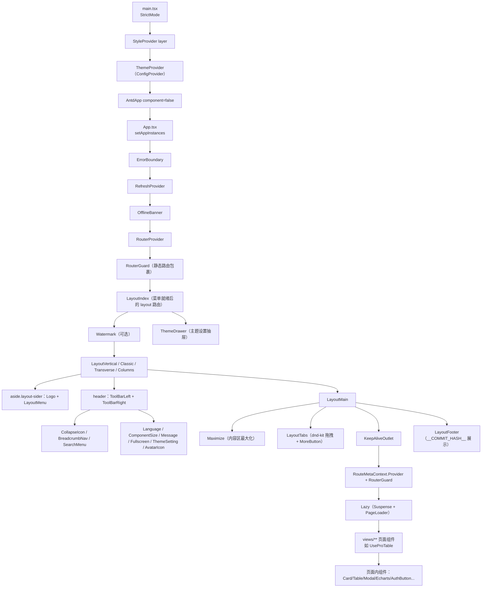
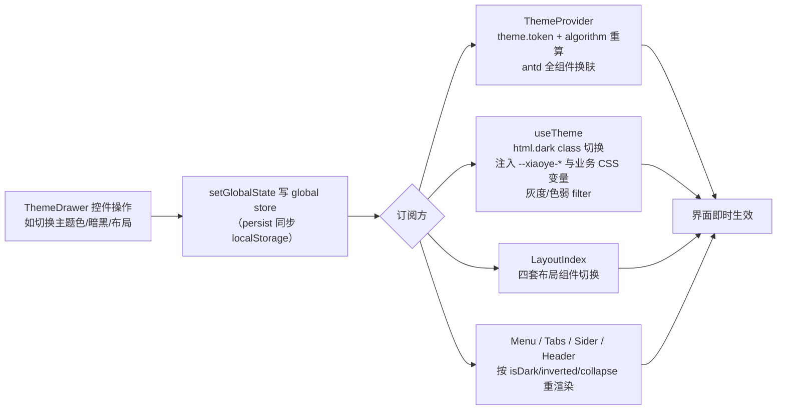

# 02 页面设计

> 项目：xiaoye-admin-react ｜ 版本：v1.0 ｜ 生成日期：2026-10-06 ｜ 依据：源码分析

## 1. 页面组织总原则

框架的页面体系围绕三个约定展开。第一，**位置约定**：所有页面组件放在 `src/views/**` 下（`src/pages/` 仅为 `.gitkeep` 占位空目录），`src/routers/helper/ConvertRouter.tsx` 用 `import.meta.glob("/src/views/**/*.tsx")` 收集，页面无须手动注册路由。第二，**菜单即路由**：页面能否访问完全由菜单数据决定（开发态为 `src/assets/json/authMenuList.json`，生产态为菜单接口），菜单节点中 `element` 字符串（如 `/system/accountManage/index`）与视图路径一一对应，不在菜单中的页面不会注册路由。第三，**meta 驱动行为**：`src/routers/interface/index.ts` 定义的 `MetaProps`（key/icon/title/activeMenu/isLink/isHide/isFull/isAffix/isKeepAlive）决定该页面在菜单、标签栏、面包屑、缓存体系中的表现。

## 2. 路由与页面总表

静态路由（`src/routers/modules/staticRouter.tsx`）：

| 路径 | 组件 | 说明 |
| --- | --- | --- |
| `/` | `<Navigate to="/home/index">` | 根路径重定向到 HOME_URL（`src/config/index.ts`） |
| `/login` | `src/views/login/index.tsx` | 登录页，支持账号/手机号双 Tab |
| `/403`、`/404`、`/500` | `src/components/Error/{403,404,500}.tsx` | 错误页；`/500` 在路由白名单中可离线访问 |
| `*` | 菜单未就绪时 `<Loading />`，就绪后 `<NotFound />` | 防刷新 404 的两段式兜底 |

动态页面（`src/views/`，共 14 个顶级模块、77 个菜单节点，均挂载在 `<LayoutIndex />` 之下，`meta.isFull` 者除外）：

| 模块目录 | 页面清单 | 内容要点 |
| --- | --- | --- |
| `home/` | 工作台首页 | 统计卡（useCountUp 数值滚动）+ Tabs 趋势图 + 饼图 + 待办表格，图表配置抽离在 `config/{overview,proportion,trend,table}.tsx` |
| `auth/page`、`auth/button` | 页面权限 / 按钮权限 | 页面权限演示不同账号菜单差异；按钮权限页消费 `authButtonList` 中的 `authButton` 键 |
| `details/basic`、`details/advanced` | 基础/高级详情 | Descriptions + Card 组合的详情排版范式 |
| `result/{success,fail,warning,info}` | 结果页 4 页 | 共用 `components/ResultPage.tsx` 渲染器 |
| `form/{basic,step,advanced}` | 基础/分步/高级表单 | antd Form 三种范式 |
| `list/{useProTable,useProList,useDragTable,useEditTable}` | 高级搜索表格/卡片列表/拖拽表格/行内编辑表格 | 自研 ProTable 风格：搜索区 + 工具栏 + Table + 弹窗 CRUD |
| `feat/{tabs,breadcrumb,clipboard,colorPicker,globalization}` | 标签栏操作/Tab 详情、面包屑平级与层级、剪贴板、取色器、国际化 | 交互特性演示；`feat/tabs/detail.tsx` 演示动态详情路由与 activeMenu |
| `assembly/{guide,svgIcon,qrCode,watermark,statistic,echarts}` | 引导页/SVG 图标/二维码/水印/统计数值/ECharts | 常用组件演示 |
| `menu/menu1`、`menu/menu2/**`、`menu/menu3` | 菜单嵌套演示（3 级） | 验证多级目录的展开/面包屑/缓存 |
| `link/bing` | 外部链接 | `meta.isLink` 新窗口打开 |
| `noLayout` | 无布局页 | `meta.isFull` 为 true，脱离 Layout 全屏渲染 |
| `system/{accountManage,roleManage,menuMange}` | 账号/角色/菜单管理 | 完整 CRUD 业务页，对接 `src/api/modules/system.ts` |
| `showcase/*`（20 页） | UI 组件演示 11 页、Hooks 演示 7 页、React 官方教程示例 2 页（ProductTable、TicTacToe） | 展示 antd 6 各组件族与 ahooks 用法 |
| `about/` | 关于项目 | 消费 `__APP_INFO__`（vite define 注入的依赖版本与构建时间） |

## 3. 框架内置关键页面详解

### 3.1 登录页（`src/views/login/`）

**布局**：全屏 `login-container`，居中 `login-content` 卡片；右上角工具区放置 `Language`（语言切换）与 `SwitchDark`（明暗切换）两个全局控件（`index.tsx`），表明主题与语言在登录前即可用——它们的落点正是 global store 的 `language`/`isDark` 字段。左侧展示 Logo + 标题 + `login_bg.svg` 背景插画（`assets/images/`）。

**交互与状态**（`components/LoginForm.tsx`）：`Tabs` 切换账号登录/手机号登录两种模式（`mode` state）。账号表单支持"记住用户名"（localStorage 键 `xiaoye-remember-username`，勾选时写入、取消时移除，下次进入预填）。手机号表单内置 60 秒验证码倒计时（`countdown` state + setInterval），发送前先 `validateFields(["mobile"])` 校验 `/^1[3-9]\d{9}$/`。

**登录成功流程**由 `useLoginSuccess` hook 统一封装：记住用户名 → `setToken` → 清空 tabsList → `await initPermissions(token)` 拉权限 → 时段问候语 notification → `navigate(redirectUrl, { replace: true })`。三个细节值得注意：密码先经 `md5()` 摘要再提交；登录请求传 `skipErrorHandler: true` 改为页面内联 `<Alert>` 展示错误（`getLoginErrMsg` 兼容业务信封与 AxiosError 两种 reject 形态）；redirect 经 `getSafeRedirectUrl` 安全校验，非法值回退 `HOME_URL`；`replace` 确保浏览器后退不会回到登录页。

### 3.2 工作台首页（`src/views/home/index.tsx`）

首页是仪表盘范式：4 张统计卡（图标、数值、同比涨跌、迷你趋势），配合 `useCountUp`（`src/hooks/useCountUp.ts`）实现数值滚动动画；Tabs 切换的时间趋势 ECharts 折线图、分类占比饼图与一个 antd Table。图表实例统一走 `src/components/Echarts/index.tsx` 封装（内置 `echarts/core` 按需注册与主题跟随，配置见 `src/components/Echarts/config/index.ts`）。数据当前为静态演示数据（`config/` 下硬编码），页面本身不发起请求——这是脚手架的演示性质使然，接业务时替换为接口即可。

页面代码组织也值得模仿：四张统计卡的配置（图标、底色、数值、涨跌、12 期迷你趋势数组）由 `buildCards(t)` 工厂函数生成，标题直接消费 `home.*` 词条，是"配置驱动视图"的典型写法；`config/overview.ts` 导出 `overviewOptionsFn` 与 `overviewTabs`，图表 option 以函数形式产出便于响应主题与语言变化；`config/table.tsx` 把列定义与类型 `HomeRecord` 一并收口。这套"页面瘦、配置厚"的结构让首页主体逻辑保持在百行量级。

### 3.3 示范 CRUD 页：高级搜索表格（`src/views/list/useProTable/index.tsx`）

该页是框架推荐的列表页范本，状态结构清晰可复制：

- **查询状态**：`params`（username/gender/startTime/endTime/createTimeSort/current/pageSize）+ `searchVersion`（触发重新查询的版本号）；
- **竞态防护**：`latestRequestId`（`useRef` 计数）+ 卸载标记 `unmounted`，保证慢请求返回时不会覆盖新请求的结果；
- **弹窗/抽屉**：`viewRecord`（查看抽屉）、`editingRecord + modalOpen + submitting`（新增/编辑 Modal）+ `Form.useForm<ReqUserSave>()`；
- **工具栏**：行勾选 `selectedRowKeys`（批量删除）、密度切换（映射 Table size）、列显隐 `columnVisibility`（持久化到 localStorage 键 `xiaoye.useProTable.columnVisibility`，读取时有 try/catch 容错）。

交互流：搜索 → setLoading → `getUserList` → `setData/setTotal`；行内"编辑"回填表单开 Modal → `editUser` → 成功后 message + 重新拉取；"删除"走 `modal.confirm`（`src/hooks/useMessage.tsx` 的实例化封装）二次确认后调 `deleteUser`。

### 3.4 系统管理三页（`src/views/system/`）

`accountManage`（账号管理）是最完整的业务页：搜索区（用户名/状态/性别/角色）、表格（含 roleIds→roleNames 冗余展示）、新增/编辑 Modal（编辑时 id 必填、password 仅新增时提交）、重置密码（KeyOutlined 按钮）、行内状态 Switch（`switchingId` 防抖单行 loading）、批量删除（`batchDeleting`）；内置超级管理员账号（`BUILT_IN_ACCOUNT_ID = "1"`)不可删除/禁用/改名，属于业务级保护逻辑。`roleManage` 维护角色与菜单授权（`menuIds`），`menuMange` 维护菜单树（catalog/menu 两类节点，与 `MenuNode` 类型对应，见 `src/api/interface/index.ts`）。语言包未覆盖 `system.*` 命名空间，这三页的表单标签采用中文硬编码（源码注释明确此取舍）。

### 3.5 布局工具区与全局交互组件

Header 左右工具区（`src/layouts/components/Header/ToolBarLeft.tsx`、`ToolBarRight.tsx`）是框架交互密度的最高点，每个控件都是独立组件：`CollapseIcon` 切换菜单折叠（写 global store 的 `isCollapse`）；`BreadcrumbNav` 消费 `getAllBreadcrumbList` 预计算的面包屑映射，支持图标与层级展开；`SearchMenu` 提供菜单模糊搜索快速跳转；`Language` 是语言切换入口（登录页右上角复用同一组件）；`ComponentSize` 切换 antd 全局组件尺寸（写 `componentSize`，经 `ConfigProvider.componentSize` 生效）；`Message` 是站内消息通知演示；`Fullscreen` 走浏览器全屏 API；`ThemeSetting` 打开主题抽屉；`AvatarIcon` 是头像下拉，内含 `InfoModal`（个人信息编辑，调 `updateUserInfoApi`）与 `PasswordModal`（修改密码，密码 md5 摘要后调 `changePasswordApi`）及退出登录（登出接口 + 清登录态 + 跳登录页）。

内容区的交互组件同样成体系：`Maximize`（`layouts/components/Main/components/Maximize.tsx`）把内容区撑满整个视口（写 `maximize`，`LayoutMain` 监听后给 `#root` 挂 `main-maximize` class）；`MoreButton`（`layouts/components/Tabs/components/MoreButton.tsx`）聚合标签的刷新当前页（调 `RefreshContext.refresh()`）、关闭当前/其他/左右标签等操作；`Footer`（`layouts/components/Footer/index.tsx`）展示构建信息——`vite.config.ts` 注入的 `__COMMIT_HASH__`（git 短哈希）与 `__APP_INFO__`（依赖版本与构建时间）。错误页三件套（`src/components/Error/403.tsx`、`404.tsx`、`500.tsx`）共享 `index.css` 的插画排版，标题文案走 `error.*` 词条；`Loading` 组件提供页内 `PageLoader` 与全屏两种形态（后者由请求层 `loading: true` 触发，计数器管理并发）。`Tour` 组件（`src/components/Tour/index.tsx`）为引导页提供分步导览能力，与 `views/assembly/guide` 配合。

## 4. 组件树

一次典型页面渲染的组件树如下（以 vertical 布局为例）：

布局共享组件的职责：`ToolBarLeft`（折叠按钮、面包屑、搜索菜单）与 `ToolBarRight`（语言、组件尺寸、消息通知、全屏、主题设置、头像下拉）组成 Header；`AvatarIcon` 下拉含个人信息（`InfoModal`）与修改密码（`PasswordModal`）弹窗及退出登录；`SearchMenu` 提供菜单全局搜索快速跳转；`BreadcrumbNav` 基于 `getAllBreadcrumbList`（`src/utils/index.ts`）渲染层级；`ThemeDrawer` 是主题设置抽屉（布局切换、主题色 `ColorPicker`、明暗/紧凑/圆角、灰度/色弱、水印等 23 项开关的 UI 入口）。

## 5. 状态管理设计

页面状态分为四层，各自归属明确：

1. **持久化全局偏好**：`useGlobalStore`（localStorage `xiaoye-global`）。组件只调 `setGlobalState({ key, value })` 一个动作，类型安全地更新任意字段；`ThemeProvider` 与 `useTheme` 订阅后驱动 antd 与 CSS 变量，`ThemeDrawer` 等控件只写 store。
2. **会话与权限**：`useUserStore`（持久化）+ `useAuthStore`（内存）。登录页、RouterGuard、usePermissions、AuthButton 全部只读这两个 store，写入路径收敛为 `setToken/setUserInfo/setAuthMenuList/setAuthButtonList/resetAuth` 几个动作。
3. **视图会话状态**：`useTabsStore`（内存，不持久化——刷新后标签栏按 affix 重建）。Tabs 组件监听路由变化 `addTab`，MoreButton 调 `removeTab/closeTabsOnSide/closeMultipleTab`。
4. **页面局部状态**：组件内 `useState/useRef/Form`（如 CRUD 页的 params/data/loading/modal），不进全局 store——框架刻意避免把列表数据全局化。

跨组件的"刷新当前页"通过 `RefreshContext`（`src/context/Refresh.tsx`）传递：`refresh()` 先隐藏 outlet 再自增 nonce，`KeepAliveOutlet` 据此丢弃缓存；页面身份则通过 `RouteMetaContext`（`src/context/RouteMeta.tsx`）由路由逐级注入。

## 6. 关键 UI 交互流程

### 6.1 布局与主题定制交互

用户在 ThemeDrawer 中的一次设置如何传导到全站：

### 6.2 多标签页交互

标签栏（`src/layouts/components/Tabs/index.tsx`）的行为链：路由变化 → `useUpdateEffect` 读取最后一条 match 的 meta → `addTab`（按 path 去重，affix 标签不可关）；拖拽 → dnd-kit `PointerSensor`（10px 激活阈值）→ `onDragEnd` 中 `arrayMove` 后 `setTabsList`（带 -1 索引防护）；关闭 → `removeTab`，若关的是当前页则自动导航到相邻标签（`window.$navigate`）；标签集合同时是 KeepAlive 缓存的存活名单，关闭即释放缓存（见《01-系统架构》4.4）。标签的生命周期还有两端：**起点**是权限就绪——`useEffect` 监听 `flatMenuList`（而非仅在挂载时），登录或刷新后 affix 菜单（`meta.isAffix` 且非隐藏非全屏）会被自动预置为固定标签，标题同样走 i18n 翻译；**终点**是刷新即逝——`tabsList` 不持久化，用户临时打开的标签在整页刷新后消失，只留下 affix 固定项，这是"标签是会话内导航足迹"的产品语义，而非持久收藏夹。

### 6.3 页面缓存交互要点

缓存页（`meta.isKeepAlive: true`）在切走时以 `display:none` 隐藏、切回时重放 `fade-enter` 动画（`replayEnter` 先移除类名、强制回流 `void el.offsetWidth` 再添加，源码注释解释这是让 CSS transition 必定重新触发的手法）；重定向路由不缓存；`RefreshContext.refresh()`（MoreButton 中的"刷新当前页"）触发 nonce 自增丢弃当前缓存。

### 6.4 特殊页面机制：isFull、isLink、activeMenu 与动态详情

有四类特殊页面机制在页面设计中扮演"逃生口"角色。其一，**全屏页（`meta.isFull`）**：`ConvertRouter` 把这类路由从 Layout 下拆出、平铺到路由表顶层，`views/noLayout/index.tsx` 就是典型——它渲染时不带侧栏、头部与标签栏，适合打印页、独立落地页。其二，**外链页（`meta.isLink`）**：菜单点击时 `Menu` 组件检测到该字段直接 `window.open(url, "_blank")`，不注册本地路由，`views/link/bing` 是其演示形态。其三，**隐藏菜单（`meta.isHide`）**：页面可访问但不出现在菜单里（`getShowMenuList` 过滤），常配合 `meta.activeMenu` 使用。其四，**动态详情路由**：`feat/tabs/detail` 演示了带参数的详情页（形如 `:id` 的路径段），它以 `activeMenu` 指向列表父页，标签栏上折叠为父 tab 而不是无限开新标签，KeepAlive 缓存清理时也按 `activeMenu` 归属判定（父 tab 关闭则详情缓存一并释放，见 `src/components/KeepAlive/index.tsx` 的 `keyAlive` 逻辑与 `matchPath` 匹配）。这四类机制全部由菜单数据声明，无需改任何框架代码，是"菜单即路由"理念在边缘场景的延伸。

### 6.5 响应式与边界行为

页面体系在视口与异常边界上有一组值得了解的行为约定。视口方面，`LayoutMain`（`src/layouts/components/Main/index.tsx`）监听 `window.resize`（ahooks `useDebounceFn`，100ms 防抖），当 `document.body.clientWidth` 小于 1200 时自动把菜单置为折叠态——也就是说"窄屏自动收起侧栏"是全局行为而非某布局独有；`Maximize` 与 `isCollapse` 等状态的视觉落点都是给 `#root` 或布局节点切换 class，由 `layout.css`、`index.css` 中的样式承接。异常边界方面：懒加载页面首挂走 `Suspense` 显示 `PageLoader`；`RouteMetaContext` 缺失（如直接渲染在静态路由下）时 `useAuthButton` 以空 `menuKey` 回退为无按钮权限；`document.title` 的兜底链是"词条 → meta.title → 应用名"。此外 `index.html` 的首屏占位遵循系统 `prefers-color-scheme`，暗色系统用户在 JS 加载期也不会被白底闪屏——这类"加载链路每一环都有兜底"的设计贯穿整个页面体系。

## 7. 页面级无障碍与细节

框架在若干页面细节上体现了打磨：登录页问候语按时段 i18n 化（`getGreeting`），与 `src/utils/index.ts` 的非 i18n 版 `getTimeState` 并存（后者仅供非 UI 场景）；`index.html` 内置 `#boot-loading` 首屏占位（跟随 `prefers-color-scheme` 的明暗背景），避免慢网络白屏；`ErrorBoundary` 的错误兜底 UI 文案全部走 `appError.*` 词条；表单类演示页统一 `requiredMark={false}`、`autoComplete="off"`。这些细节共同构成"读文档即可复刻"的页面质感基线。
