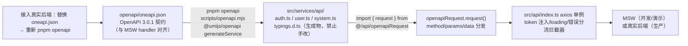

# 03 接口设计

> 项目：xiaoye-admin-react ｜ 版本：v1.0 ｜ 生成日期：2026-10-06 ｜ 依据：源码分析

## 1. 请求层封装详解

### 1.1 axios 实例与全局配置

`src/api/index.ts` 定义 `RequestHttp` 类并导出单例。构造时以如下配置创建 axios 实例：

- `baseURL`：取自环境变量 `VITE_API_URL`（各环境均为 `/api`，见 `.env.development` / `.env.production` / `.env.test` / `.env.mock`），生产环境由 Nginx 将 `/api` 反代到真实后端；
- `timeout`：`ResultEnum.TIMEOUT = 30000`（30 秒，`src/enums/httpEnum.ts`）；
- `withCredentials: false`：不跨域携带 Cookie，鉴权完全依赖请求头 token。

对外暴露六个方法：`get/post/put/delete<T>` 返回 `Promise<ResultData<T>>`，`download` 以 `responseType: "blob"` 发 POST 返回二进制。泛型 `T` 只约束 `data` 字段，信封外壳统一由 `Result` 描述。

### 1.2 请求拦截器

`src/api/index.ts` 的请求拦截器做两件事：

1. **全屏 loading**：请求配置携带 `loading: true` 时调 `showFullScreenLoading()`（`src/components/Loading/fullScreen.tsx`，内部按计数器处理并发请求的显隐，响应侧对应 `tryHideFullScreenLoading`）；
2. **Token 注入**：向请求头写入 `x-access-token`，值实时读取 `useUserStore.getState().token`（zustand 支持在非 React 环境直接 `getState()`，因此拦截器无须 hook）。写入前检查 `config.headers.set` 是否为函数，兼容 axios 1.x 的 `AxiosHeaders`。

自定义配置类型 `CustomAxiosRequestConfig` 扩展了两个开关：`loading?: boolean` 与 `skipErrorHandler?: boolean`。后者是"逃生口"：跳过全局错误提示、由页面自行 catch 处理，但**业务 401 仍会清登录态并跳登录页，只是不弹提示**（源码注释原文强调）。

### 1.3 响应拦截器与统一信封

所有业务接口遵循 `{ code, msg, data, showType? }` 信封（`src/api/interface/index.ts` 的 `Result/ResultData`），`code` 语义来自 `ResultEnum`：`SUCCESS = 200`、`OVERDUE = 401`、`ERROR = 500`。响应拦截器的分支顺序：

1. `tryHideFullScreenLoading()` 计数递减；
2. **Blob 直通**：`responseType === "blob"` 的响应（文件下载）跳过信封检查直接返回 `response.data`，避免二进制流被当 JSON 校验；
3. **业务 401**（HTTP 200 且 `data.code == 401`）：`setToken("")` + `useAuthStore.resetAuth()`（清菜单/按钮权限，防账号切换权限串号）→ 非 skip 时 `showBizError` → `navigateTo(buildLoginUrlWithRedirect())` → `Promise.reject(data)`；
4. **其他非 200 业务码**：按 `showType` 分流提示（见 1.4），返回 `Promise.reject(data)`——页面拿到的 reject 值是信封对象而非 AxiosError，因此页面 catch 里可用 `err.msg`；
5. **成功**：直接返回 `data`（信封对象），调用方以 `const { data } = await api()` 解构业务数据。

HTTP 层异常（网络错误、超时、非 2xx）进入错误回调：`showHttpError(error)` 后 `Promise.reject(error)`。

**关于 Token 刷新**：项目当前**没有实现 refresh token / 无感刷新机制**⚠️ 待确认（源码中不存在刷新接口与刷新逻辑，401 一律登出重登）。这是脚手架的简化取舍，二次开发如需无感刷新，应在响应拦截器的 401 分支中插入"单飞（single-flight）刷新 + 请求重放"逻辑。

### 1.4 错误处理双轨制

`src/api/helper/` 下三个文件构成完整的错误处理体系：

**`errorShowType.ts`**：定义业务错误呈现方式枚举（借鉴 ant-design-pro 的 `requestErrorConfig` 约定）：`SILENT=0`（静默）、`WARN_MESSAGE=1`、`ERROR_MESSAGE=2`（默认）、`NOTIFICATION=3`、`REDIRECT=9`（清登录态跳登录）。后端在业务错误响应体中携带 `showType` 即可控制前端行为，未携带按 `ERROR_MESSAGE`。

**`errorHandler.ts`**：
- `showBizError(data)`：按 showType switch 分流到 `message.warning/error`、`notification.error`（附 code）、`navigateTo(登录页)` 或静默；返回实际采用的展示方式便于测试断言；
- `showHttpError(error)`：超时（`error.message` 含 "timeout"）提示 `common.requestTimeout`；网络错误提示 `common.networkError`；有响应时交给 `checkStatus`；无响应且 `!window.navigator.onLine` 跳 `/500` 断网页。

**`checkStatus.ts`**：HTTP 状态码 → i18n 文案映射表，覆盖 400/401/403/404/405/408/500/502/503/504 与默认分支；其中 401 额外执行 `setToken("") + resetAuth() + navigateTo(buildLoginUrlWithRedirect())`，与业务 401 行为对齐。

提示实例全部来自 `src/hooks/useMessage.tsx` 的模块级单例（由 `App.tsx` 注入 antd `<App>` 上下文实例），保证提示继承全局 locale 与主题。

全屏 loading 的并发语义在 `src/components/Loading/fullScreen.tsx` 中实现：模块维护计数器 `needLoadingRequestCount`，首个 `loading: true` 请求到达时才向 `document.body` 挂载独立的 `div#loading` 并用独立的 `ReactDOM.createRoot` 渲染 Loading 组件；响应到达时 `tryHideFullScreenLoading` 递减，只有计数归零才真正卸载——先 `root.unmount()` 释放 fiber 树与事件监听，再移除 DOM 节点（源码注释强调卸载顺序）。因此并发多个带 loading 的请求时，全屏遮罩在"第一个开、最后一个关"的区间内持续存在，不会闪烁。`download` 方法则完全绕开信封与 loading 语义：以 `responseType: "blob"` 发 POST 并让响应拦截器直通返回二进制，由调用方自行处理保存（配合 `src/typings/window.d.ts` 中保留的 `msSaveOrOpenBlob` 兼容声明）。

### 1.5 跳转与回跳安全

`src/utils/safeRedirect.ts` 提供：`getSafeRedirectUrl`（只放行以单个 `/` 开头的站内相对路径，拒绝 `//` 协议相对地址与跨 origin 拼接，防 Open Redirect）、`getCurrentInternalUrl`（按 hash/history 模式取当前完整地址）、`buildLoginUrlWithRedirect`（生成带 `?redirect=` 的登录地址，已在登录页时原样返回防死循环）。`src/utils/navigate.ts` 的 `navigateTo` 在非 React 场景优先使用 RouterGuard 挂载的 `window.$navigate`，未挂载时按 `VITE_ROUTER_MODE` 降级改 hash 或 href。

跳转链路有一个时序上的固有窗口值得知晓：`window.$navigate` 由 `RouterGuard` 在渲染阶段挂载，若 401 跳转发生得极早（例如登录请求自身返回 401，此时应用可能尚未完成首次渲染），`navigateTo` 会退化为直接改地址栏——两种路径最终都能到达登录页，区别仅在于后者是整页导航而非客户端路由切换。另外，请求头 `x-access-token` 是**前后端约定的自定义头**（非标准 `Authorization`），后端接入时需按此头名鉴权；`withCredentials: false` 意味着 Cookie 不参与鉴权，若后端坚持 Cookie 会话需同时修改 axios 配置与跨域策略（CORS `credentials`）。

## 2. API 组织约定

### 2.1 目录与命名

手写 API 位于 `src/api/modules/`，按业务域拆四个文件：`login.ts`（认证/权限/个人中心，8 个函数）、`user.ts`（演示用户 CRUD，4 个）、`system.ts`（账号/角色/菜单管理）、`business.ts`（商品/品牌/分类/出入库/经营看板）。全项目共 **42 个接口函数**（`grep` 统计 `http.get|post|put|delete|download` 调用数）。URL 前缀统一使用 `src/api/config/servicePort.ts` 导出的 `PORT1 = "/hooks"`——源码注释特别说明：这是后端契约路径（与 mock 服务对齐），不是产品显示名，不要因品牌改名而改动它。

命名遵循 `xxxApi` 后缀（如 `loginApi`、`getAuthMenuListApi`、`deleteUser` 一部分省略后缀以模块名为命名空间）。每个函数都带泛型标注返回的 `data` 类型，请求与响应类型集中定义在 `src/api/interface/index.ts`（含分页 `ReqPage/ResPage<T>` 约定：`current/pageSize` 入参，`list/current/pageSize/total` 出参）。

### 2.2 核心接口示例

| 接口函数 | 方法与路径 | 入参 / 出参 | 说明 |
| --- | --- | --- | --- |
| `loginApi` | POST `/api/hooks/login` | `ReqLogin{username,password(md5)}` → `ResLogin{access_token}` | 登录，支持透传 options |
| `mobileLoginApi` | POST `/api/hooks/login/mobile` | `ReqMobileLogin{mobile,code}` → `ResLogin` | 手机验证码登录 |
| `getAuthMenuListApi` | GET `/api/hooks/menu/list` | — → `RouteObjectType[]` | 动态菜单树 |
| `getAuthButtonListApi` | GET `/api/hooks/auth/buttons` | — → `{[menuKey]: string[]}` | 按钮权限码 |
| `logoutApi` | POST `/api/hooks/logout` | — | 带 `loading: true` 全屏加载 |
| `updateUserInfoApi` / `changePasswordApi` | POST `/api/hooks/user/info/update`、`/user/password/change` | `ReqUpdateUserInfo` / `ReqChangePassword`（md5 摘要） | 个人中心 |
| `getUserList` | POST `/api/hooks/user/list` | `ReqUserList` → `ResPage<UserList>` | 分页 + 筛选 + 排序 |
| `getAccountList` 等 system 系 | POST `/api/hooks/system/...` | 见 `src/api/interface/index.ts` 的 Account/Role/Menu 类型 | 系统管理三域 |

登录页调用示例（`src/views/login/components/LoginForm.tsx`）：`await loginApi({ ...values, password: md5(values.password) }, { skipErrorHandler: true })`——options 参数直接落到 axios 配置层。

### 2.3 接口类型设计规约

`src/api/interface/index.ts` 的类型组织有五条可复制的规约。规约一，**信封与业务分离**：`Result` 只描述 `code/msg/showType?`，`ResultData<T>` 组合出完整响应，接口函数的泛型永远只标业务数据类型；分页用 `ReqPage/ResPage<T>` 标准对（`current/pageSize` 入、`list/current/pageSize/total` 出），任何新列表接口都应沿用而不是自造分页字段。规约二，**编辑入参从实体派生**：新增/编辑入参一律写成 `Omit<实体, 服务端生成字段>` 且 `id` 可选（如 `ReqAccountSave extends Omit<AccountItem, "id" | "roleNames" | "createTime">`），实体字段变更时入参自动跟随，杜绝两处维护。规约三，**只读字段用 Pick 圈定**：`ReqUpdateUserInfo = Pick<UserInfo, "name" | "email" | "phone" | "remark">`，把 `username`、`role` 这类服务端裁决字段挡在提交体外。规约四，**枚举语义用字面量联合**：`gender: 1 | 2`、`type: "in" | "out"`、`createTimeSort?: "asc" | "desc"`，比 string 更安全也比 enum 更轻。规约五，**冗余字段由服务端下发并注释契约**：`AccountItem.roleNames` 与 `roleIds` 顺序一致、`CategoryNode.goodsCount` 由服务端统计，类型上的 JSDoc 注释就是前后端契约的一部分——这是接口文档化的轻量做法。

## 3. OpenAPI 生成与消费链路

### 3.1 链路总览

### 3.2 生成器配置（`scripts/openapi.mjs`）

脚本以 `createRequire` 加载 CJS 的 `@umijs/openapi`，`generateService` 参数：`schemaPath` 指向 `openapi/oneapi.json`、`serversPath` 输出到 `src/services`、`projectName: "api"`（生成子目录 `src/services/api`）、`namespace: "API"`（生成 `API.ResultXxx` 命名空间类型）、`requestLibPath` 固定注入 `import { request } from '@/api/openapiRequest'`。`src/services/README.md` 明确该目录是生成产物禁止手改：改接口先改 schema 再重新生成。

`openapi/oneapi.json` 当前是与 `src/mocks` MSW handler 保持一致的**示例契约**（文件 info.description 原文），`servers.url = "/api"`，分 auth/user/system 三个 tag，覆盖 login/logout/menu/buttons/user-info 等端点，响应按 `{code,msg,data}` 信封建模（`ResultLogin/ResultNull/ResultMenuList/ResultAuthButtons` 等）。

### 3.3 适配器桥接（`src/api/openapiRequest.ts`）

`@umijs/openapi` 假定存在 `request<T>(url, options)` 函数；适配器把 options 中的 `method/params/data` 分发到统一 axios 实例的 get/put/delete/post，其余键（如 `loading`、`skipErrorHandler`）原样透传进 axios 配置。运行时返回的是响应拦截器解包后的 `{code,msg,data}` 信封，与 schema 中按信封建模的 `API.ResultXxx` 类型一一对应；取数方式为 `const { data } = await api.auth.login(body)`（见 `src/services/api/index.ts` 聚合导出 `auth/user/system` 三个命名空间）。由此，**生成代码与手写代码共享同一套鉴权、错误分流与 loading 行为**，这是本项目接口层最重要的复用设计。

## 4. Mock 方案（MSW）

### 4.1 架构与启动

Mock 采用 MSW 2.15.0（版本精确锁定，因 `public/mockServiceWorker.js` 与之绑定，升级需 `npx msw init public/ --save` 重新生成）。`src/mocks/browser.ts` 用 `setupWorker` 聚合 handlers；`src/main.tsx` 的 `enableMocking()` 在**渲染前 await** 启动（防止首屏请求抢在拦截生效前漏网），带三层防护：5 秒竞速超时（隐私模式/禁 SW 环境不白屏）、`onUnhandledRequest: "warn"`（漏 mock 的接口控制台告警）、"SW 未接管页面则整页刷新一次"（sessionStorage 键 `xiaoye-msw-claim-reload` 防死循环）。启动条件：非生产构建恒开；生产构建仅当 `VITE_ENABLE_MOCK === "true"`（即 `pnpm build:mock` 演示构建）才打包进产物——常规生产构建经动态 `import("@/mocks/browser")` 天然 tree-shake 掉 MSW。

### 4.2 Handler 组织与数据语义

`src/mocks/handlers.ts` 聚合四个域模块：`auth.ts`（登录/验证码/登出/个人信息/改密/菜单/按钮权限）、`demo.ts`（用户列表 CRUD：固定 87 条确定性数据，"保证分页与筛选行为稳定可复现"）、`system.ts`（账号/角色/菜单）、`business.ts`（商品/品牌/分类/出入库/看板）。公共包装在 `_shared.ts`：`ok(data)` 产出 `{code:200,data,msg:"success"}`、`fail(msg, code=500)` 产出错误信封——注释强调必须与响应拦截器的 `code===200` 判定一致，否则会被拦截器判为业务错误；`nextId()` 自增游标避免同毫秒重复 id；`delay()` 模拟 200~400ms 网络延迟。

handler 与 `src/api/modules/` 的 42 个接口**一一对应**（`README.md` 明确），路径即真实路径（`/api/hooks/...`）。演示环境登录账密为 admin / 123456（密码以 md5 存于内存，改密接口会更新摘要）；短信验证码固定 123456。

以一个请求的完整生命周期走读 mock 语义：页面发起 `getUserList` → Service Worker 在网络层拦截 `/api/hooks/user/list` → handler 内 `await delay(400)` 模拟延迟 → 从确定性数据集（demo 域固定 87 条用户，姓名/城市/时间由索引派生，保证每次刷新数据一致、分页行为可复现）中执行筛选、排序、切片 → 以 `ok(data)` 包装为 `{code:200,...}` 返回。若 handler 返回 `fail(msg)`（默认 code 500），响应拦截器会将其判为业务错误并按 showType 弹错——`_shared.ts` 的注释特别强调包装函数必须与拦截器的 `ResultEnum.SUCCESS` 判定保持一致。auth 域还有带状态的 mock：`currentPasswordMd5` 是模块级可变量，修改密码接口校验旧摘要后更新它，会话内立即生效、刷新页面（重载 mock 模块）即重置，这种"内存数据源"语义在文件头注释中有明确说明。

### 4.3 Mock 的边界

开发态菜单与按钮权限实际**不经过 MSW**：`usePermissions` 在非 PROD 构建短路走静态 JSON（`src/assets/json/authMenuList.json`），仅按钮权限带重试地请求 MSW；MSW 主要服务登录、用户列表等真实发请求的场景（`README.md` "本地 mock" 一节的原文口径）。菜单接口 handler（`/api/hooks/menu/list`）返回的正是静态菜单 JSON 的 `data`，因此 mock 模式与生产模式的权限数据结构完全一致。

## 5. 二次开发的接口接入清单

1. **契约优先路径**：更新 `openapi/oneapi.json` → `pnpm openapi` → 页面 import `api.<tag>.<fn>`；
2. **手写路径**：`src/api/interface/index.ts` 补类型 → `src/api/modules/<域>.ts` 加函数（记得带 `PORT1` 前缀与泛型）；
3. 两条路径都要在 `src/mocks/modules/` 对应域补 handler，保持"接口 ↔ mock ↔ 契约"三者同步；
4. 需要差异化错误处理时用 `options`：`{ loading: true }` 全屏加载、`{ skipErrorHandler: true }` 页面自理；
5. 接真实后端时：`.env.development` 配 `VITE_PROXY = [["/api","http://localhost:后端端口"]]`（`build/proxy.ts` 会 rewrite 掉 `/api` 前缀、支持 ws 与 https `secure:false`），并整体替换 `oneapi.json`。
