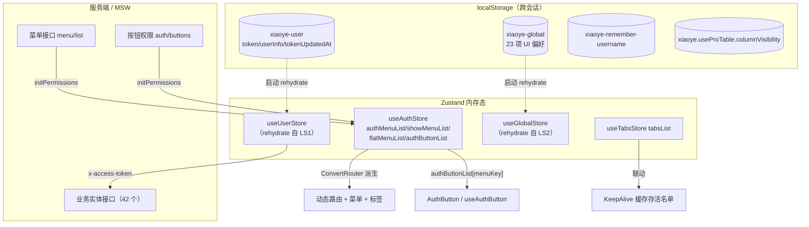
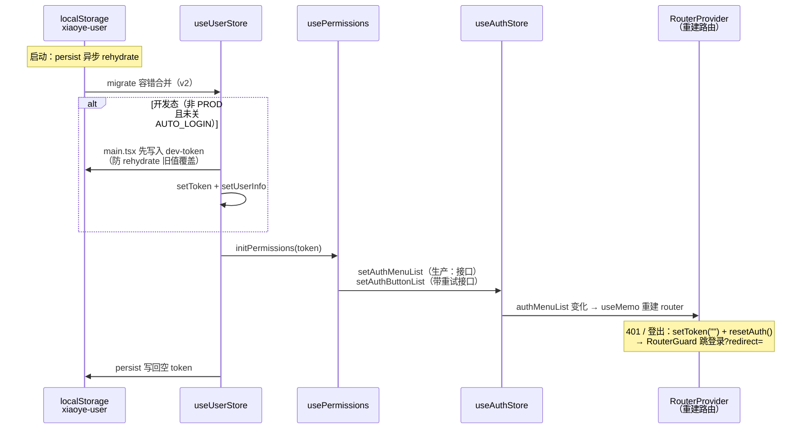

# 04 数据模型

> 项目：xiaoye-admin-react ｜ 版本：v1.0 ｜ 生成日期：2026-10-06 ｜ 依据：源码分析

## 1. 模型总览

前端数据按"归属 + 生命周期"划分为五类：**服务端资源模型**（接口契约中的业务实体，定义于 `src/api/interface/index.ts`）、**鉴权会话状态**（`useUserStore`，localStorage 持久化）、**权限数据**（`useAuthStore`，内存态、每次启动重建）、**全局偏好**（`useGlobalStore`，localStorage 持久化）、**视图会话状态**（`useTabsStore` 与页面局部 state，内存态）。类型定义集中是本项目的一个显著特征：store 的数据接口抽在 `src/stores/interface/index.ts`（只含数据字段，方法由 zustand 自动推导），接口契约抽在 `src/api/interface/index.ts`，路由 meta 抽在 `src/routers/interface/index.ts`，三者互不重复。

## 2. 鉴权会话数据结构

### 2.1 UserState（`src/stores/interface/index.ts` + `modules/user.ts`）

| 字段 | 类型 | 说明 |
| --- | --- | --- |
| `token` | `string` | 登录凭证。登录成功时写入 `ResLogin.access_token`；请求拦截器注入 `x-access-token` 头；清空即登出 |
| `userInfo` | `UserInfo` | 当前用户资料：`username`（只读登录名）、`name`（展示昵称）、`email`、`phone`、`role`（角色名，只读展示）、`remark`、`createTime` |
| `tokenUpdatedAt` | `number` | token 写入时间戳（毫秒）。源码注释明确"仅作记录用，不参与强制登出判断"，为将来按需校验登录态新鲜度预留 |

persist 配置：键 `xiaoye-user`、`version: 2`、`partialize` 只持久化三个数据字段。`migrate` 函数是防御性设计样板：容忍任意旧结构（v0 缓存可能只有 `{name}` 等部分字段），用 `DEFAULT_USER_INFO` 补齐缺失项，异常时回退默认值**绝不抛错**（源码注释：抛错会导致登录态整体丢失）。`DEFAULT_USER_INFO`（`modules/user.ts` 导出）与 MSW 的 `CURRENT_USER_INFO` 保持同一人设（admin / Xiaoye），供开发态跳过登录时使用。

### 2.2 权限数据的派生关系

`useAuthStore` 的四个字段由一次 `setAuthMenuList` 调用派生（`src/stores/modules/auth.ts`）：

| 字段 | 类型 | 派生方式 | 消费方 |
| --- | --- | --- | --- |
| `authMenuList` | `RouteObjectType[]` | 原始菜单树（接口或静态 JSON） | `ConvertRouter` 重建路由表 |
| `showMenuList` | `RouteObjectType[]` | `getShowMenuList` 递归过滤 `meta.isHide` | 侧边/顶部菜单渲染（`layouts/components/Menu`） |
| `flatMenuList` | `RouteObjectType[]` | `getFlatMenuList` 递归展平并剥掉 children | 动态路由装配、Tabs、KeepAlive 联动、面包屑 |
| `authButtonList` | `{ [menuKey: string]: string[] }` | 独立接口写入 | `AuthButton` / `useAuthButton`（按当前页 `meta.key` 取数组） |

`resetAuth()` 将四个字段整体重置为初始值，是 401 与登出的唯一清理出口（防权限串号）。`src/utils/menu.ts` 头注释记录了一个架构约束：菜单纯函数单独成文件是因为 `utils/index.ts` 依赖 store、store 又依赖菜单函数，抽离纯函数文件打破了 `utils -> stores -> utils` 的循环依赖。

`authButtonList` 的键值契约也值得单独说明：键是菜单 `meta.key`（如 `"authButton"`、`"useProTable"`，见 `src/assets/json/authButtonList.json` 示例），值是该页允许的按钮权限码字符串数组（如 `["add","edit","delete","import","export"]`）。这个"按页面分组的码表"结构决定了权限粒度天然是页面级的——同一名权限码在不同页面互不干扰；也决定了后端下发时必须以 `meta.key` 为命名空间，前端不做任何跨页合并。若将来需要"全局按钮权限"，做法是约定一个特殊键或把判定函数改为同时查多键，而不是改动数据形态。

### 2.3 会话数据的两种初始化路径

同一份 UserState 在开发态与生产态的"来路"完全不同，理解这一点是排查登录类问题的前提。生产态走"登录接口 → setToken → initPermissions 换权限"的完整链路，token 的有效性与菜单接口的可用性都由后端裁决；开发态则由 `src/main.tsx` 在模块加载期直接预置——先把 `{state:{token:"dev-token",userInfo:DEFAULT_USER_INFO},version:0}` 写入 localStorage 的 `xiaoye-user`，再调 `setToken/setUserInfo`。这个"先写持久层再写内存"的顺序在源码注释中有完整解释：zustand persist 的 rehydrate 是异步的，若只调用 setToken，随后完成的 rehydrate 会用 localStorage 中的旧值（空 token）覆盖内存，导致权限初始化被跳过、动态路由无法生成、页面一直匹配 `*` 路由停在加载态。`tokenUpdatedAt` 字段同理是这一机制的衍生物——它记录写入时间但刻意不参与强制登出判断（源码注释：以免影响开发态跳过登录的行为），把"登录态新鲜度"留给将来的使用者按需启用。

按钮权限数据（`authButtonList`）还有一条独立的韧性路径：它是全站唯一"启动时一次性获取、之后不再请求"的数据，因此 `usePermissions` 为它设计了 5 秒重试窗口（600ms 间隔、单次 2 秒超时竞速），开发态最终失败按空权限处理——页面不崩，只是 `AuthButton` 全部不渲染。相比之下菜单数据每次刷新都会重新拉取，不存在"过期菜单"问题。

## 3. 状态管理数据结构汇总

### 3.1 GlobalState（`src/stores/modules/global.ts`，persist 键 `xiaoye-global`，version 2）

| 分组 | 字段 | 类型 / 默认值 | 用途 |
| --- | --- | --- | --- |
| 布局 | `layout` | `"vertical" \| "classic" \| "transverse" \| "columns"`，默认 vertical | 四套布局切换（`layouts/index.tsx`） |
| 布局 | `isCollapse` / `accordion` / `menuSplit` | boolean / true / true | 菜单折叠、手风琴、菜单分割 |
| 布局 | `siderInverted` / `headerInverted` | boolean / false | 侧边栏与头部反色 |
| 主题 | `primary` | string，`DEFAULT_PRIMARY = "#3b82f6"`（与 Tailwind brand-500 同值，`src/config/index.ts`） | antd `colorPrimary` 与 CSS 变量种子 |
| 主题 | `isDark` / `compactAlgorithm` / `borderRadius` | false / false / 6 | 暗黑、紧凑算法、圆角 |
| 主题 | `isGrey` / `isWeak` | boolean / false | 灰度模式（`grayscale(1)`）与色弱模式（`invert(80%)`） |
| 语言 | `language` | `"zh" \| "en" \| null`，默认 null | null 表示未初始化，由 ThemeProvider 按浏览器语言回填 |
| 内容开关 | `breadcrumb` / `breadcrumbIcon` / `tabs` / `tabsIcon` / `tabsDrag` / `footer` / `watermark` | boolean | 面包屑/标签栏/页脚/水印显隐 |
| 运行态 | `maximize` / `componentSize` / `themeDrawerVisible` | false / `"middle"` / false | 内容区最大化、antd 组件尺寸、主题抽屉开关 |

写入接口只有一个泛型方法 `setGlobalState<K extends keyof GlobalState>({ key, value })`。migrate 会剥离已废弃的 `isHappy` 字段并强制 `watermark: false`（v2 迁移语义：旧缓存不延续水印状态）。

### 3.2 TabsState（`src/stores/modules/tabs.ts`，不持久化）

`tabsList: TabsListProp[]`，每项 `{ icon, title, path, closable }`。六个动作：`setTabsList`（登录时清空/拖拽排序回写）、`addTab`（path 去重）、`removeTab`（不可关项直接忽略；关当前页时自动导航相邻标签）、`closeTabsOnSide`（左右批量关闭，保留 `!closable` 的 affix 项）、`closeMultipleTab`（关闭其余）、`setTabTitle`（按 `getUrlWithParams()` 匹配当前路径改题，供 Tab 详情页动态改标题）。生命周期：登录成功清空 → affix 菜单自动重建 → 路由切换追加 → 刷新页面后丢失重建（这是它不持久化的原因）。

### 3.3 服务端资源模型（`src/api/interface/index.ts`）

按域分组的核心实体：

| 域 | 实体 / 入参 | 关键字段 |
| --- | --- | --- |
| 通用 | `Result` / `ResultData<T>` / `ReqPage` / `ResPage<T>` | `code/msg/showType?/data`；分页 `current/pageSize` → `list/current/pageSize/total` |
| 认证 | `UserInfo`、`ReqUpdateUserInfo`（Pick 可编辑四字段）、`ReqChangePassword` | 密码均为 md5 摘要传输 |
| 演示用户 | `UserList`、`ReqUserList`（筛选/排序/分页）、`ReqUserSave` | gender 用 `1\|2` 字面量；编辑携带 id |
| 账号 | `AccountItem`、`ReqAccountSave` | `roleIds` + 冗余 `roleNames`（服务端下发避免前端二次查表）；password 仅新增时提交 |
| 角色 | `RoleItem`、`ReqRoleSave` | `roleKey` 全局唯一权限标识；`menuIds` 授权菜单集合 |
| 菜单 | `MenuNode`、`ReqMenuSave`、`MenuNodeType` | `catalog`（目录，不绑路由）/ `menu`（绑 element）；`isLink/isHide/isKeepAlive/isFull/isAffix/redirect` 与前端 `MetaProps` 同名对应 |
| 商品 | `GoodsItem`、`ReqGoodsList/Save` | `stockThreshold` 库存预警阈值 |
| 品牌/分类 | `BrandItem`、`CategoryNode`（树）、`ReqCategorySave` | `goodsCount` 服务端统计下发 |
| 出入库 | `StockRecord`、`ReqStockList` | `type: "in" \| "out"` |
| 看板 | `BusinessOverview` | 汇总数 + 近 7 日趋势 + 分类占比 |

设计共性：**冗余字段服务端下发**（roleNames、categoryName、goodsCount）、**编辑入参 = 实体去掉服务端生成字段**（`Omit<..., "id" | "createTime">` 且 id 可选）、**枚举用字符串/数字字面量联合而非 enum**。

### 3.4 服务端模型与前端运行结构的映射

数据模型的另一半价值在于"映射关系"：哪些服务端字段会在前端被翻译成哪种运行行为。最核心的是 `MenuNode` → `RouteObjectType.meta` 的对应：`type: "catalog" | "menu"` 区分目录与页面（目录带 `redirect` 指向首个子菜单，转换后变成 `<Navigate>`）；`element` 字符串经 `ConvertRouter` 拼接为 `src/views` 下的真实文件路径并懒加载；`isLink` 有值时菜单点击改为新窗口打开而不注册本地路由；`isHide` 让页面可访问但不出现在菜单（`getShowMenuList` 递归过滤）；`isKeepAlive` 决定页面是否进入 KeepAlive 缓存；`isAffix` 决定页面是否固定在标签栏且不可关闭（Tabs 组件初始化时据此预置标签）；`isFull` 决定页面是否脱离 Layout 全屏渲染；`activeMenu` 把动态详情页折叠到父级菜单与标签。角色模型的 `menuIds` 则是这条映射链的"上游开关"——角色授权决定菜单下发集合，菜单集合决定路由注册集合，因此**权限的最小可验证单元是"角色 → 菜单 → 路由可达性"**。

账号模型体现了另一类映射：`roleIds` 存关系、`roleNames` 存展示，两者顺序一致（类型 JSDoc 注明"列表直接展示，避免前端二次查表"）。这意味着前端在账号管理页渲染角色列时无须再做关联查询，但编辑账号时提交的是 `roleIds`（`ReqAccountSave` 已把 `roleNames` Omit 掉）——读写职责在模型层面就分开了。商品域的 `stockThreshold` 同理：预警判定阈值由服务端配置、服务端统计 `warningCount` 下发给看板，前端只做呈现。理解这些映射后，新业务实体应照此办理：关系字段与展示字段分离、判定阈值服务端持有、前端不自行推导。

## 4. 本地存储使用清单

全项目检索（`grep localStorage/sessionStorage/document.cookie`）确认共 5 个存储键，**不使用 Cookie**（`withCredentials: false`，鉴权走请求头）：

| 键 | 位置 | 类型 | 内容与用途 | 清理时机 |
| --- | --- | --- | --- | --- |
| `xiaoye-user` | `src/stores/modules/user.ts`（zustand persist） | localStorage | `{state:{token,userInfo,tokenUpdatedAt}, version:2}` | 仅手动清空（登出只清内存 token，持久层留空值结构）⚠️ 实现细节：`setToken("")` 后 persist 会写入空 token，等效登出 |
| `xiaoye-global` | `src/stores/modules/global.ts`（zustand persist） | localStorage | 全部 GlobalState 数据字段 | 永久保留，migrate 兼容升级 |
| `xiaoye-remember-username` | `src/views/login/components/LoginForm.tsx` | localStorage | 记住的用户名字符串 | 取消勾选"记住用户名"时移除 |
| `xiaoye.useProTable.columnVisibility` | `src/views/list/useProTable/index.tsx` | localStorage | 列显隐配置 JSON；读写均有 try/catch（隐私模式写入失败仅失去持久化） | 无自动清理 |
| `xiaoye-msw-claim-reload` | `src/main.tsx` | sessionStorage | MSW SW 未接管时的一次性整页刷新标记，防无限刷新循环 | SW 接管成功后移除；会话结束自然消失 |

## 5. 数据生命周期

### 5.1 鉴权数据全周期

### 5.2 各类数据的生命周期归纳

- **token**：产生于登录接口 → persist 写入 localStorage → 每次启动 rehydrate → 401/登出时内存清空（持久层写入空串）→ 下次登录覆盖。页面刷新不丢失，这是"刷新不掉线"的基础。
- **权限数据**：只存在于内存，**每次启动都重新初始化**（`RouterProvider` 检测 `authMenuList.length === 0 && !hasInit.current` 时调 `initPermissions`，`useRef` 防重入）。刷新页面后由 token 重新换取——这保证权限变更在下次刷新即生效，也意味着"菜单接口挂了"在刷新后会话中立即暴露为登出。
- **全局偏好**：跨会话持久，migrate 负责结构演进（v1→v2 剥离 isHappy、重置 watermark）。
- **tabsList**：会话内存活，刷新重建（仅 affix 项回归）。
- **业务实体**：不缓存于 store，页面组件按需请求 + 局部 state 持有；Mock 数据（如 demo 域 87 条用户）在内存中跨请求保持、刷新即重置（`src/mocks/modules/auth.ts` 头注释说明"刷新页面即重置"的内存数据源语义）。

### 5.3 数据一致性保障要点

`src/main.tsx` 注释记录了一个真实的时序缺陷及修复：开发态预置登录必须**先写 localStorage 再 setToken**，因为 zustand persist 的 rehydrate 是异步的，只调 setToken 会被 rehydrate 用旧值（空 token）覆盖，导致权限初始化被跳过、动态路由无法生成、页面停在加载态。这一"持久层先行"原则是维护该 store 时必须遵守的约定。

除时序外，一致性还有三条保障线。**清空路径的唯一性**：任何需要"退出登录语义"的场景（业务 401、HTTP 401、用户主动登出）都收敛到"清 token + resetAuth"组合，不存在绕过 auth store 直接改路由的路径，这保证权限数据不会跨账号残留。**迁移的容错性**：两个持久化 store 的 migrate 都被要求"容忍任意旧结构、异常回退默认值、绝不抛错"（user store 源码注释原文：抛错会导致登录态整体丢失），版本号从 0/1 演进到 2 的旧缓存都能安全升级。**写入面最小化**：`partialize` 明确圈定持久化字段（user store 只存 token/userInfo/tokenUpdatedAt，global store 剥离方法），localStorage 中不会出现函数序列化或冗余状态，读取方永远面对稳定的数据形状。

## 6. 类型组织与共享约定

数据模型的类型载体分布在四个文件，各有明确边界。`src/stores/interface/index.ts` 只含 store 的数据字段（注释强调"方法由 zustand store 自动推导"），并从 `src/routers/interface` 与 `src/api/interface` 复用类型，是典型的"组合而非复制"。`src/api/interface/index.ts` 是前后端契约的唯一 TS 载体，同时被页面、API 模块与 MSW handler 三方引用——mock 与真实接口因此共享同一套类型，改契约只需改一处。`src/routers/interface/index.ts` 定义 `MetaProps` 与 `RouteObjectType`（基于 react-router 的 `RouteObject` 扩展 `redirect/meta`），`loader` 下发、`useLoaderData` 消费的正是这一定义。`src/typings/global.d.ts` 声明 `ViteEnv`（全部环境变量的类型）与构建期注入的 `__APP_INFO__`、`__COMMIT_HASH__`；`window.d.ts` 声明 `window.$navigate` 与实验性 `EyeDropper` API；`utils.d.ts` 提供 `Recordable` 等通用工具类型。全局还开启了 `verbatimModuleSyntax`，类型与值导入必须显式区分（`import type`），这让"哪些类型跨层共享"在 import 语句层面一目了然。新增数据模型时，应先判断它属于哪一层（契约/路由/store/全局），再落到对应文件，避免出现第四种类型存放点。

## 7. Mock 数据的建模启示

Mock 数据本身也是一类"数据模型"，它的组织方式对二次开发有直接参考价值。demo 域的用户数据是**确定性生成**的：87 条记录由索引经固定算法派生出姓名（姓氏表 + 名字表按下标取模）、性别（`index % 3`）、年龄（`20 + index % 25`）、城市与时间——注释原文是"固定 87 条，保证分页与筛选行为稳定可复现"。这比随机数据更适合联调：分页边界、排序稳定性、筛选命中数在任何环境、任何次运行都一致，出现分页 Bug 时可以精确复现到某一条记录。auth 域的个人信息与密码则是**会话内可变**的内存模型（`CURRENT_USER_INFO` 与 `currentPasswordMd5`），修改即时生效、刷新即重置，文件头注释对这一语义有明确说明。id 生成用自增游标 `nextId()` 而非 `Date.now()`，注释点名了同一毫秒重复 id 的隐患。综合起来，Mock 建模的三原则是：列表数据确定性、会话数据可变性、标识符唯一性——把它们带回真实后端的表设计同样成立。
