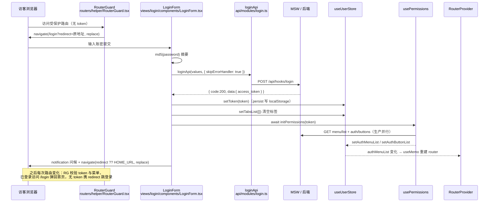
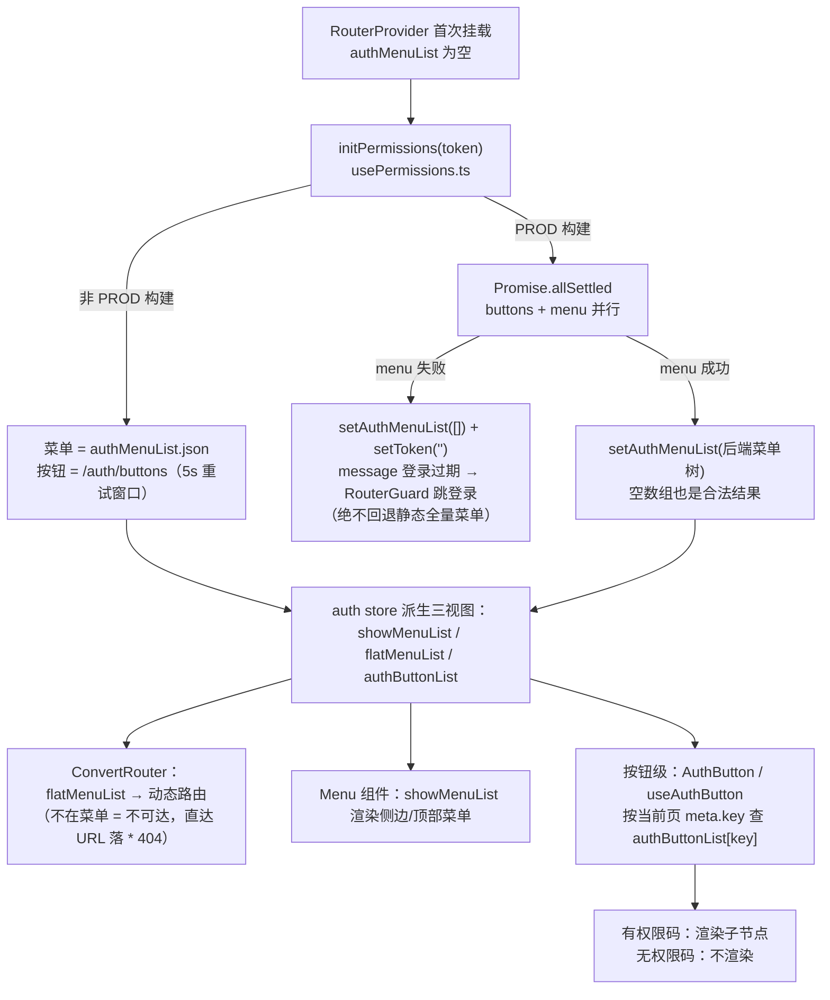
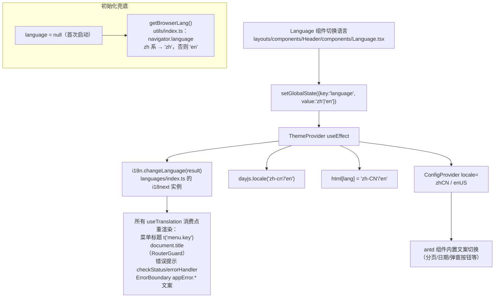
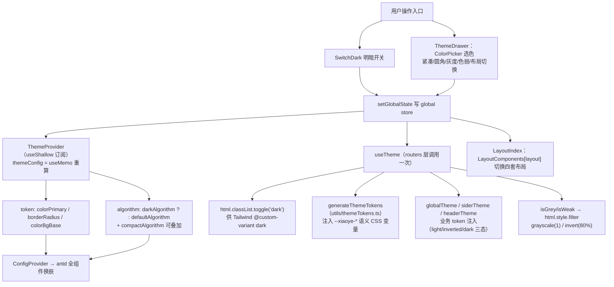
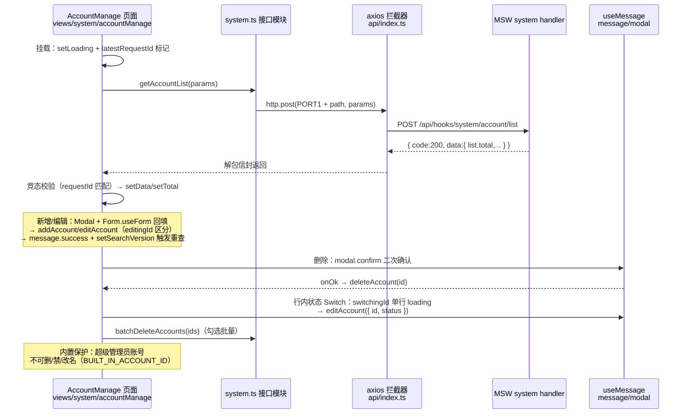

# 05 核心流程

> 项目：xiaoye-admin-react ｜ 版本：v1.0 ｜ 生成日期：2026-10-06 ｜ 依据：源码分析

本文选取五个最具代表性的端到端流程，逐一给出图示、分步说明与涉及文件清单。这五个流程覆盖了框架的全部横切能力：鉴权、权限、国际化、主题与业务 CRUD。阅读方式建议是先看图建立时序直觉，再对照分步说明落 到具体文件；每个流程末尾的文件清单同时可作为代码走读的入口顺序——按清单从头到尾读一遍源码，通常不超过半小时即可完整走通一个流程。

## 流程零：应用启动与 Mock 接管

在进入五个业务流程之前，先交代一切流程的起点——启动。`index.html` 在 `#root` 内预置了 `boot-loading` 占位（自带跟随系统明暗的内联样式与旋转动画），JS bundle 下载解析期间用户看到的不是白屏；`src/main.tsx` 的 `bootstrap()` 随后按序执行三步：第一步，非生产构建且未关闭 `VITE_DEV_AUTO_LOGIN` 时预置登录态（先写 localStorage 再写内存，原因见《04-数据模型》2.3）；第二步，`enableMocking()` 启动 MSW——只有非 PROD 构建，或 `VITE_ENABLE_MOCK === "true"` 的演示构建才会真正加载 `src/mocks/browser.ts`，启动以 5 秒竞速超时保护，SW 首次安装存在 `clients.claim()` 时序缺口（`navigator.serviceWorker.controller` 仍为 null，请求会绕过 mock 直连网络报"资源不存在"），启动逻辑等 300 毫秒复查后仍未接管就整页刷新一次，`sessionStorage` 键 `xiaoye-msw-claim-reload` 防止异常环境无限刷新；第三步，`renderApp()` 渲染 Provider 链。整个过程任何一步失败都不阻塞渲染——mock 启动失败只是控制台告警加接口不可用，页面照常出现。涉及文件：`index.html`、`src/main.tsx`、`src/mocks/browser.ts`、`src/mocks/handlers.ts`、`public/mockServiceWorker.js`。

## 流程一：登录鉴权与路由守卫

### 时序图

### 分步说明

1. **守卫拦截**：`RouterGuard`（`src/routers/helper/RouterGuard.tsx`）在每个路由元素外层运行。`useEffect` 中先放行白名单（`ROUTER_WHITE_LIST = ["/500"]`，`src/config/index.ts`）；已登录（有菜单 + 有 token）访问登录页则跳 `HOME_URL`；无 token 访问非登录页则以 `replace` 跳转 `${LOGIN_URL}?redirect=${encodeURIComponent(pathname+search)}`。
2. **提交与摘要**：`LoginForm` 把密码经 `md5()` 摘要后提交，并传 `skipErrorHandler: true`——失败提示由页面内联 `<Alert>` 呈现（`getLoginErrMsg` 兼容业务信封 `{msg}` 与 AxiosError 两种 reject 形态）。
3. **成功序列**：`useLoginSuccess`（LoginForm 内定义的 hook）严格按"记住用户名 → setToken → 清标签 → **await** initPermissions → 问候通知 → navigate(replace)"执行。源码注释说明顺序对齐 ant-design-pro：先初始化权限再跳转，避免目标页守卫因权限未就绪而把用户弹回登录页。
4. **redirect 回跳安全**：目标地址来自 `getSafeRedirectUrl(searchParams.get("redirect")) ?? HOME_URL`（`src/utils/safeRedirect.ts`），仅放行站内相对路径。
5. **开发态捷径**：`src/main.tsx` 在非 PROD 且 `VITE_DEV_AUTO_LOGIN !== "false"` 时直接写入 `xiaoye-user`（先 localStorage 后 setToken，防 rehydrate 覆盖），跳过上述全部交互。

### 涉及文件清单

`src/main.tsx`、`src/routers/index.tsx`、`src/routers/helper/RouterGuard.tsx`、`src/routers/modules/staticRouter.tsx`、`src/views/login/index.tsx`、`src/views/login/components/LoginForm.tsx`、`src/hooks/usePermissions.ts`、`src/stores/modules/user.ts`、`src/stores/modules/auth.ts`、`src/utils/safeRedirect.ts`、`src/api/modules/login.ts`、`src/mocks/modules/auth.ts`。

## 流程二：菜单与按钮权限控制

### 流程图

### 分步说明

1. **初始化时机**：`src/routers/index.tsx` 的 `useEffect` 在"`authMenuList` 为空且未初始化过"时调用 `initPermissions`，`hasInit` ref 防重复。菜单未就绪期间静态路由的 `*` 渲染 `<Loading />`，页面不会闪 404。
2. **生产分支的健壮性**：`fetchAuthButtonsWithRetry` 在 5 秒窗口内以 600ms 间隔、单次 2s 超时重试（源码注释：按钮权限是全站唯一"启动时一次性获取、之后不再请求"的数据）；菜单与按钮并行请求（顺序 await 会连带失败，源码标注 P0-3）；菜单失败清登录态而非兜底放行（P0-2，防权限体系被绕过）。
3. **菜单渲染**：`src/layouts/components/Menu/index.tsx` 用 `showMenuList` 构建 antd Menu items；标题经 `t("menu." + meta.key)` 国际化；`meta.isLink` 项 `window.open` 新窗口；选中态取 `meta.activeMenu ?? pathname`（动态详情路由折叠到父菜单）。
4. **按钮渲染**：`src/components/AuthButton/index.tsx`（`React.memo`）按 `authority`（字符串或数组，数组为"全部满足"）查 `authButtonList[menuKey]`，无权限渲染 `null`；`src/hooks/useAuthButton.ts` 返回命令式 `BUTTONS` 映射供逻辑判断。页面身份一律来自 `RouteMetaContext`（`src/context/RouteMeta.tsx`）注入的 meta 而非全局 URL——KeepAlive 缓存页隐藏期间重渲染时全局 URL 可能属于其他页面。

权限链路还有一个常被忽略的"不可达即无权限"语义：菜单数据不仅驱动 UI 展示，更直接决定路由注册——不在 `flatMenuList` 中的路径根本没有对应路由，用户手输 URL 会落入 `*` 兜底（就绪后渲染 404），而非"看到了页面却被按钮挡住"。因此前端的菜单权限是**结构性隔离**而非视觉遮罩；真正的安全边界当然仍在后端接口（前端一切权限控制都只是体验优化，这一常识同样适用于本框架），但"路由不注册"这一层保证了未授权页面连组件代码都不会被加载。

### 涉及文件清单

`src/hooks/usePermissions.ts`、`src/stores/modules/auth.ts`、`src/utils/menu.ts`、`src/routers/helper/ConvertRouter.tsx`、`src/layouts/components/Menu/index.tsx`、`src/components/AuthButton/index.tsx`、`src/hooks/useAuthButton.ts`、`src/context/RouteMeta.tsx`、`src/assets/json/authMenuList.json`、`src/assets/json/authButtonList.json`、`src/views/auth/page/index.tsx`、`src/views/auth/button/index.tsx`。

## 流程三：国际化切换

### 流程图

### 分步说明

1. **词表与初始化**：`src/languages/modules/zh.ts` 与 `en.ts` 导出命名空间化的词表（`menu.*`、`login.*`、`common.*`、`error.*`、`appError.*`、`home.*` 等），`src/languages/index.ts` 以 `initReactI18next` 初始化，初始语言取 `getBrowserLang()`。
2. **语言状态单源**：语言是 global store 的字段（`language`），切换入口只有 Language 组件（含登录页右上角复用的同一组件）。`ThemeProvider` 的 effect 统一落地四件事：回填 store（null → 浏览器语言）、i18next 切换、dayjs locale、html lang 属性。
3. **消费模式**：业务代码一律 `useTranslation()` 的 `t()`，菜单/标签等动态内容用 `t(\`menu.${meta.key}\`, { defaultValue: meta.title })` 形态——词表缺失时回退菜单自带标题，这是新增页面即使忘记补词条也不至于显示 key 的防御设计。非 React 场景（axios 错误提示、ErrorBoundary）直接用 `i18n.t`。
4. **边界说明**：`src/views/system/` 三页与 `useProTable` 的部分表单标签为中文硬编码（源码注释明确：语言包未覆盖对应命名空间，沿用参考项目写法），属于已知未完成国际化区域 ⚠️ 待确认（是否补齐词条由使用者决定）。
5. **新增词条的操作路径**：为页面补充双语时，先在 `src/languages/modules/zh.ts` 与 `en.ts` 中以相同命名空间成对添加（现有命名空间包括 `menu`、`login`、`common`、`error`、`appError`、`home` 等），消费端用 `t("命名空间.键", { defaultValue: 兜底文案 })` 的防御式写法——`defaultValue` 机制保证了词条与代码可以分批上线而不出现裸 key。菜单标题是国际化收益最大的场景：`meta.key` 在菜单、标签栏、面包屑、document.title 四处复用同一词条，补一条 `menu.*` 词条即可四处生效。

### 涉及文件清单

`src/languages/index.ts`、`src/languages/modules/zh.ts`、`src/languages/modules/en.ts`、`src/components/ThemeProvider/index.tsx`、`src/layouts/components/Header/components/Language.tsx`、`src/utils/index.ts`（getBrowserLang）、`src/routers/helper/RouterGuard.tsx`（标题 i18n）、`src/api/helper/checkStatus.ts`、`src/api/helper/errorHandler.ts`、`src/components/ErrorBoundary/index.tsx`、`src/views/feat/globalization/index.tsx`（演示页）。

## 流程四：主题切换（明暗 / 主题色 / 布局）

### 流程图

### 分步说明

1. **双轨主题架构**：antd 组件的配色由 `ConfigProvider` 的 `algorithm` 原生派生（dark/compact），`colorPrimary/borderRadius/colorBgBase` 只作种子 token（`ThemeProvider` 源码注释）；自定义样式则消费 `useTheme` 注入的 `--xiaoye-*` CSS 变量与业务 token。两轨由同一个 global store 驱动，永远同步。
2. **暗黑模式**：`useTheme` 对 `html` 增删 `dark` class，配合 Tailwind v4 的自定义变体使 `dark:` 前缀生效；同时 `ThemeProvider` 把 `colorBgBase` 定为纯黑/纯白（源码注释：与 `utils/themeTokens` 的明暗底色同源，避免页面背景与组件背景脱节）。
3. **反色体系**：`siderInverted/headerInverted` 决定侧栏/头部的 light/inverted/dark 三态（`src/styles/theme/sider.ts`、`header.ts`），Menu 组件据此计算 `isDarkTheme` 决定菜单配色。
4. **持久化与入口一致性**：主题偏好全部落在 global store 的 persist 通道（`xiaoye-global`），用户改完即写 localStorage，下次启动随 store 初始化回放，无须任何显式恢复代码；`ThemeDrawer` 与登录页右上角的 `SwitchDark` 操作同一份数据，"未登录先调主题、登录后依然生效"因此自然成立。语言与主题的所有修改入口（`Language`、`SwitchDark`、`ThemeDrawer`、`ComponentSize`）都不直接操作 DOM 或 antd，而是统一 `setGlobalState`，由 ThemeProvider 与 useTheme 两个订阅方落地。新增外观类开关照此模式只需三步：store 加字段、`ThemeDrawer` 加控件、订阅方加 effect，即可获得持久化、双端可用与多布局适配的全部既有能力。
4. **持久化**：全部主题偏好在 global store 中，经 persist 落 `xiaoye-global`，刷新后原样恢复；`ThemeDrawer`（`src/layouts/components/ThemeDrawer/index.tsx`）是这些开关的集中 UI，取色器基于 `react-colorful` 封装（`ThemeDrawer/components/ColorPicker`）。

### 涉及文件清单

`src/stores/modules/global.ts`、`src/components/ThemeProvider/index.tsx`、`src/hooks/useTheme.ts`、`src/utils/themeTokens.ts`、`src/utils/index.ts`（setStyleProperty）、`src/styles/theme/{global,header,sider}.ts`、`src/styles/global.css`（@theme/@layer）、`src/layouts/index.tsx`、`src/layouts/components/ThemeDrawer/index.tsx`、`src/components/SwitchDark/index.tsx`、`src/layouts/components/Header/components/ThemeSetting.tsx`。

## 流程五：典型页面 CRUD（以账号管理为例）

### 时序图

### 分步说明

1. **查询范式**：查询状态收敛为 `params` 对象 + `searchVersion` 版本号；`useEffect` 依赖二者发起请求，`latestRequestId` 与 `unmounted` ref 双保险防竞态与卸载后 setState。这一范式在本项目所有列表页一致（`useProTable`、`accountManage` 等），可直接复制。
2. **写操作**：新增/编辑共用一个 Modal，`editingId` 判空区分模式；成功后 `message.success`（来自 `useMessage` 注入的 antd App 实例，自动继承主题与语言）并递增 `searchVersion` 重查列表。
3. **危险操作**：删除一律经 `modal.confirm`（`src/hooks/useMessage.tsx` 封装，支持 `danger` 红色确认按钮、`mask.closable` antd 6 新写法）。
4. **业务保护**：内置超级管理员账号（id `"1"`）在删除、禁用、改名三个操作上被显式拦截，是业务级保护逻辑的参考写法。
5. **Mock 配套**：`src/mocks/modules/system.ts` 为以上每个端点提供确定性数据 handler，与接口一一对应。

把该页当作范本复用时，有四个易错点值得预先知晓。一是**角色下拉的数据源**：`getRoleOptions` 在页面挂载时单独请求（源码第 95 行附近），与主列表互不阻塞——外键下拉永远独立取数，不塞进列表接口。二是**表单回填时机**：新增与编辑打开 Modal 时分别以 `form.setFieldsValue` 预置默认值或回填记录（新增预置 `status: true, gender: 1, password: "123456"` 初始密码），`Form.useForm` 实例配合 `confirmLoading` 驱动确认按钮状态，避免重复提交。三是**提交防重**：`submitting` state 挂在 Modal 的 `confirmLoading` 上，请求落定前按钮不可再点。四是**删除的确认语义**：`modal.confirm` 的 `onOk` 返回 Promise 时弹窗自动进入 loading 态直到请求落定（antd 内建行为），失败则弹窗保持打开——错误提示已由拦截器统一弹出，页面无须重复处理。

### 涉及文件清单

`src/views/system/accountManage/index.tsx`（另有 `roleManage`、`menuMange` 同构）、`src/api/modules/system.ts`、`src/api/interface/index.ts`（AccountItem/ReqAccountSave 等）、`src/api/index.ts`、`src/hooks/useMessage.tsx`、`src/mocks/modules/system.ts`、`src/mocks/modules/_shared.ts`；列表页通用范式参考 `src/views/list/useProTable/index.tsx`。

## 结语：流程间的共享底座

五个流程共享三块底座：**global store 单源**（主题/语言/布局全部经 `setGlobalState` 一入口写入）、**auth store 双域**（菜单驱动路由与菜单 UI，按钮码驱动按钮 UI）、**统一请求管线**（信封 + showType + 401 收敛）。理解这三块底座后，任何新流程（如接入审批流、消息中心）都可以按"写 store → 订阅 Provider/组件 → 走统一请求层"的既有轨迹扩展。

从维护视角再补充三条跨流程的观察。第一，**流程的时序敏感点都有源码注释驻守**：登录必须 await 权限初始化、启动必须先 MSW 后渲染、预置登录必须先写持久层——这些顺序一旦被打乱，症状（弹回登录页、接口穿透、停在加载态）都出现在远离病因的位置，改动前应先读注释。第二，**每个流程都有"降级而非崩溃"的出口**：MSW 起不来就放弃 mock 照常渲染、按钮权限拿不到就按无权限渲染、断网有横幅、chunk 失效有重试——复刻新流程时应延续这种"宁可功能缺失不可整站不可用"的取舍。第三，**流程的可观测性依赖约定**：控制台的 `[msw]` 前缀告警、`onUnhandledRequest: "warn"` 的漏 mock 提示、ErrorBoundary 的 `[ErrorBoundary]` 日志，都是排障的第一入口，新增流程时也应留下同类日志锚点。
