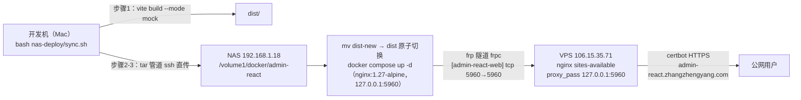

# 06 部署运行

> 项目：xiaoye-admin-react ｜ 版本：v1.0 ｜ 生成日期：2026-10-06 ｜ 依据：源码分析

## 1. 环境要求

| 项 | 要求 | 依据 |
| --- | --- | --- |
| Node.js | >= 20.19.0 | `package.json` 的 `engines` 字段 |
| 包管理器 | pnpm >= 9 | `README.md` Step 0（项目使用 pnpm 锁文件 `pnpm-lock.yaml`） |
| 操作系统 | macOS / Linux / Windows 均可 | 部署脚本 `nas-deploy/sync.sh` 需 bash 与 ssh（macOS/Linux） |

TypeScript 版本约束：必须保持 5.9.x，不可升 7.x——`typescript-eslint@8.70.0` 的 peer 约束为 `>=4.8.4 <6.1.0`，强行升级会使类型感知规则全部失效（`README.md` "两个必须注意的版本约束"）。`msw` 锁定 2.15.0 精确版本，升级后必须重跑 `npx msw init public/ --save` 同步 Service Worker 文件。工具链整体围绕 pnpm 的工作区语义组织：`pnpm-lock.yaml` 是依赖一致性的唯一凭证，CI 与 `sync.sh` 的构建都应基于锁文件安装（`pnpm install --frozen-lockfile`）而不是裸 `install`，否则构建产物的可复现性无从谈起。

## 2. 本地启动（命令级）

```bash
# 1. 安装依赖
pnpm install

# 2. 启动开发服务器（读取 .env + .env.development）
pnpm dev            # 端口 VITE_PORT=5173，host 0.0.0.0，VITE_OPEN=true 自动开浏览器

# 3. 质量检查
pnpm typecheck      # tsc -b，project references 增量类型检查
pnpm lint           # ESLint（flat config）
pnpm format:check   # Prettier 校验
pnpm test           # vitest 单测

# 4. 构建
pnpm build          # 类型检查 + 生产构建 → dist/
pnpm build:mock     # 演示构建（production + MSW，读 .env.mock）
pnpm preview        # 本地预览 dist/（自带 history 回退）
```

开发态行为要点（均出自 `src/main.tsx`）：非生产构建自动预置登录态（`VITE_DEV_AUTO_LOGIN=false` 可关闭以测试完整登录流）；MSW 在渲染前启动，带 5 秒超时与 SW 接管缺口自愈（整页刷新一次，sessionStorage 防循环）；菜单走静态 JSON 零等待，按钮权限走 MSW 接口并带 5 秒重试。`vite.config.ts` 的 dev server 配置 `host: "0.0.0.0"`、`cors: true`，代理来自 `VITE_PROXY`（`build/proxy.ts` 解析为 `[prefix]: { target, changeOrigin, ws, rewrite }` 结构，https 目标自动 `secure: false`）。

开发体验插件（`build/plugins.ts`）：`vite-plugin-checker` 把 TS 错误浮层到浏览器；`VITE_REPORT=true` 时构建产出 `stats.html` 体积分析（rollup-plugin-visualizer，含 gzip/brotli 尺寸）。

## 3. 环境变量清单

加载机制：`vite.config.ts` 用 `loadEnv(mode, root)` 读取 `.env` + `.env.<mode>`，经 `build/getEnv.ts` 的 `wrapperEnv` 做类型转换（"true"/"false"→布尔、`VITE_PORT`→数字、`VITE_PROXY`→JSON）。类型声明在 `src/typings/global.d.ts` 的 `ViteEnv` 接口。

这一机制有三层值得理解的细节。第一层是**叠加顺序**：`.env` 是所有模式共享的基底（应用名、端口、分析开关），`.env.development/.env.production/.env.test/.env.mock` 按 `--mode` 叠加覆盖，因此 `VITE_ROUTER_MODE`、`VITE_API_URL` 这类变量在每个环境文件里都显式重申一遍而非省略——这让任何模式的行为都能在单个文件内看全。第二层是**类型转换的边界**：`wrapperEnv` 只对布尔字面量、`VITE_PORT` 与 `VITE_PROXY` 做转换，其余值保持字符串，所以 `VITE_ENABLE_MOCK` 在代码里是以字符串比较的（`import.meta.env.VITE_ENABLE_MOCK !== "true"`），写 `true`（无引号布尔）反而不匹配——这是环境变量使用中最容易踩的暗坑。第三层是**类型与运行时的对齐**：`ViteEnv` 接口（`src/typings/global.d.ts`）是这些变量的唯一类型契约，新增变量必须先补这里，`build/plugins.ts` 才能以类型安全的方式消费 `viteEnv`。另外 `vite.config.ts` 里还有一个独立于环境变量的注入通道：`define` 字段把 `__APP_INFO__`（依赖清单 + 构建时间）与 `__COMMIT_HASH__`（git 短哈希，非 git 环境留空）编译进产物，二者不进 `.env`，属于"构建时才可知"的信息。

| 变量 | 所在文件 | 类型 / 取值 | 说明 |
| --- | --- | --- | --- |
| `VITE_GLOB_APP_TITLE` | `.env` | string（"Xiaoye Admin React"） | 应用名：document.title 后缀、PWA manifest、Logo 文案 |
| `VITE_PORT` | `.env` | number（5173） | dev server 端口 |
| `VITE_OPEN` | `.env` | boolean（true） | 启动时自动打开浏览器 |
| `VITE_REPORT` | `.env` | boolean（false） | 构建后生成 `stats.html` 体积分析 |
| `VITE_USER_NODE_ENV` | 各 env | `development/production/test` | 环境标识（Vite 内建 `PROD/DEV` 之外的业务侧标记） |
| `VITE_PUBLIC_PATH` | 各 env | string（"/"） | 构建基础路径（vite `base`） |
| `VITE_ROUTER_MODE` | 各 env | `hash` / `history` | 路由模式；全项目统一 history |
| `VITE_DROP_CONSOLE` | 各 env | boolean（true） | 构建时移除 console（配合 eslint 的 `no-console` 规则） |
| `VITE_PWA` | dev/test=false，prod/mock=true | boolean | 是否注入 PWA（`build/plugins.ts`） |
| `VITE_BUILD_COMPRESS` | prod/mock | `gzip/brotli/gzip,brotli/none` | 压缩产物类型（默认 none） |
| `VITE_BUILD_COMPRESS_DELETE_ORIGIN_FILE` | prod/mock | boolean（false） | 压缩后是否删除原始文件 |
| `VITE_API_URL` | 各 env | string（"/api"） | axios baseURL；生产由 Nginx 反代 |
| `VITE_PROXY` | `.env.development` | JSON 数组 `[["/api","http://target"]]` | dev 代理；当前留空走 MSW |
| `VITE_DEV_AUTO_LOGIN` | `.env.development` | boolean（true） | 开发态自动预置登录态；改后需重启 dev server |
| `VITE_ENABLE_MOCK` | `.env.mock` | "true" | 演示构建开关：PROD 产物中保留并启动 MSW |

## 4. 构建产物分析

`vite.config.ts` 的构建配置要点：

- **入口与产物命名**：JS 统一输出 `assets/js/[name]-[hash].js`，其余资源 `assets/[ext]/[name]-[hash].[ext]`，`chunkSizeWarningLimit: 1500`，`sourcemap: false`。
- **manualChunks 三分Vendor**：`vendor-react`（react/react-dom/react-router）、`vendor-antd`（antd + @ant-design）、`vendor-echarts`（echarts + zrender）。源码注释：antd 体积大，独立分包显著改善长期缓存命中率——业务代码迭代不使 vendor chunk 失效。
- **编译期注入**：`define` 注入 `__APP_INFO__`（package.json 依赖表 + `dayjs` 构建时间，供"关于项目"页与 Footer 展示）与 `__COMMIT_HASH__`（`git rev-parse --short HEAD`，非 git 环境留空）。
- **已知构建提示**（`README.md`）：`INEFFECTIVE_DYNAMIC_IMPORT`——login 页同时被 staticRouter 静态导入与 glob 动态导入，无法单独分包，不影响功能；`vendor-antd` 超 1.5MB 警告——antd 全量引入所致。
- **PWA 产物**（`VITE_PWA=true` 时）：`generateSW` 模式，`navigateFallback: "index.html"` 且 `navigateFallbackDenylist: [/^\/api\//]`（接口请求不回退），`maximumFileSizeToCacheInBytes` 放宽到 4MiB 以容纳 vendor-antd；manifest 图标用 `public/logo-192.png` / `logo-512.png`。
- **压缩产物**：`VITE_BUILD_COMPRESS` 控制 vite-plugin-compression 产出 `.gz`/`.br`。

缓存策略的完整逻辑值得单独梳理成一条链：构建产物分三类对待——带内容哈希的 `assets/` 静态资源允许"永不过期"（immutable 一年缓存，因为内容一变哈希即变，不存在脏读）；`index.html` 明确禁止缓存（它是引用所有哈希资源的清单，缓存了它就等于把用户锁死在旧版本）；其余兜底路径（SPA 深链）不设特殊缓存。当发版与在线用户相遇时，链路上有两道自愈：存活标签页靠"index.html 不缓存"在下次整页加载时拿到新版；停留在旧页面的用户切路由触发旧 chunk 加载失败时，`ErrorBoundary` 识别 ChunkLoadError 并在恢复联网后自动刷新。PWA 场景再叠一层 workbox 的 `navigateFallback`，离线深链也能落到缓存的 `index.html`。理解这条链后，任何"用户反映页面是旧版"的问题都应沿"index.html 缓存头 → SW 缓存 → 容器是否重启"三处排查。

## 5. nas-deploy 部署链路详解

### 5.1 部署拓扑



### 5.2 一键发布：`nas-deploy/sync.sh`

脚本四步（`set -euo pipefail`）：

1. **演示构建**：`CI=true node node_modules/vite/bin/vite.js build --mode mock`（等价 `pnpm build:mock`）；
2. **同步部署配置**：`tar czf - docker-compose.yml nginx-default.conf | ssh ... tar xzf -`（幂等覆盖，`COPYFILE_DISABLE=1` 防 macOS 污染文件）；
3. **同步 dist**：tar 管道直传到 NAS 的 `dist-new`（源码注释纪律：不走 NAS 挂载卷拷小文件）；
4. **原子切换**：SSH 到 NAS 执行 `rm -rf dist.old && mv dist dist.old && mv dist-new dist && sudo docker compose up -d`，最后 `curl 127.0.0.1:5960` 输出验证 HTTP 码（sudo 密码交互输入）。

三条发布纪律（`nas-deploy/README.md` "踩过的坑"）：换 dist 后**必须重启容器**（bind-mount 指向 inode）；同步前不要开着指向 dist 的 dev server；tar 管道直传。

### 5.3 容器与 Nginx 配置

`nas-deploy/docker-compose.yml`：单服务 `admin-react-web`，镜像 `nginx:1.27-alpine`，`restart: unless-stopped`，端口 **`127.0.0.1:5960:80` 只绑回环**（公网流量必须走 frp → VPS nginx，端口不对公网暴露），卷挂载 `./dist`（ro）与 `./nginx-default.conf`（ro），无 docker build。

`nas-deploy/nginx-default.conf` 三段缓存策略：`/assets/`（带内容哈希）`max-age=31536000, immutable` 长缓存；`location = /index.html` `no-cache`（源码注释：发版后存活标签页必得新版，旧 hash chunk 失效由前端加载自愈兜底，即 ErrorBoundary 的 ChunkLoadError 处理）；`location /` 执行 `try_files $uri $uri/ /index.html` history 回退。另开 gzip（level 5，含 JS/CSS/JSON/SVG 等类型）。

### 5.4 公网接入四件套（首次部署）

`nas-deploy/README.md` 完整记录：①frp 隧道——`frpc-add.toml` 追加到 NAS `/etc/frp/frpc.toml`（本地生成文件管道 `cat >>` 合并，勿用 printf 转义，双层 ssh 会吃掉换行），重启 frpc 后日志应见 `[admin-react-web] start proxy success`；②VPS Nginx 站点——`vps-nginx-admin-react.conf` 以 base64 编码投递解码写入（防 `$` 转义），**不要预置 return 404 占位块**（会压过 certbot 的 80→301）；③HTTPS——`certbot --nginx -d admin-react.zhangzhengyang.com --redirect`；④端到端验证——本地 `curl --noproxy '*'` 验证 http 301 / https 200 / history 深链 `/system/accountManage` 200，浏览器验收登录（admin/123456）、出数、深链刷新、PWA 可安装。

上线信息：域名 `admin-react.zhangzhengyang.com`（2026-09-15 已上线，HTTPS 至 2026-12-14），端口 5960 已双侧实测录入资产清单；阿里云安全组不放行 5960（仅 VPS 本机 nginx 可达）。

### 5.5 部署排错清单

依据发布手册中记录的经验与配置的内在逻辑，可以归纳出六类高频故障的定位方法。其一，**NAS 本地 curl 不通**：先确认容器状态与端口绑定（`docker ps` 看 `127.0.0.1:5960->80`），再确认 dist 目录已原子切换成功——bind-mount 指向 inode，只替换目录内容而不重启容器是手册明令禁止的操作。其二，**公网 502/504**：链路为 VPS nginx → frp 隧道 → NAS 回环端口，任一环断开都表现为 502，依次查 VPS nginx error log、`tail /var/log/frpc.log` 是否仍有 `start proxy success`、NAS 容器是否存活。其三，**HTTPS 证书未生效或 80 不跳 443**：检查 VPS 站点文件是否被预置了 `return 404` 占位块（手册明确它会压过 certbot 的 80→301），必要时重新执行 certbot。其四，**深链刷新 404**：`nginx-default.conf` 的 `try_files $uri $uri/ /index.html;` 缺失或被覆盖，对照仓库内配置恢复。其五，**演示站接口全部失败**：演示构建必须由 `--mode mock` 产出（`VITE_ENABLE_MOCK=true`），误用普通 `pnpm build` 的产物会导致生产模式下无后端可依、菜单接口失败即登出。其六，**DNS 不解析**：该域名无泛解析，必须显式添加 A 记录指向 VPS（手册"首次上线准备"一节）。

## 6. 测试体系与质量门禁

### 6.1 测试栈与配置

`vitest.config.ts` 独立于 `vite.config.ts`（源码注释：单测只需 alias 与 DOM 环境，不加载 react/tailwind 构建插件），环境 `happy-dom`，测试文件匹配 `src/**/*.{test,spec}.{ts,tsx}` 与 `tests/**`，setup 文件 `tests/setupTests.ts`。setup 中为 happy-dom 补齐 antd/echarts 挂载时探测的浏览器 API：`matchMedia`、`ResizeObserver`、`scrollTo`、`URL.createObjectURL/revokeObjectURL`，并引入 `@testing-library/jest-dom/vitest` 断言扩展。

### 6.2 现有测试用例

| 用例 | 被测对象 | 断言要点 |
| --- | --- | --- |
| `src/api/helper/__tests__/errorHandler.test.ts` | `showBizError` | 按 showType 分流的正确性（函数返回实际展示方式便于断言，源码注释明示此设计意图） |
| `src/utils/__tests__/safeRedirect.test.ts` | `getSafeRedirectUrl` 等 | Open Redirect 防护：拒绝空值/外链/`//`/跨 origin |
| `src/components/OfflineBanner/__tests__/OfflineBanner.test.tsx` | 断网横幅 | 在线不渲染、离线渲染 Alert |
| `src/layouts/components/Menu/__tests__/Menu.test.tsx` | 布局菜单 | 菜单渲染与交互 |

命令：`pnpm test`（run 一次）、`pnpm test:watch`、`pnpm test:coverage`（@vitest/coverage-v8）。

从现有用例的选题可以看出项目的测试哲学：**不追求页面级快照覆盖，而是为"纯逻辑与关键防御点"立测试**。四个用例分别对应错误分流（最难人工回归的分支逻辑）、Open Redirect 防护（安全语义，回归成本高）、断网横幅（外部状态订阅）与菜单渲染（权限数据到 UI 的转换）。二次开发者新增代码时应延续这一取向：优先为 `src/utils/`、`src/api/helper/` 这类纯函数补测试；涉及 store 或组件的，聚焦状态转换断言而非像素级渲染；MSW 的存在也让"组件内发起请求"的测试成为可能——在测试里直接调用页面 hook 或组件，请求会走到 axios 层，可用 vitest 的模块 mock 替换 `src/api` 模块，无须真实网络。`vitest.config.ts` 与构建配置刻意解耦（不加载 Tailwind/React 插件），意味着测试只验证逻辑与 DOM 行为，样式回归不在单测职责内。若团队希望引入覆盖率门禁，`pnpm test:coverage` 产出 v8 报告后，可在 `vitest.config.ts` 的 `test.coverage.thresholds` 中对 `src/utils/**` 与 `src/api/helper/**` 这类纯逻辑目录设置行覆盖阈值，而暂不对视图层设限，与既有测试取向保持一致。

### 6.4 与 CI 集成的建议序列

项目当前未内置 CI 配置，结合脚本清单给出可直接落地的门禁序列：`pnpm install --frozen-lockfile`（锁文件校验）→ `pnpm typecheck`（project references 增量检查，失败即类型破坏）→ `pnpm lint`（含 react-hooks/exhaustive-deps 警告，建议在 CI 中以 `--max-warnings` 收紧）→ `pnpm format:check` → `pnpm test` → `pnpm build`（构建成功本身是对 `tsc -b` 与 Vite 打包的双重验证）。若需发布演示站，可在构建后追加 `bash nas-deploy/sync.sh`（其内部含 NAS 侧 curl 验证）。手册中"更新 NAS 资产清单、Umami 统计可选注入"属于发布后的人为收尾项，不适合自动化强约束。

### 6.3 质量门禁

项目未配置 husky/lint-staged（`README.md` 把它列为"可选增强"），门禁依赖三条命令的纪律性执行：`pnpm typecheck`（tsconfig.app 开启 `strict + noUnusedLocals + noUnusedParameters + verbatimModuleSyntax`）、`pnpm lint`（flat config：TS 文件关 `no-undef`、Hooks 规则 error、`no-console` 仅放行 warn/error、`eslint-config-prettier` 置底、`src/services/**` 生成物豁免）、`pnpm test`。建议接入 CI 时按 `typecheck → lint → format:check → test → build` 串联。

## 7. 部署形态选择建议

| 场景 | 命令 | 后端 | 说明 |
| --- | --- | --- | --- |
| 本地开发 | `pnpm dev` | MSW（或 VITE_PROXY 真实后端） | 静态菜单短路，零等待 |
| 接入真实后端联调 | `pnpm dev` + `VITE_PROXY` | 真实后端 | `.env.development` 配代理 |
| 演示站 | `pnpm build:mock` | 无（MSW 浏览器端） | nas-deploy 链路即为此形态 |
| 生产站 | `pnpm build` | 真实后端（`/api` 反代） | 权限完全走接口，失败即登出，无静态兜底 |

无论哪种形态，服务器（或 PWA SW）必须保证 history 路由回退到 `index.html`，否则刷新/深链 404——这是本项目部署层面唯一的硬性要求。

## 8. 从演示站到生产站的迁移清单

模板使用者最终的归宿是把"演示站"变成"生产站"，迁移动作可以收敛为六步。第一步，**切换构建命令**：`nas-deploy/sync.sh` 内的 `--mode mock` 换成普通 `pnpm build`，产物不再包含 MSW（`enableMocking` 在 PROD 且未开启 `VITE_ENABLE_MOCK` 时直接短路返回）。第二步，**接通后端**：`.env.production` 的 `VITE_API_URL` 保持 `/api`，把 Nginx 的 `/api` 从"无"配置为反代到真实后端（当前演示链路中没有这一段，因为 MSW 在浏览器内应答）；开发联调期同时在 `.env.development` 配 `VITE_PROXY`。第三步，**替换契约**：用后端导出的 swagger/oneapi 文档覆盖 `openapi/oneapi.json`，执行 `pnpm openapi` 重新生成 `src/services/api`。第四步，**核对权限语义**：与后端约定菜单接口失败与空菜单的行为（前端已按"失败即登出、空菜单合法"实现），确认按钮权限码集合与 `AuthButton` 的 `authority` 取值一致。第五步，**调整部署编排**：`docker-compose.yml` 的域名/端口、`nginx-default.conf` 的缓存策略可原样沿用，新增 `/api` 反代 location（或由网关层承担）；frp 与 VPS 站点按手册对应小节重做。第六步，**验收**：手册的端到端 curl 四连（301/200/深链 200）之外，追加"错误密码登录、退出登录、深链刷新、断网恢复、PWA 安装"五项人工用例。完成这六步后，`nas-deploy/README.md` 中与演示相关的描述（admin/123456、无真实风险等）应随之更新，避免误导后来者。
