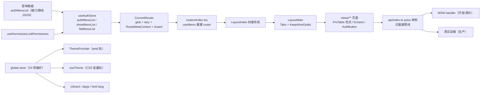

# 07 模块详解

> 项目：xiaoye-admin-react ｜ 版本：v1.1 ｜ 生成日期：2026-10-06 ｜ 依据：源码分析

本文是框架核心模块的逐个深读手册，定位与《01-系统架构》互补：架构篇讲分层与数据流的全景，本篇按"模块"粒度下沉到关键文件与函数，给出每个模块的职责边界、关键文件清单与机制走读，供二次开发时按图索骥。全景与设计动机不再重复展开，需要背景时按文中「见《0X-xxx》」回跳对应篇目。

## 1. 路由与菜单转换（ConvertRouter）

### 1.1 职责与文件清单

路由模块的职责是把"菜单数据"翻译成"react-router 可执行的路由表"，它是"菜单即路由"理念的执行者。涉及文件如下：

| 文件 / 导出 | 职责 |
| --- | --- |
| `src/routers/index.tsx` 的 `RouterProvider` | 监听 `authMenuList`，空菜单时挂静态路由（`*` 渲染 Loading），就绪后合并动态路由并重建 router |
| `src/routers/helper/ConvertRouter.tsx` 的 `convertToDynamicRouterFormat(authMenuList, flatMenuList?)` | 菜单树 → `RouteObject[]`：redirect 转 `<Navigate>`、element 字符串转 lazy 组件、注入 RouteMetaContext 与 RouterGuard、按 isFull 分流 |
| `src/routers/helper/RouterGuard.tsx` | 路由守卫：挂载 `window.$navigate`、写 `document.title`、登录态校验与 redirect 回跳 |
| `src/routers/modules/staticRouter.tsx` 的 `wrappedStaticRouter` | 静态路由（`/`、`/login`、`/403`、`/404`、`/500`、`*`），每个 element 包 RouterGuard 并附 loader |
| `src/routers/interface/index.ts` | `MetaProps`（key/icon/title/activeMenu/isLink/isHide/isFull/isAffix/isKeepAlive）与 `RouteObjectType` |
| `src/utils/menu.ts` | `getFlatMenuList` / `getShowMenuList` / `findMenuByPath` 三个菜单纯函数 |
| `src/context/RouteMeta.tsx` | `RouteMetaContext` + `useRouteMeta`：向页面注入"自身路由的 meta" |

### 1.2 机制走读

`ConvertRouter.tsx` 顶部执行一次 `import.meta.glob("/src/views/**/*.tsx")`，把全部视图声明为懒加载 chunk。这条 glob 有两个源码注释明确强调的硬约束：其一，`import.meta.glob` 不支持路径别名，必须写真实路径；其二，模式必须以 `/` 开头（项目根），否则 Vite 返回的键是相对当前模块的路径（如 `../../views/home/index.tsx`），而转换时的查找键是 `/src/views` + element + `.tsx`，键格式不匹配会让每一次查找都落空，所有页面渲染 "Page Not Found" 占位。

转换函数 `convertToDynamicRouterFormat` 优先复用外部传入的 `flatMenuList`（由 `useAuthStore.setAuthMenuList` 派生时已算好），避免重复展平。对每个扁平菜单节点做三件事：第一，`redirect` 字段转成 `<Navigate>` 元件；第二，`element` 字符串（形如 `/home/index`）拼接为 `/src/views/home/index.tsx` 去 glob 结果中查找，命中则 `lazy(loader)` 并包一层 `LazyComponent`（`src/components/Lazy/index.tsx` 的 Suspense + PageLoader），未命中则降级为渲染 "Page Not Found" 的占位组件而不是让路由崩溃；第三，把 `<RouteMetaContext.Provider value={item.meta}>` 与 `<RouterGuard>` 依次包在组件外——注释写明这是为了让页面（尤其是 KeepAlive 缓存页）从 Context 读自身身份，不依赖全局 URL 反查。每个节点还附带 `loader: () => ({ ...item.meta, redirect: !!item.redirect })`，把 meta 下发给 `useLoaderData`。最后按 `meta.isFull` 把路由分成两组：普通路由全部作为 children 挂到无 path 的 `<LayoutIndex />` 下，全屏路由平铺在路由表顶层。

`src/routers/index.tsx` 的 `useMemo` 以菜单数组引用为依赖重建 router。源码中的大段注释解释了为什么不能用"路径指纹 + useState"的常见写法：所有动态路由都嵌在同一个无 path 的 layout 路由下，顶层 path 列表在菜单加载前后完全相同，指纹永远不变，路由器会停留在空菜单版本，所有动态页落 `*` 变 404。另一处细节是 `*` 路由的就绪切换：菜单未就绪时 `*` 渲染 `<Loading />`（防刷新闪 404），就绪后用不可变 map 把该项元素替换为 `<NotFound />`——源码注明不能原地修改 `wrappedStaticRouter` 这个模块级常量。路由守卫 `RouterGuard` 本身的规则（白名单、已登录禁回登录页、无 token 带 redirect 跳登录、document.title 国际化）见《01-系统架构》2.2 与《05-核心流程》流程一，此处不重复。

## 2. 权限初始化（usePermissions）

### 2.1 职责与文件清单

| 文件 / 导出 | 职责 |
| --- | --- |
| `src/hooks/usePermissions.ts` 的 `initPermissions(token)` | 权限初始化唯一入口：按环境分流菜单来源，写 auth store |
| `usePermissions.ts` 的 `fetchAuthButtonsWithRetry()` | 按钮权限带重试获取：5 秒窗口、600ms 间隔、单次 2s 超时竞速 |
| `src/stores/modules/auth.ts` | `useAuthStore`：`setAuthMenuList` 一次性派生三视图，`resetAuth` 统一清理 |
| `src/assets/json/authMenuList.json` / `authButtonList.json` | 开发态静态菜单与按钮权限码表 |
| `src/components/AuthButton/index.tsx`、`src/hooks/useAuthButton.ts` | 按钮权限的两个消费端 |

### 2.2 机制走读

`initPermissions` 的分支树有三层。入口先判断 token，无 token 直接返回。第一层是环境分流：`!import.meta.env.PROD` 视为开发态（源码注释解释用 PROD 取反而非 DEV：以 `--mode development/test` 构建部署时 DEV 仍为 true，会误判为开发态把 dev-token 写进部署产物），开发态菜单直接取 `staticMenu.data`（即 `authMenuList.json` 的 `data` 字段），零网络等待；原因是 mock 服务不可达时请求会挂起到 axios 的 30 秒超时，页面长时间停在加载态。开发态按钮权限仍走接口（否则 `/auth/button` 演示页整页无按钮），并以外层 `setAuthButtonList({})` 先占位、重试成功后回填的方式保证页面不阻塞。

第二层是生产并行：`Promise.allSettled([fetchAuthButtonsWithRetry(), getAuthMenuListApi()])`。源码标注 P0-3 解释了为什么必须并行——顺序 await 时按钮接口的失败会连带吞掉菜单请求，整站退化。第三层是失败语义：按钮失败按空权限处理（`{}`）；菜单失败则 `setAuthMenuList([])` + `setToken("")` 并提示"登录过期"，由 RouterGuard 统一跳登录——注释用"绝不回落到静态全量菜单"强调这是防权限绕过的安全边界（该历史缺陷见 `docs/bug-audit.md` P0-2）；空菜单（接口成功但返回 `[]`）同样是合法结果，不做兜底。

`fetchAuthButtonsWithRetry` 值得单独走读：`deadline = Date.now() + 5000` 构成窗口，循环内 `Promise.race` 把请求与一个 2 秒的 reject 定时器竞速，失败后 `await` 600ms 再试，窗口耗尽抛出最后错误。源码注释给出动机：按钮权限是全站唯一"启动时一次性获取、之后不再请求"的数据，单次失败会让演示页整个会话空白、只能刷新恢复；启动初期存在 MSW 尚未接管的窗口期，重试即可恢复。

初始化的触发点在 `src/routers/index.tsx` 的 `useEffect`：`authMenuList` 为空且 `hasInit` ref 未置位时调用（ref 防重复初始化）。权限数据的派生关系与消费链见《04-数据模型》2.2，按钮权限的判定细节见本篇第 8 节与《08-安全与权限设计》。

## 3. 请求层拦截器管线

### 3.1 职责与文件清单

| 文件 / 导出 | 职责 |
| --- | --- |
| `src/api/index.ts` 的 `RequestHttp` 类与默认导出单例 | 唯一 axios 实例：`get/post/put/delete/download` 五个方法，请求/响应两条拦截器 |
| `src/api/index.ts` 的 `CustomAxiosRequestConfig` | 扩展 `loading` 与 `skipErrorHandler` 两个开关 |
| `src/api/helper/errorShowType.ts` | `ErrorShowType` 枚举：SILENT=0 / WARN_MESSAGE=1 / ERROR_MESSAGE=2 / NOTIFICATION=3 / REDIRECT=9 |
| `src/api/helper/errorHandler.ts` | `showBizError`（按 showType 分流，返回实际展示方式）、`showHttpError`（超时/断网/状态码） |
| `src/api/helper/checkStatus.ts` | HTTP 状态码 → i18n 文案映射，401 额外清登录态 |
| `src/components/Loading/fullScreen.tsx` | `showFullScreenLoading` / `tryHideFullScreenLoading` 计数器式全屏遮罩 |
| `src/api/config/servicePort.ts` | `PORT1 = "/hooks"` 接口前缀（后端契约路径） |

### 3.2 机制走读

请求拦截器只有两步：`config.loading` 为真时调 `showFullScreenLoading()`；向请求头写 `x-access-token`，值实时读 `useUserStore.getState().token`（zustand 允许在非 React 环境直接 `getState()`，拦截器因此无需 hook），写入前检查 `config.headers.set` 是否为函数以兼容 axios 1.x 的 `AxiosHeaders`。响应拦截器的分支顺序承载了全项目的错误语义：先 `tryHideFullScreenLoading()` 计数递减；blob 响应直通返回（防二进制流被当 JSON 校验）；`data.code == 401`（业务 401）时清 token + `resetAuth()` + 非 skip 时 `showBizError` + `navigateTo(buildLoginUrlWithRedirect())` + `Promise.reject(data)`，源码注释强调"无论是否 skip 都必须清登录态并跳登录页，skip 只影响是否弹提示"；其他非 200 业务码按 showType 分流后 reject 信封对象（页面 catch 里直接可用 `err.msg`）；成功分支直接返回 `data` 信封。HTTP 层异常进入错误回调：非 skip 时 `showHttpError`，其内部依次识别超时文案、断网文案、`checkStatus` 状态码映射，且断网时跳 `/500`。

全屏 loading 的并发语义在 `fullScreen.tsx`：模块级计数器 `needLoadingRequestCount`，首个请求到达才向 body 挂 `div#loading` 并用独立 `ReactDOM.createRoot` 渲染 Loading；递减到零才卸载——先 `root.unmount()` 释放 fiber 树再移除 DOM 节点（源码注释强调这个顺序）。因此并发多个 loading 请求时遮罩"第一个开、最后一个关"，不会闪烁。`skipErrorHandler` 的语义是"逃生口而非豁免口"，登录页用它把全局弹错改为内联 Alert（`getLoginErrMsg` 兼容业务信封与 AxiosError 两种 reject 形态）。openapi 生成代码通过 `src/api/openapiRequest.ts` 的 `request` 适配器桥接到同一实例，method/params/data 分发之外其余键原样透传进 axios 配置，两套 API 共享全部拦截器行为——这条链路的契约侧见《03-接口设计》第 3 节，接口清单见《15-接口全量参考》。

## 4. MSW Mock 体系

### 4.1 职责与文件清单

| 文件 / 导出 | 职责 |
| --- | --- |
| `src/mocks/browser.ts` | `setupWorker(...handlers)` 聚合导出 worker |
| `src/mocks/handlers.ts` | 按 auth → demo → system → business 顺序聚合四域 handler |
| `src/mocks/modules/_shared.ts` | `ok`/`fail` 信封包装、`nextId` 自增游标、`formatNow`、`pad` |
| `src/mocks/modules/auth.ts` | 登录/验证码/登出/个人信息/改密/菜单/按钮权限 8 个 handler，含内存人设与可变密码摘要 |
| `src/mocks/modules/demo.ts` | 演示用户 CRUD 4 个 handler，固定 87 条确定性数据 |
| `src/mocks/modules/system.ts` | 账号/角色/菜单 16 个 handler，45 账号 / 5 角色 / 最多 4 层菜单树 |
| `src/mocks/modules/business.ts` | 商品/品牌/分类/出入库/看板 14 个 handler |
| `public/mockServiceWorker.js` | MSW Service Worker（与 msw 2.15.0 版本绑定） |

### 4.2 机制走读

启动侧的完整逻辑在 `src/main.tsx` 的 `enableMocking()`：非 PROD 构建恒开，PROD 构建仅当 `VITE_ENABLE_MOCK === "true"`（演示构建）才动态 `import("@/mocks/browser")`——常规生产构建中 MSW 代码因此不进产物。启动必须发生在渲染前（`await`），源码注释解释：Service Worker 注册是异步的，若先渲染，首屏发出的菜单/权限请求会赶在拦截生效前漏到真实网络。启动带三层防护：5 秒竞速超时（隐私模式、禁 SW 环境不白屏，失败仅 `console.warn("[msw] 启动失败...")`）；`onUnhandledRequest: "warn"`（漏 mock 的请求放行并告警）；SW 接管缺口自愈——`worker.start()` 后检查 `navigator.serviceWorker.controller`，为空则等 300ms 复查，仍未接管就整页刷新一次，`sessionStorage` 键 `xiaoye-msw-claim-reload` 防死循环（源码注释解释这是 `clients.claim()` 的时序缺口：worker 已激活但当前页面未被纳入控制，请求绕过 mock 直连网络，表现为"你所访问的资源不存在"）。

handler 侧的纪律有三条。其一，信封对齐：`_shared.ts` 的 `ok(data)` 产出 `{code:200,data,msg:"success"}`，注释强调必须与响应拦截器的 `code===200` 判定一致，否则会被判为业务错误。其二，数据建模三原则（详见《04-数据模型》第 7 节）：列表确定性（demo 域 87 条由索引派生，分页可复现）、会话数据可变（auth 域 `CURRENT_USER_INFO` 与 `currentPasswordMd5` 模块级可变量，改密即生效、刷新即重置）、标识唯一（`nextId()` 自增避免同毫秒重复）。其三，业务规则演练：system 域实现了内置账号保护（id `"1"` 不可删/禁/改名）、角色引用检查（有账号的角色不可删）、菜单树级联删除；business 域实现了冗余字段联动（品牌/分类改名同步商品上的 brandName/categoryName）、分类 goodsCount 子级汇总、看板 trend/categoryRatio 实时聚合。开发态菜单与按钮权限实际不经过 MSW（`usePermissions` 短路走静态 JSON，仅按钮权限走接口），MSW 主要服务登录、用户列表等真实请求场景——这个边界见《03-接口设计》4.3。

## 5. 主题双轨制

### 5.1 职责与文件清单

| 文件 / 导出 | 职责 |
| --- | --- |
| `src/components/ThemeProvider/index.tsx` | 响应式主题桥：ConfigProvider 的 locale/theme/componentSize + 语言落地（i18next/dayjs/html lang） |
| `src/hooks/useTheme.ts` | CSS 变量轨：html.dark class、`--xiaoye-*` 注入、灰度/色弱 filter、侧栏/头部三态主题 |
| `src/utils/themeTokens.ts` | `generateThemeTokens`：三级分层 Design Token（原始/语义/组件），静态 token + 明暗两套色彩 token |
| `src/utils/color.ts` | `getLightColor`/`getDarkColor` 主色阶梯混色 |
| `src/styles/theme/{global,header,sider}.ts` | 业务组件 token（Logo/登录页/卡片投影、头部、侧栏）的 light/inverted/dark 三态 |
| `src/styles/global.css` | `@layer` 定序声明、`@theme` 设计令牌、`@utility` 自定义工具类 |
| `src/stores/modules/global.ts` | 23 项偏好单源（persist 键 `xiaoye-global`） |

### 5.2 机制走读

"双轨"指同一份 global store 状态驱动两条互不干扰的主题通道。轨道一是 antd 运行时主题：`ThemeProvider` 用 `useShallow` 订阅 `isDark/primary/borderRadius/compactAlgorithm/componentSize/language`，`useMemo` 算出 `themeConfig`——`token` 只注三个种子（`colorPrimary`、`borderRadius`、`colorBgBase` 定为纯黑/纯白，源码注释说明与 themeTokens 的明暗底色同源以防页面与组件背景脱节），`algorithm` 数组按需叠加 `darkAlgorithm` 与 `compactAlgorithm`，其余配色全部交由 algorithm 原生派生。轨道二是 CSS 变量：`useTheme`（在 RouterProvider 层调用一次）把 `generateThemeTokens` 产出的全套语义 token 以 `--xiaoye-${key}` 写入 `:root`，再把 `globalTheme/siderTheme/headerTheme` 按 light/inverted/dark 三态注入；`html.classList.toggle("dark", isDark)` 供 Tailwind 的 `dark:` 变体使用；`isGrey/isWeak` 直接写 `html.style.filter`（`grayscale(1)` / `invert(80%)`）。

`themeTokens.ts` 的头注释明确了三级分层纪律：原始 Token（主色 1~10 阶梯，暗黑下向黑混合避免派生色残留亮色 tint）、语义 Token（组件唯一消费入口，静态项含字体/间距/圆角/断点/动效/zIndex，色彩项分 light/dark 两套，覆盖功能色/中性色/填充/阴影/图表色板）、组件 Token（sider/header 文件按用途绑定）。消费规范写明"禁止直接使用原始色值"。antd 与 Tailwind 的层叠共存由 `global.css` 顶部的 `@layer theme, base, antd, components, utilities;` 与 `main.tsx` 的 `StyleProvider layer` 共同保证（机制详见 `docs/tailwind-antd-style-conflict.md` 与《01-系统架构》4.3）。新增外观开关的模式是三步：store 加字段、ThemeDrawer 加控件、订阅方加 effect（见《11-扩展开发指南》场景四）。

## 6. 国际化

### 6.1 职责与文件清单

| 文件 / 导出 | 职责 |
| --- | --- |
| `src/languages/index.ts` | i18next 实例：`resources` 挂 zh/en 两份词表，初始语言 `getBrowserLang()` |
| `src/languages/modules/zh.ts` / `en.ts` | 命名空间化词表（各约 990 行）：home/header/globalization/tabs/menu/theme/error/auth/result/common/userInfo/form/feat/assembly/login/showcase/appError |
| `src/components/ThemeProvider/index.tsx` | 语言落地四件事：store 回填、`i18n.changeLanguage`、`dayjs.locale`、`html[lang]` |
| `src/utils/index.ts` 的 `getBrowserLang` | 浏览器语言探测：zh 系 → "zh"，否则 "en" |
| `src/layouts/components/Header/components/Language.tsx` | 语言切换入口（登录页右上角复用同一组件） |

### 6.2 机制走读

语言状态单源于 global store 的 `language` 字段（`"zh" | "en" | null`，null 表示未初始化）。首次启动由 ThemeProvider 的 effect 回填：`language ?? getBrowserLang()`，随后同步 i18next、dayjs（`zh-cn`/`en`）与 `html[lang]` 属性。消费模式统一为 `useTranslation()` 的 `t()`，动态内容用防御式写法 `t(\`menu.${meta.key}\`, { defaultValue: meta.title })`——词表缺失时回退菜单自带标题，新增页面忘补词条也不会显示裸 key。四处复用同一词条的场景是菜单标题、标签栏（Tabs 的 `translateTitle`）、面包屑与 `document.title`（RouterGuard 中按 `meta.key` 是否属于 login/notAuth/notFound/notNetwork 决定取 `error.*` 还是 `menu.*` 命名空间）。非 React 场景直接用 `i18n.t`（`checkStatus`、`errorHandler`、`ErrorBoundary`、`OfflineBanner`）。已知的未覆盖区域（`views/system/` 三页与 `useProTable` 的部分表单标签为中文硬编码，`useMessage` 的 modal 默认按钮文案亦然）作为技术债务记录在《13-技术债务与演进建议》。

## 7. KeepAlive 与标签栏

### 7.1 职责与文件清单

| 文件 / 导出 | 职责 |
| --- | --- |
| `src/components/KeepAlive/index.tsx` | `KeepAliveOutlet`：display 切换式页面缓存 |
| `src/context/Refresh.tsx` | `RefreshProvider`：`outletShow` + `refreshNonce` + `refresh()` |
| `src/stores/modules/tabs.ts` | `useTabsStore`：tabsList 六个动作（set/add/remove/closeOnSide/closeMultiple/setTabTitle） |
| `src/layouts/components/Tabs/index.tsx` | 标签栏 UI：dnd-kit 拖拽、affix 预置、路由联动 addTab |
| `src/layouts/components/Tabs/components/MoreButton.tsx` | 刷新当前页（调 `refresh()`）、关闭当前/其他/左右标签 |
| `src/layouts/components/Main/index.tsx` | `LayoutMain`：窄屏折叠、maximize class、渲染 KeepAliveOutlet |

### 7.2 机制走读

KeepAlive 的核心决策是"缓存节点常驻 DOM、以 display:none 隐藏"，而不是卸载-恢复。缓存 key 为 `pathname + search`，组件状态与 effects 完整保留；源码注释解释了不使用 React 19 `<Activity>` 的原因：其 hidden 态会卸载 effects 并推迟提交，与懒加载 Suspense、rc-tabs 墨条动画叠加时导致过切页空白、内容滞留、墨条丢失等故障。组件内部维护 `cacheRef: Map<string, CachePage>`，`CachePage.id` 携带 `refreshNonce`——nonce 变化时删除当前缓存并以新 id 重建节点，这就是"刷新当前页"的实现（`RefreshContext.refresh()` 先置 `outletShow=false` 制造卸载窗口，下一个宏任务恢复显示）。缓存清理有两个信号：开启多标签时只保留 tabsList 中存在的缓存，动态详情路由（如 `/feat/tabs/detail/:id`）经 `matchPath` 匹配后按 `meta.activeMenu` 归属到父 tab 判定存亡；`meta.isKeepAlive` 为 false 或 redirect 路由不走缓存，渲染进 `keep-alive-live` 容器。进场动画 `replayEnter` 先移除类名、强制回流（`void el.offsetWidth`）再添加，使 CSS transition 必定重新触发。

标签栏与缓存联动：Tabs 组件的 `useEffect` 监听 `flatMenuList`（而非仅在挂载时），把 `isAffix` 且非隐藏非全屏的菜单预置为固定标签；路由变化经 `useUpdateEffect` 读取最后一条 match 的 meta 后 `addTab`（按 path 去重，`meta.redirect` 的路由不入栈）；拖拽用 dnd-kit `PointerSensor`（10px 激活阈值），`onDragEnd` 中 `arrayMove` 前做 -1 索引防护；`removeTab` 关当前页时自动导航相邻标签。标签标题走 `t(\`menu.${meta.key}\`)` 国际化。`LayoutMain` 还承担窄屏自动折叠（`useDebounceFn` 100ms，`clientWidth < 1200` 时写 `isCollapse`）与内容区最大化（给 `#root` 挂 `main-maximize` class）。

## 8. ProTable 范式与图表封装

框架没有抽象出独立的 `<ProTable>` 组件，"ProTable 封装"由三层共同承担。第一层是全局分页配置 `src/config/proTable.ts`（`size: "default"`、`showSizeChanger: true`、`defaultPageSize: 10`）。第二层是范本页面 `src/views/list/useProTable/index.tsx`：查询状态收敛为 `params` 对象 + `searchVersion` 版本号，`latestRequestId` ref 计数防竞态，列显隐持久化到 localStorage 键 `xiaoye.useProTable.columnVisibility`（读写均有 try/catch），工具栏提供密度切换与列设置，弹窗 CRUD 以 `editingRecord + modalOpen + submitting` 驱动。第三层是同构变体：`useEditTable`（行内编辑）、`useDragTable`（dnd-kit 行拖拽）、`useProList`（卡片列表）。新列表页应复制该范式而不是自造状态结构（规约见《01-系统架构》第 6 节，交互细节见《02-页面设计》3.3）。

图表封装 `src/components/Echarts/index.tsx` 是另一个值得细读的复用件：`echarts/core` 按需注册（`config/index.ts`），实例挂载一次（`getInstanceByDom` 防重复 init），卸载时 `off("click")` + `dispose()` + `observer.disconnect()` 成对清理；更新走单一 `setOption` 路径且传 `notMerge: true`（源码注释：防轮询场景 series 变短残留旧 series）；`normalizeLegend` 统一恢复 v5 的横向图例布局（ECharts 6 破坏性变更的适配，源码注明缘由）；暗黑模式注入默认 tooltip 配色且页面 option 可覆盖；`onClick` 存 ref 保证实例只绑定一次事件。

## 9. 模块协作一图

## 10. 模块边界速记

收束成六句话：路由是菜单的派生物（ConvertRouter 只翻译不决策）；权限是启动时的一次性快照（usePermissions 之后不再请求）；请求是信封的统一关卡（页面不自行判错）；mock 是契约的浏览器端实现（三处对齐：api ↔ handler ↔ openapi）；主题是单源双轨（global store 同时驱动 antd algorithm 与 CSS 变量）；缓存是标签的影子（KeepAlive 存活名单随 tabsList 增删）。改动任何一个模块前，先确认它在这六句话里的位置，再确认它的上下游（上游是事实源，下游是消费方），就可以预判改动的影响面。
