# 12 FAQ 与故障排查

> 项目：xiaoye-admin-react ｜ 版本：v1.1 ｜ 生成日期：2026-10-06 ｜ 依据：源码分析

本文收录高频报错与"踩坑点"，给出排查决策树与日志调试入口。阅读姿势：先对症状走第 2 节决策树定位域，再查第 3 节分类 FAQ 对应条目；每个 FAQ 都标注了机制根源与源码位置，"为什么"层面的展开引用既有篇目。部署链路故障（NAS/VPS/frp/HTTPS）见《06-部署运行》5.5，本文不重复。

## 1. 排查总原则

三条原则先立住。第一，**区分"设计行为"与"故障"**：本项目有一批行为看起来像 Bug 实为安全或可用性设计——登录后跳回登录页（菜单接口失败清登录态）、整站按钮消失（按钮权限按无权限兜底）、演示站接口全挂（误用普通 build 产物）、切页白屏后自动恢复（ChunkLoadError 自愈）。排查时先对照《00-项目总览》第 7 节的六条已知行为，能省一半时间。第二，**看控制台日志锚点**：框架在关键失败点都留了前缀化日志（见第 4 节清单），排障从日志开始而不是从猜开始。第三，**用形态差异缩小范围**：开发态（pnpm dev）与生产态（build 产物）在权限来源、Mock 启动、预置登录上行为完全不同（见《00-项目总览》第 6 节），"dev 正常 build 异常"或反之的现象，九成出在这三态差异上。

## 2. 排查决策树

遇到页面异常时，按下面的树从症状走向诊断。树覆盖五类症状：白屏/加载不停、登录异常、页面 404/不可达、接口无数据、构建部署异常。

```mermaid
flowchart TD
    S[页面异常] --> T1{现象?}
    T1 -->|白屏或停在加载| A1{控制台有无报错?}
    A1 -->|无| A2[访问的是动态路由且菜单未就绪<br/>权限接口挂起: 查菜单接口可达性<br/>开发态菜单为静态JSON不受影响]
    A1 -->|chunk 加载失败| A3[发版后旧chunk失效<br/>ErrorBoundary自愈: 点重试或等恢复联网自动刷新<br/>本地开发多为构建缓存: 清dist重启]
    A1 -->|其他渲染错误| A4[ErrorBoundary兜底UI<br/>读其日志定位组件栈]
    A1 -->|MSW 启动失败 warn| A5[接口无数据但页面正常<br/>MSW未接管 见3.1第2条]

    T1 -->|被弹回登录页| B1{何时发生?}
    B1 -->|登录后立刻| B2[菜单接口失败: 生产态清登录态跳登录<br/>查后端 /api/hooks/menu/list<br/>绝不回退全量菜单是设计行为]
    B1 -->|操作一段时间后| B3[业务401: token失效被后端判过期<br/>正常登出流程 非Bug]
    B1 -->|登录成功又回登录页| B4[redirect 不安全被拒<br/>getSafeRedirectUrl 返回null回退HOME_URL<br/>检查redirect参数编码]

    T1 -->|页面404或不可达| C1{菜单里有该项吗?}
    C1 -->|无| C2[结构性权限隔离: 不在菜单=不注册路由<br/>补菜单数据而非改路由代码]
    C1 -->|有但仍404| C3[element路径与views目录不匹配<br/>核对glob键 /src/views + element + .tsx]
    C1 -->|刷新深链才404| C4[服务器缺history回退<br/>try_files 到 index.html 或走PWA navigateFallback]

    T1 -->|接口无数据/报错| D1{Network里请求发到哪了?}
    D1 -->|没发请求| D2[开发态菜单短路: usePermissions不请求菜单<br/>按钮权限有5s重试窗口后按无权限处理]
    D1 -->|请求直连网络未走mock| D3[MSW未接管: 首装SW时序缺口应已自愈刷新<br/>检查mockServiceWorker.js与msw版本匹配]
    D1 -->|请求返回非200信封| D4[按showType分流弹错属正常<br/>skipErrorHandler时页面自理 静默reject]
    D1 -->|请求pending超30秒| D5[axios超时30s: 后端不可达或代理未配<br/>开发态查VITE_PROXY 生产查Nginx /api反代]

    T1 -->|构建或部署后异常| E1{哪一步坏?}
    E1 -->|pnpm build 类型错| E2[tsc -b增量缓存陷阱: 用 tsc -b --force 复核]
    E1 -->|演示站接口全挂| E3[误用普通build产物: 演示站必须 --mode mock<br/>VITE_ENABLE_MOCK=true]
    E1 -->|页面是旧版| E4[index.html被缓存 或容器未重启<br/>三处排查: 缓存头→SW→容器]
    E1 -->|资源404| E5[VITE_PUBLIC_PATH 与部署路径不符]
```

## 3. 分类 FAQ

### 3.1 启动与加载类

**Q：dev 启动后一直停在 boot-loading 或页面加载态？** 控制台无报错时，多为权限初始化挂起。开发态菜单走静态 JSON 不会挂；若手动改过 `usePermissions` 或代理配置，检查菜单请求是否 pending（axios 超时 30 秒才失败）。另一个候选是 MSW 启动超时前的 5 秒窗口——超过 5 秒会有 `[msw] 启动失败` warn 并照常渲染，若连渲染都没有，查 `index.html` 的 `#root` 与 `boot-loading` 结构是否被改动。

**Q：控制台刷"你所访问的资源不存在"？** 典型 MSW 未接管。首装 Service Worker 的时序缺口已由 `main.tsx` 自愈（300ms 复查后整页刷新一次，sessionStorage 防循环）；若仍出现，检查 `public/mockServiceWorker.js` 是否与 msw 2.15.0 匹配（升级 msw 后必须重跑 `npx msw init public/ --save`），以及是否在无痕模式/禁 SW 环境（此时 mock 本就不可用，属预期降级）。

**Q：切页白屏，控制台报 chunk 加载失败？** 发版后旧 chunk 已删是线上主因，ErrorBoundary 提供"重试"，恢复联网自动整页刷新；本地开发多为 dist 缓存错乱，删 `dist/` 重启 dev。若误改了 `import.meta.glob` 的写法（去掉开头 `/` 或用别名），所有动态页会渲染 "Page Not Found" 占位而非白屏——症状不同，根源同在 glob 键匹配（见《07-模块详解》1.2）。

### 3.2 登录与权限类

**Q：登录成功后又被弹回登录页？** 生产态菜单接口失败会 `setAuthMenuList([])` + `setToken("")` 并提示登录过期——这是防权限绕过的安全设计（P0-2，见《08-安全与权限设计》5.2），排查方向是后端菜单接口而非前端。验证法：Network 面板看 `/api/hooks/menu/list` 是否返回成功信封。

**Q：整页按钮全消失？** 按钮权限最终失败按空权限处理（5 秒重试窗口 600ms 间隔耗尽后），页面不崩只是按钮不渲染。查 `/api/hooks/auth/buttons` 可达性；开发态该接口走 MSW，见上一条 MSW 未接管。

**Q：想测完整登录流程但直接进了主界面？** 开发态预置登录生效。`.env.development` 设 `VITE_DEV_AUTO_LOGIN=false` 并重启 dev server。

**Q：登录后 redirect 跳到了首页而不是原地址？** `getSafeRedirectUrl` 判定原地址不安全（外链、`//` 开头、跨 origin），回退 `HOME_URL`。若原地址本应合法，检查跳转前是否正确 `encodeURIComponent`。

**Q：改了菜单 JSON / 权限数据，页面没变化？** 先分清改的是哪一份：开发态菜单读 `src/assets/json/authMenuList.json`（改后刷新即生效，无缓存），按钮权限读 `authButtonList.json` 但经 MSW 接口（改后需刷新重取）；若已接入真实后端，前端 JSON 不再生效，改动要落在后端菜单数据。另一类"没变化"是改了 `meta.key` 但忘了同步语言包与按钮权限码的键——三处同键（见《11-扩展开发指南》场景一）。

**Q：刷新页面后标签栏只剩固定标签，打开过的标签全没了？** 设计行为：`tabsList` 不持久化（会话内导航足迹的语义），刷新后仅 `meta.isAffix` 项回归。若业务需要持久化标签，需自行给 `useTabsStore` 加 persist（注意同步 KeepAlive 缓存重建逻辑），属于产品决策而非缺陷修复。

### 3.3 接口与 Mock 类

**Q：接口 30 秒后报超时？** axios 全局 timeout 30000（`src/enums/httpEnum.ts`）。先 curl 后端确认可达，再查代理链：开发态 `VITE_PROXY`（`build/proxy.ts` 会 rewrite 掉 `/api` 前缀，后端路由不要带 `/api`）；生产态 Nginx `/api` 反代。断网时另有专属路径：`showHttpError` 检测 `!navigator.onLine` 跳 `/500`。

**Q：页面 catch 到的错误对象没有 message 字段？** 业务错误的 reject 值是信封对象 `{code,msg,data}`（非 AxiosError），取 `err.msg`；HTTP 层错误的 reject 才是 AxiosError。两种形态共存是拦截器设计（见《03-接口设计》1.3），`getLoginErrMsg`（登录页）演示了兼容两者的写法。

**Q：改了 mock 数据不生效？** 三种可能：改的是 handler 但页面短路了请求（开发态菜单走静态 JSON，改菜单要去 `authMenuList.json`）；handler 路径与 api 模块不一致（漏网请求有 `onUnhandledRequest: "warn"` 告警）；auth 域内存数据源语义——`CURRENT_USER_INFO` 与密码摘要改密即生效、刷新页面即重置（模块重载），属设计。

### 3.4 构建与部署类

**Q：`pnpm build` 类型报错，但刚才 `pnpm typecheck` 是绿的？** `tsc -b` 增量缓存陷阱：`.tsbuildinfo` 可能掩盖新增文件的错误（bug-audit P0-1 排查实录），用 `tsc -b --force` 复核。CI 中应固化 `--force`。

**Q：构建警告 INEFFECTIVE_DYNAMIC_IMPORT / vendor-antd 超 1.5MB？** 均为已知无害项（`README.md` "已知构建提示"），成因与评估见《10-性能设计与优化》2。

**Q：部署后刷新深链 404？** history 路由要求服务器 `try_files $uri $uri/ /index.html`（`nas-deploy/nginx-default.conf` 已配），自建静态服务器必须补齐；PWA 形态下由 `navigateFallback` 兜底，检查 `VITE_PWA` 是否开启。

**Q：发版后用户页面还是旧版？** 沿三处查：`index.html` 是否被中间层缓存（应 no-cache）；PWA SW 缓存（navigateFallback 引到的 index.html 是否新版）；容器 bind-mount 是否重启（《06-部署运行》5.2 纪律：换 dist 必须重启容器）。

### 3.5 样式、主题与缓存类

**Q：Tailwind 类名盖不过 antd 组件样式，或加 `!important` 才生效？** 说明层序被破坏。正确机制是 `src/styles/global.css` 顶部的 `@layer theme, base, antd, components, utilities;` 加 `main.tsx` 的 `StyleProvider layer`（antd 样式降权到 `@layer antd`）；若项目里出现过自定义 antd 覆盖、或 StyleProvider 被移出 ConfigProvider 外层（官方要求启用 layer 时必须包裹 ConfigProvider），优先级链即断裂。完整机制与验证方法见 `docs/tailwind-antd-style-conflict.md` 与《01-系统架构》4.3。

**Q：主题色改了，但某个角落颜色没跟着变？** 双轨主题下"没跟变"的角落多半是写死了原始色值（hex/rgb）而非消费令牌。排查顺序：该元素用的 Tailwind 类是否引用 `@theme` 令牌或 `dark:` 变体；是否消费 `--xiaoye-*` CSS 变量；是否落在 `src/styles/theme/` 三态 token 管辖的布局区。修复方向是接入令牌体系，而不是再加一层覆盖（见《07-模块详解》5）。

**Q：页面切回来状态丢了（或表单被重置）？** 先确认该页 `meta.isKeepAlive` 是否为 true——没开缓存的页面切走即卸载，这是默认行为不是 Bug。开了还丢的两种情况：开着多标签时把对应标签关了（关标签即释放缓存，设计行为）；点了 MoreButton 的"刷新当前页"（refreshNonce 自增主动丢弃缓存）。动态详情页缓存按 `meta.activeMenu` 归属父 tab，父 tab 关闭详情缓存随之释放（`src/components/KeepAlive/index.tsx` 的 `keyAlive`）。

**Q：切语言后部分文案没变？** 三类"没变"三种原因：系统管理三页与确认弹窗按钮是已知硬编码区（《13-技术债务》D2）；dayjs/antd 内置文案未跟变说明 ThemeProvider 的 locale 映射缺该语言（新增语言场景的必查项，见《11-扩展开发指南》场景三）；个别组件用 `defaultValue` 兜底显示了菜单自带标题——词条缺失时的防御行为，补词条即可。

**Q：页面报 antd InvalidStateError（Watermark 相关）？** antd 6 的 Watermark 空 content 会生成 0×0 canvas 抛错；框架已在 `src/layouts/index.tsx` 处理（关水印时直接卸载组件而非传空 content）。若在别处自行使用 Watermark，照抄该写法。

**Q：PWA 装不上 / 更新不生效？** 先确认形态：`VITE_PWA=true` 只有 production 与 mock 构建（`pnpm build` / `pnpm build:mock`），dev 产物没有 SW，本地装不上属预期。装上后"更新不生效"的机制是 `registerType: "autoUpdate"`——新 SW 就绪后接管，但当前标签页要等下次导航或刷新才运行新代码，这是 autoUpdate 的语义而非故障。调试入口：浏览器 Application 面板看 SW 状态与 precache 清单（vendor-antd 受 4MiB 预缓存上限保护，见《10-性能设计与优化》6）；`navigateFallbackDenylist` 排除了 `/api/`，接口请求不会被回退劫持。

## 4. 日志与调试入口

框架的运行时日志锚点共六处，全部是 `console.warn/error`（受 `no-console` 规则约束的合法出口）：`[msw] 启动失败...`（`src/main.tsx`，Mock 启动异常，此时接口不可用但页面正常）；`[msw]` 前缀的未接管请求告警（`onUnhandledRequest: "warn"`，漏 mock 的接口放行并提示，是三处对齐漂移的第一信号）；`[ErrorBoundary] Uncaught error:`（`src/components/ErrorBoundary/index.tsx`，含组件栈，渲染错误第一入口）；MSW 未接管时的整页刷新（无日志但有 sessionStorage 键 `xiaoye-msw-claim-reload` 可查）。调试工具面：`vite-plugin-checker` 把 TS 错误浮层在浏览器页面上（dev 期类型问题不用切终端）；`window.$navigate`（`src/typings/window.d.ts`）可在控制台直接调用做路由跳转试验；MSW 请求拦截可在 Network 面板正常观察（SW 层拦截对 XHR 观测透明）；`__APP_INFO__`（控制台读取）携带依赖版本与构建时间，用于确认"运行的到底是不是刚构建的产物"；Footer 的 `__COMMIT_HASH__` 同理。自检命令四连：`pnpm typecheck --` 加 `--force` 变体、`pnpm lint`、`pnpm test`、`curl` 目标接口——多数"前端 Bug"在这四步内现形。

## 5. 自检命令与信息采集清单

升级为"提bug前的自检"场景时，按此清单采集信息，多数问题在这一步就会现形：`pnpm typecheck`（疑缓存问题时换 `tsc -b --force`）；`pnpm lint`（关注新增 warning）；`pnpm test`；`curl` 直接打目标接口看信封是否合法（绕开前端确认后端行为）；浏览器 Network 面板确认请求头（`x-access-token` 是否带上）与响应体（code/msg/showType 三元组）；控制台按日志前缀过滤（`[msw]`、`[ErrorBoundary]`）；Application 面板查 localStorage 的 `xiaoye-user`/`xiaoye-global` 结构与 sessionStorage 的 `xiaoye-msw-claim-reload` 标记（这两个 store 的数据结构见《04-数据模型》第 4 节存储清单）；确认运行的产物版本（Footer 的 commit 哈希或控制台读 `__APP_INFO__`）。

## 6. 小结

本项目的排障有一个贯穿性特征：**症状远离病因**。预置登录的时序错误表现为"页面停在加载态"，glob 键写错表现为"Page Not Found"，菜单接口失败表现为"登录页循环"——直接对症状改代码几乎必然改错位置。正确的路径是：症状 → 决策树定域 → 日志锚点或 Network 证据 → 机制根源（回对应篇目读设计动机）→ 修改。若你排查的问题最终不在本文档中，修复后请把它按本文格式补录，FAQ 的价值在于持续沉淀。
