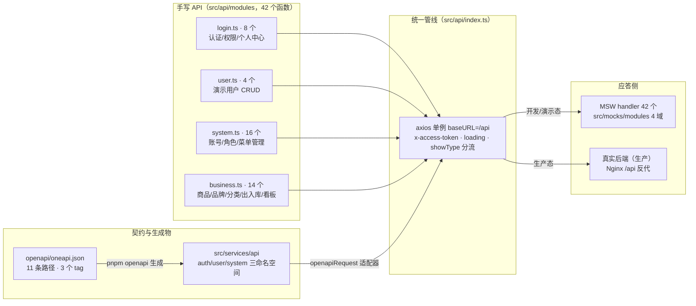

# 15 接口全量参考

> 项目：xiaoye-admin-react ｜ 版本：v1.1 ｜ 生成日期：2026-10-06 ｜ 依据：源码分析

本篇是接口层的全量速查表：手写 API（`src/api/modules/`）42 个接口的方法、路径、入参与响应类型，MSW handler 的对应关系与数据语义，以及 OpenAPI 生成产物的结构。请求层机制（拦截器、错误分流、loading 语义）见《03-接口设计》，类型设计规约见《03-接口设计》2.3，本篇以大表格为主，供开发时按名查表。

## 1. 总览图

## 2. 通用约定

读表前必须知道的五条全局约定。一，**路径前缀**：表中路径为契约路径（`/hooks/...`，来自 `src/api/config/servicePort.ts` 的 `PORT1`，注释明确是后端契约勿改名）；实际请求为 `baseURL(/api) + 路径`，即 `/api/hooks/...`，生产由 Nginx 反代掉 `/api`。二，**响应信封**：全部接口返回 `{ code, msg, data, showType? }`（`src/api/interface/index.ts` 的 `Result/ResultData<T>`），成功 `code=200`；业务错误的呈现方式由可选 `showType` 控制（`src/api/helper/errorShowType.ts`，未传按 ERROR_MESSAGE）。三，**鉴权头**：`x-access-token`（自定义头名，非标准 Authorization）。四，**分页约定**：入参 `ReqPage { current?, pageSize? }`，出参 `ResPage<T> { list, current, pageSize, total }`。五，**两套写法**：手写模块（本篇第 3 节）与 OpenAPI 生成物（第 5 节）当前并存且路径有重叠，页面应统一使用手写模块（生成物为契约示例，演示其接入方式）；两者共享同一 axios 管线。

**状态语义的完整口径**：除 `SUCCESS = 200` 与 `OVERDUE = 401` 外，其余非 200 业务码统一走"按 showType 分流提示 + reject 信封"路径（`src/api/index.ts` 响应拦截器），后端不需要为每种业务失败约定独立 code——msg 承载原因、showType 承载呈现方式。两种登录态失效路径行为完全一致：HTTP 状态 401（`checkStatus` 映射）与 HTTP 200 + `data.code == 401`，都执行"清 token + resetAuth + 带 redirect 跳登录"。超时为 30 秒（`ResultEnum.TIMEOUT`）；断网时错误回调直接跳 `/500`。后端接入时的错误契约示例：业务校验失败返回 `{ code: 500, msg: "角色名已存在", showType: 1 }`（warning 而非 error）；登录过期返回 `{ code: 401, msg: "登录过期" }`；静默失败（前端自行处理）返回 `{ code: 500, msg: "...", showType: 0 }`。

**调用侧的两个约定**：手写函数签名一律 `函数(入参, options?)`，options 直接落入 axios 配置，可用项 `{ loading: true }`（全屏遮罩，计数器并发管理）与 `{ skipErrorHandler: true }`（页面自理错误提示，但登录态清理照常执行）；页面取数写法统一为 `const { data } = await getXxx(params)`——拦截器返回的是整个信封，业务数据在 `.data` 里，失败时 reject 的也是信封对象（catch 里取 `err.msg`）。

## 3. 手写 API 全量表（42 个）

### 3.1 认证与权限域（`src/api/modules/login.ts`，8 个）

本域是权限体系的数据源，消费方集中在 `src/hooks/usePermissions.ts`（菜单与按钮两个接口）与登录页/头像下拉（其余六个）。两个 GET 权限接口无入参——用户身份完全由请求头 `x-access-token` 决定，后端不得依赖任何 body/query 传参判身份；`getAuthMenuListApi` 的返回类型直接复用 `AuthState["authMenuList"]`（即 `RouteObjectType[]`），保证菜单接口契约与路由系统类型同源。`loginApi`/`mobileLoginApi` 的第二参 options 是全项目唯一约定传 `skipErrorHandler: true` 的位置（登录失败改页面内联 Alert 展示）。

| 函数 | 方法 | 路径 | 用途 | 入参 | 响应 data |
| --- | --- | --- | --- | --- | --- |
| `loginApi` | POST | `/hooks/login` | 账号登录（支持透传 options） | `ReqLogin { username, password(md5) }` | `ResLogin { access_token }` |
| `mobileLoginApi` | POST | `/hooks/login/mobile` | 手机验证码登录 | `ReqMobileLogin { mobile, code }` | `ResLogin { access_token }` |
| `sendCaptchaApi` | POST | `/hooks/login/captcha` | 发送短信验证码（演示固定 123456） | `{ mobile }` | `null` |
| `getAuthMenuListApi` | GET | `/hooks/menu/list` | 当前用户动态菜单树 | — | `RouteObjectType[]`（菜单树） |
| `getAuthButtonListApi` | GET | `/hooks/auth/buttons` | 当前用户按钮权限码 | — | `{ [menuKey]: string[] }` |
| `logoutApi` | POST | `/hooks/logout` | 退出登录（`loading: true` 全屏遮罩） | — | — |
| `updateUserInfoApi` | POST | `/hooks/user/info/update` | 更新个人信息 | `ReqUpdateUserInfo`（Pick name/email/phone/remark） | `null` |
| `changePasswordApi` | POST | `/hooks/user/password/change` | 修改密码（md5 摘要） | `ReqChangePassword { oldPassword, newPassword }` | `null` |

### 3.2 演示用户域（`src/api/modules/user.ts`，4 个）

本域支撑 `src/views/list/useProTable` 演示页（框架推荐的列表页范本），四个接口构成最小完整 CRUD 集。`ReqUserList` 的筛选字段设计有三个细节：`createTimeSort` 用 `"asc" | "desc"` 字面量而非布尔；时间范围用 `startTime/endTime` 双字段而非区间对象；gender 语义为 `1 男 / 2 女`（与全项目一致）。编辑复用 `ReqUserSave`（id 可选），行内状态开关可只提交 `{ id, status }`——"同一提交体覆盖全量编辑与局部更新"是该域的简化取舍，系统管理域则拆出了显式的 Patch 类型（见下节）。

| 函数 | 方法 | 路径 | 用途 | 入参 | 响应 data |
| --- | --- | --- | --- | --- | --- |
| `getUserList` | POST | `/hooks/user/list` | 用户分页列表（筛选/排序） | `ReqUserList`（extends ReqPage：username?/gender?/startTime?/endTime?/createTimeSort?） | `ResPage<UserList>` |
| `addUser` | POST | `/hooks/user/add` | 新增用户 | `ReqUserSave`（无 id） | `null` |
| `editUser` | POST | `/hooks/user/edit` | 编辑用户 | `ReqUserSave`（含 id，行内状态可只传 status） | `null` |
| `deleteUser` | POST | `/hooks/user/delete` | 删除用户 | `{ id }` | `null` |

### 3.3 系统管理域（`src/api/modules/system.ts`，16 个）

本域是三张业务表（账号/角色/菜单）的完整管理面，类型设计上最有参考价值：`ReqAccountPatch`/`ReqRolePatch`/`ReqMenuPatch` 用 `Partial<ReqSave> & { id: string }` 显式建模"行内局部更新"（如只改状态），与全量编辑共用端点；实体上的冗余展示字段（`AccountItem.roleNames`、与 roleIds 顺序一致）由服务端下发，前端免二次查表；`MenuNode` 是前端 `MetaProps` 的服务端镜像（isLink/isHide/isKeepAlive/isFull/isAffix/redirect 同名对应），菜单管理页改的就是权限体系的上游事实源。业务保护（内置账号、角色引用检查、菜单级联）全部由服务端裁决并以业务错误信封返回。

| 函数 | 方法 | 路径 | 用途 | 入参 | 响应 data |
| --- | --- | --- | --- | --- | --- |
| `getAccountList` | POST | `/hooks/system/account/list` | 账号分页列表 | `ReqAccountList`（username?/status?/gender?/roleId? + 分页） | `ResPage<AccountItem>` |
| `addAccount` | POST | `/hooks/system/account/add` | 新增账号（password 仅此处提交） | `ReqAccountSave`（无 id） | `null` |
| `editAccount` | POST | `/hooks/system/account/edit` | 编辑账号（支持行内局部更新） | `ReqAccountPatch = Partial<ReqAccountSave> & { id }` | `null` |
| `deleteAccount` | POST | `/hooks/system/account/delete` | 删除账号（内置账号 id "1" 服务端拒绝） | `{ id }` | `null` |
| `batchDeleteAccounts` | POST | `/hooks/system/account/batchDelete` | 批量删除账号 | `{ ids: string[] }` | `null` |
| `resetAccountPassword` | POST | `/hooks/system/account/resetPassword` | 重置密码为初始值（注释"仅演示用"，返回明文） | `{ id }` | `{ password }` |
| `getRoleList` | POST | `/hooks/system/role/list` | 角色分页列表 | `ReqRoleList`（roleName?/status? + 分页） | `ResPage<RoleItem>` |
| `getRoleOptions` | GET | `/hooks/system/role/options` | 角色下拉（全量启用，不分页） | — | `RoleItem[]` |
| `addRole` | POST | `/hooks/system/role/add` | 新增角色 | `ReqRoleSave`（含 menuIds） | `null` |
| `editRole` | POST | `/hooks/system/role/edit` | 编辑角色（支持局部更新） | `ReqRolePatch` | `null` |
| `deleteRole` | POST | `/hooks/system/role/delete` | 删除角色（被账号引用时服务端拒绝） | `{ id }` | `null` |
| `batchDeleteRoles` | POST | `/hooks/system/role/batchDelete` | 批量删除角色（内置/被引用拒绝） | `{ ids }` | `null` |
| `getMenuTree` | GET | `/hooks/system/menu/tree` | 菜单管理树（树形表格数据） | — | `MenuNode[]` |
| `addMenu` | POST | `/hooks/system/menu/add` | 新增菜单（catalog/menu 两类） | `ReqMenuSave`（无 id/children） | `null` |
| `editMenu` | POST | `/hooks/system/menu/edit` | 编辑菜单（支持局部更新） | `ReqMenuPatch` | `null` |
| `deleteMenu` | POST | `/hooks/system/menu/delete` | 删除菜单（服务端级联校验子级） | `{ id }` | `null` |

### 3.4 业务中心域（`src/api/modules/business.ts`，14 个）

本域支撑"商品中心"菜单组六个页面，展示了三张表（商品/品牌/分类）加只读聚合（出入库、看板）的组织方式。它的特点是**写操作都带联动语义**：品牌/分类改名后商品的 brandName/categoryName 冗余字段由服务端同步；分类删除受"无子级且无商品"约束；看板的 trend 与 categoryRatio 从同一份内存数据实时聚合，保证六个页面数据互洽。`getBusinessOverview` 是全项目唯一的"聚合读"接口（无分页、一次返回汇总+趋势+占比三块），适合作为仪表盘类接口的形态参考。

| 函数 | 方法 | 路径 | 用途 | 入参 | 响应 data |
| --- | --- | --- | --- | --- | --- |
| `getGoodsList` | POST | `/hooks/business/goods/list` | 商品分页列表 | `ReqGoodsList`（keyword?/categoryId?/status? + 分页） | `ResPage<GoodsItem>` |
| `addGoods` | POST | `/hooks/business/goods/add` | 新增商品 | `ReqGoodsSave`（无 id/categoryName/brandName） | `null` |
| `editGoods` | POST | `/hooks/business/goods/edit` | 编辑商品 | `ReqGoodsSave`（含 id） | `null` |
| `deleteGoods` | POST | `/hooks/business/goods/delete` | 删除商品 | `{ id }` | `null` |
| `getBrandList` | GET | `/hooks/business/brand/list` | 品牌全量列表（含 goodsCount 统计） | — | `BrandItem[]` |
| `addBrand` | POST | `/hooks/business/brand/add` | 新增品牌 | `ReqBrandSave` | `null` |
| `editBrand` | POST | `/hooks/business/brand/edit` | 编辑品牌（改名联动商品 brandName） | `ReqBrandSave` | `null` |
| `deleteBrand` | POST | `/hooks/business/brand/delete` | 删除品牌（被商品引用时拒绝） | `{ id }` | `null` |
| `getCategoryTree` | GET | `/hooks/business/category/tree` | 分类树（含子级 goodsCount 汇总） | — | `CategoryNode[]` |
| `addCategory` | POST | `/hooks/business/category/add` | 新增分类 | `ReqCategorySave { parentId, name, sort }` | `null` |
| `editCategory` | POST | `/hooks/business/category/edit` | 编辑分类（改名联动商品 categoryName） | `ReqCategorySave` | `null` |
| `deleteCategory` | POST | `/hooks/business/category/delete` | 删除分类（有子级/有商品拒绝） | `{ id }` | `null` |
| `getStockList` | POST | `/hooks/business/stock/list` | 出入库分页记录 | `ReqStockList`（type? "in"\|"out"、keyword? + 分页） | `ResPage<StockRecord>` |
| `getBusinessOverview` | GET | `/hooks/business/overview` | 经营看板（汇总+近 7 日趋势+分类占比） | — | `BusinessOverview` |

## 4. MSW handler 映射表

handler 与上表 42 个接口一一对应，按域聚合在 `src/mocks/handlers.ts`（顺序 auth → demo → system → business）。下表给出 handler 位置与数据语义；公共包装 `ok()/fail()` 与数据建模三原则见《03-接口设计》4.2、《04-数据模型》第 7 节。

handler 文件的组织模式值得单独说明，因为它是"新增域"时的模板。每个域文件由三部分组成：头部注释声明内存数据源的语义（哪些可变、何时重置）；模块级数据源（种子数组 + `let` 可变集合或纯函数派生的不可变集合）；导出的 handler 数组（供 `handlers.ts` 聚合）。`_shared.ts` 提供五个工具——`ok(data)`（成功信封，注释强调必须与拦截器 `code===200` 判定一致）、`fail(msg, code=500)`（错误信封）、`nextId()`（自增游标防同毫秒重复 id）、`formatNow()`（`YYYY-MM-DD HH:mm:ss` 当前时间）、`pad(n)`（两位补零）。这套模式让每个 handler 都形如"小号后端 controller"，接真实后端时可以直接把 handler 的业务规则翻译给后端开发者作为验收用例。

| 域文件 | handler 数 | 覆盖路径 | 数据规模与业务规则 |
| --- | --- | --- | --- |
| `src/mocks/modules/auth.ts` | 8 | login、login/captcha、login/mobile、logout、user/info/update、user/password/change、menu/list、auth/buttons | 内存人设 `CURRENT_USER_INFO`（admin）与可变密码摘要 `currentPasswordMd5`（初始 123456，改密即生效、刷新即重置）；验证码固定 123456；菜单直接返回静态 JSON 的 `data`（注释口径 81 项，实为 77，见《13-技术债务》D1） |
| `src/mocks/modules/demo.ts` | 4 | user/list、user/add、user/edit、user/delete | 固定 87 条确定性用户（姓氏/名字/城市按索引取模派生），分页与筛选行为可复现；`nextId()` 自增游标 |
| `src/mocks/modules/system.ts` | 16 | system/account/* 6 个、system/role/* 6 个、system/menu/* 4 个 | 45 个账号（首条为内置超级管理员 id "1"，不可删/禁/改名）、5 个角色（admin/system/operator/analyst/guest）、最多 4 层菜单树；角色删除有账号引用检查；菜单删除级联校验；重置密码固定返回 123456 |
| `src/mocks/modules/business.ts` | 14 | business/goods/* 4、brand/* 4、category/* 4、stock/list、overview | 60 个商品、6 个品牌、分类树；冗余字段联动（品牌/分类改名同步商品）；分类删除需无子级且无商品；overview 的 trend（近 7 日出入库聚合）与 categoryRatio 实时从内存数据计算 |

映射关系的三条使用规则：改接口路径时三个落点必须同步（api 模块、handler、openapi 契约），漏改 handler 的第一信号是控制台 `onUnhandledRequest: "warn"` 告警（见《12-FAQ与故障排查》4）；开发态菜单接口 handler 实际不被 `usePermissions` 触发（静态 JSON 短路），仅按钮权限接口被请求（带 5 秒重试窗口，见《03-接口设计》4.3）；演示环境的完整登录链路走 MSW（admin/123456），与生产态行为等价。

## 5. OpenAPI 生成产物结构

**契约源**：`openapi/oneapi.json`（OpenAPI 3.0.1，`servers.url = "/api"`，info.description 自述"与 src/mocks 保持一致的契约示例"）。当前覆盖 11 条路径：`/hooks/login`、`/hooks/logout`、`/hooks/menu/list`、`/hooks/auth/buttons`、`/hooks/user/info/update`、`/hooks/user/password/change`、`/hooks/user/list`、`/hooks/user/add`、`/hooks/user/edit`、`/hooks/user/delete`、`/hooks/system/account/list`，分 auth/user/system 三个 tag——注意它只示例了 42 个接口的一个子集，手写模块才是全量；响应按 `ResultLogin/ResultNull/ResultMenuList/ResultAuthButtons` 等信封 schema 建模。

契约文件的写法有两点直接决定生成质量。其一，**operationId 即生成函数名**：`operationId: "login"` 生成 `login(...)`，与手写模块的 `loginApi` 形成同名异缀的对应关系，改 operationId 等于改生成 API 的公开签名，须谨慎。其二，**信封 schema 与业务 schema 分层**：业务实体（如 `LoginBody`、`AccountItem`）独立建模，信封类型（`ResultLogin` 等）以 `data` 字段 `$ref` 业务实体组合而成——这与 `src/api/interface/index.ts` 的 `Result/ResultData<T>` 手写结构完全同构，两种写法才能在类型层面互相印证。接入真实后端时，后端导出的 swagger 若不含信封包装，需要先补一层信封 schema 再生成，否则生成代码的返回类型与运行时信封不匹配。

**生成产物**（`pnpm openapi`，`scripts/openapi.mjs` 配置见《14-配置与环境详解》8）：目录 `src/services/api/`，四个文件——`index.ts`（聚合 `auth/user/system` 三命名空间默认导出）、`auth.ts`、`user.ts`、`system.ts`（每个端点一个函数，注释含方法与路径，如 `login(body: API.LoginBody)`）、`typings.d.ts`（`declare namespace API` 的请求/响应类型：`LoginBody`、`AccountItem`、`AccountListBody`、`ResultXxx` 信封等）。文件头带 `@ts-ignore` 与 `/* eslint-disable */`，且 ESLint 对 `src/services/**` 整体豁免——生成物禁区，禁止手改（`src/services/README.md`）。

生成函数的形态是统一的：`export async function fn(body: API.XxxBody, options?: { [key: string]: any })`，内部按 method 组装 `request<T>(url, { method, data 或 params, ...(options || {}) })`——POST/PUT 带 `Content-Type: application/json` 与 `data`，GET/DELETE 用 `params`（query string）。`options` 的 `[key: string]: any` 宽类型是有意的：它让调用方可以透传 axios 层的自定义键（`loading`、`skipErrorHandler`）而不破坏生成模板。

**消费链**：生成函数内部 `import { request } from "@/api/openapiRequest"`，适配器把 options 的 `method/params/data` 分发到统一 axios 实例（get/put/delete/post），其余键（loading、skipErrorHandler）原样透传；运行时返回拦截器解包后的信封，取数写法 `const { data } = await api.auth.login(body)`。由此生成代码与手写代码共享同一套鉴权头、错误分流与 loading 行为——这是接口层最重要的复用设计，接入真实后端时整体替换 `oneapi.json` 重新生成即可（六步迁移清单见《06-部署运行》8）。

## 6. 页面与接口的对应关系

为便于按页查接口，给出"消费方 → 接口"的反向索引（正向详表见第 3 节）。登录页（`src/views/login/`）消费 `loginApi`、`mobileLoginApi`、`sendCaptchaApi`；权限初始化（`src/hooks/usePermissions.ts`）消费 `getAuthMenuListApi` 与 `getAuthButtonListApi`；头像下拉（`src/layouts/components/Header/components/AvatarIcon/`）消费 `updateUserInfoApi`、`changePasswordApi` 与登出接口 `logoutApi`。演示列表页 `src/views/list/useProTable` 消费 user 域四个接口；系统管理三页（`src/views/system/`）消费 system 域十六个接口，其中 `getRoleOptions` 被 accountManage 的角色下拉单独请求（外键下拉独立取数，不塞进列表接口，见《05-核心流程》流程五）。商品中心六个页面按各自主题分别消费 business 域：商品列表页用 goods 四接口，品牌页用 brand 四接口，分类页用 category 四接口，库存总览用 `getStockList`，经营看板用 `getBusinessOverview`。工作台首页（`src/views/home/`）当前不发起请求（静态演示数据），替换为接口时优先参考 `getBusinessOverview` 的聚合形态。

这层反向索引的实际用途有二：接真实后端时可以按页面粒度核对后端实现进度（一个页面的接口齐了才可演示）；排查"某页面数据异常"时可据此快速圈定 handler 或后端端点范围，而不必在 42 个接口里线性搜索。

## 7. 查表补遗

三类不落表但常查的细节。**文件下载**：`http.download(url, params)` 以 POST + `responseType: "blob"` 发请求，响应拦截器对 blob 直通返回二进制，不走信封检查（`src/api/index.ts`）——注意当前 42 个接口中没有使用 download 的端点，它是预留给业务扩展的能力。**options 透传**：所有手写函数的第三参（或 login 系的 options 参）直接落入 axios 配置，可用项包括 `{ loading: true }`（全屏遮罩）与 `{ skipErrorHandler: true }`（页面自理错误，但 401 仍清登录态）。**类型派生规约**：编辑入参 = `Omit<实体, "id" | "createTime" | 冗余字段>` 且 id 可选；只读字段用 `Pick` 圈定（如 `ReqUpdateUserInfo`）；枚举用字面量联合（`gender: 1 | 2`、`type: "in" | "out"`）；冗余展示字段（roleNames/goodsCount/categoryName）由服务端下发，前端不查表——新接口照此办理即可与全表风格一致。

本篇表格与源码的一致性以生成日期为锚点：42 个函数名、路径与类型均逐一对照 `src/api/modules/` 与 `src/api/interface/index.ts` 核实；后续接口增删时，更新本篇的顺序是先改源码三处对齐（api 模块、MSW handler、openapi 契约，见《11-扩展开发指南》场景二），再回填第 3、4 节表格——表格是结果不是源头，直接改表不改码只会制造第二处口径漂移（与菜单数量问题的教训同源，见《13-技术债务与演进建议》D1）。
