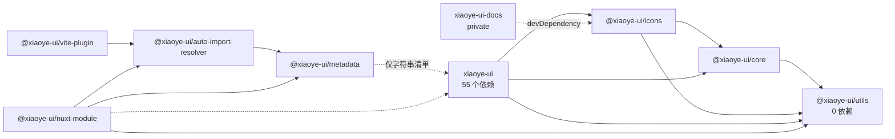
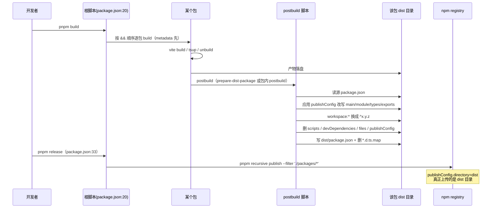
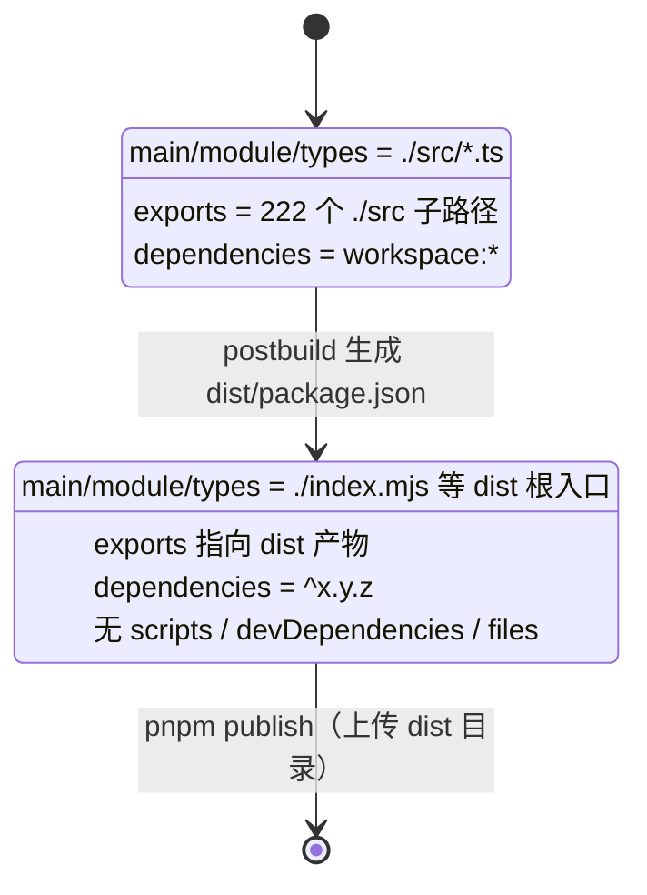

# A01 monorepo 拓扑与发布链路

> **本篇解决**：`pnpm build` 到底按什么顺序构建、为什么这个顺序是错的却能跑通？发布出去的包和仓库里的包为什么入口字段不一样？`workspace:*` 是怎么在产物里消失的？CI 现在真的在测什么？
> **前置**：无（本篇是专栏起点）　**读者坐标**：`01-architecture` 第 1/8 篇
> 三个生成物（`components.ts` / `global.d.ts` / `exports` 表）的生成规则归 A02；自动导入与 nuxt 的消费细节归 A08；本篇只管**包与包、包与发布之间的事**。

---

## 一、职责与边界

这条链负责四件事：包边界（8 个包 + 1 个文档应用）、构建顺序、发布期 manifest 改写、版本与外部依赖契约。

明确**不负责**：

- 组件内部如何写、props/样式规范 → A02/A06/A03
- Vite 库模式的产物形状细节（`preserveModules` 的产物长什么样只在本篇 §论点 4 交代到"能解释 exports 为什么对不上"为止）
- 文档站自身的构建（VitePress 配置归 A08）

| 方向 | 对象 | 证据 |
| --- | --- | --- |
| 工作区定义 | 只有 `pnpm-workspace.yaml` 两处 glob，**根 `package.json` 没有 `workspaces` 字段** | `pnpm-workspace.yaml:1-3` |
| 包管理器钉版 | `packageManager: "pnpm@9.6.0"` | `package.json:5` |
| Node 版本 | `engines.node: ">=18.0.0"`（pnpm 版本只写在 `packageManager`，`engines` 里没有） | `package.json:44-46` |
| 私有性 | 根与文档站 `private: true`，8 个包均可发布 | `package.json:4`、`apps/docs/package.json:4` |

---

## 二、源码地图

| 文件 | 行数 | 职责 |
| --- | --- | --- |
| `pnpm-workspace.yaml` | 3 | 工作区成员定义 |
| `package.json` | — | 8 条脚本串起整个生命周期；`build:packages` 一条 `&&` 定死顺序（`:21`） |
| `scripts/prepare-dist-package.mjs` | 205 | 6 个包共用的发布期 manifest 生成器 |
| `scripts/build-helper.mjs` | 177 | 仅 `nuxt-module` 使用的工具集（版本同步 + workspace 规范化） |
| `scripts/generate-llms-txt.mjs` | — | `llms.txt` 产物（A08） |
| `packages/xiaoye-ui/vite.config.mts` | 59 | ESM-only 库构建 + 由 package.json 反向驱动的 external |
| `packages/xiaoye-ui/scripts/source-entry.mjs` | 79 | 扫描 `src/` 生成构建入口映射 |
| `packages/xiaoye-ui/scripts/postbuild.mjs` | 211 | 主包专用的发布期 manifest 改写 |
| `packages/*/package.json` | — | 8 份 manifest，dev/pub 双身份都写在这一份里 |
| `.github/workflows/test.yml` | 116 | CI：`setup` / `compile` / `lint` / `node` 四个 job |
| `.github/workflows/codecov.yml` | 76 | 覆盖率上传（与 test.yml 同构的 setup 链） |

8 个包按构建工具分三族（`packages/*/package.json` 的 `scripts.build`）：

| 族 | 包 | build 命令 |
| --- | --- | --- |
| tsup | `utils`、`metadata`、`auto-import-resolver`、`vite-plugin` | `tsup` |
| vite build | `core`、`icons`、`xiaoye-ui` | `vite build` |
| unbuild | `nuxt-module` | `NODE_ENV=production INPUT_DIR=src/ OUTPUT_DIR=dist/ pnpm run build:package` |

---

## 三、架构与数据流

### 3.1 真实依赖图 vs 声明的构建顺序



虚线那两条是关键：`metadata` 与 `nuxt-module` 对 `xiaoye-ui` 的依赖**不产生构建期需求**（原因见 §论点 2）。

而 `package.json:21` 声明的顺序是把这 8 个包**硬写成一条 `&&` 链**：

```json
// package.json:21
"build:packages": "pnpm --filter @xiaoye-ui/metadata build && pnpm --filter @xiaoye-ui/utils build && pnpm --filter @xiaoye-ui/core build && pnpm --filter @xiaoye-ui/icons build && pnpm --filter xiaoye-ui build && pnpm --filter @xiaoye-ui/auto-import-resolver build && pnpm --filter @xiaoye-ui/vite-plugin build && pnpm --filter @xiaoye-ui/nuxt-module build"
```

对照 3.1 的依赖图，正确的拓扑序应是 `utils → core → icons → xiaoye-ui → metadata → …`，而声明序把 `metadata` 排在**第一个**、把它依赖的 `xiaoye-ui` 排在第五个。

### 3.2 一次构建到发布发生了什么



### 3.3 单包 manifest 的双身份



`publishConfig.directory: "dist"` 在 8 个包里**全部存在**，所以 npm 上传的目录永远是 `dist/`，而仓库里那份 `package.json` 只对 workspace 内部生效。

---

## 四、核心机制精读

### 论点 1：整个工作区是 "src-first"，发布态靠第二份 manifest 顶上

8 个包的入口字段一律指向源码，没有一个例外：

```json
// packages/core/package.json（节选）
"main": "./src/index.ts",
"module": "./src/index.ts",
"types": "./src/index.ts",
```

`xiaoye-ui` 的 222 个 `exports` 键也全是 `./src/...`：

```json
// packages/xiaoye-ui/package.json（节选）
".": { "types": "./src/index.ts", "import": "./src/index.ts" },
"./affix": { "types": "./src/affix/index.tsx", "import": "./src/affix/index.tsx" },
```

**后果一（收益）**：改库源码，文档站和所有下游包立刻生效，不需要 watch 构建；`typecheck` 与 `test:unit` 直接跑源码。

**后果二（代价）**：仓库里的 `package.json` 与发布出去的**不是同一份**。发布态由 `postbuild` 现场生成：

```js
// scripts/prepare-dist-package.mjs:124
const pkg = readJson(srcPkgPath);
const distPkg = { ...pkg };
const publishConfig = distPkg.publishConfig || {};

// 应用 publishConfig 入口
if (publishConfig.main) distPkg.main = publishConfig.main;
if (publishConfig.module) distPkg.module = publishConfig.module;
if (publishConfig.types) distPkg.types = publishConfig.types;
```

```js
// scripts/prepare-dist-package.mjs:161
delete distPkg.scripts;
delete distPkg.devDependencies;
// 删除 files 字段：源 package.json 的 files: ["dist"] 用于开发期，
// 但发布时 publishConfig.directory 已指向 dist，dist/package.json 中不应再保留 files，
// 否则 npm 会在 dist 目录内查找 dist 子目录，导致发布空包
delete distPkg.files;
```

第 163-166 行那段注释是**踩过坑的证据**：留着 `files: ["dist"]` 会让 npm 在已经指向 `dist/` 的目录里再找 `dist/` 子目录，结果是发布出一个空包。这类问题在本地的 `pnpm pack` 之前不会暴露（见 §七 坑 4）。

### 论点 2：`build:packages` 的顺序与真实依赖图不一致，之所以能跑是因为 `metadata` 根本不 import 主库

声明序把 `metadata` 放第一，而它的 `dependencies` 里有 `"xiaoye-ui": "workspace:*"`。真实原因是这些依赖声明**不产生构建期需求**——`metadata` 的全部内容是字符串清单：

```ts
// packages/metadata/src/directives/index.ts:14
 * 与 `composables/index.ts` 同处理：整组清空，真要做指令先落实现再回来登记。
 */
export const directives: MetaType[] = toMeta([]);
```

（修前第 5 行是 `{ name: 'badge', as: 'BadgeDirective', from: 'xiaoye-ui/badgedirective' },`，第 6 行是 tooltip 那条；这一组六条加 `composables` 三条在 2026-09-30 被证明**全是字符串意义上的幽灵条目**——本库没有任何 Vue 指令、也没有那三个 composable 实现，于是整组清空，见 `01-architecture/08-consumer-integration.md` §论点 4 与 §七 坑 6。）

而它自己的源文件只 import 本地 `shared`：

```ts
// packages/metadata/src/components/index.ts:1
import type { MetaType } from '../shared';
import { toMeta } from '../shared';
```

实测证据（`grep -c` 统计 `metadata/src` 里"import 语句中出现 xiaoye-ui"的行数，结果为 0）：

```bash
grep -rn "from 'xiaoye-ui[^']*'" packages/metadata/src --include='*.ts' | grep -c ":import"
# 0
```

`tsup.config.ts` 也没有把主库设为 external：

```ts
// packages/metadata/tsup.config.ts:3
export default defineConfig({
  entry: ['src/index.ts'],
  format: ['esm'],
  dts: true,
  splitting: false,
  sourcemap: false,
  clean: true,
  external: [/^@xiaoye-ui\//],
});
```

第 10 行的正则只匹配**带 scope 的** `@xiaoye-ui/*`。主包的名字是裸的 `xiaoye-ui`，不匹配这条规则。**一旦哪天 `metadata` 真的 `import ... from 'xiaoye-ui/xxx'`，tsup 会把主库源码打进 metadata 的产物里**（因为不 external），而今天没有人会拦住它。这是一条只靠"大家记得别 import"维持的隐式约定，属 §七 坑 3。

同一份 `toMeta` 里还藏着一个会自动出错的推导：

```ts
// packages/metadata/src/shared.ts:17
export function toMeta(arr?: any[]): MetaType[] | undefined {
  return arr?.map(item => {
    const it = typeof item === 'string' ? { name: item } : item;

    it.as ??= it?.name;
    // 组件目录是 kebab-case（`auto-complete`、`color-picker`），而生成物的 `exports` 键
    // 逐个来自目录名；原先的 `toLowerCase()` 会得到 `autocomplete` 这种不存在的子入口，
    // 130 条裸名字里只有 52 条能命中，改成 kebab 后是 79 条。
    it.from ??= `xiaoye-ui/${it?.name?.replace(/([a-z0-9])([A-Z])/g, '$1-$2').toLowerCase()}`;

    return it;
  });
}
```

**修前**第 16 行的推导规则是**小写、不插连字符**，而本库目录名是 kebab-case（`focus-trap`、`key-filter`、`auto-complete`），所以清单里任何一条**只写 `name` 不写 `from`** 的多词条目，都会被推成 `xiaoye-ui/focustrap` 这种不存在的子路径。**2026-09-30 已按 kebab 改规则**（现在是 `:19`），受益的是「目录确实存在、只差拼写」那 34 条；剩下的条目要么该补显式 `from`（子组件），要么整条是虚构的，见 A08 论点 4。

**关于"哪些条目真的因此坏掉"，我原先的判断错过一次，此处按 A08 的复核更正**：`directives/index.ts:5-10` 与修前 `composables/index.ts:6-7` 那 7 条幽灵 `from`（`badgedirective`/`styleclass`/`focustrap`/`animateonscroll`/`keyfilter`/`useconfirm`/`usedialog`）**每一条都显式写了 `from`，推导对它们根本不触发**——它们是有人按同一套"小写不插连字符"的拼写习惯手写进去的（其中 `focustrap → focus-trap`、`keyfilter → key-filter` 是风格错配，其余在主库无对应目录）。推导规则真正的受害者是**只写裸名的条目**：A08 实测 151 条组件条目里，修前有 87 条 `from` 不在主包 222 键 `exports` 内（其中 82 条来自这条推导），改成 kebab 之后重跑同一份口径是 **53 条**。composables 那两条（以及 `:5` 的 `useXiaoyeUI`）随整组虚构条目在 2026-09-30 一起删除。结论不变、成因换人：**问题出在"拼写约定没人校验"，而不是"某一行代码算错"**。完整影响面与量化归 **A08**（已完成，`01-architecture/08-consumer-integration.md`），本篇只登记它在包边界上的成因位置。

### 论点 3：发布期 manifest 改写有三份实现，规则互相分叉

| 实现 | 服务对象 | 入口改写规则 | workspace 规范化覆盖的字段 |
| --- | --- | --- | --- |
| `scripts/prepare-dist-package.mjs` | `utils`/`core`/`icons`/`metadata`/`auto-import-resolver`/`vite-plugin`（各自 `postbuild` 调用） | `./src/x/index.ts → ./x/index.mjs`（**保留 `/index`**），且带产物存在性回退 | `dependencies`、`peerDependencies`、`optionalDependencies` |
| `packages/xiaoye-ui/scripts/postbuild.mjs` | 仅主包 | `./src/x/index.ts → ./x.mjs`（**去掉 `/index`**），无存在性回退 | `dependencies`、`peerDependencies` |
| `scripts/build-helper.mjs` 的 `clearPackageJson` | 仅 `nuxt-module`（`prebuild.mjs:2`、`postbuild.mjs:3` 是唯一两个 import 方） | 直接用 `publishConfig` 覆盖，不做路径换算 | `dependencies`、`peerDependencies`、`optionalDependencies`、**`devDependencies`** |

主包为什么要自己写一份？答案写在它自己的注释里：

```js
// packages/xiaoye-ui/scripts/postbuild.mjs:85
/**
 * Vite lib 模式 + preserveModules 下：
 * - 入口文件 src/<name>/index.ts → dist/<name>.mjs（用入口 key 命名，去掉 /index）
 * - style 入口 src/<name>/style/index.ts → dist/<name>/style.mjs
 * - 根入口 src/index.ts → dist/index.mjs
 *
 * 注意：与 srcToDistTypes 不同！vite-plugin-dts 生成的 .d.ts 保留目录结构
 * （dist/<name>/index.d.ts），但 Vite 构建的 .mjs 入口文件不保留 /index。
 */
```

两份实现的差异因此是**产物形状差异**的必然结果，而不是重复劳动——但 `*.d.ts.map` 的清理逻辑（`prepare-dist-package.mjs:185-204` 与 `postbuild.mjs:191-210`）是逐行相同的复制，`normalizeWorkspaceDependencies` 也在三处各有一份（`prepare-dist-package.mjs:53-70`、`build-helper.mjs:61-85`、`postbuild.mjs:151-169`），这三份的**字段覆盖集不同**（见上表），意味着同一类清理动作在不同包上的结果不一样。

再看主包独有的存在性回退——通用版有、主包版没有：

```js
// scripts/prepare-dist-package.mjs:95
  // 如果对应 dist 产物存在则使用，否则回退到根入口
  const absoluteTarget = resolve(distDir, target.replace(/^\.\//, ''));
  if (existsSync(absoluteTarget)) {
    return target;
  }
  return isTypes ? rootTypes : rootImport;
```

这个"兜底成根入口"的策略值得警惕：**产物缺失不会让构建失败，而是静默把所有子路径导出都指向 `./index.mjs`**。发出去的包 `exports` 看起来完好，但任何子路径 import 拿到的都是全量根入口（体积爆炸 + 破坏 tree-shaking），且没有任何一处会报错。

### 论点 4：`external` 由 `package.json` 反向驱动，产物形状由 `preserveModules` 决定

主库的构建配置里**没有硬编码依赖清单**：

```ts
// packages/xiaoye-ui/vite.config.mts:12
// 读取 package.json，将 dependencies + peerDependencies 全部 external 化
const pkg = JSON.parse(readFileSync(resolve(__dirname, 'package.json'), 'utf-8'));
const externalDeps = [
  ...Object.keys(pkg.dependencies || {}),
  ...Object.keys(pkg.peerDependencies || {}),
];
```

```ts
// packages/xiaoye-ui/vite.config.mts:36
      external(source) {
        if (source === 'vue') return true;
        if (source.startsWith('@xiaoye-ui/')) return true;
        // 将 package.json 中声明的依赖（含子路径导入）全部 external 化
        for (const dep of externalDeps) {
          if (source === dep || source.startsWith(dep + '/')) return true;
        }
        return false;
      },
```

第 40-41 行按**声明顺序**遍历并用 `startsWith(dep + '/')` 覆盖子路径导入，这带来一个真实缺陷：短前缀会吃掉长包名。`@xiaoye-ui/core`（第 38 行的 scope 分支已提前兜住本库包）之外，若某依赖名恰是另一个的前缀（如 `dayjs` 与 `dayjs-plugin-x`），前者会先把后者的 import 判为 external。本库当前 55 个 `dependencies` 里没有这种成对名字，所以问题不可见——但规则本身是脆弱的（§七 坑 5）。

产物形状则解释了 §论点 3 里"两份改写规则为什么必须不同"：

```ts
// packages/xiaoye-ui/vite.config.mts:45
      output: {
        preserveModules: true,
        preserveModulesRoot: 'src',
        entryFileNames: '[name].mjs',
        chunkFileNames: '[name].mjs',
        assetFileNames: '[name][extname]',
      },
```

入口名来自扫描器，而扫描器给每个组件生成**两个**入口：

```js
// packages/xiaoye-ui/scripts/source-entry.mjs:37
  for (const dir of dirs) {
    // 主入口 index.ts / index.tsx
    for (const entry of ['index.ts', 'index.tsx']) {
      const entryPath = resolve(srcDir, dir, entry);
      if (existsSync(entryPath)) {
        entries[dir] = entryPath;
        break;
      }
    }

    // style 入口
    for (const entry of ['index.ts', 'index.tsx']) {
      const stylePath = resolve(srcDir, dir, 'style', entry);
      if (existsSync(stylePath)) {
        entries[`${dir}/style`] = stylePath;
        break;
      }
    }
  }
```

于是 `dist/` 的实际形状（实测：269 个顶层条目、1,435 个 `.mjs`、1,561 个 `.d.ts`）是 `affix.mjs`（入口）与 `affix/`（preserveModules 保留下来的模块目录 + dts 的类型）并存。`formats: ['es']`（`vite.config.mts:33`）意味着**没有 CJS 产物**——`publishConfig.exports` 也只给了 `types` 与 `import` 两个条件，没有 `require`。所以本库对纯 CJS 消费者（老 Jest、某些 SSR 打包器）是不可用的，这是有意的取舍（§六）。

扫描器的排除名单和 A02 的生成器各写了一份，规则相同：

```js
// packages/xiaoye-ui/scripts/source-entry.mjs:32
    if (name.startsWith('_') || name.startsWith('.') || name.startsWith('vc-')) return false;
```

```js
// packages/xiaoye-ui/scripts/entry-generator.mjs:299
    if (name.startsWith('_') || name.startsWith('.') || name.startsWith('vc-')) return false;
```

两行**完全一致**。也就是说"哪些目录算组件"这个判断被抄了两遍；一旦只改一边（例如某天要开始为 `vc-*` 出产物），构建入口与 `exports` 表就会错位，而 `check:entries` 只校验 manifest 侧、校验不到产物侧。

### 论点 5：版本有四处真源，其中一处进了样式缓存的 salt

| 位置 | 值 | 说明 |
| --- | --- | --- |
| `package.json:3`（根） | `6.1.3` | `private: true`，不参与发布 |
| `packages/xiaoye-ui/package.json` | `6.1.3` | 主包 |
| `packages/xiaoye-ui/src/version.ts:1` | `export default '6.1.3';` | **手写常量**，被 `theme/internal.ts:4` import |
| 其余 6 个包 | `6.1.1` | 与主包差两个 patch |
| `apps/docs/package.json:3` | `6.1.0` | 文档站独立版本 |

关键点是 `version.ts` **没有任何同步机制**（实测：`grep -rn "version.ts" --include='*.mjs' --include='*.ts' packages scripts | grep -v dist` 无结果；只有 `nuxt-module` 通过 `build-helper.mjs:35` 的 `pkg.version = packageJson.version` 会同步**它自己**的 `package.json`，不碰 `version.ts`）。

而它是有语义的：A03 论点 3 已证明 `theme/internal.ts:117` 把 version 拼进 `salt`，`salt` 参与 `useCacheToken.tsx:132-137` 的缓存键。于是**升版本时忘了改 `version.ts`，样式 hashId 不会变**——静态 SSR 抽取的旧样式、以及 `_tokenKey`/`_hashId` 相关的一切都会继续复用旧值。这个耦合在本篇的视角下是"版本真源分裂"的直接后果（§七 坑 1）。

### 论点 6：`sideEffects` 决定样式会不会被摇掉，三个包写得三种样

```json
// packages/xiaoye-ui/package.json（sideEffects）
["**/style/index.{js,ts}", "**/style.mjs", "*.vue", "*.css", "*.less"]
```

```json
// packages/icons/package.json（sideEffects）
["*.vue"]
```

其余 6 个包（`utils`/`core`/`metadata`/`auto-import-resolver`/`vite-plugin`/`nuxt-module`）一律 `false`。

`xiaoye-ui` 的四条 pattern 里，前两条对应"按需样式入口"的两种存在形式：源码态 `src/<name>/style/index.ts` 与产物态 `<name>/style.mjs`（正是 §论点 4 的入口扫描产物）。这两条是**用户 bundle 能摇掉未用组件样式、又不会把样式摇丢**的唯一依据。`*.vue` 之所以也要列进 sideEffects，是因为图标与主库都有 `.vue` 文件（`packages/icons/src` 下 239 个图标目录、239 个 `.vue`，整个 `src` 共 722 个文件）。

风险面在 `core`：它的 `sideEffects: false` 是对全包的断言，一旦 `packages/core/src` 里出现任何顶层副作用（注册全局、注入样式、写 `document`），压缩器有权直接删掉整个模块，且**不会有任何报错**。

### 论点 7：CI 的 install 与执行两端都和仓库现状脱节

`test.yml` 的四个 job 共用一条 `setup` 缓存链：

```yaml
# .github/workflows/test.yml:18
      - name: create package-lock.json
        run: npm i --package-lock-only --ignore-scripts

# .github/workflows/test.yml:35
      - name: install
        if: steps.node_modules_cache_id.outputs.cache-hit != 'true'
        run: npm ci
```

本仓库的锁文件是 `pnpm-lock.yaml`（`git log` 中 `dc38739 chore: 将 pnpm-lock.yaml 纳入版本控制` 才入库），工作区靠 `pnpm-workspace.yaml` 定义；`npm i` + `npm ci` 这条路径不认 pnpm 的 `workspace:*` 协议与虚拟 store。

更直接的是两个 job 调用**根 `package.json` 里不存在的脚本**：

```yaml
# .github/workflows/test.yml:69
      - name: compile
        run: npm run compile

# .github/workflows/test.yml:113
      - name: test
        run: npm test
```

实测该脚本不存在（`node -p "'compile' in require('./package.json').scripts"` → `false`；`'test' in ...` → `false`；存在的只有 `test:unit`）。`codecov.yml:67` 的 `npm test` 同样落空。所以**结论是：本仓库的单测与 typecheck 目前不在 CI 覆盖范围内**，`lint`（`test.yml:92` 跑 `npm run lint`，该脚本存在）是唯一可能通过的 job——而它同样依赖那条 `npm ci` 安装链。这条判断的局限我在 §附 检查点 3 里标了如何复核（需要看 Actions 运行记录或本地 `npm ci` 实测）。

### 论点 8：全仓库唯一的版本同步机制在 `nuxt-module`，而它会改写 tracked 源文件

`packages/nuxt-module/scripts/prebuild.mjs` 只有 5 行：

```js
// packages/nuxt-module/scripts/prebuild.mjs:1
import path from 'path';
import { removeBuild, resolvePath, updatePackageJson } from '../../../scripts/build-helper.mjs';

removeBuild(import.meta.url);
updatePackageJson(path.resolve(resolvePath(import.meta.url).__dirname, '../package.json'));
```

被调用的 `updatePackageJson` 从**根** `package.json` 取字段写回**包**的 `package.json`，并且是就地写文件：

```js
// scripts/build-helper.mjs:35
  pkg.version = packageJson.version;
  pkg.author = packageJson.author;
  pkg.homepage = packageJson.homepage;
  pkg.license = packageJson.license;
  pkg.repository = { ...pkg.repository, ...packageJson.repository };
  pkg.bugs = { ...pkg.bugs, ...packageJson.bugs };

  fs.writeFileSync(localPackageJson, JSON.stringify(pkg, null, 2) + '\n', { encoding: 'utf-8' });
```

第 35 行就是「同步」的全部内容：**只有 `nuxt-module` 会跟随根版本**，其余 7 个包的 `version` 靠手改。而第 39-40 行的两个展开是有害的：根 `package.json` 里没有 `repository` 与 `bugs`（实测 `node -p "require('./package.json').repository"` → `undefined`），于是 `{...undefined, ...undefined}` 得到 `{}`，最终被**写进 tracked 文件的空对象字段**。

在本仓库的 `package.json` 副本上实测（把文件复制到 `/tmp` 后调用同一函数，绝不碰仓库文件）：

```
文件是否被改写: true
  变更字段 version: "6.1.1"  ->  "6.1.3"
  变更字段 repository: undefined  ->  {}
  变更字段 bugs: undefined  ->  {}
```

结论有两层：其一，跑一次 `pnpm --filter @xiaoye-ui/nuxt-module build` **会让 git 工作树变脏**（`packages/nuxt-module/package.json` 出现 diff），这是本仓库唯一一个"构建脚本改 tracked 文件"的地方，和 AGENTS.md 对 `prebuild` 静默改写生成物的收敛方向（改完必须 `pnpm gen:entries` 显式落盘、`prebuild` 只 `--check`）正好相反；其二，`version` 被同步成根版本、而其余包停在 `6.1.1`，正是 §论点 5 那张版本表的成因。

### 论点 9：发布前守卫也只有 `nuxt-module` 有，其余 7 个包裸奔

`nuxt-module/scripts/postbuild.mjs` 在打包后做两件事——校验 `workspace:` 残留、校验入口产物存在：

```js
// packages/nuxt-module/scripts/postbuild.mjs:17
if (serializedManifest.includes('workspace:') || serializedManifest.includes('catalog:')) {
  throw new Error(
    '@xiaoye-ui/nuxt-module published dependencies contain workspace: or catalog: ranges.',
  );
}
```

```js
// packages/nuxt-module/scripts/postbuild.mjs:23
const publishDir = pkg.publishConfig?.directory
  ? path.resolve(__dirname, '..', pkg.publishConfig.directory)
  : path.resolve(__dirname, '..');
const requiredEntries = [pkg.publishConfig?.main, pkg.publishConfig?.types].filter(Boolean);

for (const entry of requiredEntries) {
  const target = path.resolve(publishDir, entry);
  // ...不存在则抛错
```

`serializedManifest` 只取 `dependencies`/`peerDependencies`/`optionalDependencies` 三个字段（`:12`）拼串判断，粗但有效——AGENTS.md「禁止在发布产物中保留 `workspace:*` 依赖声明」这条红线，在这里是**唯一一个会被机器执行的地方**。

把它和 §论点 3 放在一起看，风险分布是反的：主包与其余包既没有 `workspace:` 残留校验，`prepare-dist-package.mjs` 还带"产物缺失就静默回退到根入口"的行为（`:95-100`）。也就是说，**最脆弱的包恰恰是守卫最少的那几个**。

### 论点 10：提交门只覆盖格式化，`AGENTS.md` 要求的四项检查里三项没有机械强制

`.husky` 下有三个钩子：

| 钩子 | 内容 | 实际强制范围 |
| --- | --- | --- |
| `.husky/commit-msg:2` | `npx --no-install commitlint -x @commitlint/config-conventional -e "$1"` | Conventional Commits 标题格式 |
| `.husky/pre-commit:2` | `npx --no-install lint-staged` | 仅**暂存文件**：`*.{js,mjs,jsx,ts,tsx,vue}` 走 `eslint --fix`，`*.{js,mjs,jsx,ts,tsx,json,md,css,less,vue}` 走 `prettier --write`（配置在根 `package.json` 的 `lint-staged` 字段） |
| `.husky/pre-push:2` | `pnpm lint` | 全仓 ESLint（push 时才跑） |

`AGENTS.md`「提交代码前必须执行的检查」列的是 `pnpm lint`、`pnpm typecheck`、`pnpm test:unit`、`pnpm build:packages`（改动组件目录时再加 `pnpm gen:entries`）。对照上表：**`typecheck`、`test:unit`、`build:packages`、`gen:entries` 都不在任何钩子里**，全靠人自觉或 CI——而 §论点 7 已说明 CI 目前连 `test:unit` 都不跑。两个约束叠起来的结果是"坏提交可以一路进 master"。

钩子本身生效的前提是 `package.json:34` 的 `"prepare": "husky"` 在 `pnpm install` 时执行过；未跑过 install 的新克隆不会装钩子，且不会有任何提示。

### 论点 11：8 个包对「vue 从哪来」「这个包算哪种模块体系」给出了互相矛盾的答案

`peerDependencies` 只出现在 3 个包里，且写法不统一（实测逐个读取 `packages/*/package.json`）：

| 包 | `peerDependencies.vue` | 语义 |
| --- | --- | --- |
| `@xiaoye-ui/core` | `^3.4.0` | 等价于 `>=3.4.0 <4.0.0`，**排除 vue 4** |
| `@xiaoye-ui/icons` | `>=3.4.0` | **包含 vue 4** |
| `xiaoye-ui` | `>=3.5.0` | 2026-09-29 从 `>=3.4.0` 抬上来：它的 `dependencies` 里有 `@dnd-kit/vue@0.5.0`，而后者的 peer 是 `vue: ^3.5.0`（`pnpm-lock.yaml:865` 与 `node_modules/@dnd-kit/vue/package.json:72` 两种方法一致），原声明允许 3.4.x、实际却在 SortableList 一条链上撞 peer |
| 其余 5 包 | 无 | 不声明 |

这三行放在一起是自相矛盾的：`xiaoye-ui` 的 `dependencies` 里有 `@xiaoye-ui/core`（`workspace:*`，发布期被 `prepare-dist-package.mjs:59-67` 换成 `^6.1.1` 之类的实版本），于是**一个声明支持 vue 4 的包，传递依赖了一个声明不支持 vue 4 的包**。这不是推断——在 `/tmp` 的干净目录里对已发布产物做 A/B 实测：

```
npm i --dry-run vue@4 xiaoye-ui
  npm error peer vue@"^3.4.0" from @xiaoye-ui/core@6.1.1
  npm error Fix the upstream dependency conflict, or retry
  npm error this command with --force or --legacy-peer-deps

npm i --dry-run vue@3 xiaoye-ui
  （通过，无 ERESOLVE）
```

所以**当前已发布的包在 vue 4 下装不上**，而 `@xiaoye-ui/icons` 与主包自己写的 `>=3.4.0` 又对外暗示支持 vue 4。本仓库日常看不见这个冲突，是因为 pnpm 对 peer 冲突默认只告警不失败，而且 workspace 内根本不走 registry 解析。修法见 §七 坑 10。

第二个矛盾在模块体系：7 个包声明 `"type": "module"`，**只有 `@xiaoye-ui/icons` 没有**。而它的入口是 `main: "./src/index.js"`，实测该文件是 ESM 语法（前 12 行是 `export * from './align-center'` 这类语句，`grep -c "require(\|module.exports"` 为 0）。按 Node 的规则，无 `type: module` 的包里 `.js` 一律按 CommonJS 解析——**也就是说 icons 的开发态入口指向了一个会被 Node 判成 CJS、实则是 ESM 的文件**。发布态不受影响（`publishConfig.main` 换成 `./index.mjs`，扩展名直接决定语义），bundler 路径也不受影响（Vite 按内容判断），只有"用纯 Node 直接 import workspace 里的 @xiaoye-ui/icons"这一条路会抛 `Unexpected token 'export'`。

第三个不一致是入口语言与声明文件形态：icons 是 8 个包里唯一 `main` 指向 `.js`、`types` 指向手写 `.d.ts` 的包（`./src/index.d.ts`），`nuxt-module` 的 `types` 也是手写的 `./src/types.d.ts`，其余 6 包一律 `types: ./src/index.ts`。手写声明意味着它不会随源码自动更新——`packages/icons/src/index.js` 顶部还写着 `Auto-Generated`，但 `scripts/` 与 `packages/` 下没有任何文件生成它（全仓对 `icons/src/index` 的引用只有一处：`apps/docs/.vitepress/config/index.ts:20` 把它做成文档站 alias），`packages/icons` 目录里也只有 `package.json`、`src`、`tsconfig.json`、`vite.config.mts`，实际按 `AGENTS.md` 的图标规范手工维护。产物自述与维护方式不符这件事记在这里，深讲归 **I15**。

三个不一致的共同根因是：**没有任何一处机制在检查包之间契约的一致性**。`typecheck` 检查类型、`lint` 检查代码风格、`check:entries` 检查生成物新鲜度（见 A02），但没有一个脚本读过 `peerDependencies`、`type`、`main` 的扩展名是否自洽。

---

## 五、对外契约如何生效

一个消费者（或 workspace 邻居）解析 `xiaoye-ui` 时，实际读到的字段来自三个不同地方，优先级如下：

1. **开发期**（workspace 内）：`main`/`module`/`types` = `./src/index.ts`，`exports` 的 222 个键全部指向 `./src/...`。加上 `packages/xiaoye-ui/vite.config.mts` 之外还有一层路径别名（`xiaoye-ui` → `packages/xiaoye-ui/src`，见 AGENTS.md 与 `vitest.config.mts:42-45`），所以**仓库内测试与文档站的 import 并不经过 `exports` 字段**。这解释了为什么 `exports` 缺子路径（如 `./radio/Group`）在本仓库测试里完全暴露不出来。
2. **发布期**：`dist/package.json` 由 `postbuild` 生成，入口改为 `publishConfig` 给的 `./index.mjs` 等；`exports` 经 `srcToDist*` 换算。**真正被 Node/bundler 解析的是这一份**。
3. **`pnpm publish` 阶段**：`publishConfig.directory: "dist"` 决定上传内容；`access: "public"` 决定 scoped 包的可见性。`release` 脚本（`package.json:33`）用 `pnpm recursive publish --filter './packages/*' --report-summary --publish-branch $(git branch --show-current)`，分支名从 `git branch --show-current` 现取——因此**在哪个分支上跑就声明从哪个分支发布**。

`workspace:*` 的替换规则（三处实现略有出入，共同点是 `*`/`^`/空 → `^<本地版本>`，`~` → `~<本地版本>`，其余原样保留）：

```js
// scripts/prepare-dist-package.mjs:59
        const specifier = version.replace(/^workspace:/, '');
        if (!specifier || specifier === '*' || specifier === '^') {
          deps[name] = `^${localVersion}`;
        } else if (specifier === '~') {
          deps[name] = `~${localVersion}`;
        } else {
          deps[name] = specifier;
        }
```

注意 `^${localVersion}` 对 `0.x` 版本没有保护语义（`^0.1.2` 仍允许 `0.1.x`），且这里用的是**被依赖包当时的版本**，跨包主版本不一致时会产生装不上的组合——目前 8 个包版本只差 patch，所以未暴露。

### 5.1 两个包对"子路径暴露"做了相反的选择

主包 `xiaoye-ui` 的发布态 `exports` 是**枚举**：222 个键全部逐条写死，唯一的通配符是 `./es/locale/*`。好处是把公开面钉死成一份可审计清单（也正是 A02 的生成物之一），代价是漏一条就 404（§坑 3）。

图标包 `@xiaoye-ui/icons` 走的是另一条路：开发态 `exports` 有 238 个枚举键（`./package.json`、`./affix`-风格的每个图标名），但发布态直接被 `publishConfig.exports` 整体替换成一条通配：

```json
// packages/icons/package.json（publishConfig.exports）
{
  ".": { "types": "./index.d.ts", "import": "./index.mjs" },
  "./*": "./*"
}
```

`prepare-dist-package.mjs:134-136` 里 `if (publishConfig.exports) distPkg.exports = publishConfig.exports;`——**publishConfig 的 exports 会整包覆盖**，不做 src→dist 换算（换算只在 `distPkg.exports` 存在且未被覆盖时发生，`:150-152`）。所以图标包发布后，任何 `@xiaoye-ui/icons/<任意路径>` 都会直接映射到 `dist/` 下的同名文件。

结果是两个方向的收益与代价正好互换：图标包永远不会有"漏声明子路径"的问题，但 `dist/` 的内部文件名从此变成公开 API——重命名或调整产物布局就是破坏性变更；主包反过来，公开面收紧了，却依赖 A02 的生成器永远不漏条目。

---

## 六、设计取舍

**为什么选 src-first 而不是 dist-first？**
src-first 让本地开发零构建等待，`typecheck`/测试直接吃源码，IDE 跳转进的是真文件。代价是"仓库里的 manifest"与"发出去的 manifest"是两份东西，**任何只在发布态成立的问题，本地都必须显式 pack 才能复现**（§七 坑 4）。仓库用 `publishConfig.directory` + postbuild 生成 `dist/package.json` 来弥合，属于常见的双身份方案。

**为什么构建顺序用人写的 `&&` 链，而不是 `pnpm -r build`（按拓扑序）？**
`&&` 链的好处是**顺序显式、可读、可预期**，且失败即停、日志线性；坏处是它和依赖图没有任何同步机制，今天已经出现了 `metadata` 先于其依赖被构建的错位（论点 2）。它能成立完全依赖"`metadata` 不 import 主库"这条没写下来的约定。改用 `pnpm -r --workspace-concurrency=1 build` 可让拓扑序自动成立，代价是失去对顺序的手工控制与显式可读性。

**为什么只出 ESM（`formats: ['es']`）？**
`vite.config.mts:33` 与 `publishConfig.exports` 的 `types`/`import` 两条件一致，产物只有一套。换来的是 `preserveModules` 下干净的按组件分包与可靠 tree-shaking，赔上的是 CJS 消费者（老版本 Jest 默认配置、部分构建链）无法直接 require。仓库没留任何 CJS 兼容层，因此这个决定对下游是硬约束。

**为什么 `external` 不写死清单？**
写死清单会让"加一个依赖"变成两处改动（`dependencies` + 构建配置），漏一处就把依赖打进产物；现在的方案只改 `dependencies`（`vite.config.mts:14-17`）。代价是前缀匹配的规则脆弱（论点 4）且构建配置不再自解释。

---

## 七、坑与改动指南

1. **升版本必须改 8 个 `package.json` + `src/version.ts`，而没有任何脚本会提醒你。**
   触发：手工 bump 主包版本。
   症状：`version.ts` 忘改 → 样式 `salt` 不变 → `hashId`/`_tokenKey` 与旧版本相同，SSR 抽出的旧样式被继续复用（机制见 A03 论点 3）；包版本没同步 bump → 6.1.1 与 6.1.3 长期并存（当前正是这样），`workspace:*` 替换出来的 `^` 范围也跟着不一致（`prepare-dist-package.mjs:60-61`）。
   定位：`packages/xiaoye-ui/src/version.ts:1`、`package.json:3`、`packages/*/package.json`。
   验证：`grep -h '"version"' packages/*/package.json package.json | sort -u`。

2. **给 `metadata` 补一条真 import，就会把主库源码打进 metadata 产物。**
   触发：`import type { X } from 'xiaoye-ui/xxx'` 或更糟的值 import。
   症状：产物体积暴涨；两包版本不同步时出现"库里嵌了一份旧库"。
   原因：`tsup.config.ts:10` 的 `external: [/^@xiaoye-ui\//]` 不匹配裸名 `xiaoye-ui`。
   定位：`packages/metadata/tsup.config.ts:10`。改法是把 `xiaoye-ui` 一并列入 external，或改用 `pnpm -r` 拓扑序构建。

3. **`exports` 表覆盖不到的子路径，本地能跑、发布后 404。**
   触发：`metadata` 里 `{ name: 'RadioGroup', from: 'xiaoye-ui/radio/Group' }`（`components/index.ts:21`）。
   症状：源码里 `src/radio/Group.tsx` 确实存在；但主包 `exports` 只有 `./radio` 与 `./radio/style` 两个键（实测 222 个键里没有 `./radio/Group`，也没有通配符兜底——唯一的通配符是 `./es/locale/*`）。仓库内跑测试时靠 vite/vitest 的 alias 直达 `src/`，完全发现不了；真实消费者按 `exports` 解析即失败。
   定位：`packages/xiaoye-ui/package.json` 的 `exports`、`vitest.config.mts:42-45`（alias 掩盖点）。
   验证命令见 §附 检查点 1。

4. **只在发布态成立的问题，本地看不出来。**
   触发：新增/修改 `publishConfig`、`files`、`exports`。
   症状：本仓库一切正常，装到真实项目里入口解析失败或空包。
   原因：`publishConfig.directory: dist` + postbuild 生成的 `dist/package.json` 是第二份 manifest（论点 1）。
   安全边界：改动后用 `pnpm --filter <pkg> pack` 解包看 `package/package.json` 的实际字段，再决定是否发布。历史上 `files` 导致空包的事就写在这一步的注释里（`prepare-dist-package.mjs:163-166`）。

5. **`external` 的前缀匹配可能被短包名吃掉长包名。**
   触发：新增依赖名是另一依赖名前缀（如 `foo` 与 `foo-extra`）。
   症状：`foo-extra` 的 import 在第 41 行被 `foo/`… 准确说被 `source === dep || source.startsWith(dep + '/')` 判成 external，因此不会被打包（这条对 external 判定其实"过宽"而非"过窄"，风险是**未声明依赖被误 external** 或反之，取决于清单）。
   定位：`packages/xiaoye-ui/vite.config.mts:40-42`。当前 55 个依赖无此成对名字，属潜在风险而非现行故障。

6. **通用 postbuild 的存在性回退会把构建错误变成静默的"全量入口"。**
   触发：某个 `exports` 子路径产物缺失（改 `preserveModules`、改入口扫描器、或只改一边排除名单，见论点 4 末）。
   症状：`dist/package.json` 的该子路径被改写成 `./index.mjs`，不报错。
   定位：`scripts/prepare-dist-package.mjs:95-100`。改法：把回退改成抛错，或在回退时打 `console.warn`（允许 warn，AGENTS.md 不禁）。

7. **CI 不跑单测也不跑 typecheck。**
   症状：坏提交照样绿（甚至更糟：`compile`/`node` 两个 job 直接因缺脚本失败，把仓库真实信号变成噪声）。
   定位：`test.yml:70`、`test.yml:114`、`codecov.yml:67`。
   最小修法：`npm run compile` → `pnpm build`；`npm test` → `pnpm test:unit`；install 链改 `pnpm install --frozen-lockfile`，并给 workflow 加 `pnpm/action-setup`。
   局限：**本条关于"CI 当前失败"的判断只用静态证据（缺脚本 + 锁文件体系不符）支撑，未查 Actions 运行历史，也未本地实测 `npm ci` 对 `workspace:*` 的行为**。复核方法见 §附 检查点 3。

8. **构建 `nuxt-module` 会改 tracked 的 `package.json`，把工作树弄脏。**
   触发：`pnpm build`（`build:packages` 的最后一步）或单独 `pnpm --filter @xiaoye-ui/nuxt-module build`。
   症状：`git status` 出现 `packages/nuxt-module/package.json` 的 diff，内容是 `version` 被改成根版本，外加两个空对象字段 `repository: {}`、`bugs: {}`（副本实测见 §论点 8）。
   原因：`prebuild.mjs:5` 调 `updatePackageJson` → `build-helper.mjs:43` 就地 `writeFileSync`。
   处置：这不是"你改的"，别把它混进业务提交；要么在提交前 `git checkout -- packages/nuxt-module/package.json`（先确认该文件没有你自己的改动），要么把 `build-helper.mjs:39-40` 的展开改成"字段存在才赋值"，并把 version 同步改为发布期而非构建期。

9. **`icons` 的发布态 `./*` 通配把产物文件名变成公开 API。**
   触发：调整 `packages/icons` 的产物布局或重命名某个图标文件。
   症状：`import SearchOutlined from '@xiaoye-ui/icons/search-outlined'` 一类深路径用法在旧版本能跑、新版本 404，而 `exports` 表里**没有任何一条声明可以对照**（发布态只有 `.` 与 `./*`）。
   原因：`publishConfig.exports` 覆盖式生效（`prepare-dist-package.mjs:134-136`）。
   定位：`packages/icons/package.json` 的 `publishConfig.exports`。若要收紧，只能改成枚举 + 保留 `./package.json`，且需先确认无人在用深路径。

10. **vue 4 消费者装不上：peer 范围自相矛盾（已实测）。**
    触发：`npm i vue@4 xiaoye-ui`。
    症状：`npm error peer vue@"^3.4.0" from @xiaoye-ui/core@6.1.1` → `ERESOLVE`，除非带 `--legacy-peer-deps` 或 `--force`。
    定位：`packages/core/package.json` 的 `peerDependencies.vue: "^3.4.0"`，与 `packages/xiaoye-ui/package.json`、`packages/icons/package.json` 的 `">=3.4.0"` 冲突。
    复核（判别性 A/B，在临时目录里跑，不污染仓库）：

    ```bash
    mkdir -p /tmp/peer-probe && cd /tmp/peer-probe && rm -rf node_modules package*.json && npm init -y >/dev/null
    npm i --dry-run vue@4 xiaoye-ui   # 期望：报 peer ERESOLVE
    npm i --dry-run vue@3 xiaoye-ui   # 期望：通过
    ```

    修法：三处统一成同一种范围——要支持 vue 4 就都写 `>=3.4.0`（并把 vue 4 兼容性真正验一遍），暂不支持就都收紧成 `^3.4.0` 并在 `README`/`guide/installation.md` 写明。只改主包无效，因为冲突来自传递依赖 `@xiaoye-ui/core` 自己的 manifest。

---

## 附：本篇可证伪的三个检查点

1. **`exports` 覆盖不到 `metadata` 声明的子路径**：

   ```bash
   node -e "
   const ex=require('./packages/xiaoye-ui/package.json').exports, ks=Object.keys(ex);
   console.log('exports 键数='+ks.length);
   for(const k of ['./radio/Group','./typography/Link','./focustrap','./focus-trap','./keyfilter','./key-filter'])
     console.log((ks.includes(k)?'有 ':'无 ')+k);
   console.log('通配符键='+JSON.stringify(ks.filter(k=>k.includes('*'))));"
   ```
   实测：222 个键，`./radio/Group`、`./typography/Link`、`./focustrap`、`./keyfilter` 全为「无」，`./focus-trap`、`./key-filter` 为「有」，通配符只有 `./es/locale/*`。若哪天 `./radio/Group` 变成「有」，论点 2 与坑 3 的表述需更新（说明 A02 的生成器已开始为子路径出条目）。

2. **版本同步只覆盖 `nuxt-module`，且构建期改写源文件**：

   ```bash
   grep -rn "version.ts" --include='*.mjs' --include='*.js' --include='*.ts' packages scripts | grep -v dist
   grep -rln "updatePackageJson" packages | grep -v dist
   cp packages/nuxt-module/package.json /tmp/p.json && node --input-type=module -e "
     process.env.INPUT_DIR='src/'; process.env.OUTPUT_DIR='dist/';
     import { updatePackageJson } from '<仓库绝对路径>/scripts/build-helper.mjs';
     import { readFileSync } from 'node:fs';
     updatePackageJson('/tmp/p.json');
     const j = JSON.parse(readFileSync('/tmp/p.json','utf8'));
     console.log('version='+j.version, 'repository='+JSON.stringify(j.repository), 'bugs='+JSON.stringify(j.bugs));"
   ```
   实测：第一条为空（`version.ts` 无人同步）；第二条只输出 `packages/nuxt-module/scripts/prebuild.mjs`；第三条打印 `version=6.1.3 repository={} bugs={}`，同时 `git status` 保持干净。**第三条只动 `/tmp` 的副本，绝不要把路径直接指向仓库里的 `package.json`。**

3. **CI 调用不存在的脚本**（也是我对"CI 当前失败"这一结论的**限定性验证**，它只证到"脚本不存在"，未证到 Actions 实际红/绿）：

   ```bash
   node -p "const s=require('./package.json').scripts; [s.compile||'无 compile', s.test||'无 test', s['test:unit']]"
   grep -n "npm i --package-lock-only\|npm ci\|npm run compile\|npm test" .github/workflows/test.yml .github/workflows/codecov.yml
   ```
   要彻底确认，需看 Actions 运行记录（本地无法复现 CI 环境），或本地实跑 `npm ci` 观察对 `workspace:*` 的报错——**后者会在工作区生成 `package-lock.json`，跑前先确认可以丢弃**。
