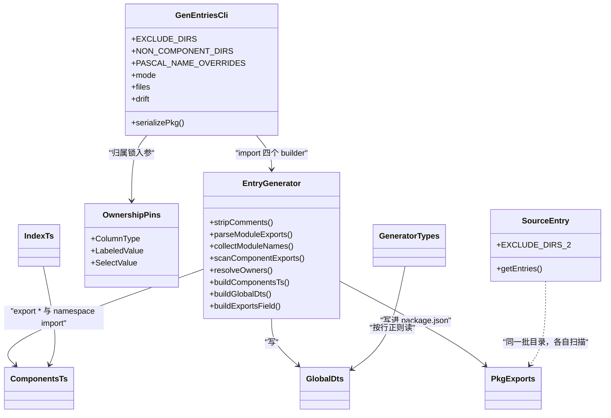
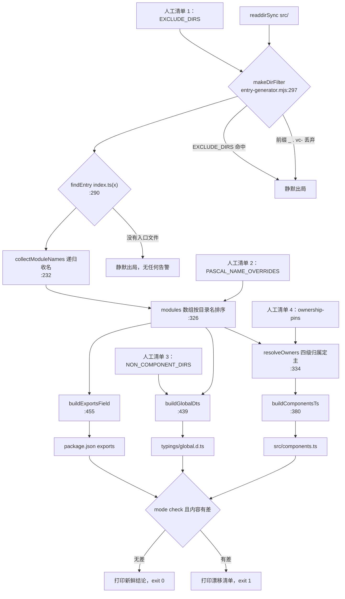
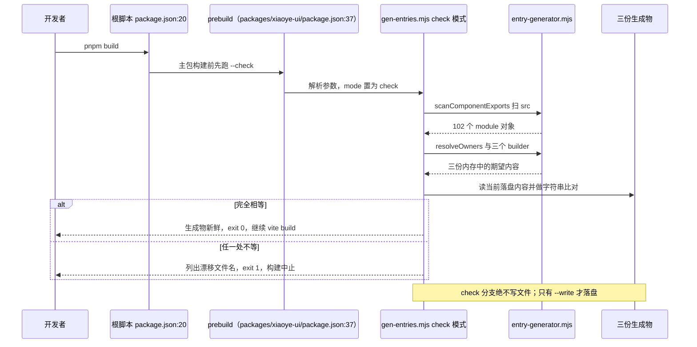

# A02 组件目录契约与 gen:entries 生成物链路

> **本篇解决**：`packages/xiaoye-ui` 的三份生成物各自按什么规则产出？「哪些目录算组件」这个判断到底写在哪几处、它们是否等价？两个组件目录暴露同名导出时谁赢、为什么赢、改一行源码写法会不会让公开 API 换主人？为什么 `check:entries` 全绿仍然不能说明生成物是对的？
> **前置**：A01 monorepo 拓扑与发布链路　**读者坐标**：`01-architecture` 第 2/8 篇
> **主题边界**：本篇只讲三个生成物与归属定主机制。包边界、构建顺序、发布期 manifest 换算归 [A01](./01-monorepo-topology-拓扑与发布链路.md)；Token 定义与派生归 [A03](./03-design-token-四层体系.md)；自动导入解析器与文档站消费面归 A08。

---

## 一、职责与边界

这条链路负责把「主库有哪些组件、每个组件对外叫什么名、有几种入口」从人的记忆变成三份可机器校验的文件，并把「同名导出谁赢」从偶然后果变成有规则的显式决定。它管四件事：

1. 目录准入判定（哪些 `src/<dir>` 算组件）；
2. 导出名静态收集（每个组件目录最终对外暴露哪些值名与类型名）；
3. 歧义名归属定主（冲突名挑一个 owner，其余目录让它让位）；
4. 三份生成物的产出与新鲜度校验（`--write` 落盘、`--check` 比对）。

明确**不负责**：

- 组件内部怎么写、props 与样式规范 → A06/A03
- 生成物在发布期如何被换算成 `dist` 路径 → A01 论点 3、论点 4（本篇只讲开发态形状）
- `xy-` 标签如何被 IDE / 自动导入解析器找到 → A08（本篇只指出它对本篇契约的依赖点）
- 自动导入清单里的 `from` 字符串与 `exports` 键是否对得上 → 已在 A01 论点 2 给出成因，本篇不重述

| 方向 | 对象 | 证据 |
| --- | --- | --- |
| 依赖（读） | `src/` 目录树与各组件入口文件的**文本** | `packages/xiaoye-ui/scripts/entry-generator.mjs:309` |
| 依赖（读） | `package.json` 的**原始字符串**（不是只读 `exports` 子树） | `packages/xiaoye-ui/scripts/gen-entries.mjs:92` |
| 依赖（人工清单） | 四份手写名单：目录排除、非组件、Pascal 覆写、归属锁 | `gen-entries.mjs:34-36`、`ownership-pins.mjs:10-18` |
| 产出（写） | `src/components.ts`、`typings/global.d.ts`、`package.json` 的 `exports` | `gen-entries.mjs:45-49`、`:101-104` |
| 被谁调 | 根脚本 `pnpm gen:entries` / `check:entries` 与主包 `prebuild` | `package.json:30-31`、`packages/xiaoye-ui/package.json:35-37` |
| 被谁读 | `src/index.ts` 的 barrel 与 `install`；一个用正则解析 `global.d.ts` 的遗留脚本 | `src/index.ts:4`、`scripts/generator-types/src/index.ts:31` |

一份重要前提：这条链路**不 import 任何 Vue 运行时代码**，也不执行 `src/` 里的任何模块。它全部靠文本解析得出结论，因此它对「什么是组件」的理解上限，就是它那套正则能看懂的语法形态（详见 §四 论点 3 与论点 9）。

---

## 二、源码地图

| 文件 | 行数 | 职责 | 关键导出 / 入口行 |
| --- | --- | --- | --- |
| `packages/xiaoye-ui/scripts/gen-entries.mjs` | 123 | CLI：参数解析、调三个 builder、比对与落盘 | `:38-44` 互斥判定、`:95-99` drift 判定 |
| `packages/xiaoye-ui/scripts/entry-generator.mjs` | 480 | 全部静态分析与生成逻辑 | `:306` 扫描、`:334` 归属、`:380/:439/:455` 三个 builder |
| `packages/xiaoye-ui/scripts/ownership-pins.mjs` | 18 | 归属锁：3 条已发布归属的钉版清单 | `:10-18` |
| `packages/xiaoye-ui/scripts/source-entry.mjs` | 78 | **另一个**扫描器，产出 vite 库模式构建入口 | `:21` `getEntries()` |
| `packages/xiaoye-ui/src/components.ts` | 413 | 生成物 1：组件聚合入口 | `:5` 首块、歧义消解块见文内（2026-10-02 移除批次后全文 413 行） |
| `packages/xiaoye-ui/typings/global.d.ts` | 105 | 生成物 2：Vue `GlobalComponents` 声明 | `:3` `declare module 'vue'`、`:5` 起 98 条声明 |
| `packages/xiaoye-ui/package.json` | 622 | 生成物 3 的宿主：`exports` 块 202 键 | `:96` 块起始、`:614` 块结束 |
| `packages/xiaoye-ui/src/index.ts` | 35 | 消费聚合入口并实现全量 `install` | `:4`、`:7`、`:11-17` |
| `packages/xiaoye-ui/tests/entry-generator.test.js` | 256 | 生成器的单元测试与真实 `src/` 快照断言 | `:181-193`、`:252-255` |
| `packages/xiaoye-ui/tests/index.test.js` | 74 | 运行时导出面断言（含 101 这个硬编码数，2026-10-02 随移除批次同步） | `:41-52`、`:57-73` |

行数与计数都是实测值，本篇用到时会重复给命令。**最值得记住的是三组算术**：

| 计数 | 值 | 推导（可复现） |
| --- | --- | --- |
| 进入聚合入口的目录 | 102 | `src/` 下非 `_`/`.`/`vc-` 目录 109 个（2026-10-02 移除 10 个组件目录后），减去 `EXCLUDE_DIRS` 里真实存在的 5 个、再减去没有 `index.ts(x)` 的 2 个 |
| `export * from` 行数 | 102 | 每个入选目录一行，`entry-generator.mjs:409` |
| `export { default as }` 行数 | 101 | 102 减 1 个无默认导出的目录（`table-core`），`:403-404` |
| style 副作用 import 行数 | 96 | 102 减 6 个没有 `style/index.ts(x)` 的目录，`:406` |
| `XYXxx` 声明条数 | 98 | 101 减 `NON_COMPONENT_DIRS` 的 3 个，`:447-448` |
| `exports` 键数 | 202 | 102 组件键 + 96 style 键 + `.` + `./package.json` + `./es/locale` + `./es/locale/*` |
| 歧义导出名数 | 11 | `resolveOwners` 返回的 map 大小，实测输出「11 个歧义导出名」 |

这七个数字互为约束，任何一个动了而其他没动，就说明有人在手工编辑生成物。

---

## 三、架构与数据流

### 3.1 模块关系：一个 CLI、四个纯函数、三份落盘、两份人工清单



读图要点有三条。第一，`GenEntriesCli` 是唯一持有「人工判断」的地方——三份名单（`:34`、`:35`、`:36`）全在 CLI 里，`EntryGenerator` 只接参数、不认识任何具体目录名；这个分层让生成器可被单测直接复用（`tests/entry-generator.test.js:4-11`），代价是名单与生成器分处两个文件，加组件时改哪一处不显眼。第二，虚线那条 `SourceEntry ..> PkgExports` 是本篇的第一个风险源：**构建入口与 `exports` 表由两个扫描器各自扫出来**，两个扫描器的目录过滤条件是逐字抄的两份（`source-entry.mjs:32` 与 `entry-generator.mjs:299`），排除名单也是两份（`source-entry.mjs:15` 与 `gen-entries.mjs:34`）。第三，`GeneratorTypes --> GlobalDts` 是唯一一个**按文本格式读生成物**的下游，本篇 §论点 11 单独讲。

### 3.2 一次生成的完整流水线，以及四个人工注入点



四个人工注入点是这条图的重点：**静态分析推不出来的东西，全部由这四处补**。`_shared`、`style`、`theme`、`locale`、`version`、`components`、`config` 这些目录在文件系统上与 `button`、`select` 毫无区别；`grid` 的默认导出是 `{ useBreakpoint }`（`src/grid/index.ts:11`），形态上和一个组件目录完全一致，只有人能判断它不是组件。`block-ui` 需要覆写成 `BlockUI`，因为 `toPascalCase` 的通用规则会给出 `BlockUi`（`entry-generator.mjs:282-288`）——`global.d.ts:13` 的 `XYBlockUI` 就是这条覆写生效的唯一可见证据。

### 3.3 `pnpm build` 里 `prebuild` 只做校验的时序



这条时序是 `AGENTS.md:626` 那条规定的实现：「`pnpm build` 的 `prebuild` 只做 `--check`：**不再静默改写 tracked 文件**」。实现方式不是加开关，而是 `mode` 变量决定走 `:101-110` 的写分支还是 `:112-118` 的比对分支，两条路径互斥。与 A01 论点 8 里 `nuxt-module` 的 `prebuild` 正好相反——那一个会就地改写 tracked 的 `package.json`。

---

## 四、核心机制精读

### 论点 1：「哪些目录算组件」是三条规则的叠加，而这套判断在仓库里有四份互不同步的副本

**断言**：目录准入完全由「名字前缀 + 手写名单 + 必须是目录」三条规则决定，没有任何一处代码去读组件本身的形态；而这条规则连同它的排除名单，在 `scripts/` 与 `tests/` 里被抄了四份，其中两组的名单内容不同。

```js
// packages/xiaoye-ui/scripts/entry-generator.mjs:290
export function findEntry(dirPath) {
  for (const entry of ['index.ts', 'index.tsx']) {
    if (existsSync(join(dirPath, entry))) return join(dirPath, entry);
  }
  return null;
}

export function makeDirFilter(srcRoot, excludeDirs) {
  return name => {
    if (name.startsWith('_') || name.startsWith('.') || name.startsWith('vc-')) return false;
    if (excludeDirs.includes(name)) return false;
    return statSync(join(srcRoot, name)).isDirectory();
  };
}

/** 扫描所有组件目录的导出面 */
export function scanComponentExports(srcRoot, excludeDirs, pascalOverrides = {}) {
  const root = resolve(srcRoot);
  const modules = [];
  for (const name of readdirSync(root).filter(makeDirFilter(root, excludeDirs))) {
    const dirPath = join(root, name);
    const entry = findEntry(dirPath);
    if (!entry) continue;
```

逐段看。第 299 行的前缀判断是**唯一带语义的规则**：`_` 是内部实现、`.` 是隐藏文件、`vc-` 是底层实现层（vendor，本库的底层控件封装目录，深读归 I03/I05 等）。这三类不进任何生成物，也就决定了「`vc-table` 有完整 `index.tsx` 却不会出现在包根导出面」这一事实。第 300 行的 `excludeDirs.includes(name)` 是纯字符串比较，**不校验名单里的名字是否真的存在**——所以 `EXCLUDE_DIRS` 里的 `'components'` 是一次空转（`src/components` 不是目录，只有 `src/components.ts` 这个文件，它在第 301 行被 `isDirectory()` 挡掉），`'_shared'` 也是空转（它在第 299 行就因前缀被拒）。7 条名单里真正起作用的只有 5 条：`style`、`theme`、`locale`、`version`、`config`。

第 301 行 `statSync` 的写法决定了一个不可恢复的顺序依赖：**名单检查在前、`statSync` 在后**。这意味着往名单里塞一个不存在的名字永远不会报错，而一旦某天某个真实目录被改名而名单没跟上，它立刻变成一个「新组件」。`version` 就是这种脆弱性的活标本：`src/` 根下同时存在文件 `src/version.ts`（`:1` 是 `export default '6.1.3';`）与目录 `src/version/`（带 `index.ts`）。`index.ts:5` 写 `from './version'` 拿到的是文件，`theme/internal.ts:4` 写 `from '../version'` 拿到的也是文件；目录里那份 `src/version/version.ts:1` 停在 `'4.2.6'`，全靠 `EXCLUDE_DIRS` 含 `'version'` 才不会作为组件进入三个生成物。版本真源分裂这件事本身已在 A01 论点 5 写过，本篇只登记「`EXCLUDE_DIRS` 里那条 `'version'` 是有真实目录兜着的」。

四份副本的对应关系如下（第 4 份在测试里，容易被完全忽略）：

| 副本 | 位置 | 目录过滤条件 | 排除名单内容 |
| --- | --- | --- | --- |
| 生成器 | `entry-generator.mjs:299-301` | 前缀 + 名单 + 必须是目录 | `_shared`/`style`/`theme`/`locale`/`version`/`components`/`config`（`gen-entries.mjs:34`） |
| 构建入口扫描器 | `source-entry.mjs:32-34` | 与生成器**逐字相同**的三条件 | `_util`/`style`/`theme`/`version`/`locale`/`config`（`source-entry.mjs:15`） |
| 生成器单测 | `tests/entry-generator.test.js:15` | 不复制谓词，只复制名单 | 与生成器同一份内容，**手写第二遍** |
| 运行时导出面测试 | `tests/index.test.js:32` | 只判前缀 `_` 与 `vc-`，**漏掉 `.` 与「必须是目录」** | 少 `_shared`、少 `components` |

两组名单看似不同，实际差集全是空转项：`_util` 与 `_shared` 被前缀规则先挡住，`components` 被 `isDirectory()` 挡住。也就是说**今天两个扫描器得到的目录集合完全相同（各 102 个）**，`source-entry.mjs` 产出 102 个目录入口 + 96 个 style 入口 + 67 个 locale 入口 + 1 个根入口 = 266 个构建入口，与 `exports` 的 202 键在组件集合上对齐。这个对齐目前是靠「两组名单的差异恰好都是无效项」维持的，而不是靠任何机制校验——把 `_util` 从 `source-entry.mjs:15` 删掉不会有任何变化，把 `config` 删掉则会让 `dist/` 多出 `config.mjs` 而 `exports` 仍无 `./config` 键（实测 `'./config' in exports` 为 `false`），构建产物与公开入口表当场错位。

### 论点 2：准入的第二道门是「有没有 `index.ts(x)`」，缺入口的目录静默消失，`--check` 依然是绿的

**断言**：`scanComponentExports` 在通过全部过滤之后还会因为 `findEntry` 返回 `null` 而 `continue`，这条路径**不打任何日志**；而 `findEntry` 只认 `index.ts` / `index.tsx` 两个名字，`index.js` 与 `index.d.ts` 都不算入口。今天有两个目录正走在这条静默路径上。

```js
// packages/xiaoye-ui/scripts/source-entry.mjs:31
  // 组件入口
  const dirs = readdirSync(srcDir).filter(name => {
    if (name.startsWith('_') || name.startsWith('.') || name.startsWith('vc-')) return false;
    if (EXCLUDE_DIRS.includes(name)) return false;
    return statSync(resolve(srcDir, name)).isDirectory();
  });

  for (const dir of dirs) {
    // 主入口 index.ts / index.tsx
    for (const entry of ['index.ts', 'index.tsx']) {
      const entryPath = resolve(srcDir, dir, entry);
      if (existsSync(entryPath)) {
        entries[dir] = entryPath;
        break;
      }
    }

    // style 入口
    for (const entry of ['index.ts', 'index.tsx']) {
      const stylePath = resolve(srcDir, dir, 'style', entry);
      if (existsSync(stylePath)) {
        entries[`${dir}/style`] = stylePath;
        break;
      }
    }
  }
```

实测 `src/` 下非 `_`、非 `vc-` 的一级目录共 109 个（2026-10-02 移除批次前为 119），109 − 5（名单里真实存在的目录）− 2（没有入口文件）= 102，与 `--check` 输出的「102 个组件」严格吻合。被静默丢掉的 2 个是：

- `src/resolvers/`：五个校验适配层子目录加一个 `index.d.ts`。`resolvers/index.d.ts:4` 起是 `export interface ResolverOptions {`，**类型是有的，但没有 `.ts`/`.tsx` 实现入口**，于是 `findEntry` 返回 `null`。这个结果是「对」的（适配层不是组件，深讲归 I12），但它是**碰巧对**——判定依据是文件扩展名而不是语义。
- `src/utils/`：只有一个 `forms.ts`，同样无入口。

这条静默路径有两个实际后果。第一，新建组件时如果入口写成 `index.js`（本仓库确实存在这种形态：`src/vc-slick/index.js` 是一个真实的 `index.js` 入口），`pnpm gen:entries` 会正常退出、打印「生成物新鲜」，而新组件在三份生成物里**一个字都没有**；`pnpm typecheck` 也发现不了，因为根本没有任何地方引用它。第二，构建侧的 `source-entry.mjs:39` 用的是同一对扩展名候选，所以 `dist/` 里也不会有对应产物——也就是说「静默消失」在两个扫描器里是同步的，这反倒让它更难被发现：没有任何一处会出现「有产物没导出」或「有导出没产物」的信号。唯一能兜住它的是 `tests/index.test.js:33` 那次独立的 `readdirSync` 扫描——但它同样只认 `index.ts(x)`（`:38`），因此也会漏掉同一个目录，两边一致地错。

### 论点 3：`hasDefault` 只读入口文件那一层文本，不跟 re-export 链，因此 `export { default } from` 会同时打掉两处生成物

**断言**：解析器对 `export default` 只置一个布尔位，且这个布尔位在收集阶段是**对入口文件单独重算一次**的；跨文件的默认导出转发（`export { default } from './X'`）会被解析成一个普通具名导出 `default`，既不会置位 `hasDefault`，也不会被 `resolveOwners` 视为冲突项——直到某天两个组件目录都用这种写法，包根就会出现一条语义错误的 `export { default } from` 语句。

```ts
// packages/xiaoye-ui/scripts/entry-generator.mjs:153
  const stmtRe = /^[ \t]*export\s/gm;
  let m;
  while ((m = stmtRe.exec(src))) {
    const after = m.index + m[0].length;
    const rest = src.slice(after);

    if (/^default\b/.test(rest)) {
      hasDefault = true;
      continue;
    }

    const starMatch = /^\*(?:\s+as\s+([A-Za-z_$][\w$]*))?\s*(?:from\s*)?['"]([^'"]+)['"]/.exec(
      rest,
    );
    if (starMatch) {
      if (starMatch[1]) values.add(starMatch[1]);
      else starFrom.push({ spec: starMatch[2], only: null });
      continue;
    }
```

第 153 行的语句锚是 `^[ \t]*export\s`，即**只有出现在行首的 `export` 才算一条导出语句**。这是整个解析器最重要的一条约束，也是 §论点 9 里那个手写道处理字符串与注释的词法器存在的全部理由——它必须保证「行首」这个判断不被注释与字符串里的 `export` 字样污染。第 159 行的 `default` 分支只置布尔位、不记名字，`continue` 掉了；第 167-171 行处理 `export *`：带 `as ns` 的整表命名空间导出被当成**一个值名**塞进 `values`（第 168 行），只有裸 `export * from` 才进入 `starFrom` 供递归跟踪（第 169 行）。

真正把 `hasDefault` 钉死在入口文件的是第 277 行：

```ts
// packages/xiaoye-ui/scripts/entry-generator.mjs:273
  return {
    values: [...result.values].sort(),
    types: [...result.types].sort(),
    own: [...own].sort(),
    hasDefault: parseModuleExports(readFileSync(entryFile, 'utf-8')).hasDefault,
    unparsed,
  };
```

**同一个入口文件在这里被读了第二次、解析了第二次**（第一次在 `visit` 里，`:249`），而且第二次的结果不参与 `values`/`types` 的递归聚合。这不是笔误而是语义选择——但它带来一个盲区：`date-picker/index.tsx:2` 用 `export * from './dayjs'` 把真正的默认导出藏在下一层文件里，靠的是 `index.tsx:4` 自己又写了一遍 `export default DatePicker;`。把 `index.tsx:4` 这一行删掉，`date-picker` 的 `hasDefault` 立刻变假，`XYDatePicker`（当前在 `global.d.ts:31`）从 `global.d.ts` 消失、`export { default as DatePicker }` 从 `components.ts` 消失。

这个盲区今天并非纯理论。仓库里已经有一处真实写法踩在上面：`src/vc-pagination/index.ts:2` 是 `export { default } from './Pagination';`。它现在无害，因为 `vc-` 前缀在 `:299` 就被拒了。而 `parseSpecifierList` 的标识符校验用的 `IDENT_RE`（`:16`，`/^[A-Za-z_$][\w$]*$/`）**会把 `default` 当成一个合法名字放行**——`default` 五个字符全部命中该正则。所以只要有一个顶层组件目录改用这种入口写法，`default` 就会作为普通值名进入 `resolveOwners` 的候选表（`:336-341`）；两个组件同时这么做时，`buildComponentsTs` 会在歧义消解块里生成一条 `export { default } from './xxx';`（生成语句在 `:421-425`）——按 ES 模块「本地显式导出优先于 star」的同一规则（也正是 `:417` 那句注释依赖的规则），`src/index.ts:7` 的 `export * from './components'` 会把这个 `default` 让给 `:32-35` 那份本地 `export default { version, install }`，于是包根默认导出仍然是库对象、不会报错，**但这条生成语句本身就是无意义的噪声**，且单组件的默认导出从包根彻底不可达。而**这条路径今天没有任何测试覆盖**：`tests/entry-generator.test.js` 的用例集（`:38-256`）里没有任何一条把 `export { default } from` 作为输入。

### 论点 4：归属定主是一条四级优先链，第二级依赖「就地声明 vs 转发」的语法形态，因此改一行写法就能改变公开 API 的归属

**断言**：`resolveOwners` 的选主顺序是「归属锁 → 目录名正是该名的 PascalCase → 只有一个候选目录就地声明了它 → 目录名字典序」，而第二级与第三级读的都是**文本形态**而非语义：`import` 后再裸 `export { T }` 会被算作「就地声明」，`export { T } from './x'` 会被算作「转发」。两者写法的差别足以让 owner 换人。

```ts
// packages/xiaoye-ui/scripts/entry-generator.mjs:345
  for (const [name, mods] of candidates) {
    if (mods.length < 2) {
      if (pins[name]) stalePins.push(`${name}: pin 指向 ./${pins[name]}，但该名已不再冲突`);
      continue;
    }
    const dirs = mods.map(mod => mod.name).sort();
    const pinned = pins[name];
    let pool;
    if (pinned) {
      if (!dirs.includes(pinned)) {
        stalePins.push(
          `${name}: pin 指向 ./${pinned}，但它并未参与冲突（冲突方：${dirs.join(', ')}）`,
        );
        pool = null;
      } else {
        pool = [pinned];
      }
    }
    if (!pool) {
      const canonical = dirs.filter(dir => toPascalCase(dir) === name);
      const declaredHere = dirs.filter(dir => mods.find(mod => mod.name === dir).own.has(name));
      pool = canonical.length ? canonical : declaredHere.length === 1 ? declaredHere : dirs;
    }
    const [owner] = pool;
    owners.set(name, {
      owner,
      losers: dirs.filter(dir => dir !== owner),
      kind: mods.find(mod => mod.name === owner).values.includes(name) ? 'value' : 'type',
    });
  }
```

关键行是 364-366。`canonical`（364）只在「目录名转 PascalCase 后正好等于冲突名」时命中，今天 11 个冲突名里**一条都没命中**（`back-top` 的 Pascal 是 `BackTop`，不是 `BackTopProps`）。真正起作用的是 365 的 `declaredHere` 与 366 末尾的 `dirs` 字典序兜底。而 `own` 集合的来源在 `:256-258`：只把「在**本组件目录内**就地声明」的名字放进去，是否「就地声明」由 `parseModuleExports` 的第 186 行判定——`if (!fromMatch) declared.add(spec.name);`，即**具名导出列表后面没有 `from` 才算声明**。

这条规则的后果可以用 `ColProps` 与 `BackTopProps` 两个真实案例对照出来：

- `ColProps` 的冲突方是 `col` 与 `grid`。`src/col/index.ts:3` 是 `export type { ColProps, ColSize } from '../grid';`——**带 `from`**，算转发，`col` 的 `own` 里没有它；`grid` 一侧经 `grid/index.ts:7` 顺链到 `grid/Col`，在那儿是真正的声明，`own` 里有。于是 `declaredHere` 长度 1，owner 定为 `grid`，生成 `components.ts:410`。
- `BackTopProps` 的冲突方是 `back-top` 与 `float-button`。`src/back-top/index.ts:5` 带 `from`（转发给自己的 `backTopTypes`，顺链后仍是就地声明），而 `src/float-button/index.ts:17-24` 是一段**先 `import type`、再裸 `export type { ... }`** 的写法——按 186 行的规则，这算 float-button 就地声明。于是 `declaredHere` 长度 2，落到 366 的字典序兜底，owner 仍是 `back-top`。

差别就在这一行：`col/index.ts:3` 如果改成 `import type { ColProps } from '../grid';` 加一句裸 `export type { ColProps };`（即抄 `float-button` 的写法），`col` 立刻进入 `declaredHere`，长度变 2，字典序 `col` 小于 `grid`，**包根的 `ColProps` 换人**。而 `components.ts:410` 那一行只是把 `from './grid'` 改成 `from './col'`，diff 只有一行、`--check` 之后照样全绿、`typecheck` 也照样过（`col/index.ts:1` 转发的就是同一个对象）。这个可翻转性不是推测——`tests/entry-generator.test.js:138-144` 正是用「只有一个目录就地声明」构造了一个 `aaa`/`zzz` 用例来锁定第三级规则，`:132-136` 用 `aardvark`/`radio` 锁定了第一级；**没有任何一条测试锁住「转发写法变更不应改变归属」**，因为它本来就不是可锁定的性质。结论写死在这里：归属的稳定性来自「目录名」和「写法」两个弱信号，不来自语义。

### 论点 5：显式 re-export 取代了 `export *` 黑名单，换来 TS2308 不再复发，赔上的是包根同名导出的值面与类型面分裂

**断言**：`buildComponentsTs` 把冲突名集中成一段「显式 re-export 优先于 star」的尾块，按目录与按值/类型分桶一次写完；代价是类型面的定主（`export type`）在运行时会因擦除而失效，同一个名字在包根的类型和值可能来自两个不同目录。

```ts
// packages/xiaoye-ui/scripts/entry-generator.mjs:417
  if (owners.size) {
    const byDir = { type: new Map(), value: new Map() };
    for (const [name, { owner, kind }] of owners) {
      const bucket = byDir[kind];
      if (!bucket.has(owner)) bucket.set(owner, []);
      bucket.get(owner).push(name);
    }
    lines.push('// === 歧义导出消解：显式 re-export 优先于 `export *`，用于定名冲突归属 ===');
    for (const kind of ['type', 'value']) {
      for (const [dir, names] of [...byDir[kind]].sort((a, b) => a[0].localeCompare(b[0]))) {
        const list = [...names].sort().join(', ');
        lines.push(
          kind === 'type'
            ? `export type { ${list} } from './${dir}';`
            : `export { ${list} } from './${dir}';`,
        );
      }
    }
    lines.push('');
  }
```

第 412-415 行做了两件事：先按 `owner` 目录分桶，桶内再按 `kind` 分流，`kind` 在 372 行算出（owner 的 `values` 里有这个名字就是 `value`，否则 `type`）。分桶的效果是把同一目录的同一类名字**合并成一行**，所以 11 个歧义名最终只写了 7 行（`components.ts:407-413`）：`BackTopProps` / `BaseOptionType, DefaultOptionType` / `MenuItem` / `ColProps, ColSize, RowProps` / `ColumnType` / `LabeledValue, SelectValue` 六行类型加 `getInstance` 一行值。第 419 行按目录名再排一次序，所以尾块是稳定、可 diff 的。

现在看值面与类型面分裂的那个真实样本：`MenuItem`。owner 是 `context-menu`、`kind` 是 `type`（`context-menu/index.ts:6` 用的是 `export type {...}`），loser 是 `menu`。但 `menu/index.tsx:39-47` 那段裸 `export { ..., MenuItem, ... }` 导出的是**一个组件值**（来源是 `menu/index.tsx:4`）。于是生成物里 `components.ts:409` 的 `export type { MenuItem } from './context-menu';` 只锁定类型含义；到运行时它被整条擦除，两条 star 里只剩 `menu` 那侧提供 `MenuItem` 这个值。实测证据是包根导出面的快照：`tests/__snapshots__/index.test.js.snap:110` 有 `"MenuItem"` 这一项，而同批歧义名里所有纯类型名（`BackTopProps`、`BaseOptionType`、`ColProps`、`ColumnType`、`LabeledValue`、`SelectValue`）在快照中一条都搜不到。也就是说从包根拿 `MenuItem`，类型上得到 context-menu 的菜单项接口、运行时得到 menu 的组件对象——两半都不是对方。`menu` 那侧真正的安全用法是 `menu/index.tsx:25` 挂出来的 `Menu.Item` 与 `:41` 的别名 `Item`，这也是 `tests/index.test.js:57-73` 为什么专门断言 `SubMenu`/`MenuItemGroup`/`MenuDivider` 这类别名可用而不断言 `MenuItem`。

同一批数据里还有一组**含义完全不同**的冲突值得记住：`ColumnType`。`src/list/index.tsx:37` 是 `export type ColumnType = 'gutter' | 'column' | 'xs' | ...`（栅格断言联合），`src/table/index.tsx:16` 是 `export type { ColumnsType, ColumnType, ColumnGroupType } from './interface';`（表格列定义）。两边都是真声明，`declaredHere` 长度 2，字典序 `list` 小于 `table`——**没有归属锁的话包根的 `ColumnType` 会给 list**。这正是 `ownership-pins.mjs` 存在的唯一理由，见下一论点。

### 论点 6：归属锁是这条链路里唯一「人工否决自动结果」的入口，实测去掉它 11 个名字里有 3 个会换 owner

**断言**：`OWNERSHIP_PINS` 只有 3 条，且它的语义不是「规定归属」而是「冻结已发布的归属」；锁定的目录一旦退出冲突，`--check` 会把它当作错误强制删除。

```js
// packages/xiaoye-ui/scripts/ownership-pins.mjs:1
/**
 * 归属 pin：锁定「已经发布出去的」冲突名归属，避免生成器换 owner 后改变公开 API。
 *
 * 这里只登记 6.x 已经在发布的具体名字，新增组件之间产生的冲突由 entry-generator
 * 自动消解，不需要往这里加条目；pin 一旦失效（名字不再冲突或 owner 目录被删）会由
 * `gen-entries --check` 报错，防止清单腐烂。
 *
 * 今天从包根 `xiaoye-ui` 能拿到的这三个名字，其类型来自右侧目录：
 */
export const OWNERSHIP_PINS = {
  // list 里同名类型是响应式栅格断言联合（'gutter' | 'column' | 'xs' ...），
  // 但 6.x 发布的是表格列定义，且后者是使用者实际依赖的语义。
  ColumnType: 'table',
  // select 与 tree-select 各自声明了同名类型；LabeledValue 两处结构一致，
  // SelectValue 则 select 版多了 `| undefined`。为不改变已发布的类型形状，保持 tree-select。
  LabeledValue: 'tree-select',
  SelectValue: 'tree-select',
};
```

注释里那两句技术事实都能对上源码：`select/index.tsx:36` 与 `tree-select/index.tsx:52` 都写了 `export interface LabeledValue {`，结构一致（`key?`/`value`/`label?`）；而 `SelectValue` 上 `select/index.tsx:41` 的联合比 `tree-select/index.tsx:58` 多一个 `| undefined`。这两处若换 owner，包根类型形状会变，属于破坏性变更。

「去掉锁会怎样」是可实测的，不必推断。在同一次扫描上分别用两份 pin 跑 `resolveOwners`，结果是：`ColumnType` 有锁为 `table`、无锁为 `list`；`LabeledValue` 与 `SelectValue` 有锁为 `tree-select`、无锁为 `select`；其余 8 个名字有锁无锁完全一致。也就是说**锁只在这 3 个名字上真正承重**。反过来说，如果哪天有人「顺手」把 `MenuItem: 'menu'` 加进这份清单来修复 §论点 5 的类型/值分裂，它确实能生效（353-360 行的优先级最高），但这会把「只保留历史冻结项」这条约束破坏掉——而 `AGENTS.md` 已经明文写了「新增冲突不要加 pin」。失效路径在 347 行与 355-358 行：pin 指向的名字不再冲突、或 pin 指向的目录没参与冲突，都会进 `stalePins`；前者是「某组件删了这个类型」，后者是「pin 写错了目录名」。`tests/entry-generator.test.js:156-167` 覆盖到了「pin 指向不存在的目录时不能抛错，仍要能定主」这一支（`:163-166`），这是本篇范围内少见的、连错误路径都有测试的地方。

### 论点 7：`--check` 校验的是「生成物等于生成器的不动点」，不是「生成物等于意图」；而 drift 把整份 package.json 拖进了字符串比较

**断言**：check 模式唯一的判据是「内存中重新生成的字符串是否逐字等于磁盘上的字符串」，它无法发现生成器本身判断错了；而 `exports` 那一路的比较对象是**整份 manifest 的重新序列化结果**，所以任何格式差异都会被报成「package.json exports 漂移」。

```js
// packages/xiaoye-ui/scripts/gen-entries.mjs:83
function serializePkg(raw, nextExports) {
  const pkg = JSON.parse(raw);
  pkg.exports = nextExports;
  return `${JSON.stringify(pkg, null, 2)}\n`;
}

const current = {
  components: readIf(files.components),
  globalDts: readIf(files.globalDts),
  pkgRaw: readIf(files.pkg),
};
const pkgTs = current.pkgRaw ? serializePkg(current.pkgRaw, exportsField) : null;
const drift = [
  ['src/components.ts', current.components, componentsTs],
  ['typings/global.d.ts', current.globalDts, globalDts],
  ['package.json exports', current.pkgRaw, pkgTs],
].filter(([, before, after]) => after !== null && before !== after);
```

第 84-86 行是「parse 整份、只换 `exports`、再以 2 空格缩进重新序列化」。这带来两个方向的性质。

**好的方向**：`--write` 不会丢字段。第 84 行读的是当前文件而不是生成物，所以 `dependencies`、`publishConfig` 等内容全部保留；`JSON.stringify` 按插入顺序输出键，因此除 `exports` 子树外整份文件形状不变。实测当前文件恰好等于 `JSON.stringify(JSON.parse(raw), null, 2) + '\n'`（比较结果为 `true`，末三字符是换行加 `}` 再加换行），所以现在这一路是无损的。

**坏的方向**：正因为比较对象是整份字符串，**上面那个 `true` 成了前提条件而不是被保证的性质**。如果有人把 `package.json` 的缩进改成 4 空格、或者让编辑器写入 CRLF、或者手工调整两个顶层字段的先后顺序，第 86 行的输出仍会逐字回到 2 空格加尾换行的规范形，第 98 行的 `before !== after` 立刻成立，而 `:114` 打印的清单只会写 `package.json exports` 这一行——**报错信息把一个纯格式问题指成了 exports 内容问题**。定位办法很短：把 `exports` 单独 parse 出来对比内容是否真变（本篇 §附 检查点 1 给了命令）。同一段里还有一个更隐蔽的不对称：第 99 行的过滤器用 `after !== null` 跳过「文件不存在」的项，而第 101-104 行的写分支**没有这个守卫**，三个 `writeFileSync` 无条件执行；若 `package.json` 缺失，第 94 行给出 `pkgTs = null`，check 分支安静地跳过它，write 分支会把 `null` 当数据交给 `writeFileSync`。今天这个分支不可达（manifest 必然存在），但它说明两个模式不是同一套逻辑的两个出口。

至于「不动点不等于正确」，本篇前面已经给了三个实例：`src/resolvers` 与 `src/utils` 因为扩展名而消失（论点 2），`ColProps` 的归属取决于 `col/index.ts:3` 那一行用不用 `from`（论点 4），`table-core` 因为「入口文件没有 `export default`」而丢掉 `XYTableCore` 声明（论点 8）。这三种情况下 `--check` 都会打印「生成物新鲜」并 `exit 0`。真正能证伪生成器结论的只有 `tests/` 里那几条硬编码断言——`entry-generator.test.js:182` 钉住 112、`:192` 钉住「唯一无默认导出的目录是 `table-core`」、`index.test.js:52` 钉住 111。这三行是本篇范围内**唯一能发现「某组件悄悄掉出去了」的机器**，代价是把数字写死了：新增组件时必须同时改这三处，而 `AGENTS.md` 的提交清单里没有提到这一点。

### 论点 8：三个生成物各有独立的过滤条件，因此「组件集合」有三个互不相等的版本

**断言**：`components.ts`、`global.d.ts`、`exports` 三份生成物在「谁有资格进来」上用了三组不同的条件，加上第四个由人工维护的文档站页面集合，四个集合两两不等；两个「108」是巧合而不是同一定义。

```ts
// packages/xiaoye-ui/scripts/entry-generator.mjs:446
/** 生成 typings/global.d.ts */
export function buildGlobalDts(modules, nonComponentDirs) {
  const lines = [
    '/* eslint-disable @typescript-eslint/consistent-type-imports */',
    '// Auto-Generated by scripts/gen-entries.mjs - DO NOT EDIT',
    "declare module 'vue' {",
    '  export interface GlobalComponents {',
  ];
  for (const mod of modules) {
    if (!mod.hasDefault || nonComponentDirs.includes(mod.name)) continue;
    lines.push(`    XY${mod.pascalName}: (typeof import('xiaoye-ui'))['${mod.pascalName}'];`);
  }
  lines.push('  }', '}', 'export {};');
  return `${lines.join('\n')}\n`;
}
```

第 448 行的双条件是 `global.d.ts` 独有的收窄：`hasDefault`（入口文件有默认导出）**并且**目录名不在 `NON_COMPONENT_DIRS`。后者只有三项——`grid`、`message`、`notification`（`gen-entries.mjs:35`），CLI 头部注释（`:33`）交代了为什么必须由人写：「静态分析无法区分『默认导出是组件』还是『默认导出是工具对象』」。`grid/index.ts:11` 的 `export default { useBreakpoint };` 就是那个反例——它确实是个默认导出，但它是工具对象。`message`/`notification` 则是因为它们的默认导出是命令式 API 而非可写进模板的组件，可它们仍然各占一个 `exports` 键与一行 `export { default as }`（`components.ts:230-232`、`:242-244`）。

把四个集合摊开：

| 集合 | 基数 | 判定条件 | 有而别人无的成员 |
| --- | --- | --- | --- |
| `components.ts` 聚合 | 112 | 目录准入 + 有 `index.ts(x)` | `col`、`row`、`locale-provider`、`table-core` |
| `exports` 组件键 | 112 | 同上，与上一行是同一个数组 | 无（`:326` 排序后两处复用） |
| `global.d.ts` 声明 | 108 | 再加 `hasDefault` 且不在 `NON_COMPONENT_DIRS` | `col`、`row`、`locale-provider` |
| `apps/docs/components/*.md` | 108 | 人工写文档 | `grid`、`message`、`notification` |

第四行是纯人工的，`AGENTS.md` 只规定「新增组件必须补文档」而没有机制校验。把第三、四行对比出来，两个 108 的**对称差是 6 个**：`XYCol`（`global.d.ts:23`）、`XYRow`（`:80`）、`XYLocaleProvider`（`:56`）三条类型声明没有对应文档页；反过来 `grid.md`、`message.md`、`notification.md` 三个文档页没有对应标签声明。第一行里的 `table-core` 则四面楚歌：`src/table-core/index.ts` 从第 8 行起全是具名导出、没有默认导出，于是它进了聚合入口（`components.ts:374` 只有一行 `export *`，既无 default 行也无 style 行），却进不了 `global.d.ts`，也没有 `./table-core/style` 键。

后果要写清：`<xy-col>` 与 `<xy-row>` 是**有 `GlobalComponents` 类型、IDE 会补全、但文档只以 `grid.md` 的示例形式存在**的标签（该页正文只出现过一次 `<xy-col` 字面量，示例文件在 `apps/docs/examples/grid/` 下）；而 `<xy-grid>` **不是组件**——`xiaoye-ui/grid` 这个子路径能 import（`package.json` 的 `exports` 里有这个键），但拿到的默认导出是 `{ useBreakpoint }`，把它当组件用会在渲染期报错。这类「名字对得上、含义对不上」的错位是接手这块代码的人最容易踩空的地方，而且它不会被任何构建期检查发现（§七 坑 3）。

### 论点 9：为了让「字符串里的 export」不被当成导出语句，这里手写了一个词法器；它的正确性直接决定归属判定的输入

**断言**：`parseModuleExports` 的正则全部建立在「行首」之上，而 JS/TS 源码里行首位置最容易被注释和字符串污染，所以 `:19-103` 有一个 85 行的手写扫描器专门处理行注释、块注释、三种引号、模板字符串的 `${}` 嵌套与正则字面量；它不是整洁性问题，是必需件。

```ts
// packages/xiaoye-ui/scripts/entry-generator.mjs:19
export function stripComments(code) {
  let out = '';
  let i = 0;
  const n = code.length;
  const isRegexStart = () => {
    const tail = out.replace(/\s+$/, '');
    if (!tail) return true;
    if ('(,=:[!&|?{};+-*%<>~^'.includes(tail[tail.length - 1])) return true;
    return /(return|typeof|case|in|of|do|else|void|delete|instanceof|yield|await)$/.test(tail);
  };

  while (i < n) {
    const c = code[i];
    const next = code[i + 1];

    if (c === '/' && next === '/') {
      i += 2;
      while (i < n && code[i] !== '\n') i += 1;
      continue;
    }
    if (c === '/' && next === '*') {
      i += 2;
      while (i < n && !(code[i] === '*' && code[i + 1] === '/')) i += 1;
      i += 2;
      continue;
    }
```

`isRegexStart`（23-28 行）是这段里最难写对的部分：看到一个 `/` 时，要判断它是「除号」还是「正则字面量开头」。第 26 行用「前一个非空白字符是否在运算符集合里」来判，第 27 行再用关键字后缀兜底。这套启发式的失败模式是**双向**的：把除法误判成正则，会从那个 `/` 一路吞到下一个 `/` 或行尾（78-98 行），中间的真实 `export` 语句就消失了；把正则误判成除法，则正则字面量里若含 `export` 字样会被当成导出名。测试选了后一种风险的反向用例来锁：`tests/entry-generator.test.js:53-58` 断言带转义斜杠的正则不会被当成注释、并且 `unparsed` 为空。而 `:39-51` 锁的是注释与字符串——URL 里的那个 `export` 不能成为语句。

三个值得记下的实现细节。第一，第 24 行每次遇到 `/` 都对**整个已输出缓冲**做一次 `replace` 去尾空白，这是每个斜杠一次全串扫描；一条 `--check` 实测耗时约 96 毫秒（在 `packages/xiaoye-ui` 目录、Node 24 上），因为被解析的是「每个组件入口加上它的相对路径 re-export 闭包」，量级还撑得住——真要加几十个组件时这里会先变慢。第二，模板字符串插值（60-68 行）用 `{`/`}` 计数来配对，**不跟踪插值表达式内部的字符串**，所以形如 `${a["}"]}` 的写法会把它带偏；今天入口闭包里没有这种写法，属理论缺陷。第三，块注释扫描（41 行）在遇到不闭合的 `/*` 时会一路走到文件末尾再 `i += 2`，结果是**该文件剩余内容全部被丢弃**——一个组件入口文件如果写了没闭合的块注释，它会「有入口、零导出」地进入生成物：`export *` 行照写、`export { default as }` 行不写（`hasDefault` 也读不出来）、`values`/`types` 全空，而 `tests/entry-generator.test.js:199-201` 恰好断言「只有 `icon` 这一个目录没有任何具名导出」，这条断言会失败——这是本篇范围内少见的、由测试而非生成器自身提供的保护。

### 论点 10：告警与失败被分成三种等级，其中两种只在 stderr 留痕；`--write` 与 `--check` 同时给会直接退出

**断言**：CLI 对四类问题给了四种不同反应——未识别导出只 `warn` 且只打印前 10 条、默认导出名冲突只 `warn`、失效归属锁在 check 模式 `exit 1` 而在 write 模式只 `warn`、内容漂移才是唯一稳定的 `exit 1`。这意味着**同一份源码，用 `pnpm gen:entries` 生成再提交，与用 `pnpm check:entries` 校验，可能一个放行一个报错**。

```js
// packages/xiaoye-ui/scripts/gen-entries.mjs:62
const unparsed = modules.flatMap(mod => mod.unparsed);
if (unparsed.length) {
  console.warn(`[gen-entries] ${unparsed.length} 条导出语句未被识别（可能漏掉导出名）：`);
  for (const text of unparsed.slice(0, 10)) console.warn(`  - ${text}`);
}
if (droppedDefaults.length) {
  console.warn(`[gen-entries] 默认导出名冲突，已跳过：\n  - ${droppedDefaults.join('\n  - ')}`);
}
if (stalePins.length) {
  const message = `[gen-entries] scripts/ownership-pins.mjs 中的 pin 已失效，请删除：\n  - ${stalePins.join('\n  - ')}`;
  if (mode === 'check') {
    console.error(message);
    process.exit(1);
  }
  console.warn(message);
}
```

第 65 行的 `slice(0, 10)` 是一个**静默上限**：如果未识别语句超过 10 条，第 64 行报出的总数是对的，但清单只有前 10 条，剩下的没有指路信息。今天这个分支不进（实测 `unparsed` 长度为 0，`tests/entry-generator.test.js:211` 也断言它为 `[]`），所以「未识别导出被截断」看不见；但它一旦触发，就意味着有导出名漏进生成物，而**整个流程不会失败**，`--check` 下一轮还会因为「生成物等于生成器输出」而全绿。`droppedDefaults`（67-69 行）同理，而且它的触发条件更硬：`buildComponentsTs:393-400` 在两个目录的 PascalCase 名相同时只保留先扫到的那个、把后者推进 `droppedDefaults`——`tests/entry-generator.test.js:183-189` 用 `foo-bar` 与 `fooBar` 构造了这个用例并断言只生成 1 条 default 行。今天 102 个目录里恰好 101 条 default 行（差额就是 `table-core` 无默认导出），说明**没有任何默认导出名被丢弃**，但这个「恰好」是巧合，不是不变式。

失效归属锁的模式依赖（70-77 行）最值得警惕：check 模式 `exit 1` 阻断构建，write 模式只 `warn` 后继续落盘。**这条 2026-09-30 实测过 check 那一半**（临时往清单里塞一个不存在的名字，`pnpm check:entries` 打印两行后以退出码 1 结束；副本还原、复跑 `pnpm check:entries` 回到「生成物新鲜」）；write 那一半仍只有代码依据（`:76` 的 `console.warn` 之后没有 `exit`），因为跑它要真的改写三个 tracked 文件，本轮不动。另一处实测收获是 owner 会跟着失效 pin 漂移：`resolveOwners(mods, { Shared: 'nonexistent' })` 不抛错，直接把 `Shared` 判给字典序最小的 `aaa`（`:358` 把 `pool` 置 null 后走自动规则），所以「pin 写错」在 write 模式下不是失败而是**静默换 owner**——这条原先只写在坑 7，现在有了 `tests/entry-generator.test.js:163-166` 的断言钉着。设想某人删了 `tree-select` 里的 `LabeledValue`（冲突消失），然后顺手跑了 `pnpm gen:entries`——他看到一条警告、生成物写盘、提交、CI 里 `prebuild` 用的是 `--check`，此时才炸。**顺序不同，发现成本差一个提交**。互斥判定在 `:38-43`：两个 flag 都给时 `console.error` 加 `process.exit(2)`（实测退出码就是 2），用 2 而不是 1，正好与 `prebuild` 期望的失败码区分开。另外 `:52-55` 的「未扫描到任何组件目录」是唯一的 `exit 1` 前置守卫——它只在 `modules.length === 0` 时触发，所以「扫到 111 个」这种少了一个的情况它管不了。

### 论点 11：`global.d.ts` 的文本行形状本身是一个下游契约，而另一个下游（运行时全量注册）读的是本篇完全不管的东西

**断言**：`buildGlobalDts` 产出的每一行都是某段正则的输入；同时，标签能不能在运行时被解析出来并不由 `global.d.ts` 决定，而由组件自己有没有挂上 `install` 决定——挂 `install` 的写法有三种，**用一条 grep 数不准**。

```ts
// packages/xiaoye-ui/scripts/generator-types/src/index.ts:29
function readTypings(options: Options): Map<String, VueTag> {
  const tags = new Map<String, VueTag>();
  const fileContent = readFileSync(options.typingsPath, 'utf-8');
  fileContent
    .split('\n')
    .filter(line => line && line.includes('typeof'))
    .map(line => {
      const l = line.trim();
      return toKebabCase(l.substring(0, l.indexOf(':')));
    })
    .forEach(tagName =>
      tags.set(tagName, {
        name: tagName,
        slots: [],
        events: [],
        attributes: [],
      }),
    );
  return tags;
}
```

`typingsPath` 指向的正是生成物本身（`scripts/generator-types/index.js:10`）。第 34 行用 `includes('typeof')` 挑出「是组件声明」的行，第 37 行取**该行第一个冒号之前**的文本做 kebab 化当作标签名。这两步对格式的依赖非常具体：`entry-generator.mjs:456` 那行模板里 `typeof` 出现在冒号之前，所以只要模板还长这样，第 37 行截出来的就是 `XYAffix` 这种键名。反过来，任何一次「让声明更好看」的手工改动——把 `typeof` 挪到冒号之后、或改成不含 `typeof` 的写法——都会让这个脚本产出的**标签数变成 0**，而它不报错，只是空。而这个脚本今天根本跑不起来：`index.js:3` 要求 `./lib/index.js`，但 `scripts/generator-types/` 下只有 `README.md`、`index.js`、`src`、`tsconfig.json`（实测无 `lib/`），`packages/xiaoye-ui/package.json:33-42` 的 8 条脚本也没有任何一条指向它。它还把标签前缀写成单个字母加连字符的形态（`index.js:14`），与 `AGENTS.md` 的命名红线相反。所以本篇的结论是：**这是一个已经断掉、但格式契约仍然生效的下游**，属于 A03 论点 10 登记过的「为工具链预留、但本仓库没有工具链」那一类残留，这里只补 A02 侧的新证据，不重述该主题。

另一侧的运行时契约更要紧。`src/index.ts:11-17` 的全量注册是这样实现的：

```ts
// packages/xiaoye-ui/src/index.ts:16
export const install = function (app: App) {
  Object.keys(components).forEach(key => {
    const component = components[key];
    if (component.install) {
      app.use(component);
    }
  });
  app.use(cssinjs.StyleProvider);
```

`:4` 的 `import * as components from './components'` 拿到的是聚合入口的**全部**运行时导出，其中既有组件，也有 `getInstance`（`components.ts:413`）、`message`/`notification` 这类 API 对象、以及各组件的 props 工厂函数。`:14` 用 `if (component.install)` 做筛选——**有没有 `install` 完全由组件自己在源码里挂**，`registerComponent`（`_util/registerComponent.ts:16-27`）负责把 `XYXxx` 转成标签名并防重复注册（`:23` 用 `app.component(tagName)` 的读取来判断是否已注册）。也就是说：`global.d.ts` 保证**类型面**（模板里写 `<xy-xxx>` 能通过 `vue-tsc`），`install` 保证**运行时面**（标签真的能解析出来），两者由完全不同的机制维护，而本篇的生成器只看默认导出存不存在，**看不到 `install`**。

因此「全量注册到底覆盖多少个组件」不能用一条 grep 回答。我实测了三种形态，并且每一种都发现了漏判：

| 形态 | 典型位置 | 漏判样本 |
| --- | --- | --- |
| `withInstall(X)` 包裹默认导出 | `_util/type.ts:39-46`，用在 `col/index.ts:4` | 写成 `withInstall<泛型>(...)` 时 `grep "withInstall("` 匹配不到，`cascader/index.tsx:343` 正是这种 |
| 对象字面量里的 `install:` 属性 | `table/index.tsx:47`、`tree/index.tsx:35`、`steps/index.tsx:164` | 写成 `install(app: App) {` 方法简写时 `grep "install: "` 匹配不到（`upload/index.tsx:14`、`auto-complete/index.tsx:170`）；属性写在下层文件时也扫不到（`date-picker/dayjs.tsx:31`） |
| 事后赋值 `X.install = fn` | `menu/index.tsx:16`、`back-top/index.ts:8` | 赋值发生在被转发的下一层文件时，只扫入口会漏：`locale-provider/index.ts:5` 什么都没有，真正的 `install` 挂在 `locale/index.tsx:105` |

按「只扫各目录 `index.ts(x)`」这个最朴素的口径跑一遍，三种形态分别命中 26 / 7 / 71 个文件，去重后 103 个目录命中、11 个不命中（`auto-complete`、`calendar`、`cascader`、`date-picker`、`grid`、`locale-provider`、`message`、`notification`、`table-core`、`time-picker`、`upload`）。**上表已经证明这 11 个里至少有 4 个是假阴性**：`cascader`、`upload`、`auto-complete` 靠表中的漏判形态挂了 `install`，`locale-provider` 那份默认导出实际是 `locale/index.tsx:110` 被 `withInstall` 包过的组件。所以本篇只给方法论、不给数字：**要拿到准确集合，必须在运行时枚举 `Object.keys(components)` 并检查 `.install` 真值**，静态 grep 在这个仓库里不可靠。这条待核实项登记在 §七 坑 10。

---

## 五、对外契约如何生效

生成物对外的作用面有三条，彼此独立、失效方式也不同。

**第一条：包根的类型与值面。** 路径是 `src/<dir>/index.ts(x)` → `collectModuleNames`（`entry-generator.mjs:232`）收名 → `components.ts` 的 `export * from`（`:402`）与 `export { default as }`（`:404`）→ `src/index.ts:7` 的 `export * from './components'`。类型面上，歧义名由尾块的显式语句定主（`components.ts:407-412`）；值面上，`export { default as X }` 是把目录默认导出改名挂到包根，而 `hasDefault` 只来自入口文件那层文本（`:277`）。这条路径同时喂给 `tsconfig.json:8` 的 `paths` 映射（`"xiaoye-ui": ["./src/index.ts"]`），所以**本仓库内的类型检查走 alias、不走 `exports` 字段**——这是 A01 坑 3 里「本地能跑、发布后 404」的同一机制在类型面的投影。

**第二条：子路径入口面。** `buildExportsField`（`:455`）产出 222 个键，形状分三种：

| 键形态 | 数量 | 生成处 | 例 |
| --- | --- | --- | --- |
| 对象（`types` + `import`） | 115 | `:457-460`、`:462-465`、`:473-477` | `package.json:131-134` |
| 裸字符串 | 106 | `:466-469` | `package.json:135` |
| 通配 | 1 | `:477` | `package.json:610-613` |

注意 style 入口生成的是**裸字符串**（`exports[键] = './src/<name>/style/index.ts'`），而组件入口生成的是带 `types`/`import` 两个条件的对象——同一个 builder 里两种写法（`:462-469`）不是笔误，因为 style 没有类型可给。另有两条硬编码：`.` 与 `./package.json`（`:457-460`），以及一对 locale 特判——`locale` 被 `EXCLUDE_DIRS` 从组件里踢掉，却在 `:471-478` 被重新加回 `./es/locale` 与 `./es/locale/*` 两个键。这两半是同一条决策：**语言包不是组件，但必须能被子路径 import**。如果哪天 `src/locale/index.tsx` 改名，`findEntry` 返回 `null`，这两个键会**静默消失**，`--check` 会把它报成 exports 漂移——这是本篇少见的「格式变化能被 check 抓到」的例子，但报错信息不会告诉你是 locale 而不是组件。

**第三条：模板标签面。** `global.d.ts:5-102` 的 108 条 `XYXxx`。它的生效条件很苛刻，而且**今天两个条件都不成立**：其一，`packages/xiaoye-ui/tsconfig.json:15` 的 `include` 只有 `src/**/*` 与 `tests/**/*`，`typings/` 不在其中，所以 `pnpm --filter xiaoye-ui typecheck` 根本不把这个文件纳入程序（它是 `declare module 'vue'` 的增强，不被纳入就不生效）；其二，发布侧 `postbuild.mjs:118-132` 只把 `package.json`、`README.md`、`LICENSE` 复制进 `dist/`，而 `package.json:30-32` 的 `files` 与 `:105` 的 `publishConfig.directory` 都指向 `dist`，所以这份声明**不会随包发布**（实测已构建出的 `dist/` 里既无 `global.d.ts` 也无 `typings/` 目录）。跨方法复核的结论一致：全仓对 `GlobalComponents` 的引用只有生成物自己（`typings/global.d.ts:4`）与两处脚本里的字符串（`entry-generator.mjs:451`、`gen-entries.mjs:13`），没有任何 tsconfig 或 triple-slash 引用它。

这一条的准确表述是：`global.d.ts` 目前是**一份写给「手工把它加进 tsconfig 的人」准备的清单**，本仓库自己不享受它，发布出去的包也不带它。它仍然值得存在——`AGENTS.md:616` 把它列为三个生成物之一，`generator-types` 那段遗留代码按它的行格式解析（§论点 11）——但接手的人必须知道：**类型面与标签面之间的桥没有接上**。要接上，需要同时做两件事（把 `typings/**` 纳入消费方 tsconfig 的 `include`，以及把该文件随 `dist/` 发布或在 `publishConfig.types` 里给出入口），这两件事都不在本篇的机制范围内，也不属于 A01 已写完的发布链路，我把它登记为一条待办而不是本篇的结论。

运行时侧还有一条：`src/index.ts:11-17` 的全量注册只看 `.install` 真值，`:18-26` 额外挂 `$message`/`$notification`/`$info`/`$confirm` 等 7 个全局属性。`$message` 取的是 `components.message`，也就是 `message/index.tsx:252` 那个具名导出 `export const message = api`——注意它和 `export { default as Message }`（`components.ts:230-231`）是两个不同的名字、两份不同的值引用，生成器只管把两者都写进 `export *`，管不到谁该被挂到 `app.config.globalProperties` 上。

---

## 六、设计取舍

**为什么用静态文本扫描，而不是在构建时真的 `import` 一次包根、从运行时模块对象里读名字？**
静态扫描换来三件实实在在的东西：不执行任何组件代码，因此不触发模块级副作用（样式注入、DOM 访问），可以在没装依赖的环境跑；不需要 Vue 编译链，`.tsx`/`.vue` 都能当纯文本读；整条 `--check` 只要约 96 毫秒。代价是**语义上限被语法封顶**：`hasDefault` 分不清默认导出是组件还是工具对象（于是需要 `NON_COMPONENT_DIRS`）、`declaredHere` 分不清「先 import 再裸 export」和「就地声明」（于是归属可被一行写法翻转，§论点 4）、`findEntry` 只认两个扩展名（于是 `index.js`/`index.d.ts` 目录静默消失，§论点 2）。这三个代价全都是**静默**的，而运行时求值天然不会犯这三类错。这是一次明确的取舍：要构建期零执行与可 diff 的公开面清单，就把正确性押在语法形态上。

**为什么生成物进版本控制，而不是每次构建现场生成？**
`AGENTS.md:626` 说得很直白：「不再静默改写 tracked 文件」。进版本控制换来的是 **`package.json` 的 222 个键成了一份可审计的公开 API 清单**——评审一个 PR 时，`exports` 的 diff 就是 API 的 diff，歧义名定主的 7 行也是显式可读的。赔上的是必须再写一个 `--check` 才能防漂移，而 `--check` 只能证明「有人跑过生成器」，不能证明「生成器判对了」（§论点 7）。仓库里有一个反面参照：A01 论点 8 记录了 `nuxt-module` 的 `prebuild` 会就地改写 tracked 的 `package.json` 并把工作树弄脏；本包走的是相反方向，且方向是对的。

**为什么把 `export *` 黑名单换成「扫描冲突名 + 显式定主」？**
生成器头部注释（`entry-generator.mjs:7-11`）写明了动机：两个目录暴露同名导出会让 `export *` 触发 TS2308 并让 `typecheck` 失败，旧做法是维护一份手工黑名单把某些目录从聚合里排除。黑名单的代价是**每次加组件都可能撞名、每次撞名都要人决定排除谁**，而且被排除的目录会连带失去 `export *`（那才是真正的 API 损失）。新做法让 star 全部保留、只把冲突名钉一个 owner。换来的是「新增冲突零维护成本」，`tests/entry-generator.test.js:225-242` 断言了一批过去被拉黑、现在正常走 star 的目录名。赔上的是 §论点 5 那个类型/值分裂：定主语句按 `kind` 只写一种含义（`:372`），所以 `MenuItem` 在包根只剩 context-menu 的类型含义，运行时那个组件值仍从 `menu` 的 star 里出来。更根本的缺陷是**定主依据是弱信号**（目录名、字典序、`from` 关键字的存在与否），不是语义；`ownership-pins.mjs` 只能事后打补丁，且 `AGENTS.md:629` 明确禁止为新冲突加补丁——也就是说这套设计接受「新冲突的归属由字典序决定」这件事，把稳定性押在「名字别撞」上。

**为什么三个生成物用三套不同的准入条件，而不是共用一份组件清单？**
条件不同本身是有道理的：可达性（`export *`）、标签类型（`XYXxx`）、按需样式（`./<name>/style`）三件事确实各自需要不同的成员判定，而 style 的判定还必须是文件级的（有没有 `style/index.ts`）。真正的问题不在于条件不同，而在于**没有任何一处声明这四个集合（含文档站页面集合）应该相等、还是允许不等**。`global.d.ts` 有 `XYCol` 而文档没有 `col.md`；文档有 `grid.md` 而 `global.d.ts` 没有 `XYGrid`；`exports` 有 `./table-core` 而它连默认导出都没有。三种错位都自洽、都「不是 bug」，但也没一条被判定过对错，于是它们会长期存在。如果改成「四个集合必须相等，例外要写进一份带理由的清单」，这份清单反而更容易审。这是我认为当前设计里最弱的一环。

**为什么 `exports` 用逐条枚举，而不是 `./<name>` 通配？**
这是主包与图标包做了相反选择的地方，A01 §5.1 已经展开：图标包在发布态用 `./*` 通配，代价是产物文件名变成公开 API；主包用 222 条枚举，代价是漏一条就 404。本篇的视角补一句：**枚举这份清单能存在，本身就是生成器带来的收益**——只有机器生成的表才敢逐条写死，人手维护 222 条必然出错。所以这条选择不是风格偏好，而是「有生成器」这个前提允许的选择。

---

## 七、坑与改动指南

1. **新组件的入口写成 `index.js`，会三份生成物一个字都没有，而且所有检查全绿。**
   触发：新建 `src/foo/`，入口文件是 `index.js`（本仓库确有此形态，见 `src/vc-slick/index.js`）。
   症状：`pnpm gen:entries` 正常退出并打印「生成物新鲜」；`import { Foo } from 'xiaoye-ui'` 报无此导出；`<xy-foo>` 无类型；文档站能 import 但库消费方不行。
   原因：`findEntry` 只枚举 `index.ts`/`index.tsx`（`entry-generator.mjs:291`），返回 `null` 后在 `:312` 直接 `continue`，**这条路径没有任何日志**。
   定位：`entry-generator.mjs:290-295`、`:312`。自查命令：`node scripts/gen-entries.mjs --check` 输出里的组件数是否 +1。若没有，先确认扩展名。**该分支无测试保护**（`tests/` 下没有构造缺入口目录的用例）。

2. **把入口的 `export default X` 改成 `export { default } from './X'`，会同时删掉两处生成物内容。**
   触发：重构组件入口，习惯用转发写法。
   症状：`components.ts` 少一行 `export { default as X }`、`global.d.ts` 少一条 `XYXxx`；`--check` 会报 drift（因为生成物变了），但报错只列文件名，不说是哪个组件掉了。
   原因：`hasDefault` 由入口文件单独重算（`entry-generator.mjs:277`），不跟 re-export 链。
   定位：`entry-generator.mjs:159-161`、`:277`、`:403-404`、`:448`。安全写法：入口保留一行字面 `export default X;`（`date-picker/index.tsx:4` 就是为此存在）。

3. **一行转发写法的改动就能改变包根公开 API 的归属，且 `--check`、`typecheck` 全过。**
   触发：把 `col/index.ts:3` 的 `export type { ColProps, ColSize } from '../grid';` 拆成 `import type` + 裸 `export type`（例如为了统一风格照抄 `float-button/index.ts:17-24`）。
   症状：`components.ts:410` 的 `from './grid'` 变成 `from './col'`；包根 `ColProps` 换了一个来源目录；下游若依赖 `ColProps` 的某个 grid 特有成员，会在**他们的项目里**报错，而本仓库没有任何测试会变红。
   原因：`declaredHere` 判定只看具名导出后面有没有 `from`（`entry-generator.mjs:186`），一旦 `col` 也算就地声明，长度变 2，落到字典序（`:366`）。
   定位：`entry-generator.mjs:182-186`、`:364-366`。**这类翻转无测试保护**：`tests/entry-generator.test.js:138-144` 锁的是「只有一个就地声明」的正向用例，没有锁「增加一个声明不该改变语义」。改动评审时请把 `components.ts` 尾块（`:447-453`）的 diff 当作 API diff 看。

4. **手工格式化 `package.json`（编辑器/Prettier 改了缩进、换行符或顶层键顺序）会让 `prebuild` 失败，并把错误指成 `exports` 内容问题。**
   触发：编辑器把 manifest 重排，或有人把缩进从 2 空格改成 4。
   症状：`pnpm build` 在 `prebuild` 阶段中止，输出 `[gen-entries] 检测到生成物与源码不一致（drift）：` 加一行 `- package.json exports`。
   原因：`:98` 的比较是「整份文件的 `JSON.parse` 再 `JSON.stringify(..., null, 2) + '\n'`」对「原始字符串」，任何不可逆的格式差异都算漂移；`:114` 的标签是硬写的三条名字，不会区分格式与内容。
   定位：`gen-entries.mjs:83-99`、`:112-118`。判别命令见 §附 检查点 2。修法是把文件恢复成 2 空格 + 尾换行的规范形（当前仓库正是这个形状，实测可 round-trip）。

5. **`global.d.ts` 既不被本仓库的 tsconfig 纳入，也不随包发布。**
   触发：以为加了 `XYXxx` 就能让 `<xy-xxx>` 在模板里有类型。
   症状：`vue-tsc` 不报错也不补全；发布包里没有该文件。
   原因：`packages/xiaoye-ui/tsconfig.json:15` 的 `include` 只有 `src/**/*` 与 `tests/**/*`；`postbuild.mjs:118-132` 只复制 `package.json`/`README.md`/`LICENSE`，而 `package.json:30-32`、`:105` 把发布内容钉在 `dist`。
   定位：`tsconfig.json:15`、`scripts/postbuild.mjs:123-132`。这一条是**当前状态描述而非缺陷修复方案**，真要生效需要跨包改配置，不在本篇范围。

6. **忘记 `pnpm gen:entries` 就构建会被拦住，但这道闸不在 CI 上。**
   触发：新增/改名/删除组件目录后直接 `pnpm build`。
   症状：`prebuild` 报三行漂移清单并 `exit 1`（这是**期望行为**，`AGENTS.md:626`）。
   原因：`packages/xiaoye-ui/package.json:37`。
   定位：`gen-entries.mjs:112-118`。但 A01 论点 7 与论点 10 已经证明 CI 不跑 `build`、也不跑 `test:unit`，`.husky/pre-push` 只有 `pnpm lint`——所以**「忘了跑」在合入前不会被机器抓到**。本地兜底：`pnpm check:entries`（根 `package.json:31`）。

7. **往归属锁清单里加新条目，会在冲突消失时把构建钉死。**
   触发：为新的同名冲突加一条 `XxxProps: 'some-dir'`；后来某个组件删掉该类型，冲突变单方。
   症状：`--check` 打印「pin 已失效，请删除」并 `exit 1`（`gen-entries.mjs:70-75`），`build` 中止；而 `pnpm gen:entries` 只 `warn` 后照样写盘。**同一份代码，两种模式一个过一个失败。**
   原因：`entry-generator.mjs:346-348`（单方名字进 stalePins）与 `:353-358`（pin 目录未参与冲突）。**2026-09-30 补了第三条分支**：pin 的名字从所有组件里彻底消失时（比如连着 owner 目录一起被删），上面的循环按 `candidates` 迭代、根本不会访问它，于是 `stalePins` 恒空——这与 `ownership-pins.mjs:4-6` 的头注释承诺（「名字不再冲突**或 owner 目录被删**会由 `gen-entries --check` 报错，防止清单腐烂」）不符。现在 `:375-381` 在循环之后补了一遍 `Object.entries(pins)` 的反查，`resolveOwners` 里三条分支齐了；回归用例是 `tests/entry-generator.test.js:169-181`（含「现存 pin 不能被误伤」的对照），实测 `buildComponentsTs(modules, { Ghost: 'aaa' })` 从修前的 `stalePins: []` 变成一条「已不从任何组件导出」。CLI 端到端也跑过：把 `__GhostPinForProbe__: 'button'` 临时写进清单再跑 `pnpm check:entries`，输出就是那两行「pin 已失效，请删除」+ pnpm 报 `Command failed with exit code 1`（跑完立刻用副本还原，`git diff --stat` 对清单为 0 行）。
   定位：`ownership-pins.mjs:10-18` 的头部注释（`:4-6`）已经写了规则，`AGENTS.md:629` 重申「新增冲突不要加 pin」。

8. **6 个组件有子路径入口但没有 `./<name>/style` 键，按需样式链路在它们身上不存在。**
   触发：`import 'xiaoye-ui/icon/style'`、`.../time-picker/style`、`.../watermark/style`、`.../auto-complete/style`、`.../locale-provider/style`、`.../table-core/style`。
   症状：解析失败（`exports` 无此键且无 style 兜底通配，唯一的通配是 `./es/locale/*`）。
   原因：这 6 个目录**根本没有 `style/` 子目录**（实测），`hasStyle` 为假，`:406` 与 `:466-469` 两处同时跳过。它们的样式来源各不相同：`auto-complete` 复用 `select`（`auto-complete/index.tsx:3` 直接 import Select），而 `components.ts:328` 已经为 select 写过 style 副作用导入；`time-picker/index.tsx:1` 只转发 `./dayjs`，样式在 date-picker 一侧；`watermark/index.tsx:7` 用 `useToken` 直接取 Token 而无组件级样式文件；`icon`、`locale-provider`、`table-core` 无样式。
   定位：`entry-generator.mjs:317`、`:406`、`:466-469`。风险在下游：`auto-import-resolver/src/index.ts:48` 会按组件名**无条件拼** `xiaoye-ui/<name>/style` 作为 `sideEffects`，命中这 6 个名字就拼出不存在的子路径。今天它被 A01 论点 2 记录的 metadata 命名缺陷（大小写与连字符不匹配）提前掩盖——**两条缺陷互相遮挡，修一条会让另一条暴露**。深讲归 A08。

9. **`EXCLUDE_DIRS` 与 `NON_COMPONENT_DIRS` 是源码常量，改它们等于改配置但没有配置的样子。**
   触发：把某个目录从 `gen-entries.mjs:34` 移除，或给 `:35` 增删一项。
   症状：该目录立刻在三个生成物里出现或消失；如果它同时是 `source-entry.mjs:15` 的成员，构建入口不会跟着变（两份名单独立）。
   原因：`entry-generator.mjs:300` 与 `source-entry.mjs:33` 各自读各自文件的常量。
   定位：`gen-entries.mjs:34-35`、`source-entry.mjs:15`。**改这类名单必须同时手改 `tests/entry-generator.test.js:15` 与 `tests/index.test.js:32`**，否则 `:182`（112）与 `index.test.js:52`（111）会失败——这两处硬编码是唯一能防止名单漂移的机器，但它们不会告诉你要改哪里。

10. **「全量注册覆盖多少组件」无法静态回答，别用一条 grep 下结论。**
    触发：想核对哪些标签能被 `app.use(XyUI)` 注册。
    症状：给出一个错误的数并按它推论（我在这上面连错两次，故本篇不给数）。
    原因：`install` 有三种挂载形态，且每种都有让朴素 grep 漏判的写法——`withInstall<泛型>(...)` 打断 `grep "withInstall("`（`cascader/index.tsx:343`）、`install(app: App) {` 方法简写躲过 `grep "install: "`（`upload/index.tsx:14`、`auto-complete/index.tsx:170`）、挂载点落在入口文件之外躲过「只扫 index」（`date-picker/dayjs.tsx:31`、`locale/index.tsx:105`）。
    定位：`_util/type.ts:39-46`、`src/index.ts:14`。**待核实登记**：准确集合需要在运行时枚举 `Object.keys(components)` 并检查 `.install` 真值，或在单测里断言一次；本篇未执行该验证，因此 §论点 11 只给方法论、不给数量。

11. **生成器单测只覆盖三个生成物里的一个。**
    触发：改了 `buildGlobalDts` 或 `buildExportsField`。
    症状：`pnpm test:unit` 全绿，`--check` 也全绿（因为生成物跟着代码一起重写了）。
    原因：`buildGlobalDts` 与 `buildExportsField` 只被 CLI 调用（`gen-entries.mjs:59-60`），测试文件（`:4-11`）没有 import 它们；唯一的「内容相等」断言是 `:252-255`，只比对 `components.ts`。
    定位：`tests/entry-generator.test.js:266-269`。**这两份生成物没有单测保护**，防漂移全靠 `--check` 与 `prebuild`。

**改动安全边界**：`entry-generator.mjs` 的 `resolveOwners`、`buildComponentsTs` 尾块、`ownership-pins.mjs` 三处**任何一个字节的变化都可能改包根公开 API**，验证顺序应为 `pnpm check:entries`（格式与内容）→ 看 `components.ts:407-413` 的 diff（API 面）→ `pnpm --filter xiaoye-ui test:unit tests/entry-generator.test.js tests/index.test.js` → `pnpm typecheck`。`stripComments` 与 `parseModuleExports` 的改动要额外跑一次 `--check`，因为「112/111/108/106/222」这五个数只要有任何一个变了，就说明收集面被改到了。

---

## 附：本篇可证伪的三个检查点

1. **三个生成物的成员集合两两不等，且四个数能互相推出**（支撑 §论点 8 与 §二 的算术表）：

   ```bash
   cd packages/xiaoye-ui && node -e "
   const fs=require('fs');
   const c=fs.readFileSync('src/components.ts','utf8').split('\n');
   const agg=c.filter(l=>/^export \* from '/.test(l)).map(l=>l.match(/'\.\/([^']+)'/)[1]);
   const ex=JSON.parse(fs.readFileSync('package.json','utf8')).exports, ks=Object.keys(ex);
   const xy=[...fs.readFileSync('typings/global.d.ts','utf8').matchAll(/XY([A-Za-z0-9]+):/g)].map(m=>m[1]);
   const docs=fs.readdirSync('../../apps/docs/components').filter(f=>f.endsWith('.md')).map(f=>f.slice(0,-3));
   const kebab=s=>s.replace(/([a-z0-9])([A-Z])/g,'\$1-\$2').toLowerCase();
   const xyD=new Set(xy.map(kebab)), docS=new Set(docs), aggS=new Set(agg);
   console.log('聚合',agg.length,'exports',ks.length,'组件键',ks.filter(k=>k!=='.'&&k!=='./package.json'&&!k.endsWith('/style')&&!k.startsWith('./es/')).length);
   console.log('default行',c.filter(l=>/^export \{ default as/.test(l)).length,'style行',c.filter(l=>/^import '\.\//.test(l)).length);
   console.log('XY',xy.length,'docs',docs.length);
   console.log('聚合-文档',agg.filter(x=>!docS.has(x)));
   console.log('文档-XY',docs.filter(x=>!xyD.has(x)));
   console.log('XY-文档',[...xyD].filter(x=>!docS.has(x)));"
   ```
   实测：112 / 222 / 112、111 / 106、108 / 108；`聚合-文档` 为 `col`、`locale-provider`、`row`、`table-core`；`文档-XY` 为 `grid`、`message`、`notification`；`XY-文档` 为 `col`、`row`、`locale-provider`。**若哪天 `文档-XY` 变空**，说明 `XYGrid` 之类被补上了或 `NON_COMPONENT_DIRS` 被改过，§论点 8 的表需要更新。

2. **drift 判定吃格式不吃内容**（支撑 §七 坑 4，不写任何仓库文件）：

   ```bash
   cd packages/xiaoye-ui && node -e "
   const fs=require('fs'),raw=fs.readFileSync('package.json','utf8'),o=JSON.parse(raw);
   console.log('可无损 round-trip（2 空格）?', raw===JSON.stringify(o,null,2)+'\n');
   console.log('4 空格变体?', raw===JSON.stringify(o,null,4)+'\n');
   const alt=JSON.parse(JSON.stringify(o)); alt.exports={'.':{'types':'./src/index.ts'}};
   console.log('exports 内容不等?', JSON.stringify(o.exports)!==JSON.stringify(alt.exports));"
   ```
   实测第一条为 `true`（所以当前不触发误报），第二条为 `false`（**所以缩进变化会被判成漂移**）。这条检查点的作用是：哪天第一行变成 `false`，`prebuild` 就会以「package.json exports」的名义失败，而真正变化的可能是缩进或键顺序，不是 `exports`。

3. **归属锁确实在承重**（支撑 §论点 6 与 §论点 5 的 `ColumnType` 案例）：

   ```bash
   cd packages/xiaoye-ui && node -e "
   Promise.all([import('./scripts/entry-generator.mjs'),import('./scripts/ownership-pins.mjs')]).then(([g,p])=>{
   const EX=['_shared','style','theme','locale','version','components','config'];
   const m=g.scanComponentExports('src',EX,{'block-ui':'BlockUI'});
   const a=g.resolveOwners(m,p.OWNERSHIP_PINS), b=g.resolveOwners(m,{});
   for(const [n,v] of a) console.log(n,'有锁='+v.owner,'无锁='+b.get(n).owner,v.kind,'败方='+v.losers.join(','));
   console.log('歧义名',a.size,'失效锁',a.stalePins.length,'未识别导出',m.flatMap(x=>x.unparsed).length);});"
   ```
   实测 11 行归属、3 行「有锁/无锁」不同（`ColumnType`、`LabeledValue`、`SelectValue`）、`kind` 只有 `getInstance` 是 value、失效锁 0、未识别导出 0。**这条命令只读源码、不写文件**，可反复执行；若改成 `--write` 则会改写三个 tracked 文件，必须先用 `git status` 确认干净、跑完立刻 `git checkout -- packages/xiaoye-ui/src/components.ts packages/xiaoye-ui/typings/global.d.ts packages/xiaoye-ui/package.json` 再确认一次（实测 `--write` 对当前仓库是幂等的，写盘后 `git status` 仍为空）。

---

**本篇未证实/待核实清单**

- 全量注册（`app.use(XyUI)`）实际覆盖的组件数：静态 grep 在三种 `install` 形态上都有漏判样本，未做运行时枚举，因此本篇不给数字（§论点 11、§七 坑 10）。
- `pnpm typecheck` 对 `components.ts` 尾块的歧义消解是否真的能挡住 TS2308：本篇只用 `tests/entry-generator.test.js:244-264`（断言显式导出名不重复）与生成器注释（`entry-generator.mjs:7-11`）作证据，没有实跑一次「人为制造同名冲突再 typecheck」的破坏性实验，因为那需要改 `src/`。
- `stripComments` 的 O(n²) 特性：由 `entry-generator.mjs:24` 的实现直接推出，并配了 96 毫秒的实测总耗时作量级参考，**未做单函数微基准**。

