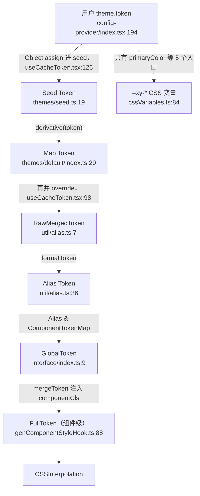
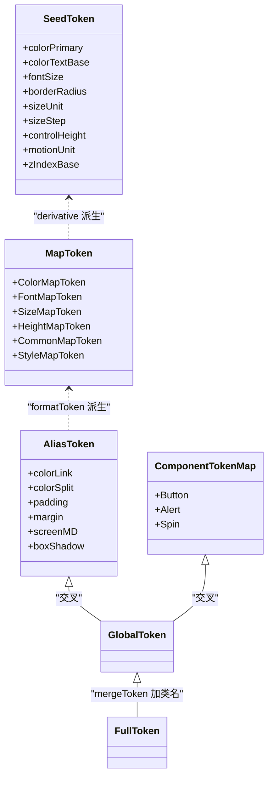
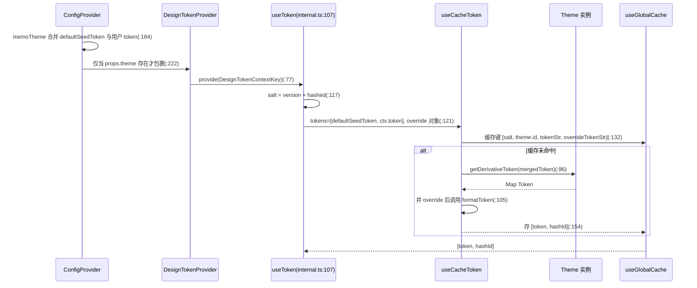

# A03 Design Token 四层体系

> **本篇解决**：改一个 `colorPrimary` 到底经过了哪几次函数转换才变成 CSS？为什么 `theme.token` 里写 `colorLink` 和写 `colorPrimary` 走的是两条路？dark/compact 算法为什么不重算圆角？
> **前置**：A01（monorepo 拓扑）　**读者坐标**：`01-architecture` 第 3/8 篇
> 样式注册与缓存的物理实现（`StyleContext`、`Cache`、SSR 注水）属 A04；本篇只管**数值是怎么算出来的**。

---

## 一、职责与边界

`theme/` 负责把 **13 个预置色 + 24 个种子值**派生成组件可以直接消费的一张扁平表（`GlobalToken`），并提供一个把 Token 表变成 CSS 的挂载点（`genComponentStyleHook`）。

明确**不负责**：

- CSS 的写入、去重、SSR 抽取、`hashId` 的生成算法本身 → `src/_util/cssinjs/`（A04）
- `prefixCls` / `direction` / `size` 等上下文的纵向传播 → `config-provider/`（A05）
- 具体组件的样式形状 → 各组件 `style/index.ts`

依赖与被依赖（实测）：

| 方向 | 对象 | 证据 |
| --- | --- | --- |
| 被依赖 | 86 个组件样式文件调用 `genComponentStyleHook`（共 88 处调用点） | `packages/xiaoye-ui/src/*/style/index.ts` |
| 依赖 | `@ant-design/colors` 的 `generate`（色阶）、`@ctrl/tinycolor`（alpha/混色） | `theme/themes/default/index.ts:1`、`theme/util/alias.ts:1` |
| 依赖 | `cssinjs` 的 `createTheme` / `useCacheToken` / `useStyleRegister` | `theme/internal.ts:2` |
| 依赖 | `config-provider/context` 取 `getPrefixCls`、`iconPrefixCls` | `theme/util/genComponentStyleHook.ts:11` |

---

## 二、源码地图

`theme/` 共 34 个 ts 文件、合计 3,542 行；其中 `convertLegacyToken.ts` 一个文件占 1,106 行且无人调用（§六、§七 坑 6），真正的派生链约 2,436 行。

| 文件 | 行数 | 职责 | 关键导出 |
| --- | --- | --- | --- |
| `theme/interface/seeds.ts` | 216 | Seed 层类型与注释（`@nameZH` / `@default`） | `SeedToken` |
| `theme/interface/maps/` | 5 文件 | Map 层类型切面：colors / font / size / style | `MapToken` 及各 `*MapToken` |
| `theme/interface/alias.ts` | 152 | Alias 层类型 | `AliasToken` |
| `theme/interface/components.ts` | 187 | 组件专属 Token 注册表 | `ComponentTokenMap`（`:73`） |
| `theme/interface/index.ts` | 25 | 四层拼合 | `GlobalToken`（`:9`）、`OverrideToken`（`:4`） |
| `theme/themes/seed.ts` | 76 | Seed 的**默认值** | `defaultPresetColors`（`:3`）、seedToken（`:19`） |
| `theme/themes/default/index.ts` | 46 | Seed→Map 算法 | `derivative(token)`（`:11`） |
| `theme/themes/dark/index.ts` | 42 | 暗色：Map 层局部重写 | `derivative(token, mapToken)`（`:9`） |
| `theme/themes/compact/index.ts` | 27 | 紧凑：只重算尺寸/字号/高度 | `derivative(token, mapToken)`（`:8`） |
| `theme/themes/shared/` | 7 文件 | 颜色/字号/尺寸/圆角/高度的生成器 | `genColorMapToken`、`genSizeMapToken`… |
| `theme/util/alias.ts` | 201 | Map→Alias 的唯一实现 | `formatToken`（`:14`） |
| `theme/util/genComponentStyleHook.ts` | 113 | Component 层挂载点 | 默认导出（`:40`） |
| `theme/util/statistic.ts` | 75 | `mergeToken` 与 dev 期用量统计 | `merge`（`:11`）、`statisticToken`（`:51`） |
| `theme/internal.ts` | 146 | 对内总装：Context + `useToken` | `useToken`（`:107`）、`DesignTokenProvider`（`:95`） |
| `theme/index.ts` | 31 | 对外公开面 | `useToken`（`:12`）、三套算法 |

主实现入口：`packages/xiaoye-ui/src/theme/internal.ts:107`。

---

## 三、架构与数据流

### 3.1 派生链：四层不是四份数据，是三次纯函数 + 一次类型交叉



读图要点：`Seed → Map → Alias` 每一步都是**纯函数**（输入一个对象、输出一个新对象，不 mutate）；`Alias → Global` 只是类型层面的交叉（`interface/index.ts:9`）；只有 `Global → FullToken` 发生在渲染期、且带上了组件的 CSS 类名。这条链决定了后面所有排障思路：**Token 不生效，先看它落在哪一层**。

### 3.2 类型层的关系：四个 interface，一个交叉点



`MapToken` / `AliasToken` 本身也是切片拼接的：`MapToken` 由 `ColorMapToken | FontMapToken | SizeMapToken | HeightMapToken | CommonMapToken | StyleMapToken` 合成（`interface/maps/index.ts`，5 个文件），`GlobalToken = AliasToken & ComponentTokenMap` 是全链**唯一的类型交叉点**（`interface/index.ts:9`），组件侧拿到的 `FullToken` 再由 `TokenWithCommonCls` 叠上四个类名字段（`genComponentStyleHook.ts:26-38`）。

注意 `ComponentTokenMap` 的每个值都是可选的（`interface/components.ts:69-81`），且相当一部分写成 `Affix?: {}` / `Badge?: {}` / `Breadcrumb?: {}` 这类**空对象**——含义是"该组件没有专属 Token，但占一个位以便将来 `theme.components.Badge` 仍能覆盖 Alias 值"。新增组件时若忘了在这里登记，`theme.components.Xxx` 会被 TS 拒掉（`OverrideToken` 的键域来自 `ComponentTokenMap`）。

### 3.3 运行时装配：一次 `useToken()` 到底做了什么



关键点：`ConfigProvider` 只在**显式传入 `theme`** 时才插入一层 Provider（`config-provider/index.tsx:222`）。没传就不插，子树继续沿用祖先注入或全局兜底（`internal.ts:89-94`）。这解释了"嵌套 ConfigProvider 只改 locale 时主题不会被重置"的行为。

---

## 四、核心机制精读

### 论点 1：`theme.token` 里的 seed 名和 alias 名走的是两条完全不同的路

`internal.ts` 把同一份用户 token 传了**两次**：

```tsx
// packages/xiaoye-ui/src/theme/internal.ts:117
  const salt = computed(() => `${version}-${designTokenContext.value.hashed || ''}`);

  const mergedTheme = computed(() => designTokenContext.value.theme || defaultTheme);

  const cacheToken = useCacheToken<GlobalToken, SeedToken>(
    mergedTheme,
    computed(() => [defaultSeedToken, designTokenContext.value.token]),
    computed(() => ({
      salt: salt.value,
      override: {
        override: designTokenContext.value.token,
        ...designTokenContext.value.components,
      },
      formatToken,
    })),
  );
```

- 第 123 行的 `tokens` 数组在 `useCacheToken.tsx:126` 被 `Object.assign({}, ...tokens.value)` 压成 `mergedToken`，**再交给算法**（`:96`）。所以写 `colorPrimary: '#f00'` 时，颜色算法拿到的种子已经是红色，10 级色阶全部围绕红色重算。
- 同一个对象又出现在 `override.override`（第 128 行）。它在 `useCacheToken.tsx:98-101` 被并进 Map 结果，随后由 `formatToken` 处理。

而 `formatToken` 开头就**把 override 里所有与 seed 同名的键删掉**：

```ts
// packages/xiaoye-ui/src/theme/util/alias.ts:14
export default function formatToken(derivativeToken: RawMergedToken): AliasToken {
  const { override, ...restToken } = derivativeToken;
  const overrideTokens = { ...override };

  Object.keys(seedToken).forEach(token => {
    delete overrideTokens[token as keyof SeedToken];
  });

  const mergedToken = {
    ...restToken,
    ...overrideTokens,
  };
```

结论：删掉是为了**不让原始 seed 值绕过算法直接落到 Alias 层**（否则 `colorPrimaryBg` 这类派生值会与 `colorPrimary` 脱钩）。删掉之后，`overrideTokens` 里剩下的（alias 名，如 `colorLink`）在第 22-25 行先并入参与派生、又在第 197 行 `...overrideTokens` 再覆盖一次，所以 **alias 层的键能盖住算法结果，seed 层的键只能喂给算法**。

可验证命题：在 `theme.token` 里同时写 `colorPrimary` 与 `colorPrimaryBg`，前者会改变整条色阶、后者只改这一个小格；且 `colorPrimary` 永远不会以"未派生"的形态出现在 Alias 层。

### 论点 2：dark 与 compact 不是"另一套种子"，而是 Map 层的局部重写

```ts
// packages/xiaoye-ui/src/theme/themes/dark/index.ts:9
const derivative: DerivativeFunc<SeedToken, MapToken> = (token, mapToken) => {
  const colorPalettes = Object.keys(defaultPresetColors)
    .map((colorKey: keyof PresetColorType) => {
      const colors = generate(token[colorKey], { theme: 'dark' });
      // ...
    })
    // ...
  const mergedMapToken = mapToken ?? defaultAlgorithm(token);

  return {
    ...mergedMapToken,
    ...colorPalettes,
    ...genColorMapToken(token, { generateColorPalettes, generateNeutralColorPalettes }),
  };
};
```

两处值得注意的实现事实：

1. **`derivative` 收两个参数**（`token, mapToken`）。`mapToken` 是链上前一个算法的输出，`?? defaultAlgorithm(token)` 表示没有前序算法时自己兜底跑一遍默认算法。因此 `theme: [darkAlgorithm]` 与 `theme: [defaultAlgorithm, darkAlgorithm]` 都会得到"默认 Map 为底 + 暗色覆盖"，但后者允许在中间插入自定义算法。
2. **返回值只覆盖颜色族**（`:29-38`）。`fontSize`、`borderRadius`、`size*`、`controlHeight` 全部来自 `mergedMapToken`，暗色算法一行都不动。

compact 是同构的另一半证据：

```ts
// packages/xiaoye-ui/src/theme/themes/compact/index.ts:8
const derivative: DerivativeFunc<SeedToken, MapToken> = (token, mapToken) => {
  const mergedMapToken = mapToken ?? defaultAlgorithm(token);

  const fontSize = mergedMapToken.fontSizeSM; // Smaller size font-size as base
  const controlHeight = mergedMapToken.controlHeight - 4;

  return {
    ...mergedMapToken,
    ...genCompactSizeMapToken(mapToken ?? token),
    ...genFontMapToken(fontSize),
    controlHeight,
    ...genControlHeight({ ...mergedMapToken, controlHeight }),
  };
};
```

compact 只重算尺寸、字号、控件高度三类，**颜色一律继承**。这两段合起来解释了为什么"暗色 + 紧凑"能叠加使用（`algorithm` 支持数组，见 `config-provider/index.tsx:186-189` 的 `createTheme(algorithm)`），也解释了为什么**不能指望 compact 让颜色变浅**。

### 论点 3：缓存身份由四元组决定，`salt` 里掺了版本号

```tsx
// packages/xiaoye-ui/src/_util/cssinjs/hooks/useCacheToken.tsx:126
  const mergedToken = computed(() => Object.assign({}, ...tokens.value));
  const tokenStr = computed(() => flattenToken(mergedToken.value));
  const overrideTokenStr = computed(() => flattenToken(option.value.override || EMPTY_OVERRIDE));

  const cachedToken = useGlobalCache<[DerivativeToken & { _tokenKey: string }, string]>(
    'token',
    computed(() => [
      option.value.salt || '',
      theme.value.id,
      tokenStr.value,
      overrideTokenStr.value,
    ]),
```

缓存键是 `[salt, theme.id, tokenStr, overrideTokenStr]`，而 `salt` 来自 `internal.ts:117` 的 `${version}-${hashed}`。命中缓存时**跳过** 138-157 的整段重算（`getDerivativeToken` + `formatToken` + 哈希）。

由此得到三个可直接观测的后果：

- 升级组件库版本 ⇒ 所有 `token` 缓存全部失效（`version.ts` 变更会改 salt）。这是有意的：注释在 `useCacheToken.tsx:22` 写明 salt 的作用就是"让相同派生 token 在不同版本下产生不同 hashId"。
- `hashed: false` ⇒ `internal.ts:137` 把 hashId 直接返回空串，样式类名只留 `xy-` 前缀；同时 `salt` 少一段，与 hashed 模式的缓存互不复用。
- dev 与 prod 的类名前缀不同：`useCacheToken.tsx:17` 的 `hashPrefix` 在非生产/非预渲染时是 `css-dev-only-do-not-override`，生产是 `css`。

最后一条是踩坑高发点：任何**硬编码完整 hash 类名**的样式覆盖或快照，切到生产构建就会失效或漂移。

### 论点 4：Component Token 层在渲染期才成型，且 `getDefaultToken` 形同虚设

```ts
// packages/xiaoye-ui/src/theme/util/genComponentStyleHook.ts:79
        const { token: proxyToken, flush } = statisticToken(token.value);

        const defaultComponentToken =
          typeof getDefaultToken === 'function'
            ? (getDefaultToken as any)(proxyToken)
            : getDefaultToken;
        const mergedComponentToken = { ...defaultComponentToken, ...token.value[component] };

        const componentCls = `.${prefixCls.value}`;
        const mergedToken = mergeToken<TokenWithCommonCls<GlobalTokenWithComponent<OverrideComponent>>>(
          proxyToken,
          {
            componentCls,
            prefixCls: prefixCls.value,
            iconCls: `.${iconPrefixCls.value}`,
            rootCls: `.${rootPrefixCls.value}`,
          },
          mergedComponentToken,
        );
```

第 85 行 `token.value[component]` 就是 `ConfigProvider` 里 `theme.components.Button` 的落点（`OverrideToken` 的键形态见 `interface/index.ts:4-6`）。第 88-99 行把四个类名占位符（`componentCls` / `prefixCls` / `iconCls` / `rootCls`）拼进 token 对象，这就是各组件样式里 `componentCls` 的唯一来源。

值得记下的实现现状（**这一段原先写成「`getDefaultToken` 在整个 `src` 中没有任何调用方」，那是错的，已由 C10-09 反证并于 2026-09-29 更正**）：第三个参数是**位置实参**，按名字 `grep -rn getDefaultToken packages/xiaoye-ui/src` 只会命中 `genComponentStyleHook.ts` 自身的 `:43`/`:82`/`:83`/`:84`，这**在结构上无法证明无人传它**。数实参才有效：用括号配对统计各调用点顶层逗号，本仓 103 处 `genComponentStyleHook(...)` 调用里 **37 处传了第三个实参**（对象字面量或函数），66 处只传两个，例如 `packages/xiaoye-ui/src/divider/style/index.ts:153`-`:167` 的第三段就是 `{ sizePaddingEdgeHorizontal: 0 }`（`:164-166`）。所以第 81-84 行不是恒 `undefined`，`:85` 的 `{ ...defaultComponentToken, ...token.value[component] }` 也确实用到了框架级默认值。**真正的失效点在下一层**：`:85` 之后 `styleFn` 拿到 token 又做一次 `mergeToken(token, {…})`，把组件自己的默认值**写在用户覆盖值之后**，于是**键相交的那部分覆盖被无条件覆写回去**——`comment/style/index.ts:144-157` 把 12 个键全列进第二次 merge，故 Comment 的主题覆盖率为 0；而 `divider/style/index.ts:157-161` 只列 3 个 `divider*` 键，与它自己 `getDefaultToken` 里的 `sizePaddingEdgeHorizontal` 不相交，那一个键反而真的可覆盖。结论要按这个形状说：**框架兜底是生效的，兜底与用户覆盖都会被组件内的二次 `mergeToken` 覆写，覆写范围 = 键集合的交集**。组件若要为自己的 Token 兜底，只能在 styleFn 内部自己做二次 `mergeToken`，例如 Button：

```ts
// packages/xiaoye-ui/src/button/style/index.ts:498
export default genComponentStyleHook('Button', token => {
  const { controlTmpOutline, paddingContentHorizontal } = token;
  const buttonToken = mergeToken<ButtonToken>(token, {
    colorOutlineDefault: controlTmpOutline,
    buttonPaddingHorizontal: paddingContentHorizontal,
  });
```

也就是说：**组件默认 Token 的兜底责任在每个组件的 styleFn 里，而不在框架里**。新增组件时忘记 `mergeToken` 兜底，就会直接踩 undefined 而不是报错（因为样式对象里出现 `undefined` 值不抛异常）。

另一处只有 Menu 用到的能力：styleFn 的第二个入参 `StyleInfo` 携带 `overrideComponentToken`（`genComponentStyleHook.ts:100-106`），Menu 用它 + `injectStyle` 开关跳过自己的样式注入：

```ts
// packages/xiaoye-ui/src/menu/style/index.ts:431
  const useOriginHook = genComponentStyleHook(
    'Menu',
    (token, { overrideComponentToken }) => {
      // Dropdown will handle menu style self. We do not need to handle this.
      if (injectStyle?.value === false) {
        return [];
      }
```

全仓 `src` 内解构 `overrideComponentToken` 的只有 `menu/style/index.ts:433` 与 `:491` 两处——这个第二参数目前是"一个用户在用"的状态。

### 论点 5：每个组件注册样式时都顺带注册一遍全局 link 与 icon reset

```ts
// packages/xiaoye-ui/src/theme/util/genComponentStyleHook.ts:52
    const sharedInfo = computed(() => {
      return {
        theme: theme.value,
        token: token.value,
        hashId: hashId.value,
        path: ['Shared', rootPrefixCls.value],
      };
    });
    // Generate style for all a tags in xiaoye-ui component.
    useStyleRegister(sharedInfo, () => [
      {
        // Link
        '&': genLinkStyle(token.value),
        // Global icon reset to make @xiaoye-ui/icons scale with parent font-size
        [`.${iconPrefixCls.value}`]: resetIcon(),
      },
    ]);
```

这段在每个组件的 hook 工厂里都会执行一次。它不会重复注入 CSS——去重靠 `path`：Shared 层的 `path` 是 `['Shared', rootPrefixCls]`（第 57 行），组件层是 `[component, prefixCls, iconPrefixCls]`（第 74 行）。因此：

- 同一 `rootPrefixCls` 下，无论渲染多少个组件，Shared 样式只有一份；
- **换 `prefixCls` 会让组件层整片重算**（`prefixCls` 是缓存键的一部分），而换 `rootPrefixCls` 会连 Shared 一起重算。

第 108 行还有一处容易被忽略的成本：每次组件样式生成都会把 `genCommonStyle(token, prefixCls)` 拼进结果，通用样式（焦点、滚动条等）同样是"每组件挂一次、按 path 去重"。

### 论点 6：Token 用量统计机制在本仓库是空转的

```ts
// packages/xiaoye-ui/src/theme/util/statistic.ts:3
const enableStatistic =
  process.env.NODE_ENV !== 'production' || typeof CSSINJS_STATISTIC !== 'undefined';
let recording = true;

/**
 * This function will do as `Object.assign` in production. But will use Object.defineProperty:get to
 * pass all value access in development. To support statistic field usage with alias token.
 */
export function merge<T extends object>(...objs: Partial<T>[]): T {
  /* istanbul ignore next */
  if (!enableStatistic) {
    return Object.assign({}, ...objs);
  }

  recording = false;
  const ret = {} as T;
  objs.forEach(obj => {
    const keys = Object.keys(obj);
    keys.forEach(key => {
      Object.defineProperty(ret, key, {
        configurable: true,
        enumerable: true,
        get: () => (obj as any)[key],
      });
    });
  });
  recording = true;
  return ret;
}
```

设计意图很清楚：开发期把 `merge` 的结果换成"只读代理"，配合 `statisticToken` 的 `Proxy`（`:60-67`）记录每个组件读了哪些 Token 字段，最后由 `flush(component, mergedComponentToken)` 写进 `statistic[component]`（`:69-71`）。生产构建里 `enableStatistic` 为假，`merge` 退化成 `Object.assign`（`:13-15`），零开销。

现状是：**没有任何消费方**。`grep -rn "_statistic_build_\|statistic\[" packages apps scripts` 在源码里只命中定义本身（`theme/util/statistic.ts:38-45`）与 `internal.ts:20/41-42` 的再导出；`flush` 在 `genComponentStyleHook.ts:107` 被调用，但写入的 `statistic` 对象没人读。所以开发期每个组件样式生成都会白付一次 Proxy + `defineProperty` 的成本，换来一份没人看的账本。这是上游能力的残留，改动时**不要把它当成可用特性**（详见 §六、§七）。

### 论点 7：Map 层的数值 Token 是矩阵，不是枚举——两个 Seed 值就能平移整套间距

```ts
// packages/xiaoye-ui/src/theme/themes/shared/genSizeMapToken.ts:3
export default function genSizeMapToken(token: SeedToken): SizeMapToken {
  const { sizeUnit, sizeStep } = token;

  return {
    sizeXXL: sizeUnit * (sizeStep + 8), // 48
    sizeXL: sizeUnit * (sizeStep + 4), // 32
    sizeLG: sizeUnit * (sizeStep + 2), // 24
    sizeMD: sizeUnit * (sizeStep + 1), // 20
    sizeMS: sizeUnit * sizeStep, // 16
    size: sizeUnit * sizeStep, // 16
    sizeSM: sizeUnit * (sizeStep - 1), // 12
    sizeXS: sizeUnit * (sizeStep - 2), // 8
    sizeXXS: sizeUnit * (sizeStep - 3), // 4
  };
}
```

9 档间距只由 `sizeUnit`（`themes/seed.ts:59` = 4）与 `sizeStep`（同处 = 4）两个种子决定，行尾注释是代入默认值后的结果。控件高度同理，而且是**乘数**：

```ts
// packages/xiaoye-ui/src/theme/themes/shared/genControlHeight.ts:6
  return {
    controlHeightSM: controlHeight * 0.75,
    controlHeightXS: controlHeight * 0.5,
    controlHeightLG: controlHeight * 1.25,
  };
```

`controlHeight` 种子是 32（`themes/seed.ts:64`），于是 SM=24、XS=16、LG=40。`HeightMapToken` 的声明在 `interface/maps/size.ts:47-68`，只有这三档——**没有 XL/XXL 控件高度**，组件要更大的高度只能自己乘（Button 的尺寸样式就是这么做的，见 C01-01）。

关键在于 Alias 层把 `size*` **改名复制**成两套公共命名空间：`paddingXXS…paddingXL` 与 `marginXXS…marginXXL` 全部来自 `mergedToken.size*`（`util/alias.ts:103-126`）。后果是：**动一个 `sizeUnit`，页面所有组件的 padding 与 margin 一起平移**，而不需要改任何组件；反过来，想让某个组件的 padding 独立变化，就必须走 `theme.components.Xxx` 而不是种子。这两条路是互斥的设计意图，也是 §七 坑 7 的成因。

### 论点 8：中性色的梯度靠两份同名、方向相反的 `colorAlgorithm`

`themes/default/` 与 `themes/dark/` 各有一份 `colorAlgorithm.ts`，导出同名符号、实现方向相反：

```ts
// packages/xiaoye-ui/src/theme/themes/default/colorAlgorithm.ts:6
export const getSolidColor = (baseColor: string, brightness: number) => {
  const instance = new TinyColor(baseColor);
  return instance.darken(brightness).toHexString();
};
```

```ts
// packages/xiaoye-ui/src/theme/themes/dark/colorAlgorithm.ts:6
export const getSolidColor = (baseColor: string, brightness: number) => {
  const instance = new TinyColor(baseColor);
  return instance.lighten(brightness).toHexString();
};
```

两者的消费者用相对路径各自注入（`themes/default/colors.ts:3`、`themes/dark/colors.ts:3` 都写 `from './colorAlgorithm'`），所以**没有任何一处代码同时约束这两份实现**——它们是同名兄弟，不是共享库。配套的两个事实：

1. **空基色靠 `||` 兜底且方向互换**。种子层把基色留空（`themes/seed.ts:29` 的 `colorTextBase: ''`、`:31` 的 `colorBgBase: ''`），由各自算法补默认值：浅色是 `bg || '#fff'` / `text || '#000'`（`default/colors.ts:28-29`），暗色正好相反（`dark/colors.ts:28-29`）。所以"暗色不用配基色也能出正确层级"这件事，成立在这 4 行上。
2. **透明度与实色档位是 Map 层硬编码的常量表**，不在 Alias 层：浅色文本四级 0.88/0.65/0.45/0.25、fill 四级 0.15/0.06/0.04/0.02（`default/colors.ts:35-43`），实色档位 `colorBgLayout` 4、`colorBgContainer`/`colorBgElevated` 0、`colorBorder` 15、`colorBorderSecondary` 6（`:45-51`）；暗色对应档位是 12/8/0/26/26/19（`dark/colors.ts:45-51`）。用 tinycolor 复算暗色（`colorBgBase='#000'` + lighten）得到：

   | Token | 值 | 来源 |
   | --- | --- | --- |
   | `colorBgLayout` | `#000000` | `lighten(0)` |
   | `colorBgContainer` | `#141414` | `lighten(8)` |
   | `colorBgElevated` | `#1f1f1f` | `lighten(12)` |
   | `colorBorder` | `#424242` | `lighten(26)` |
   | `colorBorderSecondary` | `#303030` | `lighten(19)` |

   浅色侧同样复算：`colorBgLayout #f5f5f5`、`colorBgContainer #ffffff`、`colorBorder #d9d9d9`、`colorBorderSecondary #f0f0f0`（`default/colors.ts:45-51` + darken）。

3. **两套算法的主文本透明度不相等**：浅色 `colorText` 用 0.88（`default/colors.ts:35`），暗色用 0.85（`dark/colors.ts:35`）。文档站 `apps/docs/guide/dark-mode.md:118` 把 `rgba(0, 0, 0, 0.88)` 说成"浅色派生值，darkAlgorithm 下自动翻转"，**翻转的是基色与方向，数值本身并不对称**——按 0.88 去核对暗色会得到错误结论。

顺带一条容易被名字骗的地方：所谓"10 级色阶"实际只有 7 个唯一值。

```ts
// packages/xiaoye-ui/src/theme/themes/default/colors.ts:7
  return {
    1: colors[0],
    // ...
    5: colors[4],
    6: colors[5],
    7: colors[6],
    8: colors[4],
    9: colors[5],
    10: colors[6],
    // 8: colors[7],
    // 9: colors[8],
    // 10: colors[9],
  };
```

第 8/9/10 档复用第 5/6/7 档（真正的深档被注释在第 18-20 行）。暗色也是同一手法（`dark/colors.ts:8-20`，只是 5/6/7 的取序反转）。等经过 `genColorMapToken.ts:34-43` 的语义映射后，产出三对**完全相等**的公开 Token：

| 语义 Token A | 语义 Token B | 相等原因 |
| --- | --- | --- |
| `colorPrimary` | `colorPrimaryText` | `primaryColors[6]` 与 `[9]` 都是 `colors[5]` |
| `colorPrimaryHover` | `colorPrimaryTextHover` | `[5]` 与 `[8]` 都是 `colors[4]` |
| `colorPrimaryActive` | `colorPrimaryTextActive` | `[7]` 与 `[10]` 都是 `colors[6]` |

这不是 bug（是为了让深档在浅底上可读），但意味着**用 `colorPrimaryText*` 做"文字色"时它并不比 `colorPrimary*` 更深**，想让文字更重只能自己覆盖。

### 论点 9：Map 层同时用了三种派生策略——乘数、指数序列、分段查表

间距是乘数（论点 7），字号是**指数序列**，圆角是**分段查表**。三者都在 Map 层，但没有任何统一规律可循，这是读 `themes/shared/` 时最需要先建立的认识。

```ts
// packages/xiaoye-ui/src/theme/themes/shared/genFontSizes.ts:2
export default function getFontSizes(base: number) {
  const fontSizes = new Array(10).fill(null).map((_, index) => {
    const i = index - 1;
    const baseSize = base * 2.71828 ** (i / 5);
    const intSize = index > 1 ? Math.floor(baseSize) : Math.ceil(baseSize);

    // Convert to even
    return Math.floor(intSize / 2) * 2;
  });

  fontSizes[1] = base;
```

四个细节都有下游后果：以 $e^{1/5}$ 为公比生成 10 档；第 0/1 档向上取整、其余向下取整（`:6`）；所有档位被强制**取偶**（`:9`）；`fontSizes[1] = base` 用赋值覆盖计算值（`:12`）以保证 `fontSize` 严格等于种子。行高不是独立 Token，而是从字号反推的无单位倍数：

```ts
// packages/xiaoye-ui/src/theme/themes/shared/genFontSizes.ts:14
  return fontSizes.map(size => {
    const height = size + 8;

    return {
      size,
      lineHeight: height / size,
    };
  });
```

即 `lineHeight = 1 + 8/size`——**字号越小行高倍数越大**（12px → 1.667，16px → 1.5）。也因此 `fontSizeSM` 与 `lineHeightSM` 必须成对消费（`genFontMapToken.ts:21-23` 按同一 index 取），单独改字号会让行高跟着变。

标题档位的取序是**反的**，且与正文档复用：

```ts
// packages/xiaoye-ui/src/theme/themes/shared/genFontMapToken.ts:15
    fontSizeHeading1: fontSizes[6],
    fontSizeHeading2: fontSizes[5],
    fontSizeHeading3: fontSizes[4],
    fontSizeHeading4: fontSizes[3],
    fontSizeHeading5: fontSizes[2],
```

对照 `:10-13` 的正文档位（`fontSizeLG = fontSizes[2]`、`fontSizeXL = fontSizes[3]`）可以确定：**H5 与 `fontSizeLG` 同值、H4 与 `fontSizeXL` 同值**。改 `fontSizeLG` 会连带改掉 Typography 的 H5（见 C11-08）。

圆角则是完全另一种写法——分段查表，且带**硬上限**：

```ts
// packages/xiaoye-ui/src/theme/themes/shared/genRadius.ts:50
  return {
    borderRadius: radiusBase > 16 ? 16 : radiusBase,
    borderRadiusXS: radiusXS,
    borderRadiusSM: radiusSM,
    borderRadiusLG: radiusLG,
    borderRadiusOuter: radiusOuter,
  };
```

`radiusBase` 超过 16 时 `borderRadius` 被截成 16（`:51`），`radiusLG` 同样封顶 16（`:19-21`），而 `radiusXS` 在 `base < 2` 时保持等于 base（`:37-41` 的两条分支都不覆盖该情况）。入口只有一处：`genCommonMapToken` 用种子的 `borderRadius` 调它（`genCommonMapToken.ts:17`），同文件还给出另外两种派生形态——motion 时长是 `.toFixed(1)` 拼字符串（`:9-11`）、`lineWidthBold` 是 `+1`（`:14`）。

结论：**"改一个种子会传导多远"在 Map 层没有统一答案**。间距是线性平移、字号是等比数列、圆角是查表加截断、动画时长是定值累加。这是 §七 坑 7/9 的共同成因。

### 论点 10：四处"为工具链预留、但本仓库没有工具链"的残留

把本篇与相邻篇查到的空转放在一起，它是一个成型的模式，而不是孤立巧合：

| 残留 | 预留的用途 | 现状证据 |
| --- | --- | --- |
| `getDefaultToken`（`genComponentStyleHook.ts:43-45`） | 框架统一兜底组件默认 Token | 103 处调用里 37 处确实传了它（数实参，不是按名字 grep；详见论点 4），但组件内的二次 `mergeToken` 会在键相交处覆写它 |
| `statistic` / `_statistic_build_`（`statistic.ts:45-45`） | 出 Token 用量报告 | `grep -rn "_statistic_build_" packages apps scripts \| grep -v dist` 只命中定义行 |
| `convertLegacyToken.ts`（1,106 行） | 旧 LESS 变量名映射 | `grep -rn "convertLegacyToken" packages/xiaoye-ui/src apps` 只命中 `:4` 的定义 |
| Token 接口上的 `@nameZH` / `@default` JSDoc | 生成 Token 文档表格 | `grep -rln "nameZH" packages apps scripts` 命中 7 个文件，全部是**声明这些注释的 interface 自身**（`interface/seeds.ts`、`interface/maps/{colors,size,font,style}.ts`、`interface/alias.ts`）加 `flex/style/index.ts`，无任何读取方 |

第四条最值得说：`interface/seeds.ts`（216 行）与 `interface/maps/*.ts` 的每个 Token 都手工写了中文名、说明和 `@default` 值，形如 `maps/size.ts:17-21` 的 `@nameZH MD / @default 20`。这些 `@default` 是**手抄的第二真源**——它们与 `genSizeMapToken.ts:10` 的计算结果此刻一致（`4*(4+1)=20`），但没有任何机制保证下次改种子时同步。`theme/util.test.js` 只测 `getAlphaColor` 的一个分支（全文件 9 行），也帮不上。

对维护者的实际含义：**不要把这些注释当权威值去读，也不要指望改注释能影响文档生成**；要真实默认值就去看 `themes/seed.ts` 与各 `gen*MapToken.ts` 的表达式。

---

## 五、对外契约如何生效

用户侧只有一个入口对象 `ThemeConfig`（`theme token / components / algorithm / hashed`，见 `config-provider/context.ts:57-58` 的 `algorithm`、`hashed` 声明），它的流动路径：

1. **props → Context**：`ConfigProvider` 把自己的 `theme` 与父级 `theme` 做浅合并（`config-provider/index.tsx:85-86`），再由 `memoTheme` 补全 seed 底（`:194-197` 的 `{...defaultSeedToken, ...token}`）并把 `algorithm` 包成 Theme 实例（`:186-189`）。
2. **Context → 注入**：`useDesignTokenProvider` 同时做两件事——`provide(DesignTokenContextKey, value)`，并用 `watch(value, …, {deep:true})` 把值同步到模块级 `globalDesignTokenApi`（`internal.ts:77-87`）。后者是给"脱离组件树"的场景兜底：静态方法（如 `Modal.confirm`）在独立挂载的容器里取不到 provide 链，就靠 `useDesignTokenInject` 的第二参数回落到全局（`:89-94`）。
3. **注入 → 渲染**：组件样式 hook 里 `useToken()` 拿到 `[theme, token, hashId]`（`genComponentStyleHook.ts:49`），`wrapSSR` 负责把生成的 CSS 挂到返回节点上，`hashId` 由组件写进 class（`internal.ts:134-138` 决定是否给 hashId）。
4. **旁路**：`globalConfig` 的 `registerTheme` 走 CSS 变量而不是 cssinjs——`config-provider/cssVariables.ts:84-92` 把 `variables` 拼成 `:root { --xy-xxx: …; }`，`:95-103` 用 `updateCSS` 注入；`globalConfig.ts:138` 是调用点。注意它的输入只有 `primaryColor / successColor / warningColor / errorColor / infoColor` 五个（`:35-81`），且带一大批 `*-deprecated-*` 变量名。这条链路**不参与 §3.1 的四层派生**，是为兼容旧变量名服务的第二真源。

事件、slots、expose 与 Token 无直接关系，本篇不展开。

---

## 六、设计取舍

**为什么主链路不用 CSS 变量，而把 CSS 变量做成旁路？**
cssinjs 的哈希类名方案能给出"样式作用域随 token 走"的隔离：同一页面两套 ConfigProvider 主题并存时，各自的 token 生成不同 `hashId`，互不污染（依据 `useCacheToken.tsx:130-137` 把 `tokenStr/overrideTokenStr` 纳入缓存键、`:154` 由 tokenKey 反出 hashId）。CSS 变量做不到这点——`:root` 上的变量是全局单值，所以 `cssVariables.ts:10` 每次注册都生成带时间戳的新样式节点，本质是"最后写入者赢"。代价：样式体积和节点数量随主题数增长，且 SSR 无法支持该旁路（`cssVariables.ts:100-102` 直接 `warning`，不注入）。

**为什么 Alias 层留了这么多硬编码常量？**
`util/alias.ts` 里 `screenXS…screenXXXL` 八个断点（`:27-33`）、`fontWeightStrong: 600`（`:92`）、`controlPaddingHorizontal: 12`（`:100-101`）、三段 `boxShadow`（`:127-141`）都是写死的数字，不来自 Seed。收益是"派生层稳定、设计师改一个 `sizeStep` 不会连带改变断点"；代价是**这些值无法通过 `theme.token` 正确影响所有下游**——例如改 `sizeUnit` 会改 `padding/margin`（`:103-126` 是 `size*` 的别名复制），但改不动断点。`:164` 的 `// FIXME: component box-shadow, should be removed` 说明作者自己也认为 `boxShadowPopoverArrow`、`boxShadowCard`、四个 `boxShadowDrawer*`、四个 `boxShadowTabsOverflow*` 放错了层：它们只有具体组件用，应下沉为 Component Token。

**为什么放弃"框架统一兜底组件默认 Token"？**
`getDefaultToken` 参数**有 37 处调用在传**（论点 4 更正后的口径），但框架给的兜底会在组件自己的二次 `mergeToken` 里被覆写，所以实际效果仍接近"没人用它兜底"；仓内主流选择是"每个组件自己 `mergeToken`"。换来的是各组件可以按尺寸再派生变体（Button 的 `smallToken` / `largeToken`，`button/style/index.ts:477`、`:475`），代价是兜底责任分散、漏写不报错。要收敛就得一次改 86 个 styleFn，仓库目前没做这件事。

**为什么 `colorAlgorithm` 与档位表要复制两份，而不是抽一个带方向的共享函数？**
现状是 `themes/default/` 与 `themes/dark/` 各有一份 `colorAlgorithm.ts`（一个 `darken` 一个 `lighten`），`colors.ts` 也各写一份透明度与档位（论点 8）。可辩护的理由是：两套的**语义映射本身不同**——浅色的 `colorBgLayout` 比容器暗 4%，暗色的 `colorBgLayout` 是纯黑而容器更亮 8%，方向反转后"亮度差值"这个参数已经不等价，抽公共函数要么塞进一堆 `if (isDark)`，要么把档位拆成两套语义名。代价同样明确：透明度、基色兜底、色阶复用手法这三件事是**复制而非派生**的，任何"两个主题都要修"的调整必须改两处（见 §七 坑 8）。仓库没有测试保护这件事（§附 检查点 3），只能靠人工比对。

**为什么对外 `useToken()` 返回对象，而内部 `useToken()` 返回数组？**
`theme/internal.ts:107` 的内部实现返回三元组 `[theme, token, hashId]`，`genComponentStyleHook` 直接解构（`genComponentStyleHook.ts:49`）；公开的 `theme/index.ts:12-16` 把它包成 `{ theme, token, hashId }`。原因写在 `theme/index.ts:8-10` 的注释里：对外用对象、对内用数组，是为了**减小主包体积**——数组解构不需要稳定的属性名，配合 `components.ts` 的聚合导出与 tree-shaking 更友好，同时避免把内部 `useToken` 直接暴露出去（注释原文 "Please do not export internal `useToken` directly"）。因此写组件内部代码时**不要**改用它，二者返回形状不同（数组 vs 对象），混用会得到解构后的 `undefined`。同理，`theme/index.ts:21-22` 把 `defaultConfig` 标成 `@private Test Usage`，它存在的意义是让测试能拿到一份稳定基线配置（`internal.ts:60-63`），不要用于生产。

**为什么 `ConfigProvider` 不无条件包 Provider？**
`index.tsx:222` 的条件包裹避免了"每个 ConfigProvider 都插一层组件树"的额外嵌套，只在真的带主题时才插。换来的是纯 locale 场景零层级成本，代价是"未传 theme 的子树静默继承祖先主题"这一行为只能靠读源码才知道。

---

## 七、坑与改动指南

1. **在 `theme.token` 里写组件专属 Token 不生效。**
   触发：`theme={{ token: { buttonPaddingHorizontal: 20 } }}`。症状：按钮内边距没变化，也不报错。
   原因：Alias 层只认 `AliasToken` 的键；组件 Token 必须走 `theme.components.Button`，它的落点是 `genComponentStyleHook.ts:85` 的 `token.value[component]`。
   定位：`theme/util/alias.ts:18-25`（seed 键被剥离）+ `theme/interface/index.ts:4-6`（`OverrideToken` 的键是组件名）。

2. **新增组件的 styleFn 忘记 `mergeToken` 兜底，产出静默失效的样式。**
   触发：`genComponentStyleHook('Foo', token => ({ [token.componentCls]: { padding: token.fooPadding } }))`，而 `FooComponentToken` 未在任何地方赋默认值。
   症状：CSS 里该属性被写成 `padding: undefined`（浏览器丢弃），组件看着"样式没生效"。
   原因：组件的 `styleFn` 内部又做一次 `mergeToken`，把同名键的默认值写在用户覆盖之后；框架那层（`getDefaultToken` 与 `token.value[component]` 的合并）虽然生效，但只在**键不相交**时才留下可见效果（论点 4）。
   定位：`theme/util/genComponentStyleHook.ts:81-85`；对照 `button/style/index.ts:500` 的写法补齐。

3. **改 Token 派生逻辑没有测试网。**
   实测：`grep -rn "formatToken\|derivative\|genComponentStyleHook\|useToken" --include='*.test.*' packages/xiaoye-ui/src` **零命中**；`theme/` 下唯一测试是 `theme/util.test.js`，只覆盖 `getAlphaColor` 的一个分支（共 9 行）。
   后果：动 `util/alias.ts` 或 `themes/*/index.ts` 时不会有任何单测失败来提醒你；视觉回归只能靠文档站人工比对。
   安全边界：改 Alias 派生前，先用 §附 的检查点 2 记录改前 `GlobalToken` 的键与若干代表值，再对比改后。

4. **依赖 dev 的 hash 类名做覆盖，上生产即失效。**
   触发：写成 `css-dev-only-do-not-override-xxxx .xy-btn { … }` 这类选择器（快照、E2E 定位器、业务侧 hack 都可能出现）。
   原因：`useCacheToken.tsx:17` 的前缀在生产环境是 `css`。
   定位：`_util/cssinjs/hooks/useCacheToken.tsx:154`；另外 `hashed: false` 会让 hashId 变空串（`theme/internal.ts:137`），两种情况都会破坏硬编码类名。

5. **误把 `statistic` 当可用特性。**
   症状：`import { statistic } from 'xiaoye-ui/theme/internal'` 拿到的对象在非生产环境有值、在生产恒空（`statistic.ts:3-4`、`:13-15`）。
   原因：仅 dev 记录，且无消费方（论点 6）。
   若要真做"Token 用量报告"，需要额外提供消费端与 `CSSINJS_STATISTIC` 的构建开关，别只依赖现有导出。

6. **`convertLegacyToken.ts` 是 1,106 行无人调用的映射。**
   `grep -rn "convertLegacyToken" packages/xiaoye-ui/src apps` 只命中定义本身（`theme/convertLegacyToken.ts:4`），调用方仅存在于历史 `dist` 产物。
   影响：它把 Map Token 映到 `primary-color`、`btn-*`、`zindex-modal` 等旧 LESS 变量名，**改它不会让任何东西变好或变坏**；删它则需确认没有外部直接深路径引用。
   建议：作为待清理债务对待，不要在它上面继续加新映射。

7. **改 `sizeUnit` / `sizeStep` 的影响面比名字暗示的大得多。**
   触发：想让"间距更紧凑"，于是改 `token: { sizeUnit: 3 }`。
   症状：9 档间距一起变，`padding*` 与 `margin*` 两套公开 Token 同步平移，而 `controlHeight` 系列完全不变（它走另一条乘数链，`genControlHeight.ts:6-10`），于是出现"盒子变扁但控件还是 32px"的错配；`sizePopupArrow`（`themes/seed.ts:61`）也不受影响，它是独立种子。
   原因：`util/alias.ts:103-126` 把 9 档 `size*` 复制成 `padding*` 与 `margin*` 两套公开命名空间。
   定位：`theme/themes/shared/genSizeMapToken.ts:3-17` + `theme/util/alias.ts:103-126`。想只动一处，走 `theme.components.Xxx`。

8. **深浅两套中性色实现是同名兄弟，改一份不会同步。**
   触发：只改 `themes/default/colorAlgorithm.ts` 或只改档位数字（`default/colors.ts:45-51`）。
   症状：浅色正常、暗色不动（或反向）；同一处"全局修一下"的直觉在这里必错。
   原因：`themes/dark/colorAlgorithm.ts:8` 是 `lighten`，`themes/default/colorAlgorithm.ts:8` 是 `darken`；两份文件靠各自的相对 import 生效（`default/colors.ts:3`、`dark/colors.ts:3`），没有共同入口。
   追加一条：透明度阶梯也是各自硬编码（浅色 `colorText` 0.88、暗色 0.85），改一个不动另一个 → 主题切换时正文对比度跳变。
   定位：上面四行 + `interface/maps/colors.ts:1`（`ColorNeutralMapToken` 的键约束，是唯一同时约束两边的地方；其中 `colorTextBase` / `colorBgBase` 都标了 `@internal`，见 `:3` 与 `:8` 的注释，而 `ColorMapToken` 由它加五个色族交叉而成，见 `:410-415`）。

9. **`borderRadius` 传大于 16 的值会被静默截断。**
   触发：`theme: { token: { borderRadius: 24 } }` 想要大圆角风格。
   症状：`borderRadius` 变成 16，且 `borderRadiusLG` 也是 16，卡片/按钮看起来"圆角到顶了但不再变大"，无任何告警。
   原因：`genRadius.ts:51` 的 `radiusBase > 16 ? 16 : radiusBase` 与 `:19-21` 的 `radiusLG = 16` 封顶。
   定位：`theme/themes/shared/genRadius.ts:15-51`。真要做超圆角，得同时覆盖 `components` 层或改查表分支（属公共 API 变更）。

10. **`@default` 注释值与真实派生值可能不一致，且没有校验。**
    触发：读 `interface/maps/size.ts:17-21`（`@nameZH MD / @default 20`）就以为 MD 间距是 20。
    症状：一旦有人改 `sizeUnit` 或 `sizeStep`，注释不变、实际值变，文档站与 IDE hover 提示都会指着一个错数字。
    原因：没有工具读这些 JSDoc（论点 10 第 4 行），也没有测试断言（`theme/util.test.js` 只覆盖 `getAlphaColor`）。
    定位：真值永远看 `themes/shared/genSizeMapToken.ts:6-16` 这类表达式，不要看注释。

验证命令（改 Token 相关代码后的最小电池）：

```bash
pnpm typecheck
pnpm --filter xiaoye-ui test:unit        # 注意：不会覆盖派生逻辑（见 §附 检查点 3）
```

由于派生链无测试，改 `util/alias.ts` 或 `themes/**` 后的正确做法是**跑一次实算对比**：在 node 里用 `getComputedToken` 同序的两个纯函数（`derivative` + `formatToken`）打印改动前后的关键 Token 值。仓库目前没有提供这类脚本，这是 I16 之外最值得补的一块基建（建议放 `packages/xiaoye-ui/scripts/`）。

---

## 附：本篇可证伪的三个检查点

1. **seed 键在 Alias 层被剥离**：读 `packages/xiaoye-ui/src/theme/util/alias.ts` 第 18-20 行，确认 `delete overrideTokens[token]` 的循环对象是 `seedToken` 的键；再确认第 197 行的 `...overrideTokens` 位于展开末尾。若第 18-20 行不存在或改成 `restToken`，论点 1 失效。

   ```bash
   sed -n '14,26p;195,201p' packages/xiaoye-ui/src/theme/util/alias.ts
   ```

2. **深浅两套实现的实际差异范围**：暗色只重写颜色族、不重算尺寸与圆角；且两份 `colorAlgorithm` 方向相反；且色阶实际只有 7 级。

   ```bash
   grep -n "mergedMapToken\|genColorMapToken\|genSizeMapToken\|genControlHeight\|genFontMapToken" \
     packages/xiaoye-ui/src/theme/themes/dark/index.ts packages/xiaoye-ui/src/theme/themes/compact/index.ts
   grep -n "darken\|lighten" packages/xiaoye-ui/src/theme/themes/*/colorAlgorithm.ts
   grep -n "8: colors\|9: colors\|10: colors" packages/xiaoye-ui/src/theme/themes/default/colors.ts
   ```
   预期：第一条里 dark 只出现 `genColorMapToken`（无 size/controlHeight/font），compact 反之；第二条 dark 命中 `lighten`、default 命中 `darken`；第三条 default 的第 15-20 行显示 `8: colors[4] / 9: colors[5] / 10: colors[6]` 并带被注释的真值。三条中任一条对不上，论点 8 与坑 8 需重写。

3. **派生链无测试保护、四处残留无消费方**：以下四条命令都应**只输出定义位置或完全为空**。

   ```bash
   grep -rn "formatToken\|getDerivativeToken\|genComponentStyleHook" --include='*.test.*' packages/xiaoye-ui/src
   grep -rn "getDefaultToken" packages/xiaoye-ui/src
   grep -rn "_statistic_build_" packages apps scripts | grep -v dist
   grep -rln "nameZH" packages apps scripts | grep -v dist
   ```
   实测依次为空、4 行（全在 `genComponentStyleHook.ts`）、1 行（定义自身）、7 行（全是声明该注释的 interface 文件 + `flex/style/index.ts`）。**注意第二条不构成"无人传该参数"的证据**：`getDefaultToken` 是位置实参，调用点不会写出这个名字，按名字搜必然只见定义处；要判"有没有人传"须数实参（论点 4 给的就是数出来的 37/103）。第四条一旦出现 `scripts/` 或 `apps/docs/.vitepress/` 下的文件，说明有人补上了 Token 文档生成工具，论点 10 与坑 10 需重写。
