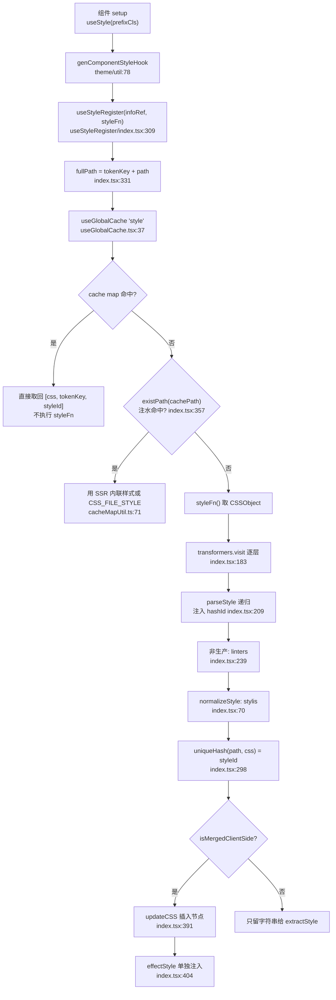
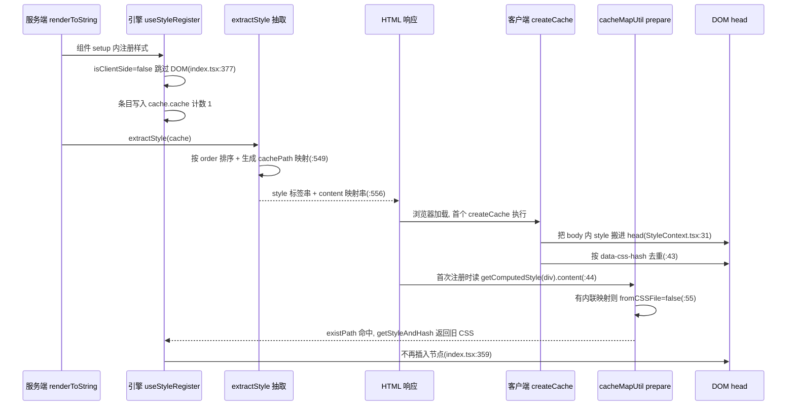
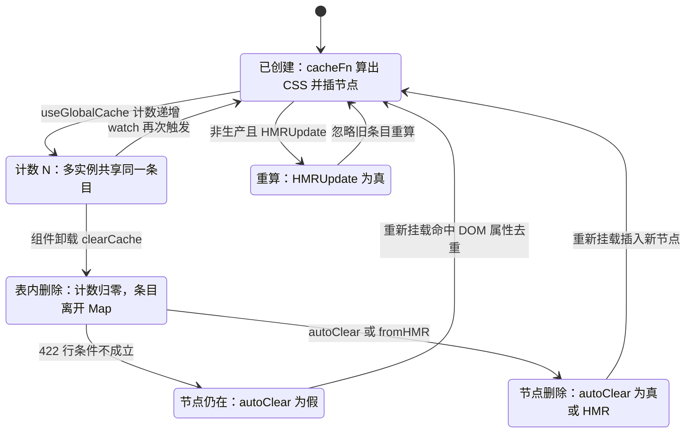
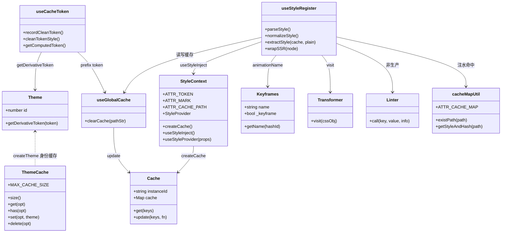

# A04 cssinjs 样式引擎与 SSR 注水

> **本篇解决**：一次 `useStyle(prefixCls)` 之后，CSSObject 经过哪几步变成 DOM 里的 `<style>`？缓存键由什么组成、去重靠什么？`hashId` 是谁算的、dev 与 prod 差在哪？服务端怎么把样式抽成字符串、客户端 hydrate 时凭什么不重复插入？
> **前置**：A03（Design Token 四层体系）　**读者坐标**：`01-architecture` 第 4/8 篇
> **边界**：Token 怎么算出来的见 A03，本篇不重复派生链；`styleChecker`、`warning` 等运行时约束归 I14；`prefixCls` / `direction` / `size` 的纵向注入归 A05。

---

## 一、职责与边界

`_util/cssinjs/` 是一个自研（上游实现血统）的 CSS-in-JS 引擎，负责四件事：

1. 把 JS 对象（`CSSObject`）编译成 CSS 文本（递归解释 + stylis 序列化）；
2. 决定这段文本的**身份**（缓存键与 `styleId`）并做去重；
3. 决定它落在哪里（DOM `<style>` 节点 / SSR 字符串）；
4. 提供 `hashId`，把"这一批样式属于哪一份 token"写进选择器。

明确**不负责**：

- Token 的四层派生与 `useToken` 语义 → A03（`theme/internal.ts:107`）
- `theme.components.Xxx` 到 `componentCls` 的形状 → A03 论点 4
- CSS 变量旁路（`--xy-*`）→ `config-provider/cssVariables.ts`，A03 §五 已登记为第二真源
- `isStyleSupport` / `detectFlexGapSupported` → `_util/styleChecker.ts`，归 I14
- 具体选择器写什么 → 各组件 `style/index.ts`

依赖与被依赖（实测）：

| 方向 | 对象 | 证据 |
| --- | --- | --- |
| 被依赖 | 3 处 `useStyleRegister` 调用点（2 处在 hook 内、1 处在 config-provider 样式） | `theme/util/genComponentStyleHook.ts:61`、`:78`、`config-provider/style/index.ts:9` |
| 被依赖 | 110 个文件引用 `wrapSSR`（其中 103 个是 `const [wrapSSR, hashId] = useStyle(…)` 形态） | `packages/xiaoye-ui/src/**`（`grep -rl wrapSSR`） |
| 依赖 | `@emotion/hash`（两处）、`@emotion/unitless`、`stylis` 的 `compile/serialize/stringify` | `hooks/useStyleRegister/index.tsx:1`、`:4`、`:5` |
| 依赖 | `vc-util/Dom/dynamicCSS` 的 `updateCSS` / `removeCSS` | `hooks/useStyleRegister/index.tsx:21` |
| 依赖 | `vc-util/warning` 的 `devWarning`（lint 告警出口） | `linters/utils.ts:1` |
| 被依赖 | 包根把整个引擎再导出成公开 API | `packages/xiaoye-ui/src/index.ts:8` |

---

## 二、源码地图

`_util/cssinjs/` 共 26 个文件、2,005 行（`wc -l` 实测）。

| 文件 | 行数 | 职责 | 关键导出（行号） |
| --- | --- | --- | --- |
| `hooks/useStyleRegister/index.tsx` | 566 | **主实现入口**：解析 + 注册 + SSR 抽取 | `parseStyle`（`:128`）、默认导出（`:309`）、`extractStyle`（`:457`） |
| `hooks/useStyleRegister/cacheMapUtil.ts` | 91 | 注水识别：从 CSS `content` 读 cache-path 映射 | `ATTR_CACHE_MAP`（`:4`）、`existPath`（`:65`）、`getStyleAndHash`（`:71`） |
| `StyleContext.tsx` | 195 | 上下文、`createCache`、`StyleProvider` 组件 | `createCache`（`:22`）、`useStyleInject`（`:118`）、`useStyleProvider`（`:122`）、`StyleProvider`（`:179`） |
| `Cache.ts` | 29 | 引用计数表（`Map<string, [count, value]>`） | 默认导出 `Entity`（`:4`） |
| `hooks/useGlobalCache.tsx` | 58 | 按 key 读写缓存、卸载递减、HMR 绕过 | 默认导出（函数名是 `useClientCache`，`:6`） |
| `hooks/useCacheToken.tsx` | 165 | token 缓存、`tokenKey`/`hashId` 产出、token 级样式清理 | `getComputedToken`（`:90`）、默认导出（`:118`） |
| `hooks/useHMR.ts` | 34 | HMR 探测（只认 webpack） | 默认导出（`:11`） |
| `util.ts` | 118 | `flattenToken`、`token2key`、三个特性探测 | `flattenToken`（`:10`）、`token2key`（`:35`）、`supportLayer`（`:78`） |
| `Keyframes.ts` | 19 | `@keyframes` 名字与 hashId 绑定 | 默认导出 `Keyframe`（`:3`） |
| `transformers/legacyLogicalProperties.ts` | 162 | 逻辑属性 → 物理属性降级 | 默认导出（`:121`） |
| `transformers/px2rem.ts` | 76 | px → rem（可选媒体查询） | 默认导出工厂（`:34`） |
| `linters/logicalPropertiesLinter.ts` | 88 | RTL 兼容性检查（**默认不启用**） | 默认导出（`:4`） |
| `linters/contentQuotesLinter.ts`、`hashedAnimationLinter.ts` | 25 / 15 | 默认启用的两条规则 | `:4` |
| `linters/legacyNotSelectorLinter.ts`、`parentSelectorLinter.ts` | 33 / 15 | 需手工传入才生效 | `:24`、`:4` |
| `theme/Theme.ts`、`ThemeCache.ts`、`createTheme.ts` | 37 / 135 / 25 | 算法数组 → 带 id 的 Theme 实例及其 LRU | `Theme`（`Theme.ts:10`）、`ThemeCache`（`ThemeCache.ts:27`）、`createTheme`（`createTheme.ts:10`） |
| `index.ts` | 77 | 引擎公开面聚合 | `cssinjs` 默认导出（`:16`）、`_experimental`（`:73`） |
| `_util/static-style-extract/index.tsx` | 93 | 全组件静态抽样式（构建期） | `extractStyle`（`:81`） |

三个"外围但必属本篇"的文件：`vc-util/Dom/dynamicCSS.ts`（真正把节点插进 DOM 的地方，`:54` / `:130`）、`style/index.ts` 的 `genCommonStyle`（`:105`）、`theme/util/genComponentStyleHook.ts`（引擎在本库的唯一常规调用壳，`:40`）。

---

## 三、架构与数据流

### 3.1 一次注册：从 hook 调用到 `<style>` 落地



读图要点：菱形 `F` 与 `H` 是**两个不同层次的去重**。`F` 是 JS 层（同一次会话内重复挂载同一组件）；`H` 是跨阶段层（SSR 已经出过样式）。`J`→`O` 这条链**只在两级都未命中时执行**，所以 `styleFn` 的开销不是每渲染一次付一遍。`P` 之所以要判定，是因为同一份代码要同时服务服务端（只攒字符串）和客户端（要写 DOM）。

### 3.2 SSR 注水的完整时序



读图要点：`P` 这一步是**整条注水链的关键设计**——映射表不是塞进 `window.__INITIAL_STATE__`，而是伪装成一条 CSS 规则（`.data-xy-cssinjs-cache-path{content:"…"}`），由 `prepare()` 创建一个隐藏 `div` 再用 `getComputedStyle` 读回来。好处是不污染全局变量、能天然支持"样式打进 CSS 文件"的形态；代价见 §七 坑 1。

### 3.3 缓存条目与样式节点的生命周期



读图要点：`表内删除 → 节点仍在` 是本库默认行为（`autoClear` 没有任何调用方设置，见 §论点 7），也就是说 JS 表会缩、DOM 只增；`节点仍在 → 已创建` 这条回边靠的是 `updateCSS` 用 `data-css-hash` 反查旧节点（`dynamicCSS.ts:136-148`），因此重新挂载**不会产生第二个节点**，实测 DOM 节点数始终为 1。

### 3.4 模块关系



`Cache` 是全局唯一的存储介质，`style` 与 `token` 两类条目**共用同一张 Map、只靠前缀区分**（`useGlobalCache.tsx:16` 的 `[prefix, ...keyPath].join('%')`），这一点解释了 §论点 7 里 token 清理为什么要绕道 DOM 属性而不是直接删缓存。

---

## 四、核心机制精读

### 论点 1：缓存键是 `[tokenKey, ...path]`，`styleFn` 的内容不在键里

```tsx
// packages/xiaoye-ui/src/_util/cssinjs/hooks/useStyleRegister/index.tsx:327
  const styleContext = useStyleInject();

  const tokenKey = computed(() => info.value.token._tokenKey as string);

  const fullPath = computed(() => [tokenKey.value, ...info.value.path]);

  // Check if need insert style
  let isMergedClientSide = isClientSide;
  if (process.env.NODE_ENV !== 'production' && styleContext.value.mock !== undefined) {
    isMergedClientSide = styleContext.value.mock === 'client';
  }
```

逐段解释：

- 第 329 行直接读 `info.value.token._tokenKey`——这个字段是 `useCacheToken.tsx:151` 挂到派生 token 对象上的，**不由本函数计算**。于是样式缓存的身份被拆成两半：token 部分由 A03 那条链负责，其余部分由 `path` 数组负责。
- 第 331 行 `fullPath` 就是缓存键的全部内容。`path` 由调用方给：组件层是 `[component, prefixCls, iconPrefixCls]`（`genComponentStyleHook.ts:74`），Shared 层是 `['Shared', rootPrefixCls]`（`:57`），config-provider 的图标层是 `['xiaoye-ui-icons', iconPrefixCls]`（`config-provider/style/index.ts:14`）。
- 第 334-337 行的 `mock` 只在非生产生效，是一个纯测试开关（`StyleContext.tsx:62` 的注释写明 `@private Test only`），生产下恒用模块加载时算好的 `isClientSide`（`index.tsx:34`）。

真正的去重有**三层**，且第三层常被忽略：

```tsx
// packages/xiaoye-ui/src/_util/cssinjs/hooks/useStyleRegister/index.tsx:353
    () => {
      const { path, hashId, layer, nonce, clientOnly, order = 0 } = info.value;
      const cachePath = fullPath.value.join('|');
      // Get style from SSR inline style directly
      if (existPath(cachePath)) {
        const [inlineCacheStyleStr, styleHash] = getStyleAndHash(cachePath);
        if (inlineCacheStyleStr) {
          return [inlineCacheStyleStr, tokenKey.value, styleHash, {}, clientOnly, order];
        }
      }
      const styleObj = styleFn();
      const { hashPriority, container, transformers, linters, cache } = styleContext.value;

      const [parsedStyle, effectStyle] = parseStyle(styleObj, {
        hashId,
        hashPriority,
        layer,
        path: path.join('-'),
        transformers,
        linters,
      });
      const styleStr = normalizeStyle(parsedStyle);
      const styleId = uniqueHash(fullPath.value, styleStr);
```

- 第一层：`useGlobalCache` 的 `cache.update(newStr, …)`（`useGlobalCache.tsx:37-49`）——同 key 命中就**根本不执行** `cacheFn`，也就不会执行 `styleFn`。
- 第二层：`existPath` + `getStyleAndHash`（第 357-362 行）——SSR 已产出的条目直接复用。
- 第三层：`updateCSS(styleStr, styleId, …)`（第 391 行）落到 `dynamicCSS.ts:136` 的 `findExistNode`，用 DOM 上的 `data-css-hash` 反查。即使 JS 表已经被清空，只要节点还在，就是**改写 innerHTML 而非新增节点**。

由此得到一个可实测但极易踩空的行为：**`styleFn` 的返回值不参与缓存键**。我按 `useStyleRegister` 的原样签名跑了一次最小挂载（组件内 `computed` 包 info、`styleFn` 读一个外部 `ref`）：

```text
1 mounted   | cache: style%tk123%Demo%xy-demo x1 ":where(.h1).xy-demo{color:red;}" | DOM: ":where(.h1).xy-demo{color:red;}"
2 styleFn changed | cache: style%tk123%Demo%xy-demo x1 ":where(.h1).xy-demo{color:red;}" | DOM: 同上，仍是 color:red
```

`color` 从 `red` 改成 `blue` 后，缓存条目与 DOM 都纹丝不动。原因就在 `useGlobalCache.tsx:32` 的 `watch(fullPathStr, …)`——依赖里只有 key 字符串，没有 `styleFn`。结论回扣：**引擎的一切更新都必须先改变 `tokenKey` 或 `path`**（或走 HMR 分支，见论点 8），"响应式改样式"这条路在引擎层面是不存在的，`useToken` 之所以能刷新样式，恰恰是因为 token 变了 → `tokenKey` 变了 → key 变了。

### 论点 2：`parseStyle` 是递归下降解释器，hashId 注入有三个互斥分支

```tsx
// packages/xiaoye-ui/src/_util/cssinjs/hooks/useStyleRegister/index.tsx:186
      Object.keys(mergedStyle).forEach(key => {
        const value = mergedStyle[key];

        if (
          typeof value === 'object' &&
          value &&
          (key !== 'animationName' || !(value as Keyframes)._keyframe) &&
          !isCompoundCSSProperty(value)
        ) {
          let subInjectHash = false;

          // 当成嵌套对象来处理
          let mergedKey = key.trim();
          // Whether treat child as root. In most case it is false.
          let nextRoot = false;

          // 拆分多个选择器
          if ((root || injectHash) && hashId) {
            if (mergedKey.startsWith('@')) {
              // 略过媒体查询，交给子节点继续插入 hashId
              subInjectHash = true;
            } else {
              // 注入 hashId
              mergedKey = injectSelectorHash(key, hashId, hashPriority);
            }
          } else if (root && !hashId && (mergedKey === '&' || mergedKey === '')) {
```

三个分支的分工（第 203-219 行）：

1. **普通选择器** → `injectSelectorHash`（`:79`）。它把 hashId 塞进**第一个复合选择器之后**：若首段以 HTML 标签开头（`/^\w+/`，`:93`），hash 插到标签名后面，否则插到最前面（`:95`）。
2. **`@` 开头的规则**（媒体查询、`@supports`）→ 本层不注入，标记 `subInjectHash = true` 让子层注入。这就是 `{'@media (…)': {'.xy-demo': {…}}}` 里 `.xy-demo` 仍带 hash 的原因。
3. **root 且无 hashId 且 key 是 `&`/空串** → 把 key 清空、把子节点当 root 处理（`:217-218`）。第 211-216 行的注释直说这是在绕 stylis 的语法坑：`&{a:{color:red;}}` 会被序列化成裸 `{color:red;}`。

注入形态由 `hashPriority` 决定：

```tsx
// packages/xiaoye-ui/src/_util/cssinjs/hooks/useStyleRegister/index.tsx:84
  const hashClassName = `.${hashId}`;
  const hashSelector = hashPriority === 'low' ? `:where(${hashClassName})` : hashClassName;

  // 注入 hashId
  const keys = key.split(',').map(k => {
    const fullPath = k.trim().split(/\s+/);

    // 如果 Selector 第一个是 HTML Element，那我们就插到它的后面。反之，就插到最前面。
    let firstPath = fullPath[0] || '';
    const htmlElement = firstPath.match(/^\w+/)?.[0] || '';

    firstPath = `${htmlElement}${hashSelector}${firstPath.slice(htmlElement.length)}`;

    return [firstPath, ...fullPath.slice(1)].join(' ');
  });
```

`low` 是本库默认值（`StyleContext.tsx:115`），意思是 `:where(.hash)` **不贡献任何特异性**，业务侧一条普通 `.xy-btn` 就能覆盖组件样式；`high` 才是 `.hash.xy-btn`。实测（直接调 `parseStyle`，`hashId` 传 `css-hash1`，输入均为单个 CSSObject）：

| 输入 | 输出（原文） |
| --- | --- |
| `{'.xy-btn': {color:'red', padding:4}}` + low | `:where(.css-hash1).xy-btn{color:red;padding:4px;}` |
| 同上去掉 padding，改传 high | `.css-hash1.xy-btn{color:red;}` |
| `{'a.xy-link': {color:'red'}}` + low | `a:where(.css-hash1).xy-link{color:red;}` |
| `{'&': {a: {color:'red'}}}`，无 hashId | `a{color:red;}` |
| `{'.xy-btn': {'@media (max-width: 600px)': {color:'blue'}}}` + low | `:where(.css-hash1).xy-btn{@media (max-width: 600px){color:blue;}}` |
| `{'@media (max-width: 600px)': {'.xy-demo': {color:'blue'}}}`（`css-demo`） | `@media (max-width: 600px){:where(.css-demo).xy-demo{color:blue;}}` |

第 5、6 两行合起来才说明分支 2 的必要性：媒体查询**嵌在选择器里**时 hash 已由父层注入、内层只需写声明；媒体查询**写在根上**时，内层的 `.xy-demo` 才靠 `subInjectHash` 拿到 hash。

值的一侧还有四条硬编码规则集中在 `appendStyle`：

```tsx
// packages/xiaoye-ui/src/_util/cssinjs/hooks/useStyleRegister/index.tsx:234
          function appendStyle(cssKey: string, cssValue: any) {
            if (
              process.env.NODE_ENV !== 'production' &&
              (typeof value !== 'object' || !(value as any)?.[SKIP_CHECK])
            ) {
              [contentQuotesLinter, hashedAnimationLinter, ...linters].forEach(linter =>
                linter(cssKey, cssValue, { path, hashId, parentSelectors }),
              );
            }

            // 如果是样式则直接插入
            const styleName = cssKey.replace(/[A-Z]/g, match => `-${match.toLowerCase()}`);

            // Auto suffix with px
            let formatValue = cssValue;
            if (!unitless[cssKey] && typeof formatValue === 'number' && formatValue !== 0) {
              formatValue = `${formatValue}px`;
            }
```

- 第 245 行：camelCase 键一律转成 kebab-case，所以组件里写 `paddingInline` 出来是 `padding-inline`。
- 第 249 行：数字自动补 `px`，白名单来自 `@emotion/unitless`（`index.tsx:4` 注入）。**判定只看键名**，因此写 `animationDuration: 0.3` 会产出 `animation-duration:0.3px` 这种无效声明——实测用 `animationDuration: 1` 得到 `animation-duration:1px`。仓库自身的样式文件一律写字符串（`'0.3s'`），但这道门只靠习惯维持。
- 第 239 行：linter 列表是 `[固定的两个, ...上下文传入的]`，`SKIP_CHECK`（`_skip_check_`，第 36 行）是 transformer 用来**关闭 lint** 的旁路标记，见论点 3。
- 多值声明（`_multi_value_`，`:262-270`）会输出**同名多条**声明，实测 `{transition: {_multi_value_:true, value:['opacity 0.3s','transform 0.3s']}}` → `transition:opacity 0.3s;transition:transform 0.3s;`。这是给浏览器留降级回退的写法。

最后一步是 `normalizeStyle`：

```tsx
// packages/xiaoye-ui/src/_util/cssinjs/hooks/useStyleRegister/index.tsx:69
export function normalizeStyle(styleStr: string): string {
  const serialized = serialize(compile(styleStr), stringify);
  return serialized.replace(/\{%%%\:[^;];}/g, ';');
}
```

`parseStyle` 产出的是**未闭合的原始串**（root 之外的层由 `:279` 补 `{…}`），必须经 stylis 的 `compile + serialize` 才成为合法 CSS；第 71 行的正则专门吃掉 `@layer` 顺序占位符（由 `:288` 写入 `{%%%:%}`）。也就是说：`@layer` 支持靠"先塞占位、序列化后再删"的手工 hack 完成，而 `@layer` 包裹本身还要过 `supportLayer()` 探测（`:280`）——实测在服务端（无 DOM）该探测返回 false，`layer` 配置被静默忽略。

### 论点 3：transformers 与 linters 是两个挂载点不同的插件面，且默认几乎全关

`Transformer` 的接口只有一个方法：

```ts
// packages/xiaoye-ui/src/_util/cssinjs/transformers/interface.ts:3
export interface Transformer {
  visit?: (cssObj: CSSObject) => CSSObject;
}
```

它在 `parseStyle` 里**每层对象递归前**跑一次（`index.tsx:183` 的 `transformers.reduce((prev, trans) => trans?.visit?.(prev) || prev, style)`）。本库提供两个：

1. `legacyLogicalProperties.ts` 的 `keyMap` 把 47 个逻辑属性名映射回物理属性（`:43-106`），并按值的空格分段决定复制几份：

```ts
// packages/xiaoye-ui/src/_util/cssinjs/transformers/legacyLogicalProperties.ts:129
      if (matchValue && (typeof value === 'number' || typeof value === 'string')) {
        const values = splitValues(value);

        if (matchValue.length && matchValue.notSplit) {
          // not split means always give same value like border
          matchValue.forEach(matchKey => {
            clone[matchKey] = skipCheck(value);
          });
        } else if (matchValue.length === 1) {
          // Handle like `marginBlockStart` => `marginTop`
          clone[matchValue[0]] = skipCheck(value);
        } else if (matchValue.length === 2) {
          // Handle like `marginBlock` => `marginTop` & `marginBottom`
          matchValue.forEach((matchKey, index) => {
            clone[matchKey] = skipCheck(values[index] ?? values[0]);
          });
        } else if (matchValue.length === 4) {
```

   `skipCheck`（`:108`）返回 `{_skip_check_: true, value}`，正是论点 2 里第 237 行 lint 旁路的来源——**降级出来的物理属性不该再被"非逻辑属性"规则报警**。`splitValues`（`:4`）还要处理括号内空格（`calc(1px + 2px)` 不能被拆成 3 段）。
2. `px2rem.ts` 是工厂函数，`{rootValue=16, precision=5, mediaQuery=false}`（`:35`），`px <= 1` 不转换（`:41`，注释保留了 `@zombieJ` 的上游署名，属**上游实现**约定）；`mediaQuery` 为假时 `@media (max-width: 600px)` 里的 px 原样保留（`:62`）。

`Linter` 的挂载点完全不同：只在**写一条 declaration 的瞬间**、且只在非生产被调（`index.tsx:235-242`），签名 `(key, value, info)`（`linters/interface.ts:7`），告警出口统一：

```ts
// packages/xiaoye-ui/src/_util/cssinjs/linters/utils.ts:4
export function lintWarning(message: string, info: LinterInfo) {
  const { path, parentSelectors } = info;

  devWarning(
    false,
    `[Xiaoye UI CSS-in-JS] ${path ? `Error in '${path}': ` : ''}${message}${
      parentSelectors.length ? ` Selector info: ${parentSelectors.join(' -> ')}` : ''
    }`,
  );
}
```

`devWarning` 即 `vc-util/warning` 的 `warningOnce`（`linters/utils.ts:1`），后者按**消息全文**去重并只在非生产 `console.error`（`vc-util/warning.ts:4-7`、`:33-34`）。运行时前缀 `[Xiaoye UI CSS-in-JS]` 与 `path`（即 `parseStyle` 传入的 `path.join('-')`，`index.tsx:370`）合起来就是告警里能定位到"哪个组件的哪条选择器"的全部内容——实测用默认 linter 跑一份 `{ '.xy-x::after': { content: 'abc' } }`，`console.error` 输出为 `Warning: [Xiaoye UI CSS-in-JS] Error in 'Lint': You seem to be using a value for 'content' without quotes… Selector info: .css-l.xy-x::after`；同一份输入里的 `marginLeft` 则**不产生任何告警**，因为 `logicalPropertiesLinter` 不在默认集合里。

关键事实是**默认启用的只有两条**：`contentQuotesLinter` 与 `hashedAnimationLinter`（`index.tsx:239` 的数组头部）。其余三条（`logicalPropertiesLinter`、`legacyNotSelectorLinter`、`parentSelectorLinter`）必须由调用方通过 `StyleProvider` 的 `linters` 传入才生效，而**本仓库没有任何一处传入**——实测：

```bash
grep -rn "logicalPropertiesLinter\|legacyNotSelectorLinter\|parentSelectorLinter" packages apps --include='*.ts' --include='*.tsx' | grep -v src/_util/cssinjs
# 无输出
```

同理 `legacyLogicalPropertiesTransformer` / `px2remTransformer` 也只有引擎自身的 barrel 导出（`index.ts:28-29`、`:51-52`）用到，仓库与文档站零引用。所以 RTL 兼容性检查（那条最容易被当成"库自带能力"的规则）、逻辑属性降级、px→rem **在本库都是未接线的可选件**。`hashedAnimationLinter` 是唯一一条与 `hashId` 耦合的规则：有 hashId 且 `animation` 值不是 `none` 时，就提示改用 `animationName` + `Keyframes`（`hashedAnimationLinter.ts:5-11`）——因为动画名要参与 hash 化（`Keyframes.getName`，见论点 7）。

### 论点 4：`hashId` 是"双重哈希 + 环境前缀"的产物，`tokenKey` 才是那个真正的总开关

```tsx
// packages/xiaoye-ui/src/_util/cssinjs/hooks/useCacheToken.tsx:118
export default function useCacheToken<DerivativeToken = object, DesignToken = DerivativeToken>(
  theme: Ref<Theme<any, any>>,
  tokens: Ref<Partial<DesignToken>[]>,
  option: Ref<Option<DerivativeToken, DesignToken>> = ref({}),
) {
  const style = useStyleInject();

  // Basic - We do basic cache here
  const mergedToken = computed(() => Object.assign({}, ...tokens.value));
  const tokenStr = computed(() => flattenToken(mergedToken.value));
  const overrideTokenStr = computed(() => flattenToken(option.value.override || EMPTY_OVERRIDE));

  const cachedToken = useGlobalCache<[DerivativeToken & { _tokenKey: string }, string]>(
    'token',
    computed(() => [
      option.value.salt || '',
      theme.value.id,
      tokenStr.value,
      overrideTokenStr.value,
    ]),
```

四元组缓存键（第 132-137 行）A03 论点 3 已经定过名，本篇只补它**在引擎侧的物理后果**：`salt` 与 `theme.id` 只出现在 token 缓存里，**不出现在样式缓存里**。样式缓存只认 `_tokenKey`（`index.tsx:329`）。于是：

```tsx
// packages/xiaoye-ui/src/_util/cssinjs/hooks/useCacheToken.tsx:145
      const mergedDerivativeToken = compute
        ? compute(mergedToken.value, override, theme.value)
        : getComputedToken(mergedToken.value, override, theme.value, formatToken);

      // Optimize for `useStyleRegister` performance
      const tokenKey = token2key(mergedDerivativeToken, salt);
      mergedDerivativeToken._tokenKey = tokenKey;
      recordCleanToken(tokenKey);

      const hashId = `${hashPrefix}-${hash(tokenKey)}`;
      mergedDerivativeToken._hashId = hashId; // Not used
      return [mergedDerivativeToken, hashId];
```

第 150 行是 `tokenKey` 的诞生地，第 154 行是 `hashId` 的诞生地，两行的输入不同：

```ts
// packages/xiaoye-ui/src/_util/cssinjs/util.ts:8
const flattenTokenCache = new WeakMap<any, string>();

export function flattenToken(token: any) {
  let str = flattenTokenCache.get(token) || '';

  if (!str) {
    Object.keys(token).forEach(key => {
      const value = token[key];
      str += key;
      if (value instanceof Theme) {
        str += value.id;
      } else if (value && typeof value === 'object') {
        str += flattenToken(value);
      } else {
        str += value;
      }
    });

    // Put in cache
    flattenTokenCache.set(token, str);
  }
  return str;
}

/**
 * Convert derivative token to key string
 */
export function token2key(token: any, salt: string): string {
  return hash(`${salt}_${flattenToken(token)}`);
}
```

完整链路（含实测数字）：

1. `flattenToken(派生 token)`：按 `Object.keys` **顺序**拼 `key + value`，遇到 `Theme` 实例只取 `value.id`（第 17-18 行）。结果被 `WeakMap` 按对象身份缓存（`:8`），所以**同一个 token 对象重复 flatten 是 O(1)**，但**换了对象即使内容相同也会重算**；反过来，就地 mutate 已有 token 对象会拿到**过期字符串**（WeakMap 命中）——这就是"绝对不要改 `_tokenKey` 所在对象"的机械原因。
2. `token2key = hash(salt + '_' + flattenToken(token))`（`:36`）。
3. `hashId = hashPrefix + '-' + hash(tokenKey)`（`useCacheToken.tsx:154`）——**对 tokenKey 再哈希一次**，所以 hashId 与 tokenKey 是两个不同的短码。
4. 前缀：

```tsx
// packages/xiaoye-ui/src/_util/cssinjs/hooks/useCacheToken.tsx:11
const isProduction = process.env.NODE_ENV === 'production';
// nuxt generate when NODE_ENV is prerender
const isPrerender = process.env.NODE_ENV === 'prerender';

// Generate different prefix to make user selector break in production env.
// This helps developer not to do style override directly on the hash id.
const hashPrefix = !isProduction && !isPrerender ? 'css-dev-only-do-not-override' : 'css';
```

实测同一份 token（`salt = '6.1.3-true'`）在两种 `NODE_ENV` 下跑 `useCacheToken`：

```text
NODE_ENV = undefined   tokenKey= md5r8c  hashId= css-dev-only-do-not-override-17y884i
NODE_ENV = production  tokenKey= md5r8c  hashId= css-17y884i
```

三点值得钉住：**(a)** `tokenKey` 与环境无关（它不含前缀），**hashId 才随前缀变**，所以 dev 里靠 hashId 写的选择器在生产一定对不上，而靠 `data-token-hash` 写的选择器反而不受影响；**(b)** `prerender` 这个取值（第 13 行）是为 Nuxt generate 留的，`NODE_ENV === 'prerender'` 时前缀按生产算——这条分支在本仓库没有任何脚本设置该环境变量（实测 `grep -rn "NODE_ENV=prerender" . --include='*'` 无命中），属"能力在、开关不在"；**(c)** `mergedDerivativeToken._hashId` 带着 `// Not used` 注释（第 155 行），全仓库对 `_hashId` 的唯一消费者就是这行赋值本身，写样式时请取 `useStyle` 返回的第二个元素而不是 `token._hashId`。

`hashed: false` 的后果与 A03 论点 3 的结论一致，但机制位置要补全：**引擎层完全不知道 `hashed` 的存在**。`hashed` 只在 `theme/internal.ts:137` 决定"把不把 hashId 交出去"，`salt` 里的 `hashed` 片段（`:117`）只影响缓存键。所以 `hashed:false` 时 `tokenKey` 照样生成、样式照样注册、`<style data-token-hash>` 照样写，只是选择器里没有 hash 段——`parseStyle` 于是走论点 2 的第 3 分支（`:211-219`），`{'&': {…}}` 这类写法从 `:where(.hash) x` 变成裸 `x{…}`，实测输出 `a{color:red;}`。换 `hashed` 因此不只是"类名变短"，而是**改变一批边缘写法的解析结果**。

### 论点 5：`wrapSSR` 在本库是恒等函数，SSR 样式的唯一出口是 `extractStyle(cache)`

组件拿到的 `useStyle(prefixCls)` 返回 `[wrapSSR, hashId]`（`genComponentStyleHook.ts:77-111`，`UseComponentStyleResult` 类型定义在 `theme/internal.ts:141`）。名字里的 SSR 含义来自上游那套"组件自己渲染内联 `<style>`"的做法，而本库的实现是：

```tsx
// packages/xiaoye-ui/src/_util/cssinjs/hooks/useStyleRegister/index.tsx:428
  return (node: VueNode) => {
    return node;
    // let styleNode: VueNode;
    // if (!styleContext.ssrInline || isMergedClientSide || !styleContext.defaultCache) {
    //   styleNode = <Empty />;
    // } else {
    //   styleNode = (
    //     <style
    //       {...{
    //         [ATTR_TOKEN]: cacheStyle.value[1],
    //         [ATTR_MARK]: cacheStyle.value[2],
    //       }}
    //       innerHTML={cacheStyle.value[0]}
    //     />
    //   );
    // }

    // return (
    //   <>
    //     {styleNode}
    //     {node}
    //   </>
    // );
  };
```

第 429 行 `return node` 就结束了，第 430-450 行整段被注释。这带来三个可验证的后果：

1. **110 个文件里的 `wrapSSR(...)` 调用一律是空转**（`grep -rl wrapSSR packages/xiaoye-ui/src` 得 110）。它保留的唯一价值是签名兼容——把节点原样返回，不增加任何 vnode。
2. **`ssrInline` 与 `defaultCache` 是死开关**。`ssrInline` 全仓库只出现在类型声明（`StyleContext.tsx:76`）、props 声明（`:168`）和上面这行注释里（实测 `grep -rn ssrInline packages apps` 仅 3 处命中）；`defaultCache` 虽然被 `useStyleProvider` 认真计算并传递（`StyleContext.tsx:144`），但唯一读取点也在注释里（`:431`）。
3. **服务端渲染产物里没有样式**。我按 `useStyleRegister` 的原样契约跑了一次 `renderToString`（`StyleProvider cache + mock:'server'`），HTML 长度 47 且不含 `<style`，而同一轮之后 `extractStyle(cache)` 返回：

```html
<style data-vc-order="prependQueue" data-vc-priority="0" data-token-hash="tk123" data-css-hash="9p3r09">:where(.css-demo).xy-demo{color:red;padding-inline:8px;}@media (max-width: 600px){:where(.css-demo).xy-demo{color:blue;}}</style><style data-xy-cssinjs-cache-path="data-xy-cssinjs-cache-path">.data-xy-cssinjs-cache-path{content:"tk123|Demo|xy-demo:9p3r09";}</style>
```

`extractStyle` 做的正是三件事——**排序、打标、附映射表**：

```tsx
// packages/xiaoye-ui/src/_util/cssinjs/hooks/useStyleRegister/index.tsx:457
export function extractStyle(cache: Cache, plain = false) {
  const matchPrefix = `style%`;

  // prefix with `style` is used for `useStyleRegister` to cache style context
  const styleKeys = Array.from(cache.cache.keys()).filter(key => key.startsWith(matchPrefix));

  // Common effect styles like animation
  const effectStyles: Record<string, boolean> = {};

  // Mapping of cachePath to style hash
  const cachePathMap: Record<string, string> = {};

  let styleText = '';

  function toStyleStr(
    style: string,
    tokenKey?: string,
    styleId?: string,
    customizeAttrs: Record<string, string> = {},
  ) {
    const attrs: Record<string, string | undefined> = {
      ...customizeAttrs,
      [ATTR_TOKEN]: tokenKey,
      [ATTR_MARK]: styleId,
    };
```

- 第 458-461 行：从同一张 `Cache` 里用 `style%` 前缀筛出样式条目——**这就是为什么 token 与 style 要共用一张表却能各取所需**（`Cache.ts:3` 的 `SPLIT = '%'`）。
- 第 477-481 行：把 `data-token-hash` / `data-css-hash` 当作属性写进 `<style>`，客户端后续所有反查都依赖这两个名字（`useCacheToken.tsx:58`、`dynamicCSS.ts:97`）。
- `plain` 参数（`:491`）决定输出是 HTML 片段还是纯 CSS 文本；实测同一份缓存 `plain=true` 时得到的是把上面两段拼起来、去掉标签的纯文本，映射规则照样带上。

排序与映射表在同一轮里完成：

```tsx
// packages/xiaoye-ui/src/_util/cssinjs/hooks/useStyleRegister/index.tsx:510
      // Skip client only style
      if (clientOnly) {
        return null! as OrderStyle;
      }

      // ====================== Style ======================
      // Used for vc-util
      const sharedAttrs = {
        'data-vc-order': 'prependQueue',
        'data-vc-priority': `${order}`,
      };

      let keyStyleText = toStyleStr(styleStr, tokenKey, styleId, sharedAttrs);

      // Save cache path with hash mapping
      cachePathMap[cachePath] = styleId;
```

第 549-553 行按 `order` 升序拼接、第 556-563 行把 `cachePathMap` 序列化追加为最后一条规则。`cachePath` 的还原发生在第 499 行：`key.slice(matchPrefix.length).replace(/%/g, '|')`，与客户端 `fullPath.value.join('|')`（`:355`）严格对称——**`%` 与 `|` 的这次互换是整条注水链的唯一契约**（见 §七 坑 4）。

`clientOnly` 分支（第 511-513 行）是"服务端不抽、只在客户端注"的开关，`effectStyle` 分支（第 528-541 行）负责把 keyframes 也吐出去。但这四个 info 字段（`clientOnly`、`layer`、`nonce`、`order`）在本库**没有任何生产者**：`useStyleRegister` 只有三个调用点，其 info 对象分别是 `genComponentStyleHook.ts:52-59`、`:69-76` 与 `config-provider/style/index.ts:10-15`，三个 `computed` 里都没有这四个键。实测三条 grep 分别是：`grep -rn "clientOnly" packages/xiaoye-ui/src | grep -v _util/cssinjs` → 0 命中；`grep -rn "layer:" …` → 0 命中；`grep -rn "order:" …genComponentStyleHook.ts …config-provider/style/index.ts` → 0 命中。`nonce` 一词在引擎之外有 6 个文件出现，但没有一处喂给 info——库内的 CSP 走的是另外的路：`_util/wave/index.tsx:29` 从 config 取 `csp` 并在 `:41-42` 暴露、`tree-table/TreeTable.tsx:741-745` 给**自己手工创建的 `<style>`** 打 nonce。于是 `order` 排序、`@layer` 包裹、CSP nonce 透传这三项能力只在引擎里存在，接不到组件侧（`order` 的客户端缺口见 §七 坑 7）。

### 论点 6：注水识别靠"读回 CSS content"，两条分支决定要不要重新插节点

服务端把映射表伪装成一条 CSS 规则吐出去，客户端要把它读回来：

```tsx
// packages/xiaoye-ui/src/_util/cssinjs/hooks/useStyleRegister/cacheMapUtil.ts:32
export function prepare() {
  if (!cachePathMap) {
    cachePathMap = {};

    if (canUseDom()) {
      const div = document.createElement('div');
      div.className = ATTR_CACHE_MAP;
      div.style.position = 'fixed';
      div.style.visibility = 'hidden';
      div.style.top = '-9999px';
      document.body.appendChild(div);

      let content = getComputedStyle(div).content || '';
      content = content.replace(/^"/, '').replace(/"$/, '');

      // Fill data
      content.split(';').forEach(item => {
        const [path, hash] = item.split(':');
        cachePathMap[path] = hash;
      });

      // Remove inline record style
      const inlineMapStyle = document.querySelector(`style[${ATTR_CACHE_MAP}]`);
      if (inlineMapStyle) {
        fromCSSFile = false;
        inlineMapStyle.parentNode?.removeChild(inlineMapStyle);
      }

      document.body.removeChild(div);
    }
  }
}
```

逐段解释：

- 第 33 行 `if (!cachePathMap)` 使整个探测**进程内只做一次**；`reset()`（`:27`）是唯一的注入口，且注释标明 `@private Test usage only`。
- 第 37-45 行：造一个挂 `data-xy-cssinjs-cache-path` 类名的隐藏 div，用 `getComputedStyle(div).content` 把浏览器算出来的 `content` 字符串读回来，去掉首尾引号后按 `;` 与 `:` 反序列化。这套做法的收益是**不需要任何全局变量**，脚本被 CSP 拦掉也不影响样式注水。
- 第 54-58 行是关键分叉：如果映射表来自 HTML 里的 `<style>` 节点，就把 `fromCSSFile` 置 false **并删掉这个节点**（它是一次性载体）；如果没找到，说明映射来自真正的 CSS 文件（构建期 `plain=true` 抽出的那份），`fromCSSFile` 保持初值 `true`（`:22`）。

消费这两条信息的是：

```tsx
// packages/xiaoye-ui/src/_util/cssinjs/hooks/useStyleRegister/cacheMapUtil.ts:71
export function getStyleAndHash(path: string): [style: string | null, hash: string] {
  const hash = cachePathMap[path];
  let styleStr: string | null = null;

  if (hash && canUseDom()) {
    if (fromCSSFile) {
      styleStr = CSS_FILE_STYLE;
    } else {
      const style = document.querySelector(`style[${ATTR_MARK}="${cachePathMap[path]}"]`);

      if (style) {
        styleStr = style.innerHTML;
      } else {
        // Clean up since not exist anymore
        delete cachePathMap[path];
      }
    }
  }

  return [styleStr, hash];
}
```

- `fromCSSFile` 为真时返回哨兵 `CSS_FILE_STYLE`（`:10` 定义，注释写明"来自 CSS 文件，不存在于 `<style/>` 里"）。回到 `index.tsx:359` 的 `if (inlineCacheStyleStr)` 分支——哨兵是真值，于是**既不解析也不插节点**，缓存条目里存的是那个哨兵字符串。这是"全量 CSS 文件 + 运行时注水"混合形态能工作的原因。
- `fromCSSFile` 为假时按 `data-css-hash` 反查真实节点取 `innerHTML`；查不到就**删映射条目**（`:85`）并返回 `null` → `index.tsx:359` 判断落空 → 走完整重算与插入。

实测三段连续行为（同一进程内先注水、再把样式节点删光、再挂一次）：

```text
B after hydrate mount: count=1
   hash=9p3r09 token=tk123 cachePath=null parent=HEAD   map style present: false
C after styles wiped: count=2
   hash=1kz2xa4 token=tk123 cachePath=tk123|Demo|xy-demo parent=HEAD
   hash=_effect-css-demo-xyFade token=null cachePath=null parent=HEAD
```

三行结论：注水命中时**没有新增节点**（count 仍是 SSR 那 1 个）；该节点被 `createCache()` 从 body 搬进了 `head`（`StyleContext.tsx:31-39`）、且**没有** `data-cache-path`（该属性只在客户端插入分支的 dev 下写，`index.tsx:399-401`）；一旦映射还在而节点没了，就自动降级为重算并补上 `data-cache-path`。**FOUC 的正解因此不在引擎里**，而在"HTML 里必须带着 `extractStyle` 的那串 `<style>`"——引擎只保证带对了就不重复插。

本仓库谁在带？实测只有一个调用者：构建期静态抽取 `_util/static-style-extract/index.tsx`：

```tsx
// packages/xiaoye-ui/src/_util/static-style-extract/index.tsx:81
export function extractStyle(customTheme?: CustomRender): string {
  const cache = createCache();
  renderToString(
    <StyleProvider cache={cache}>
      {customTheme ? customTheme(defaultNode()) : defaultNode()}
    </StyleProvider>,
  );

  // Grab style from cache
  const styleText = extStyle(cache, true);

  return styleText;
}
```

`plain=true`（第 90 行）意味着产出是**纯 CSS 文本**，用于落盘成一份静态样式表；它把 `src/components.ts` 导出的每个组件都渲染一遍（`defaultNode`，`:40`），靠 `blackList`（`:5-18`）跳过需要上下文的组件、靠 `pickerMap` / `compChildNameMap`（`:20`、`:26`）把子组件塞进父组件渲染。而真正的运行时 SSR 注水**没有接线**：`packages/nuxt-module/src/runtime/plugin.server.ts:37-39` 的 TODO 明确写着"CSS-in-JS 组件样式（extractStyle）尚未在 SSR 中注入"，那里只预注入 `--xy-*` 变量（`:35`）来防 FOUC。所以本库现状是：**引擎支持注水，仓库里只有构建期抽取在用，SSR 首屏组件样式仍依赖客户端补插**。

### 论点 7：`Cache` 是引用计数表，但清理样式节点的三条路各管一段

```ts
// packages/xiaoye-ui/src/_util/cssinjs/Cache.ts:1
export type KeyType = string | number;
type ValueType = [number, any]; // [times, realValue]
const SPLIT = '%';
class Entity {
  instanceId: string;
  constructor(instanceId: string) {
    this.instanceId = instanceId;
  }
  /** @private Internal cache map. Do not access this directly */
  cache = new Map<string, ValueType>();

  get(keys: KeyType[] | string): ValueType | null {
    return this.cache.get(Array.isArray(keys) ? keys.join(SPLIT) : keys) || null;
  }

  update(keys: KeyType[] | string, valueFn: (origin: ValueType | null) => ValueType | null) {
    const path = Array.isArray(keys) ? keys.join(SPLIT) : keys;
    const prevValue = this.cache.get(path)!;
    const nextValue = valueFn(prevValue);

    if (nextValue === null) {
      this.cache.delete(path);
    } else {
      this.cache.set(path, nextValue);
    }
  }
}
```

第 2 行的 `[times, realValue]` 是全引擎唯一的存储契约：任何条目都是"计数 + 真值"，`get`/`update` 不比较内容、只按字符串键查。计数由 `useGlobalCache` 维护：

```tsx
// packages/xiaoye-ui/src/_util/cssinjs/hooks/useGlobalCache.tsx:32
  watch(
    fullPathStr,
    (newStr, oldStr) => {
      if (oldStr) clearCache(oldStr);
      // Create cache
      styleContext.value.cache.update(newStr, prevCache => {
        const [times = 0, cache] = prevCache || [];

        // HMR should always ignore cache since developer may change it
        let tmpCache = cache;
        if (process.env.NODE_ENV !== 'production' && cache && HMRUpdate) {
          onCacheRemove?.(tmpCache, HMRUpdate);
          tmpCache = null;
        }
        const mergedCache = tmpCache || cacheFn();

        return [times + 1, mergedCache];
      });
      res.value = styleContext.value.cache.get(fullPathStr.value)![1];
    },
    { immediate: true },
  );
  onBeforeUnmount(() => {
    clearCache(fullPathStr.value);
  });
```

- 第 37-49 行：命中就 `times + 1` 并**跳过 `cacheFn`**；第 42-45 行是 HMR 唯一的绕过窗口（`HMRUpdate` 来源见论点 8）。
- 第 19-30 行 `clearCache`：`nextCount === 0` 才调 `onCacheRemove` 并 `return null`（条目从 Map 删除），否则只递减。
- 第 54-56 行把递减挂在 `onBeforeUnmount` 上。**SSR 期间没有卸载**，`renderToString` 结束后条目仍留在表里、计数为 1——这正是 `extractStyle` 能读到东西的机制前提。

条目被删不等于节点被删，这一步由第三个参数决定：

```tsx
// packages/xiaoye-ui/src/_util/cssinjs/hooks/useStyleRegister/index.tsx:420
    // Remove cache if no need
    ([, , styleId], fromHMR) => {
      if ((fromHMR || styleContext.value.autoClear) && isClientSide) {
        removeCSS(styleId, { mark: ATTR_MARK });
      }
    },
```

第 422 行的条件里，`autoClear` 在 `defaultStyleContext`（`StyleContext.tsx:112-116`）里没有赋值，而仓库内没有任何 `StyleProvider` 使用点（实测 `grep -rn "autoClear" packages apps | grep -v vc-select | grep -v vc-tree-select` 只命中引擎自身三行）→ 默认路径下 **DOM 只进不出**。实测卸载后：`cache` 里条目清空，`DOM` 里 `<style>` 原封不动；再用同一个 cache 挂载时靠 `updateCSS` 的属性反查复用，节点数不变。

第二条路是 token 级的批量清扫：

```tsx
// packages/xiaoye-ui/src/_util/cssinjs/hooks/useCacheToken.tsx:51
const tokenKeys = new Map<string, number>();
function recordCleanToken(tokenKey: string) {
  tokenKeys.set(tokenKey, (tokenKeys.get(tokenKey) || 0) + 1);
}

function removeStyleTags(key: string, instanceId: string) {
  if (typeof document !== 'undefined') {
    const styles = document.querySelectorAll(`style[${ATTR_TOKEN}="${key}"]`);

    styles.forEach(style => {
      if ((style as any)[CSS_IN_JS_INSTANCE] === instanceId) {
        style.parentNode?.removeChild(style);
      }
    });
  }
}

const TOKEN_THRESHOLD = 0;

// Remove will check current keys first
function cleanTokenStyle(tokenKey: string, instanceId: string) {
  tokenKeys.set(tokenKey, (tokenKeys.get(tokenKey) || 0) - 1);

  const tokenKeyList = Array.from(tokenKeys.keys());
  const cleanableKeyList = tokenKeyList.filter(key => {
    const count = tokenKeys.get(key) || 0;

    return count <= 0;
  });

  // Should keep tokens under threshold for not to insert style too often
  if (tokenKeyList.length - cleanableKeyList.length > TOKEN_THRESHOLD) {
```

- 这是**第二套独立于 `Cache` 的计数**（模块级 `tokenKeys`，第 51 行），由 `useCacheToken` 的 create/remove 回调维护（`:152`、`:160`）。
- `removeStyleTags` 靠 `data-token-hash` 选择器批量删，并用 `CSS_IN_JS_INSTANCE` 过滤，**只删自己这个引擎实例插的节点**——这是多实例共存最重要的隔离手段。
- 第 82 行的 `> TOKEN_THRESHOLD`（常量是 0，`:68`）意味着**当所有 token 都死光时一次都不删**。设计意图写在第 81 行注释里（避免频繁插删，例如整页主题切换），副作用是"最后一个带主题的组件卸载后，旧主题的 `<style>` 全部留在文档里，直到下一次有存活 token 的清扫才顺带走"。因为 `cleanableKeyList` 每次都对**全表**重新过滤（第 74-79 行），这些僵尸条目会在下一轮被顺带回收——是机会式清理，不是定时器。

第三条路只管 keyframes，而且不管回收：

```tsx
// packages/xiaoye-ui/src/_util/cssinjs/hooks/useStyleRegister/index.tsx:403
        // Inject client side effect style
        Object.keys(effectStyle).forEach(effectKey => {
          if (!globalEffectStyleKeys.has(effectKey)) {
            globalEffectStyleKeys.add(effectKey);

            // Inject
            updateCSS(normalizeStyle(effectStyle[effectKey]), `_effect-${effectKey}`, {
              mark: ATTR_MARK,
              prepend: 'queue',
              attachTo: container,
            });
          }
        });
```

与第 391-401 行的主样式插入对比，少做三件事：不写 `ATTR_TOKEN`、不写 `CSS_IN_JS_INSTANCE`、不返回节点句柄。后果实测可见——keyframes 节点的属性是 `token=null`：

- `removeStyleTags` 找不到它（没 `data-token-hash`），`cleanTokenStyle` 管不到它；
- 开启 `autoClear` 卸载后，主样式节点消失、`_effect-*` 节点仍在（实测 `E after unmount (autoClear on): count=1`，剩的就是 `_effect-css-demo-xyFade`）；
- 第 119 行的 `globalEffectStyleKeys` 是**模块级 Set，与 container 无关**。第 118 行注释说"Global effect style will mount once and not removed"，是有意的；但它只认 effectKey（形如 `css-demo-xyFade`，由 `Keyframes.getName(hashId)` 生成，`Keyframes.ts:12-14`），于是第二个 `container` 拿不到 keyframes——实测两个不同 `container` 分别挂载时，第二个容器里只有主样式节点，动画节点留在第一个容器/head 中。同一文档里 CSS 动画名可全局命中，所以只有把 `container` 指向 **ShadowRoot** 时才会表现为动画彻底失效（这条我未做浏览器实测，判定依据是第 404-414 行的分支只查 Set、不查容器）。

keyframes 的名字为什么要带 hashId，答案在 `parseKeyframes` 的注释里：

```tsx
// packages/xiaoye-ui/src/_util/cssinjs/hooks/useStyleRegister/index.tsx:136
  parsedStr: string,
  // Style content which should be unique on all of the style (e.g. Keyframes).
  // Firefox will flick with same animation name when exist multiple same keyframes.
  effectStyle: Record<string, string>,
] => {
  const { hashId, layer, path, hashPriority, transformers = [], linters = [] } = config;
  let styleStr = '';
  let effectStyle: Record<string, string> = {};

  function parseKeyframes(keyframes: Keyframes) {
    const animationName = keyframes.getName(hashId);
    if (!effectStyle[animationName]) {
      const [parsedStr] = parseStyle(keyframes.style, config, {
        root: false,
        parentSelectors,
      });

      effectStyle[animationName] = `@keyframes ${keyframes.getName(hashId)}${parsedStr}`;
    }
  }
```

第 137-138 行的注释给出理由：`Firefox will flick with same animation name when exist multiple same keyframes`——同一页面两套主题的 keyframes 若同名会闪烁，所以动画名必须跟 hashId 走。第 147 行 `if (!effectStyle[animationName])` 则保证一次解析内每个动画名只产一份。本库有 18 个样式文件、58 处 `new Keyframes(`（实测 `grep -rn "new Keyframes(" | wc -l`），全都吃这条规则；`tree/style/index.ts:10` 那个名字 `xy-tree-node-fx-do-not-use` 就是给这个机制留的占位约定。

### 论点 8：身份有三个轴——per-app 的 cache、per-节点的 instanceId、per-算法数组的 theme.id

```tsx
// packages/xiaoye-ui/src/_util/cssinjs/StyleContext.tsx:92
// fix: global cache for css-in-js
const getCache = () => {
  const instance = getCurrentInstance();
  let cache: CacheEntity;
  if (instance && instance.appContext) {
    const globalCache = instance.appContext?.config?.globalProperties?.__XYUI_CSSINJS_CACHE__;
    if (globalCache) {
      cache = globalCache;
    } else {
      cache = createCache();
      if (instance.appContext.config.globalProperties) {
        instance.appContext.config.globalProperties.__XYUI_CSSINJS_CACHE__ = cache;
      }
    }
  } else {
    cache = createCache();
  }
  return cache;
};

const defaultStyleContext: StyleContextProps = {
  cache: createCache(),
  defaultCache: true,
  hashPriority: 'low',
};
// fix: style context injection
export const useStyleInject = () => {
  const cache = getCache();
  return inject(StyleContextKey, shallowRef({ ...defaultStyleContext, cache }));
};
```

- 第 93-110 行是本库相对上游**额外加**的一层（两条 `// fix:` 注释即改动痕迹）：默认 cache 不再是"模块级单例"，而是**挂在 `appContext.config.globalProperties` 上的 per-app 单例**，键名 `__XYUI_CSSINJS_CACHE__`。收益很实在：同一个 Vue 应用里，无论组件挂载在哪个容器（含 `Portal`、`Modal` 的独立容器），`useStyleInject` 拿到的是同一张缓存表，不会出现"两个容器各插一份全量样式"。
- 代价写在第 118-121 行：`inject` 的第二个参数是**立即求值**的，所以每次调用 `useStyleInject` 都会先执行 `getCache()`、再新建一个 `shallowRef` 包装默认上下文——即便注入链上真的有 `StyleProvider`，这个临时对象也会被丢弃。函数式调用点很多（`useStyleRegister`、`useCacheToken`、`useGlobalCache` 各一次），这部分开销是常数但不可省。
- 第 106-108 行的 `else` 分支（无组件实例，例如在 setup 之外直接调 hook）每次 `createCache()`——而 `createCache` **带 DOM 副作用**（第 22-56 行），见下。

`instanceId` 是第二个轴，也是最容易被测试环境改写的一个：

```tsx
// packages/xiaoye-ui/src/_util/cssinjs/StyleContext.tsx:22
export function createCache() {
  const cssinjsInstanceId = Math.random().toString(12).slice(2);

  // Tricky SSR: Move all inline style to the head.
  // PS: We do not recommend tricky mode.
  if (typeof document !== 'undefined' && document.head && document.body) {
    const styles = document.body.querySelectorAll(`style[${ATTR_MARK}]`) || [];
    const { firstChild } = document.head;

    Array.from(styles).forEach(style => {
      (style as any)[CSS_IN_JS_INSTANCE] = (style as any)[CSS_IN_JS_INSTANCE] || cssinjsInstanceId;

      // Not force move if no head
      // Not force move if no head
      if ((style as any)[CSS_IN_JS_INSTANCE] === cssinjsInstanceId) {
        document.head.insertBefore(style, firstChild);
      }
    });

    // Deduplicate of moved styles
    const styleHash: Record<string, boolean> = {};
    Array.from(document.querySelectorAll(`style[${ATTR_MARK}]`)).forEach(style => {
      const hash = style.getAttribute(ATTR_MARK)!;
      if (styleHash[hash]) {
        if ((style as any)[CSS_IN_JS_INSTANCE] === cssinjsInstanceId) {
          style.parentNode?.removeChild(style);
        }
      } else {
        styleHash[hash] = true;
      }
    });
  }
```

第 23 行用 `Math.random()` 造实例号，第 27-53 行做两件"抢救式"的事：把遗落在 `body` 的引擎样式搬进 `head`，再按 `data-css-hash` 去重。第 35 行有一行重复注释（`Not force move if no head` 写了两遍），是搬运过程中留下的痕迹。搬与删都只对 `CSS_IN_JS_INSTANCE === 自己的 instanceId` 的节点生效（第 36、46 行），而已有的节点若已被别的实例打标就保留原主——**这是跨 `StyleProvider` 不打架的唯一机制**，`removeStyleTags`（`useCacheToken.tsx:61`）复用的正是同一个判断。

第三个轴是 Theme 的身份：

```ts
// packages/xiaoye-ui/src/_util/cssinjs/theme/Theme.ts:14
  constructor(
    derivatives:
      DerivativeFunc<DesignToken, DerivativeToken> | DerivativeFunc<DesignToken, DerivativeToken>[],
  ) {
    this.derivatives = Array.isArray(derivatives) ? derivatives : [derivatives];
    this.id = uuid;

    if (derivatives.length === 0) {
      warning(
        derivatives.length > 0,
        '[Xiaoye UI CSS-in-JS] Theme should have at least one derivative function.',
      );
    }

    uuid += 1;
  }

  getDerivativeToken(token: DesignToken): DerivativeToken {
    return this.derivatives.reduce<DerivativeToken>(
      (result, derivative) => derivative(token, result),
      undefined as any,
    );
  }
```

- 第 19 行 `this.id = uuid` **先赋值后自增**（第 27 行），id 是模块级自增数，只保证"同一次运行内不重复"。`getDerivativeToken`（第 31-36 行）就是 A03 里 `dark/compact` 能收到 `mapToken` 的原因：`reduce` 把上一个算法的输出喂给下一个。
- `ThemeCache` 用**函数数组的身份**做键，并在超容量时按调用次数淘汰：

```ts
// packages/xiaoye-ui/src/_util/cssinjs/theme/ThemeCache.ts:27
export default class ThemeCache {
  public static MAX_CACHE_SIZE = 20;
  public static MAX_CACHE_OFFSET = 5;

  private readonly cache: ThemeCacheMap;
  private keys: DerivativeOptions[];
  private cacheCallTimes: number;
```

`set`（`:71-105`）在 `size() + 1 > 25` 时挑调用次数最小的键删掉（`:74-86`），而 `createTheme`（`createTheme.ts:10-24`）保证同一条算法数组拿回同一个实例。于是形成一条容易误读的链：**`theme.id` 进 token 缓存键（`useCacheToken.tsx:134`）但不进 `token2key`**，所以一旦 `ThemeCache` 把某个主题淘汰、下次重建得到新 id，只有 token 缓存会重算（样式缓存因 `tokenKey` 不变而继续命中）。多主题动态增删的场景里，这意味着"重建主题实例"的成本只落在 token 层一次。

HMR 是这条链上唯一能主动作废样式缓存的入口，而它只认 webpack：

```ts
// packages/xiaoye-ui/src/_util/cssinjs/hooks/useHMR.ts:1
function useProdHMR() {
  return false;
}

let webpackHMR = false;

function useDevHMR() {
  return webpackHMR;
}

export default process.env.NODE_ENV === 'production' ? useProdHMR : useDevHMR;

// Webpack `module.hot.accept` do not support any deps update trigger
// We have to hack handler to force mark as HRM
if (
  process.env.NODE_ENV !== 'production' &&
  typeof module !== 'undefined' &&
  module &&
  (module as any).hot &&
  typeof window !== 'undefined'
) {
```

第 15-21 行的四个条件里，webpack 专有的 `module.hot`（源码写作 `(module as any).hot`，第 19 行）与后面的 `window.webpackHotUpdate`（`:23`）是硬门槛；第 11 行按 `NODE_ENV` 静态选函数。结论：**在 Vite 下 `HMRUpdate` 恒为 false**，配合论点 1 的"`styleFn` 不入键"，改一个 `xxx/style/index.ts` 后如果模块图没把 `tokenKey`/`path` 换掉、也没有整页刷新，缓存里的旧 CSS 会继续被命中。本仓库的开发入口是 VitePress/Vite（`package.json:19` 的 `dev` 脚本指向文档站），所以这条是日常会撞的；我用的是代码条件推导，**未在 dev 服务器做浏览器端实测**，复现方法见 §附 检查点 3。

---

## 五、对外契约如何生效

引擎对外只有四类接触面，路径如下（属性清单不在本篇展开）。

**1）`StyleProvider` 的 9 个 prop → 上下文合并 → 解析期读取。**
组件本体只有 11 行：

```tsx
// packages/xiaoye-ui/src/_util/cssinjs/StyleContext.tsx:179
export const StyleProvider = withInstall(
  defineComponent({
    name: 'XYStyleProvider',
    inheritAttrs: false,
    props: styleProviderProps(),
    setup(props, { slots }) {
      useStyleProvider(props);
      return () => slots.default?.();
    },
  }),
);
```

`withInstall`（`_util/type.ts:39-46`）走 `registerComponent`，由 `toXYTagName` 把 `XYStyleProvider` 换成标签名 `xy-style-provider`（`_util/registerComponent.ts:6-12`，实测该函数对 `XYStyleProvider` 的输出就是 `xy-style-provider`），并由包根 `install` 无条件注册（`src/index.ts:18`）。合并逻辑在 `useStyleProvider`：

```tsx
// packages/xiaoye-ui/src/_util/cssinjs/StyleContext.tsx:128
  watch(
    [() => unref(props), parentContext],
    () => {
      const mergedContext: Partial<StyleContextProps> = {
        ...parentContext.value,
      };
      const propsValue = unref(props);
      Object.keys(propsValue).forEach(key => {
        const value = propsValue[key];
        if (propsValue[key] !== undefined) {
          mergedContext[key] = value;
        }
      });

      const { cache } = propsValue;
      mergedContext.cache = mergedContext.cache || createCache();
      mergedContext.defaultCache = !cache && parentContext.value.defaultCache;
      context.value = mergedContext;
    },
    { immediate: true },
  );
  provide(StyleContextKey, context);
```

第 135-140 行用 `!== undefined` 过滤，意味着**显式传 `undefined` 等于不传**（Vue 的 props 对未传项给的就是 `undefined`，见 `styleProviderProps` 里 `booleanType()` 无默认值，`:153`）。第 143 行保证"props 没给 cache 就继承父级"，第 144 行据此重算 `defaultCache`。三个只被读取一次的地方决定语义：`hashPriority` 在 `parseStyle` 调用点（`index.tsx:364-373`）、`container` 在插入点（`:381`）、`transformers`/`linters` 同在一次 `cacheFn` 内（`:364`）。**因为读取发生在 `cacheFn` 内部，而 `cacheFn` 只在缓存未命中时执行，所以这些配置改了对已注册样式无效**——这正是 `StyleContext.tsx:77`、`:82` 两句注释 "do not support dynamic update" 的实现层解释。

**2）`wrapSSR` 与 `hashId` 到组件。**
`genComponentStyleHook` 把 `useStyleRegister` 的返回值（那个恒等函数）原样放进元组第一位（`theme/util/genComponentStyleHook.ts:77-111`），组件普遍写成 `const [wrapSSR, hashId] = useStyle(prefixCls)`（例如 `button/Button.tsx:48`），`hashId` 进 class 字典（同文件 `:97`）、`wrapSSR` 包一次返回值（`:218`、`:241`）。对消费方而言：**真正生效的只有 `hashId`**；`wrapSSR` 只是保留调用形状（论点 5）。

**3）`extractStyle(cache)` 到 SSR / 构建期。**
契约是"你必须把注册用的同一个 `cache` 交给它"（`index.tsx:457`），且必须让注册发生在服务端模式（`isClientSide` 为假，或 dev 下 `mock:'server'`），否则样式会插进 DOM 而缓存里只多一份字符串。产出里的两类节点属性（`data-token-hash`、`data-css-hash`）与那条 `content` 映射规则共同构成客户端注水的输入（论点 6）。`plain` 参数决定能否直接把结果写进 CSS 文件——注意 `plain=true` 时**映射规则同样在输出里**（`:556` 的追加在 `toStyleStr` 之外无条件执行），这正是 `fromCSSFile` 分支的成立条件。

**4）引擎整体是公开 API。**
`src/index.ts:8` 的 `export * from './_util/cssinjs'` 把 `StyleProvider`、`createCache`、`extractStyle`、`Keyframes`、`Theme`、`createTheme`、两个 transformer、三个 linter 全部推到包根，并已被导出面快照锁死（`tests/__snapshots__/index.test.js.snap:93`、`:171`、`:235`、`:271`、`:300`、`:326`、`:378`）。同时 `package.json` 的 222 个 `exports` 键里**没有** `./_util/*`（实测：`exports` 无 `_util` 条目），因此深路径引用不受支持，公开面只有包根一条——这决定了 A02 的生成物一旦漏项就会直接影响引擎可用性。

---

## 六、设计取舍

**为什么放弃"组件自己渲染内联 `<style>`"，改用 `extractStyle` + `content` 映射？**
被留下的注释（`index.tsx:430-450`）说明曾经考虑过逐组件内联。选了现在这条路的收益有三：SSR 产物里组件 DOM 不被塞入样式（实测 `renderToString` 输出 47 字节、零 `<style>`），样式位置可控（全在 `head`）；映射走 CSS 通道，因此同一份抽取结果既能当 HTML 片段用（`plain=false`）也能直接打进 CSS 文件（`plain=true` + `fromCSSFile`），一套代码服务两种部署；不引入全局变量，与任何 SSR 框架的状态注入方式解耦。赔上的是：多一次 `getComputedStyle` 探测、映射表与 `styleId` 必须逐字符对称（`%`↔`|` 的互换成单点故障）、以及**首屏 HTML 里那条 map 节点被删掉就退化成重插**（`cacheMapUtil.ts:54-58` 消费即删，无法二次注水）。后者是本方案最脆的一环，见 §七 坑 4。

**为什么 `:where` 默认开、且不做特性探测？**
`hashPriority:'low'`（`StyleContext.tsx:115`）让所有组件样式默认零特异性，业务覆盖不需要 `!important`——这在 token 化主题体系里几乎是必需项（A03 §六 讨论过 CSS 变量旁路为什么做不到同等隔离）。代价是浏览器要求：`:where` 不被支持时整套选择器直接失效。引擎其实**有**探测函数 `supportWhere()`（`util.ts:92`），但只在 `_experimental.supportModernCSS`（`index.ts:73-75`）里暴露，注水路径（`index.tsx:85`）没有调用它。也就是说这是"知道有坑但把判断权交给调用方"的取舍：要兼容旧浏览器，只能自己传 `hashPriority:'high'`。

**为什么 dev/prod 用不同 `hashPrefix`？**
第 15-16 行的注释写得很直白：故意让依赖 hash 类名的用户选择器在生产环境断掉（`useCacheToken.tsx:15-17`）。换来的是"样式覆盖写错层"会被立刻发现，赔上的是快照测试、E2E 定位器和任何硬编码选择器都要处理前缀漂移（§七 坑 3）。这是一个**主动制造破坏**的防呆设计，取舍本身成立，但仓库没有任何工具帮助生成正确的类名选择器。

**为什么把 React 版的 `useMemo` 语义整体换成 Ref + `watch`？**
本引擎所有入参都是 `Ref`（`useStyleRegister` 的 `info: Ref<…>`，`index.tsx:310`；`useCacheToken` 的 `theme/tokens/option`，`:119-121`），缓存判定改成 `watch(fullPathStr, …)`（`useGlobalCache.tsx:32`）+ `watchEffect` 计算键串（`:15-17`）。收益是"键由内容派生"这件事变成显式的字符串（`token%…`、`style%…`），也符合 Vue 的组合式约定；赔上有二：其一，为了把 token 变成可比较的字符串必须自己实现 `flattenToken`（`util.ts:10-30`）并用 `WeakMap` 兜住重复开销，键的正确性从"React 的浅比较"退化为"我拼出来的串是否唯一"；其二，`styleFn` 不进依赖 → 内容变化不重算（论点 1 实测）。这不是 bug 而是这类迁移的固有代价，但**它需要 HMR 兜底，而 HMR 探测只写了 webpack**（论点 8），兜底链是断的。

**为什么 token 与 style 共用一张 `Cache`？**
好处是 `extractStyle` 只需一种遍历（`style%` 前缀过滤，`index.tsx:461`），且 `Cache` 本体可以小到 29 行（只有 join/get/update）。代价是 token 的引用计数（`Cache` 里的 `times`）与"哪些 DOM 节点属于这个 token"是两套账（第二套在模块级 `tokenKeys`，`useCacheToken.tsx:51`），清理必须靠 DOM 属性反查，于是出现"keyframes 节点没打 `data-token-hash` → 谁都不管它"这种缝隙（论点 7）。

**为什么 lint 默认只开两条？**
`[contentQuotesLinter, hashedAnimationLinter, ...linters]`（`index.tsx:239`）——这两条是"照抄 CSS 就会写错、且没有别的工具能查"的（`content` 少引号会被 stylis 吞、`animation` 混用 hash 名会闪烁）。`logicalPropertiesLinter` 未默认开是合理的：本库样式刻意偏向逻辑属性（实测 `paddingInline|marginInline` 出现 316 处，物理的 `paddingLeft|paddingRight|marginLeft|marginRight` 仍有 69 处，均不含 cssinjs 自身与 transformer 的映射表），而这条规则还会把 `left`/`right` 这类定位键一并列入告警（`linters/logicalPropertiesLinter.ts:10-11`），一旦开启，现存样式文件会刷屏；但它同样意味着**没人在开发期检查 RTL 兼容性**，仓库文档里也没有提到这三个 linter 的存在（实测 `apps/docs` 对 `StyleProvider`、`hashPriority`、`px2rem` 零命中）。

---

## 七、坑与改动指南

> 测试现状（先说清底线）：`_util/cssinjs/` 目录下**零测试文件**（实测 `find packages/xiaoye-ui/src/_util/cssinjs -name '*.test.*' -o -name __tests__ -type d` 无输出）。整条引擎链唯一相关的测试是 `_util/static-style-extract/index.test.js`（79 行、3 个 `it`，第 46-78 行那组 `hashPriority` 用例整体被注释掉），它只断言抽出的字符串"含/不含某个颜色值"，不断言选择器形状、节点属性、去重或注水行为。**本篇 §四 的多数结论来自我在 `/tmp` 里按引擎原样签名跑的最小挂载脚本**，复现命令见 §附。

1. **环境里 `window` 存在但 `getComputedStyle` 不是全局函数 → 第一次注册样式就抛错。**
   触发：自建 SSR/测试环境时只把 `window`/`document` 挂到 `globalThis`（jsdom 实例不自动导出全局），或某些沙箱只代理 `window`。
   症状：`ReferenceError: getComputedStyle is not defined`，栈顶在 `cacheMapUtil.prepare`，且发生在**首个组件注册样式时**，看起来像"库崩了"。
   原因：`cacheMapUtil.ts:44` 调的是裸全局 `getComputedStyle`，而守卫函数 `canUseDom()` 只检查 `window.document.createElement`（`_util/canUseDom.ts:1-3`）。
   定位与规避：注水识别只在 `prepare()` 里做（`:36` 的 `canUseDom()` 分支），把 `getComputedStyle` 一并挂上即可；实测补上后同一条链路正常。**该分支无测试保护。**

2. **改了组件的 `style/index.ts`，Vite 下样式不更新。**
   触发：`pnpm dev`（文档站）里编辑任意 `packages/xiaoye-ui/src/<comp>/style/index.ts`。
   症状：CSS 不变，除非 token/prefixCls 变了或整页刷新。
   原因：`styleFn` 不进缓存键（论点 1，实测 `color` 改 `blue` 后缓存与 DOM 都不动），唯一的绕过口是 `useGlobalCache.tsx:42-45` 的 `HMRUpdate`，而 `useHMR.ts:15-21` 的探测条件要求 `module.hot` 与 `window.webpackHotUpdate`。
   定位：`hooks/useHMR.ts:11`、`hooks/useGlobalCache.tsx:42`。改法是给 Vite 也置一个 HMR 标记（例如 `import.meta.hot` 触发时清对应 path 的缓存），或让 `cacheFn` 依赖 `styleFn` 的某种版本指纹。**注意：这条判定来自代码条件推导，我没有在文档站浏览器里实测。**

3. **硬编码 hash 类名 / 快照在生产构建漂移。**
   触发：选择器或快照里写死 `css-dev-only-do-not-override-*`。
   症状：dev 正常、prod 全断（A03 坑 4 已提过一次，这里给实现级依据）。
   原因与实测：`hashPrefix` 由 `NODE_ENV` 决定（`useCacheToken.tsx:11-17`）；同一份 token 实测得到 `tokenKey= md5r8c`（两种环境相同）而 `hashId` 分别是 `css-dev-only-do-not-override-17y884i` / `css-17y884i`。
   定位：`useCacheToken.tsx:154`。要写稳定选择器，用 `data-token-hash`（环境无关）或组件自身 `xy-` 类名，不要用 hashId。另注意 `NODE_ENV=prerender` 也按生产算前缀（`:13`）。

4. **SSR 注水偶发失效：映射表与节点必须成对存在。**
   触发：HTML 优化器/清洗脚本删掉那条 `<style data-xy-cssinjs-cache-path>`，或把 `data-css-hash` 属性剥掉；或首屏脚本先跑了一次渲染导致 `prepare()` 提前定型（`:33` 的 `if (!cachePathMap)` 只跑一次）。
   症状：样式重复插入或首屏闪烁，且**只在全新加载时出现**；第二次访问反而正常（映射已从内存走）。
   原因：`prepare()` 读一次并消费内联映射（`cacheMapUtil.ts:54-58` 删除节点、`fromCSSFile` 永久定型），之后所有判定基于内存里的 map；map 有项但 DOM 无节点则走删除分支（`:85`）。
   定位：`cacheMapUtil.ts:32-63`、`index.tsx:357-362`。安全性边界：**不要动 `data-xy-cssinjs-cache-path` / `data-css-hash` / `data-token-hash` 这三个属性名**，它们横跨序列化（`index.tsx:499`、`:556`）与反序列化（`cacheMapUtil.ts:79`），单边改名不会报错，只会静默失去注水。

5. **keyframes 不随主题/token 清理，Shadow DOM 下动画失效。**
   触发：反复切换主题（产生新 hashId → 新动画名），或把 `container` 指到 ShadowRoot。
   症状：`<style data-css-hash="_effect-…">` 只增不减（实测 `autoClear` 卸载后仍剩 1 个）；换容器时第二个容器里动画完全没有。
   原因：`index.tsx:403-415` 的 effect 节点不写 `ATTR_TOKEN`（`removeStyleTags` 选不到）也不写 `CSS_IN_JS_INSTANCE`，而 `globalEffectStyleKeys`（`:119`）是模块级、与 container 无关。
   定位：`index.tsx:119`、`:403-415`、`useCacheToken.tsx:56-66`。若要做 Shadow DOM 或主题频繁切换，需要在 effect 注入上补容器维度（属引擎改动）。

6. **`StyleProvider` 的 `transformers` / `linters` 改了没反应。**
   触发：切换 `px2remTransformer` 或补 `logicalPropertiesLinter` 后期望运行时生效。
   症状：新挂载的组件不重算（缓存命中），只有换了 token 才带上。
   原因：读取点在 `cacheFn` 内（`index.tsx:364`），而缓存键（`:331`）不含它们。类型注释 `StyleContext.tsx:77`、`:82` 已声明不支持动态更新。
   定位：`index.tsx:363-373`。要么换 `cache`（`key` 里带上插件指纹），要么整页刷新。

7. **把 `order` 当客户端层叠控制手段。**
   触发：给 `useStyleRegister` 的 info 传 `order: 100` 想让样式排在后面。
   症状：SSR 产物里排对了（`index.tsx:549-553` 按 order 升序，且写出 `data-vc-priority`），客户端没有任何效果。
   原因：`index.tsx:383` 把 order 塞进 `mergedCSSConfig.priority`，但 `dynamicCSS.ts` 只在 `Options` 里声明了 `priority?: number`（`:18`），`injectCSS`/`updateCSS` 全程不读它，也不写 `data-vc-priority`（实测客户端节点属性只有 `data-vc-order`/`data-css-hash`/`data-token-hash`/`data-cache-path`）。
   定位：`vc-util/Dom/dynamicCSS.ts:54-92` 对照 `index.tsx:517-520`。**这是一处 SSR 与客户端行为不一致的实现缺口**，且本库目前没有 info 传 order 的调用点，所以暴露面暂时为零。

8. **`_tokenKey` / `_hashId` / `mock` / `ssrInline` / `defaultCache` / `autoClear` 都不是可用的公开约定。**
   `_tokenKey` 是跨文件契约（`useCacheToken.tsx:151` 写、`index.tsx:329` 读），删改会打断样式缓存；`_hashId` 自注 `// Not used`（`:155`）；后四个开关中 `ssrInline`/`defaultCache` 的唯一读取在注释里（论点 5），`autoClear`/`mock` 无人传值（论点 7）。
   定位：上列四处行号。改动指南：**要清 DOM 就自己按 `data-token-hash` 删，不要指望 `autoClear`；要改注水行为，只有一条真路——换 `cache` 实例**。

9. **测试里 `Math.random` 被钉死，`instanceId` 退化。**
   触发：在 Vitest（jsdom 环境）里断言"多实例互不删对方样式"。
   症状：两个 `createCache()` 得到同一个 `instanceId`，`CSS_IN_JS_INSTANCE` 隔离失效，用例之间互相污染样式节点。
   原因：`packages/xiaoye-ui/tests/setup.ts:168-171` 把 `Math.random` 覆盖成 `() => 0.5`，而 `StyleContext.tsx:23` 的 id 正是 `Math.random().toString(12).slice(2)`（对 `0.5` 得 `"6"`）。
   定位：上面两处行号。要写引擎测试，必须显式传入自己的 `cache`（`StyleProvider` 的 `cache` prop）而不是依赖默认值。

**验证命令（改动引擎后的最小电池）：**

```bash
pnpm --filter xiaoye-ui test:unit        # 只会跑到 static-style-extract 那 3 个用例
node docs/column/tools/verify-refs.mjs --excerpt docs/column/01-architecture/04-cssinjs-engine-样式引擎与SSR注水.md
```

由于 cssinjs 无单测，`pnpm test:unit` 通过**不代表样式链路没被改坏**。改 `parseStyle`/`injectSelectorHash` 之前的安全边界是：先用 §附 检查点 1 的脚本记录改动前后 `parseStyle` 对同一组输入的字符串输出，再做修改；改 `Cache`/`useGlobalCache` 之前，额外确认 `style%` 与 `token%` 两类键的拼接顺序（`useGlobalCache.tsx:16`、`Cache.ts:3`）没有变化，否则 `extractStyle` 的过滤（`index.tsx:461`）会静默抽出空字符串。

---

## 附：本篇可证伪的三个检查点

1. **`wrapSSR` 是恒等函数、`ssrInline`/`defaultCache` 无读取方**：

   ```bash
   sed -n '426,452p' packages/xiaoye-ui/src/_util/cssinjs/hooks/useStyleRegister/index.tsx
   grep -rn "ssrInline\|defaultCache" packages apps --include='*.ts' --include='*.tsx' | grep -v node_modules
   ```
   预期：第一条显示 `return node;` 后紧跟一整段被注释的 `styleNode` 分支；第二条只命中 `StyleContext.tsx:70`、`:76`、`:114`、`:144`、`:162`、`:168` 与 `index.tsx:431`（注释行）。一旦出现某个组件真的按 `ssrInline` 分支渲染 `<style>`，论点 5 与 §六 第一节需重写。

2. **dev/prod 的 `hashId` 前缀差异 + 客户端不写 `data-vc-priority`**：在仓库根跑一个最小 tsx 脚本（jsdom 先建、再 `import()` vue 与 `src/_util/cssinjs/index.ts`，因为 `isClientSide` 在模块加载时定型），断言三件事：

   ```bash
   NODE_ENV=production ./node_modules/.bin/tsx <probe.mts>
   ```
   脚本要点：`useCacheToken` 返回的是 **ShallowRef**（`:164`），要取 `.value[1]` 而不是解构；`useStyleRegister` 的 info 必须包成 `computed`（`:310`）。实测输出：dev `tokenKey= md5r8c hashId= css-dev-only-do-not-override-17y884i`，prod 同 `tokenKey` 而 `hashId= css-17y884i`；带 `order: 7` 挂载后节点属性为 `data-vc-order=prependQueue, data-css-hash=…, data-token-hash=…, data-cache-path=…`（prod 无最后一项），**没有** `data-vc-priority`。任一项对不上，论点 4、§七 坑 3 与坑 7 需重写。

3. **注水命中即不再插节点 / `styleFn` 变化不重算 / 卸载后节点留存**：同一脚本里连做四步并把 `cache.cache` 与 DOM 打出来（顺序必须是：带 SSR `<style>` 挂载 → 改 styleFn 依赖的 ref → 卸载 → 删掉 SSR 节点后重挂）。实测依次为：`count=1` 且节点无 `data-cache-path`（说明走的是 `index.tsx:357` 分支）；CSS 文本保持旧值；`cache` 空但 DOM 仍有节点；`count=2`（主样式 + `_effect-*`）且映射条目被清理。另需一条 grep 复核 §七 坑 2 的前提：

   ```bash
   grep -rn "import.meta.hot\|module.hot" packages/xiaoye-ui/src/_util/cssinjs
   ```
   预期只命中 `hooks/useHMR.ts:13` 那句 webpack 相关的注释，**没有任何 `import.meta.hot` 分支**（Vite 的 HMR 句柄）。若哪天加了 Vite 分支，坑 2 的"Vite 下不更新"即失效（届时仍应补一次浏览器实测再下结论）。
